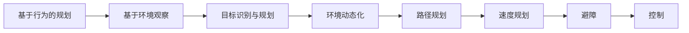

## 第 2 章 无人车基本框架

这一讲由中南大学人工智能与机器人实验室谢斌老师讲授，课件是《智能驾驶导论》的第 2 讲。讲的是一辆无人车从传感器到方向盘之间的整条链路：系统怎么分层、靠什么感知、在哪知道自己是谁、怎么和别的车说话、怎么决策、怎么控制 [第2讲 无人车基本框架.pptx · p.2](http://10.188.31.55:5244/Nextcloud/School/Auto-Drive-Intro/%E3%80%8A%E6%99%BA%E8%83%BD%E9%A9%BE%E9%A9%B6%E5%AF%BC%E8%AE%BA%E3%80%8BPPT-2020/%E7%AC%AC2%E8%AE%B2%20%E6%97%A0%E4%BA%BA%E8%BD%A6%E5%9F%BA%E6%9C%AC%E6%A1%86%E6%9E%B6.pptx)。

### 系统分层

无人车系统是三层加一个执行机构：环境感知层、决策规划层、控制层，三层各有一条反馈通路，最后由执行机构把命令变成方向盘转角和油门刹车 [第2讲 无人车基本框架.pptx · p.4](http://10.188.31.55:5244/Nextcloud/School/Auto-Drive-Intro/%E3%80%8A%E6%99%BA%E8%83%BD%E9%A9%BE%E9%A9%B6%E5%AF%BC%E8%AE%BA%E3%80%8BPPT-2020/%E7%AC%AC2%E8%AE%B2%20%E6%97%A0%E4%BA%BA%E8%BD%A6%E5%9F%BA%E6%9C%AC%E6%A1%86%E6%9E%B6.pptx)。

感知层不只做目标检测，还要做定位和地图更新——这三个是同一批传感器数据的三个出口 [第2讲 无人车基本框架.pptx · p.5](http://10.188.31.55:5244/Nextcloud/School/Auto-Drive-Intro/%E3%80%8A%E6%99%BA%E8%83%BD%E9%A9%BE%E9%A9%B6%E5%AF%BC%E8%AE%BA%E3%80%8BPPT-2020/%E7%AC%AC2%E8%AE%B2%20%E6%97%A0%E4%BA%BA%E8%BD%A6%E5%9F%BA%E6%9C%AC%E6%A1%86%E6%9E%B6.pptx)。

这层划分不只是画给论文看的，它决定了故障怎么隔离、模块怎么单独测试。感知错了不该把车撞了，所以规划和控制之间还有一层校验。

### 硬件：靠什么看路

无人车的传感器分四类：相机、激光雷达、毫米波雷达、超声波雷达 [第2讲 无人车基本框架.pptx · p.9](http://10.188.31.55:5244/Nextcloud/School/Auto-Drive-Intro/%E3%80%8A%E6%99%BA%E8%83%BD%E9%A9%BE%E9%A9%B6%E5%AF%BC%E8%AE%BA%E3%80%8BPPT-2020/%E7%AC%AC2%E8%AE%B2%20%E6%97%A0%E4%BA%BA%E8%BD%A6%E5%9F%BA%E6%9C%AC%E6%A1%86%E6%9E%B6.pptx)。

选传感器时看三件事：测距、测速、测角度，缺一项就补另一类。课件把每类传感器的原理、优点、缺点、状态和成本列成一张表 [第2讲 无人车基本框架.pptx · p.13](http://10.188.31.55:5244/Nextcloud/School/Auto-Drive-Intro/%E3%80%8A%E6%99%BA%E8%83%BD%E9%A9%BE%E9%A9%B6%E5%AF%BC%E8%AE%BA%E3%80%8BPPT-2020/%E7%AC%AC2%E8%AE%B2%20%E6%97%A0%E4%BA%BA%E8%BD%A6%E5%9F%BA%E6%9C%AC%E6%A1%86%E6%9E%B6.pptx)。

成本这一列值得单独看：激光雷达过去是万元级，毫米波雷达几百到上千，摄像头几十块 [第2讲 无人车基本框架.pptx · p.14](http://10.188.31.55:5244/Nextcloud/School/Auto-Drive-Intro/%E3%80%8A%E6%99%BA%E8%83%BD%E9%A9%BE%E9%A9%B6%E5%AF%BC%E8%AE%BA%E3%80%8BPPT-2020/%E7%AC%AC2%E8%AE%B2%20%E6%97%A0%E4%BA%BA%E8%BD%A6%E5%9F%BA%E6%9C%AC%E6%A1%86%E6%9E%B6.pptx)。

### 软件：数据和控制怎么流

软件侧的四个模块是感知、规划、控制、定位，HMI 和 CANbus 在最外面 [第2讲 无人车基本框架.pptx · p.16](http://10.188.31.55:5244/Nextcloud/School/Auto-Drive-Intro/%E3%80%8A%E6%99%BA%E8%83%BD%E9%A9%BE%E9%A9%B6%E5%AF%BC%E8%AE%BA%E3%80%8BPPT-2020/%E7%AC%AC2%E8%AE%B2%20%E6%97%A0%E4%BA%BA%E8%BD%A6%E5%9F%BA%E6%9C%AC%E6%A1%86%E6%9E%B6.pptx)。

实线是数据流，虚线是控制流。定位模块既接收 GPS/IMU 的数据，又输出给规划模块和环境感知模块——它是一个共享服务，不是一条单向链。

### 定位：我在哪

GPS 定位的原理是测卫星信号的传播时间。伪距 $\rho$ 是接收机到卫星的斜距，不是直线距离，因为钟差 $\Delta t$ 会污染测量：

$$\rho = \sqrt{(x - x_s)^2 + (y - y_s)^2 + (z - z_s)^2} + c \cdot \Delta t$$

对四颗及以上的卫星联立求解，得到接收机的位置 [第2讲 无人车基本框架.pptx · p.18](http://10.188.31.55:5244/Nextcloud/School/Auto-Drive-Intro/%E3%80%8A%E6%99%BA%E8%83%BD%E9%A9%BE%E9%A9%B6%E5%AF%BC%E8%AE%BA%E3%80%8BPPT-2020/%E7%AC%AC2%E8%AE%B2%20%E6%97%A0%E4%BA%BA%E8%BD%A6%E5%9F%BA%E6%9C%AC%E6%A1%86%E6%9E%B6.pptx)。

差分 GPS 在已知精确坐标的基准站装一台同样的接收机，把基准站的钟差和星历误差算出来当成改正量，播给附近的移动站用，定位精度能从米级提到厘米级 [第2讲 无人车基本框架.pptx · p.20](http://10.188.31.55:5244/Nextcloud/School/Auto-Drive-Intro/%E3%80%8A%E6%99%BA%E8%83%BD%E9%A9%BE%E9%A9%B6%E5%AF%BC%E8%AE%BA%E3%80%8BPPT-2020/%E7%AC%AC2%E8%AE%B2%20%E6%97%A0%E4%BA%BA%E8%BD%A6%E5%9F%BA%E6%9C%AC%E6%A1%86%E6%9E%B6.pptx)。

城市里 GPS 有两个躲不开的问题：遮挡（高楼、隧道挡住卫星）和反射（信号被墙面反射，路径变长）。北斗和 GPS 一样是全球定位系统，两者可以互操作，课件对比了两者的星座和频点 [第2讲 无人车基本框架.pptx · p.23](http://10.188.31.55:5244/Nextcloud/School/Auto-Drive-Intro/%E3%80%8A%E6%99%BA%E8%83%BD%E9%A9%BE%E9%A9%B6%E5%AF%BC%E8%AE%BA%E3%80%8BPPT-2020/%E7%AC%AC2%E8%AE%B2%20%E6%97%A0%E4%BA%BA%E8%BD%A6%E5%9F%BA%E6%9C%AC%E6%A1%86%E6%9E%B6.pptx)。

卫星定位的固有缺点是更新频率低、精度受环境影响。解法是混合定位：把不同原理、不同失效模式的定位源组合起来 [第2讲 无人车基本框架.pptx · p.25](http://10.188.31.55:5244/Nextcloud/School/Auto-Drive-Intro/%E3%80%8A%E6%99%BA%E8%83%BD%E9%A9%BE%E9%A9%B6%E5%AF%BC%E8%AE%BA%E3%80%8BPPT-2020/%E7%AC%AC2%E8%AE%B2%20%E6%97%A0%E4%BA%BA%E8%BD%A6%E5%9F%BA%E6%9C%AC%E6%A1%86%E6%9E%B6.pptx)。

混合定位的逻辑是让失效模式互不相关：GNSS 在城市峡谷失效，激光雷达在雨雾里失效，两者同时失效的概率小得多。捷联惯导（INS）靠陀螺仪和加速度计积分推算位置，短时间很准但误差随时间累积；环境特征定位把路标、车道线这类地标当作指纹 [第2讲 无人车基本框架.pptx · p.26](http://10.188.31.55:5244/Nextcloud/School/Auto-Drive-Intro/%E3%80%8A%E6%99%BA%E8%83%BD%E9%A9%BE%E9%A9%B6%E5%AF%BC%E8%AE%BA%E3%80%8BPPT-2020/%E7%AC%AC2%E8%AE%B2%20%E6%97%A0%E4%BA%BA%E8%BD%A6%E5%9F%BA%E6%9C%AC%E6%A1%86%E6%9E%B6.pptx)。

> [!WARNING]
> GNSS 和惯性导航的失效模式是互补的，不是冗余的。GNSS 精度高但更新慢，惯性导航更新快但误差随时间累积。融合的实际做法是让 KF 用 GNSS 不断修正惯性推算的漂移。

### 高精地图

高精地图和传统导航地图的差别不在比例尺，在于它带了驾驶辅助信息：车道级几何、限速、转向限制、路口的连接关系 [第2讲 无人车基本框架.pptx · p.30](http://10.188.31.55:5244/Nextcloud/School/Auto-Drive-Intro/%E3%80%8A%E6%99%BA%E8%83%BD%E9%A9%BE%E9%A9%B6%E5%AF%BC%E8%AE%BA%E3%80%8BPPT-2020/%E7%AC%AC2%E8%AE%B2%20%E6%97%A0%E4%BA%BA%E8%BD%A6%E5%9F%BA%E6%9C%AC%E6%A1%86%E6%9E%B6.pptx)。

高精地图的四个环节：采集、构建、定位、与规划。采集用装了 GPS/IMU、LiDAR、Camera 的采集车，跑过一遍就把数据录下来 [第2讲 无人车基本框架.pptx · p.31](http://10.188.31.55:5244/Nextcloud/School/Auto-Drive-Intro/%E3%80%8A%E6%99%BA%E8%83%BD%E9%A9%BE%E9%A9%B6%E5%AF%BC%E8%AE%BA%E3%80%8BPPT-2020/%E7%AC%AC2%E8%AE%B2%20%E6%97%A0%E4%BA%BA%E8%BD%A6%E5%9F%BA%E6%9C%AC%E6%A1%86%E6%9E%B6.pptx)。

构建阶段把采集数据做闭环检测、点云分类、地图匹配和语义要素标注，最后产出矢量地图要素和定位地图 [第2讲 无人车基本框架.pptx · p.32](http://10.188.31.55:5244/Nextcloud/School/Auto-Drive-Intro/%E3%80%8A%E6%99%BA%E8%83%BD%E9%A9%BE%E9%A9%B6%E5%AF%BC%E8%AE%BA%E3%80%8BPPT-2020/%E7%AC%AC2%E8%AE%B2%20%E6%97%A0%E4%BA%BA%E8%BD%A6%E5%9F%BA%E6%9C%AC%E6%A1%86%E6%9E%B6.pptx)。

### V2X：车和车说话

V2X（Vehicle to Everything）把车和车、车和路、车和网络连起来。构成上是三部分：车载单元（OBU）、路侧单元（RSU）和通信网络 [第2讲 无人车基本框架.pptx · p.36](http://10.188.31.55:5244/Nextcloud/School/Auto-Drive-Intro/%E3%80%8A%E6%99%BA%E8%83%BD%E9%A9%BE%E9%A9%B6%E5%AF%BC%E8%AE%BA%E3%80%8BPPT-2020/%E7%AC%AC2%E8%AE%B2%20%E6%97%A0%E4%BA%BA%E8%BD%A6%E5%9F%BA%E6%9C%AC%E6%A1%86%E6%9E%B6.pptx)。

意义在于单车感知有盲区。超视距的场景里，前车挡住了目标的传感器，V2X 让信息绕过遮挡直接传过来。课件给的收益数据里，92% 来自降低事故率，34% 来自提升通行效率 [第2讲 无人车基本框架.pptx · p.37](http://10.188.31.55:5244/Nextcloud/School/Auto-Drive-Intro/%E3%80%8A%E6%99%BA%E8%83%BD%E9%A9%BE%E9%A9%B6%E5%AF%BC%E8%AE%BA%E3%80%8BPPT-2020/%E7%AC%AC2%E8%AE%B2%20%E6%97%A0%E4%BA%BA%E8%BD%A6%E5%9F%BA%E6%9C%AC%E6%A1%86%E6%9E%B6.pptx)。

标准之争落在 DSRC 和 LTE-V 上。DSRC 是 802.11p 的变体，特点是在 5.9GHz 频段直连、延迟低；LTE-V 是蜂窝的延伸，靠基站做广域覆盖。V2X 行业标准最终给出的是基于 5G 的通信方案 [第2讲 无人车基本框架.pptx · p.41](http://10.188.31.55:5244/Nextcloud/School/Auto-Drive-Intro/%E3%80%8A%E6%99%BA%E8%83%BD%E9%A9%BE%E9%A9%B6%E5%AF%BC%E8%AE%BA%E3%80%8BPPT-2020/%E7%AC%AC2%E8%AE%B2%20%E6%97%A0%E4%BA%BA%E8%BD%A6%E5%9F%BA%E6%9C%AC%E6%A1%86%E6%9E%B6.pptx)。

### 决策规划

决策规划有两套体系结构。反应式把感知直接接到动作，不建中间模型：

反应式结构短，反应快，但没法做全局推理 [第2讲 无人车基本框架.pptx · p.45](http://10.188.31.55:5244/Nextcloud/School/Auto-Drive-Intro/%E3%80%8A%E6%99%BA%E8%83%BD%E9%A9%BE%E9%A9%B6%E5%AF%BC%E8%AE%BA%E3%80%8BPPT-2020/%E7%AC%AC2%E8%AE%B2%20%E6%97%A0%E4%BA%BA%E8%BD%A6%E5%9F%BA%E6%9C%AC%E6%A1%86%E6%9E%B6.pptx)。

混合式在反应式之上加了一层环境感知和全局决策：环境感知生成全局环境模型，全局决策出全局目标与路径，局部规划再出实时轨迹 [第2讲 无人车基本框架.pptx · p.46](http://10.188.31.55:5244/Nextcloud/School/Auto-Drive-Intro/%E3%80%8A%E6%99%BA%E8%83%BD%E9%A9%BE%E9%A9%B6%E5%AF%BC%E8%AE%BA%E3%80%8BPPT-2020/%E7%AC%AC2%E8%AE%B2%20%E6%97%A0%E4%BA%BA%E8%BD%A6%E5%9F%BA%E6%9C%AC%E6%A1%86%E6%9E%B6.pptx)。

任务规划这一层把「去哪儿」拆成有限状态机：巡航、变道、输入巡航、交通冲突、避障、返回、车道保持 [第2讲 无人车基本框架.pptx · p.47](http://10.188.31.55:5244/Nextcloud/School/Auto-Drive-Intro/%E3%80%8A%E6%99%BA%E8%83%BD%E9%A9%BE%E9%A9%B6%E5%AF%BC%E8%AE%BA%E3%80%8BPPT-2020/%E7%AC%AC2%E8%AE%B2%20%E6%97%A0%E4%BA%BA%E8%BD%A6%E5%9F%BA%E6%9C%AC%E6%A1%86%E6%9E%B6.pptx)。

### 控制

控制分纵向和横向。纵向控制是速度问题，输入目标速度和当前状态，输出加速度或油门刹车量；横向控制是路径跟随问题，输入路径和当前位姿，输出转向角 [第2讲 无人车基本框架.pptx · p.48](http://10.188.31.55:5244/Nextcloud/School/Auto-Drive-Intro/%E3%80%8A%E6%99%BA%E8%83%BD%E9%A9%BE%E9%A9%B6%E5%AF%BC%E8%AE%BA%E3%80%8BPPT-2020/%E7%AC%AC2%E8%AE%B2%20%E6%97%A0%E4%BA%BA%E8%BD%A6%E5%9F%BA%E6%9C%AC%E6%A1%86%E6%9E%B6.pptx)。

工程上有两条路线。基于规划-跟踪的间接控制先规划一条完整轨迹，再用跟踪器让车跟着走，轨迹在规划-跟踪控制器里生成，优点是可解释、可以提前规划 [第2讲 无人车基本框架.pptx · p.50](http://10.188.31.55:5244/Nextcloud/School/Auto-Drive-Intro/%E3%80%8A%E6%99%BA%E8%83%BD%E9%A9%BE%E9%A9%B6%E5%AF%BC%E8%AE%BA%E3%80%8BPPT-2020/%E7%AC%AC2%E8%AE%B2%20%E6%97%A0%E4%BA%BA%E8%BD%A6%E5%9F%BA%E6%9C%AC%E6%A1%86%E6%9E%B6.pptx)。

基于人工智能的直接控制则把感知状态和动作直接用一个网络连起来，端到端学 [第2讲 无人车基本框架.pptx · p.51](http://10.188.31.55:5244/Nextcloud/School/Auto-Drive-Intro/%E3%80%8A%E6%99%BA%E8%83%BD%E9%A9%BE%E9%A9%B6%E5%AF%BC%E8%AE%BA%E3%80%8BPPT-2020/%E7%AC%AC2%E8%AE%B2%20%E6%97%A0%E4%BA%BA%E8%BD%A6%E5%9F%BA%E6%9C%AC%E6%A1%86%E6%9E%B6.pptx)。

