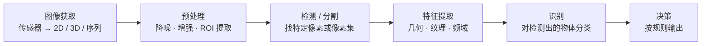

## 第 3 章 视觉感知

视觉感知是无人驾驶感知链路的入口。相机把光信号变成像素，后续所有关于车道、车辆、行人、标志牌的判断都建立在这张像素图上。本章的材料来自两处：第 3 讲的 PPT 给出视觉感知的概念框架与智能驾驶中的具体任务，第二章《无人驾驶感知基础》PDF 补上分割与检测两条算法线的细节 [第3讲 视觉感知.pptx · p.2](http://10.188.31.55:5244/Nextcloud/School/Auto-Drive-Intro/%E3%80%8A%E6%99%BA%E8%83%BD%E9%A9%BE%E9%A9%B6%E5%AF%BC%E8%AE%BA%E3%80%8BPPT-2020/%E7%AC%AC3%E8%AE%B2%20%E8%A7%86%E8%A7%89%E6%84%9F%E7%9F%A5.pptx) [第二章 无人驾驶感知基础.pdf · p.2](http://10.188.31.55:5244/Nextcloud/School/Auto-Drive-Intro/%E8%AF%BE%E4%BB%B6/%E7%AC%AC%E4%BA%8C%E7%AB%A0%20%E6%97%A0%E4%BA%BA%E9%A9%BE%E9%A9%B6%E6%84%9F%E7%9F%A5%E5%9F%BA%E7%A1%80.pdf#page=2)。

### 视觉感知的两条通路

视觉感知的定义是接收并使用环境物体反射的可见光来解释周围环境的能力 [第3讲 视觉感知.pptx · p.4](http://10.188.31.55:5244/Nextcloud/School/Auto-Drive-Intro/%E3%80%8A%E6%99%BA%E8%83%BD%E9%A9%BE%E9%A9%B6%E5%AF%BC%E8%AE%BA%E3%80%8BPPT-2020/%E7%AC%AC3%E8%AE%B2%20%E8%A7%86%E8%A7%89%E6%84%9F%E7%9F%A5.pptx)。人眼把这条通路拆成两路：ventral system 负责识别，dorsal system 负责视觉指导的行为 [第3讲 视觉感知.pptx · p.5](http://10.188.31.55:5244/Nextcloud/School/Auto-Drive-Intro/%E3%80%8A%E6%99%BA%E8%83%BD%E9%A9%BE%E9%A9%B6%E5%AF%BC%E8%AE%BA%E3%80%8BPPT-2020/%E7%AC%AC3%E8%AE%B2%20%E8%A7%86%E8%A7%89%E6%84%9F%E7%9F%A5.pptx)。

| 维度 | Ventral system | Dorsal system |
| --- | --- | --- |
| 功能 | 识别 | 视觉指导的行为 |
| 敏感度 | 高速空间频率，细节 | 高速时间频率，运动 |
| 记忆 | 长期存储表达 | 非常短期的存储 |
| 速度 | 相对慢 | 相对快 |
| 意识 | 比较高 | 比较低 |
| 参照系 | 面向目标 | 面向自我 |
| 输入 | 中央凹或其周围 | 纵横视网膜 |
| 单目 | 较小影响 | 很大影响（如视差） |

dorsal system 对单目的依赖更大，视差这类深度线索直接落在这一路上。这解释了为什么自动驾驶里单目测距难，而 binocular 或 RGBD 的深度估计可以借视觉指导类机制 [第3讲 视觉感知.pptx · p.5](http://10.188.31.55:5244/Nextcloud/School/Auto-Drive-Intro/%E3%80%8A%E6%99%BA%E8%83%BD%E9%A9%BE%E9%A9%B6%E5%AF%BC%E8%AE%BA%E3%80%8BPPT-2020/%E7%AC%AC3%E8%AE%B2%20%E8%A7%86%E8%A7%89%E6%84%9F%E7%9F%A5.pptx)。

### 机器视觉与它相交的方向

机器视觉是一个跨学科领域，目标是让计算机像人一样高层次地理解图像或视频，自动化完成相关任务 [第3讲 视觉感知.pptx · p.6](http://10.188.31.55:5244/Nextcloud/School/Auto-Drive-Intro/%E3%80%8A%E6%99%BA%E8%83%BD%E9%A9%BE%E9%A9%B6%E5%AF%BC%E8%AE%BA%E3%80%8BPPT-2020/%E7%AC%AC3%E8%AE%B2%20%E8%A7%86%E8%A7%89%E6%84%9F%E7%9F%A5.pptx)。它与四个方向交叉：人工智能（机器学习、模式识别）、信息工程（机器视觉通常被看作信息工程的一部分）、固体物理学（视觉传感器）、信号处理（图像处理） [第3讲 视觉感知.pptx · p.7](http://10.188.31.55:5244/Nextcloud/School/Auto-Drive-Intro/%E3%80%8A%E6%99%BA%E8%83%BD%E9%A9%BE%E9%A9%B6%E5%AF%BC%E8%AE%BA%E3%80%8BPPT-2020/%E7%AC%AC3%E8%AE%B2%20%E8%A7%86%E8%A7%89%E6%84%9F%E7%9F%A5.pptx)。

一般流程固定为六步：图像获取、预处理、检测、特征提取、识别、决策 [第3讲 视觉感知.pptx · p.11](http://10.188.31.55:5244/Nextcloud/School/Auto-Drive-Intro/%E3%80%8A%E6%99%BA%E8%83%BD%E9%A9%BE%E9%A9%B6%E5%AF%BC%E8%AE%BA%E3%80%8BPPT-2020/%E7%AC%AC3%E8%AE%B2%20%E8%A7%86%E8%A7%89%E6%84%9F%E7%9F%A5.pptx)。

图像获取这一环拿到的数据是普通 2D 图像、3D 体积或图像序列。像素值通常对应光强度，也可以对应声波或电磁波的深度、吸收、反射，或者核磁共振 [第3讲 视觉感知.pptx · p.12](http://10.188.31.55:5244/Nextcloud/School/Auto-Drive-Intro/%E3%80%8A%E6%99%BA%E8%83%BD%E9%A9%BE%E9%A9%B6%E5%AF%BC%E8%AE%BA%E3%80%8BPPT-2020/%E7%AC%AC3%E8%AE%B2%20%E8%A7%86%E8%A7%89%E6%84%9F%E7%9F%A5.pptx)。除可见光相机外，传感器还包括距离传感器和热感成像仪 [第3讲 视觉感知.pptx · p.12](http://10.188.31.55:5244/Nextcloud/School/Auto-Drive-Intro/%E3%80%8A%E6%99%BA%E8%83%BD%E9%A9%BE%E9%A9%B6%E5%AF%BC%E8%AE%BA%E3%80%8BPPT-2020/%E7%AC%AC3%E8%AE%B2%20%E8%A7%86%E8%A7%89%E6%84%9F%E7%9F%A5.pptx)。预处理的常规手段是降噪、增强、感兴趣区域提取 [第3讲 视觉感知.pptx · p.13](http://10.188.31.55:5244/Nextcloud/School/Auto-Drive-Intro/%E3%80%8A%E6%99%BA%E8%83%BD%E9%A9%BE%E9%A9%B6%E5%AF%BC%E8%AE%BA%E3%80%8BPPT-2020/%E7%AC%AC3%E8%AE%B2%20%E8%A7%86%E8%A7%89%E6%84%9F%E7%9F%A5.pptx)。检测与分割是在图像中寻找特定的像素或像素集，特征提取拿几何、纹理、频域等特征描述该对象，识别对已检测的物体分类，决策把识别结果按规则输出 [第3讲 视觉感知.pptx · p.14](http://10.188.31.55:5244/Nextcloud/School/Auto-Drive-Intro/%E3%80%8A%E6%99%BA%E8%83%BD%E9%A9%BE%E9%A9%B6%E5%AF%BC%E8%AE%BA%E3%80%8BPPT-2020/%E7%AC%AC3%E8%AE%B2%20%E8%A7%86%E8%A7%89%E6%84%9F%E7%9F%A5.pptx) [第3讲 视觉感知.pptx · p.15](http://10.188.31.55:5244/Nextcloud/School/Auto-Drive-Intro/%E3%80%8A%E6%99%BA%E8%83%BD%E9%A9%BE%E9%A9%B6%E5%AF%BC%E8%AE%BA%E3%80%8BPPT-2020/%E7%AC%AC3%E8%AE%B2%20%E8%A7%86%E8%A7%89%E6%84%9F%E7%9F%A5.pptx) [第3讲 视觉感知.pptx · p.16](http://10.188.31.55:5244/Nextcloud/School/Auto-Drive-Intro/%E3%80%8A%E6%99%BA%E8%83%BD%E9%A9%BE%E9%A9%B6%E5%AF%BC%E8%AE%BA%E3%80%8BPPT-2020/%E7%AC%AC3%E8%AE%B2%20%E8%A7%86%E8%A7%89%E6%84%9F%E7%9F%A5.pptx) [第3讲 视觉感知.pptx · p.17](http://10.188.31.55:5244/Nextcloud/School/Auto-Drive-Intro/%E3%80%8A%E6%99%BA%E8%83%BD%E9%A9%BE%E9%A9%B6%E5%AF%BC%E8%AE%BA%E3%80%8BPPT-2020/%E7%AC%AC3%E8%AE%B2%20%E8%A7%86%E8%A7%89%E6%84%9F%E7%9F%A5.pptx)。

### 智能驾驶中的视觉感知

PPT 给出的关键技术清单是：道路识别、车道线检测、前方车辆检测与识别、标志牌检测与识别、交通灯检测与识别、行人检测，以及其他 [第3讲 视觉感知.pptx · p.20](http://10.188.31.55:5244/Nextcloud/School/Auto-Drive-Intro/%E3%80%8A%E6%99%BA%E8%83%BD%E9%A9%BE%E9%A9%B6%E5%AF%BC%E8%AE%BA%E3%80%8BPPT-2020/%E7%AC%AC3%E8%AE%B2%20%E8%A7%86%E8%A7%89%E6%84%9F%E7%9F%A5.pptx)。每一项在 PPT 里配了演示画面。

**车道线检测。** 输出是在原图上叠加的车道线，红色线条标出两侧边界 [第3讲 视觉感知.pptx · p.22](http://10.188.31.55:5244/Nextcloud/School/Auto-Drive-Intro/%E3%80%8A%E6%99%BA%E8%83%BD%E9%A9%BE%E9%A9%B6%E5%AF%BC%E8%AE%BA%E3%80%8BPPT-2020/%E7%AC%AC3%E8%AE%B2%20%E8%A7%86%E8%A7%89%E6%84%9F%E7%9F%A5.pptx)。

**前方车辆检测与识别。** 输出是带类别与置信度的包围框 [第3讲 视觉感知.pptx · p.23](http://10.188.31.55:5244/Nextcloud/School/Auto-Drive-Intro/%E3%80%8A%E6%99%BA%E8%83%BD%E9%A9%BE%E9%A9%B6%E5%AF%BC%E8%AE%BA%E3%80%8BPPT-2020/%E7%AC%AC3%E8%AE%B2%20%E8%A7%86%E8%A7%89%E6%84%9F%E7%9F%A5.pptx)。

**交通灯检测与识别。** 除了定位，识别部分还要给出灯的颜色与状态。PPT 用的是一个完整的标志灯识别系统，左边是实拍画面与检测框，右边是参数面板 [第3讲 视觉感知.pptx · p.26](http://10.188.31.55:5244/Nextcloud/School/Auto-Drive-Intro/%E3%80%8A%E6%99%BA%E8%83%BD%E9%A9%BE%E9%A9%B6%E5%AF%BC%E8%AE%BA%E3%80%8BPPT-2020/%E7%AC%AC3%E8%AE%B2%20%E8%A7%86%E8%A7%89%E6%84%9F%E7%9F%A5.pptx)。

**人行横道与停止线检测。** 这项任务把路面上的人行横道条带当成一组平行线段检出，再合并成横道的整体区域 [第3讲 视觉感知.pptx · p.29](http://10.188.31.55:5244/Nextcloud/School/Auto-Drive-Intro/%E3%80%8A%E6%99%BA%E8%83%BD%E9%A9%BE%E9%A9%B6%E5%AF%BC%E8%AE%BA%E3%80%8BPPT-2020/%E7%AC%AC3%E8%AE%B2%20%E8%A7%86%E8%A7%89%E6%84%9F%E7%9F%A5.pptx)。

**标志牌检测与识别。** 两步走：先在图像里定位牌面，再判类别。PPT 的演示画面里，圆形禁令标志、蓝色指路牌和三角形警告牌各自被彩色圆圈框出，同一个界面的右侧面板按位置列出识别到的牌面与类别 [第3讲 视觉感知.pptx · p.24](http://10.188.31.55:5244/Nextcloud/School/Auto-Drive-Intro/%E3%80%8A%E6%99%BA%E8%83%BD%E9%A9%BE%E9%A9%B6%E5%AF%BC%E8%AE%BA%E3%80%8BPPT-2020/%E7%AC%AC3%E8%AE%B2%20%E8%A7%86%E8%A7%89%E6%84%9F%E7%9F%A5.pptx) [第3讲 视觉感知.pptx · p.25](http://10.188.31.55:5244/Nextcloud/School/Auto-Drive-Intro/%E3%80%8A%E6%99%BA%E8%83%BD%E9%A9%BE%E9%A9%B6%E5%AF%BC%E8%AE%BA%E3%80%8BPPT-2020/%E7%AC%AC3%E8%AE%B2%20%E8%A7%86%E8%A7%89%E6%84%9F%E7%9F%A5.pptx)。

**行人检测。** 行人尺寸小、姿态变化大，在画面里占比低。PPT 这一页的演示画面用的是同一套基于外观的检测框，画面里远处两辆车被标成 car 0.869 与 car 0.940 [第3讲 视觉感知.pptx · p.28](http://10.188.31.55:5244/Nextcloud/School/Auto-Drive-Intro/%E3%80%8A%E6%99%BA%E8%83%BD%E9%A9%BE%E9%A9%B6%E5%AF%BC%E8%AE%BA%E3%80%8BPPT-2020/%E7%AC%AC3%E8%AE%B2%20%E8%A7%86%E8%A7%89%E6%84%9F%E7%9F%A5.pptx)。

### 深度学习在这条链路上的位置

PPT 的第三部分给出四个网络，作为前述任务的实现工具。

**AlexNet。** 输入 $227 \times 227 \times 3$，五层卷积后接三层全连接，输出 class number。卷积层的输出尺寸依次是 $55 \times 55 \times 96$、$27 \times 27 \times 256$、$13 \times 13 \times 384$、$13 \times 13 \times 384$、$13 \times 13 \times 256$，全连接层维度 4096 [第3讲 视觉感知.pptx · p.31](http://10.188.31.55:5244/Nextcloud/School/Auto-Drive-Intro/%E3%80%8A%E6%99%BA%E8%83%BD%E9%A9%BE%E9%A9%B6%E5%AF%BC%E8%AE%BA%E3%80%8BPPT-2020/%E7%AC%AC3%E8%AE%B2%20%E8%A7%86%E8%A7%89%E6%84%9F%E7%9F%A5.pptx)。

**VGGNet。** 用堆叠的 $3 \times 3$ 卷积核加深网络。配置表按 A、A-LRN、B、C、D、E 列出六个版本，权重层数分别是 11、11、13、16、16、19，结尾统一接 FC-4096、FC-4096、FC-1000 与 soft-max [第3讲 视觉感知.pptx · p.32](http://10.188.31.55:5244/Nextcloud/School/Auto-Drive-Intro/%E3%80%8A%E6%99%BA%E8%83%BD%E9%A9%BE%E9%A9%B6%E5%AF%BC%E8%AE%BA%E3%80%8BPPT-2020/%E7%AC%AC3%E8%AE%B2%20%E8%A7%86%E8%A7%89%E6%84%9F%E7%9F%A5.pptx)。

**UNet。** 编码器下采样，解码器上采样，跳连把低层特征裁剪后拼回高层 [第3讲 视觉感知.pptx · p.33](http://10.188.31.55:5244/Nextcloud/School/Auto-Drive-Intro/%E3%80%8A%E6%99%BA%E8%83%BD%E9%A9%BE%E9%A9%B6%E5%AF%BC%E8%AE%BA%E3%80%8BPPT-2020/%E7%AC%AC3%E8%AE%B2%20%E8%A7%86%E8%A7%89%E6%84%9F%E7%9F%A5.pptx)。

**YOLO v3。** 主干换成 darknet-53，三个尺度输出，stride 分别为 32、16、8，小目标靠 stride 8 那一路接住 [第3讲 视觉感知.pptx · p.34](http://10.188.31.55:5244/Nextcloud/School/Auto-Drive-Intro/%E3%80%8A%E6%99%BA%E8%83%BD%E9%A9%BE%E9%A9%B6%E5%AF%BC%E8%AE%BA%E3%80%8BPPT-2020/%E7%AC%AC3%E8%AE%B2%20%E8%A7%86%E8%A7%89%E6%84%9F%E7%9F%A5.pptx)。

### 静态环境感知

PDF 把感知拆成感知外界与感知自身。感知外界拿静态环境（车道线、路面、交通标识）与动态物体（车、人的位置、朝向、速度）；感知自身属于定位，用 GPS、IMU、HDmap、SLAM [第二章 无人驾驶感知基础.pdf · p.4](http://10.188.31.55:5244/Nextcloud/School/Auto-Drive-Intro/%E8%AF%BE%E4%BB%B6/%E7%AC%AC%E4%BA%8C%E7%AB%A0%20%E6%97%A0%E4%BA%BA%E9%A9%BE%E9%A9%B6%E6%84%9F%E7%9F%A5%E5%9F%BA%E7%A1%80.pdf#page=4)。感知拿到的信息对应四个任务：分类提升对图像的特征提取能力，分割对像素分类并分出不同物体的形状，检测框分类即框出物体再做分类，跟踪用目标物体的全部信息做时序关联，一般对连续帧处理 [第二章 无人驾驶感知基础.pdf · p.5](http://10.188.31.55:5244/Nextcloud/School/Auto-Drive-Intro/%E8%AF%BE%E4%BB%B6/%E7%AC%AC%E4%BA%8C%E7%AB%A0%20%E6%97%A0%E4%BA%BA%E9%A9%BE%E9%A9%B6%E6%84%9F%E7%9F%A5%E5%9F%BA%E7%A1%80.pdf#page=5)。静态物体分割这块安排了实战传统方法的车道线检测、分割算法综述、实战基于图片分割的车道线检测三件事 [第二章 无人驾驶感知基础.pdf · p.7](http://10.188.31.55:5244/Nextcloud/School/Auto-Drive-Intro/%E8%AF%BE%E4%BB%B6/%E7%AC%AC%E4%BA%8C%E7%AB%A0%20%E6%97%A0%E4%BA%BA%E9%A9%BE%E9%A9%B6%E6%84%9F%E7%9F%A5%E5%9F%BA%E7%A1%80.pdf#page=7)。

**传统方法车道线检测。** 流水线是 Canny 边缘检测 → 分割路面区域 → 霍夫变换求直线 → 叠加回原图 [第二章 无人驾驶感知基础.pdf · p.9](http://10.188.31.55:5244/Nextcloud/School/Auto-Drive-Intro/%E8%AF%BE%E4%BB%B6/%E7%AC%AC%E4%BA%8C%E7%AB%A0%20%E6%97%A0%E4%BA%BA%E9%A9%BE%E9%A9%B6%E6%84%9F%E7%9F%A5%E5%9F%BA%E7%A1%80.pdf#page=9)。

Canny 检测亮度的急剧变化，在给定阈值下定义为边。预处理先把彩色图片转灰度，然后走四步：降噪用 $5 \times 5$ 高斯滤波器卷积平滑图像；求亮度梯度用 Sobel、Roberts、Prewitt 核沿 $x$ 轴和 $y$ 轴检测水平、垂直、对角线方向的边缘；非极大值抑制检查每个像素在梯度方向上是否为局部最大值，不是就把像素值置 0；Hysteresis thresholding 判弱像素，梯度大于 `maxVal` 的是边缘，小于 `minVal` 的删除，落在 $[minVal, maxVal]$ 的像素只有与强边缘相连才算边缘 [第二章 无人驾驶感知基础.pdf · p.10](http://10.188.31.55:5244/Nextcloud/School/Auto-Drive-Intro/%E8%AF%BE%E4%BB%B6/%E7%AC%AC%E4%BA%8C%E7%AB%A0%20%E6%97%A0%E4%BA%BA%E9%A9%BE%E9%A9%B6%E6%84%9F%E7%9F%A5%E5%9F%BA%E7%A1%80.pdf#page=10)。之后用手动指定的三角形把路面区域分割出来，去掉其他干扰边缘 [第二章 无人驾驶感知基础.pdf · p.11](http://10.188.31.55:5244/Nextcloud/School/Auto-Drive-Intro/%E8%AF%BE%E4%BB%B6/%E7%AC%AC%E4%BA%8C%E7%AB%A0%20%E6%97%A0%E4%BA%BA%E9%A9%BE%E9%A9%B6%E6%84%9F%E7%9F%A5%E5%9F%BA%E7%A1%80.pdf#page=11)。

霍夫变换把找直线变成找点。笛卡尔坐标系的直线方程 $y = mx + b$ 里变量是 $(x, y)$、参数是 $(m, b)$；搬进霍夫空间后变量与参数互换，方程写成 $b = -xm + y$ [第二章 无人驾驶感知基础.pdf · p.12](http://10.188.31.55:5244/Nextcloud/School/Auto-Drive-Intro/%E8%AF%BE%E4%BB%B6/%E7%AC%AC%E4%BA%8C%E7%AB%A0%20%E6%97%A0%E4%BA%BA%E9%A9%BE%E9%A9%B6%E6%84%9F%E7%9F%A5%E5%9F%BA%E7%A1%80.pdf#page=12)。垂直线斜率无穷大，没法在 $y = mx + b$ 里表示，改用极坐标形式，$d$ 是原点到直线的垂距，$\theta$ 是垂线与 $x$ 轴的夹角：

$$
d = x\cos\theta + y\sin\theta
$$

此时变量是 $(\theta, d)$、参数是 $(x, y)$，笛卡尔坐标系里一个点对应霍夫空间里一条曲线 $d_i = x\cos\theta_i + y\sin\theta_i$ [第二章 无人驾驶感知基础.pdf · p.13](http://10.188.31.55:5244/Nextcloud/School/Auto-Drive-Intro/%E8%AF%BE%E4%BB%B6/%E7%AC%AC%E4%BA%8C%E7%AB%A0%20%E6%97%A0%E4%BA%BA%E9%A9%BE%E9%A9%B6%E6%84%9F%E7%9F%A5%E5%9F%BA%E7%A1%80.pdf#page=13)。

> [!NOTE] **阈值决定漏检和误检**
> 霍夫空间中相交的曲线越多，交点表示的线在笛卡尔坐标系里对应的点就越多。所以定义交点的最小阈值来检测线：跟踪帧中每个点的霍夫空间交点，数量超过阈值就确定一条对应参数 $\theta$ 和 $d$ 的线 [第二章 无人驾驶感知基础.pdf · p.13](http://10.188.31.55:5244/Nextcloud/School/Auto-Drive-Intro/%E8%AF%BE%E4%BB%B6/%E7%AC%AC%E4%BA%8C%E7%AB%A0%20%E6%97%A0%E4%BA%BA%E9%A9%BE%E9%A9%B6%E6%84%9F%E7%9F%A5%E5%9F%BA%E7%A1%80.pdf#page=13)。调大阈值则弱线漏检，调小则噪声成线。

**基于深度学习的分割。** 图片分普通分割、语义分割、实例分割三层：普通分割把不同物体的像素区域分开，语义分割再加上每块区域的类别，实例分割再区分同种物体的不同个体 [第二章 无人驾驶感知基础.pdf · p.16](http://10.188.31.55:5244/Nextcloud/School/Auto-Drive-Intro/%E8%AF%BE%E4%BB%B6/%E7%AC%AC%E4%BA%8C%E7%AB%A0%20%E6%97%A0%E4%BA%BA%E9%A9%BE%E9%A9%B6%E6%84%9F%E7%9F%A5%E5%9F%BA%E7%A1%80.pdf#page=16)。通用框架分前后端：前端用全卷积网络做特征提取，依次是下采样（Convolution）、上采样（Deconvolution 或 Resize）、多尺度特征融合（特征逐点相加或拼接），得到像素级 segmentation map；后端用 CRF 或 MRF 优化前端输出 [第二章 无人驾驶感知基础.pdf · p.17](http://10.188.31.55:5244/Nextcloud/School/Auto-Drive-Intro/%E8%AF%BE%E4%BB%B6/%E7%AC%AC%E4%BA%8C%E7%AB%A0%20%E6%97%A0%E4%BA%BA%E9%A9%BE%E9%A9%B6%E6%84%9F%E7%9F%A5%E5%9F%BA%E7%A1%80.pdf#page=17)。

FCN 首次把深度学习引入语义分割，三项贡献：把全连接层换成全卷积层，使网络接受任意大小的图片并输出与原图一样大的特征图；用反卷积层做上采样（更准确的名字是转置卷积，作用是从小的特征图卷出大的特征图）；Skip Layer 做特征融合，把不同池化层的结果上采样后融合再分类 [第二章 无人驾驶感知基础.pdf · p.19](http://10.188.31.55:5244/Nextcloud/School/Auto-Drive-Intro/%E8%AF%BE%E4%BB%B6/%E7%AC%AC%E4%BA%8C%E7%AB%A0%20%E6%97%A0%E4%BA%BA%E9%A9%BE%E9%A9%B6%E6%84%9F%E7%9F%A5%E5%9F%BA%E7%A1%80.pdf#page=19)。U-Net 结构类似 U 字母，Conv+Pooling 下采样、Deconv 上采样、把之前的低层 feature map 裁剪后融合再上采样，重复直到得到 $388 \times 388 \times 2$ 的 feature map，最后经 softmax 得到 output segment map；与 FCN 逐点相加不同，U-Net 在 channel 维度拼接特征，形成更厚的特征 [第二章 无人驾驶感知基础.pdf · p.20](http://10.188.31.55:5244/Nextcloud/School/Auto-Drive-Intro/%E8%AF%BE%E4%BB%B6/%E7%AC%AC%E4%BA%8C%E7%AB%A0%20%E6%97%A0%E4%BA%BA%E9%A9%BE%E9%A9%B6%E6%84%9F%E7%9F%A5%E5%9F%BA%E7%A1%80.pdf#page=20)。

DeepLab 的核心是空洞卷积（Dilation / Atrous Convolution），普通卷积核中间插入几个洞，运算与普通卷积一致但感受野更大。卷积核尺寸 $k$、膨胀率 $r$ 时有效感受野边长为：

$$
k_{\text{eff}} = k + (k - 1)(r - 1)
$$

$3 \times 3$ 卷积插入一个洞，视野变成 $5 \times 5$。特征图缩到同样倍数时能掌握更多全局信息 [第二章 无人驾驶感知基础.pdf · p.22](http://10.188.31.55:5244/Nextcloud/School/Auto-Drive-Intro/%E8%AF%BE%E4%BB%B6/%E7%AC%AC%E4%BA%8C%E7%AB%A0%20%E6%97%A0%E4%BA%BA%E9%A9%BE%E9%A9%B6%E6%84%9F%E7%9F%A5%E5%9F%BA%E7%A1%80.pdf#page=22)。

Mask R-CNN 把检测与分割结合：新增分支输出 mask，损失是分类加回归加 mask 三项；mask 分支用全卷积网络输出 $k$ 类 mask，用 sigmoid 与阈值 0.5 比较得到二值 mask，避免类间竞争 [第二章 无人驾驶感知基础.pdf · p.24](http://10.188.31.55:5244/Nextcloud/School/Auto-Drive-Intro/%E8%AF%BE%E4%BB%B6/%E7%AC%AC%E4%BA%8C%E7%AB%A0%20%E6%97%A0%E4%BA%BA%E9%A9%BE%E9%A9%B6%E6%84%9F%E7%9F%A5%E5%9F%BA%E7%A1%80.pdf#page=24)。

**基于图片分割的车道线检测：LaneNet。** 论文《Towards End-to-End Lane Detection: an Instance Segmentation Approach》。两个特点：用实例分割检测车道线；用 CNN 学习透视变换，输入 RGB 图像加分割结果，经 H-Network 输出透视变换参数，绕开固定透视矩阵在上下坡场景失效的问题 [第二章 无人驾驶感知基础.pdf · p.25](http://10.188.31.55:5244/Nextcloud/School/Auto-Drive-Intro/%E8%AF%BE%E4%BB%B6/%E7%AC%AC%E4%BA%8C%E7%AB%A0%20%E6%97%A0%E4%BA%BA%E9%A9%BE%E9%A9%B6%E6%84%9F%E7%9F%A5%E5%9F%BA%E7%A1%80.pdf#page=25)。做法是先生成每个像素的 $n$ 维嵌入，使同一车道的嵌入距离近、不同车道的远，再用分割分支的二值分割图做掩码，取出所有车道像素的嵌入做聚类，得到所属车道类别 [第二章 无人驾驶感知基础.pdf · p.26](http://10.188.31.55:5244/Nextcloud/School/Auto-Drive-Intro/%E8%AF%BE%E4%BB%B6/%E7%AC%AC%E4%BA%8C%E7%AB%A0%20%E6%97%A0%E4%BA%BA%E9%A9%BE%E9%A9%B6%E6%84%9F%E7%9F%A5%E5%9F%BA%E7%A1%80.pdf#page=26)。

### 基于图像的检测算法

无人驾驶的检测任务输入是图片或点云，输出是 2D 或 3D bounding box。图片（相机）走图片检测算法，稀疏点云（激光雷达）走点云检测算法，稠密点云（双目或 RGBD 相机）走深度图算法 [第二章 无人驾驶感知基础.pdf · p.29](http://10.188.31.55:5244/Nextcloud/School/Auto-Drive-Intro/%E8%AF%BE%E4%BB%B6/%E7%AC%AC%E4%BA%8C%E7%AB%A0%20%E6%97%A0%E4%BA%BA%E9%A9%BE%E9%A9%B6%E6%84%9F%E7%9F%A5%E5%9F%BA%E7%A1%80.pdf#page=29)。点云那一支属于第 4 章。

检测相对分类多出两件事：位置，即找到所有可能包含物体的 ROI（region of interest）；以及位置修正，即 bounding box regression。类别仍是对每个 ROI 做分类 [第二章 无人驾驶感知基础.pdf · p.30](http://10.188.31.55:5244/Nextcloud/School/Auto-Drive-Intro/%E8%AF%BE%E4%BB%B6/%E7%AC%AC%E4%BA%8C%E7%AB%A0%20%E6%97%A0%E4%BA%BA%E9%A9%BE%E9%A9%B6%E6%84%9F%E7%9F%A5%E5%9F%BA%E7%A1%80.pdf#page=30)。ROI 的特征可以用传统方法（Haar、LBP、SIFT、SURF、HOG、DPM）也可以用 CNN，分类器可以用 SVM、AdaBoost 也可以用 CNN [第二章 无人驾驶感知基础.pdf · p.32](http://10.188.31.55:5244/Nextcloud/School/Auto-Drive-Intro/%E8%AF%BE%E4%BB%B6/%E7%AC%AC%E4%BA%8C%E7%AB%A0%20%E6%97%A0%E4%BA%BA%E9%A9%BE%E9%A9%B6%E6%84%9F%E7%9F%A5%E5%9F%BA%E7%A1%80.pdf#page=32)。

**获取 ROI 的三种方法。** Sliding window 遍历所有位置与所有 scale、ratio，产生大量无效框，计算复杂，适合长宽比固定的物体（人脸、行人）。Region proposal 用分割找出可能有物体的区域，减少无效框与需要分类的路径，Selective search 属于这一类，先过度分割再按相似度合并相邻框。CNN 路线用 anchor box 与来自 Faster-RCNN 的 RPN [第二章 无人驾驶感知基础.pdf · p.31](http://10.188.31.55:5244/Nextcloud/School/Auto-Drive-Intro/%E8%AF%BE%E4%BB%B6/%E7%AC%AC%E4%BA%8C%E7%AB%A0%20%E6%97%A0%E4%BA%BA%E9%A9%BE%E9%A9%B6%E6%84%9F%E7%9F%A5%E5%9F%BA%E7%A1%80.pdf#page=31)。

**Two-step 方法。** 这条线上的每一步都在把「提候选框」和「分类回归」两端换成 CNN [第二章 无人驾驶感知基础.pdf · p.33](http://10.188.31.55:5244/Nextcloud/School/Auto-Drive-Intro/%E8%AF%BE%E4%BB%B6/%E7%AC%AC%E4%BA%8C%E7%AB%A0%20%E6%97%A0%E4%BA%BA%E9%A9%BE%E9%A9%B6%E6%84%9F%E7%9F%A5%E5%9F%BA%E7%A1%80.pdf#page=33)：

| 方法 | 位置 | 类别 | 位置修正 |
| --- | --- | --- | --- |
| RCNN | Selective Search 提候选框 | CNN 特征 + SVM 分类 | 线性回归 |
| SPPNet | Selective Search 提候选框 | CNN 特征 + SVM 分类 | 线性回归 |
| Fast-RCNN | Selective Search 提候选框 | CNN 特征 + CNN 分类 | CNN 回归 |
| Faster-RCNN | CNN 提候选框（RPN） | CNN 特征 + CNN 分类 | CNN 回归 |

SPPNet 引入共享卷积大幅降低计算量，SPP 层把不同尺度的特征转成固定尺度，接到全连接层 [第二章 无人驾驶感知基础.pdf · p.35](http://10.188.31.55:5244/Nextcloud/School/Auto-Drive-Intro/%E8%AF%BE%E4%BB%B6/%E7%AC%AC%E4%BA%8C%E7%AB%A0%20%E6%97%A0%E4%BA%BA%E9%A9%BE%E9%A9%B6%E6%84%9F%E7%9F%A5%E5%9F%BA%E7%A1%80.pdf#page=35)。Fast-RCNN 把分类和回归都用 CNN 实现，两种损失可以反传联动调参（半 end-to-end），SPP 层换成 ROI Pooling 提高速度 [第二章 无人驾驶感知基础.pdf · p.36](http://10.188.31.55:5244/Nextcloud/School/Auto-Drive-Intro/%E8%AF%BE%E4%BB%B6/%E7%AC%AC%E4%BA%8C%E7%AB%A0%20%E6%97%A0%E4%BA%BA%E9%A9%BE%E9%A9%B6%E6%84%9F%E7%9F%A5%E5%9F%BA%E7%A1%80.pdf#page=36)。Faster-RCNN 引入 RPN：在 feature 点对应的原图感受野框处生成不同 ratio 和 scale 的 anchor box，对 anchor box 做二分类加回归 [第二章 无人驾驶感知基础.pdf · p.37](http://10.188.31.55:5244/Nextcloud/School/Auto-Drive-Intro/%E8%AF%BE%E4%BB%B6/%E7%AC%AC%E4%BA%8C%E7%AB%A0%20%E6%97%A0%E4%BA%BA%E9%A9%BE%E9%A9%B6%E6%84%9F%E7%9F%A5%E5%9F%BA%E7%A1%80.pdf#page=37)。

**One-step 方法。** 不再分两步，直接对 default box 做全分类加回归。YOLO 把全图划成 $7 \times 7$ 网格，每个网格对应 2 个 default box，box 中心坐标的 $x$、$y$ 归一化到 0 到 1，$w$、$h$ 用图像的 width 和 height 归一化到 0 到 1 [第二章 无人驾驶感知基础.pdf · p.38](http://10.188.31.55:5244/Nextcloud/School/Auto-Drive-Intro/%E8%AF%BE%E4%BB%B6/%E7%AC%AC%E4%BA%8C%E7%AB%A0%20%E6%97%A0%E4%BA%BA%E9%A9%BE%E9%A9%B6%E6%84%9F%E7%9F%A5%E5%9F%BA%E7%A1%80.pdf#page=38)。YOLO 的优点是实时性，缺点是准确率不如 Faster-RCNN，anchor box 不够丰富且只回归修正一次，定位精度差，不规则物体也差 [第二章 无人驾驶感知基础.pdf · p.39](http://10.188.31.55:5244/Nextcloud/School/Auto-Drive-Intro/%E8%AF%BE%E4%BB%B6/%E7%AC%AC%E4%BA%8C%E7%AB%A0%20%E6%97%A0%E4%BA%BA%E9%A9%BE%E9%A9%B6%E6%84%9F%E7%9F%A5%E5%9F%BA%E7%A1%80.pdf#page=39)。

SSD 借鉴 RPN 的 anchor box 机制，但用多感受野特征输出层，前面层感受野小适合小物体，后面层感受野大适合大物体 [第二章 无人驾驶感知基础.pdf · p.40](http://10.188.31.55:5244/Nextcloud/School/Auto-Drive-Intro/%E8%AF%BE%E4%BB%B6/%E7%AC%AC%E4%BA%8C%E7%AB%A0%20%E6%97%A0%E4%BA%BA%E9%A9%BE%E9%A9%B6%E6%84%9F%E7%9F%A5%E5%9F%BA%E7%A1%80.pdf#page=40)。YOLO-v2 两点改进：更丰富的 default box，用 k-means 从数据集统计出来，$k$ 增大时 IOU 也增大（高召回率）但复杂度增加，最终取 $k = 5$；更灵活的类别预测，把预测类别的机制从空间位置（cell）中解耦，由 default box 同时预测类别和坐标，解决物体重叠 [第二章 无人驾驶感知基础.pdf · p.41](http://10.188.31.55:5244/Nextcloud/School/Auto-Drive-Intro/%E8%AF%BE%E4%BB%B6/%E7%AC%AC%E4%BA%8C%E7%AB%A0%20%E6%97%A0%E4%BA%BA%E9%A9%BE%E9%A9%B6%E6%84%9F%E7%9F%A5%E5%9F%BA%E7%A1%80.pdf#page=41)。YOLO-v3 三点改进：基础网络从 darknet-19 换成 darknet-53；考虑多尺度，多感受野特中层输出，先上采样融合再输出，借鉴 feature pyramid networks，SSD 则是直接输出不融合；default box 更多，$K = 9$，被 3 个输出平分 [第二章 无人驾驶感知基础.pdf · p.42](http://10.188.31.55:5244/Nextcloud/School/Auto-Drive-Intro/%E8%AF%BE%E4%BB%B6/%E7%AC%AC%E4%BA%8C%E7%AB%A0%20%E6%97%A0%E4%BA%BA%E9%A9%BE%E9%A9%B6%E6%84%9F%E7%9F%A5%E5%9F%BA%E7%A1%80.pdf#page=42)。

整个谱系按「一步还是两步」分成两组：两步方法有 RCNN、SPPNet、Fast-RCNN、Faster-RCNN、RFCN、Mask-RCNN，它们是端到端的，Get ROI、Extract feature、Classify、box regression 全用 CNN；一步方法有 OverFeat、YOLO、SSD、YOLO-v2、RetinaNet、YOLO-v3 [第二章 无人驾驶感知基础.pdf · p.43](http://10.188.31.55:5244/Nextcloud/School/Auto-Drive-Intro/%E8%AF%BE%E4%BB%B6/%E7%AC%AC%E4%BA%8C%E7%AB%A0%20%E6%97%A0%E4%BA%BA%E9%A9%BE%E9%A9%B6%E6%84%9F%E7%9F%A5%E5%9F%BA%E7%A1%80.pdf#page=43)。
