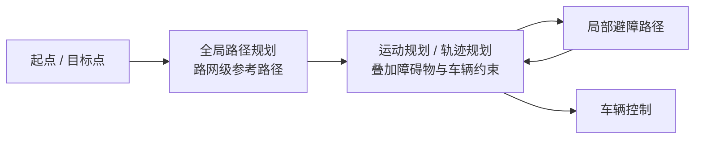

## 第 5 章 路径规划

本章讲路径规划。课件由陈白帆讲师在中南大学自动化学院于 2020 年 3 月讲授 [第5讲 路径规划.pptx · p.1](http://10.188.31.55:5244/Nextcloud/School/Auto-Drive-Intro/%E3%80%8A%E6%99%BA%E8%83%BD%E9%A9%BE%E9%A9%B6%E5%AF%BC%E8%AE%BA%E3%80%8BPPT-2020/%E7%AC%AC5%E8%AE%B2%20%E8%B7%AF%E5%BE%84%E8%A7%84%E5%88%92.pptx)。

路径规划在自动驾驶里有两层含义。**全局路径规划**在一定的环境模型基础上，给定起点和目标点，按照性能指标规划出一条无碰撞、能安全到达目标点的有效路径。**运动规划 / 轨迹规划**在车辆运动过程中，根据感知系统反馈的障碍信息做局部运动规划；当判断前方障碍物无法满足车辆期望速度、或者预测会碰撞时，局部规划器规划一条避障路径，避障之后返回原路径，继续向目标点运动 [第5讲 路径规划.pptx · p.3](http://10.188.31.55:5244/Nextcloud/School/Auto-Drive-Intro/%E3%80%8A%E6%99%BA%E8%83%BD%E9%A9%BE%E9%A9%B6%E5%AF%BC%E8%AE%BA%E3%80%8BPPT-2020/%E7%AC%AC5%E8%AE%B2%20%E8%B7%AF%E5%BE%84%E8%A7%84%E5%88%92.pptx)。

产品上的衔接通常做三层：导航地图出道路级路径，HD Map 出车道级路径，自动驾驶系统再在车道级路径上做避障 [第5讲 路径规划.pptx · p.3](http://10.188.31.55:5244/Nextcloud/School/Auto-Drive-Intro/%E3%80%8A%E6%99%BA%E8%83%BD%E9%A9%BE%E9%A9%B6%E5%AF%BC%E8%AE%BA%E3%80%8BPPT-2020/%E7%AC%AC5%E8%AE%B2%20%E8%B7%AF%E5%BE%84%E8%A7%84%E5%88%92.pptx)。

全局规划的结果是一条无碰撞的可行路径。下图里红色折线是障碍物边界，左下角的自车拖出一片绿色格状位姿扇面，青色与黄色是两条候选路径曲线，右上角方块里是目标位置 [第5讲 路径规划.pptx · p.4](http://10.188.31.55:5244/Nextcloud/School/Auto-Drive-Intro/%E3%80%8A%E6%99%BA%E8%83%BD%E9%A9%BE%E9%A9%B6%E5%AF%BC%E8%AE%BA%E3%80%8BPPT-2020/%E7%AC%AC5%E8%AE%B2%20%E8%B7%AF%E5%BE%84%E8%A7%84%E5%88%92.pptx)。

### 路径规划方法的分类

课件把路径规划算法分成五类，每类给出代表算法 [第5讲 路径规划.pptx · p.5](http://10.188.31.55:5244/Nextcloud/School/Auto-Drive-Intro/%E3%80%8A%E6%99%BA%E8%83%BD%E9%A9%BE%E9%A9%B6%E5%AF%BC%E8%AE%BA%E3%80%8BPPT-2020/%E7%AC%AC5%E8%AE%B2%20%E8%B7%AF%E5%BE%84%E8%A7%84%E5%88%92.pptx)：

- **基于采样的方法**：Voronoi、RRT、PRM。
- **基于搜索的方法**：Dijkstra、A\*、D\*。
- **基于数学模型的方法**：MILP、NLP。
- **基于生物启发式方法**：NN、GN。
- **多融合算法**：PRM-NODE。

### 概率图算法 PRM

PRM（Probabilistic Road Map）的做法是：在规划空间内随机选取 $N$ 个节点，连接各节点，并去除与障碍物接触的连线，由此得到一个可行路径 [第5讲 路径规划.pptx · p.6](http://10.188.31.55:5244/Nextcloud/School/Auto-Drive-Intro/%E3%80%8A%E6%99%BA%E8%83%BD%E9%A9%BE%E9%A9%B6%E5%AF%BC%E8%AE%BA%E3%80%8BPPT-2020/%E7%AC%AC5%E8%AE%B2%20%E8%B7%AF%E5%BE%84%E8%A7%84%E5%88%92.pptx)。把这一步写成数学形式，就是构造一个概率路网图 $G_N=(V,E)$：

$$
\begin{aligned}
V&=\{v_1,\dots,v_N\},\quad v_i \overset{\text{i.i.d.}}{\sim} \mathcal{U}(C_{\text{free}})\\
E&=\bigl\{(v_i,v_j)\ \big|\ \|v_i-v_j\|<r,\ \overline{v_iv_j}\cap C_{\text{obs}}=\varnothing\bigr\}
\end{aligned}
$$

$V$ 是随机采样出来的自由空间节点，$E$ 是通过碰撞检测的候选边，$\overline{v_iv_j}$ 是两点之间的线段。下图中黑色是障碍物，灰色圆点是采样节点，灰线是候选边，绿色是从 $q_{\text{init}}$ 到 $q_{\text{goal}}$ 的搜索结果路径。

完备性上，PRM 是**概率完备**的：采样点足够多、且在自由空间中的分布覆盖了狭窄通道时，找到解的概率随采样次数增加趋于 1。课件明确指出，当采样点太少或者分布不合理时 PRM 算法不完备；增加采样点使该算法达到完备，但不是最优的 [第5讲 路径规划.pptx · p.6](http://10.188.31.55:5244/Nextcloud/School/Auto-Drive-Intro/%E3%80%8A%E6%99%BA%E8%83%BD%E9%A9%BE%E9%A9%B6%E5%AF%BC%E8%AE%BA%E3%80%8BPPT-2020/%E7%AC%AC5%E8%AE%B2%20%E8%B7%AF%E5%BE%84%E8%A7%84%E5%88%92.pptx)。

> [!NOTE] **概率完备与最优是两件事**
> 完备只保证「找得到」，不保证「找得好」。PRM 增加采样点解决的是前者，路径质量靠后处理（路径平滑、重新优化）解决。

### 快速随机扩展树 RRT

RRT（Rapidly-exploring Random Tree）的做法是：以起点作为根节点，通过随机采样增加叶子节点的方式，递增地构造一个搜索树；生成随机树后，当树中的叶子节点包含了目标区域，便可以在随机树中获得从起点到目标点的路径 [第5讲 路径规划.pptx · p.7](http://10.188.31.55:5244/Nextcloud/School/Auto-Drive-Intro/%E3%80%8A%E6%99%BA%E8%83%BD%E9%A9%BE%E9%A9%B6%E5%AF%BC%E8%AE%BA%E3%80%8BPPT-2020/%E7%AC%AC5%E8%AE%B2%20%E8%B7%AF%E5%BE%84%E8%A7%84%E5%88%92.pptx)。

写成数学形式，每一轮迭代做三件事。采样一个随机点，在树中找离它最近的节点，然后朝它迈出固定步长：

$$
\begin{aligned}
x_{\text{rand}}&\sim \mathcal{U}(C_{\text{free}})\\
x_{\text{near}}&=\arg\min_{x\in \mathcal{T}}\|x-x_{\text{rand}}\|\\
x_{\text{new}}&=x_{\text{near}}+\frac{x_{\text{rand}}-x_{\text{near}}}{\|x_{\text{rand}}-x_{\text{near}}\|}\cdot\Delta
\end{aligned}
$$

$\Delta$ 是步长，$\mathcal{T}$ 是当前树。若 $x_{\text{new}}$ 落在自由空间内，就把它作为新叶子挂到 $x_{\text{near}}$ 上；否则丢弃本次采样。

RRT 的取样偏向障碍物附近，所以树能快速伸向狭窄通道。它同样是概率完备的：采样次数足够多时找到解的概率趋于 1，但路径质量没有保证。

### 基于搜索的方法：Dijkstra 与 A\*

**Dijkstra 算法**是一种贪心算法，使用宽度优先搜索解决权有向图的最短路径问题。课件指出它的两个问题：局部最优，算法的时间复杂度较高，很难满足路径规划实时性的要求 [第5讲 路径规划.pptx · p.8](http://10.188.31.55:5244/Nextcloud/School/Auto-Drive-Intro/%E3%80%8A%E6%99%BA%E8%83%BD%E9%A9%BE%E9%A9%B6%E5%AF%BC%E8%AE%BA%E3%80%8BPPT-2020/%E7%AC%AC5%E8%AE%B2%20%E8%B7%AF%E5%BE%84%E8%A7%84%E5%88%92.pptx)。它扩展节点时用的评价函数只有已走代价 $f(n)=g(n)$，$g(n)$ 是起点到节点 $n$ 的累计代价。Dijkstra 保证了最优解，代价是要把几乎整个连通分量都扩展一遍。用二叉堆实现的复杂度是 $O\bigl(|E|+|V|\log|V|\bigr)$，稠密图上退化到 $O(|V|^2)$。

**A\* 算法**引入启发式函数，利用带有启发式值的估价函数来评估路径中顶点的价值，最后再决定采用哪一种方案。它能够同时满足实时性和最优性要求 [第5讲 路径规划.pptx · p.8](http://10.188.31.55:5244/Nextcloud/School/Auto-Drive-Intro/%E3%80%8A%E6%99%BA%E8%83%BD%E9%A9%BE%E9%A9%B6%E5%AF%BC%E8%AE%BA%E3%80%8BPPT-2020/%E7%AC%AC5%E8%AE%B2%20%E8%B7%AF%E5%BE%84%E8%A7%84%E5%88%92.pptx)：评价函数是 $f(n)=g(n)+h(n)$，$h(n)$ 是从 $n$ 到目标的估价。若 $h(n)$ 不高估真实剩余代价（可采纳，admissible），A\* 仍然返回最优解，但扩展的节点数比 Dijkstra 少得多。在栅格地图上，直线距离 $h(n)=\|n-n_{\text{goal}}\|$ 就是最常用的可采纳启发式。

课件把两个算法的结果并排放在同一张栅格地图上。蓝色是已扩展的节点，品红是回溯得到的路径，黑色是障碍墙，绿色方块是起点，红色方块是终点，黄色是路径两侧的格子 [第5讲 路径规划.pptx · p.8](http://10.188.31.55:5244/Nextcloud/School/Auto-Drive-Intro/%E3%80%8A%E6%99%BA%E8%83%BD%E9%A9%BE%E9%A9%B6%E5%AF%BC%E8%AE%BA%E3%80%8BPPT-2020/%E7%AC%AC5%E8%AE%B2%20%E8%B7%AF%E5%BE%84%E8%A7%84%E5%88%92.pptx)。

两张图的差别就是 $h(n)$ 带来的：加进估价函数之后，扩展的格子数少了一个量级。

### Frenet 坐标系

Frenet 坐标系以车辆自身为原点，使用道路的中心线作为参考线，使用参考线的切线向量和法线向量建立坐标系，更适合处理带约束的无人车路径规划问题 [第5讲 路径规划.pptx · p.9](http://10.188.31.55:5244/Nextcloud/School/Auto-Drive-Intro/%E3%80%8A%E6%99%BA%E8%83%BD%E9%A9%BE%E9%A9%B6%E5%AF%BC%E8%AE%BA%E3%80%8BPPT-2020/%E7%AC%AC5%E8%AE%B2%20%E8%B7%AF%E5%BE%84%E8%A7%84%E5%88%92.pptx)。

把坐标变换写成数学形式。设参考线为以弧长参数化的曲线 $r(s)=(x(s),y(s))$，则单位切向量和单位法向量分别是 $t(s)=r'(s)/\|r'(s)\|$ 与 $n(s)=(-t_y(s),\,t_x(s))$。任意点 $p$ 的 Frenet 坐标 $(s,d)$ 由下式给出，其中 $s$ 是 $p$ 在参考线上的投影弧长，$d$ 是带符号的横向距离：

$$
p=r(s)+d\cdot n(s)
$$

反过来，从笛卡尔坐标 $(x,y)$ 求 Frenet 坐标，就是解一个投影方程：

$$
s=\arg\min_{\sigma}\bigl\|p-r(\sigma)\bigr\|,\qquad
d=\bigl(p-r(s)\bigr)\cdot n(s)
$$

课件的备注把 Frenet 的好处讲得更具体：使用纵向距离和横向距离来描述任意位置，同时纵向和横向的速度、加速度、加加速度等信息也更便于计算；基于 Frenet 坐标系的轨迹规划方法，在高速情况下的车道保持和换道过程中都具有很强的实用性 [第5讲 路径规划.pptx · p.9](http://10.188.31.55:5244/Nextcloud/School/Auto-Drive-Intro/%E3%80%8A%E6%99%BA%E8%83%BD%E9%A9%BE%E9%A9%B6%E5%AF%BC%E8%AE%BA%E3%80%8BPPT-2020/%E7%AC%AC5%E8%AE%B2%20%E8%B7%AF%E5%BE%84%E8%A7%84%E5%88%92.pptx)。

> [!IMPORTANT] **Frenet 把约束解耦了**
> 车道保持和换道在 Frenet 下变成「$d$ 方向怎么动」和「$s$ 方向怎么动」两个独立问题，路宽、限速这类以道路为基准的约束也直接落在 $d$ 和 $s$ 上。

### 轨迹生成

**横向轨迹的生成。** 在规划的路径中「撒点」采样生成 Trajectory Point。一条轨迹就可以看成是沿着 Lane 的中心线纵向位移方向，连接不同 Trajectory Point 的平滑曲线。课件的做法是采用多项式曲线连接轨迹点，生成候选曲线 [第5讲 路径规划.pptx · p.10](http://10.188.31.55:5244/Nextcloud/School/Auto-Drive-Intro/%E3%80%8A%E6%99%BA%E8%83%BD%E9%A9%BE%E9%A9%B6%E5%AF%BC%E8%AE%BA%E3%80%8BPPT-2020/%E7%AC%AC5%E8%AE%B2%20%E8%B7%AF%E5%BE%84%E8%A7%84%E5%88%92.pptx)。课件插图里列出一次、三次、五次三种多项式曲线，式中 $s$、$v$ 用的是课件的符号：

$$
\begin{aligned}
v&=k_1 s+k_0\\
v&=k_3 s^3+k_2 s^2+k_1 s+k_0\\
v&=k_5 s^5+k_4 s^4+k_3 s^3+k_2 s^2+k_1 s+k_0
\end{aligned}
$$

**速度规划。** 已知当前的速度信息以及目标的速度信息，需要生成一条平滑的速度曲线，从当前速度到目标速度，同时这个过程中应尽可能保持平顺，避免急加速、急减速。课件把它说成：在二维空间中，给定起点和终点状态，计算一条连接两点的平滑曲线 [第5讲 路径规划.pptx · p.11](http://10.188.31.55:5244/Nextcloud/School/Auto-Drive-Intro/%E3%80%8A%E6%99%BA%E8%83%BD%E9%A9%BE%E9%A9%B6%E5%AF%BC%E8%AE%BA%E3%80%8BPPT-2020/%E7%AC%AC5%E8%AE%B2%20%E8%B7%AF%E5%BE%84%E8%A7%84%E5%88%92.pptx)。

课件用四个符号描述运动状态：$s$ 是 distance（距离），$v$ 是 velocity（速度），$a$ 是 acceleration（加速度），$j$ 是 jerk（加加速度）。起点和终点各自带一组状态：

$$
(s_1,v_1,a_1,j_1)\ \longrightarrow\ (s_2,v_2,a_2,j_2)
$$

用五次多项式做速度曲线，正好六个边界条件对应六个系数：$v(s_1)=v_1,\ v'(s_1)=a_1,\ v''(s_1)=j_1$ 与 $v(s_2)=v_2,\ v'(s_2)=a_2,\ v''(s_2)=j_2$。

其中 $v'(s)=a(s)$ 是加速度，$v''(s)=j(s)$ 是加加速度。课件备注说，在不考虑避障的情况下，通常使横向的加加速度最小化来提高换道时的平顺性 [第5讲 路径规划.pptx · p.9](http://10.188.31.55:5244/Nextcloud/School/Auto-Drive-Intro/%E3%80%8A%E6%99%BA%E8%83%BD%E9%A9%BE%E9%A9%B6%E5%AF%BC%E8%AE%BA%E3%80%8BPPT-2020/%E7%AC%AC5%E8%AE%B2%20%E8%B7%AF%E5%BE%84%E8%A7%84%E5%88%92.pptx)。

### 轨迹生成的约束条件

除损失函数的约束以外，路径规划过程中还有许多硬约束条件 [第5讲 路径规划.pptx · p.12](http://10.188.31.55:5244/Nextcloud/School/Auto-Drive-Intro/%E3%80%8A%E6%99%BA%E8%83%BD%E9%A9%BE%E9%A9%B6%E5%AF%BC%E8%AE%BA%E3%80%8BPPT-2020/%E7%AC%AC5%E8%AE%B2%20%E8%B7%AF%E5%BE%84%E8%A7%84%E5%88%92.pptx)：

- 不能碰撞障碍物。
- 不能超过允许的最大速度 $v\le v_{\max}$。
- 不能超过允许的最大加速度 $|a|\le a_{\max}$。
- 转弯半径或者说曲率不能超过允许的最大值。

最后一条在 Frenet 下有现成的表达。横向偏移 $d(s)$ 对应的路径曲率是：

$$
\kappa=\frac{d''(s)}{\bigl(1+d'(s)^2\bigr)^{3/2}},\qquad |\kappa|\le \kappa_{\max}=\frac{1}{R_{\min}}
$$

$d'(s)$ 是横向偏移对纵向距离的导数，也就是路径相对参考线的切角变化率。

### 最优轨迹选择

有了候选轨迹和损失函数之后，还要在候选里挑一条最优的。课件在较高速度的情况下给出横向代价函数：

$$
C_d = k_j\,J_t\bigl(d(t)\bigr)+k_t\,T+k_d\,d_1^2
$$

这个损失函数包含三个惩罚项 [第5讲 路径规划.pptx · p.13](http://10.188.31.55:5244/Nextcloud/School/Auto-Drive-Intro/%E3%80%8A%E6%99%BA%E8%83%BD%E9%A9%BE%E9%A9%B6%E5%AF%BC%E8%AE%BA%E3%80%8BPPT-2020/%E7%AC%AC5%E8%AE%B2%20%E8%B7%AF%E5%BE%84%E8%A7%84%E5%88%92.pptx)：

- 第 1 项 $k_j J_t(d(t))$：惩罚 Jerk 大的备选轨迹，$J_t(d(t))$ 记的是横向偏移 $d(t)$ 的 Jerk 代价。
- 第 2 项 $k_t T$：制动应当迅速，时间短，课件把时间量记作 $T$。
- 第 3 项 $k_d d_1^2$：目标状态不应偏离道路中心线太远，$d_1$ 是目标状态的横向偏差。

三项都是越小越好，所以最小化 $C_d$ 就是同时追求平顺、快、贴中心线。

撒点采样加多项式连接给出的候选轨迹族长这样：黑色细线是各条备选轨迹，绿色是选出来的那条，纵轴是横向偏移 $d$（米），横轴是时间 $t$（秒），绿点是轨迹上的采样点 [第5讲 路径规划.pptx · p.13](http://10.188.31.55:5244/Nextcloud/School/Auto-Drive-Intro/%E3%80%8A%E6%99%BA%E8%83%BD%E9%A9%BE%E9%A9%B6%E5%AF%BC%E8%AE%BA%E3%80%8BPPT-2020/%E7%AC%AC5%E8%AE%B2%20%E8%B7%AF%E5%BE%84%E8%A7%84%E5%88%92.pptx)。

**轨迹选择。** 将路径规划在 Frenet 的基础上进行分解求解：在 $s$ 方向即纵向求解最优路径，在 $d$ 方向即横向求解最优解，从而形成合成的最优化轨迹 [第5讲 路径规划.pptx · p.14](http://10.188.31.55:5244/Nextcloud/School/Auto-Drive-Intro/%E3%80%8A%E6%99%BA%E8%83%BD%E9%A9%BE%E9%A9%B6%E5%AF%BC%E8%AE%BA%E3%80%8BPPT-2020/%E7%AC%AC5%E8%AE%B2%20%E8%B7%AF%E5%BE%84%E8%A7%84%E5%88%92.pptx)。

右侧两组图把同一个问题拆成两问：横向那组图问「哪一条换道曲线最优」，纵向那组图问「哪一条纵向曲线最优」，各自的最优解合起来就是最终轨迹。

课件最后给出一组实测数据的拟合结果，横轴是采样序号，纵轴是速度，红色是拟合出的速度曲线，绿色圆点是落在曲线上的实测点，蓝色圆点是离群点 [第5讲 路径规划.pptx · p.15](http://10.188.31.55:5244/Nextcloud/School/Auto-Drive-Intro/%E3%80%8A%E6%99%BA%E8%83%BD%E9%A9%BE%E9%A9%B6%E5%AF%BC%E8%AE%BA%E3%80%8BPPT-2020/%E7%AC%AC5%E8%AE%B2%20%E8%B7%AF%E5%BE%84%E8%A7%84%E5%88%92.pptx)。

![速度曲线拟合结果，标题 speed[km/h]:12.2，横轴是采样点序号，纵轴是速度，红色是拟合出的曲线，绿色圆点是落在曲线上的实测点，蓝色圆点是离群点，曲线先降到 -4 左右再升到 7](images/fig-l5-15.png)
