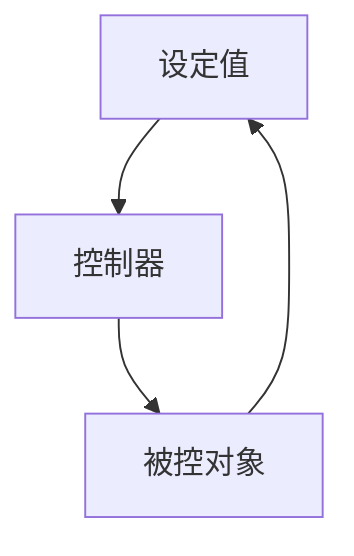

# code

`code` 模块不是指令，它作用于所有围栏代码块。模块做两件事：给代码块加一个语言标签，给围栏 meta 点名的行加一条底色。

## 语言标签

每个代码块的左上角显示语言名。标签在代码块的外壳上，不在 `<pre>` 里，所以代码横向滚动时标签留在原地。代码块顶部留出一条空白，标签不压住第一行代码。

```python
def control(pid, setpoint):
    error = setpoint - pid
    return Kp * error + Ki * pid.integral
```

标签跟着明暗主题走，只用站点的颜色变量。

```c
#include <stdio.h>

int main(void) {
    printf("hello\n");
    return 0;
}
```

没有写语言的围栏，标签显示 Astro 填的名字 `plaintext`。

```
plain fence
```

## 行高亮

围栏 meta 里写行号，行号之间用逗号分隔。下面的代码块高亮第 1 行和第 3 行。

```python {1,3}
def control(pid, setpoint):
    error = setpoint - pid
    return Kp * error + Ki * pid.integral
```

行号也可以写区间，`{2,4-6}` 高亮第 2 行和第 4 到第 6 行。

```python {2,4-6}
def control(pid, setpoint):
    error = setpoint - pid
    integral += error
    derivative = (error - pid.last_error) / Ts
    pid.last_error = error
    return Kp * error + Ki * integral + Kd * derivative
```

没有 meta 的代码块没有底色。

```python
def control(pid, setpoint):
    error = setpoint - pid
    return Kp * error
```

底色铺满代码块的宽度，代码横向滚动时跟着代码走。

## mermaid

mermaid 块由客户端渲染成图，模块不给它加语言标签，也不给它加行高亮。



## 图和公式

代码块和普通 markdown 混排时，图片、表格和公式都照常渲染。


误差的积分项：

$$
u(t) = K_p e(t) + K_i \int_0^t e(\tau) d\tau
$$

| 参数 | 含义 | 典型值 |
|---|---|---|
| $K_p$ | 比例系数 | 1.2 |
| $K_i$ | 积分系数 | 0.5 |

## 打印

打印时行高亮的底色要留下来。`@media print` 规则给底色加 `print-color-adjust: exact`，打印机才肯上色。语言标签照常打印。
