```cardlink
url: http://10.188.31.55:5244/Nextcloud/School/Auto-Drive-Intro/《智能驾驶导论》PPT-2020/
title: "智能驾驶导论 · 全六讲课件"
description: "中南大学人工智能与机器人实验室《智能驾驶导论》的六讲课件"
host: 10.188.31.55:5244
```

- 第 1 章 智能驾驶概述 — 什么是智能驾驶、SAE 分级、八条优点与四类风险、全球竞争格局与主要玩家
- 第 2 章 无人车基本框架 — 整体框架、硬件与软件架构、定位技术、高精地图、V2X、决策规划与控制
- 第 3 章 视觉感知 — 机器视觉流程、智能驾驶中的视觉感知任务、深度学习网络
- 第 4 章 雷达感知 — 毫米波与激光雷达原理、传感器部署、可行区域检测、目标识别四方案、点云处理
- 第 5 章 路径规划 — 全局与局部规划、PRM/RRT/A*、Frenet 坐标系、轨迹生成与损失函数
- 第 6 章 地图与定位 — 地图表示、定位技术、IMU 与误差、GPS-IMU 融合、SLAM
- 课后实践：APOLLO 平台大作业 — 车辆规划可视化、路径规划、速度规划与数据采集、控制结果分析

## 第 1 章 智能驾驶概述

### 什么是智能驾驶：车辆形态与功能演进

智能驾驶不是某一台机器的代称，而是一整套从感知、决策到执行的功能装车过程。课件用两张整车照片说明它首先是一种产品形态：普通量产车加装摄像头、雷达与计算单元后，人可以随时接管 [第1讲 智能驾驶概述.pptx · p.4](http://10.188.31.55:5244/Nextcloud/School/Auto-Drive-Intro/%E3%80%8A%E6%99%BA%E8%83%BD%E9%A9%BE%E9%A9%B6%E5%AF%BC%E8%AE%BA%E3%80%8BPPT-2020/%E7%AC%AC1%E8%AE%B2%20%E6%99%BA%E8%83%BD%E9%A9%BE%E9%A9%B6%E6%A6%82%E8%BF%B0.pptx)。

课件在「智能驾驶功能演进」这页给出的分级图把能力划成四层，层级越高，系统承担的驾驶操作越多 [第1讲 智能驾驶概述.pptx · p.6](http://10.188.31.55:5244/Nextcloud/School/Auto-Drive-Intro/%E3%80%8A%E6%99%BA%E8%83%BD%E9%A9%BE%E9%A9%B6%E5%AF%BC%E8%AE%BA%E3%80%8BPPT-2020/%E7%AC%AC1%E8%AE%B2%20%E6%99%BA%E8%83%BD%E9%A9%BE%E9%A9%B6%E6%A6%82%E8%BF%B0.pptx)：

- **01 初级辅助驾驶**：只有一个简单的辅助驾驶功能，特定场景下能对驾驶员进行驾驶辅助。
- **02 高级辅助驾驶**：拥有 2 个及以上的辅助驾驶功能，且多个辅助驾驶功能能够相互配合。
- **03 自动驾驶**：特定场景下能够在驾驶员无需干预的情况下自主驾驶，且能够根据场景顺畅切换至驾驶员操控。
- **04 无人驾驶**：所有场景下能够在驾驶员无需干预的情况下自主驾驶，包括车辆中无人的情况。

每一层对应四类能力。**系统监测**包括胎压监测、车速监测；**环境监测**包括交通标识识别、信号灯识别、车辆识别、车道偏离检测、驾驶疲劳检测、障碍物检测；**显示辅助**包括抬头显示、全景显示、电子后视镜、夜视系统；**主动行为**包括自动刹车、防抱死系统。越往上走，能力从「监测与提示」走向「自主执行」，车队行驶、主动变道、主动超车、主动避障、汇入车流、离开车流这类行为只出现在高层级。


### 技术分级：SAE J3016 与发展时间表

业界通用的是 SAE J3016 定义的六级体系，判断一辆车处在哪一级，看的不是它有多少传感器，而是四个维度的责任划分 [第1讲 智能驾驶概述.pptx · p.7](http://10.188.31.55:5244/Nextcloud/School/Auto-Drive-Intro/%E3%80%8A%E6%99%BA%E8%83%BD%E9%A9%BE%E9%A9%B6%E5%AF%BC%E8%AE%BA%E3%80%8BPPT-2020/%E7%AC%AC1%E8%AE%B2%20%E6%99%BA%E8%83%BD%E9%A9%BE%E9%A9%B6%E6%A6%82%E8%BF%B0.pptx)。


| 等级 | 叫法 | 转向、加减速控制 | 对环境的观察 | 激烈驾驶的应对 | 应对工况 |
| --- | --- | --- | --- | --- | --- |
| L0 | 人工驾驶 | 驾驶员 | 驾驶员 | 驾驶员 | — |
| L1 | 辅助驾驶 | 驾驶员 + 系统 | 驾驶员 | 驾驶员 | 部分 |
| L2 | 半自动驾驶 | 系统 | 驾驶员 | 驾驶员 | 部分 |
| L3 | 高度自动驾驶 | 系统 | 系统 | 驾驶员 | 部分 |
| L4 | 超高度自动驾驶 | 系统 | 系统 | 系统 | 部分 |
| L5 | 全自动驾驶 | 系统 | 系统 | 系统 | 全部 |

从 L2 到 L3 是一次责任转移的分水岭：观察权交给系统，但激烈驾驶时仍由驾驶员接管，所以 L3 仍属于「有条件」自动驾驶。L4 起系统自己应对激烈驾驶，L5 则要求在全部工况下都能自动驾驶 [第1讲 智能驾驶概述.pptx · p.7](http://10.188.31.55:5244/Nextcloud/School/Auto-Drive-Intro/%E3%80%8A%E6%99%BA%E8%83%BD%E9%A9%BE%E9%A9%B6%E5%AF%BC%E8%AE%BA%E3%80%8BPPT-2020/%E7%AC%AC1%E8%AE%B2%20%E6%99%BA%E8%83%BD%E9%A9%BE%E9%A9%B6%E6%A6%82%E8%BF%B0.pptx)。

SAE J3016 的原始图把这件事讲得更啰嗦一点：LEVEL0 到 LEVEL2 是「辅助驾驶功能」，驾驶员必须时刻观察各种情况、必须主动制动加速或转向；LEVEL3 到 LEVEL5 是「自动驾驶功能」，功能请求时驾驶员无需接管 [第1讲 智能驾驶概述.pptx · p.8](http://10.188.31.55:5244/Nextcloud/School/Auto-Drive-Intro/%E3%80%8A%E6%99%BA%E8%83%BD%E9%A9%BE%E9%A9%B6%E5%AF%BC%E8%AE%BA%E3%80%8BPPT-2020/%E7%AC%AC1%E8%AE%B2%20%E6%99%BA%E8%83%BD%E9%A9%BE%E9%A9%B6%E6%A6%82%E8%BF%B0.pptx)。

课件给出的时间表是预测值，不是承诺值：2016 年 L1 辅助驾驶（警告提示类功能，系统提供单项辅助支持），2018 年 L2 部分自动化（部分干预辅助类功能，系统提供多项辅助支持），2020 年 L3 特定条件自动化（综合干预辅助类功能，系统完成大部分驾驶操作，人类驾驶者提供适当应答），2025 年 L4 高度自动化（限定道路与环境条件下，无人驾驶系统完成所有的驾驶操作），此后是 L5 完全自动化（所有道路与环境条件下，无人驾驶系统完成所有驾驶操作）[第1讲 智能驾驶概述.pptx · p.9](http://10.188.31.55:5244/Nextcloud/School/Auto-Drive-Intro/%E3%80%8A%E6%99%BA%E8%83%BD%E9%A9%BE%E9%A9%B6%E5%AF%BC%E8%AE%BA%E3%80%8BPPT-2020/%E7%AC%AC1%E8%AE%B2%20%E6%99%BA%E8%83%BD%E9%A9%BE%E9%A9%B6%E6%A6%82%E8%BF%B0.pptx)。


### 无人驾驶汽车的八条优点

课件用八页幻灯片列了八条优点，顺序上从安全一路排到停车场，每条一页配一张说明图 [第1讲 智能驾驶概述.pptx · p.11](http://10.188.31.55:5244/Nextcloud/School/Auto-Drive-Intro/%E3%80%8A%E6%99%BA%E8%83%BD%E9%A9%BE%E9%A9%B6%E5%AF%BC%E8%AE%BA%E3%80%8BPPT-2020/%E7%AC%AC1%E8%AE%B2%20%E6%99%BA%E8%83%BD%E9%A9%BE%E9%A9%B6%E6%A6%82%E8%BF%B0.pptx)：

1. 大幅提升交通安全。
2. 大幅降低温室气体排放。
3. 降低出行费用。
4. 大幅降低交通拥堵。
5. 增加更多自由时间。
6. 提升劳动生产力。
7. 提升特定人群出行能力。
8. 大幅降低停车场需求。

第 7 条值得单独提一句。课件没有展开，但可以推出来：对那些拿不到驾照或者身体条件不允许开车的人，辅助与无人驾驶把「不能开」变成「能出行」，这是一类不体现在经济账上的收益。

### 风险：结构性失业、责任判定、可靠性与伦理

每条优点对面都有一条风险，课件同样列了四条 [第1讲 智能驾驶概述.pptx · p.19](http://10.188.31.55:5244/Nextcloud/School/Auto-Drive-Intro/%E3%80%8A%E6%99%BA%E8%83%BD%E9%A9%BE%E9%A9%B6%E5%AF%BC%E8%AE%BA%E3%80%8BPPT-2020/%E7%AC%AC1%E8%AE%B2%20%E6%99%BA%E8%83%BD%E9%A9%BE%E9%A9%B6%E6%A6%82%E8%BF%B0.pptx)。

- **AI 导致的结构性失业风险**：驾驶岗位本身被替代，冲击的是就业结构而非某个行业 [第1讲 智能驾驶概述.pptx · p.20](http://10.188.31.55:5244/Nextcloud/School/Auto-Drive-Intro/%E3%80%8A%E6%99%BA%E8%83%BD%E9%A9%BE%E9%A9%B6%E5%AF%BC%E8%AE%BA%E3%80%8BPPT-2020/%E7%AC%AC1%E8%AE%B2%20%E6%99%BA%E8%83%BD%E9%A9%BE%E9%A9%B6%E6%A6%82%E8%BF%B0.pptx)。
- **自动驾驶的责任判定**：L3 及以下事故仍由驾驶员担责，责任边界随等级移动 [第1讲 智能驾驶概述.pptx · p.21](http://10.188.31.55:5244/Nextcloud/School/Auto-Drive-Intro/%E3%80%8A%E6%99%BA%E8%83%BD%E9%A9%BE%E9%A9%B6%E5%AF%BC%E8%AE%BA%E3%80%8BPPT-2020/%E7%AC%AC1%E8%AE%B2%20%E6%99%BA%E8%83%BD%E9%A9%BE%E9%A9%B6%E6%A6%82%E8%BF%B0.pptx)。
- **技术的可靠性与安全性**：系统越复杂，失效模式越多 [第1讲 智能驾驶概述.pptx · p.22](http://10.188.31.55:5244/Nextcloud/School/Auto-Drive-Intro/%E3%80%8A%E6%99%BA%E8%83%BD%E9%A9%BE%E9%A9%B6%E5%AF%BC%E8%AE%BA%E3%80%8BPPT-2020/%E7%AC%AC1%E8%AE%B2%20%E6%99%BA%E8%83%BD%E9%A9%BE%E9%A9%B6%E6%A6%82%E8%BF%B0.pptx)。
- **潜在的伦理问题**：算法在极端场景里必须做的取舍，由谁定义 [第1讲 智能驾驶概述.pptx · p.23](http://10.188.31.55:5244/Nextcloud/School/Auto-Drive-Intro/%E3%80%8A%E6%99%BA%E8%83%BD%E9%A9%BE%E9%A9%B6%E5%AF%BC%E8%AE%BA%E3%80%8BPPT-2020/%E7%AC%AC1%E8%AE%B2%20%E6%99%BA%E8%83%BD%E9%A9%BE%E9%A9%B6%E6%A6%82%E8%BF%B0.pptx)。

> [!NOTE] **分级决定了风险落在谁头上**
> 责任争议的根源在 SAE 分级里已经写好：L0 到 L2 的激烈驾驶应对由驾驶员负责，L4 起才交给系统。所以「无人驾驶是不是无人负责」这个问题，在L3 阶段依然成立。

### 全球竞争格局与中国市场

智能驾驶成为全球竞争焦点，各国政策集中在两件事上：允许测试，以及给出标准 [第1讲 智能驾驶概述.pptx · p.24](http://10.188.31.55:5244/Nextcloud/School/Auto-Drive-Intro/%E3%80%8A%E6%99%BA%E8%83%BD%E9%A9%BE%E9%A9%B6%E5%AF%BC%E8%AE%BA%E3%80%8BPPT-2020/%E7%AC%AC1%E8%AE%B2%20%E6%99%BA%E8%83%BD%E9%A9%BE%E9%A9%B6%E6%A6%82%E8%BF%B0.pptx)。课件用一张世界地图列出各国时间线：英国 2014 年发布自动驾驶汽车发展路线图，政府投资 1900 万英镑的无人驾驶测试项目在 4 个城市正式运行；美国 2016 年 3 月表示由人工智能系统驾驶的谷歌无人驾驶车将被视为符合联邦法律；韩国 2016 年 3 月发放该国首个自动驾驶汽车牌照，同年 4 月产业通商资源部宣布从 2017 年起投入 1455 亿韩元用于无人驾驶汽车核心技术开发；日本 2016 年 5 月发布《自动驾驶普及路线图》，计划 2020 年允许在高速公路上行驶；中国 2016 年 3 月在「十三五」汽车工业发展规划意见中写入相关，7 月工信部官员透露正在积极推动制定无人驾驶相关技术规范；法国 2014 年发布路线图，投资 1 亿欧元；欧盟 2014 年 2 月启动「Adaptive」项目；联合国 2016 年 1 月通过《联合国自动驾驶安全全球标准》；德国 2015 年 2 月成立无人驾驶项目委员会。

中国市场的推力来自乘用车销量和渗透率两条线 [第1讲 智能驾驶概述.pptx · p.25](http://10.188.31.55:5244/Nextcloud/School/Auto-Drive-Intro/%E3%80%8A%E6%99%BA%E8%83%BD%E9%A9%BE%E9%A9%B6%E5%AF%BC%E8%AE%BA%E3%80%8BPPT-2020/%E7%AC%AC1%E8%AE%B2%20%E6%99%BA%E8%83%BD%E9%A9%BE%E9%A9%B6%E6%A6%82%E8%BF%B0.pptx)。2015 年中国乘用车销量 2114.6 万台，预计 2020 年达到 2773.3 万台，环比增速从 15.7% 一路回落到 4.9%；同期智能驾驶乘用车渗透率 2014 年 11%、2015 年 15%，预测 2016 年 20%、2017 年 32%、2018 年 47%、2019 年 52%、2020 年 61%。

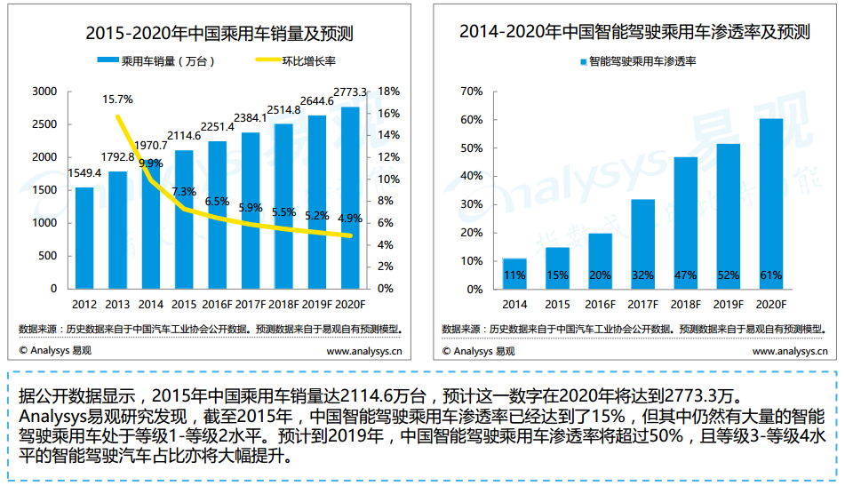

销量增速放缓而智能驾驶渗透率翻倍，意味着增量不再来自市场变大，而是来自单车智能化的比例上升。易观给出的判断是：全球智能汽车市场到 2019 年会迎来洗牌阶段，缺乏竞争力的企业将被淘汰，率先推出相应产品的企业将在领域中占有一席之地 [第1讲 智能驾驶概述.pptx · p.27](http://10.188.31.55:5244/Nextcloud/School/Auto-Drive-Intro/%E3%80%8A%E6%99%BA%E8%83%BD%E9%A9%BE%E9%A9%B6%E5%AF%BC%E8%AE%BA%E3%80%8BPPT-2020/%E7%AC%AC1%E8%AE%B2%20%E6%99%BA%E8%83%BD%E9%A9%BE%E9%A9%B6%E6%A6%82%E8%BF%B0.pptx)。

### 全球智能驾驶产业生态图谱

产业链被拆成三层加两个应用方向 [第1讲 智能驾驶概述.pptx · p.28](http://10.188.31.55:5244/Nextcloud/School/Auto-Drive-Intro/%E3%80%8A%E6%99%BA%E8%83%BD%E9%A9%BE%E9%A9%B6%E5%AF%BC%E8%AE%BA%E3%80%8BPPT-2020/%E7%AC%AC1%E8%AE%B2%20%E6%99%BA%E8%83%BD%E9%A9%BE%E9%A9%B6%E6%A6%82%E8%BF%B0.pptx)。上游硬件包括处理器与存储器（Intel、NVIDIA、AMD、Samsung）、车载雷达（Continental、北科天绘、北京自适应）、车载摄像头（Mobileye、保千里电子、欧菲光）、电机与电控（Continental、Magna、Siemens）、储能设备（Panasonic、LG、BYD）。上游软件包括高精度地图数据（四维图新、高德、百度、Here、易图通）、智能驾驶算法（Google、百度、Mobileye、UISEE 驭势）、智能驾驶操作系统（Google、百度、Apple、Tesla）。往下是解决方案层，ADAS 芯片给 RENESAS、XILINX、freescale、Analog Devices，整车方案给 Google、百度、智车优行、UISEE；再往下是整车制造，传统厂商有上汽、长安、北汽，互联网公司有 Tesla、Apple、智车优行；商业应用一端是汽车共享，图里给了四家出行平台的 logo。

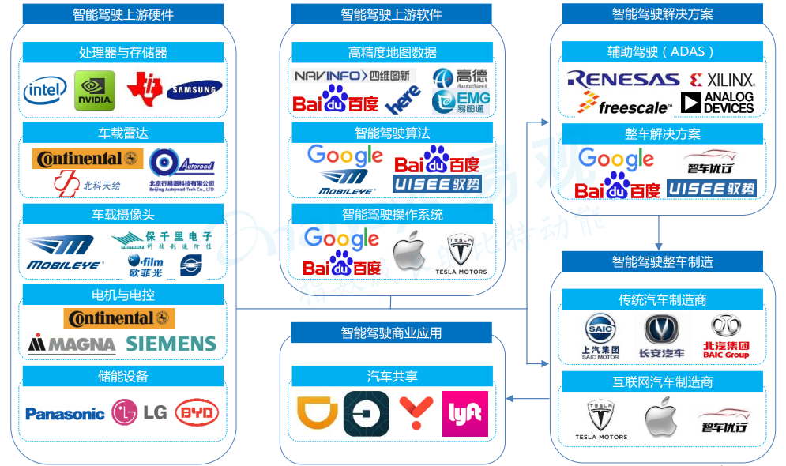

这张图解释了为什么各家选的路不一样：有芯片和传感器能力的做上游，有地图和算法能力的做中间层，整车厂要么自己做软件，要么采购。百度出现在上游软件的三格（地图数据、算法、操作系统）和解决方案的整车方案里，Tesla 出现在智能驾驶操作系统与互联网汽车制造商两处。

### 加州 DMV 脱离报告：把「无人」变成可比的数字

加州车辆管理局要求持有测试许可的公司报告「脱离」情况，即自动驾驶系统无法继续正常操作、必须由人工接管的那一刻。课件给出的 2018 年数据把各家放在同一把尺子上 [第1讲 智能驾驶概述.pptx · p.29](http://10.188.31.55:5244/Nextcloud/School/Auto-Drive-Intro/%E3%80%8A%E6%99%BA%E8%83%BD%E9%A9%BE%E9%A9%B6%E5%AF%BC%E8%AE%BA%E3%80%8BPPT-2020/%E7%AC%AC1%E8%AE%B2%20%E6%99%BA%E8%83%BD%E9%A9%BE%E9%A9%B6%E6%A6%82%E8%BF%B0.pptx)。

这个指标通常写成每千英里的人为干预次数，算法本身并不复杂：

$$
\text{每千英里干预次数} = \frac{\text{人为干预次数}}{\text{路测里程（英里）}} \times 1000
$$

| 公司 | 车队规模（辆） | 路测里程（英里） | 人为干预次数 | 每千英里干预次数 |
| --- | --- | --- | --- | --- |
| Waymo | 75 | 352545 | 63 | 0.18 |
| 通用 Cruise | 94 | 131676 | 105 | 0.84 |
| 日产 | 5 | 5007 | 24 | 4.79 |
| Zoox | 11 | 2955 | 14 | 6.21 |
| Drive.ai | 7 | 6015 | 92 | 15.30 |
| 百度 | 4 | 1949 | 43 | 22.06 |
| Telenav | 1 | 1824 | 59 | 32.35 |
| 德尔福 | 1 | 1810 | 82 | 45.30 |
| 英伟达 | 2 | 505 | 109 | 215.84 |
| 法雷奥 | 1 | 574 | 215 | 374.56 |

Waymo 每千英里干预 0.18 次，约为通用 Cruise 的五分之一、百度的三十分之一，与排在后面的德尔福、英伟达、法雷奥相差两个到三个量级。同期还有一张按同一口径统计的柱状图，纵轴是「平均每隔多少英里才脱离一次」，最高能到 12000 英里，Waymo 位于最前端 [第1讲 智能驾驶概述.pptx · p.30](http://10.188.31.55:5244/Nextcloud/School/Auto-Drive-Intro/%E3%80%8A%E6%99%BA%E8%83%BD%E9%A9%BE%E9%A9%B6%E5%AF%BC%E8%AE%BA%E3%80%8BPPT-2020/%E7%AC%AC1%E8%AE%B2%20%E6%99%BA%E8%83%BD%E9%A9%BE%E9%A9%B6%E6%A6%82%E8%BF%B0.pptx)。


> [!WARNING] **这份表的两个陷阱**
> 第一，干预次数由各公司自行申报，定义口径不统一，有的公司把「车辆主动减速避险」也记为脱离。第二，路测里程短的公司的比值波动极大。表里 Waymo 与法雷奥的差距，既是技术差距，也是数据规模差距。

### Google 与 Waymo：从项目到公司

Google 的 Driverless Car 项目走的是可查证的时间线 [第1讲 智能驾驶概述.pptx · p.31](http://10.188.31.55:5244/Nextcloud/School/Auto-Drive-Intro/%E3%80%8A%E6%99%BA%E8%83%BD%E9%A9%BE%E9%A9%B6%E5%AF%BC%E8%AE%BA%E3%80%8BPPT-2020/%E7%AC%AC1%E8%AE%B2%20%E6%99%BA%E8%83%BD%E9%A9%BE%E9%A9%B6%E6%A6%82%E8%BF%B0.pptx)：2010 年宣布研发无人驾驶汽车项目，由斯坦福人工智能实验室牵头；2011 年内华达州为运用其实验性自动驾驶技术的丰田 Prius 颁发驾照；2012 年累计行驶里程超过 100 万英里，期间共发生 341 次事故；2015 年美国国家公路安全交通管理局（NHTSA）承认其无人驾驶汽车采用的人工智能系统可以被视为「司机」；2016 年之后公司制运作，合作企业里既有 Chrysler、Ford、Toyota、FIAT、GM、Hyundai 这样的整车厂商，也有 Delphi、RCO、LG、ROUSH、NVIDIA 这样的零部件伙伴。


NHTSA 那次认可的意义被课件讲得很直接：它是无人驾驶进入合法化的重要标志，此前相关技术研发会受制于法律法规，公共部门的积极态度表明对无人汽车有了较为一致并且积极的意见 [第1讲 智能驾驶概述.pptx · p.33](http://10.188.31.55:5244/Nextcloud/School/Auto-Drive-Intro/%E3%80%8A%E6%99%BA%E8%83%BD%E9%A9%BE%E9%A9%B6%E5%AF%BC%E8%AE%BA%E3%80%8BPPT-2020/%E7%AC%AC1%E8%AE%B2%20%E6%99%BA%E8%83%BD%E9%A9%BE%E9%A9%B6%E6%A6%82%E8%BF%B0.pptx)。同一页给出故障数的变化：2014 年第四季度无人驾驶汽车每行驶 785 英里就会出现一次故障；2015 年 5 月开始以后，每月平均出现 15.4 次故障，较 2014 年显著减少。

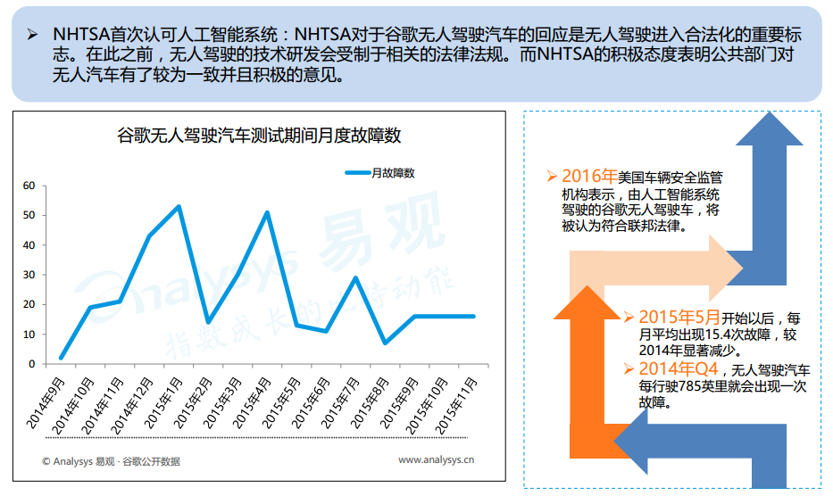

技术细节上，Google 走的是高精度感知加冗余定位的路线：通过顶部激光雷达绘制周围环境，用激光反射波测量距离；车载雷达与位置传感器测出车辆在三个方向上的加速度、角速度，再结合 GPS 算出车辆位置，所有数据经过处理后由系统作出行驶判断；摄像头用来侦测交通信号灯的变化 [第1讲 智能驾驶概述.pptx · p.32](http://10.188.31.55:5244/Nextcloud/School/Auto-Drive-Intro/%E3%80%8A%E6%99%BA%E8%83%BD%E9%A9%BE%E9%A9%B6%E5%AF%BC%E8%AE%BA%E3%80%8BPPT-2020/%E7%AC%AC1%E8%AE%B2%20%E6%99%BA%E8%83%BD%E9%A9%BE%E9%A9%B6%E6%A6%82%E8%BF%B0.pptx)。商业模式上，课件画了三种形态：无人驾驶解决方案成品整车、无人驾驶运输服务、信息传递智能服务；应用方向选在公共交通、物流货运、汽车租赁，因为这些领域成本承受能力更强 [第1讲 智能驾驶概述.pptx · p.34](http://10.188.31.55:5244/Nextcloud/School/Auto-Drive-Intro/%E3%80%8A%E6%99%BA%E8%83%BD%E9%A9%BE%E9%A9%B6%E5%AF%BC%E8%AE%BA%E3%80%8BPPT-2020/%E7%AC%AC1%E8%AE%B2%20%E6%99%BA%E8%83%BD%E9%A9%BE%E9%A9%B6%E6%A6%82%E8%BF%B0.pptx)。最后 Google 把无人驾驶业务拆成独立公司 Waymo [第1讲 智能驾驶概述.pptx · p.35](http://10.188.31.55:5244/Nextcloud/School/Auto-Drive-Intro/%E3%80%8A%E6%99%BA%E8%83%BD%E9%A9%BE%E9%A9%B6%E5%AF%BC%E8%AE%BA%E3%80%8BPPT-2020/%E7%AC%AC1%E8%AE%B2%20%E6%99%BA%E8%83%BD%E9%A9%BE%E9%A9%B6%E6%A6%82%E8%BF%B0.pptx)。

### 三条技术路线的分歧

Google、特斯拉、百度在课件里代表三种不同的解法，差异不在「要不要无人驾驶」，而在数据从哪来、地图从哪来。

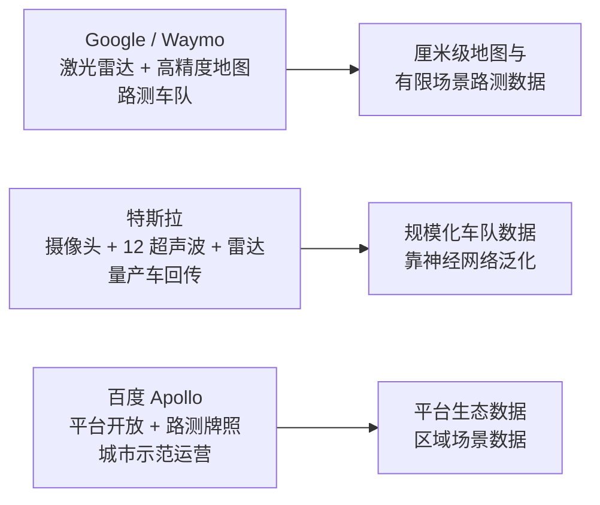

特斯拉的路线最省硬件也最吃算力。它用摄像头当眼睛，前置摄像头装在反光镜前面，软件处理提取的信息来计算距离、识别路标、探测人行横道；配 12 个远距离超声波传感器提供 360 度视角，再加一个前置雷达系统辅助半自动化驾驶。数百万辆 Model 把路上采集的路况数据实时回传中央数据库，每天平均增加百万英里的驾驶数据，软件根据这些反馈不断改善算法 [第1讲 智能驾驶概述.pptx · p.38](http://10.188.31.55:5244/Nextcloud/School/Auto-Drive-Intro/%E3%80%8A%E6%99%BA%E8%83%BD%E9%A9%BE%E9%A9%B6%E5%AF%BC%E8%AE%BA%E3%80%8BPPT-2020/%E7%AC%AC1%E8%AE%B2%20%E6%99%BA%E8%83%BD%E9%A9%BE%E9%A9%B6%E6%A6%82%E8%BF%B0.pptx)。

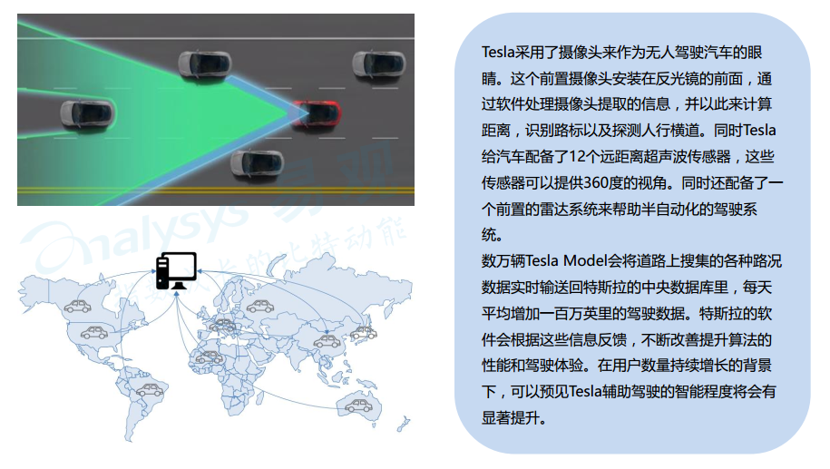

这条路线的商业前提是电动化：先靠高端产品积聚能量，技术和市场成熟后再推向低价车型 [第1讲 智能驾驶概述.pptx · p.37](http://10.188.31.55:5244/Nextcloud/School/Auto-Drive-Intro/%E3%80%8A%E6%99%BA%E8%83%BD%E9%A9%BE%E9%A9%B6%E5%AF%BC%E8%AE%BA%E3%80%8BPPT-2020/%E7%AC%AC1%E8%AE%B2%20%E6%99%BA%E8%83%BD%E9%A9%BE%E9%A9%B6%E6%A6%82%E8%BF%B0.pptx)。

### 百度与长沙：路测牌照与场景落地

国内一侧，百度被称为中国无人驾驶技术的领头羊 [第1讲 智能驾驶概述.pptx · p.41](http://10.188.31.55:5244/Nextcloud/School/Auto-Drive-Intro/%E3%80%8A%E6%99%BA%E8%83%BD%E9%A9%BE%E9%A9%B6%E5%AF%BC%E8%AE%BA%E3%80%8BPPT-2020/%E7%AC%AC1%E8%AE%B2%20%E6%99%BA%E8%83%BD%E9%A9%BE%E9%A9%B6%E6%A6%82%E8%BF%B0.pptx)。路测是无人驾驶的重要环节，牌照数量直接对应可上路测试的车辆规模 [第1讲 智能驾驶概述.pptx · p.42](http://10.188.31.55:5244/Nextcloud/School/Auto-Drive-Intro/%E3%80%8A%E6%99%BA%E8%83%BD%E9%A9%BE%E9%A9%B6%E5%AF%BC%E8%AE%BA%E3%80%8BPPT-2020/%E7%AC%AC1%E8%AE%B2%20%E6%99%BA%E8%83%BD%E9%A9%BE%E9%A9%B6%E6%A6%82%E8%BF%B0.pptx)。

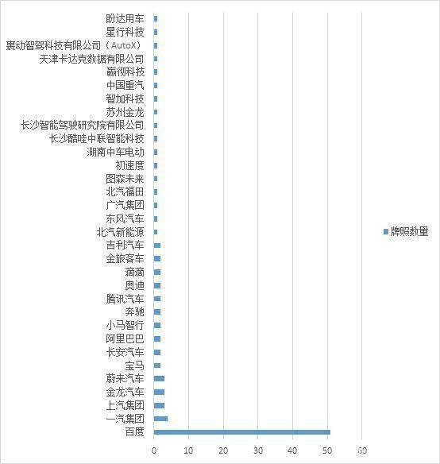

百度的牌照数量超过 50 张，其余厂商的条形几乎贴着零点，多在个位数。这张图同时暴露了国内路测格局的另一面：拿到牌照的主体里有大量主机厂、零部件商和出行平台，不只是百度一家。

落地路径上，百度牵手长沙打造「智能驾驶第一城」，2018 年 12 月 28 日全场景车队在长沙亮相 [第1讲 智能驾驶概述.pptx · p.44](http://10.188.31.55:5244/Nextcloud/School/Auto-Drive-Intro/%E3%80%8A%E6%99%BA%E8%83%BD%E9%A9%BE%E9%A9%B6%E5%AF%BC%E8%AE%BA%E3%80%8BPPT-2020/%E7%AC%AC1%E8%AE%B2%20%E6%99%BA%E8%83%BD%E9%A9%BE%E9%A9%B6%E6%A6%82%E8%BF%B0.pptx) [第1讲 智能驾驶概述.pptx · p.45](http://10.188.31.55:5244/Nextcloud/School/Auto-Drive-Intro/%E3%80%8A%E6%99%BA%E8%83%BD%E9%A9%BE%E9%A9%B6%E5%AF%BC%E8%AE%BA%E3%80%8BPPT-2020/%E7%AC%AC1%E8%AE%B2%20%E6%99%BA%E8%83%BD%E9%A9%BE%E9%A9%B6%E6%A6%82%E8%BF%B0.pptx)，随后与湖南省人民政府达成全面合作 [第1讲 智能驾驶概述.pptx · p.46](http://10.188.31.55:5244/Nextcloud/School/Auto-Drive-Intro/%E3%80%8A%E6%99%BA%E8%83%BD%E9%A9%BE%E9%A9%B6%E5%AF%BC%E8%AE%BA%E3%80%8BPPT-2020/%E7%AC%AC1%E8%AE%B2%20%E6%99%BA%E8%83%BD%E9%A9%BE%E9%A9%B6%E6%A6%82%E8%BF%B0.pptx)。

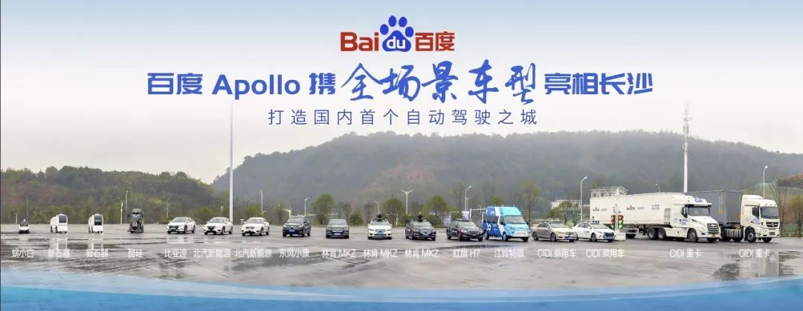

### 各大公司的推出时间表

课件最后给出一张各家承诺商业化时间的表 [第1讲 智能驾驶概述.pptx · p.47](http://10.188.31.55:5244/Nextcloud/School/Auto-Drive-Intro/%E3%80%8A%E6%99%BA%E8%83%BD%E9%A9%BE%E9%A9%B6%E5%AF%BC%E8%AE%BA%E3%80%8BPPT-2020/%E7%AC%AC1%E8%AE%B2%20%E6%99%BA%E8%83%BD%E9%A9%BE%E9%A9%B6%E6%A6%82%E8%BF%B0.pptx)：

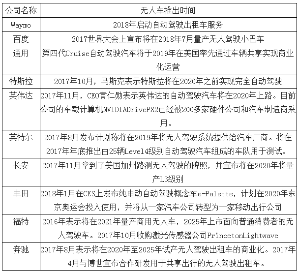

时间表集中在 2018 到 2020 年之间。Waymo 的无人出租车服务、百度的小巴车量产、特斯拉的全自动驾驶承诺都指向同一个窗口，这个窗口过去之后，所有「预计」都会变成可以核对的事实。

## 第 2 章 无人车基本框架

这一讲由中南大学人工智能与机器人实验室谢斌老师讲授，课件是《智能驾驶导论》的第 2 讲。讲的是一辆无人车从传感器到方向盘之间的整条链路：系统怎么分层、靠什么感知、在哪知道自己是谁、怎么和别的车说话、怎么决策、怎么控制 [第2讲 无人车基本框架.pptx · p.2](http://10.188.31.55:5244/Nextcloud/School/Auto-Drive-Intro/%E3%80%8A%E6%99%BA%E8%83%BD%E9%A9%BE%E9%A9%B6%E5%AF%BC%E8%AE%BA%E3%80%8BPPT-2020/%E7%AC%AC2%E8%AE%B2%20%E6%97%A0%E4%BA%BA%E8%BD%A6%E5%9F%BA%E6%9C%AC%E6%A1%86%E6%9E%B6.pptx)。

### 系统分层

无人车系统是三层加一个执行机构：环境感知层、决策规划层、控制层，三层各有一条反馈通路，最后由执行机构把命令变成方向盘转角和油门刹车 [第2讲 无人车基本框架.pptx · p.4](http://10.188.31.55:5244/Nextcloud/School/Auto-Drive-Intro/%E3%80%8A%E6%99%BA%E8%83%BD%E9%A9%BE%E9%A9%B6%E5%AF%BC%E8%AE%BA%E3%80%8BPPT-2020/%E7%AC%AC2%E8%AE%B2%20%E6%97%A0%E4%BA%BA%E8%BD%A6%E5%9F%BA%E6%9C%AC%E6%A1%86%E6%9E%B6.pptx)。

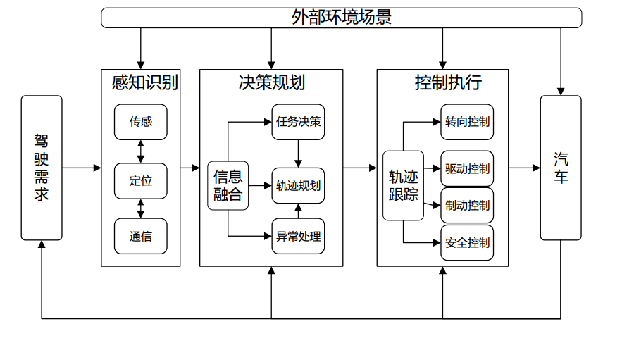

感知层不只做目标检测，还要做定位和地图更新——这三个是同一批传感器数据的三个出口 [第2讲 无人车基本框架.pptx · p.5](http://10.188.31.55:5244/Nextcloud/School/Auto-Drive-Intro/%E3%80%8A%E6%99%BA%E8%83%BD%E9%A9%BE%E9%A9%B6%E5%AF%BC%E8%AE%BA%E3%80%8BPPT-2020/%E7%AC%AC2%E8%AE%B2%20%E6%97%A0%E4%BA%BA%E8%BD%A6%E5%9F%BA%E6%9C%AC%E6%A1%86%E6%9E%B6.pptx)。

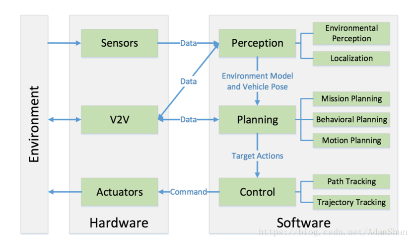

这层划分不只是画给论文看的，它决定了故障怎么隔离、模块怎么单独测试。感知错了不该把车撞了，所以规划和控制之间还有一层校验。

### 硬件：靠什么看路

无人车的传感器分四类：相机、激光雷达、毫米波雷达、超声波雷达 [第2讲 无人车基本框架.pptx · p.9](http://10.188.31.55:5244/Nextcloud/School/Auto-Drive-Intro/%E3%80%8A%E6%99%BA%E8%83%BD%E9%A9%BE%E9%A9%B6%E5%AF%BC%E8%AE%BA%E3%80%8BPPT-2020/%E7%AC%AC2%E8%AE%B2%20%E6%97%A0%E4%BA%BA%E8%BD%A6%E5%9F%BA%E6%9C%AC%E6%A1%86%E6%9E%B6.pptx)。

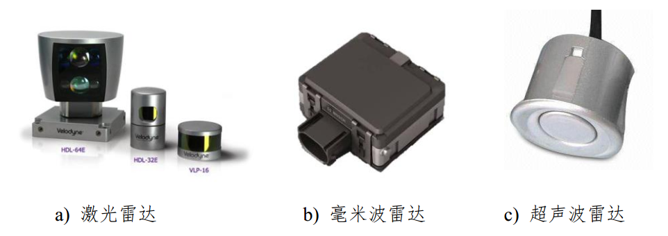

选传感器时看三件事：测距、测速、测角度，缺一项就补另一类。课件把每类传感器的原理、优点、缺点、状态和成本列成一张表 [第2讲 无人车基本框架.pptx · p.13](http://10.188.31.55:5244/Nextcloud/School/Auto-Drive-Intro/%E3%80%8A%E6%99%BA%E8%83%BD%E9%A9%BE%E9%A9%B6%E5%AF%BC%E8%AE%BA%E3%80%8BPPT-2020/%E7%AC%AC2%E8%AE%B2%20%E6%97%A0%E4%BA%BA%E8%BD%A6%E5%9F%BA%E6%9C%AC%E6%A1%86%E6%9E%B6.pptx)。

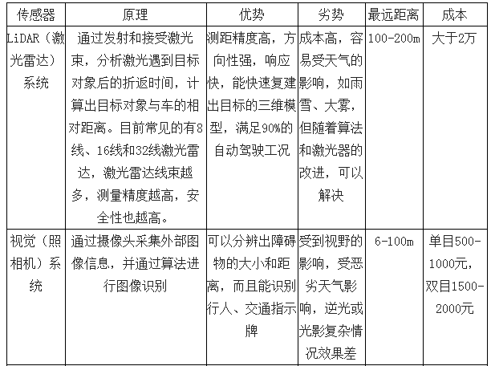

成本这一列值得单独看：激光雷达过去是万元级，毫米波雷达几百到上千，摄像头几十块 [第2讲 无人车基本框架.pptx · p.14](http://10.188.31.55:5244/Nextcloud/School/Auto-Drive-Intro/%E3%80%8A%E6%99%BA%E8%83%BD%E9%A9%BE%E9%A9%B6%E5%AF%BC%E8%AE%BA%E3%80%8BPPT-2020/%E7%AC%AC2%E8%AE%B2%20%E6%97%A0%E4%BA%BA%E8%BD%A6%E5%9F%BA%E6%9C%AC%E6%A1%86%E6%9E%B6.pptx)。

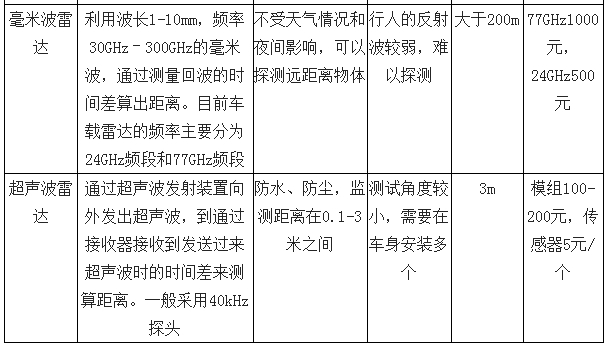

### 软件：数据和控制怎么流

软件侧的四个模块是感知、规划、控制、定位，HMI 和 CANbus 在最外面 [第2讲 无人车基本框架.pptx · p.16](http://10.188.31.55:5244/Nextcloud/School/Auto-Drive-Intro/%E3%80%8A%E6%99%BA%E8%83%BD%E9%A9%BE%E9%A9%B6%E5%AF%BC%E8%AE%BA%E3%80%8BPPT-2020/%E7%AC%AC2%E8%AE%B2%20%E6%97%A0%E4%BA%BA%E8%BD%A6%E5%9F%BA%E6%9C%AC%E6%A1%86%E6%9E%B6.pptx)。

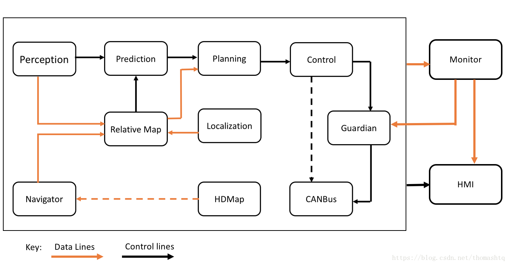

实线是数据流，虚线是控制流。定位模块既接收 GPS/IMU 的数据，又输出给规划模块和环境感知模块——它是一个共享服务，不是一条单向链。

### 定位：我在哪

GPS 定位的原理是测卫星信号的传播时间。伪距 $\rho$ 是接收机到卫星的斜距，不是直线距离，因为钟差 $\Delta t$ 会污染测量：

$$\rho = \sqrt{(x - x_s)^2 + (y - y_s)^2 + (z - z_s)^2} + c \cdot \Delta t$$

对四颗及以上的卫星联立求解，得到接收机的位置 [第2讲 无人车基本框架.pptx · p.18](http://10.188.31.55:5244/Nextcloud/School/Auto-Drive-Intro/%E3%80%8A%E6%99%BA%E8%83%BD%E9%A9%BE%E9%A9%B6%E5%AF%BC%E8%AE%BA%E3%80%8BPPT-2020/%E7%AC%AC2%E8%AE%B2%20%E6%97%A0%E4%BA%BA%E8%BD%A6%E5%9F%BA%E6%9C%AC%E6%A1%86%E6%9E%B6.pptx)。

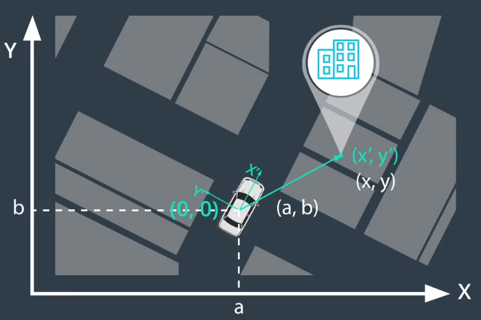

差分 GPS 在已知精确坐标的基准站装一台同样的接收机，把基准站的钟差和星历误差算出来当成改正量，播给附近的移动站用，定位精度能从米级提到厘米级 [第2讲 无人车基本框架.pptx · p.20](http://10.188.31.55:5244/Nextcloud/School/Auto-Drive-Intro/%E3%80%8A%E6%99%BA%E8%83%BD%E9%A9%BE%E9%A9%B6%E5%AF%BC%E8%AE%BA%E3%80%8BPPT-2020/%E7%AC%AC2%E8%AE%B2%20%E6%97%A0%E4%BA%BA%E8%BD%A6%E5%9F%BA%E6%9C%AC%E6%A1%86%E6%9E%B6.pptx)。

城市里 GPS 有两个躲不开的问题：遮挡（高楼、隧道挡住卫星）和反射（信号被墙面反射，路径变长）。北斗和 GPS 一样是全球定位系统，两者可以互操作，课件对比了两者的星座和频点 [第2讲 无人车基本框架.pptx · p.23](http://10.188.31.55:5244/Nextcloud/School/Auto-Drive-Intro/%E3%80%8A%E6%99%BA%E8%83%BD%E9%A9%BE%E9%A9%B6%E5%AF%BC%E8%AE%BA%E3%80%8BPPT-2020/%E7%AC%AC2%E8%AE%B2%20%E6%97%A0%E4%BA%BA%E8%BD%A6%E5%9F%BA%E6%9C%AC%E6%A1%86%E6%9E%B6.pptx)。

卫星定位的固有缺点是更新频率低、精度受环境影响。解法是混合定位：把不同原理、不同失效模式的定位源组合起来 [第2讲 无人车基本框架.pptx · p.25](http://10.188.31.55:5244/Nextcloud/School/Auto-Drive-Intro/%E3%80%8A%E6%99%BA%E8%83%BD%E9%A9%BE%E9%A9%B6%E5%AF%BC%E8%AE%BA%E3%80%8BPPT-2020/%E7%AC%AC2%E8%AE%B2%20%E6%97%A0%E4%BA%BA%E8%BD%A6%E5%9F%BA%E6%9C%AC%E6%A1%86%E6%9E%B6.pptx)。

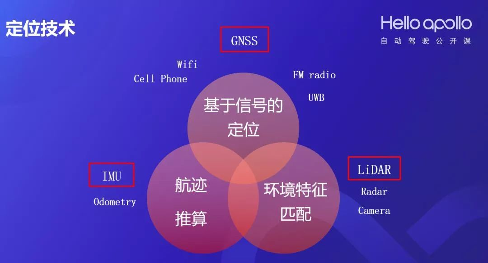

混合定位的逻辑是让失效模式互不相关：GNSS 在城市峡谷失效，激光雷达在雨雾里失效，两者同时失效的概率小得多。捷联惯导（INS）靠陀螺仪和加速度计积分推算位置，短时间很准但误差随时间累积；环境特征定位把路标、车道线这类地标当作指纹 [第2讲 无人车基本框架.pptx · p.26](http://10.188.31.55:5244/Nextcloud/School/Auto-Drive-Intro/%E3%80%8A%E6%99%BA%E8%83%BD%E9%A9%BE%E9%A9%B6%E5%AF%BC%E8%AE%BA%E3%80%8BPPT-2020/%E7%AC%AC2%E8%AE%B2%20%E6%97%A0%E4%BA%BA%E8%BD%A6%E5%9F%BA%E6%9C%AC%E6%A1%86%E6%9E%B6.pptx)。

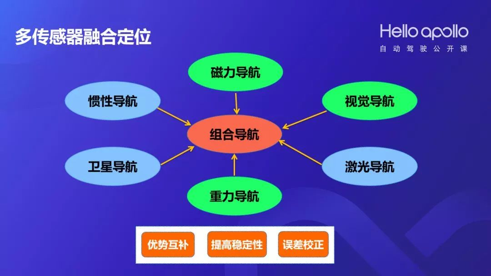

> [!WARNING]
> GNSS 和惯性导航的失效模式是互补的，不是冗余的。GNSS 精度高但更新慢，惯性导航更新快但误差随时间累积。融合的实际做法是让 KF 用 GNSS 不断修正惯性推算的漂移。

### 高精地图

高精地图和传统导航地图的差别不在比例尺，在于它带了驾驶辅助信息：车道级几何、限速、转向限制、路口的连接关系 [第2讲 无人车基本框架.pptx · p.30](http://10.188.31.55:5244/Nextcloud/School/Auto-Drive-Intro/%E3%80%8A%E6%99%BA%E8%83%BD%E9%A9%BE%E9%A9%B6%E5%AF%BC%E8%AE%BA%E3%80%8BPPT-2020/%E7%AC%AC2%E8%AE%B2%20%E6%97%A0%E4%BA%BA%E8%BD%A6%E5%9F%BA%E6%9C%AC%E6%A1%86%E6%9E%B6.pptx)。

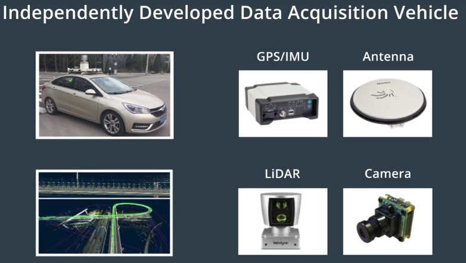

高精地图的四个环节：采集、构建、定位、与规划。采集用装了 GPS/IMU、LiDAR、Camera 的采集车，跑过一遍就把数据录下来 [第2讲 无人车基本框架.pptx · p.31](http://10.188.31.55:5244/Nextcloud/School/Auto-Drive-Intro/%E3%80%8A%E6%99%BA%E8%83%BD%E9%A9%BE%E9%A9%B6%E5%AF%BC%E8%AE%BA%E3%80%8BPPT-2020/%E7%AC%AC2%E8%AE%B2%20%E6%97%A0%E4%BA%BA%E8%BD%A6%E5%9F%BA%E6%9C%AC%E6%A1%86%E6%9E%B6.pptx)。


构建阶段把采集数据做闭环检测、点云分类、地图匹配和语义要素标注，最后产出矢量地图要素和定位地图 [第2讲 无人车基本框架.pptx · p.32](http://10.188.31.55:5244/Nextcloud/School/Auto-Drive-Intro/%E3%80%8A%E6%99%BA%E8%83%BD%E9%A9%BE%E9%A9%B6%E5%AF%BC%E8%AE%BA%E3%80%8BPPT-2020/%E7%AC%AC2%E8%AE%B2%20%E6%97%A0%E4%BA%BA%E8%BD%A6%E5%9F%BA%E6%9C%AC%E6%A1%86%E6%9E%B6.pptx)。

### V2X：车和车说话

V2X（Vehicle to Everything）把车和车、车和路、车和网络连起来。构成上是三部分：车载单元（OBU）、路侧单元（RSU）和通信网络 [第2讲 无人车基本框架.pptx · p.36](http://10.188.31.55:5244/Nextcloud/School/Auto-Drive-Intro/%E3%80%8A%E6%99%BA%E8%83%BD%E9%A9%BE%E9%A9%B6%E5%AF%BC%E8%AE%BA%E3%80%8BPPT-2020/%E7%AC%AC2%E8%AE%B2%20%E6%97%A0%E4%BA%BA%E8%BD%A6%E5%9F%BA%E6%9C%AC%E6%A1%86%E6%9E%B6.pptx)。

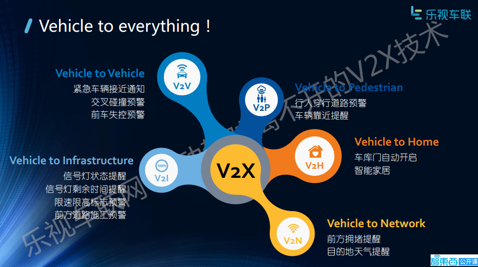

意义在于单车感知有盲区。超视距的场景里，前车挡住了目标的传感器，V2X 让信息绕过遮挡直接传过来。课件给的收益数据里，92% 来自降低事故率，34% 来自提升通行效率 [第2讲 无人车基本框架.pptx · p.37](http://10.188.31.55:5244/Nextcloud/School/Auto-Drive-Intro/%E3%80%8A%E6%99%BA%E8%83%BD%E9%A9%BE%E9%A9%B6%E5%AF%BC%E8%AE%BA%E3%80%8BPPT-2020/%E7%AC%AC2%E8%AE%B2%20%E6%97%A0%E4%BA%BA%E8%BD%A6%E5%9F%BA%E6%9C%AC%E6%A1%86%E6%9E%B6.pptx)。

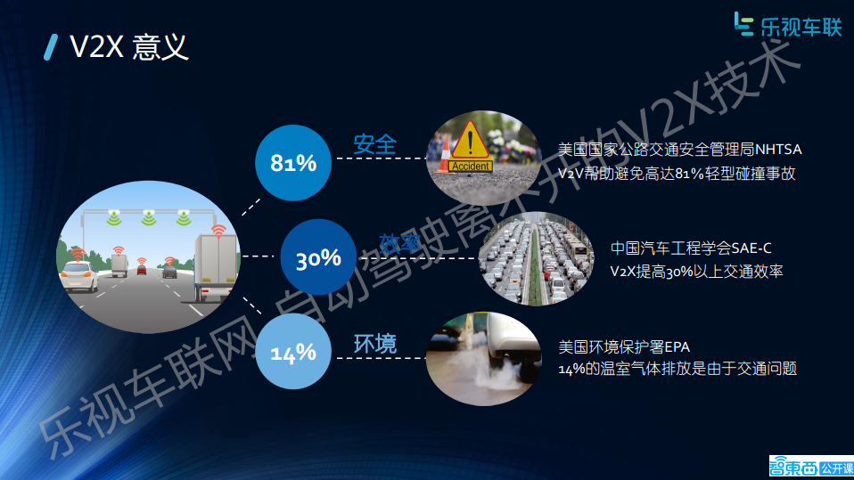

标准之争落在 DSRC 和 LTE-V 上。DSRC 是 802.11p 的变体，特点是在 5.9GHz 频段直连、延迟低；LTE-V 是蜂窝的延伸，靠基站做广域覆盖。V2X 行业标准最终给出的是基于 5G 的通信方案 [第2讲 无人车基本框架.pptx · p.41](http://10.188.31.55:5244/Nextcloud/School/Auto-Drive-Intro/%E3%80%8A%E6%99%BA%E8%83%BD%E9%A9%BE%E9%A9%B6%E5%AF%BC%E8%AE%BA%E3%80%8BPPT-2020/%E7%AC%AC2%E8%AE%B2%20%E6%97%A0%E4%BA%BA%E8%BD%A6%E5%9F%BA%E6%9C%AC%E6%A1%86%E6%9E%B6.pptx)。

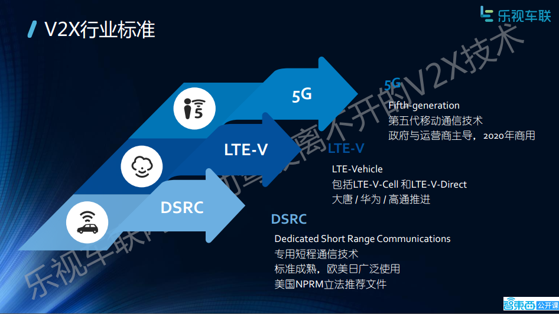

### 决策规划

决策规划有两套体系结构。反应式把感知直接接到动作，不建中间模型：

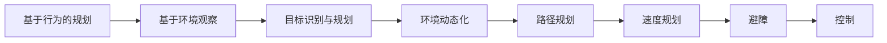

反应式结构短，反应快，但没法做全局推理 [第2讲 无人车基本框架.pptx · p.45](http://10.188.31.55:5244/Nextcloud/School/Auto-Drive-Intro/%E3%80%8A%E6%99%BA%E8%83%BD%E9%A9%BE%E9%A9%B6%E5%AF%BC%E8%AE%BA%E3%80%8BPPT-2020/%E7%AC%AC2%E8%AE%B2%20%E6%97%A0%E4%BA%BA%E8%BD%A6%E5%9F%BA%E6%9C%AC%E6%A1%86%E6%9E%B6.pptx)。

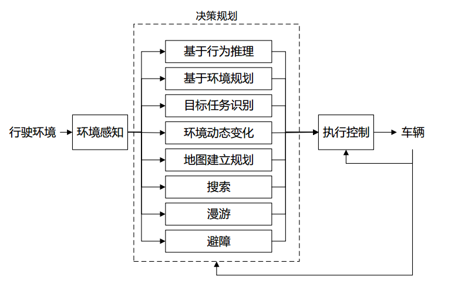

混合式在反应式之上加了一层环境感知和全局决策：环境感知生成全局环境模型，全局决策出全局目标与路径，局部规划再出实时轨迹 [第2讲 无人车基本框架.pptx · p.46](http://10.188.31.55:5244/Nextcloud/School/Auto-Drive-Intro/%E3%80%8A%E6%99%BA%E8%83%BD%E9%A9%BE%E9%A9%B6%E5%AF%BC%E8%AE%BA%E3%80%8BPPT-2020/%E7%AC%AC2%E8%AE%B2%20%E6%97%A0%E4%BA%BA%E8%BD%A6%E5%9F%BA%E6%9C%AC%E6%A1%86%E6%9E%B6.pptx)。

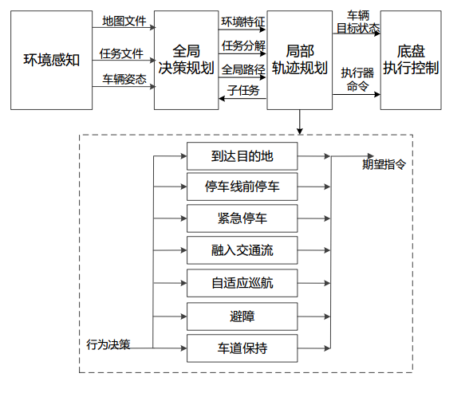

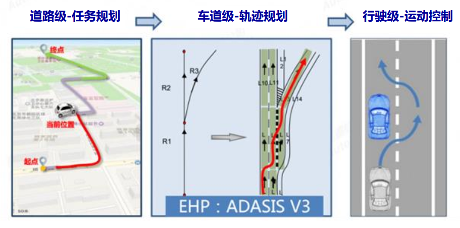

任务规划这一层把「去哪儿」拆成有限状态机：巡航、变道、输入巡航、交通冲突、避障、返回、车道保持 [第2讲 无人车基本框架.pptx · p.47](http://10.188.31.55:5244/Nextcloud/School/Auto-Drive-Intro/%E3%80%8A%E6%99%BA%E8%83%BD%E9%A9%BE%E9%A9%B6%E5%AF%BC%E8%AE%BA%E3%80%8BPPT-2020/%E7%AC%AC2%E8%AE%B2%20%E6%97%A0%E4%BA%BA%E8%BD%A6%E5%9F%BA%E6%9C%AC%E6%A1%86%E6%9E%B6.pptx)。

### 控制

控制分纵向和横向。纵向控制是速度问题，输入目标速度和当前状态，输出加速度或油门刹车量；横向控制是路径跟随问题，输入路径和当前位姿，输出转向角 [第2讲 无人车基本框架.pptx · p.48](http://10.188.31.55:5244/Nextcloud/School/Auto-Drive-Intro/%E3%80%8A%E6%99%BA%E8%83%BD%E9%A9%BE%E9%A9%B6%E5%AF%BC%E8%AE%BA%E3%80%8BPPT-2020/%E7%AC%AC2%E8%AE%B2%20%E6%97%A0%E4%BA%BA%E8%BD%A6%E5%9F%BA%E6%9C%AC%E6%A1%86%E6%9E%B6.pptx)。

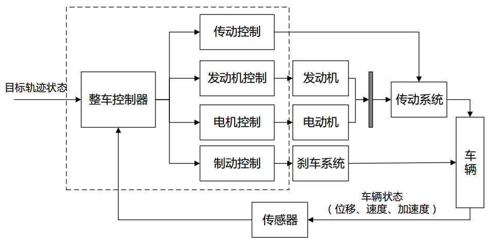

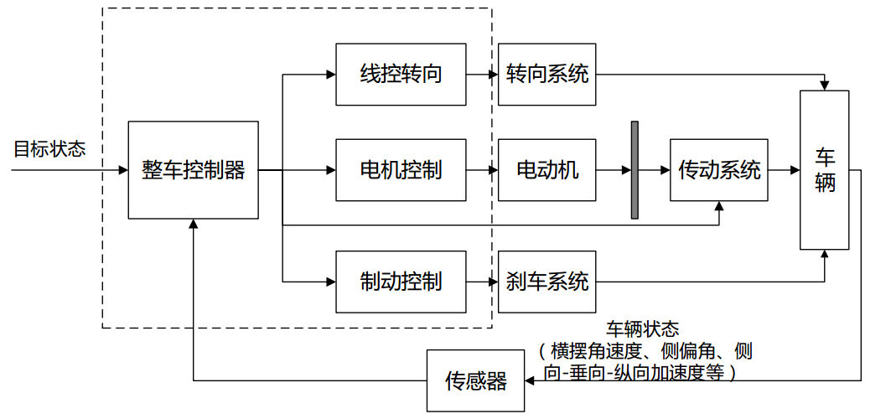

工程上有两条路线。基于规划-跟踪的间接控制先规划一条完整轨迹，再用跟踪器让车跟着走，轨迹在规划-跟踪控制器里生成，优点是可解释、可以提前规划 [第2讲 无人车基本框架.pptx · p.50](http://10.188.31.55:5244/Nextcloud/School/Auto-Drive-Intro/%E3%80%8A%E6%99%BA%E8%83%BD%E9%A9%BE%E9%A9%B6%E5%AF%BC%E8%AE%BA%E3%80%8BPPT-2020/%E7%AC%AC2%E8%AE%B2%20%E6%97%A0%E4%BA%BA%E8%BD%A6%E5%9F%BA%E6%9C%AC%E6%A1%86%E6%9E%B6.pptx)。

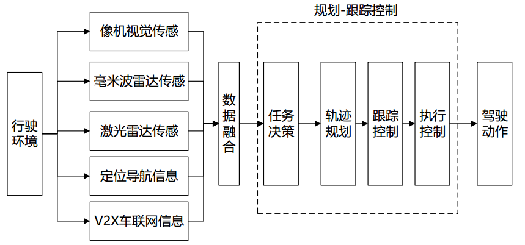

基于人工智能的直接控制则把感知状态和动作直接用一个网络连起来，端到端学 [第2讲 无人车基本框架.pptx · p.51](http://10.188.31.55:5244/Nextcloud/School/Auto-Drive-Intro/%E3%80%8A%E6%99%BA%E8%83%BD%E9%A9%BE%E9%A9%B6%E5%AF%BC%E8%AE%BA%E3%80%8BPPT-2020/%E7%AC%AC2%E8%AE%B2%20%E6%97%A0%E4%BA%BA%E8%BD%A6%E5%9F%BA%E6%9C%AC%E6%A1%86%E6%9E%B6.pptx)。

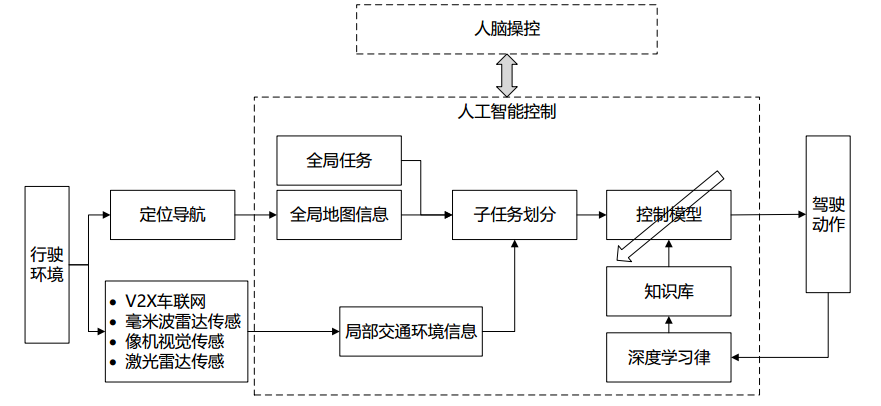

## 第 3 章 视觉感知

视觉感知是无人驾驶感知链路的入口。相机把光信号变成像素，后续所有关于车道、车辆、行人、标志牌的判断都建立在这张像素图上。本章的材料来自两处：第 3 讲的 PPT 给出视觉感知的概念框架与智能驾驶中的具体任务，第二章《无人驾驶感知基础》PDF 补上分割与检测两条算法线的细节 [第3讲 视觉感知.pptx · p.2](http://10.188.31.55:5244/Nextcloud/School/Auto-Drive-Intro/%E3%80%8A%E6%99%BA%E8%83%BD%E9%A9%BE%E9%A9%B6%E5%AF%BC%E8%AE%BA%E3%80%8BPPT-2020/%E7%AC%AC3%E8%AE%B2%20%E8%A7%86%E8%A7%89%E6%84%9F%E7%9F%A5.pptx) [第二章 无人驾驶感知基础.pdf · p.2](http://10.188.31.55:5244/Nextcloud/School/Auto-Drive-Intro/%E8%AF%BE%E4%BB%B6/%E7%AC%AC%E4%BA%8C%E7%AB%A0%20%E6%97%A0%E4%BA%BA%E9%A9%BE%E9%A9%B6%E6%84%9F%E7%9F%A5%E5%9F%BA%E7%A1%80.pdf#page=2)。

### 视觉感知的两条通路

视觉感知的定义是接收并使用环境物体反射的可见光来解释周围环境的能力 [第3讲 视觉感知.pptx · p.4](http://10.188.31.55:5244/Nextcloud/School/Auto-Drive-Intro/%E3%80%8A%E6%99%BA%E8%83%BD%E9%A9%BE%E9%A9%B6%E5%AF%BC%E8%AE%BA%E3%80%8BPPT-2020/%E7%AC%AC3%E8%AE%B2%20%E8%A7%86%E8%A7%89%E6%84%9F%E7%9F%A5.pptx)。人眼把这条通路拆成两路：ventral system 负责识别，dorsal system 负责视觉指导的行为 [第3讲 视觉感知.pptx · p.5](http://10.188.31.55:5244/Nextcloud/School/Auto-Drive-Intro/%E3%80%8A%E6%99%BA%E8%83%BD%E9%A9%BE%E9%A9%B6%E5%AF%BC%E8%AE%BA%E3%80%8BPPT-2020/%E7%AC%AC3%E8%AE%B2%20%E8%A7%86%E8%A7%89%E6%84%9F%E7%9F%A5.pptx)。

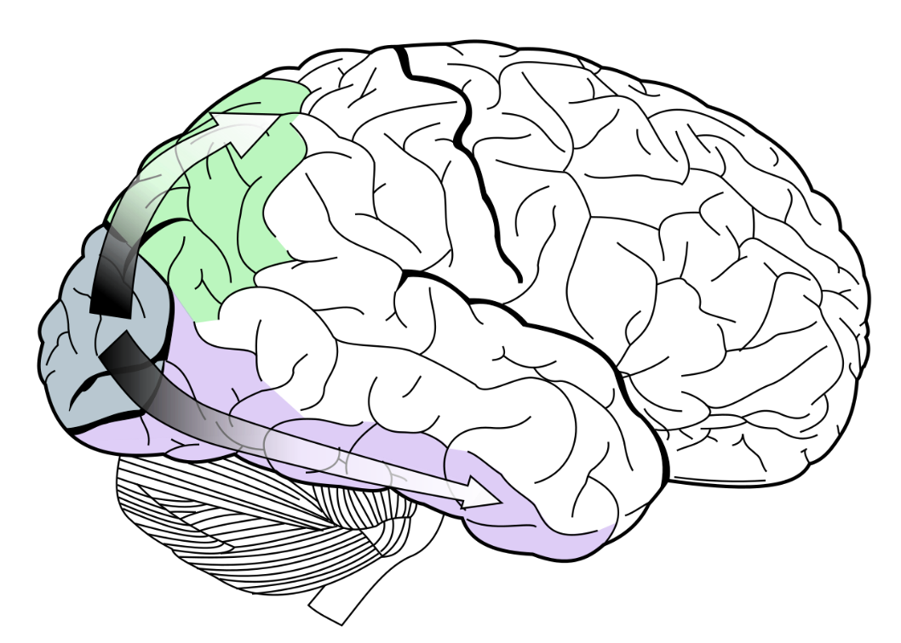

| 维度 | Ventral system | Dorsal system |
| --- | --- | --- |
| 功能 | 识别 | 视觉指导的行为 |
| 敏感度 | 高速空间频率，细节 | 高速时间频率，运动 |
| 记忆 | 长期存储表达 | 非常短期的存储 |
| 速度 | 相对慢 | 相对快 |
| 意识 | 比较高 | 比较低 |
| 参照系 | 面向目标 | 面向自我 |
| 输入 | 中央凹或其周围 | 纵横视网膜 |
| 单目 | 较小影响 | 很大影响（如视差） |

dorsal system 对单目的依赖更大，视差这类深度线索直接落在这一路上。这解释了为什么自动驾驶里单目测距难，而 binocular 或 RGBD 的深度估计可以借视觉指导类机制 [第3讲 视觉感知.pptx · p.5](http://10.188.31.55:5244/Nextcloud/School/Auto-Drive-Intro/%E3%80%8A%E6%99%BA%E8%83%BD%E9%A9%BE%E9%A9%B6%E5%AF%BC%E8%AE%BA%E3%80%8BPPT-2020/%E7%AC%AC3%E8%AE%B2%20%E8%A7%86%E8%A7%89%E6%84%9F%E7%9F%A5.pptx)。

### 机器视觉与它相交的方向

机器视觉是一个跨学科领域，目标是让计算机像人一样高层次地理解图像或视频，自动化完成相关任务 [第3讲 视觉感知.pptx · p.6](http://10.188.31.55:5244/Nextcloud/School/Auto-Drive-Intro/%E3%80%8A%E6%99%BA%E8%83%BD%E9%A9%BE%E9%A9%B6%E5%AF%BC%E8%AE%BA%E3%80%8BPPT-2020/%E7%AC%AC3%E8%AE%B2%20%E8%A7%86%E8%A7%89%E6%84%9F%E7%9F%A5.pptx)。它与四个方向交叉：人工智能（机器学习、模式识别）、信息工程（机器视觉通常被看作信息工程的一部分）、固体物理学（视觉传感器）、信号处理（图像处理） [第3讲 视觉感知.pptx · p.7](http://10.188.31.55:5244/Nextcloud/School/Auto-Drive-Intro/%E3%80%8A%E6%99%BA%E8%83%BD%E9%A9%BE%E9%A9%B6%E5%AF%BC%E8%AE%BA%E3%80%8BPPT-2020/%E7%AC%AC3%E8%AE%B2%20%E8%A7%86%E8%A7%89%E6%84%9F%E7%9F%A5.pptx)。

一般流程固定为六步：图像获取、预处理、检测、特征提取、识别、决策 [第3讲 视觉感知.pptx · p.11](http://10.188.31.55:5244/Nextcloud/School/Auto-Drive-Intro/%E3%80%8A%E6%99%BA%E8%83%BD%E9%A9%BE%E9%A9%B6%E5%AF%BC%E8%AE%BA%E3%80%8BPPT-2020/%E7%AC%AC3%E8%AE%B2%20%E8%A7%86%E8%A7%89%E6%84%9F%E7%9F%A5.pptx)。

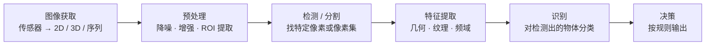

图像获取这一环拿到的数据是普通 2D 图像、3D 体积或图像序列。像素值通常对应光强度，也可以对应声波或电磁波的深度、吸收、反射，或者核磁共振 [第3讲 视觉感知.pptx · p.12](http://10.188.31.55:5244/Nextcloud/School/Auto-Drive-Intro/%E3%80%8A%E6%99%BA%E8%83%BD%E9%A9%BE%E9%A9%B6%E5%AF%BC%E8%AE%BA%E3%80%8BPPT-2020/%E7%AC%AC3%E8%AE%B2%20%E8%A7%86%E8%A7%89%E6%84%9F%E7%9F%A5.pptx)。除可见光相机外，传感器还包括距离传感器和热感成像仪 [第3讲 视觉感知.pptx · p.12](http://10.188.31.55:5244/Nextcloud/School/Auto-Drive-Intro/%E3%80%8A%E6%99%BA%E8%83%BD%E9%A9%BE%E9%A9%B6%E5%AF%BC%E8%AE%BA%E3%80%8BPPT-2020/%E7%AC%AC3%E8%AE%B2%20%E8%A7%86%E8%A7%89%E6%84%9F%E7%9F%A5.pptx)。预处理的常规手段是降噪、增强、感兴趣区域提取 [第3讲 视觉感知.pptx · p.13](http://10.188.31.55:5244/Nextcloud/School/Auto-Drive-Intro/%E3%80%8A%E6%99%BA%E8%83%BD%E9%A9%BE%E9%A9%B6%E5%AF%BC%E8%AE%BA%E3%80%8BPPT-2020/%E7%AC%AC3%E8%AE%B2%20%E8%A7%86%E8%A7%89%E6%84%9F%E7%9F%A5.pptx)。检测与分割是在图像中寻找特定的像素或像素集，特征提取拿几何、纹理、频域等特征描述该对象，识别对已检测的物体分类，决策把识别结果按规则输出 [第3讲 视觉感知.pptx · p.14](http://10.188.31.55:5244/Nextcloud/School/Auto-Drive-Intro/%E3%80%8A%E6%99%BA%E8%83%BD%E9%A9%BE%E9%A9%B6%E5%AF%BC%E8%AE%BA%E3%80%8BPPT-2020/%E7%AC%AC3%E8%AE%B2%20%E8%A7%86%E8%A7%89%E6%84%9F%E7%9F%A5.pptx) [第3讲 视觉感知.pptx · p.15](http://10.188.31.55:5244/Nextcloud/School/Auto-Drive-Intro/%E3%80%8A%E6%99%BA%E8%83%BD%E9%A9%BE%E9%A9%B6%E5%AF%BC%E8%AE%BA%E3%80%8BPPT-2020/%E7%AC%AC3%E8%AE%B2%20%E8%A7%86%E8%A7%89%E6%84%9F%E7%9F%A5.pptx) [第3讲 视觉感知.pptx · p.16](http://10.188.31.55:5244/Nextcloud/School/Auto-Drive-Intro/%E3%80%8A%E6%99%BA%E8%83%BD%E9%A9%BE%E9%A9%B6%E5%AF%BC%E8%AE%BA%E3%80%8BPPT-2020/%E7%AC%AC3%E8%AE%B2%20%E8%A7%86%E8%A7%89%E6%84%9F%E7%9F%A5.pptx) [第3讲 视觉感知.pptx · p.17](http://10.188.31.55:5244/Nextcloud/School/Auto-Drive-Intro/%E3%80%8A%E6%99%BA%E8%83%BD%E9%A9%BE%E9%A9%B6%E5%AF%BC%E8%AE%BA%E3%80%8BPPT-2020/%E7%AC%AC3%E8%AE%B2%20%E8%A7%86%E8%A7%89%E6%84%9F%E7%9F%A5.pptx)。

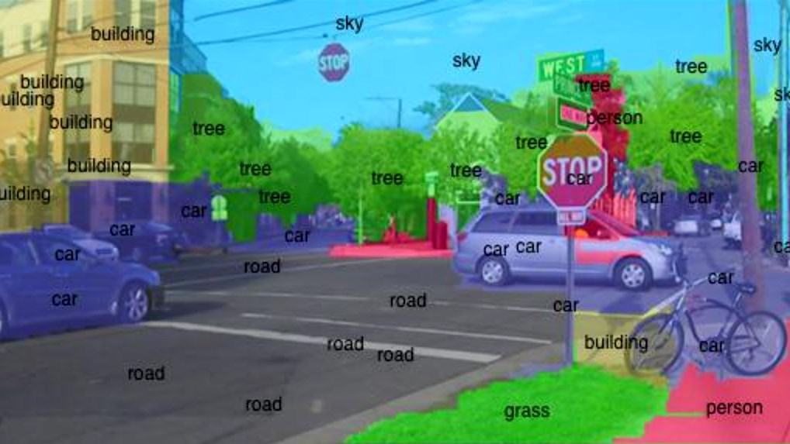

### 智能驾驶中的视觉感知

PPT 给出的关键技术清单是：道路识别、车道线检测、前方车辆检测与识别、标志牌检测与识别、交通灯检测与识别、行人检测，以及其他 [第3讲 视觉感知.pptx · p.20](http://10.188.31.55:5244/Nextcloud/School/Auto-Drive-Intro/%E3%80%8A%E6%99%BA%E8%83%BD%E9%A9%BE%E9%A9%B6%E5%AF%BC%E8%AE%BA%E3%80%8BPPT-2020/%E7%AC%AC3%E8%AE%B2%20%E8%A7%86%E8%A7%89%E6%84%9F%E7%9F%A5.pptx)。每一项在 PPT 里配了演示画面。

**车道线检测。** 输出是在原图上叠加的车道线，红色线条标出两侧边界 [第3讲 视觉感知.pptx · p.22](http://10.188.31.55:5244/Nextcloud/School/Auto-Drive-Intro/%E3%80%8A%E6%99%BA%E8%83%BD%E9%A9%BE%E9%A9%B6%E5%AF%BC%E8%AE%BA%E3%80%8BPPT-2020/%E7%AC%AC3%E8%AE%B2%20%E8%A7%86%E8%A7%89%E6%84%9F%E7%9F%A5.pptx)。

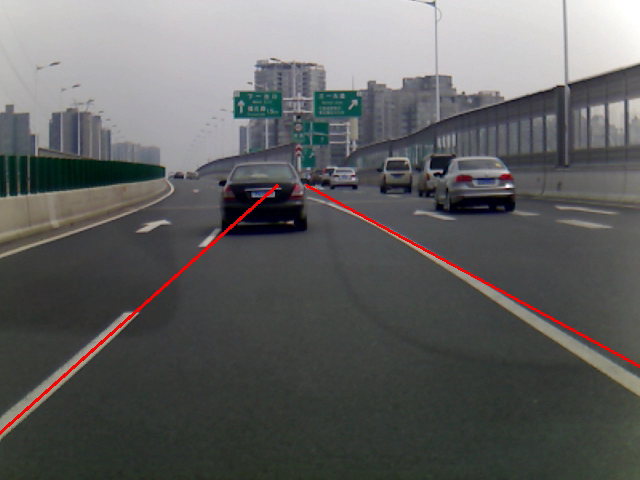

**前方车辆检测与识别。** 输出是带类别与置信度的包围框 [第3讲 视觉感知.pptx · p.23](http://10.188.31.55:5244/Nextcloud/School/Auto-Drive-Intro/%E3%80%8A%E6%99%BA%E8%83%BD%E9%A9%BE%E9%A9%B6%E5%AF%BC%E8%AE%BA%E3%80%8BPPT-2020/%E7%AC%AC3%E8%AE%B2%20%E8%A7%86%E8%A7%89%E6%84%9F%E7%9F%A5.pptx)。

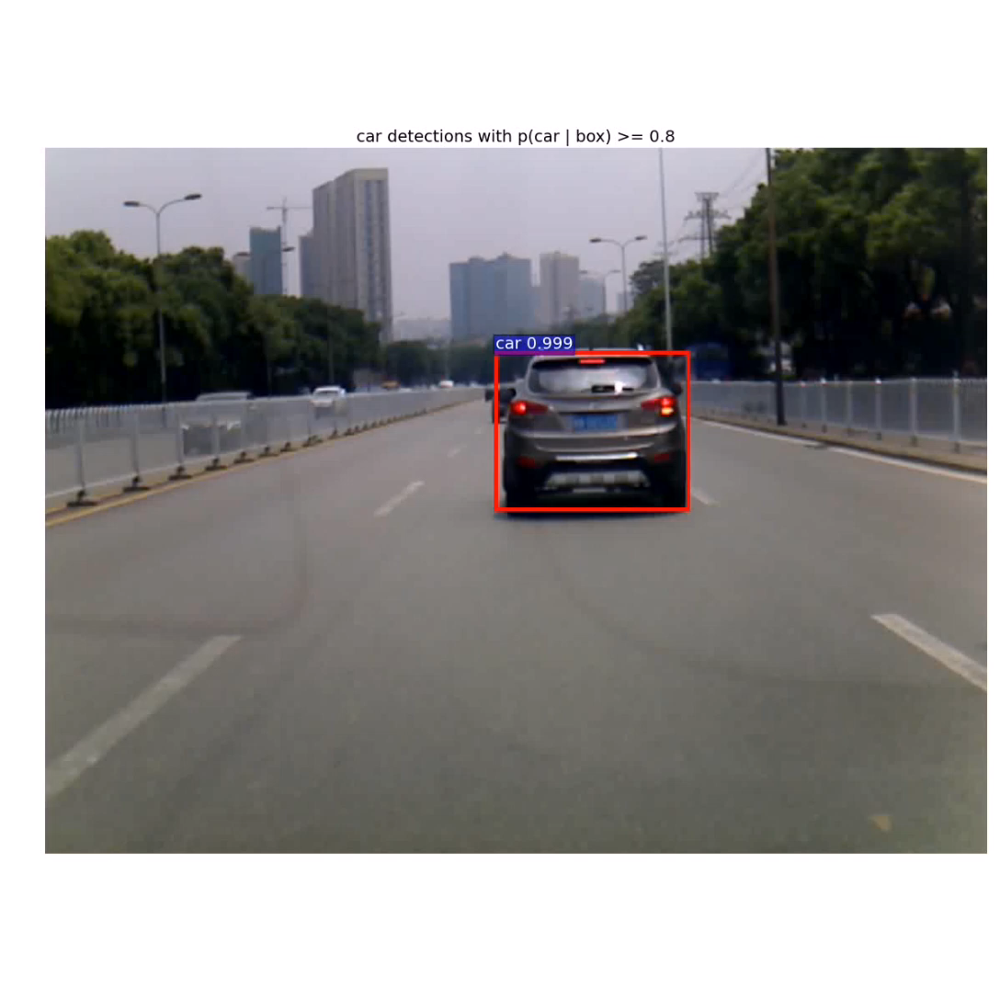

**交通灯检测与识别。** 除了定位，识别部分还要给出灯的颜色与状态。PPT 用的是一个完整的标志灯识别系统，左边是实拍画面与检测框，右边是参数面板 [第3讲 视觉感知.pptx · p.26](http://10.188.31.55:5244/Nextcloud/School/Auto-Drive-Intro/%E3%80%8A%E6%99%BA%E8%83%BD%E9%A9%BE%E9%A9%B6%E5%AF%BC%E8%AE%BA%E3%80%8BPPT-2020/%E7%AC%AC3%E8%AE%B2%20%E8%A7%86%E8%A7%89%E6%84%9F%E7%9F%A5.pptx)。

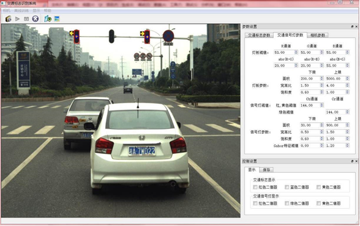

**人行横道与停止线检测。** 这项任务把路面上的人行横道条带当成一组平行线段检出，再合并成横道的整体区域 [第3讲 视觉感知.pptx · p.29](http://10.188.31.55:5244/Nextcloud/School/Auto-Drive-Intro/%E3%80%8A%E6%99%BA%E8%83%BD%E9%A9%BE%E9%A9%B6%E5%AF%BC%E8%AE%BA%E3%80%8BPPT-2020/%E7%AC%AC3%E8%AE%B2%20%E8%A7%86%E8%A7%89%E6%84%9F%E7%9F%A5.pptx)。

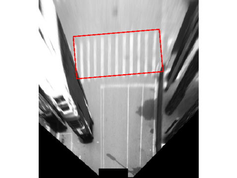

**标志牌检测与识别。** 两步走：先在图像里定位牌面，再判类别。PPT 的演示画面里，圆形禁令标志、蓝色指路牌和三角形警告牌各自被彩色圆圈框出，同一个界面的右侧面板按位置列出识别到的牌面与类别 [第3讲 视觉感知.pptx · p.24](http://10.188.31.55:5244/Nextcloud/School/Auto-Drive-Intro/%E3%80%8A%E6%99%BA%E8%83%BD%E9%A9%BE%E9%A9%B6%E5%AF%BC%E8%AE%BA%E3%80%8BPPT-2020/%E7%AC%AC3%E8%AE%B2%20%E8%A7%86%E8%A7%89%E6%84%9F%E7%9F%A5.pptx) [第3讲 视觉感知.pptx · p.25](http://10.188.31.55:5244/Nextcloud/School/Auto-Drive-Intro/%E3%80%8A%E6%99%BA%E8%83%BD%E9%A9%BE%E9%A9%B6%E5%AF%BC%E8%AE%BA%E3%80%8BPPT-2020/%E7%AC%AC3%E8%AE%B2%20%E8%A7%86%E8%A7%89%E6%84%9F%E7%9F%A5.pptx)。

**行人检测。** 行人尺寸小、姿态变化大，在画面里占比低。PPT 这一页的演示画面用的是同一套基于外观的检测框，画面里远处两辆车被标成 car 0.869 与 car 0.940 [第3讲 视觉感知.pptx · p.28](http://10.188.31.55:5244/Nextcloud/School/Auto-Drive-Intro/%E3%80%8A%E6%99%BA%E8%83%BD%E9%A9%BE%E9%A9%B6%E5%AF%BC%E8%AE%BA%E3%80%8BPPT-2020/%E7%AC%AC3%E8%AE%B2%20%E8%A7%86%E8%A7%89%E6%84%9F%E7%9F%A5.pptx)。

### 深度学习在这条链路上的位置

PPT 的第三部分给出四个网络，作为前述任务的实现工具。

**AlexNet。** 输入 $227 \times 227 \times 3$，五层卷积后接三层全连接，输出 class number。卷积层的输出尺寸依次是 $55 \times 55 \times 96$、$27 \times 27 \times 256$、$13 \times 13 \times 384$、$13 \times 13 \times 384$、$13 \times 13 \times 256$，全连接层维度 4096 [第3讲 视觉感知.pptx · p.31](http://10.188.31.55:5244/Nextcloud/School/Auto-Drive-Intro/%E3%80%8A%E6%99%BA%E8%83%BD%E9%A9%BE%E9%A9%B6%E5%AF%BC%E8%AE%BA%E3%80%8BPPT-2020/%E7%AC%AC3%E8%AE%B2%20%E8%A7%86%E8%A7%89%E6%84%9F%E7%9F%A5.pptx)。

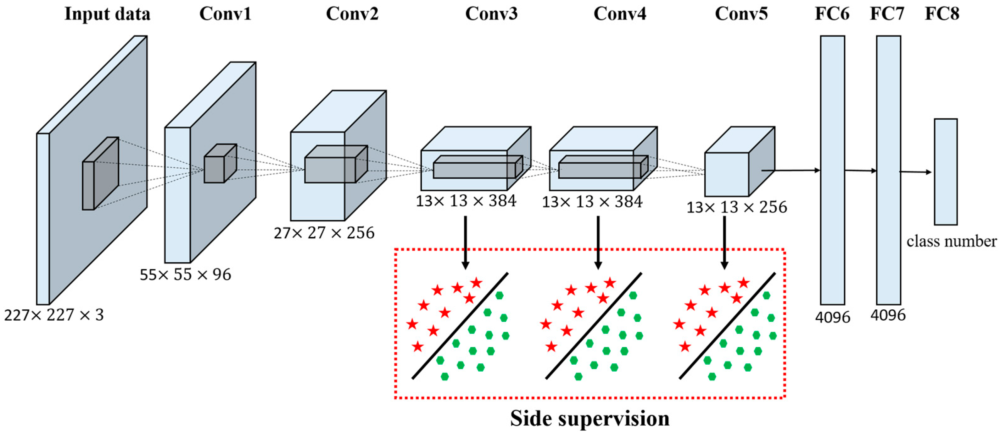

**VGGNet。** 用堆叠的 $3 \times 3$ 卷积核加深网络。配置表按 A、A-LRN、B、C、D、E 列出六个版本，权重层数分别是 11、11、13、16、16、19，结尾统一接 FC-4096、FC-4096、FC-1000 与 soft-max [第3讲 视觉感知.pptx · p.32](http://10.188.31.55:5244/Nextcloud/School/Auto-Drive-Intro/%E3%80%8A%E6%99%BA%E8%83%BD%E9%A9%BE%E9%A9%B6%E5%AF%BC%E8%AE%BA%E3%80%8BPPT-2020/%E7%AC%AC3%E8%AE%B2%20%E8%A7%86%E8%A7%89%E6%84%9F%E7%9F%A5.pptx)。

**UNet。** 编码器下采样，解码器上采样，跳连把低层特征裁剪后拼回高层 [第3讲 视觉感知.pptx · p.33](http://10.188.31.55:5244/Nextcloud/School/Auto-Drive-Intro/%E3%80%8A%E6%99%BA%E8%83%BD%E9%A9%BE%E9%A9%B6%E5%AF%BC%E8%AE%BA%E3%80%8BPPT-2020/%E7%AC%AC3%E8%AE%B2%20%E8%A7%86%E8%A7%89%E6%84%9F%E7%9F%A5.pptx)。

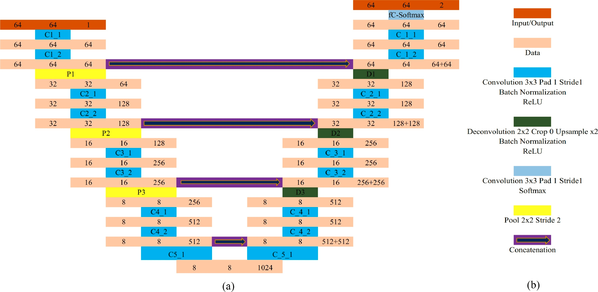

**YOLO v3。** 主干换成 darknet-53，三个尺度输出，stride 分别为 32、16、8，小目标靠 stride 8 那一路接住 [第3讲 视觉感知.pptx · p.34](http://10.188.31.55:5244/Nextcloud/School/Auto-Drive-Intro/%E3%80%8A%E6%99%BA%E8%83%BD%E9%A9%BE%E9%A9%B6%E5%AF%BC%E8%AE%BA%E3%80%8BPPT-2020/%E7%AC%AC3%E8%AE%B2%20%E8%A7%86%E8%A7%89%E6%84%9F%E7%9F%A5.pptx)。

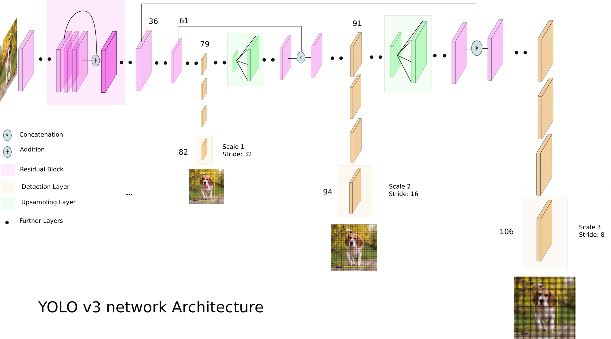

### 静态环境感知

PDF 把感知拆成感知外界与感知自身。感知外界拿静态环境（车道线、路面、交通标识）与动态物体（车、人的位置、朝向、速度）；感知自身属于定位，用 GPS、IMU、HDmap、SLAM [第二章 无人驾驶感知基础.pdf · p.4](http://10.188.31.55:5244/Nextcloud/School/Auto-Drive-Intro/%E8%AF%BE%E4%BB%B6/%E7%AC%AC%E4%BA%8C%E7%AB%A0%20%E6%97%A0%E4%BA%BA%E9%A9%BE%E9%A9%B6%E6%84%9F%E7%9F%A5%E5%9F%BA%E7%A1%80.pdf#page=4)。感知拿到的信息对应四个任务：分类提升对图像的特征提取能力，分割对像素分类并分出不同物体的形状，检测框分类即框出物体再做分类，跟踪用目标物体的全部信息做时序关联，一般对连续帧处理 [第二章 无人驾驶感知基础.pdf · p.5](http://10.188.31.55:5244/Nextcloud/School/Auto-Drive-Intro/%E8%AF%BE%E4%BB%B6/%E7%AC%AC%E4%BA%8C%E7%AB%A0%20%E6%97%A0%E4%BA%BA%E9%A9%BE%E9%A9%B6%E6%84%9F%E7%9F%A5%E5%9F%BA%E7%A1%80.pdf#page=5)。静态物体分割这块安排了实战传统方法的车道线检测、分割算法综述、实战基于图片分割的车道线检测三件事 [第二章 无人驾驶感知基础.pdf · p.7](http://10.188.31.55:5244/Nextcloud/School/Auto-Drive-Intro/%E8%AF%BE%E4%BB%B6/%E7%AC%AC%E4%BA%8C%E7%AB%A0%20%E6%97%A0%E4%BA%BA%E9%A9%BE%E9%A9%B6%E6%84%9F%E7%9F%A5%E5%9F%BA%E7%A1%80.pdf#page=7)。

**传统方法车道线检测。** 流水线是 Canny 边缘检测 → 分割路面区域 → 霍夫变换求直线 → 叠加回原图 [第二章 无人驾驶感知基础.pdf · p.9](http://10.188.31.55:5244/Nextcloud/School/Auto-Drive-Intro/%E8%AF%BE%E4%BB%B6/%E7%AC%AC%E4%BA%8C%E7%AB%A0%20%E6%97%A0%E4%BA%BA%E9%A9%BE%E9%A9%B6%E6%84%9F%E7%9F%A5%E5%9F%BA%E7%A1%80.pdf#page=9)。


Canny 检测亮度的急剧变化，在给定阈值下定义为边。预处理先把彩色图片转灰度，然后走四步：降噪用 $5 \times 5$ 高斯滤波器卷积平滑图像；求亮度梯度用 Sobel、Roberts、Prewitt 核沿 $x$ 轴和 $y$ 轴检测水平、垂直、对角线方向的边缘；非极大值抑制检查每个像素在梯度方向上是否为局部最大值，不是就把像素值置 0；Hysteresis thresholding 判弱像素，梯度大于 `maxVal` 的是边缘，小于 `minVal` 的删除，落在 $[minVal, maxVal]$ 的像素只有与强边缘相连才算边缘 [第二章 无人驾驶感知基础.pdf · p.10](http://10.188.31.55:5244/Nextcloud/School/Auto-Drive-Intro/%E8%AF%BE%E4%BB%B6/%E7%AC%AC%E4%BA%8C%E7%AB%A0%20%E6%97%A0%E4%BA%BA%E9%A9%BE%E9%A9%B6%E6%84%9F%E7%9F%A5%E5%9F%BA%E7%A1%80.pdf#page=10)。之后用手动指定的三角形把路面区域分割出来，去掉其他干扰边缘 [第二章 无人驾驶感知基础.pdf · p.11](http://10.188.31.55:5244/Nextcloud/School/Auto-Drive-Intro/%E8%AF%BE%E4%BB%B6/%E7%AC%AC%E4%BA%8C%E7%AB%A0%20%E6%97%A0%E4%BA%BA%E9%A9%BE%E9%A9%B6%E6%84%9F%E7%9F%A5%E5%9F%BA%E7%A1%80.pdf#page=11)。

霍夫变换把找直线变成找点。笛卡尔坐标系的直线方程 $y = mx + b$ 里变量是 $(x, y)$、参数是 $(m, b)$；搬进霍夫空间后变量与参数互换，方程写成 $b = -xm + y$ [第二章 无人驾驶感知基础.pdf · p.12](http://10.188.31.55:5244/Nextcloud/School/Auto-Drive-Intro/%E8%AF%BE%E4%BB%B6/%E7%AC%AC%E4%BA%8C%E7%AB%A0%20%E6%97%A0%E4%BA%BA%E9%A9%BE%E9%A9%B6%E6%84%9F%E7%9F%A5%E5%9F%BA%E7%A1%80.pdf#page=12)。垂直线斜率无穷大，没法在 $y = mx + b$ 里表示，改用极坐标形式，$d$ 是原点到直线的垂距，$\theta$ 是垂线与 $x$ 轴的夹角：

$$
d = x\cos\theta + y\sin\theta
$$

此时变量是 $(\theta, d)$、参数是 $(x, y)$，笛卡尔坐标系里一个点对应霍夫空间里一条曲线 $d_i = x\cos\theta_i + y\sin\theta_i$ [第二章 无人驾驶感知基础.pdf · p.13](http://10.188.31.55:5244/Nextcloud/School/Auto-Drive-Intro/%E8%AF%BE%E4%BB%B6/%E7%AC%AC%E4%BA%8C%E7%AB%A0%20%E6%97%A0%E4%BA%BA%E9%A9%BE%E9%A9%B6%E6%84%9F%E7%9F%A5%E5%9F%BA%E7%A1%80.pdf#page=13)。

> [!NOTE] **阈值决定漏检和误检**
> 霍夫空间中相交的曲线越多，交点表示的线在笛卡尔坐标系里对应的点就越多。所以定义交点的最小阈值来检测线：跟踪帧中每个点的霍夫空间交点，数量超过阈值就确定一条对应参数 $\theta$ 和 $d$ 的线 [第二章 无人驾驶感知基础.pdf · p.13](http://10.188.31.55:5244/Nextcloud/School/Auto-Drive-Intro/%E8%AF%BE%E4%BB%B6/%E7%AC%AC%E4%BA%8C%E7%AB%A0%20%E6%97%A0%E4%BA%BA%E9%A9%BE%E9%A9%B6%E6%84%9F%E7%9F%A5%E5%9F%BA%E7%A1%80.pdf#page=13)。调大阈值则弱线漏检，调小则噪声成线。

**基于深度学习的分割。** 图片分普通分割、语义分割、实例分割三层：普通分割把不同物体的像素区域分开，语义分割再加上每块区域的类别，实例分割再区分同种物体的不同个体 [第二章 无人驾驶感知基础.pdf · p.16](http://10.188.31.55:5244/Nextcloud/School/Auto-Drive-Intro/%E8%AF%BE%E4%BB%B6/%E7%AC%AC%E4%BA%8C%E7%AB%A0%20%E6%97%A0%E4%BA%BA%E9%A9%BE%E9%A9%B6%E6%84%9F%E7%9F%A5%E5%9F%BA%E7%A1%80.pdf#page=16)。通用框架分前后端：前端用全卷积网络做特征提取，依次是下采样（Convolution）、上采样（Deconvolution 或 Resize）、多尺度特征融合（特征逐点相加或拼接），得到像素级 segmentation map；后端用 CRF 或 MRF 优化前端输出 [第二章 无人驾驶感知基础.pdf · p.17](http://10.188.31.55:5244/Nextcloud/School/Auto-Drive-Intro/%E8%AF%BE%E4%BB%B6/%E7%AC%AC%E4%BA%8C%E7%AB%A0%20%E6%97%A0%E4%BA%BA%E9%A9%BE%E9%A9%B6%E6%84%9F%E7%9F%A5%E5%9F%BA%E7%A1%80.pdf#page=17)。

FCN 首次把深度学习引入语义分割，三项贡献：把全连接层换成全卷积层，使网络接受任意大小的图片并输出与原图一样大的特征图；用反卷积层做上采样（更准确的名字是转置卷积，作用是从小的特征图卷出大的特征图）；Skip Layer 做特征融合，把不同池化层的结果上采样后融合再分类 [第二章 无人驾驶感知基础.pdf · p.19](http://10.188.31.55:5244/Nextcloud/School/Auto-Drive-Intro/%E8%AF%BE%E4%BB%B6/%E7%AC%AC%E4%BA%8C%E7%AB%A0%20%E6%97%A0%E4%BA%BA%E9%A9%BE%E9%A9%B6%E6%84%9F%E7%9F%A5%E5%9F%BA%E7%A1%80.pdf#page=19)。U-Net 结构类似 U 字母，Conv+Pooling 下采样、Deconv 上采样、把之前的低层 feature map 裁剪后融合再上采样，重复直到得到 $388 \times 388 \times 2$ 的 feature map，最后经 softmax 得到 output segment map；与 FCN 逐点相加不同，U-Net 在 channel 维度拼接特征，形成更厚的特征 [第二章 无人驾驶感知基础.pdf · p.20](http://10.188.31.55:5244/Nextcloud/School/Auto-Drive-Intro/%E8%AF%BE%E4%BB%B6/%E7%AC%AC%E4%BA%8C%E7%AB%A0%20%E6%97%A0%E4%BA%BA%E9%A9%BE%E9%A9%B6%E6%84%9F%E7%9F%A5%E5%9F%BA%E7%A1%80.pdf#page=20)。

DeepLab 的核心是空洞卷积（Dilation / Atrous Convolution），普通卷积核中间插入几个洞，运算与普通卷积一致但感受野更大。卷积核尺寸 $k$、膨胀率 $r$ 时有效感受野边长为：

$$
k_{\text{eff}} = k + (k - 1)(r - 1)
$$

$3 \times 3$ 卷积插入一个洞，视野变成 $5 \times 5$。特征图缩到同样倍数时能掌握更多全局信息 [第二章 无人驾驶感知基础.pdf · p.22](http://10.188.31.55:5244/Nextcloud/School/Auto-Drive-Intro/%E8%AF%BE%E4%BB%B6/%E7%AC%AC%E4%BA%8C%E7%AB%A0%20%E6%97%A0%E4%BA%BA%E9%A9%BE%E9%A9%B6%E6%84%9F%E7%9F%A5%E5%9F%BA%E7%A1%80.pdf#page=22)。

Mask R-CNN 把检测与分割结合：新增分支输出 mask，损失是分类加回归加 mask 三项；mask 分支用全卷积网络输出 $k$ 类 mask，用 sigmoid 与阈值 0.5 比较得到二值 mask，避免类间竞争 [第二章 无人驾驶感知基础.pdf · p.24](http://10.188.31.55:5244/Nextcloud/School/Auto-Drive-Intro/%E8%AF%BE%E4%BB%B6/%E7%AC%AC%E4%BA%8C%E7%AB%A0%20%E6%97%A0%E4%BA%BA%E9%A9%BE%E9%A9%B6%E6%84%9F%E7%9F%A5%E5%9F%BA%E7%A1%80.pdf#page=24)。

**基于图片分割的车道线检测：LaneNet。** 论文《Towards End-to-End Lane Detection: an Instance Segmentation Approach》。两个特点：用实例分割检测车道线；用 CNN 学习透视变换，输入 RGB 图像加分割结果，经 H-Network 输出透视变换参数，绕开固定透视矩阵在上下坡场景失效的问题 [第二章 无人驾驶感知基础.pdf · p.25](http://10.188.31.55:5244/Nextcloud/School/Auto-Drive-Intro/%E8%AF%BE%E4%BB%B6/%E7%AC%AC%E4%BA%8C%E7%AB%A0%20%E6%97%A0%E4%BA%BA%E9%A9%BE%E9%A9%B6%E6%84%9F%E7%9F%A5%E5%9F%BA%E7%A1%80.pdf#page=25)。做法是先生成每个像素的 $n$ 维嵌入，使同一车道的嵌入距离近、不同车道的远，再用分割分支的二值分割图做掩码，取出所有车道像素的嵌入做聚类，得到所属车道类别 [第二章 无人驾驶感知基础.pdf · p.26](http://10.188.31.55:5244/Nextcloud/School/Auto-Drive-Intro/%E8%AF%BE%E4%BB%B6/%E7%AC%AC%E4%BA%8C%E7%AB%A0%20%E6%97%A0%E4%BA%BA%E9%A9%BE%E9%A9%B6%E6%84%9F%E7%9F%A5%E5%9F%BA%E7%A1%80.pdf#page=26)。


### 基于图像的检测算法

无人驾驶的检测任务输入是图片或点云，输出是 2D 或 3D bounding box。图片（相机）走图片检测算法，稀疏点云（激光雷达）走点云检测算法，稠密点云（双目或 RGBD 相机）走深度图算法 [第二章 无人驾驶感知基础.pdf · p.29](http://10.188.31.55:5244/Nextcloud/School/Auto-Drive-Intro/%E8%AF%BE%E4%BB%B6/%E7%AC%AC%E4%BA%8C%E7%AB%A0%20%E6%97%A0%E4%BA%BA%E9%A9%BE%E9%A9%B6%E6%84%9F%E7%9F%A5%E5%9F%BA%E7%A1%80.pdf#page=29)。点云那一支属于第 4 章。

检测相对分类多出两件事：位置，即找到所有可能包含物体的 ROI（region of interest）；以及位置修正，即 bounding box regression。类别仍是对每个 ROI 做分类 [第二章 无人驾驶感知基础.pdf · p.30](http://10.188.31.55:5244/Nextcloud/School/Auto-Drive-Intro/%E8%AF%BE%E4%BB%B6/%E7%AC%AC%E4%BA%8C%E7%AB%A0%20%E6%97%A0%E4%BA%BA%E9%A9%BE%E9%A9%B6%E6%84%9F%E7%9F%A5%E5%9F%BA%E7%A1%80.pdf#page=30)。ROI 的特征可以用传统方法（Haar、LBP、SIFT、SURF、HOG、DPM）也可以用 CNN，分类器可以用 SVM、AdaBoost 也可以用 CNN [第二章 无人驾驶感知基础.pdf · p.32](http://10.188.31.55:5244/Nextcloud/School/Auto-Drive-Intro/%E8%AF%BE%E4%BB%B6/%E7%AC%AC%E4%BA%8C%E7%AB%A0%20%E6%97%A0%E4%BA%BA%E9%A9%BE%E9%A9%B6%E6%84%9F%E7%9F%A5%E5%9F%BA%E7%A1%80.pdf#page=32)。

**获取 ROI 的三种方法。** Sliding window 遍历所有位置与所有 scale、ratio，产生大量无效框，计算复杂，适合长宽比固定的物体（人脸、行人）。Region proposal 用分割找出可能有物体的区域，减少无效框与需要分类的路径，Selective search 属于这一类，先过度分割再按相似度合并相邻框。CNN 路线用 anchor box 与来自 Faster-RCNN 的 RPN [第二章 无人驾驶感知基础.pdf · p.31](http://10.188.31.55:5244/Nextcloud/School/Auto-Drive-Intro/%E8%AF%BE%E4%BB%B6/%E7%AC%AC%E4%BA%8C%E7%AB%A0%20%E6%97%A0%E4%BA%BA%E9%A9%BE%E9%A9%B6%E6%84%9F%E7%9F%A5%E5%9F%BA%E7%A1%80.pdf#page=31)。

**Two-step 方法。** 这条线上的每一步都在把「提候选框」和「分类回归」两端换成 CNN [第二章 无人驾驶感知基础.pdf · p.33](http://10.188.31.55:5244/Nextcloud/School/Auto-Drive-Intro/%E8%AF%BE%E4%BB%B6/%E7%AC%AC%E4%BA%8C%E7%AB%A0%20%E6%97%A0%E4%BA%BA%E9%A9%BE%E9%A9%B6%E6%84%9F%E7%9F%A5%E5%9F%BA%E7%A1%80.pdf#page=33)：

| 方法 | 位置 | 类别 | 位置修正 |
| --- | --- | --- | --- |
| RCNN | Selective Search 提候选框 | CNN 特征 + SVM 分类 | 线性回归 |
| SPPNet | Selective Search 提候选框 | CNN 特征 + SVM 分类 | 线性回归 |
| Fast-RCNN | Selective Search 提候选框 | CNN 特征 + CNN 分类 | CNN 回归 |
| Faster-RCNN | CNN 提候选框（RPN） | CNN 特征 + CNN 分类 | CNN 回归 |

SPPNet 引入共享卷积大幅降低计算量，SPP 层把不同尺度的特征转成固定尺度，接到全连接层 [第二章 无人驾驶感知基础.pdf · p.35](http://10.188.31.55:5244/Nextcloud/School/Auto-Drive-Intro/%E8%AF%BE%E4%BB%B6/%E7%AC%AC%E4%BA%8C%E7%AB%A0%20%E6%97%A0%E4%BA%BA%E9%A9%BE%E9%A9%B6%E6%84%9F%E7%9F%A5%E5%9F%BA%E7%A1%80.pdf#page=35)。Fast-RCNN 把分类和回归都用 CNN 实现，两种损失可以反传联动调参（半 end-to-end），SPP 层换成 ROI Pooling 提高速度 [第二章 无人驾驶感知基础.pdf · p.36](http://10.188.31.55:5244/Nextcloud/School/Auto-Drive-Intro/%E8%AF%BE%E4%BB%B6/%E7%AC%AC%E4%BA%8C%E7%AB%A0%20%E6%97%A0%E4%BA%BA%E9%A9%BE%E9%A9%B6%E6%84%9F%E7%9F%A5%E5%9F%BA%E7%A1%80.pdf#page=36)。Faster-RCNN 引入 RPN：在 feature 点对应的原图感受野框处生成不同 ratio 和 scale 的 anchor box，对 anchor box 做二分类加回归 [第二章 无人驾驶感知基础.pdf · p.37](http://10.188.31.55:5244/Nextcloud/School/Auto-Drive-Intro/%E8%AF%BE%E4%BB%B6/%E7%AC%AC%E4%BA%8C%E7%AB%A0%20%E6%97%A0%E4%BA%BA%E9%A9%BE%E9%A9%B6%E6%84%9F%E7%9F%A5%E5%9F%BA%E7%A1%80.pdf#page=37)。

**One-step 方法。** 不再分两步，直接对 default box 做全分类加回归。YOLO 把全图划成 $7 \times 7$ 网格，每个网格对应 2 个 default box，box 中心坐标的 $x$、$y$ 归一化到 0 到 1，$w$、$h$ 用图像的 width 和 height 归一化到 0 到 1 [第二章 无人驾驶感知基础.pdf · p.38](http://10.188.31.55:5244/Nextcloud/School/Auto-Drive-Intro/%E8%AF%BE%E4%BB%B6/%E7%AC%AC%E4%BA%8C%E7%AB%A0%20%E6%97%A0%E4%BA%BA%E9%A9%BE%E9%A9%B6%E6%84%9F%E7%9F%A5%E5%9F%BA%E7%A1%80.pdf#page=38)。YOLO 的优点是实时性，缺点是准确率不如 Faster-RCNN，anchor box 不够丰富且只回归修正一次，定位精度差，不规则物体也差 [第二章 无人驾驶感知基础.pdf · p.39](http://10.188.31.55:5244/Nextcloud/School/Auto-Drive-Intro/%E8%AF%BE%E4%BB%B6/%E7%AC%AC%E4%BA%8C%E7%AB%A0%20%E6%97%A0%E4%BA%BA%E9%A9%BE%E9%A9%B6%E6%84%9F%E7%9F%A5%E5%9F%BA%E7%A1%80.pdf#page=39)。

SSD 借鉴 RPN 的 anchor box 机制，但用多感受野特征输出层，前面层感受野小适合小物体，后面层感受野大适合大物体 [第二章 无人驾驶感知基础.pdf · p.40](http://10.188.31.55:5244/Nextcloud/School/Auto-Drive-Intro/%E8%AF%BE%E4%BB%B6/%E7%AC%AC%E4%BA%8C%E7%AB%A0%20%E6%97%A0%E4%BA%BA%E9%A9%BE%E9%A9%B6%E6%84%9F%E7%9F%A5%E5%9F%BA%E7%A1%80.pdf#page=40)。YOLO-v2 两点改进：更丰富的 default box，用 k-means 从数据集统计出来，$k$ 增大时 IOU 也增大（高召回率）但复杂度增加，最终取 $k = 5$；更灵活的类别预测，把预测类别的机制从空间位置（cell）中解耦，由 default box 同时预测类别和坐标，解决物体重叠 [第二章 无人驾驶感知基础.pdf · p.41](http://10.188.31.55:5244/Nextcloud/School/Auto-Drive-Intro/%E8%AF%BE%E4%BB%B6/%E7%AC%AC%E4%BA%8C%E7%AB%A0%20%E6%97%A0%E4%BA%BA%E9%A9%BE%E9%A9%B6%E6%84%9F%E7%9F%A5%E5%9F%BA%E7%A1%80.pdf#page=41)。YOLO-v3 三点改进：基础网络从 darknet-19 换成 darknet-53；考虑多尺度，多感受野特中层输出，先上采样融合再输出，借鉴 feature pyramid networks，SSD 则是直接输出不融合；default box 更多，$K = 9$，被 3 个输出平分 [第二章 无人驾驶感知基础.pdf · p.42](http://10.188.31.55:5244/Nextcloud/School/Auto-Drive-Intro/%E8%AF%BE%E4%BB%B6/%E7%AC%AC%E4%BA%8C%E7%AB%A0%20%E6%97%A0%E4%BA%BA%E9%A9%BE%E9%A9%B6%E6%84%9F%E7%9F%A5%E5%9F%BA%E7%A1%80.pdf#page=42)。


整个谱系按「一步还是两步」分成两组：两步方法有 RCNN、SPPNet、Fast-RCNN、Faster-RCNN、RFCN、Mask-RCNN，它们是端到端的，Get ROI、Extract feature、Classify、box regression 全用 CNN；一步方法有 OverFeat、YOLO、SSD、YOLO-v2、RetinaNet、YOLO-v3 [第二章 无人驾驶感知基础.pdf · p.43](http://10.188.31.55:5244/Nextcloud/School/Auto-Drive-Intro/%E8%AF%BE%E4%BB%B6/%E7%AC%AC%E4%BA%8C%E7%AB%A0%20%E6%97%A0%E4%BA%BA%E9%A9%BE%E9%A9%B6%E6%84%9F%E7%9F%A5%E5%9F%BA%E7%A1%80.pdf#page=43)。

## 第 4 章 雷达感知

这一讲由中南大学自动化学院陈白帆老师讲授，课件是《智能驾驶导论》PPT-2020 的第 4 讲。讲的主题是无人车的传感系统，重点在毫米波雷达和激光雷达，以及激光点云拿到之后怎么变成可行驶区域和目标识别结果 [第4讲 雷达感知.pptx · p.1](http://10.188.31.55:5244/Nextcloud/School/Auto-Drive-Intro/%E3%80%8A%E6%99%BA%E8%83%BD%E9%A9%BE%E9%A9%B6%E5%AF%BC%E8%AE%BA%E3%80%8BPPT-2020/%E7%AC%AC4%E8%AE%B2%20%E9%9B%B7%E8%BE%BE%E6%84%9F%E7%9F%A5.pptx)。

### 传感系统

传感系统是用于感知外部环境的硬件集合，主要涉及 GPS/IMU、摄像头、毫米波雷达和激光雷达四类传感器 [第4讲 雷达感知.pptx · p.7](http://10.188.31.55:5244/Nextcloud/School/Auto-Drive-Intro/%E3%80%8A%E6%99%BA%E8%83%BD%E9%A9%BE%E9%A9%B6%E5%AF%BC%E8%AE%BA%E3%80%8BPPT-2020/%E7%AC%AC4%E8%AE%B2%20%E9%9B%B7%E8%BE%BE%E6%84%9F%E7%9F%A5.pptx)。KITTI 和 AnnieWay 两个公开数据集就是这套系统的产物，配套了同步采集的图像、点云和定位真值。

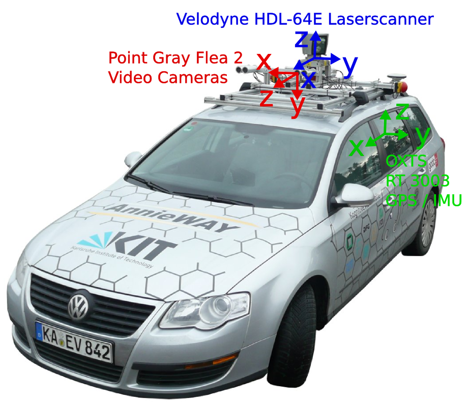

### 雷达原理

RADAR 是 Radio Detection And Ranging 的缩写，利用目标对电磁波的反射来测定障碍物的位置。雷达做四件事：检测目标有无、测量距离、测量速度、测量方位 [第4讲 雷达感知.pptx · p.8](http://10.188.31.55:5244/Nextcloud/School/Auto-Drive-Intro/%E3%80%8A%E6%99%BA%E8%83%BD%E9%A9%BE%E9%A9%B6%E5%AF%BC%E8%AE%BA%E3%80%8BPPT-2020/%E7%AC%AC4%E8%AE%B2%20%E9%9B%B7%E8%BE%BE%E6%84%9F%E7%9F%A5.pptx)。发射机发出电磁波，波打到目标后反射回来，接收机收下回波，回波与发射波之间的时间差对应距离。


### 毫米波雷达

**波长和波段。** 毫米波的波长在 1 cm 到 1 mm 之间，靠近太赫兹或者红外波段。工作波段是 30 GHz 到 300 GHz，车载雷达常用 24 GHz、60 GHz、77 GHz 和 120 GHz [第4讲 雷达感知.pptx · p.9](http://10.188.31.55:5244/Nextcloud/School/Auto-Drive-Intro/%E3%80%8A%E6%99%BA%E8%83%BD%E9%A9%BE%E9%A9%B6%E5%AF%BC%E8%AE%BA%E3%80%8BPPT-2020/%E7%AC%AC4%E8%AE%B2%20%E9%9B%B7%E8%BE%BE%E6%84%9F%E7%9F%A5.pptx)。发射形式是锥状波束。

**优点和缺点。** 优点是可靠，因为目标的反射面大，回波能量足。缺点是角度分辨力不高 [第4讲 雷达感知.pptx · p.9](http://10.188.31.55:5244/Nextcloud/School/Auto-Drive-Intro/%E3%80%8A%E6%99%BA%E8%83%BD%E9%A9%BE%E9%A9%B6%E5%AF%BC%E8%AE%BA%E3%80%8BPPT-2020/%E7%AC%AC4%E8%AE%B2%20%E9%9B%B7%E8%BE%BE%E6%84%9F%E7%9F%A5.pptx)。角度分辨力低直接限制了横向定位精度，这也是毫米波不能单独做车道级感知的原因。

**速度测量。** 用多普勒原理测径向速度：目标相对雷达有速度就改变回波频率，测出频率差就得到目标相对雷达的运动速度 [第4讲 雷达感知.pptx · p.10](http://10.188.31.55:5244/Nextcloud/School/Auto-Drive-Intro/%E3%80%8A%E6%99%BA%E8%83%BD%E9%A9%BE%E9%A9%B6%E5%AF%BC%E8%AE%BA%E3%80%8BPPT-2020/%E7%AC%AC4%E8%AE%B2%20%E9%9B%B7%E8%BE%BE%E6%84%9F%E7%9F%A5.pptx)。回波频率相对发射频率的偏移量与目标的径向速度成正比：

$$
f_d = \frac{2 v_r}{\lambda}
$$

其中 $f_d$ 是多普勒频移，$v_r$ 是径向速度分量，$\lambda$ 是雷达波长。速度只能测径向分量，这解释了为什么正前方横向通过的目标速度读数接近零。

**角度测量。** 靠有指向性的窄波束。相控阵天线用多根天线加信号处理合成窄波束，代价是功耗大、体积大 [第4讲 雷达感知.pptx · p.10](http://10.188.31.55:5244/Nextcloud/School/Auto-Drive-Intro/%E3%80%8A%E6%99%BA%E8%83%BD%E9%A9%BE%E9%A9%B6%E5%AF%BC%E8%AE%BA%E3%80%8BPPT-2020/%E7%AC%AC4%E8%AE%B2%20%E9%9B%B7%E8%BE%BE%E6%84%9F%E7%9F%A5.pptx)。速度还可以靠跟踪位置再做微分得到，课件把它作为补充手段。

**产品。** 课件给了两个代表：德尔福 Delphi ESR (Electronic Scanning Radar) 和大陆 Continental ARS 408-SC3。ARS 408 把远距窄视场和近距宽视场分开画，近距区域视野张开角度更大，远距区域收窄 [第4讲 雷达感知.pptx · p.11](http://10.188.31.55:5244/Nextcloud/School/Auto-Drive-Intro/%E3%80%8A%E6%99%BA%E8%83%BD%E9%A9%BE%E9%A9%B6%E5%AF%BC%E8%AE%BA%E3%80%8BPPT-2020/%E7%AC%AC4%E8%AE%B2%20%E9%9B%B7%E8%BE%BE%E6%84%9F%E7%9F%A5.pptx)。

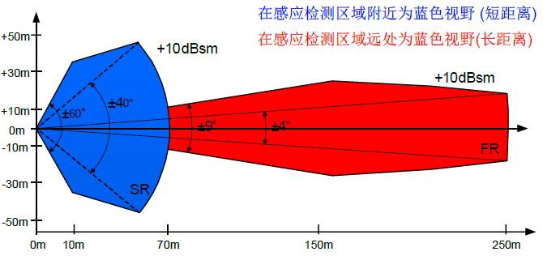

> [!NOTE]
> 毫米波雷达测的是相对速度，激光雷达测的是绝对位置。两者互补：一个给速度，一个给几何形状。这也是无人车传感器配置里两者都要的原因。

### 激光雷达

LiDAR 是 Light Detection And Ranging 的缩写。2012 年 5 月，谷歌自动驾驶汽车拿到美国内华达州车辆管理局 (DMV) 颁发的执照，这是美国历史上第一张自动驾驶汽车执照，激光雷达因此受到广泛关注 [第4讲 雷达感知.pptx · p.12](http://10.188.31.55:5244/Nextcloud/School/Auto-Drive-Intro/%E3%80%8A%E6%99%BA%E8%83%BD%E9%A9%BE%E9%A9%B6%E5%AF%BC%E8%AE%BA%E3%80%8BPPT-2020/%E7%AC%AC4%E8%AE%B2%20%E9%9B%B7%E8%BE%BE%E6%84%9F%E7%9F%A5.pptx)。

课件列了 Velodyne 系列的参数对比 [第4讲 雷达感知.pptx · p.13](http://10.188.31.55:5244/Nextcloud/School/Auto-Drive-Intro/%E3%80%8A%E6%99%BA%E8%83%BD%E9%A9%BE%E9%A9%B6%E5%AF%BC%E8%AE%BA%E3%80%8BPPT-2020/%E7%AC%AC4%E8%AE%B2%20%E9%9B%B7%E8%BE%BE%E6%84%9F%E7%9F%A5.pptx)：

| 型号 | 激光线数 | 水平分辨率 | 输出频率 | 测量范围 | 防护标准 |
| --- | --- | --- | --- | --- | --- |
| HDL-64E | 64 | 5 Hz | 130 万点/秒 | 100–120 M | IP67 |
| HDL-32E | 32 | 5 Hz | 70 万点/秒 | 80–120 M | IP67 |
| VLP-16/PUCK | 16 | 5 Hz | 30 万点/秒 | 100 M | IP67 |
| Ultra Puck-32A | 32 | 10 Hz | 70 万点/秒 | 200 M | IP67 |

VLP-16 是 16 线产品，接法是经 Ethernet 连电脑，雷达出厂 IP 192.168.1.201，可选接 INS/GPS [第4讲 雷达感知.pptx · p.14](http://10.188.31.55:5244/Nextcloud/School/Auto-Drive-Intro/%E3%80%8A%E6%99%BA%E8%83%BD%E9%A9%BE%E9%A9%B6%E5%AF%BC%E8%AE%BA%E3%80%8BPPT-2020/%E7%AC%AC4%E8%AE%B2%20%E9%9B%B7%E8%BE%BE%E6%84%9F%E7%9F%A5.pptx)。


国产激光雷达方面，课件给了四家：大疆 Livox、浩界 Horizon（为 L3/L4 无人驾驶设计，¥6499）、泰览 Tele-15（首款 500 米量程车载激光雷达，¥8999）、觅道 Mid 系列（高性价比工业级，¥3999）[第4讲 雷达感知.pptx · p.24](http://10.188.31.55:5244/Nextcloud/School/Auto-Drive-Intro/%E3%80%8A%E6%99%BA%E8%83%BD%E9%A9%BE%E9%A9%B6%E5%AF%BC%E8%AE%BA%E3%80%8BPPT-2020/%E7%AC%AC4%E8%AE%B2%20%E9%9B%B7%E8%BE%BE%E6%84%9F%E7%9F%A5.pptx)。觅道用全新的扫描方式，课件强调它的意义不只是低价，而是探索出激光雷达发展的一个新方向。

### 传感器部署

部署要解决三件事：感知范围、时间同步、传感器标定 [第4讲 雷达感知.pptx · p.15](http://10.188.31.55:5244/Nextcloud/School/Auto-Drive-Intro/%E3%80%8A%E6%99%BA%E8%83%BD%E9%A9%BE%E9%A9%B6%E5%AF%BC%E8%AE%BA%E3%80%8BPPT-2020/%E7%AC%AC4%E8%AE%B2%20%E9%9B%B7%E8%BE%BE%E6%84%9F%E7%9F%A5.pptx)。感知范围要画成侧视图和俯视图两张图，毫米波负责远处的锥形区域，激光雷达负责近处的环形扫描区，相机补中间 [第4讲 雷达感知.pptx · p.17](http://10.188.31.55:5244/Nextcloud/School/Auto-Drive-Intro/%E3%80%8A%E6%99%BA%E8%83%BD%E9%A9%BE%E9%A9%B6%E5%AF%BC%E8%AE%BA%E3%80%8BPPT-2020/%E7%AC%AC4%E8%AE%B2%20%E9%9B%B7%E8%BE%BE%E6%84%9F%E7%9F%A5.pptx)。课件给的雷诺配置是：前置激光雷达 + 前置相机 + 前置毫米波雷达 + 边角雷达 + 超声传感 + 180° 相机 [第4讲 雷达感知.pptx · p.16](http://10.188.31.55:5244/Nextcloud/School/Auto-Drive-Intro/%E3%80%8A%E6%99%BA%E8%83%BD%E9%A9%BE%E9%A9%B6%E5%AF%BC%E8%AE%BA%E3%80%8BPPT-2020/%E7%AC%AC4%E8%AE%B2%20%E9%9B%B7%E8%BE%BE%E6%84%9F%E7%9F%A5.pptx)。

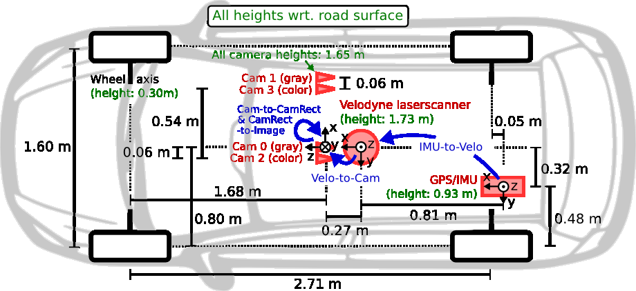

标定图里的数字是标定的输入：每个传感器相对车体基准的位置和安装高度、姿态角 [第4讲 雷达感知.pptx · p.18](http://10.188.31.55:5244/Nextcloud/School/Auto-Drive-Intro/%E3%80%8A%E6%99%BA%E8%83%BD%E9%A9%BE%E9%A9%B6%E5%AF%BC%E8%AE%BA%E3%80%8BPPT-2020/%E7%AC%AC4%E8%AE%B2%20%E9%9B%B7%E8%BE%BE%E6%84%9F%E7%9F%A5.pptx)。装了标定参数，激光点才能从雷达坐标系转到车身坐标系，再拼成一张完整的环境图。

### 感知系统的任务

感知系统做的事是把原始数据转化为智能车可识别的环境信息，主要实现检测和定位两大功能 [第4讲 雷达感知.pptx · p.21](http://10.188.31.55:5244/Nextcloud/School/Auto-Drive-Intro/%E3%80%8A%E6%99%BA%E8%83%BD%E9%A9%BE%E9%A9%B6%E5%AF%BC%E8%AE%BA%E3%80%8BPPT-2020/%E7%AC%AC4%E8%AE%B2%20%E9%9B%B7%E8%BE%BE%E6%84%9F%E7%9F%A5.pptx)。

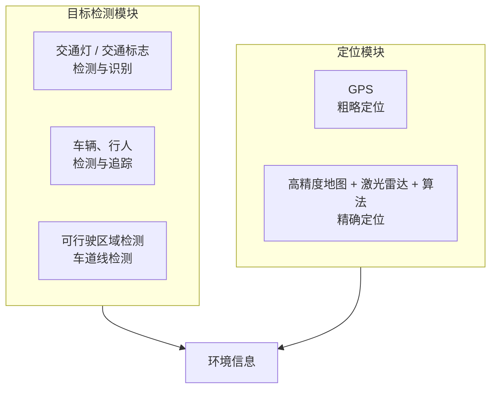

LiDAR 在智能驾驶里的应用被课件归成六项：可行区域检测、路沿检测、路面分割、车道线检测、目标检测与识别（车辆、行人）、地图构建与定位（SLAM）[第4讲 雷达感知.pptx · p.22](http://10.188.31.55:5244/Nextcloud/School/Auto-Drive-Intro/%E3%80%8A%E6%99%BA%E8%83%BD%E9%A9%BE%E9%A9%B6%E5%AF%BC%E8%AE%BA%E3%80%8BPPT-2020/%E7%AC%AC4%E8%AE%B2%20%E9%9B%B7%E8%BE%BE%E6%84%9F%E7%9F%A5.pptx)。

### 激光数据与 PCL

激光数据有四个特点：简单，每个点只有 $x$、$y$、$z$ 和反射强度 $i$；精确，精度到 2 cm；稀疏；无序 [第4讲 雷达感知.pptx · p.25](http://10.188.31.55:5244/Nextcloud/School/Auto-Drive-Intro/%E3%80%8A%E6%99%BA%E8%83%BD%E9%A9%BE%E9%A9%B6%E5%AF%BC%E8%AE%BA%E3%80%8BPPT-2020/%E7%AC%AC4%E8%AE%B2%20%E9%9B%B7%E8%BE%BE%E6%84%9F%E7%9F%A5.pptx)。雷达直接输出距离和角度，点云是这些测量解算到车体坐标系后的结果。工程上处理点云的标准工具是 PCL (The Point Cloud Library) [第二章-行车环境感知-激光雷达和点云.pptx · p.25](http://10.188.31.55:5244/Nextcloud/School/Auto-Drive-Intro/%E8%AF%BE%E4%BB%B6/%E7%AC%AC%E4%BA%8C%E7%AB%A0-%E8%A1%8C%E8%BD%A6%E7%8E%AF%E5%A2%83%E6%84%9F%E7%9F%A5-%E6%BF%80%E5%85%89%E9%9B%B7%E8%BE%BE%E5%92%8C%E7%82%B9%E4%BA%91.pptx)。

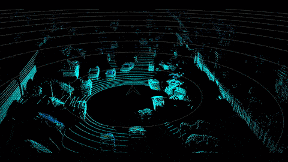

### 可行区域检测

**为什么要分割地面。** 自动驾驶车辆需要快速识别可行驶区域，而地面分割是障碍物检测和识别的先决条件 [第4讲 雷达感知.pptx · p.26](http://10.188.31.55:5244/Nextcloud/School/Auto-Drive-Intro/%E3%80%8A%E6%99%BA%E8%83%BD%E9%A9%BE%E9%A9%B6%E5%AF%BC%E8%AE%BA%E3%80%8BPPT-2020/%E7%AC%AC4%E8%AE%B2%20%E9%9B%B7%E8%BE%BE%E6%84%9F%E7%9F%A5.pptx)。

**难点。** 激光雷达点云数据通常是稀疏的、不均匀的，提取特征有困难。另一个问题是地面、路面、可行驶区域三者在概念上并不等价：坡道、起伏路面、路面上的积水都会打破这个等式。

> [!WARNING]
> 把地面直接当成可行驶区域，在有坡道和起伏的路段会出错。分割出来的地面只给出高度为零的参考平面，可行驶区域还要叠加道路语义。

**分割方法。** 课件把方法分成三类 [第4讲 雷达感知.pptx · p.27](http://10.188.31.55:5244/Nextcloud/School/Auto-Drive-Intro/%E3%80%8A%E6%99%BA%E8%83%BD%E9%A9%BE%E9%A9%B6%E5%AF%BC%E8%AE%BA%E3%80%8BPPT-2020/%E7%AC%AC4%E8%AE%B2%20%E9%9B%B7%E8%BE%BE%E6%84%9F%E7%9F%A5.pptx)：

- **基于几何特征的方法**：高度阈值、栅格高度差、平均高度，还有法向量。做法是按栅格把点云切块，比较块内高度关系。
- **基于模型的方法**：用最优化方法在点云中找平面，模型是平面方程，最小二乘法或 RANSAC (RANdom SAmple Consensus) 求解。
- **基于 CNN 网络的方法**：把点云组织成体素或投影图交给卷积网络做分类。

平面拟合的模型写成齐次形式，系数向量由最小二乘解出：

$$
a x + b y + c z + d = 0
$$

RANSAC 在这里的作用是抗离群点：随机取三点定一个平面，数一下有多少点落在平面附近，取内点最多的那个模型，再用所有内点重新做最小二乘。

**路面分割结果。** 课件给的分割结果里，红色是识别出的地面区域，黑色是未分类点 [第4讲 雷达感知.pptx · p.28](http://10.188.31.55:5244/Nextcloud/School/Auto-Drive-Intro/%E3%80%8A%E6%99%BA%E8%83%BD%E9%A9%BE%E9%A9%B6%E5%AF%BC%E8%AE%BA%E3%80%8BPPT-2020/%E7%AC%AC4%E8%AE%B2%20%E9%9B%B7%E8%BE%BE%E6%84%9F%E7%9F%A5.pptx)。


**基于反射率阈值的车道线检测。** 车道漆面的反射率与沥青路面差一个量级，把反射率超过阈值的点筛出来就能得到车道线候选 [第4讲 雷达感知.pptx · p.29](http://10.188.31.55:5244/Nextcloud/School/Auto-Drive-Intro/%E3%80%8A%E6%99%BA%E8%83%BD%E9%A9%BE%E9%A9%B6%E5%AF%BC%E8%AE%BA%E3%80%8BPPT-2020/%E7%AC%AC4%E8%AE%B2%20%E9%9B%B7%E8%BE%BE%E6%84%9F%E7%9F%A5.pptx)。

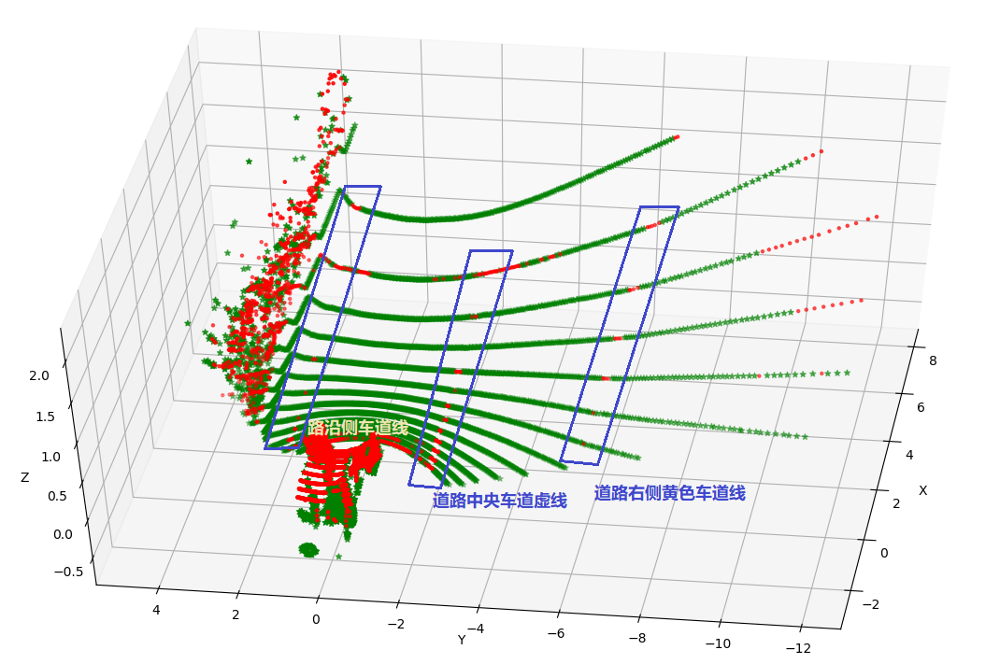

### 目标识别的四个方案

**方案一：点云投影到透视图。** 把点云投影到透视图中，再套用图像分割和特征提取技术 [第4讲 雷达感知.pptx · p.32](http://10.188.31.55:5244/Nextcloud/School/Auto-Drive-Intro/%E3%80%8A%E6%99%BA%E8%83%BD%E9%A9%BE%E9%A9%B6%E5%AF%BC%E8%AE%BA%E3%80%8BPPT-2020/%E7%AC%AC4%E8%AE%B2%20%E9%9B%B7%E8%BE%BE%E6%84%9F%E7%9F%A5.pptx)。这条路的代价是投影把三维压成二维，深度信息丢了。


**方案二：基于 3D 几何特性。** 直接在三维点云上做检测，用几何特性投票决定哪个点属于目标。课件引用了 D. Z. Wang 和 I. Posner 的 Voting for Voting in Online Point Cloud Object Detection (RSS 2015) [第4讲 雷达感知.pptx · p.33](http://10.188.31.55:5244/Nextcloud/School/Auto-Drive-Intro/%E3%80%8A%E6%99%BA%E8%83%BD%E9%A9%BE%E9%A9%B6%E5%AF%BC%E8%AE%BA%E3%80%8BPPT-2020/%E7%AC%AC4%E8%AE%B2%20%E9%9B%B7%E8%BE%BE%E6%84%9F%E7%9F%A5.pptx)。

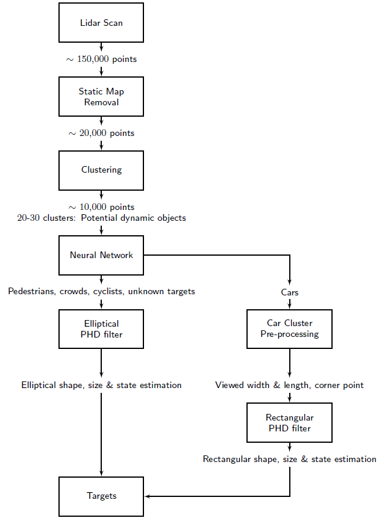

**方案三：深度学习 PointNet。** 直接处理点云数据的神经网络结构，三个主要任务是 3D 对象分类、对象零件分割和大场景下的语义分割 [第4讲 雷达感知.pptx · p.34](http://10.188.31.55:5244/Nextcloud/School/Auto-Drive-Intro/%E3%80%8A%E6%99%BA%E8%83%BD%E9%A9%BE%E9%A9%B6%E5%AF%BC%E8%AE%BA%E3%80%8BPPT-2020/%E7%AC%AC4%E8%AE%B2%20%E9%9B%B7%E8%BE%BE%E6%84%9F%E7%9F%A5.pptx)。课件引用 C. R. Qi 等人的 PointNet (CVPR 2017)。PointNet 的结构特点是分类网络和分割网络各有一路 T-Net 负责把输入对齐到规范空间。


**方案四：激光 + 视觉融合。** 激光给几何，视觉给纹理，两者互补。课件引用了 Xiaozhi Chen 等人的 Multi-View 3D Object Detection Network (CVPR 2017) [第4讲 雷达感知.pptx · p.36](http://10.188.31.55:5244/Nextcloud/School/Auto-Drive-Intro/%E3%80%8A%E6%99%BA%E8%83%BD%E9%A9%BE%E9%A9%B6%E5%AF%BC%E8%AE%BA%E3%80%8BPPT-2020/%E7%AC%AC4%E8%AE%B2%20%E9%9B%B7%E8%BE%BE%E6%84%9F%E7%9F%A5.pptx)。


### 感知的未来

课件给了四条走向 [第4讲 雷达感知.pptx · p.39](http://10.188.31.55:5244/Nextcloud/School/Auto-Drive-Intro/%E3%80%8A%E6%99%BA%E8%83%BD%E9%A9%BE%E9%A9%B6%E5%AF%BC%E8%AE%BA%E3%80%8BPPT-2020/%E7%AC%AC4%E8%AE%B2%20%E9%9B%B7%E8%BE%BE%E6%84%9F%E7%9F%A5.pptx)：传感器迭代非常快；深度学习 + 仿真数据 + 车载 AI 芯片成为主线；智能交通设施普及、V2X 铺开；人工智能技术本身继续往上抬感知上限。

## 第 5 章 路径规划

本章讲路径规划。课件由陈白帆讲师在中南大学自动化学院于 2020 年 3 月讲授 [第5讲 路径规划.pptx · p.1](http://10.188.31.55:5244/Nextcloud/School/Auto-Drive-Intro/%E3%80%8A%E6%99%BA%E8%83%BD%E9%A9%BE%E9%A9%B6%E5%AF%BC%E8%AE%BA%E3%80%8BPPT-2020/%E7%AC%AC5%E8%AE%B2%20%E8%B7%AF%E5%BE%84%E8%A7%84%E5%88%92.pptx)。

路径规划在自动驾驶里有两层含义。**全局路径规划**在一定的环境模型基础上，给定起点和目标点，按照性能指标规划出一条无碰撞、能安全到达目标点的有效路径。**运动规划 / 轨迹规划**在车辆运动过程中，根据感知系统反馈的障碍信息做局部运动规划；当判断前方障碍物无法满足车辆期望速度、或者预测会碰撞时，局部规划器规划一条避障路径，避障之后返回原路径，继续向目标点运动 [第5讲 路径规划.pptx · p.3](http://10.188.31.55:5244/Nextcloud/School/Auto-Drive-Intro/%E3%80%8A%E6%99%BA%E8%83%BD%E9%A9%BE%E9%A9%B6%E5%AF%BC%E8%AE%BA%E3%80%8BPPT-2020/%E7%AC%AC5%E8%AE%B2%20%E8%B7%AF%E5%BE%84%E8%A7%84%E5%88%92.pptx)。

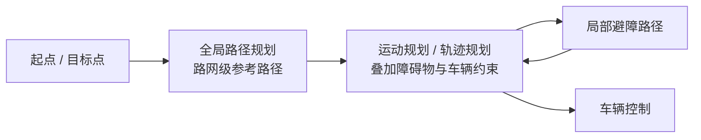

产品上的衔接通常做三层：导航地图出道路级路径，HD Map 出车道级路径，自动驾驶系统再在车道级路径上做避障 [第5讲 路径规划.pptx · p.3](http://10.188.31.55:5244/Nextcloud/School/Auto-Drive-Intro/%E3%80%8A%E6%99%BA%E8%83%BD%E9%A9%BE%E9%A9%B6%E5%AF%BC%E8%AE%BA%E3%80%8BPPT-2020/%E7%AC%AC5%E8%AE%B2%20%E8%B7%AF%E5%BE%84%E8%A7%84%E5%88%92.pptx)。

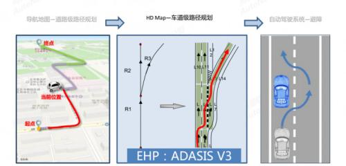

全局规划的结果是一条无碰撞的可行路径。下图里红色折线是障碍物边界，左下角的自车拖出一片绿色格状位姿扇面，青色与黄色是两条候选路径曲线，右上角方块里是目标位置 [第5讲 路径规划.pptx · p.4](http://10.188.31.55:5244/Nextcloud/School/Auto-Drive-Intro/%E3%80%8A%E6%99%BA%E8%83%BD%E9%A9%BE%E9%A9%B6%E5%AF%BC%E8%AE%BA%E3%80%8BPPT-2020/%E7%AC%AC5%E8%AE%B2%20%E8%B7%AF%E5%BE%84%E8%A7%84%E5%88%92.pptx)。

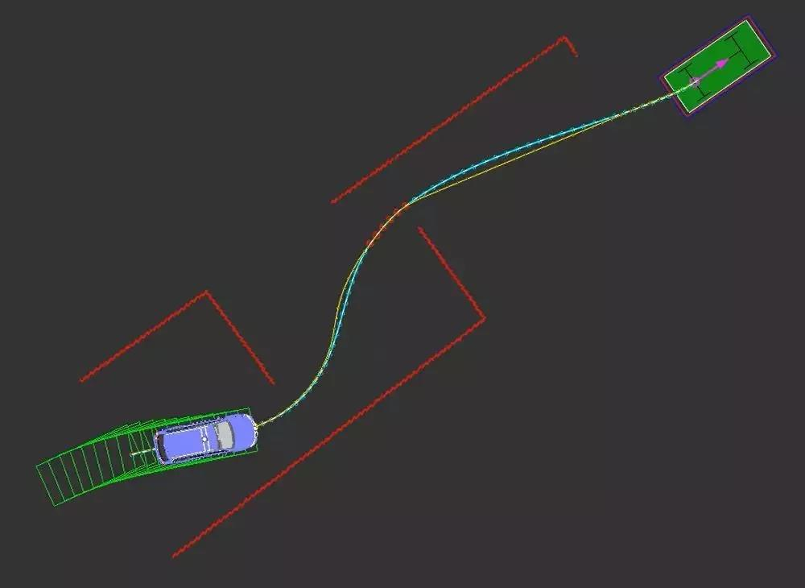

### 路径规划方法的分类

课件把路径规划算法分成五类，每类给出代表算法 [第5讲 路径规划.pptx · p.5](http://10.188.31.55:5244/Nextcloud/School/Auto-Drive-Intro/%E3%80%8A%E6%99%BA%E8%83%BD%E9%A9%BE%E9%A9%B6%E5%AF%BC%E8%AE%BA%E3%80%8BPPT-2020/%E7%AC%AC5%E8%AE%B2%20%E8%B7%AF%E5%BE%84%E8%A7%84%E5%88%92.pptx)：

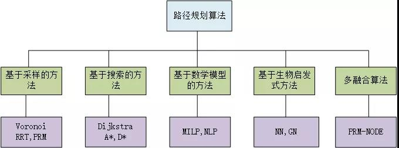

- **基于采样的方法**：Voronoi、RRT、PRM。
- **基于搜索的方法**：Dijkstra、A\*、D\*。
- **基于数学模型的方法**：MILP、NLP。
- **基于生物启发式方法**：NN、GN。
- **多融合算法**：PRM-NODE。

### 概率图算法 PRM

PRM（Probabilistic Road Map）的做法是：在规划空间内随机选取 $N$ 个节点，连接各节点，并去除与障碍物接触的连线，由此得到一个可行路径 [第5讲 路径规划.pptx · p.6](http://10.188.31.55:5244/Nextcloud/School/Auto-Drive-Intro/%E3%80%8A%E6%99%BA%E8%83%BD%E9%A9%BE%E9%A9%B6%E5%AF%BC%E8%AE%BA%E3%80%8BPPT-2020/%E7%AC%AC5%E8%AE%B2%20%E8%B7%AF%E5%BE%84%E8%A7%84%E5%88%92.pptx)。把这一步写成数学形式，就是构造一个概率路网图 $G_N=(V,E)$：

$$
\begin{aligned}
V&=\{v_1,\dots,v_N\},\quad v_i \overset{\text{i.i.d.}}{\sim} \mathcal{U}(C_{\text{free}})\\
E&=\bigl\{(v_i,v_j)\ \big|\ \|v_i-v_j\|<r,\ \overline{v_iv_j}\cap C_{\text{obs}}=\varnothing\bigr\}
\end{aligned}
$$

$V$ 是随机采样出来的自由空间节点，$E$ 是通过碰撞检测的候选边，$\overline{v_iv_j}$ 是两点之间的线段。下图中黑色是障碍物，灰色圆点是采样节点，灰线是候选边，绿色是从 $q_{\text{init}}$ 到 $q_{\text{goal}}$ 的搜索结果路径。


完备性上，PRM 是**概率完备**的：采样点足够多、且在自由空间中的分布覆盖了狭窄通道时，找到解的概率随采样次数增加趋于 1。课件明确指出，当采样点太少或者分布不合理时 PRM 算法不完备；增加采样点使该算法达到完备，但不是最优的 [第5讲 路径规划.pptx · p.6](http://10.188.31.55:5244/Nextcloud/School/Auto-Drive-Intro/%E3%80%8A%E6%99%BA%E8%83%BD%E9%A9%BE%E9%A9%B6%E5%AF%BC%E8%AE%BA%E3%80%8BPPT-2020/%E7%AC%AC5%E8%AE%B2%20%E8%B7%AF%E5%BE%84%E8%A7%84%E5%88%92.pptx)。

> [!NOTE] **概率完备与最优是两件事**
> 完备只保证「找得到」，不保证「找得好」。PRM 增加采样点解决的是前者，路径质量靠后处理（路径平滑、重新优化）解决。

### 快速随机扩展树 RRT

RRT（Rapidly-exploring Random Tree）的做法是：以起点作为根节点，通过随机采样增加叶子节点的方式，递增地构造一个搜索树；生成随机树后，当树中的叶子节点包含了目标区域，便可以在随机树中获得从起点到目标点的路径 [第5讲 路径规划.pptx · p.7](http://10.188.31.55:5244/Nextcloud/School/Auto-Drive-Intro/%E3%80%8A%E6%99%BA%E8%83%BD%E9%A9%BE%E9%A9%B6%E5%AF%BC%E8%AE%BA%E3%80%8BPPT-2020/%E7%AC%AC5%E8%AE%B2%20%E8%B7%AF%E5%BE%84%E8%A7%84%E5%88%92.pptx)。

写成数学形式，每一轮迭代做三件事。采样一个随机点，在树中找离它最近的节点，然后朝它迈出固定步长：

$$
\begin{aligned}
x_{\text{rand}}&\sim \mathcal{U}(C_{\text{free}})\\
x_{\text{near}}&=\arg\min_{x\in \mathcal{T}}\|x-x_{\text{rand}}\|\\
x_{\text{new}}&=x_{\text{near}}+\frac{x_{\text{rand}}-x_{\text{near}}}{\|x_{\text{rand}}-x_{\text{near}}\|}\cdot\Delta
\end{aligned}
$$

$\Delta$ 是步长，$\mathcal{T}$ 是当前树。若 $x_{\text{new}}$ 落在自由空间内，就把它作为新叶子挂到 $x_{\text{near}}$ 上；否则丢弃本次采样。


RRT 的取样偏向障碍物附近，所以树能快速伸向狭窄通道。它同样是概率完备的：采样次数足够多时找到解的概率趋于 1，但路径质量没有保证。

### 基于搜索的方法：Dijkstra 与 A\*

**Dijkstra 算法**是一种贪心算法，使用宽度优先搜索解决权有向图的最短路径问题。课件指出它的两个问题：局部最优，算法的时间复杂度较高，很难满足路径规划实时性的要求 [第5讲 路径规划.pptx · p.8](http://10.188.31.55:5244/Nextcloud/School/Auto-Drive-Intro/%E3%80%8A%E6%99%BA%E8%83%BD%E9%A9%BE%E9%A9%B6%E5%AF%BC%E8%AE%BA%E3%80%8BPPT-2020/%E7%AC%AC5%E8%AE%B2%20%E8%B7%AF%E5%BE%84%E8%A7%84%E5%88%92.pptx)。它扩展节点时用的评价函数只有已走代价 $f(n)=g(n)$，$g(n)$ 是起点到节点 $n$ 的累计代价。Dijkstra 保证了最优解，代价是要把几乎整个连通分量都扩展一遍。用二叉堆实现的复杂度是 $O\bigl(|E|+|V|\log|V|\bigr)$，稠密图上退化到 $O(|V|^2)$。

**A\* 算法**引入启发式函数，利用带有启发式值的估价函数来评估路径中顶点的价值，最后再决定采用哪一种方案。它能够同时满足实时性和最优性要求 [第5讲 路径规划.pptx · p.8](http://10.188.31.55:5244/Nextcloud/School/Auto-Drive-Intro/%E3%80%8A%E6%99%BA%E8%83%BD%E9%A9%BE%E9%A9%B6%E5%AF%BC%E8%AE%BA%E3%80%8BPPT-2020/%E7%AC%AC5%E8%AE%B2%20%E8%B7%AF%E5%BE%84%E8%A7%84%E5%88%92.pptx)：评价函数是 $f(n)=g(n)+h(n)$，$h(n)$ 是从 $n$ 到目标的估价。若 $h(n)$ 不高估真实剩余代价（可采纳，admissible），A\* 仍然返回最优解，但扩展的节点数比 Dijkstra 少得多。在栅格地图上，直线距离 $h(n)=\|n-n_{\text{goal}}\|$ 就是最常用的可采纳启发式。

课件把两个算法的结果并排放在同一张栅格地图上。蓝色是已扩展的节点，品红是回溯得到的路径，黑色是障碍墙，绿色方块是起点，红色方块是终点，黄色是路径两侧的格子 [第5讲 路径规划.pptx · p.8](http://10.188.31.55:5244/Nextcloud/School/Auto-Drive-Intro/%E3%80%8A%E6%99%BA%E8%83%BD%E9%A9%BE%E9%A9%B6%E5%AF%BC%E8%AE%BA%E3%80%8BPPT-2020/%E7%AC%AC5%E8%AE%B2%20%E8%B7%AF%E5%BE%84%E8%A7%84%E5%88%92.pptx)。


两张图的差别就是 $h(n)$ 带来的：加进估价函数之后，扩展的格子数少了一个量级。

### Frenet 坐标系

Frenet 坐标系以车辆自身为原点，使用道路的中心线作为参考线，使用参考线的切线向量和法线向量建立坐标系，更适合处理带约束的无人车路径规划问题 [第5讲 路径规划.pptx · p.9](http://10.188.31.55:5244/Nextcloud/School/Auto-Drive-Intro/%E3%80%8A%E6%99%BA%E8%83%BD%E9%A9%BE%E9%A9%B6%E5%AF%BC%E8%AE%BA%E3%80%8BPPT-2020/%E7%AC%AC5%E8%AE%B2%20%E8%B7%AF%E5%BE%84%E8%A7%84%E5%88%92.pptx)。


把坐标变换写成数学形式。设参考线为以弧长参数化的曲线 $r(s)=(x(s),y(s))$，则单位切向量和单位法向量分别是 $t(s)=r'(s)/\|r'(s)\|$ 与 $n(s)=(-t_y(s),\,t_x(s))$。任意点 $p$ 的 Frenet 坐标 $(s,d)$ 由下式给出，其中 $s$ 是 $p$ 在参考线上的投影弧长，$d$ 是带符号的横向距离：

$$
p=r(s)+d\cdot n(s)
$$

反过来，从笛卡尔坐标 $(x,y)$ 求 Frenet 坐标，就是解一个投影方程：

$$
s=\arg\min_{\sigma}\bigl\|p-r(\sigma)\bigr\|,\qquad
d=\bigl(p-r(s)\bigr)\cdot n(s)
$$

课件的备注把 Frenet 的好处讲得更具体：使用纵向距离和横向距离来描述任意位置，同时纵向和横向的速度、加速度、加加速度等信息也更便于计算；基于 Frenet 坐标系的轨迹规划方法，在高速情况下的车道保持和换道过程中都具有很强的实用性 [第5讲 路径规划.pptx · p.9](http://10.188.31.55:5244/Nextcloud/School/Auto-Drive-Intro/%E3%80%8A%E6%99%BA%E8%83%BD%E9%A9%BE%E9%A9%B6%E5%AF%BC%E8%AE%BA%E3%80%8BPPT-2020/%E7%AC%AC5%E8%AE%B2%20%E8%B7%AF%E5%BE%84%E8%A7%84%E5%88%92.pptx)。

> [!IMPORTANT] **Frenet 把约束解耦了**
> 车道保持和换道在 Frenet 下变成「$d$ 方向怎么动」和「$s$ 方向怎么动」两个独立问题，路宽、限速这类以道路为基准的约束也直接落在 $d$ 和 $s$ 上。

### 轨迹生成

**横向轨迹的生成。** 在规划的路径中「撒点」采样生成 Trajectory Point。一条轨迹就可以看成是沿着 Lane 的中心线纵向位移方向，连接不同 Trajectory Point 的平滑曲线。课件的做法是采用多项式曲线连接轨迹点，生成候选曲线 [第5讲 路径规划.pptx · p.10](http://10.188.31.55:5244/Nextcloud/School/Auto-Drive-Intro/%E3%80%8A%E6%99%BA%E8%83%BD%E9%A9%BE%E9%A9%B6%E5%AF%BC%E8%AE%BA%E3%80%8BPPT-2020/%E7%AC%AC5%E8%AE%B2%20%E8%B7%AF%E5%BE%84%E8%A7%84%E5%88%92.pptx)。课件插图里列出一次、三次、五次三种多项式曲线，式中 $s$、$v$ 用的是课件的符号：

$$
\begin{aligned}
v&=k_1 s+k_0\\
v&=k_3 s^3+k_2 s^2+k_1 s+k_0\\
v&=k_5 s^5+k_4 s^4+k_3 s^3+k_2 s^2+k_1 s+k_0
\end{aligned}
$$

**速度规划。** 已知当前的速度信息以及目标的速度信息，需要生成一条平滑的速度曲线，从当前速度到目标速度，同时这个过程中应尽可能保持平顺，避免急加速、急减速。课件把它说成：在二维空间中，给定起点和终点状态，计算一条连接两点的平滑曲线 [第5讲 路径规划.pptx · p.11](http://10.188.31.55:5244/Nextcloud/School/Auto-Drive-Intro/%E3%80%8A%E6%99%BA%E8%83%BD%E9%A9%BE%E9%A9%B6%E5%AF%BC%E8%AE%BA%E3%80%8BPPT-2020/%E7%AC%AC5%E8%AE%B2%20%E8%B7%AF%E5%BE%84%E8%A7%84%E5%88%92.pptx)。

课件用四个符号描述运动状态：$s$ 是 distance（距离），$v$ 是 velocity（速度），$a$ 是 acceleration（加速度），$j$ 是 jerk（加加速度）。起点和终点各自带一组状态：

$$
(s_1,v_1,a_1,j_1)\ \longrightarrow\ (s_2,v_2,a_2,j_2)
$$


用五次多项式做速度曲线，正好六个边界条件对应六个系数：$v(s_1)=v_1,\ v'(s_1)=a_1,\ v''(s_1)=j_1$ 与 $v(s_2)=v_2,\ v'(s_2)=a_2,\ v''(s_2)=j_2$。

其中 $v'(s)=a(s)$ 是加速度，$v''(s)=j(s)$ 是加加速度。课件备注说，在不考虑避障的情况下，通常使横向的加加速度最小化来提高换道时的平顺性 [第5讲 路径规划.pptx · p.9](http://10.188.31.55:5244/Nextcloud/School/Auto-Drive-Intro/%E3%80%8A%E6%99%BA%E8%83%BD%E9%A9%BE%E9%A9%B6%E5%AF%BC%E8%AE%BA%E3%80%8BPPT-2020/%E7%AC%AC5%E8%AE%B2%20%E8%B7%AF%E5%BE%84%E8%A7%84%E5%88%92.pptx)。

### 轨迹生成的约束条件

除损失函数的约束以外，路径规划过程中还有许多硬约束条件 [第5讲 路径规划.pptx · p.12](http://10.188.31.55:5244/Nextcloud/School/Auto-Drive-Intro/%E3%80%8A%E6%99%BA%E8%83%BD%E9%A9%BE%E9%A9%B6%E5%AF%BC%E8%AE%BA%E3%80%8BPPT-2020/%E7%AC%AC5%E8%AE%B2%20%E8%B7%AF%E5%BE%84%E8%A7%84%E5%88%92.pptx)：

- 不能碰撞障碍物。
- 不能超过允许的最大速度 $v\le v_{\max}$。
- 不能超过允许的最大加速度 $|a|\le a_{\max}$。
- 转弯半径或者说曲率不能超过允许的最大值。

最后一条在 Frenet 下有现成的表达。横向偏移 $d(s)$ 对应的路径曲率是：

$$
\kappa=\frac{d''(s)}{\bigl(1+d'(s)^2\bigr)^{3/2}},\qquad |\kappa|\le \kappa_{\max}=\frac{1}{R_{\min}}
$$

$d'(s)$ 是横向偏移对纵向距离的导数，也就是路径相对参考线的切角变化率。

### 最优轨迹选择

有了候选轨迹和损失函数之后，还要在候选里挑一条最优的。课件在较高速度的情况下给出横向代价函数：

$$
C_d = k_j\,J_t\bigl(d(t)\bigr)+k_t\,T+k_d\,d_1^2
$$

这个损失函数包含三个惩罚项 [第5讲 路径规划.pptx · p.13](http://10.188.31.55:5244/Nextcloud/School/Auto-Drive-Intro/%E3%80%8A%E6%99%BA%E8%83%BD%E9%A9%BE%E9%A9%B6%E5%AF%BC%E8%AE%BA%E3%80%8BPPT-2020/%E7%AC%AC5%E8%AE%B2%20%E8%B7%AF%E5%BE%84%E8%A7%84%E5%88%92.pptx)：

- 第 1 项 $k_j J_t(d(t))$：惩罚 Jerk 大的备选轨迹，$J_t(d(t))$ 记的是横向偏移 $d(t)$ 的 Jerk 代价。
- 第 2 项 $k_t T$：制动应当迅速，时间短，课件把时间量记作 $T$。
- 第 3 项 $k_d d_1^2$：目标状态不应偏离道路中心线太远，$d_1$ 是目标状态的横向偏差。

三项都是越小越好，所以最小化 $C_d$ 就是同时追求平顺、快、贴中心线。

撒点采样加多项式连接给出的候选轨迹族长这样：黑色细线是各条备选轨迹，绿色是选出来的那条，纵轴是横向偏移 $d$（米），横轴是时间 $t$（秒），绿点是轨迹上的采样点 [第5讲 路径规划.pptx · p.13](http://10.188.31.55:5244/Nextcloud/School/Auto-Drive-Intro/%E3%80%8A%E6%99%BA%E8%83%BD%E9%A9%BE%E9%A9%B6%E5%AF%BC%E8%AE%BA%E3%80%8BPPT-2020/%E7%AC%AC5%E8%AE%B2%20%E8%B7%AF%E5%BE%84%E8%A7%84%E5%88%92.pptx)。


**轨迹选择。** 将路径规划在 Frenet 的基础上进行分解求解：在 $s$ 方向即纵向求解最优路径，在 $d$ 方向即横向求解最优解，从而形成合成的最优化轨迹 [第5讲 路径规划.pptx · p.14](http://10.188.31.55:5244/Nextcloud/School/Auto-Drive-Intro/%E3%80%8A%E6%99%BA%E8%83%BD%E9%A9%BE%E9%A9%B6%E5%AF%BC%E8%AE%BA%E3%80%8BPPT-2020/%E7%AC%AC5%E8%AE%B2%20%E8%B7%AF%E5%BE%84%E8%A7%84%E5%88%92.pptx)。


右侧两组图把同一个问题拆成两问：横向那组图问「哪一条换道曲线最优」，纵向那组图问「哪一条纵向曲线最优」，各自的最优解合起来就是最终轨迹。

课件最后给出一组实测数据的拟合结果，横轴是采样序号，纵轴是速度，红色是拟合出的速度曲线，绿色圆点是落在曲线上的实测点，蓝色圆点是离群点 [第5讲 路径规划.pptx · p.15](http://10.188.31.55:5244/Nextcloud/School/Auto-Drive-Intro/%E3%80%8A%E6%99%BA%E8%83%BD%E9%A9%BE%E9%A9%B6%E5%AF%BC%E8%AE%BA%E3%80%8BPPT-2020/%E7%AC%AC5%E8%AE%B2%20%E8%B7%AF%E5%BE%84%E8%A7%84%E5%88%92.pptx)。

![速度曲线拟合结果，标题 speed[km/h]:12.2，横轴是采样点序号，纵轴是速度，红色是拟合出的曲线，绿色圆点是落在曲线上的实测点，蓝色圆点是离群点，曲线先降到 -4 左右再升到 7](images/fig-l5-15.png)

## 第 6 章 地图与定位

这一讲由中南大学自动化学院陈白帆老师讲授，课件是《智能驾驶导论》PPT-2020 的第 6 讲。讲的是无人车怎么回答三个问题：我在哪里、这是什么地方、我到哪里去。课件分三段：系统建模 [第6讲 地图与定位.pptx · p.2](http://10.188.31.55:5244/Nextcloud/School/Auto-Drive-Intro/%E3%80%8A%E6%99%BA%E8%83%BD%E9%A9%BE%E9%A9%B6%E5%AF%BC%E8%AE%BA%E3%80%8BPPT-2020/%E7%AC%AC6%E8%AE%B2%20%E5%9C%B0%E5%9B%BE%E4%B8%8E%E5%AE%9A%E4%BD%8D.pptx)、地图创建 [第6讲 地图与定位.pptx · p.9](http://10.188.31.55:5244/Nextcloud/School/Auto-Drive-Intro/%E3%80%8A%E6%99%BA%E8%83%BD%E9%A9%BE%E9%A9%B6%E5%AF%BC%E8%AE%BA%E3%80%8BPPT-2020/%E7%AC%AC6%E8%AE%B2%20%E5%9C%B0%E5%9B%BE%E4%B8%8E%E5%AE%9A%E4%BD%8D.pptx)、定位 [第6讲 地图与定位.pptx · p.14](http://10.188.31.55:5244/Nextcloud/School/Auto-Drive-Intro/%E3%80%8A%E6%99%BA%E8%83%BD%E9%A9%BE%E9%A9%B6%E5%AF%BC%E8%AE%BA%E3%80%8BPPT-2020/%E7%AC%AC6%E8%AE%B2%20%E5%9C%B0%E5%9B%BE%E4%B8%8E%E5%AE%9A%E4%BD%8D.pptx)。

### 终极三问

无人车的全部任务挂在三个问句上：我在哪里 → 定位，这是什么地方 → 建图，我到哪里去 → 路径规划 [第6讲 地图与定位.pptx · p.3](http://10.188.31.55:5244/Nextcloud/School/Auto-Drive-Intro/%E3%80%8A%E6%99%BA%E8%83%BD%E9%A9%BE%E9%A9%B6%E5%AF%BC%E8%AE%BA%E3%80%8BPPT-2020/%E7%AC%AC6%E8%AE%B2%20%E5%9C%B0%E5%9B%BE%E4%B8%8E%E5%AE%9A%E4%BD%8D.pptx)。

三问串成一个 see-think-act 循环。课件画的图把 AI 和 Robotics 放在两侧：左边 Knowledge Representation、Reasoning、Learning，中间 see-think-act 环，右边 Path Planning、Localization、Map、Execution、Actuation [第6讲 地图与定位.pptx · p.4](http://10.188.31.55:5244/Nextcloud/School/Auto-Drive-Intro/%E3%80%8A%E6%99%BA%E8%83%BD%E9%A9%BE%E9%A9%B6%E5%AF%BC%E8%AE%BA%E3%80%8BPPT-2020/%E7%AC%AC6%E8%AE%B2%20%E5%9C%B0%E5%9B%BE%E4%B8%8E%E5%AE%9A%E4%BD%8D.pptx)。


### 系统建模

移动机器人的动态系统用两个方程建模，课件先给通用形式，再给机器人上的具体形式 [第6讲 地图与定位.pptx · p.6](http://10.188.31.55:5244/Nextcloud/School/Auto-Drive-Intro/%E3%80%8A%E6%99%BA%E8%83%BD%E9%A9%BE%E9%A9%B6%E5%AF%BC%E8%AE%BA%E3%80%8BPPT-2020/%E7%AC%AC6%E8%AE%B2%20%E5%9C%B0%E5%9B%BE%E4%B8%8E%E5%AE%9A%E4%BD%8D.pptx)。

状态转移方程把上一时刻状态、已知输入和状态噪声一起送进转移函数，测量方程把当前状态、输入和测量噪声一起送进测量函数：

$$
x_k = f_k(x_{k-1}, u_{k-1}, v_{k-1}), \qquad z_k = h_k(x_k, u_k, n_k)
$$

课件对符号的定义：$f_k$ 是转移函数，可能非线性；$x_k$ 和 $x_{k-1}$ 是当前和前一时刻状态；$u_{k-1}$ 是已知输入；$v_{k-1}$ 是状态噪声，可能是非 Gaussian。$h_k$ 是测量函数，同样可能非线性；$n_k$ 是测量噪声 [第6讲 地图与定位.pptx · p.6](http://10.188.31.55:5244/Nextcloud/School/Auto-Drive-Intro/%E3%80%8A%E6%99%BA%E8%83%BD%E9%A9%BE%E9%A9%B6%E5%AF%BC%E8%AE%BA%E3%80%8BPPT-2020/%E7%AC%AC6%E8%AE%B2%20%E5%9C%B0%E5%9B%BE%E4%B8%8E%E5%AE%9A%E4%BD%8D.pptx)。

移动机器人动态系统状态图里，这两个方程的关系是：输入和噪声进状态转移，状态进测量，测量函数出观测 [第6讲 地图与定位.pptx · p.5](http://10.188.31.55:5244/Nextcloud/School/Auto-Drive-Intro/%E3%80%8A%E6%99%BA%E8%83%BD%E9%A9%BE%E9%A9%B6%E5%AF%BC%E8%AE%BA%E3%80%8BPPT-2020/%E7%AC%AC6%E8%AE%B2%20%E5%9C%B0%E5%9B%BE%E4%B8%8E%E5%AE%9A%E4%BD%8D.pptx)。


机器人的状态取位置和朝向，课件写成三元素向量 [第6讲 地图与定位.pptx · p.7](http://10.188.31.55:5244/Nextcloud/School/Auto-Drive-Intro/%E3%80%8A%E6%99%BA%E8%83%BD%E9%A9%BE%E9%A9%B6%E5%AF%BC%E8%AE%BA%E3%80%8BPPT-2020/%E7%AC%AC6%E8%AE%B2%20%E5%9C%B0%E5%9B%BE%E4%B8%8E%E5%AE%9A%E4%BD%8D.pptx)：

$$
x_t = \begin{bmatrix} x_{r,t} & y_{r,t} & \theta_{r,t} \end{bmatrix}^{T}
$$

$r$ 指机器人本体，$t$ 指时刻。

**式（1）：用位移增量做输入。** 输入是这一段走了多远、转了多少 [第6讲 地图与定位.pptx · p.7](http://10.188.31.55:5244/Nextcloud/School/Auto-Drive-Intro/%E3%80%8A%E6%99%BA%E8%83%BD%E9%A9%BE%E9%A9%B6%E5%AF%BC%E8%AE%BA%E3%80%8BPPT-2020/%E7%AC%AC6%E8%AE%B2%20%E5%9C%B0%E5%9B%BE%E4%B8%8E%E5%AE%9A%E4%BD%8D.pptx)：

$$
u_t = \begin{bmatrix} \Delta d_{r,t} & \Delta \theta_{r,t} \end{bmatrix}^{T}
$$

状态转移方程把上一时刻的位姿按这一段的位移和转角推到当前时刻，噪声单独叠加 [第6讲 地图与定位.pptx · p.7](http://10.188.31.55:5244/Nextcloud/School/Auto-Drive-Intro/%E3%80%8A%E6%99%BA%E8%83%BD%E9%A9%BE%E9%A9%B6%E5%AF%BC%E8%AE%BA%E3%80%8BPPT-2020/%E7%AC%AC6%E8%AE%B2%20%E5%9C%B0%E5%9B%BE%E4%B8%8E%E5%AE%9A%E4%BD%8D.pptx)：

$$
\begin{bmatrix} x_{r,t} \\ y_{r,t} \\ \theta_{r,t} \end{bmatrix} =
\begin{bmatrix} x_{r,t-1} + \Delta d_{r,t} \cos(\theta_{r,t-1} + \Delta \theta_{r,t}) \\ y_{r,t-1} + \Delta d_{r,t} \sin(\theta_{r,t-1} + \Delta \theta_{r,t}) \\ \theta_{r,t-1} + \Delta \theta_{r,t} \end{bmatrix} + v_t
$$

**式（2）：用速度做输入。** 输入换成线速度和角速度 [第6讲 地图与定位.pptx · p.7](http://10.188.31.55:5244/Nextcloud/School/Auto-Drive-Intro/%E3%80%8A%E6%99%BA%E8%83%BD%E9%A9%BE%E9%A9%B6%E5%AF%BC%E8%AE%BA%E3%80%8BPPT-2020/%E7%AC%AC6%E8%AE%B2%20%E5%9C%B0%E5%9B%BE%E4%B8%8E%E5%AE%9A%E4%BD%8D.pptx)：

$$
u_t = \begin{bmatrix} v_t & \omega_t \end{bmatrix}^{T}
$$

同一段运动写成闭式积分：角速度乘时间得到转过的角度，正弦余弦的差再乘 v_t/ω_t 就是这一段在两个坐标上的位移 [第6讲 地图与定位.pptx · p.7](http://10.188.31.55:5244/Nextcloud/School/Auto-Drive-Intro/%E3%80%8A%E6%99%BA%E8%83%BD%E9%A9%BE%E9%A9%B6%E5%AF%BC%E8%AE%BA%E3%80%8BPPT-2020/%E7%AC%AC6%E8%AE%B2%20%E5%9C%B0%E5%9B%BE%E4%B8%8E%E5%AE%9A%E4%BD%8D.pptx)：

$$
\begin{bmatrix} x_{r,t} \\ y_{r,t} \\ \theta_{r,t} \end{bmatrix} =
\begin{bmatrix} x_{r,t-1} + \dfrac{v_t}{\omega_t} \left( \sin(\theta_{r,t-1} + \Delta t \omega_t) - \sin(\theta_{r,t-1}) \right) \\ y_{r,t-1} + \dfrac{v_t}{\omega_t} \left( \cos(\theta_{r,t-1}) - \cos(\theta_{r,t-1} + \Delta t \omega_t) \right) \\ \theta_{r,t-1} + \Delta t \omega_t \end{bmatrix} + v_t
$$

**测量方程。** 机器人的测量是 landmark 观测。课件给了一条极坐标形式：测距 $r_{i,t}$ 和相对朝向 $\phi_{i,t}$，landmark $i$ 的坐标由机器人和它的坐标差反算 [第6讲 地图与定位.pptx · p.8](http://10.188.31.55:5244/Nextcloud/School/Auto-Drive-Intro/%E3%80%8A%E6%99%BA%E8%83%BD%E9%A9%BE%E9%A9%B6%E5%AF%BC%E8%AE%BA%E3%80%8BPPT-2020/%E7%AC%AC6%E8%AE%B2%20%E5%9C%B0%E5%9B%BE%E4%B8%8E%E5%AE%9A%E4%BD%8D.pptx)：

$$
\begin{bmatrix} r_{i,t} \\ \phi_{i,t} \end{bmatrix} =
\begin{bmatrix} \sqrt{(x_{r,t} - x_i)^2 + (y_{r,t} - y_i)^2} \\ \arctan \dfrac{y_{r,t} - y_i}{x_{r,t} - x_i} - \theta_{r,t} \end{bmatrix} + w_t
$$

课件还给了一条笛卡尔形式，直接把 landmark 坐标写成机器人位姿加上一段极坐标位移 [第6讲 地图与定位.pptx · p.8](http://10.188.31.55:5244/Nextcloud/School/Auto-Drive-Intro/%E3%80%8A%E6%99%BA%E8%83%BD%E9%A9%BE%E9%A9%B6%E5%AF%BC%E8%AE%BA%E3%80%8BPPT-2020/%E7%AC%AC6%E8%AE%B2%20%E5%9C%B0%E5%9B%BE%E4%B8%8E%E5%AE%9A%E4%BD%8D.pptx)：

$$
\begin{bmatrix} x_{i,t} \\ y_{i,t} \end{bmatrix} =
\begin{bmatrix} x_{r,t} + r_{i,t} \cos(\theta_{r,t} + \phi_{i,t}) \\ y_{r,t} + r_{i,t} \sin(\theta_{r,t} + \phi_{i,t}) \end{bmatrix} + w_t
$$

### 地图表示方法

课件列了四种地图表示：Occupancy Grid map、Topological Map、Feature Map、Appearance Based map [第6讲 地图与定位.pptx · p.10](http://10.188.31.55:5244/Nextcloud/School/Auto-Drive-Intro/%E3%80%8A%E6%99%BA%E8%83%BD%E9%A9%BE%E9%A9%B6%E5%AF%BC%E8%AE%BA%E3%80%8BPPT-2020/%E7%AC%AC6%E8%AE%B2%20%E5%9C%B0%E5%9B%BE%E4%B8%8E%E5%AE%9A%E4%BD%8D.pptx)。


课件把地图分成三大类，并列出各自的优缺点 [第6讲 地图与定位.pptx · p.11](http://10.188.31.55:5244/Nextcloud/School/Auto-Drive-Intro/%E3%80%8A%E6%99%BA%E8%83%BD%E9%A9%BE%E9%A9%B6%E5%AF%BC%E8%AE%BA%E3%80%8BPPT-2020/%E7%AC%AC6%E8%AE%B2%20%E5%9C%B0%E5%9B%BE%E4%B8%8E%E5%AE%9A%E4%BD%8D.pptx)：

| 类别 | 形式 | 优点 | 缺点 |
| --- | --- | --- | --- |
| 尺度地图 | 栅格地图 | 提供度量信息，易理解、易处理、易融合 | 依赖传感器，数据量大 |
| 尺度地图 | 几何特征地图 | 提供度量信息，存储量较小 | 数据关联困难 |
| 拓扑地图 | 拓扑地图 | 存储空间小，路径规划效率高 | 无度量信息，不适于定位 |
| 直接表征法 | 直接用传感器原始数据构造位姿空间 | 省去特征或栅格表示这一中间环节 | — |

直接表征法的例子是课件给的 RGB-D map of Shenghua 205#，把深度相机数据直接攒成三维场景，不经过特征或栅格这一层。

### 占用栅格地图

Occupancy Grid Map 把环境离散成栅格单元，每个单元存该单元被障碍物占用的概率 p(m_{x,y})，值落在 0 到 1 之间，不是 0 或 1 [第6讲 地图与定位.pptx · p.12](http://10.188.31.55:5244/Nextcloud/School/Auto-Drive-Intro/%E3%80%8A%E6%99%BA%E8%83%BD%E9%A9%BE%E9%A9%B6%E5%AF%BC%E8%AE%BA%E3%80%8BPPT-2020/%E7%AC%AC6%E8%AE%B2%20%E5%9C%B0%E5%9B%BE%E4%B8%8E%E5%AE%9A%E4%BD%8D.pptx)。课件引的原始文献是 Moravec 和 Elfes 1985 年的 High resolution maps from wide angle sonar [第6讲 地图与定位.pptx · p.12](http://10.188.31.55:5244/Nextcloud/School/Auto-Drive-Intro/%E3%80%8A%E6%99%BA%E8%83%BD%E9%A9%BE%E9%A9%B6%E5%AF%BC%E8%AE%BA%E3%80%8BPPT-2020/%E7%AC%AC6%E8%AE%B2%20%E5%9C%B0%E5%9B%BE%E4%B8%8E%E5%AE%9A%E4%BD%8D.pptx)。


### 特征地图

特征地图有两种描述方式：特征元素的集合，或者子地图的集合。创建过程是四步流水线：获取感知数据 → 特征提取 → 坐标转换 → 地图融合 [第6讲 地图与定位.pptx · p.13](http://10.188.31.55:5244/Nextcloud/School/Auto-Drive-Intro/%E3%80%8A%E6%99%BA%E8%83%BD%E9%A9%BE%E9%A9%B6%E5%AF%BC%E8%AE%BA%E3%80%8BPPT-2020/%E7%AC%AC6%E8%AE%B2%20%E5%9C%B0%E5%9B%BE%E4%B8%8E%E5%AE%9A%E4%BD%8D.pptx)。

### 常用的定位技术

课件列了六种定位技术 [第6讲 地图与定位.pptx · p.15](http://10.188.31.55:5244/Nextcloud/School/Auto-Drive-Intro/%E3%80%8A%E6%99%BA%E8%83%BD%E9%A9%BE%E9%A9%B6%E5%AF%BC%E8%AE%BA%E3%80%8BPPT-2020/%E7%AC%AC6%E8%AE%B2%20%E5%9C%B0%E5%9B%BE%E4%B8%8E%E5%AE%9A%E4%BD%8D.pptx)：

- 航迹推算 Dead-Reckoning：用里程计和罗盘得到位移与转向，再用状态转移方程推算位置，定位随时间累计会发散
- 惯性导航 INS
- GPS 定位
- 路标定位
- 地图匹配定位
- 同时定位与建图 SLAM

### IMU

IMU（Inertial Measurement Unit）检测加速度与旋转运动，硬件上是加速度计加角速度计。MEMS 的六轴惯性传感器是三个轴的加速度传感器加三个轴的陀螺仪 [第6讲 地图与定位.pptx · p.16](http://10.188.31.55:5244/Nextcloud/School/Auto-Drive-Intro/%E3%80%8A%E6%99%BA%E8%83%BD%E9%A9%BE%E9%A9%B6%E5%AF%BC%E8%AE%BA%E3%80%8BPPT-2020/%E7%AC%AC6%E8%AE%B2%20%E5%9C%B0%E5%9B%BE%E4%B8%8E%E5%AE%9A%E4%BD%8D.pptx)。课件按精度分三级：消费级是单个 MEMS 芯片，装在智能终端上，价格 $0.5–10；中级是 IMU + GPS，用在汽车上，几百到上千美元；高级是高精度惯导，用在导弹和光学瞄准系统上，几十万美元 [第6讲 地图与定位.pptx · p.16](http://10.188.31.55:5244/Nextcloud/School/Auto-Drive-Intro/%E3%80%8A%E6%99%BA%E8%83%BD%E9%A9%BE%E9%A9%B6%E5%AF%BC%E8%AE%BA%E3%80%8BPPT-2020/%E7%AC%AC6%E8%AE%B2%20%E5%9C%B0%E5%9B%BE%E4%B8%8E%E5%AE%9A%E4%BD%8D.pptx)。

**陀螺仪。** 课件给了三种实现：机械陀螺仪、激光陀螺仪、MEMS 陀螺仪，给出的指标是精度 0.01 度，采样率 200 Hz 到 1 kHz [第6讲 地图与定位.pptx · p.17](http://10.188.31.55:5244/Nextcloud/School/Auto-Drive-Intro/%E3%80%8A%E6%99%BA%E8%83%BD%E9%A9%BE%E9%A9%B6%E5%AF%BC%E8%AE%BA%E3%80%8BPPT-2020/%E7%AC%AC6%E8%AE%B2%20%E5%9C%B0%E5%9B%BE%E4%B8%8E%E5%AE%9A%E4%BD%8D.pptx)。机械陀螺仪靠角动量守恒，转轴指向不随支架旋转而变。


**加速度计。** 原理是重物通过弹簧固定在框架上，框架有加速度时重物发生相对运动，测量这种运动并转成电信号。要拿到物体的实际加速度，还得把重力加速度减掉。精度较低，0.1 m/s² [第6讲 地图与定位.pptx · p.18](http://10.188.31.55:5244/Nextcloud/School/Auto-Drive-Intro/%E3%80%8A%E6%99%BA%E8%83%BD%E9%A9%BE%E9%A9%B6%E5%AF%BC%E8%AE%BA%E3%80%8BPPT-2020/%E7%AC%AC6%E8%AE%B2%20%E5%9C%B0%E5%9B%BE%E4%B8%8E%E5%AE%9A%E4%BD%8D.pptx)。


> [!NOTE]
> MEMS 加速度计靠悬臂结构的惯性工作：中间极板质量大、悬臂弹性系数可设计，不同测量范围配不同悬臂强度。电容变化量与加速度成正比，再由专用芯片转成电压信号，数字化后做零点和灵敏度校正输出。

### IMU 的误差

误差分三类：偏移误差、比例误差、白噪声 [第6讲 地图与定位.pptx · p.19](http://10.188.31.55:5244/Nextcloud/School/Auto-Drive-Intro/%E3%80%8A%E6%99%BA%E8%83%BD%E9%A9%BE%E9%A9%B6%E5%AF%BC%E8%AE%BA%E3%80%8BPPT-2020/%E7%AC%AC6%E8%AE%B2%20%E5%9C%B0%E5%9B%BE%E4%B8%8E%E5%AE%9A%E4%BD%8D.pptx)。偏移误差指陀螺仪和加速度计在静止时也输出非零值；比例误差指输出与输入变化量之间的比值本身有偏差；白噪声是随机的逐次抖动。

偏移误差致命的原因是两次积分。加速度计读出的偏移 $b$ 是一段恒定的假加速度，第一次积分变成速度误差，第二次积分变成位置误差：

$$
\delta v(t) = \int_0^t b \, d\tau = b t, \qquad \delta p(t) = \int_0^t b \tau \, d\tau = \frac{1}{2} b t^2
$$

误差按 $t$ 的平方增长，$b$ 很小也不要紧，跑一分钟就不可用。比例误差有同样的累积特性，只是换成按时间线性放大。

> [!WARNING]
> 惯性定位的误差不会自己收敛。所有修正手段都必须是外部的：GPS 修、地图匹配修、SLAM 修。只靠 IMU 积分，误差单向累积。

### GPS/IMU 融合定位

GPS 定位相对精准，但更新频率低；惯性传感器的定位误差随时间累积，但更新频率高，短时间能给出稳定的实时位置。课件用卡尔曼滤波把两者融合 [第6讲 地图与定位.pptx · p.20](http://10.188.31.55:5244/Nextcloud/School/Auto-Drive-Intro/%E3%80%8A%E6%99%BA%E8%83%BD%E9%A9%BE%E9%A9%B6%E5%AF%BC%E8%AE%BA%E3%80%8BPPT-2020/%E7%AC%AC6%E8%AE%B2%20%E5%9C%B0%E5%9B%BE%E4%B8%8E%E5%AE%9A%E4%BD%8D.pptx)。


卡尔曼滤波分两个阶段。预测阶段用上一时刻的状态和当前输入推算当前状态；更新阶段用当前观测纠正预测。课件的类比是停电摸黑走回卧室：靠数步数预测位置，摸到电视机就用它已知的房间位置纠正预测，然后在这个更准的估计上继续数步数。频率差是融合的收益来源：惯性传感器 1 kHz、GPS 10 Hz 时，每两次 GPS 更新之间有 100 个惯性数据点可以用来做预测。课件列的惯导型号是 XW-ADU5630 [第6讲 地图与定位.pptx · p.20](http://10.188.31.55:5244/Nextcloud/School/Auto-Drive-Intro/%E3%80%8A%E6%99%BA%E8%83%BD%E9%A9%BE%E9%A9%B6%E5%AF%BC%E8%AE%BA%E3%80%8BPPT-2020/%E7%AC%AC6%E8%AE%B2%20%E5%9C%B0%E5%9B%BE%E4%B8%8E%E5%AE%9A%E4%BD%8D.pptx)。

### SLAM

SLAM 是 Simultaneous Localization and Mapping。移动机器人从一个未知位置出发，在运动中根据自身位姿估计和传感器对环境的感知构建增量式地图，同时用这张地图更新自己的定位。备注写得更细：根据之前的轨迹和已建地图，加上当前的控制输入 $u$ 和传感器观测 $z$，估计当前位姿 $x_t$ 并更新地图 [第6讲 地图与定位.pptx · p.21](http://10.188.31.55:5244/Nextcloud/School/Auto-Drive-Intro/%E3%80%8A%E6%99%BA%E8%83%BD%E9%A9%BE%E9%A9%B6%E5%AF%BC%E8%AE%BA%E3%80%8BPPT-2020/%E7%AC%AC6%E8%AE%B2%20%E5%9C%B0%E5%9B%BE%E4%B8%8E%E5%AE%9A%E4%BD%8D.pptx)。

把机器人的位姿和环境地图一起看作系统状态 $S$，并假设当前状态只与前一时刻状态和当前输入有关，SLAM 过程就是一个隐马尔可夫模型（HMM）或动态贝叶斯网络。按备注里的描述画成动态贝叶斯网络：位姿串成一条链，观测挂在每个位姿上，控制输入进状态转移。


求解方法分两大类 [第6讲 地图与定位.pptx · p.22](http://10.188.31.55:5244/Nextcloud/School/Auto-Drive-Intro/%E3%80%8A%E6%99%BA%E8%83%BD%E9%A9%BE%E9%A9%B6%E5%AF%BC%E8%AE%BA%E3%80%8BPPT-2020/%E7%AC%AC6%E8%AE%B2%20%E5%9C%B0%E5%9B%BE%E4%B8%8E%E5%AE%9A%E4%BD%8D.pptx)：


课件把这张方法树标成 autonomous robotics research 的 The Holy Grail，引的是 Adams 等人 2014 年的 Slam gets a PhD [第6讲 地图与定位.pptx · p.22](http://10.188.31.55:5244/Nextcloud/School/Auto-Drive-Intro/%E3%80%8A%E6%99%BA%E8%83%BD%E9%A9%BE%E9%A9%B6%E5%AF%BC%E8%AE%BA%E3%80%8BPPT-2020/%E7%AC%AC6%E8%AE%B2%20%E5%9C%B0%E5%9B%BE%E4%B8%8E%E5%AE%9A%E4%BD%8D.pptx)。

**实测结果。** 激光 SLAM 的结果课件给了楼前场景，实时建图的点云和实际环境照片放在一起对照 [第6讲 地图与定位.pptx · p.23](http://10.188.31.55:5244/Nextcloud/School/Auto-Drive-Intro/%E3%80%8A%E6%99%BA%E8%83%BD%E9%A9%BE%E9%A9%B6%E5%AF%BC%E8%AE%BA%E3%80%8BPPT-2020/%E7%AC%AC6%E8%AE%B2%20%E5%9C%B0%E5%9B%BE%E4%B8%8E%E5%AE%9A%E4%BD%8D.pptx)。


视觉 SLAM 课件放的是一段视频，是苏黎世大学 RPG 组的 SVO 2.0 半直接视觉里程计 [第6讲 地图与定位.pptx · p.24](http://10.188.31.55:5244/Nextcloud/School/Auto-Drive-Intro/%E3%80%8A%E6%99%BA%E8%83%BD%E9%A9%BE%E9%A9%B6%E5%AF%BC%E8%AE%BA%E3%80%8BPPT-2020/%E7%AC%AC6%E8%AE%B2%20%E5%9C%B0%E5%9B%BE%E4%B8%8E%E5%AE%9A%E4%BD%8D.pptx)。


## 课后实践：APOLLO 平台大作业

前面六讲讲的是原理，这一章讲的是动手。课程把四次作业挂在 Apollo 平台上，从可视化调试一直到控制参数分析，正好覆盖一条完整的链路：确认数据进得来、算出走哪条线、算出走多快、最后把指令变成方向盘和油门。四次作业不是四个孤立的实验，它们对应课程正文里的具体章节：路径规划和速度规划对应第 5 章的路径规划，车辆控制对应第 2 章的纵向控制与横向控制，作业一用到的 cyber 消息总线与数据流对应第 2 章的软件架构。


### 四次作业与课程章节的对应

| 作业 | Apollo 模块 | 课程章节 | 讲次材料 | 这一环要回答的问题 |
| --- | --- | --- | --- | --- |
| 一 | cyber / Dreamview / PNC Monitor | 第 2 章 无人车基本框架（软件架构与数据控制流） | 第 2 讲 [第2讲 无人车基本框架.pptx · p.16](http://10.188.31.55:5244/Nextcloud/School/Auto-Drive-Intro/%E3%80%8A%E6%99%BA%E8%83%BD%E9%A9%BE%E9%A9%B6%E5%AF%BC%E8%AE%BA%E3%80%8BPPT-2020/%E7%AC%AC2%E8%AE%B2%20%E6%97%A0%E4%BA%BA%E8%BD%A6%E5%9F%BA%E6%9C%AC%E6%A1%86%E6%9E%B6.pptx) | 数据有没有真的进到模块里 |
| 二 | Planning 路径规划 / 开放空间规划 | 第 5 章 路径规划 | 第 5 讲 [第5讲 路径规划.pptx · p.9](http://10.188.31.55:5244/Nextcloud/School/Auto-Drive-Intro/%E3%80%8A%E6%99%BA%E8%83%BD%E9%A9%BE%E9%A9%B6%E5%AF%BC%E8%AE%BA%E3%80%8BPPT-2020/%E7%AC%AC5%E8%AE%B2%20%E8%B7%AF%E5%BE%84%E8%A7%84%E5%88%92.pptx) | 走哪条线，路边界在哪 |
| 三 | Planning 速度规划 | 第 5 章 路径规划（轨迹生成与最优轨迹选择） | 第 5 讲 [第5讲 路径规划.pptx · p.11](http://10.188.31.55:5244/Nextcloud/School/Auto-Drive-Intro/%E3%80%8A%E6%99%BA%E8%83%BD%E9%A9%BE%E9%A9%B6%E5%AF%BC%E8%AE%BA%E3%80%8BPPT-2020/%E7%AC%AC5%E8%AE%B2%20%E8%B7%AF%E5%BE%84%E8%A7%84%E5%88%92.pptx) | 走多快，为什么慢下来 |
| 四 | Control（纵向 PID / 横向 LQR） | 第 2 章 无人车基本框架（纵向控制与横向控制） | 第 2 讲 [第2讲 无人车基本框架.pptx · p.49](http://10.188.31.55:5244/Nextcloud/School/Auto-Drive-Intro/%E3%80%8A%E6%99%BA%E8%83%BD%E9%A9%BE%E9%A9%B6%E5%AF%BC%E8%AE%BA%E3%80%8BPPT-2020/%E7%AC%AC2%E8%AE%B2%20%E6%97%A0%E4%BA%BA%E8%BD%A6%E5%9F%BA%E6%9C%AC%E6%A1%86%E6%9E%B6.pptx) | 规划指令怎么变成方向盘和油门 |

作业一是整条链路的入口检查，作业四是出口检查，中间两次作业都在 Planning 内部，一次管横向一次管纵向。

### 作业一：Dreamview 与 PNC Monitor —— 把车变成可观测量

**任务**是三件事：起 Dreamview、用 cyber 调试工具打开数据包、用 PNC_monitor 观察车辆运动参数 [作业一：基于百度APOLLO自动驾驶平台的车辆规划可视化与调试.docx · p.1](http://10.188.31.55:5244/Nextcloud/School/Auto-Drive-Intro/%E4%BD%9C%E4%B8%9A/%E4%BD%9C%E4%B8%9A%E4%B8%80%EF%BC%9A%E5%9F%BA%E4%BA%8E%E7%99%BE%E5%BA%A6APOLLO%E8%87%AA%E5%8A%A8%E9%A9%BE%E9%A9%B6%E5%B9%B3%E5%8F%B0%E7%9A%84%E8%BD%A6%E8%BE%86%E8%A7%84%E5%88%92%E5%8F%AF%E8%A7%86%E5%8C%96%E4%B8%8E%E8%B0%83%E8%AF%95.docx)。**Apollo 模块**上，它不碰任何感知或规划逻辑，只提供调试通道：Dreamview 是基于 Web 的可视化前端，cyber 是 Apollo 内部的消息总线，PNC_monitor 是挂在 Planning 与 Control 上的曲线面板。这一点正对着第 2 讲讲软件架构的那几页——模块之间不直接调用，全靠 cyber 上的一组 topic 交换消息 [第2讲 无人车基本框架.pptx · p.16](http://10.188.31.55:5244/Nextcloud/School/Auto-Drive-Intro/%E3%80%8A%E6%99%BA%E8%83%BD%E9%A9%BE%E9%A9%B6%E5%AF%BC%E8%AE%BA%E3%80%8BPPT-2020/%E7%AC%AC2%E8%AE%B2%20%E6%97%A0%E4%BA%BA%E8%BD%A6%E5%9F%BA%E6%9C%AC%E6%A1%86%E6%9E%B6.pptx)。

先起 Dreamview。`bash scripts/bootstrap_neo.sh` 会在终端打印一行 `Dreamview is running at http://localhost:8888`，浏览器打开这个地址就是可视化界面。启动脚本会在 Docker 里拉起全部 Apollo 节点，终端输出比网页加载早几十秒，看到这行日志再去开浏览器。

再回放离线数据包。`cyber_recorder play -f demo_3.5.record -l` 把录制好的 `.record` 文件灌回系统。`-l` 是循环播放，回放期间 Dreamview 的 3D 视图里能看到车辆沿车道行驶，感知输出的路沿和车道线以绿色线条叠在场景上。


这张截图暴露了第一个坑。回放时 Module Delay 表里每个模块都是秒级量级的红色超时，Console 里交替刷 `Monitor timed out` 和 `You haven't selected a vehicle yet!`。这不是规划算错了，是数据包回放和模块启动的时序没对齐：录制时用的是实车，模块订阅的 topic 在回放环境里没有对应发布者。查这个问题要从通道层入手，而不是去看规划曲线。

第三步用 `cyber_monitor` 看通道。Apollo 的每个模块都通过 cyber 的 topic 通信，cyber_monitor 列出所有通道名和它们的 FrameRatio。


图里几十个通道的 FrameRatio 都是 0.00，`/apollo/planning`、`/apollo/control`、`/apollo/perception/obstacles` 这些关键通道同样为 0。FrameRatio 为 0 表示这条通道上收不到任何消息，模块自然不会产出结果。**这是排查的第一站**：曲线为空时，先确认通道有数据，再去看模块。

通道通了之后，PNC_monitor 才有东西可看。它有三个页签 Planning、Control、Latency。作业报告要求从 PNC_monitor 里挑三个参数曲线做分析，报告选的是轨迹、速度、加速度。轨迹是车辆在平面上的位置变化，速度和加速度是时间序列。速度曲线显示车辆从约 13 m/s 一路爬到 58 m/s，再回落到 46 m/s。


**real 与 plan 几乎完全重合**，说明这段数据里车辆的实际运动跟规划输出的目标值一致，控制环节跟得上。

### 作业二：路径规划 —— 走哪条线

**任务**是对 Planning 模块建立概念，并在 Dreamview 的仿真环境里跑多个场景，观察路径规划、速度规划、开放空间规划三个过程 [作业二：基于百度apollo平台的多场景下路径规划.docx · p.1](http://10.188.31.55:5244/Nextcloud/School/Auto-Drive-Intro/%E4%BD%9C%E4%B8%9A/%E4%BD%9C%E4%B8%9A%E4%BA%8C%EF%BC%9A%E5%9F%BA%E4%BA%8E%E7%99%BE%E5%BA%A6apollo%E5%B9%B3%E5%8F%B0%E7%9A%84%E5%A4%9A%E5%9C%BA%E6%99%AF%E4%B8%8B%E8%B7%AF%E5%BE%84%E8%A7%84%E5%88%92.docx)。**Apollo 模块**上，这一章对应 Planning 的两个子任务之一：路径规划（横向决策，决定走哪条线），另一个是速度规划（纵向决策），留到作业三。第 5 讲把这件事拆成全局路径规划与局部运动规划：全局给出起点到终点的无碰撞路径，局部根据感知反馈的障碍信息在运动过程中随时重算避障路径 [第5讲 路径规划.pptx · p.3](http://10.188.31.55:5244/Nextcloud/School/Auto-Drive-Intro/%E3%80%8A%E6%99%BA%E8%83%BD%E9%A9%BE%E9%A9%B6%E5%AF%BC%E8%AE%BA%E3%80%8BPPT-2020/%E7%AC%AC5%E8%AE%B2%20%E8%B7%AF%E5%BE%84%E8%A7%84%E5%88%92.pptx)。

搭环境分几步。起 Dreamview 之后，在顶栏把 vehicle 下拉选成 Mkz Standard Debug，地图选 Apollo Virtual Map，Others 面板里打开 PNC Monitor 和 Sim Control。等屏幕中央出现 Mkz 车模和地图，就算进入仿真模式。

这里有第二个坑。**Module Delay 表里 Control 和 PerceptionObstacle 显示成横杠**，意思是这两个模块没跑起来。仿真模式不接真实传感器，感知模块没有数据源，自然不启动。随后的 Console 反复刷 `Control triggers safe mode`，原因是控制模块没上线，安全机制一直拦着。解决它要在左侧 Module Controller 面板里手动启动 Planning、Prediction、Routing 三项，同时注意 Components 列表里的 GPS、Lidar 128、Recorder 报 FATAL 在仿真里是正常的，Localization 报 ERROR 才需要单独确认——定位没有输出，Planning 就拿不到参考线。

模块起来之后，场景从 Profile 页签的 Scenario Profiles 里选，course 场景集提供了自车道内行驶、绕行障碍物、借道绕行、换道这几个案例，选好场景点开始仿真。想看得更清楚，切到 Layer Menu，把 Point of View 选成 Map，切到俯视图。


俯视图里能看清三个要素：**黄色是规划出来的路径**，**青色是路径边界**（规划允许车辆走的车道范围），**红色是车辆已经走过的轨迹**。规划路径必须落在边界带内，超出边界的部分无效。作业报告还要求修改路径规划参数再观察路径变化，以及调整目标点位置看规划器如何重算。

借道绕行和开放空间规划是两个更复杂的场景。借道绕行指的是借用相邻车道通过；开放空间规划（Open Space）指的是在没有车道线约束的区域（比如停车场）里找一条可行轨迹，它用完全不同的算法。


这张图是开放空间规划的调试视图。**Bdr1 到 Bdr4 是四条候选边界**，每条边界围出一个可行的搜索区域，算法在区域内找轨迹。**Smooth 是最终输出的平滑轨迹**。**WarmStart 是热启动初值**，上一帧的解被拿来当初值。带 WarmStart 的算法每次迭代从上一次的解出发，比冷启动快。

完整跑通泊车流程，Dreamview 里的状态变化会在 Scenario History 里留下记录。


Scenario History 从 `LANE_FOLLOW`（沿车道行驶）切到 `PARK_AND_GO`（泊车代客模式）再到 `VALET_PARKING`（代客泊车），最后 `APPROACHING_PARKING_SPOT` 和 `PARKING` 表示车已对准车位、正在泊入。**这条序列把一次泊车要经历哪些决策状态完整列了出来**，状态机是理解泊车行为的关键。

开放空间规划需要额外的模块：除了 Planning、Prediction、Routing，还要启动 TaskManager。发泊车请求走 Route Editing，在 PNC Monitor 里选 Routing Editing，起点选停车位前主路上的一点，终点选一个车位，然后 Send Routing Request。

> [!WARNING] **仿真模式下的三个常见误判**
>
> - Module Delay 表里某模块显示横杠，是该模块没启动，不是超时。
> - Components 里 GPS、Lidar、Recorder 报 FATAL 在仿真里是正常的，Localization 报 ERROR 才需要查。
> - Console 里的 `Control triggers safe mode` 说明控制或安全模块没上线，路径算得再对车也不会动。

### 作业三：速度规划 —— 走多快

**任务**是在加速超车、减速让行、掉头这类场景下观察速度规划、采集速度数据、修改速度规划参数看效果 [作业三：基于百度APOLLO平台多场景下的速度规划与数据采集.docx · p.1](http://10.188.31.55:5244/Nextcloud/School/Auto-Drive-Intro/%E4%BD%9C%E4%B8%9A/%E4%BD%9C%E4%B8%9A%E4%B8%89%EF%BC%9A%E5%9F%BA%E4%BA%8E%E7%99%BE%E5%BA%A6APOLLO%E5%B9%B3%E5%8F%B0%E5%A4%9A%E5%9C%BA%E6%99%AF%E4%B8%8B%E7%9A%84%E9%80%9F%E5%BA%A6%E8%A7%84%E5%88%92%E4%B8%8E%E6%95%B0%E6%8D%AE%E9%87%87%E9%9B%86.docx)。**Apollo 模块**上对应 Planning 的第二个子任务，在课程里是第 5 讲「轨迹生成与轨迹选择」那一段：已知当前速度与目标速度，要生成一条平滑的速度曲线，避免急加速、急减速 [第5讲 路径规划.pptx · p.11](http://10.188.31.55:5244/Nextcloud/School/Auto-Drive-Intro/%E3%80%8A%E6%99%BA%E8%83%BD%E9%A9%BE%E9%A9%B6%E5%AF%BC%E8%AE%BA%E3%80%8BPPT-2020/%E7%AC%AC5%E8%AE%B2%20%E8%B7%AF%E5%BE%84%E8%A7%84%E5%88%92.pptx)。速度规划要考虑的不只是目标速度，还有车辆动力学、道路限速、交通情况、安全距离。

场景在 course 场景集里，选减速让行和加速超车两个，再切到弯道掉头。速度规划的结果画在 S-T 图上。**S 是沿路径的纵向距离（米），T 是时间（秒）**，把空间和时间分开画，于是「走多远」和「什么时候到」变成一条曲线上的两个维度。这个 s 正是第 5 讲里的 Frenet 坐标系的纵向分量。


换成 Frenet 之后，路径上每一点都有两个坐标：沿参考线走了多远 s，横向偏出参考线多少 d。路径规划在 d 上做决策，速度规划在 s 上做决策，两层共用同一条参考线。


这张图分成上下两幅。**上面一幅只有障碍物**，被离散采样成一串灰点，每个点带一个决策标签，这里标的是 `8839_0 UNKNOWN`。**下面一幅多出一条连续的白色自车曲线**，同时障碍物的标签变成 `8839_0 OVERTAKE`，意思是规划器决定超车。红色 `DEST_STOP` 矩形是硬约束：曲线撞进这个区域就得停车。减速让行场景的差别体现在同一个标签变成 `8839_0 YIELD`，曲线先压到 s=-10 再缓慢爬升。

**同一个障碍物，决策标签从 OVERTAKE 变成 YIELD，整条速度曲线就得重画**。这解释了速度规划为什么必须在 S-T 空间做：在空间图上「绕过去」和「停下来等」看起来只是两个不同的轨迹点，但在 S-T 图上它们对应的是完全不同的曲线族。

S-T 曲线怎么算出来的，Apollo 提供了一个离线工具。`modules/planning/tools/plot_st_nlp.py` 读 planning.INFO 日志，按时间戳找到那一帧的规划数据并画出来。


时间戳 `17:19:29` 来自 Data Recorder 记录的时刻，不是随手写的。工具输出的五张图里，**v-s 上界曲线**最值得看：速度上界在 s=70 突然从 16.8 掉到 8 m/s，同位置的曲率曲线冲到峰值 0.155。原因是前方有个弯，规划器必须先减速再过弯。**速度规划不只看障碍物，弯道曲率也会压住速度上界**。这也正是第 5 讲讲的约束条件：不能碰撞障碍物、不能超过允许的最大速度与最大加速度、转弯半径或者说曲率不能超过允许的最大值 [第5讲 路径规划.pptx · p.12](http://10.188.31.55:5244/Nextcloud/School/Auto-Drive-Intro/%E3%80%8A%E6%99%BA%E8%83%BD%E9%A9%BE%E9%A9%B6%E5%AF%BC%E8%AE%BA%E3%80%8BPPT-2020/%E7%AC%AC5%E8%AE%B2%20%E8%B7%AF%E5%BE%84%E8%A7%84%E5%88%92.pptx)。

作业报告还要求改参数看效果。速度规划的可调项包括最大速度限制、最小速度限制、加速度限制、目标速度、安全距离、道路限速：把最小速度限制调高，车辆会加速得更积极；把安全距离调小，车会更贴近前车。

### 作业四：车辆控制结果分析 —— 怎么执行

**任务**是回放实测数据包，用控制分析工具看不同控制参数下的效果，理解纵向 PID 和横向 LQR 两个控制器的作用 [作业四：基于百度APOLLO平台的车辆控制结果分析.docx · p.1](http://10.188.31.55:5244/Nextcloud/School/Auto-Drive-Intro/%E4%BD%9C%E4%B8%9A/%E4%BD%9C%E4%B8%9A%E5%9B%9B%EF%BC%9A%E5%9F%BA%E4%BA%8E%E7%99%BE%E5%BA%A6APOLLO%E5%B9%B3%E5%8F%B0%E7%9A%84%E8%BD%A6%E8%BE%86%E6%8E%A7%E5%88%B6%E7%BB%93%E6%9E%9C%E5%88%86%E6%9E%90.docx)。**Apollo 模块**上对应 Control 模块，它的位置是「理论数学模型与车辆实际执行机构之间的偏差」这一环，对应课程第 2 章讲的纵向控制与横向控制：纵向控制把目标状态里的速度、加速度落到发动机、电机、制动器上，横向控制把目标状态里的方向盘转角落到线控转向上 [第2讲 无人车基本框架.pptx · p.48](http://10.188.31.55:5244/Nextcloud/School/Auto-Drive-Intro/%E3%80%8A%E6%99%BA%E8%83%BD%E9%A9%BE%E9%A9%B6%E5%AF%BC%E8%AE%BA%E3%80%8BPPT-2020/%E7%AC%AC2%E8%AE%B2%20%E6%97%A0%E4%BA%BA%E8%BD%A6%E5%9F%BA%E6%9C%AC%E6%A1%86%E6%9E%B6.pptx)。

回放用的是同一个 `cyber_recorder play -f demo_3.5.record -l`，但控制模块要看的是自己的输出，得单独打开。在 Tasks 面板里关掉 Lock Task Panel，打开 PNC Monitor，再切到 Control 页签。


Control 页的三张图对应控制器的三个输出：**Speed**（纵向）、**Acceleration**（纵向）、**Curvature**（横向，路径的曲率）。这张图上 real（实际值）和 plan（规划值）几乎平行，速度差在 0.2 m/s 以内，说明控制精度不错。灰色 autoModeZone 覆盖的那段是自动驾驶未激活的区间。

横向控制的结构在第 2 讲给的是一张框图。


框图左侧进的是目标状态，右侧是车辆，底部的传感器把车辆状态送回整车控制器。**横向控制是一个闭环**：整车控制器根据横向误差算出转向指令，线控转向执行，传感器再把实际的车身姿态送回来。Apollo 的横向控制器用 LQR 实现。纵向控制那张框图结构类似，只是执行机构换成发动机、电机和制动器，传感器反馈的是位移、速度和加速度。

要看更细的误差分解，得用 `control_info` 工具。它是个 Jupyter notebook，在 `modules/tools/control_info/` 目录下打开，新建 python3 cell 跑命令。纵向参数在配置文件 `modules/control/conf/control_conf.pb.txt` 里。这个文件把控制模块的时间节奏写清楚了：**`control_period` 是 0.01 秒（100 Hz），`trajectory_period` 是 0.1 秒（10 Hz）**。控制器跑得比轨迹刷新快十倍，所以每个规划周期内它要基于同一条参考轨迹连续修正十次。`active_controllers` 同时列出 `LAT_CONTROLLER` 和 `LON_CONTROLLER`，横向和纵向控制器是并联的两套。

横向参数在 `lat_controller_conf` 块里，其中 `matrix_q` 是 LQR 的状态权重矩阵，四行分别是 0.05、0.0、1.0、0.0，倒车的 `reverse_matrix_q` 是 0.5、0.0、0.4、0.0。这四个数字对应四个误差项：**q0 是横向位置误差的权重，q1 是横向位置误差变化率的权重，q2 是航向误差的权重，q3 是航向误差变化率的权重**。

LQR 控制器选择转向角时用的代价函数写成四项误差的加权和，用来在「把车拉回参考线」和「让车头指向参考线方向」之间取舍。

$$
J = q_0 e_y^2 + q_1 \dot e_y^2 + q_2 e_\psi^2 + q_3 \dot e_\psi^2
$$

配成 0.05 / 0.0 / 1.0 / 0.0 意味着：位置误差权重 0.05，位置误差变化率不管，航向误差权重 1.0，航向误差变化率不管。**这份默认配置主要盯着航向**，位置只做弱约束。倒车的 `reverse_matrix_q` 换成 0.5 / 0.0 / 0.4 / 0.0，位置权重提到 0.5、航向降到 0.4——倒车时更依赖把车摆正而不是对准方向。

改完参数重启 control 模块，误差和转向的变化用 `control_info` 的四联图看。纵向的四张图是这条链路的四个环节：**Speed Info**（当前速度、预览速度参考、速度参考）、**Station information**（纵向位置误差）、**Speed error**（速度误差及其限幅）、**Acc Info**（加加速度输出）。速度在 65 到 78 秒之间掉到 0，说明这段是停车让行；`station_error_limited` 在 78 秒冲到 2.4 m，是这个位置误差被限幅了——**限幅值触顶意味着控制器已经把修正力度拉满**。

最后看轨迹。`Trajectory` 图把规划路径和实际轨迹叠在一起。


三条线的含义：**蓝虚线 `planning path` 是规划出的完整路径，红线 `localization pose` 是定位给出的实际行驶轨迹，绿线 `planning path remain` 是还没走完的规划段**。红线与绿线几乎完全重合，说明车辆严格贴着规划路径走完，横向控制的跟踪误差可以忽略。
