```cardlink
url: http://10.188.31.55:5244/Nextcloud/School/Auto-Drive-Intro/
title: "Auto-Drive-Intro · 课件与作业"
description: "中南大学自动化学院《智能驾驶导论》的第二章课件与 APOLLO 平台作业"
host: 10.188.31.55:5244
```

- 第 2 章 无人驾驶感知基础 — 静态环境感知、基于图像的检测算法、基于激光雷达点云的检测算法
- 第 2 章 专题：行车环境感知 — 激光雷达与点云 — 工作原理、常用雷达、数据格式、点云的表示与基本操作
- 课后实践：APOLLO 平台大作业 — 车辆规划可视化、路径规划、速度规划与数据采集、控制结果分析

## 第 2 章 无人驾驶感知基础

本章的三个部分对应课件的三块内容：静态环境感知、基于图像的检测算法、基于激光雷达点云的检测算法 [第二章 无人驾驶感知基础.pdf · p.2](http://10.188.31.55:5244/Nextcloud/School/Auto-Drive-Intro/课件/%E7%AC%AC%E4%BA%8C%E7%AB%A0%20%E6%97%A0%E4%BA%BA%E9%A9%BE%E9%A9%B6%E6%84%9F%E7%9F%A5%E5%9F%BA%E7%A1%80.pdf#page=2)。课件由余伶俐讲师在中南大学自动化学院讲授。

### 静态环境感知

**感知外界与感知自身。** 感知在广义上分两件事。感知外界的目的，是拿到外在环境的信息，包含静态环境（车道线、路面、交通标识）和动态物体（运动中的车、人）的运动状态（位置、朝向、速度）；感知自身（定位）的目的，是拿到自身的运动状态。课件把这件事拆成两类传感器 [第二章 无人驾驶感知基础.pdf · p.4](http://10.188.31.55:5244/Nextcloud/School/Auto-Drive-Intro/课件/%E7%AC%AC%E4%BA%8C%E7%AB%A0%20%E6%97%A0%E4%BA%BA%E9%A9%BE%E9%A9%B6%E6%84%9F%E7%9F%A5%E5%9F%BA%E7%A1%80.pdf#page=4)：

| 感知对象 | 传感器 | 输出形式 |
| --- | --- | --- |
| 感知外界 | 单目相机 | 图片 |
| 感知外界 | 双目相机 | 深度图片、稠密点云 |
| 感知外界 | 激光雷达 | 稀疏点云 |
| 感知外界 | 毫米波雷达、超声波雷达 | 内置处理后的结果 |
| 感知自身 | GPS、IMU、HDmap、SLAM | 位姿 |

关键区别在数据处理的分工上。图片和点云是原始数据，需要外部算法处理才能变成环境信息；毫米波和超声波雷达的算法在传感器内部就跑完了 [第二章 无人驾驶感知基础.pdf · p.6](http://10.188.31.55:5244/Nextcloud/School/Auto-Drive-Intro/课件/%E7%AC%AC%E4%BA%8C%E7%AB%A0%20%E6%97%A0%E4%BA%BA%E9%A9%BE%E9%A9%B6%E6%84%9F%E7%9F%A5%E5%9F%BA%E7%A1%80.pdf#page=6)。

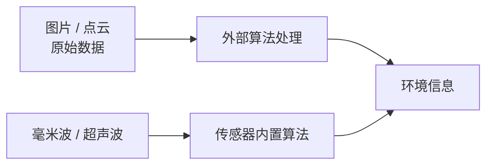

**感知的四大任务。** 感知拿到的信息对应四个任务。分类提升对图像的特征提取能力；分割对像素分类，分割出不同物体（人、车、路面）的形状；检测框分类，框出图像中的物体再对其做分类处理；跟踪使用有关目标物体的一切信息做时序关联，一般对连续帧处理 [第二章 无人驾驶感知基础.pdf · p.5](http://10.188.31.55:5244/Nextcloud/School/Auto-Drive-Intro/课件/%E7%AC%AC%E4%BA%8C%E7%AB%A0%20%E6%97%A0%E4%BA%BA%E9%A9%BE%E9%A9%B6%E6%84%9F%E7%9F%A5%E5%9F%BA%E7%A1%80.pdf#page=5)。

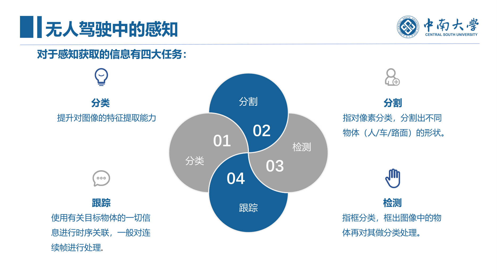

静态物体分割这一块，课件安排了三件事：实战基于传统方法的车道线检测、分割算法综述、实战基于图片分割的车道线检测 [第二章 无人驾驶感知基础.pdf · p.7](http://10.188.31.55:5244/Nextcloud/School/Auto-Drive-Intro/课件/%E7%AC%AC%E4%BA%8C%E7%AB%A0%20%E6%97%A0%E4%BA%BA%E9%A9%BE%E9%A9%B6%E6%84%9F%E7%9F%A5%E5%9F%BA%E7%A1%80.pdf#page=7)。

**传统方法车道线检测：Canny 边缘检测。** 经典流水线是 Canny 边缘检测 → 分割出路面区域 → 霍夫变换求直线 → 叠加回原图。课件给出的参考实现来自 Towards Data Science 的教程，代码在 github.com/andylei77/lane-detector [第二章 无人驾驶感知基础.pdf · p.8](http://10.188.31.55:5244/Nextcloud/School/Auto-Drive-Intro/课件/%E7%AC%AC%E4%BA%8C%E7%AB%A0%20%E6%97%A0%E4%BA%BA%E9%A9%BE%E9%A9%B6%E6%84%9F%E7%9F%A5%E5%9F%BA%E7%A1%80.pdf#page=8)。

Canny 的基本原理是检测亮度的急剧变化，比如从白色到黑色，在给定阈值下定义为边。预处理先把彩色图片转成灰度图，然后走四步 [第二章 无人驾驶感知基础.pdf · p.10](http://10.188.31.55:5244/Nextcloud/School/Auto-Drive-Intro/课件/%E7%AC%AC%E4%BA%8C%E7%AB%A0%20%E6%97%A0%E4%BA%BA%E9%A9%BE%E9%A9%B6%E6%84%9F%E7%9F%A5%E5%9F%BA%E7%A1%80.pdf#page=10)：

- **降噪**：噪声容易导致误检，用 $5 \times 5$ 的高斯滤波器（正态分布核）对图像做卷积，平滑图像。
- **求亮度梯度**：在平滑的图像上用 Sobel / Roberts / Prewitt 核沿 $x$ 轴和 $y$ 轴检测水平、垂直、对角线方向的边缘。
- **非极大值抑制**：细化边缘。检查每个像素值在梯度方向上是否为局部最大值，不是就把该像素值置 0。
- **Hysteresis thresholding**：梯度大于 `maxVal` 的是边缘，小于 `minVal` 的不是边缘并删除；落在 $[minVal, maxVal]$ 区间的像素，只有和梯度高于 `maxVal` 的像素相连时才算边缘。

Canny 之后，课件用手动指定的一个三角形把路面区域分割出来，去除其他干扰边缘 [第二章 无人驾驶感知基础.pdf · p.11](http://10.188.31.55:5244/Nextcloud/School/Auto-Drive-Intro/课件/%E7%AC%AC%E4%BA%8C%E7%AB%A0%20%E6%97%A0%E4%BA%BA%E9%A9%BE%E9%A9%B6%E6%84%9F%E7%9F%A5%E5%9F%BA%E7%A1%80.pdf#page=11)。

整套流水线在课件里被并排展示成四个窗口：canny 边缘图、segment 分割掩码、hough 检出的直线、output 把绿线叠回原图 [第二章 无人驾驶感知基础.pdf · p.9](http://10.188.31.55:5244/Nextcloud/School/Auto-Drive-Intro/课件/%E7%AC%AC%E4%BA%8C%E7%AB%A0%20%E6%97%A0%E4%BA%BA%E9%A9%BE%E9%A9%B6%E6%84%9F%E7%9F%A5%E5%9F%BA%E7%A1%80.pdf#page=9)。

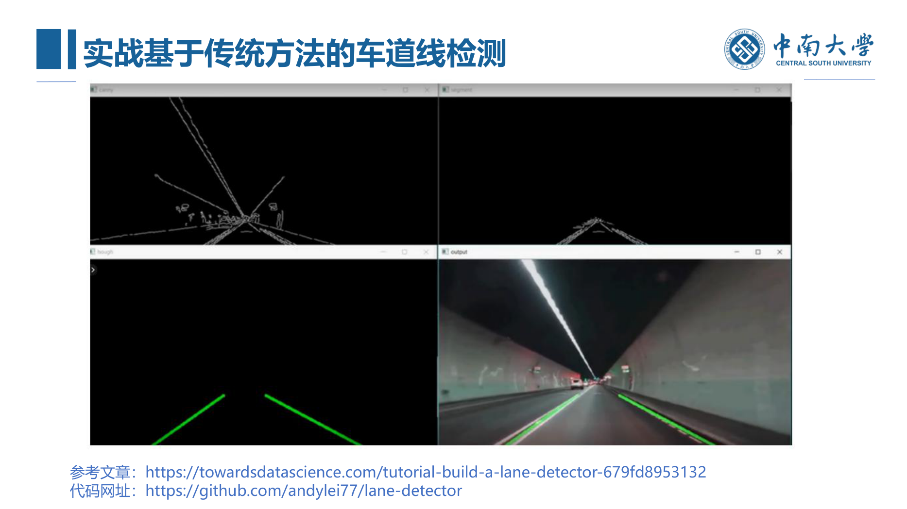

**霍夫变换。** 霍夫变换把「找直线」变成「找点」。课件用变量与参数的互换来说明这件事：笛卡尔坐标系的直线方程是 $y = mx + b$，其中变量是 $(x, y)$、参数是 $(m, b)$；搬到霍夫空间，变量变成 $(m, b)$、参数变成 $(x, y)$，方程改写为 $b = -xm + y$ [第二章 无人驾驶感知基础.pdf · p.12](http://10.188.31.55:5244/Nextcloud/School/Auto-Drive-Intro/课件/%E7%AC%AC%E4%BA%8C%E7%AB%A0%20%E6%97%A0%E4%BA%BA%E9%A9%BE%E9%A9%B6%E6%84%9F%E7%9F%A5%E5%9F%BA%E7%A1%80.pdf#page=12)。

互换之后，一条笛卡尔坐标系里的直线 $y = mx + b$，对应霍夫空间里的一个点 $(m, b)$；笛卡尔坐标系里的一个点 $(x, y)$，对应霍夫空间里的多条直线 $y = m_i x + b_i$。所以霍夫变换的作用是：把笛卡尔坐标系中一系列可能被连成线的点，变成这些点在霍夫空间中对应的线；找到霍夫空间中的交点 $(m, b)$，就是那条线的方程。

特殊情况是垂直线。线垂直时斜率梯度无穷大，无法在 $y = mx + b$ 里表示。解决办法是在笛卡尔坐标系中改用极坐标法表示直线：

$$
d = x\cos\theta + y\sin\theta
$$

这里 $d$ 是原点到直线的垂距，$\theta$ 是垂线与 $x$ 轴的夹角。变量与参数再次互换：笛卡尔坐标系里变量是 $(x, y)$、参数是 $(\theta, d)$，霍夫空间里变量是 $(\theta, d)$、参数是 $(x, y)$。于是笛卡尔坐标系里的一个点 $(x, y)$，对应霍夫空间里一条曲线 $d_i = x\cos\theta_i + y\sin\theta_i$ [第二章 无人驾驶感知基础.pdf · p.13](http://10.188.31.55:5244/Nextcloud/School/Auto-Drive-Intro/课件/%E7%AC%AC%E4%BA%8C%E7%AB%A0%20%E6%97%A0%E4%BA%BA%E9%A9%BE%E9%A9%B6%E6%84%9F%E7%9F%A5%E5%9F%BA%E7%A1%80.pdf#page=13)。

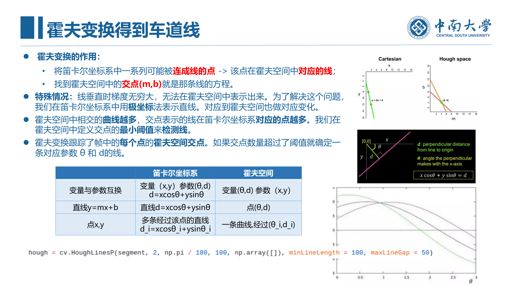

投票机制是这个方法的核心。霍夫空间中相交的曲线越多，交点表示的线在笛卡尔坐标系里对应的点就越多。课件因此在霍夫空间里定义交点的最小阈值来检测线：跟踪帧中每个点的霍夫空间交点，如果交点数量超过阈值，就确定一条对应参数 $\theta$ 和 $d$ 的线 [第二章 无人驾驶感知基础.pdf · p.13](http://10.188.31.55:5244/Nextcloud/School/Auto-Drive-Intro/课件/%E7%AC%AC%E4%BA%8C%E7%AB%A0%20%E6%97%A0%E4%BA%BA%E9%A9%BE%E9%A9%B6%E6%84%9F%E7%9F%A5%E5%9F%BA%E7%A1%80.pdf#page=13)。

> [!NOTE] **阈值决定漏检和误检**
> `cv.HoughLinesP` 的调用形式是 `HoughLinesP(image, rho, theta, threshold, minLineLength, maxLineGap)`。`threshold` 就是霍夫空间的交点最小阈值：调大则交点多的线才被检出，漏检增加；调小则弱线也被判成线，误检增加。`minLineLength` 和 `maxLineGap` 是几何后处理，限制线的最短长度和允许的最大断裂 gap。

求出所有线之后，综合所有线求得两条车道线的平均斜率和截距，再求斜率和截距的平均值得到两条车道线，最后叠加回原图 [第二章 无人驾驶感知基础.pdf · p.14](http://10.188.31.55:5244/Nextcloud/School/Auto-Drive-Intro/课件/%E7%AC%AC%E4%BA%8C%E7%AB%A0%20%E6%97%A0%E4%BA%BA%E9%A9%BE%E9%A9%B6%E6%84%9F%E7%9F%A5%E5%9F%BA%E7%A1%80.pdf#page=14) [第二章 无人驾驶感知基础.pdf · p.15](http://10.188.31.55:5244/Nextcloud/School/Auto-Drive-Intro/课件/%E7%AC%AC%E4%BA%8C%E7%AB%A0%20%E6%97%A0%E4%BA%BA%E9%A9%BE%E9%A9%B6%E6%84%9F%E7%9F%A5%E5%9F%BA%E7%A1%80.pdf#page=15)。

**图片分割的三种类型。** 分割有三个层次 [第二章 无人驾驶感知基础.pdf · p.16](http://10.188.31.55:5244/Nextcloud/School/Auto-Drive-Intro/课件/%E7%AC%AC%E4%BA%8C%E7%AB%A0%20%E6%97%A0%E4%BA%BA%E9%A9%BE%E9%A9%B6%E6%84%9F%E7%9F%A5%E5%9F%BA%E7%A1%80.pdf#page=16)：

- **普通分割**：将属于不同物体的像素区域分开即可，比如前景与背景分割，狗的区域与猫的区域与背景分开。
- **语义分割**：在普通分割的基础上，还要分类出每一块区域的语义（类别）。
- **实例分割**：在语义分割的基础上，还要进一步区分同种物体的不同个体。

这三层关系在课件后面反复出现。Mask R-CNN 那页把它写成一句等式：语义分割（单像素多分类）= 框检测（box，多分类）+ 框内的普通分割（二分类 mask）[第二章 无人驾驶感知基础.pdf · p.24](http://10.188.31.55:5244/Nextcloud/School/Auto-Drive-Intro/课件/%E7%AC%AC%E4%BA%8C%E7%AB%A0%20%E6%97%A0%E4%BA%BA%E9%A9%BE%E9%A9%B6%E6%84%9F%E7%9F%A5%E5%9F%BA%E7%A1%80.pdf#page=24)。

**深度学习分割的通用框架。** 从深度学习引入这个任务到现在，通用的框架分前后端 [第二章 无人驾驶感知基础.pdf · p.17](http://10.188.31.55:5244/Nextcloud/School/Auto-Drive-Intro/课件/%E7%AC%AC%E4%BA%8C%E7%AB%A0%20%E6%97%A0%E4%BA%BA%E9%A9%BE%E9%A9%B6%E6%84%9F%E7%9F%A5%E5%9F%BA%E7%A1%80.pdf#page=17)：

**前端**用全卷积网络做特征提取，四个环节依次是下采样（Convolution）、上采样（Deconvolution 或 Resize）、多尺度特征融合（特征逐点相加或特征拼接），最终得到像素级别的 segmentation map，对每一个像素点判断类别。**后端**用 CRF（条件随机场）或 MRF（马尔科夫随机场）优化前端的输出，得到优化后的分割图。

**FCN。** FCN 首次把深度学习引入图片语义分割，论文是《Fully Convolutional Networks for Semantic Segmentation》。三项主要贡献 [第二章 无人驾驶感知基础.pdf · p.19](http://10.188.31.55:5244/Nextcloud/School/Auto-Drive-Intro/课件/%E7%AC%AC%E4%BA%8C%E7%AB%A0%20%E6%97%A0%E4%BA%BA%E9%A9%BE%E9%A9%B6%E6%84%9F%E7%9F%A5%E5%9F%BA%E7%A1%80.pdf#page=19)：

**全卷积网络**。把全连接层替换成全卷积层（全连接等效为卷积核是输入特征大小的卷积），网络因此可以接受任意大小的图片，并输出和原图一样大小的特征图。只有这样，才能为每个像素做分类。

**反卷积层做上采样**。特征图一般只有原图的几分之一，要映射回原图大小必须上采样。虽然名字叫反卷积层，但它并不是卷积的逆操作，更合适的名字是转置卷积（Transposed Convolution），作用是从小的特征图卷出大的特征图。反卷积和卷积类似，都是相乘相加的运算，只不过后者多对一，前者一对多；反卷积的前向和后向传播，只用颠倒卷积的前后向传播即可。

**Skip Layer**。Skip 的目的就是特征融合。如果把全卷积之后的结果直接上采样，结果是很粗糙的，所以把不同池化层的结果上采样之后融合再做像素分类。数字越小使用反卷积层上采样越多，对应模型结构更复杂，分割效果更精细。

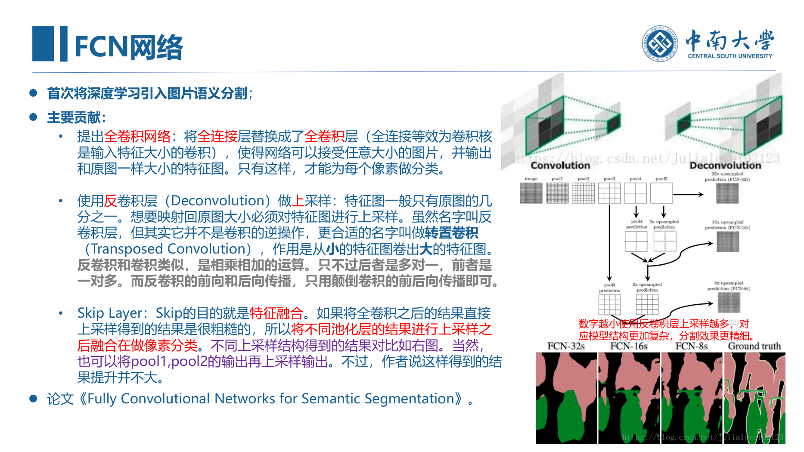

**U-Net。** U-Net 是原作者参加 ISBI Challenge 提出的分割网络，能适应很小的训练集，大约 30 张图。它与 FCN 一样是很小的分割网络，既没有使用空洞卷积，也没有后接 CRF，结构简单 [第二章 无人驾驶感知基础.pdf · p.20](http://10.188.31.55:5244/Nextcloud/School/Auto-Drive-Intro/课件/%E7%AC%AC%E4%BA%8C%E7%AB%A0%20%E6%97%A0%E4%BA%BA%E9%A9%BE%E9%A9%B6%E6%84%9F%E7%9F%A5%E5%9F%BA%E7%A1%80.pdf#page=20)。

结构类似一个 U 字母：先做 Conv+Pooling 下采样，然后 Deconv 反卷积上采样，crop 之前的低层 feature map 进行融合，然后再次上采样，重复直到获得 $388 \times 388 \times 2$ 的 feature map，最后经过 softmax 得到 output segment map。与 FCN 逐点相加不同，U-Net 把特征在 channel 维度拼接在一起，形成更「厚」的特征。

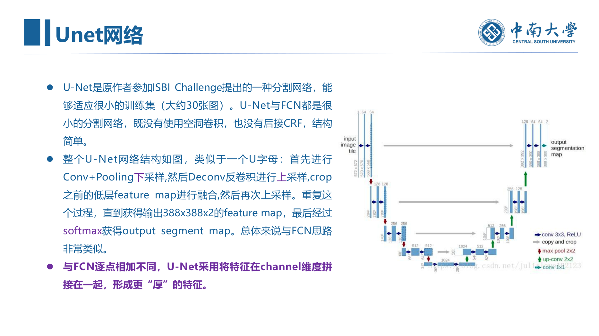

**SegNet 与 DeconvNet。** SegNet 和 DeconvNet 换掉了上采样模式，采用类似自编码器的对称结构，先编码再解码 [第二章 无人驾驶感知基础.pdf · p.21](http://10.188.31.55:5244/Nextcloud/School/Auto-Drive-Intro/课件/%E7%AC%AC%E4%BA%8C%E7%AB%A0%20%E6%97%A0%E4%BA%BA%E9%A9%BE%E9%A9%B6%E6%84%9F%E7%9F%A5%E5%9F%BA%E7%A1%80.pdf#page=21)。

上采样用两个手段。反卷积和 FCN 里一样。上池化的实现要点在于：池化时记住输出值的位置，上池化时再把这个值填回原来的位置，其他位置填 0。

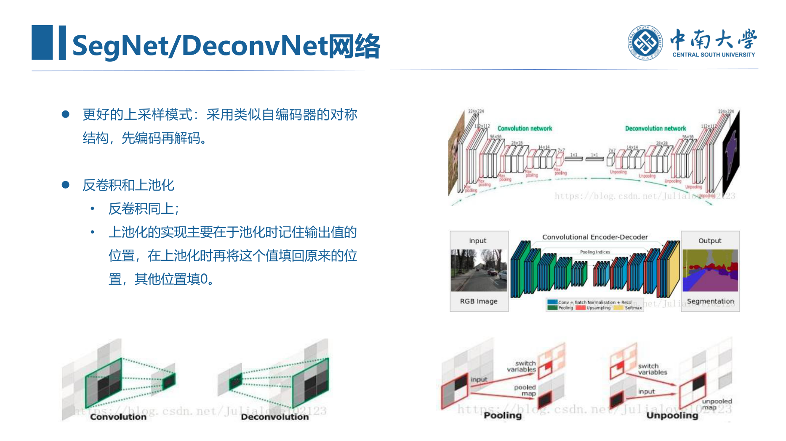

**DeepLab。** DeepLab 有 v1、v2、v3，v1 的论文是《DeepLab: Semantic Image Segmentation with Deep Convolutional Nets, Atrous Convolution, and Fully Connected CRFs》。核心方法是 Dilated / Atrous Convolution，也就是空洞卷积 [第二章 无人驾驶感知基础.pdf · p.22](http://10.188.31.55:5244/Nextcloud/School/Auto-Drive-Intro/课件/%E7%AC%AC%E4%BA%8C%E7%AB%A0%20%E6%97%A0%E4%BA%BA%E9%A9%BE%E9%A9%B6%E6%84%9F%E7%9F%A5%E5%9F%BA%E7%A1%80.pdf#page=22)。

原理是普通卷积核中间插入几个洞，运算跟普通卷积保持一样，好处是感受野更大。若卷积核尺寸为 $k$、膨胀率为 $r$，有效感受野的边长为：

$$
k_{\text{eff}} = k + (k - 1)(r - 1)
$$

$3 \times 3$ 卷积的视野是 $3 \times 3$，插入一个洞之后视野变成 $5 \times 5$。视野变大的作用是：特征图缩小到同样倍数的情况下可以掌握更多图像的全局信息，这在语义分割中很重要。

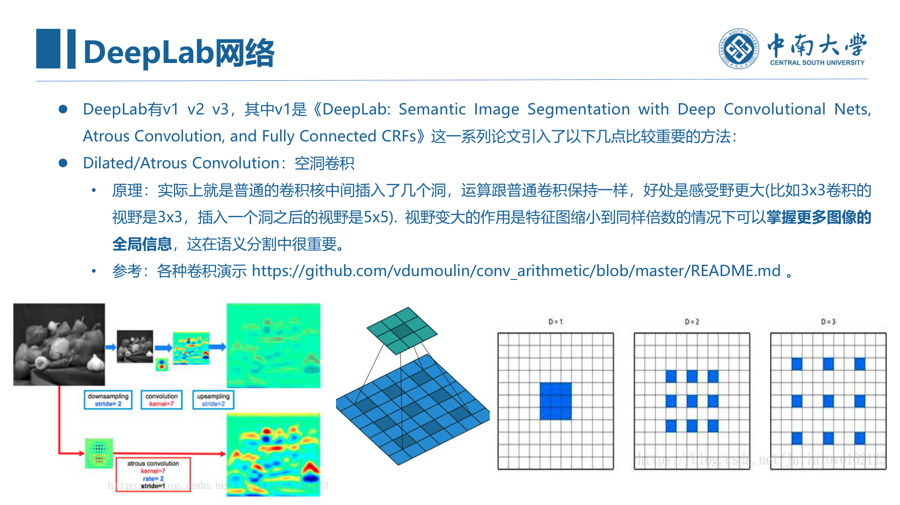

**PSPNet 与 Mask R-CNN。** PSPNet（Pyramid Scene Parsing Network）的核心贡献是 Global Pyramid Pooling。它把特征图缩放到几个不同的尺寸，上采样后与之前的特征进行融合，使特征具有更好的全局和多尺度信息，对区分不同类别有帮助。另外在金字塔池化模块里用 $1 \times 1$ 卷积降低上下文表示的维度，backbone 用带空洞卷积的 ResNet [第二章 无人驾驶感知基础.pdf · p.23](http://10.188.31.55:5244/Nextcloud/School/Auto-Drive-Intro/课件/%E7%AC%AC%E4%BA%8C%E7%AB%A0%20%E6%97%A0%E4%BA%BA%E9%A9%BE%E9%A9%B6%E6%84%9F%E7%9F%A5%E5%9F%BA%E7%A1%80.pdf#page=23)。

Mask R-CNN 把检测与分割结合起来。新增一个分支输出 mask，损失函数是分类 + 回归 + mask 三项。mask 分支和其他的分类分支一样使用全卷积网络，输出 $k$ 类的 mask，用 sigmoid 函数通过与阈值 0.5 比较输出二值 mask。这样避免了类间的竞争，每个类别都专门生成本类的 mask [第二章 无人驾驶感知基础.pdf · p.24](http://10.188.31.55:5244/Nextcloud/School/Auto-Drive-Intro/课件/%E7%AC%AC%E4%BA%8C%E7%AB%A0%20%E6%97%A0%E4%BA%BA%E9%A9%BE%E9%A9%B6%E6%84%9F%E7%9F%A5%E5%9F%BA%E7%A1%80.pdf#page=24)。

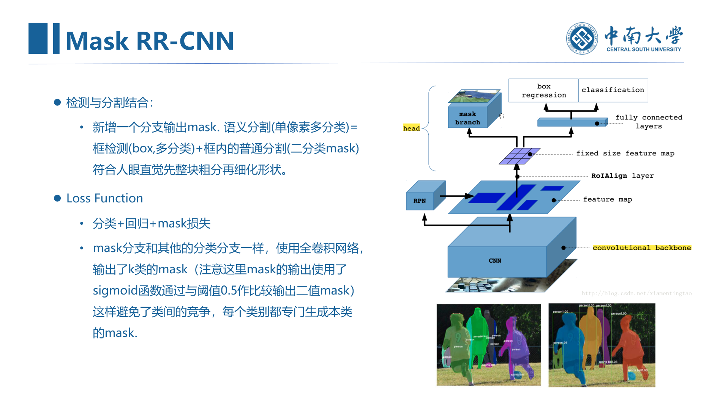

> [!IMPORTANT] **先粗分再细分**
> 语义分割等于「框检测（多分类）+ 框内普通分割（二分类 mask）」。这个组合符合人眼直觉：先整块粗分，再细化形状。Mask R-CNN 和后面的 LaneNet 都是这个模式。

**LaneNet：基于图片分割的车道线检测。** LaneNet 用实例分割来检测车道线，论文《Towards End-to-End Lane Detection: an Instance Segmentation Approach》，参考实现见 github.com/andylei77/lane-detection [第二章 无人驾驶感知基础.pdf · p.25](http://10.188.31.55:5244/Nextcloud/School/Auto-Drive-Intro/课件/%E7%AC%AC%E4%BA%8C%E7%AB%A0%20%E6%97%A0%E4%BA%BA%E9%A9%BE%E9%A9%B6%E6%84%9F%E7%9F%A5%E5%9F%BA%E7%A1%80.pdf#page=25)。

它比传统方法多做了两件事。**更灵活的透视变换**：一般将图像透视变换到鸟瞰图，进一步优化车道线；固定的透视变换矩阵遇到上下坡就不行了，所以提出用 CNN 学习透视变换——输入 RGB 图像加分割结果，经 H-Network 输出透视变换参数。**实例分割**：语义分割只分割出所有车道线，是二分类问题；再生成像素 embedding，每个像素一个 $n$ 维嵌入，使同一车道的嵌入距离近、不同车道的嵌入距离远；然后用分割分支的二值分割图做掩码，在 pixel embedding 图像上取出所有车道像素的 $n$ 维嵌入，把这些嵌入（蓝点）聚类得到所属的车道类别 [第二章 无人驾驶感知基础.pdf · p.26](http://10.188.31.55:5244/Nextcloud/School/Auto-Drive-Intro/课件/%E7%AC%AC%E4%BA%8C%E7%AB%A0%20%E6%97%A0%E4%BA%BA%E9%A9%BE%E9%A9%B6%E6%84%9F%E7%9F%A5%E5%9F%BA%E7%A1%80.pdf#page=26)。

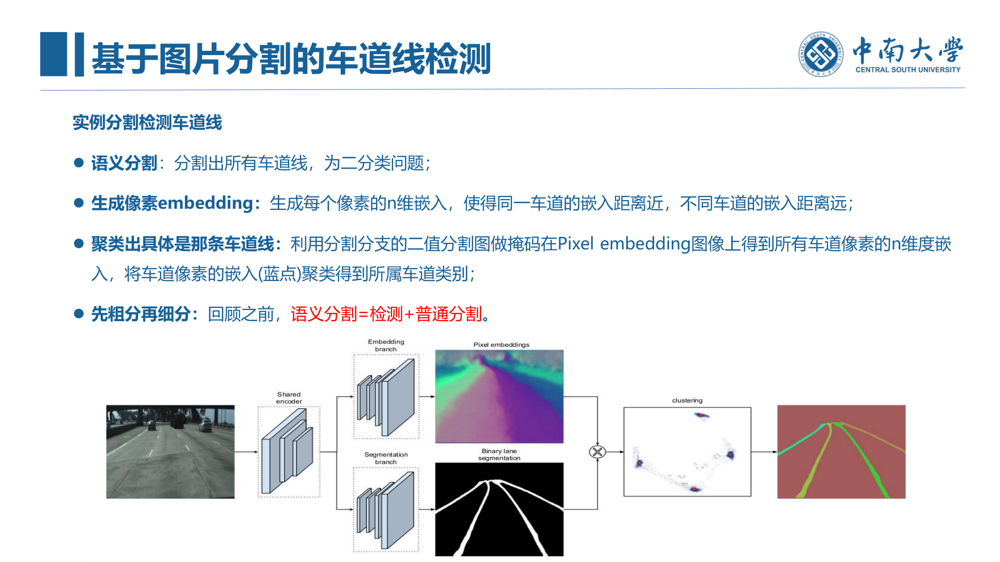

### 基于图像的检测算法

**检测的输入与输出。** 无人驾驶中的检测任务，输入是图片或点云，输出是 2D 或 3D bounding box。图片和点云走不同的算法分支：图片（相机）走图片检测算法，稀疏点云（激光雷达）走点云检测算法，稠密点云（双目 / RGBD 相机）走深度图算法 [第二章 无人驾驶感知基础.pdf · p.28](http://10.188.31.55:5244/Nextcloud/School/Auto-Drive-Intro/课件/%E7%AC%AC%E4%BA%8C%E7%AB%A0%20%E6%97%A0%E4%BA%BA%E9%A9%BE%E9%A9%B6%E6%84%9F%E7%9F%A5%E5%9F%BA%E7%A1%80.pdf#page=28)。

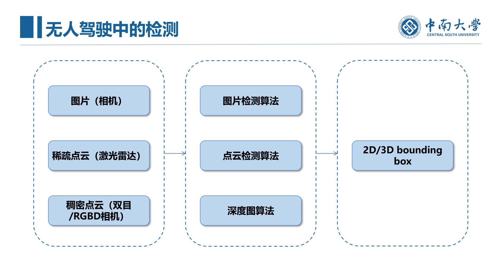

**检测拆成三件事。** 分类看的是「这是什么」，检测看的是「在哪里、是什么、框有多准」。课件把检测拆成三步 [第二章 无人驾驶感知基础.pdf · p.30](http://10.188.31.55:5244/Nextcloud/School/Auto-Drive-Intro/课件/%E7%AC%AC%E4%BA%8C%E7%AB%A0%20%E6%97%A0%E4%BA%BA%E9%A9%BE%E9%A9%B6%E6%84%9F%E7%9F%A5%E5%9F%BA%E7%A1%80.pdf#page=30)：

- **位置**：先找到所有的 ROI（region of interest，bounding box may contain object）。
- **类别**：对每一个 ROI 做分类获取类别信息。
- **位置修正**：bounding box regression。

获取 ROI 有三种方法 [第二章 无人驾驶感知基础.pdf · p.31](http://10.188.31.55:5244/Nextcloud/School/Auto-Drive-Intro/课件/%E7%AC%AC%E4%BA%8C%E7%AB%A0%20%E6%97%A0%E4%BA%BA%E9%A9%BE%E9%A9%B6%E6%84%9F%E7%9F%A5%E5%9F%BA%E7%A1%80.pdf#page=31)：

**Method 1 sliding window**。遍历所有位置（上到下、左到右），遍历所有不同的 scale 和 ratio（远近物体大小不同）。问题是产生大量无效框，计算复杂。适合固定长宽比的物体，比如人脸或行人。

**Method 2 region proposal**。用分割在图像中找出可能有物体的区域，减少无效框，减少需要分类的路径。Selective search 属于这一类：先过度分割，再按相似度合并相邻框。

**Method 3 CNN**。用 anchor box（类似 sliding window）和 RPN（来自 Faster-RCNN）。

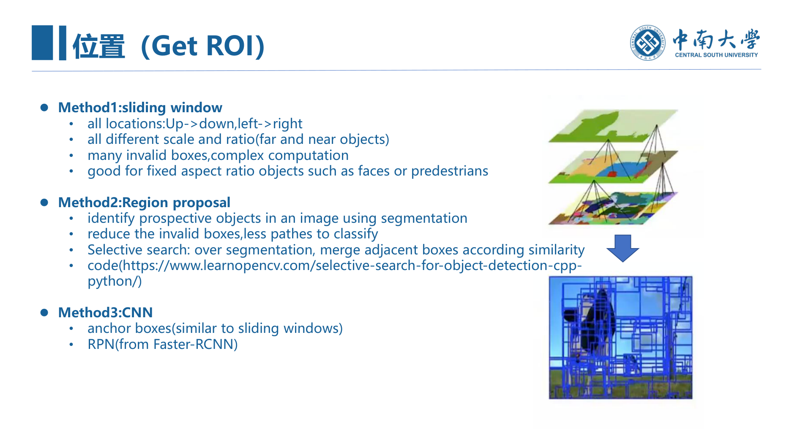

ROI 的特征提取可以用传统方法（Haar、LBP、SIFT、SURF、HOG、DPM），也可以用 CNN；分类器可以用 SVM、AdaBoost，也可以用 CNN [第二章 无人驾驶感知基础.pdf · p.32](http://10.188.31.55:5244/Nextcloud/School/Auto-Drive-Intro/课件/%E7%AC%AC%E4%BA%8C%E7%AB%A0%20%E6%97%A0%E4%BA%BA%E9%A9%BE%E9%A9%B6%E6%84%9F%E7%9F%A5%E5%9F%BA%E7%A1%80.pdf#page=32)。

**Two-step 方法：RCNN 到 Faster-RCNN。** CNN 之前的检测，位置用 sliding window 或 region proposal，类别用 HOG / DPM / SIFT / LBP 配合 SVM / AdaBoost，位置修正用线性回归 [第二章 无人驾驶感知基础.pdf · p.33](http://10.188.31.55:5244/Nextcloud/School/Auto-Drive-Intro/课件/%E7%AC%AC%E4%BA%8C%E7%AB%A0%20%E6%97%A0%E4%BA%BA%E9%A9%BE%E9%A9%B6%E6%84%9F%E7%9F%A5%E5%9F%BA%E7%A1%80.pdf#page=33)。CNN 之后，这条流水线被一步步端到端化：

**RCNN**。位置用 Selective Search 提取候选框；类别用 CNN 提取特征加 SVM 分类；位置修正用线性回归 [第二章 无人驾驶感知基础.pdf · p.34](http://10.188.31.55:5244/Nextcloud/School/Auto-Drive-Intro/课件/%E7%AC%AC%E4%BA%8C%E7%AB%A0%20%E6%97%A0%E4%BA%BA%E9%A9%BE%E9%A9%B6%E6%84%9F%E7%9F%A5%E5%9F%BA%E7%A1%80.pdf#page=34)。

**SPPNet**。位置和类别不变，但引入共享卷积大大降低计算量；SPP 层把不同尺度的特征转成固定尺度的特征，好接全连接层 [第二章 无人驾驶感知基础.pdf · p.35](http://10.188.31.55:5244/Nextcloud/School/Auto-Drive-Intro/课件/%E7%AC%AC%E4%BA%8C%E7%AB%A0%20%E6%97%A0%E4%BA%BA%E9%A9%BE%E9%A9%B6%E6%84%9F%E7%9F%A5%E5%9F%BA%E7%A1%80.pdf#page=35)。

**Fast-RCNN**。分类改成 CNN 提取特征加 CNN 分类，分类和回归都用 CNN 实现，两种损失可以反传以实现联动调参（半 end-to-end）；SPP 层换成 ROI Pooling，提高计算速度；位置修正用 CNN 回归 [第二章 无人驾驶感知基础.pdf · p.36](http://10.188.31.55:5244/Nextcloud/School/Auto-Drive-Intro/课件/%E7%AC%AC%E4%BA%8C%E7%AB%A0%20%E6%97%A0%E4%BA%BA%E9%A9%BE%E9%A9%B6%E6%84%9F%E7%9F%A5%E5%9F%BA%E7%A1%80.pdf#page=36)。

**Faster-RCNN**。位置改成用 CNN 提取候选框，引入 RPN（Region Proposal Net）：在 feature 点对应的原图感受野框处生成不同 ratio 和 scale 的 anchor box，对 anchor box 做二分类加回归。类别是 CNN 提取特征加 CNN 分类，位置修正是 CNN 回归 [第二章 无人驾驶感知基础.pdf · p.37](http://10.188.31.55:5244/Nextcloud/School/Auto-Drive-Intro/课件/%E7%AC%AC%E4%BA%8C%E7%AB%A0%20%E6%97%A0%E4%BA%BA%E9%A9%BE%E9%A9%B6%E6%84%9F%E7%9F%A5%E5%9F%BA%E7%A1%80.pdf#page=37)。

**One-step 方法：YOLO、SSD 及其后续。** One-step 的思路是不再分「提候选框」和「分类回归」两步。

**YOLO**。全图划分 $7 \times 7$ 网格，每个网格对应 2 个 default box；没有候选框，直接对 default box 做全分类加回归。box 中心坐标的 $x$、$y$ 相当于对应的网格归一化到 0 到 1 之间，$w$、$h$ 用图像的 width 和 height 归一化到 0 到 1 之间 [第二章 无人驾驶感知基础.pdf · p.38](http://10.188.31.55:5244/Nextcloud/School/Auto-Drive-Intro/课件/%E7%AC%AC%E4%BA%8C%E7%AB%A0%20%E6%97%A0%E4%BA%BA%E9%A9%BE%E9%A9%B6%E6%84%9F%E7%9F%A5%E5%9F%BA%E7%A1%80.pdf#page=38)。

YOLO 的优点是实时性。缺点也明确：准确率不如 Faster-RCNN，定位精度差（anchor box 不够丰富，且只回归修正一次）；不规则物体差，anchor 的 ratio 不够多样 [第二章 无人驾驶感知基础.pdf · p.39](http://10.188.31.55:5244/Nextcloud/School/Auto-Drive-Intro/课件/%E7%AC%AC%E4%BA%8C%E7%AB%A0%20%E6%97%A0%E4%BA%BA%E9%A9%BE%E9%A9%B6%E6%84%9F%E7%9F%A5%E5%9F%BA%E7%A1%80.pdf#page=39)。

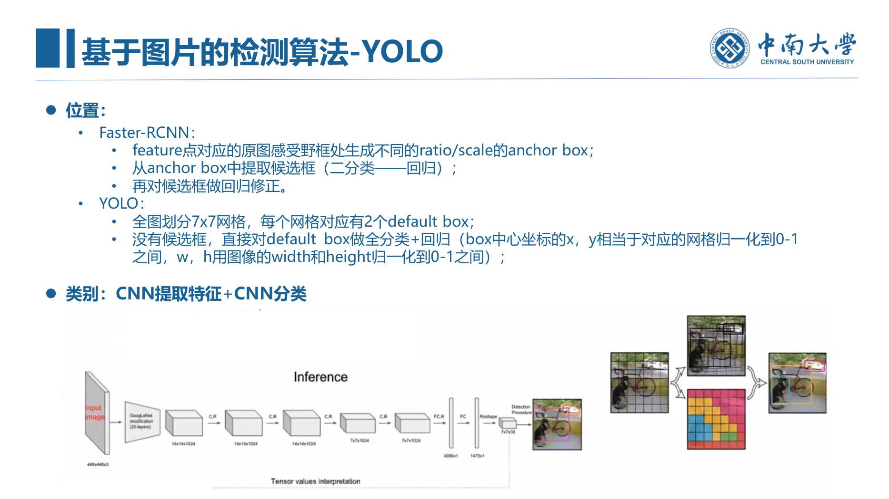

**SSD**。借鉴 RPN 的 anchor box 机制，在 feature 点对应的原图感受野框处生成不同 ratio 和 scale 的 default box，没有候选框，直接对 default box 做全分类加回归。区别在于多感受野特征输出层：前面层感受野小，适合小物体，后面层感受野大，适合大物体 [第二章 无人驾驶感知基础.pdf · p.40](http://10.188.31.55:5244/Nextcloud/School/Auto-Drive-Intro/课件/%E7%AC%AC%E4%BA%8C%E7%AB%A0%20%E6%97%A0%E4%BA%BA%E9%A9%BE%E9%A9%B6%E6%84%9F%E7%9F%A5%E5%9F%BA%E7%A1%80.pdf#page=40)。

**YOLO-v2**。两点改进。更丰富的 default box：从数据集统计出 default box（k-means），随着 $k$ 增大 IOU 也增大（高召回率），但复杂度也在增加，最终选择 $k = 5$。更灵活的类别预测：把预测类别的机制从空间位置（cell）中解耦，由 default box 同时预测类别和坐标，有效解决物体重叠 [第二章 无人驾驶感知基础.pdf · p.41](http://10.188.31.55:5244/Nextcloud/School/Auto-Drive-Intro/课件/%E7%AC%AC%E4%BA%8C%E7%AB%A0%20%E6%97%A0%E4%BA%BA%E9%A9%BE%E9%A9%B6%E6%84%9F%E7%9F%A5%E5%9F%BA%E7%A1%80.pdf#page=41)。

**YOLO-v3**。三点改进。更好的基础网络：darknet-19 换成 darknet-53。考虑多尺度：感受野多样性和 anchor box（default box）多样性；多感受野特中层输出，先上采样融合之后再输出（借鉴 feature pyramid networks），而 SSD 是直接输出不融合。更多 default box：$K = 9$，被 3 个输出平分 [第二章 无人驾驶感知基础.pdf · p.42](http://10.188.31.55:5244/Nextcloud/School/Auto-Drive-Intro/课件/%E7%AC%AC%E4%BA%8C%E7%AB%A0%20%E6%97%A0%E4%BA%BA%E9%A9%BE%E9%A9%B6%E6%84%9F%E7%9F%A5%E5%9F%BA%E7%A1%80.pdf#page=42)。

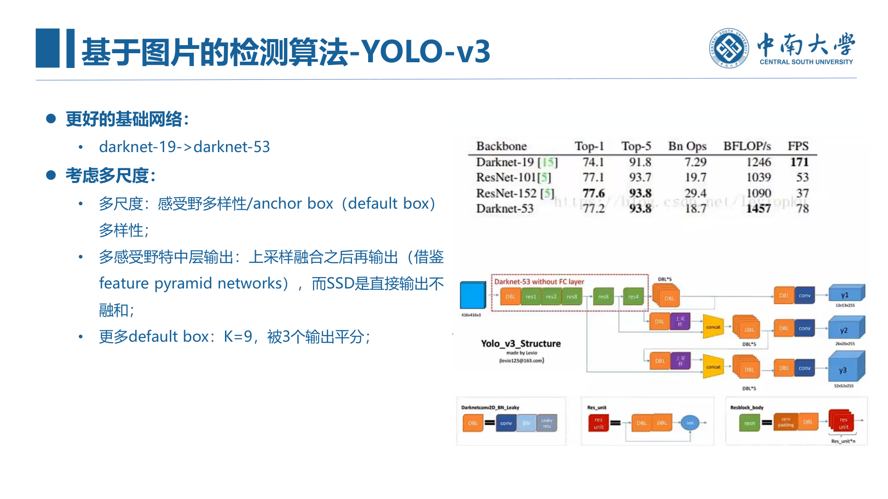

整个检测算法谱系可以按「一步还是两步」和「每个环节用什么」两个维度来读。两步方法有 RCNN、SPPNet、Fast-RCNN、Faster-RCNN、R-FCN、Mask-RCNN，它们是端到端的：Get ROI、Extract feature、Classify、box regression 全用 CNN。一步方法有 OverFeat、YOLO、SSD、YOLO-v2、RetinaNet、YOLO-v3 [第二章 无人驾驶感知基础.pdf · p.43](http://10.188.31.55:5244/Nextcloud/School/Auto-Drive-Intro/课件/%E7%AC%AC%E4%BA%8C%E7%AB%A0%20%E6%97%A0%E4%BA%BA%E9%A9%BE%E9%A9%B6%E6%84%9F%E7%9F%A5%E5%9F%BA%E7%A1%80.pdf#page=43)。

### 基于激光雷达点云的检测算法

**点云的数据特性。** 激光雷达产生点云有两种机制。机械式 Lidar 用 TOF，$N$ 个独立激光单元旋转产生 $360°$ 视场；MEMS 式 Lidar 不旋转 [第二章 无人驾驶感知基础.pdf · p.46](http://10.188.31.55:5244/Nextcloud/School/Auto-Drive-Intro/课件/%E7%AC%AC%E4%BA%8C%E7%AB%A0%20%E6%97%A0%E4%BA%BA%E9%A9%BE%E9%A9%B6%E6%84%9F%E7%9F%A5%E5%9F%BA%E7%A1%80.pdf#page=46)。

点云数据有四个特点：**简单**，每个点只有 $x$、$y$、$z$、$i$ 四个量；**稀疏**；**无序**，点的排列有 $N!$ 种可能（角度不同、震动、扫描顺序不同）；**精确**，误差 $\pm 2\text{cm}$。图像和点云各有分工：点云简单精确，适合几何感知；图像丰富多变，适合语义感知。

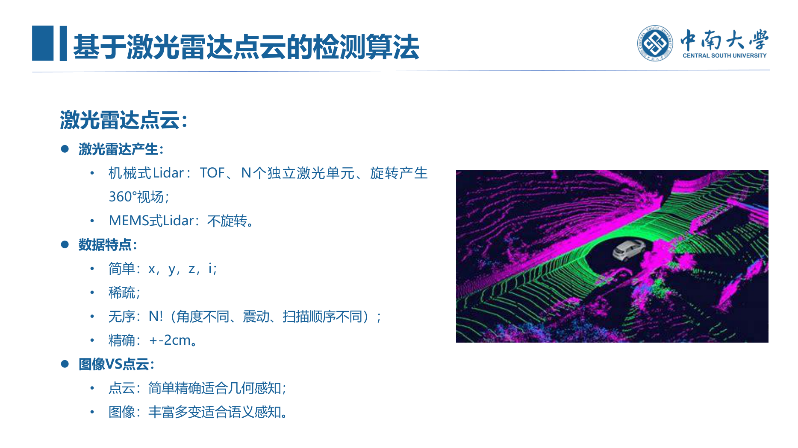

点云数据有三个来源：CAD 模型（一般分类问题的数据集是 CAD）、LIDAR 传感器、RGBD 相机。常用数据集按任务分两类：特征表示类的分类任务用 ModelNet40/10、ShapeNetPart；无人驾驶场景的检测、分割、跟踪任务用 [KITTI](http://www.cvlibs.net/datasets/kitti) 和 [ApolloScape](http://apolloscape.auto) [第二章 无人驾驶感知基础.pdf · p.47](http://10.188.31.55:5244/Nextcloud/School/Auto-Drive-Intro/课件/%E7%AC%AC%E4%BA%8C%E7%AB%A0%20%E6%97%A0%E4%BA%BA%E9%A9%BE%E9%A9%B6%E6%84%9F%E7%9F%A5%E5%9F%BA%E7%A1%80.pdf#page=47)。

**传统方法与深度学习的分野。** 传统方法做点云目标检测，流程是分割地面 → 点云聚类 → 特征提取 → 分类。课件给了三条批评 [第二章 无人驾驶感知基础.pdf · p.49](http://10.188.31.55:5244/Nextcloud/School/Auto-Drive-Intro/课件/%E7%AC%AC%E4%BA%8C%E7%AB%A0%20%E6%97%A0%E4%BA%BA%E9%A9%BE%E9%A9%B6%E6%84%9F%E7%9F%A5%E5%9F%BA%E7%A1%80.pdf#page=49)：

- 地面分割依赖人为设计的特征和规则，比如设置一些阈值、表面法线，泛化能力差。
- 多阶段的处理流程意味着可能产生复合型错误——聚类和分类并没有建立在一定的上下文基础上，目标周围的环境信息缺失。
- 这类方法对于单帧激光雷达扫描的计算时间和精度是不稳定的，这和自动驾驶场景下的安全性要求相悖。

> [!WARNING] **端到端方法要面对的五个数据问题**
> 非结构化数据：只是一堆点 XYZI，没有网格之类的组织结构。无序性：相同的点云可以由多个完全不同的矩阵表示，只是点的摆放顺序不同。数量变化大：图像中的像素数量是常数，点云的数量可能很大，比如不同线的激光雷达。表现形式变化大：一辆车左转和右转，会有不同的点代表同一辆车。缺少数据：扫描时通常被遮挡，部分数据丢失，数据稀疏。

这五个问题决定了后面所有点云算法的设计取舍。

**Pixel-Based。** 基本思想是把三维点云在不同角度做相机投影映射，再借助 2D 图像处理领域成熟的深度学习框架来分析。典型算法有 MVCNN、MV3D、AVOD、Apollo2.0、SqueezeSeg [第二章 无人驾驶感知基础.pdf · p.50](http://10.188.31.55:5244/Nextcloud/School/Auto-Drive-Intro/课件/%E7%AC%AC%E4%BA%8C%E7%AB%A0%20%E6%97%A0%E4%BA%BA%E9%A9%BE%E9%A9%B6%E6%84%9F%E7%9F%A5%E5%9F%BA%E7%A1%80.pdf#page=50)。

MVCNN 是分类方法，是最早使用深度学习来处理点云数据的方法，实现 CAD 点云模型的分类，把模型渲染成 12 个角度的图像 [第二章 无人驾驶感知基础.pdf · p.51](http://10.188.31.55:5244/Nextcloud/School/Auto-Drive-Intro/课件/%E7%AC%AC%E4%BA%8C%E7%AB%A0%20%E6%97%A0%E4%BA%BA%E9%A9%BE%E9%A9%B6%E6%84%9F%E7%9F%A5%E5%9F%BA%E7%A1%80.pdf#page=51)。

MV3D 的输入是 BV（鸟瞰图）+ FV（正视图）+ RGB，并非简单投影，而是提取高度、密度、强度、距离等特征作为像素值。ROI 的做法是在 BV 上训练一个 3D RPN，分别向 3 种视图映射得到 3 种 ROI，再进行融合。缺点是在检测行人和骑行者等小物体方面滞后——这些小物体在 BEV 中特征少且进行了多次降采样；并且无法轻易适应垂直方向上有多个物体的场景，因为它只用了 BV [第二章 无人驾驶感知基础.pdf · p.52](http://10.188.31.55:5244/Nextcloud/School/Auto-Drive-Intro/课件/%E7%AC%AC%E4%BA%8C%E7%AB%A0%20%E6%97%A0%E4%BA%BA%E9%A9%BE%E9%A9%B6%E6%84%9F%E7%9F%A5%E5%9F%BA%E7%A1%80.pdf#page=52)。

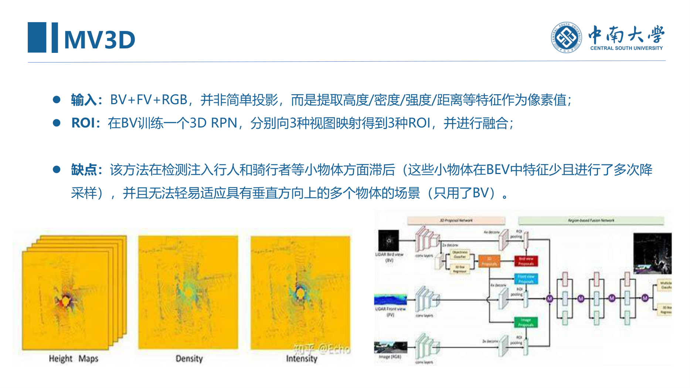

AVOD 的输入是 BEV + RGB。从 $[-40, 40] \times [0, 70] \times [0, 2.5]$ 范围内的点云数据生成 6 通道 BEV map，分辨率 $0.1\text{m}$，尺寸 $700 \times 800 \times 6$。$z$ 轴上 $[0, 2.5]$ 平分为 5 段，前 5 个通道是每个栅格单元的最大高度，第 6 个通道是每个单元中的密度信息 [第二章 无人驾驶感知基础.pdf · p.53](http://10.188.31.55:5244/Nextcloud/School/Auto-Drive-Intro/课件/%E7%AC%AC%E4%BA%8C%E7%AB%A0%20%E6%97%A0%E4%BA%BA%E9%A9%BE%E9%A9%B6%E6%84%9F%E7%9F%A5%E5%9F%BA%E7%A1%80.pdf#page=53)。

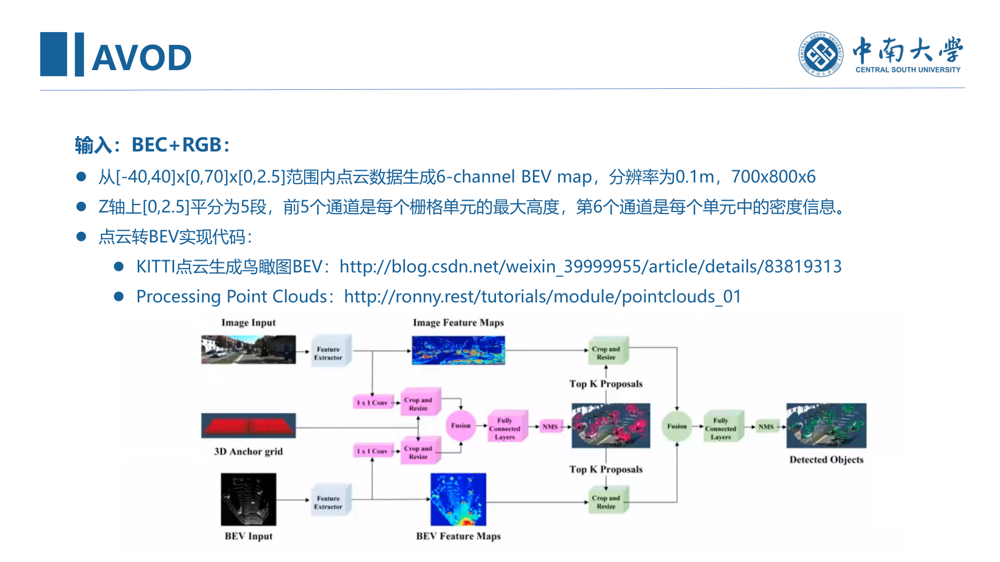

AVOD 的 feature extractor 分两部分：encoder 把 $M \times N \times D$ 降到 $M/8 \times N/8 \times D^*$；decoder 每层通过 conv-transpose 上采样，与 encoder 中对应 size 的 feature map 连接，再用 $3 \times 3$ 卷积融合两种特征图，最终得到 $M \times N \times D$ 特征图。全分辨率的 feature map 对小目标友好，借鉴自 FPN（feature pyramid networks）[第二章 无人驾驶感知基础.pdf · p.54](http://10.188.31.55:5244/Nextcloud/School/Auto-Drive-Intro/课件/%E7%AC%AC%E4%BA%8C%E7%AB%A0%20%E6%97%A0%E4%BA%BA%E9%A9%BE%E9%A9%B6%E6%84%9F%E7%9F%A5%E5%9F%BA%E7%A1%80.pdf#page=54)。

AVOD 的 RPN 把 feature map 通过 $1 \times 1$ 卷积降维处理，减少 RPN 过程中的内存和计算量。anchor 是 6 参数形式：中心点 $(t_x, t_y, t_z)$ 加长宽高 $(d_x, d_y, d_z)$，BEV 上以 $0.5\text{m}$ 间距采样 $(t_x, t_y)$，$t_z$ 由传感器与地面之间的距离等因素决定。每个类别的 anchor 尺寸不同，从训练样本中获取 $70 \times 80 / 0.5 / 0.5 \times (\text{num\_cluster}) \times 2$，丰富的 anchor 对小目标友好。通过 anchor 的映射融合两种特征图：每个 3D anchor 投影到 BEV 和 image 获得两个 ROI，每个 ROI 做 crop 并 resize 到 $3 \times 3$，然后做像素级特征融合。在融合特征图上训练 RPN（MV3D 仅在 BEV 上训练 RPN）：二分类用交叉熵，在 BEV 上通过判定 anchors 与 ground truth 的 IOU 区分 object 和 background；回归用 smooth L1 loss。最后在 BEV 上采用 2D NMS，把 top $k$ proposals 送入第二阶段检测网络 [第二章 无人驾驶感知基础.pdf · p.55](http://10.188.31.55:5244/Nextcloud/School/Auto-Drive-Intro/课件/%E7%AC%AC%E4%BA%8C%E7%AB%A0%20%E6%97%A0%E4%BA%BA%E9%A9%BE%E9%A9%B6%E6%84%9F%E7%9F%A5%E5%9F%BA%E7%A1%80.pdf#page=55)。

Apollo 2.0 的感知方案是：把点云俯视投影到地面网格（2D grid-map），每个网格计算 8 个统计量，再用 UNet 做障碍物分割 [第二章 无人驾驶感知基础.pdf · p.56](http://10.188.31.55:5244/Nextcloud/School/Auto-Drive-Intro/课件/%E7%AC%AC%E4%BA%8C%E7%AB%A0%20%E6%97%A0%E4%BA%BA%E9%A9%BE%E9%A9%B6%E6%84%9F%E7%9F%A5%E5%9F%BA%E7%A1%80.pdf#page=56)。

SqueezeSeg 的预处理把三维点降到二维：$(x, y, z) \rightarrow (\theta, \Psi)$，微分后得到一个二维的直角坐标系，球面坐标系下的每一个点都可以用直角坐标系中的点表示。提取点云中每一个点的 5 个特征 $(x, y, z, \text{intensity}, \text{range})$ 放入对应的二维坐标 $(i, j)$，最终张量尺寸是：

$$
H \times W \times C = 64 \times 512 \times 5
$$

$C = 5$，$H = 4$（KITTI 64 线激光雷达），$W = 512$（仅使用正前方 90 度范围的 512 个网格划分）[第二章 无人驾驶感知基础.pdf · p.57](http://10.188.31.55:5244/Nextcloud/School/Auto-Drive-Intro/课件/%E7%AC%AC%E4%BA%8C%E7%AB%A0%20%E6%97%A0%E4%BA%BA%E9%A9%BE%E9%A9%B6%E6%84%9F%E7%9F%A5%E5%9F%BA%E7%A1%80.pdf#page=57)。

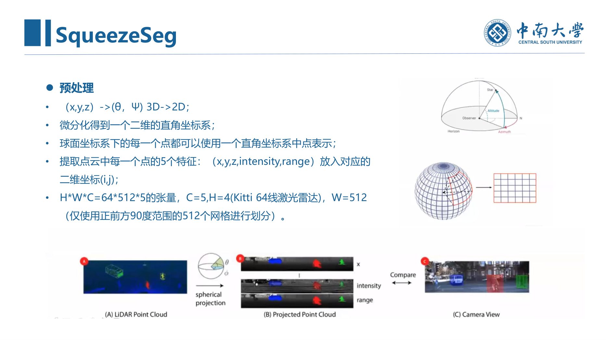

SqueezeSeg 的 CNN 用 SqueezeNet，参数量极少但能达到 AlexNet 精度，实时性好。输入点云处理后的数据 $64 \times 512 \times 5$，输出同等尺度的 label map（像素分割）。由于高度 64 小于宽度 512，网络主要对宽度进行降维（通过 max pooling）。conv14 层的输出即对每个点的分类概率映射（分割），最后送入条件随机场中做进一步矫正 [第二章 无人驾驶感知基础.pdf · p.58](http://10.188.31.55:5244/Nextcloud/School/Auto-Drive-Intro/课件/%E7%AC%AC%E4%BA%8C%E7%AB%A0%20%E6%97%A0%E4%BA%BA%E9%A9%BE%E9%A9%B6%E6%84%9F%E7%9F%A5%E5%9F%BA%E7%A1%80.pdf#page=58)。

**Voxel-Based。** 基本思想是把点云划分成均匀的空间三维体素。体素网格提供了结构，体素数量像图片一样是不变的，也解决了顺序问题。优点是表示方式规整，能把卷积池化等神经网络运算迁移到三维。缺点是体素表达的数据量大，计算量很大，一般会减小分辨率，引入量化误差和局限，例如 $64 \times 64 \times 64$ [第二章 无人驾驶感知基础.pdf · p.59](http://10.188.31.55:5244/Nextcloud/School/Auto-Drive-Intro/课件/%E7%AC%AC%E4%BA%8C%E7%AB%A0%20%E6%97%A0%E4%BA%BA%E9%A9%BE%E9%A9%B6%E6%84%9F%E7%9F%A5%E5%9F%BA%E7%A1%80.pdf#page=59)。

典型算法有 VoxNet（*A 3D convolutional neural network for real-time object classification*）、*Volumetric and multi-view CNNs for object classification on 3d data*、VoxelNet（Voxel-Based + Point-Based，局部加全局）。

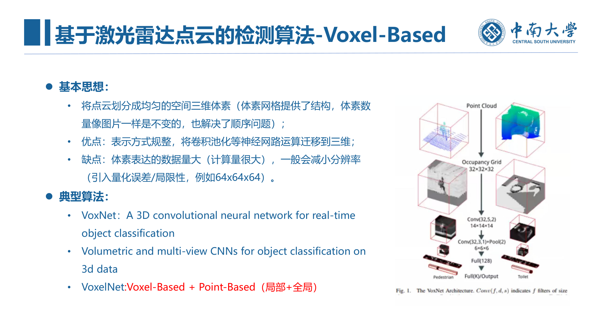

**Tree-Based。** 用 tree 来结构化点云，对稀疏点云进行高效的组织，再套用成熟的神经网络处理。优点是与体素相比是更高效的点云结构化方法。缺点是仍然需要额外步骤对数据进行预处理（类似体素化），在端到端处理方面存在劣势 [第二章 无人驾驶感知基础.pdf · p.60](http://10.188.31.55:5244/Nextcloud/School/Auto-Drive-Intro/课件/%E7%AC%AC%E4%BA%8C%E7%AB%A0%20%E6%97%A0%E4%BA%BA%E9%A9%BE%E9%A9%B6%E6%84%9F%E7%9F%A5%E5%9F%BA%E7%A1%80.pdf#page=60)。

典型算法是 OctNet（*Learning Deep 3D Representations at High Resolutions*）和 O-CNN（*Octree-based Conventional Neural Networks for 3D Shape Analysis*）。OctNet 用八叉树，这种表示关注与相关稠密区域的内存分配和计算，使 3D 卷积网络能够做得既深又高分辨率。O-CNN 的八叉树把三维点云划分成若干节点组成一定顺序结构。

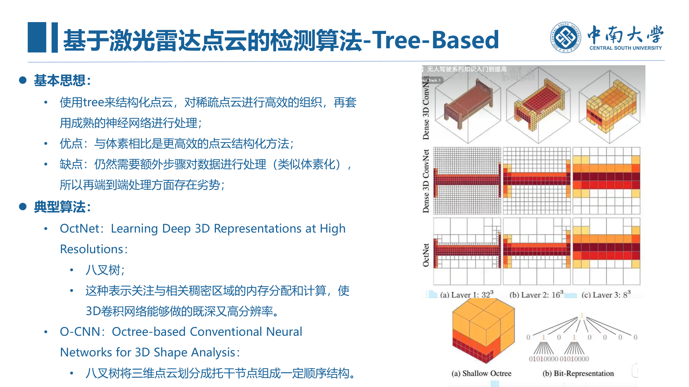

**Point-Based。** 直接对点云处理。两个必须解决的问题 [第二章 无人驾驶感知基础.pdf · p.61](http://10.188.31.55:5244/Nextcloud/School/Auto-Drive-Intro/课件/%E7%AC%AC%E4%BA%8C%E7%AB%A0%20%E6%97%A0%E4%BA%BA%E9%A9%BE%E9%A9%B6%E6%84%9F%E7%9F%A5%E5%9F%BA%E7%A1%80.pdf#page=61)：

**无序性**。点云本质上是一堆点，点的顺序不影响它对整体形状的表示。希望不同点云顺序得到相同的特征提取结果，可以用对称函数。

**旋转 / 平移性**。相同的点云在空间中经过刚性变化后坐标发生变化。希望不论点云在什么坐标系下呈现，网络都能正确识别，可以通过 STN（special transform network）解决。

Point-Based 的基本思想因此是：直接对点云进行处理，使用对称函数解决点的无序性，使用空间变换解决旋转 / 平移性。代表性算法有 PointNet、PointNet++ → Frustum-PointNet、PointRCNN，以及 PointCNN [第二章 无人驾驶感知基础.pdf · p.62](http://10.188.31.55:5244/Nextcloud/School/Auto-Drive-Intro/课件/%E7%AC%AC%E4%BA%8C%E7%AB%A0%20%E6%97%A0%E4%BA%BA%E9%A9%BE%E9%A9%B6%E6%84%9F%E7%9F%A5%E5%9F%BA%E7%A1%80.pdf#page=62)。

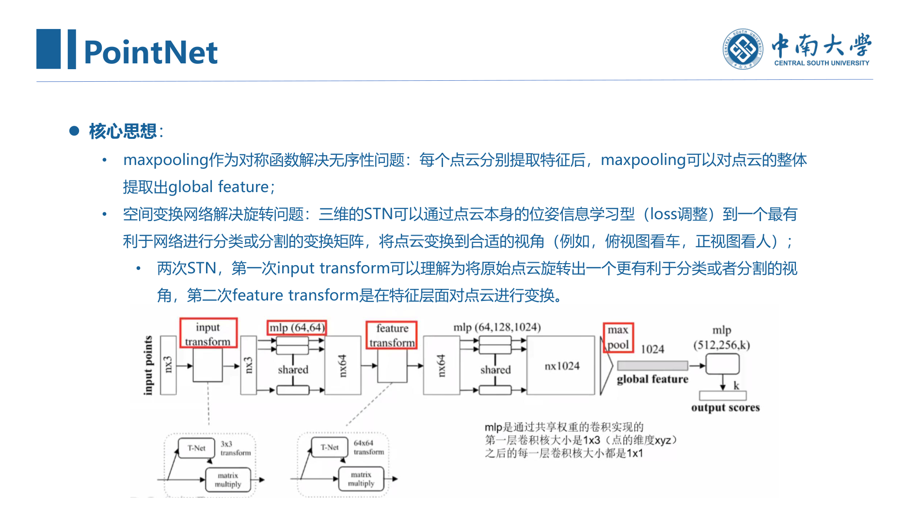

PointNet 的核心思想有两条。maxpooling 作为对称函数解决无序性问题：每个点云分别提取特征后，maxpooling 可以对点云整体提取出 global feature。空间变换网络解决旋转问题：三维的 STN 可以通过点云本身的位姿信息学习（loss 调整）到一个最有利于网络分类或分割的变换矩阵，把点云变换到合适的视角，比如俯视图看车、正视图看人。STN 有两次：第一次 input transform 把原始点云旋转出一个更有利于分类或分割的角度，第二次 feature transform 在特征层面对点云进行变换 [第二章 无人驾驶感知基础.pdf · p.63](http://10.188.31.55:5244/Nextcloud/School/Auto-Drive-Intro/课件/%E7%AC%AC%E4%BA%8C%E7%AB%A0%20%E6%97%A0%E4%BA%BA%E9%A9%BE%E9%A9%B6%E6%84%9F%E7%9F%A5%E5%9F%BA%E7%A1%80.pdf#page=63)。

PointNet++ 补上了 PointNet 缺的局部信息。PointNet 是单个点云特征直接到全局特征，中间缺少局部信息，相当于用很大的卷积核 / pooling 制作了一层卷积 / pooling，感受野一下变得很大，单个 PointNet 操作可以看作一种特殊的卷积操作。PointNet++ 则是单个点云特征 → 局部点云特征 → 更大局部点云特征 → … → 全局信息。ModelNet40 上的准确率由 89.2%（PointNet）提高到 90.7% [第二章 无人驾驶感知基础.pdf · p.65](http://10.188.31.55:5244/Nextcloud/School/Auto-Drive-Intro/课件/%E7%AC%AC%E4%BA%8C%E7%AB%A0%20%E6%97%A0%E4%BA%BA%E9%A9%BE%E9%A9%B6%E6%84%9F%E7%9F%A5%E5%9F%BA%E7%A1%80.pdf#page=65)。

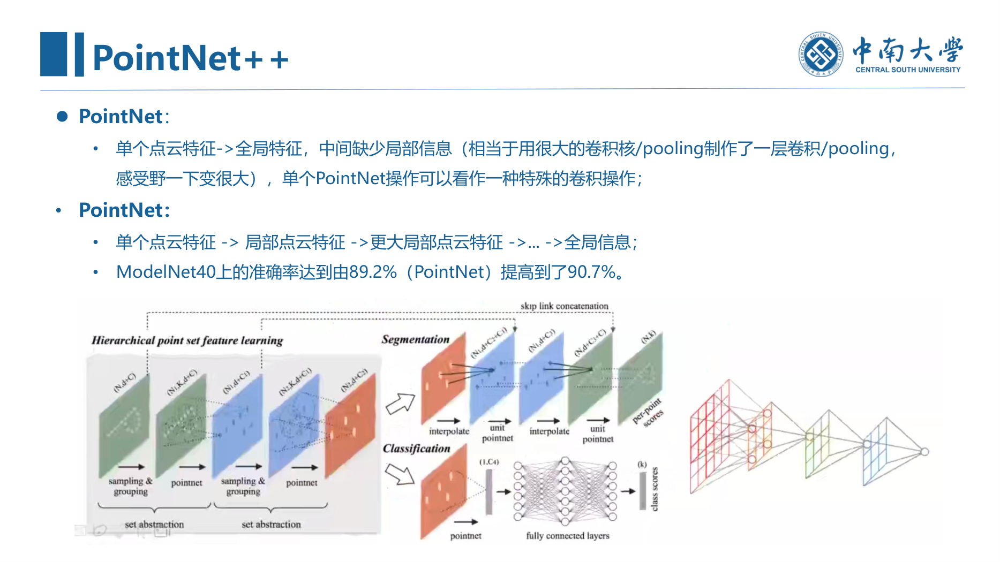

PointCNN 与 PointNet 的差别在特征提取是否顺序相关。PointNet 是点云分别提取特征（顺序无关），用对称函数（maxpooling）解决顺序问题。PointCNN 是点云领域提取特征（顺序相关），用 X 变换解决顺序问题 [第二章 无人驾驶感知基础.pdf · p.66](http://10.188.31.55:5244/Nextcloud/School/Auto-Drive-Intro/课件/%E7%AC%AC%E4%BA%8C%E7%AB%A0%20%E6%97%A0%E4%BA%BA%E9%A9%BE%E9%A9%B6%E6%84%9F%E7%9F%A5%E5%9F%BA%E7%A1%80.pdf#page=66)。

Frustum-PointNet 的做法分三步。提取视锥体：RGB 提取 2D box（ROI），用相机投影矩阵把 2D box 转成 3D 视锥体。分割：对视锥体内点云分割，得到物体实例分割。3D box：再回归出三维框 [第二章 无人驾驶感知基础.pdf · p.67](http://10.188.31.55:5244/Nextcloud/School/Auto-Drive-Intro/课件/%E7%AC%AC%E4%BA%8C%E7%AB%A0%20%E6%97%A0%E4%BA%BA%E9%A9%BE%E9%A9%B6%E6%84%9F%E7%9F%A5%E5%9F%BA%E7%A1%80.pdf#page=67)。

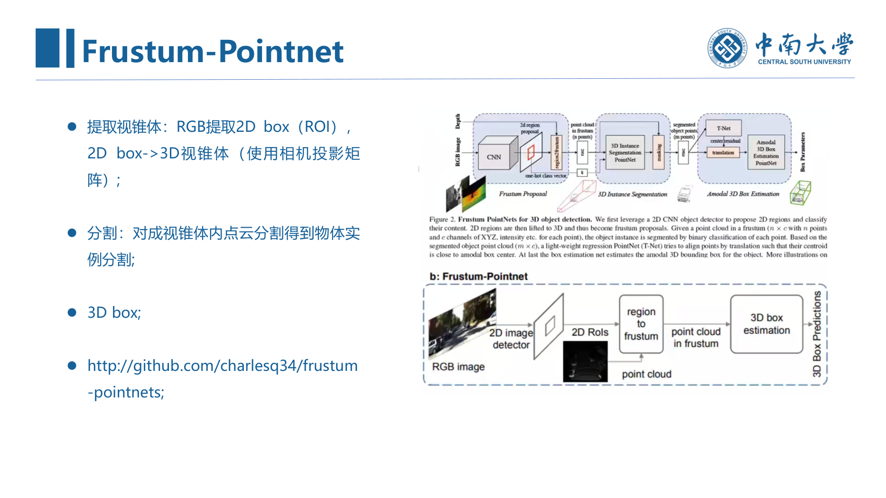

Frustum-PointNet 的细节是：3D RNN from raw point（使用 PointNet++ 提取特征），以及 refining 3D proposal [第二章 无人驾驶感知基础.pdf · p.68](http://10.188.31.55:5244/Nextcloud/School/Auto-Drive-Intro/课件/%E7%AC%AC%E4%BA%8C%E7%AB%A0%20%E6%97%A0%E4%BA%BA%E9%A9%BE%E9%A9%B6%E6%84%9F%E7%9F%A5%E5%9F%BA%E7%A1%80.pdf#page=68)。

**四种组织方式怎么解决同一个问题。** 四种点云方法的差别，可以归结为「怎么给无序的点建立结构」这一个问题的四种答案 [第二章 无人驾驶感知基础.pdf · p.69](http://10.188.31.55:5244/Nextcloud/School/Auto-Drive-Intro/课件/%E7%AC%AC%E4%BA%8C%E7%AB%A0%20%E6%97%A0%E4%BA%BA%E9%A9%BE%E9%A9%B6%E6%84%9F%E7%9F%A5%E5%9F%BA%E7%A1%80.pdf#page=69)：

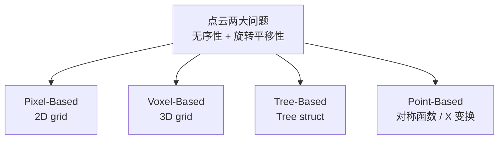

## 第 2 章 专题：行车环境感知 — 激光雷达与点云

自动驾驶的感知层要在几毫秒内把物理世界变成可计算的结构。激光雷达 (LiDAR) 负责给出几何，点云处理负责把几何变成可用的特征。这章按课件的两段结构走：先讲激光雷达本身，再讲拿到点云之后做什么。

### 激光雷达概述

LiDAR 是 Light Detection And Ranging 的缩写。它发射激光束，靠回波测量目标的位置、速度等特征量 [第二章-行车环境感知-激光雷达和点云.pptx · p.5](http://10.188.31.55:5244/Nextcloud/School/Auto-Drive-Intro/课件/%E7%AC%AC%E4%BA%8C%E7%AB%A0-%E8%A1%8C%E8%BD%A6%E7%8E%AF%E5%A2%83%E6%84%9F%E7%9F%A5-%E6%BF%80%E5%85%89%E9%9B%B7%E8%BE%BE%E5%92%8C%E7%82%B9%E4%BA%91.pptx)。激光波段在 0.5 μm 到 10 μm 之间，接收端用光电探测器。测距是 Time of Flight (TOF)：记下脉冲发出与回波到达的时间差 $t$，距离就是光速乘以时间差的一半。

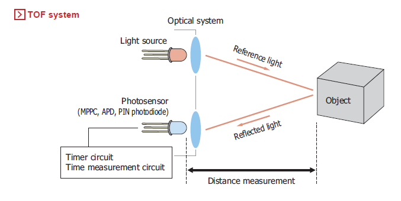

按扫描方式分三类：机械旋转式、固态、混合固态。课件把这棵树里的相控阵 OPA 和 Flash 圈了出来，是固态路线里两条主要分支 [第二章-行车环境感知-激光雷达和点云.pptx · p.6](http://10.188.31.55:5244/Nextcloud/School/Auto-Drive-Intro/课件/%E7%AC%AC%E4%BA%8C%E7%AB%A0-%E8%A1%8C%E8%BD%A6%E7%8E%AF%E5%A2%83%E6%84%9F%E7%9F%A5-%E6%BF%80%E5%85%89%E9%9B%B7%E8%BE%BE%E5%92%8C%E7%82%B9%E4%BA%91.pptx)。

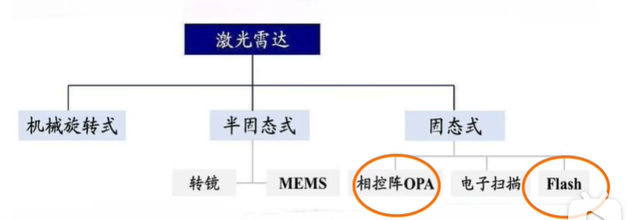

### 工作原理

机械式靠转动发射头，把激光从"线"变成"面"。竖直方向上排布多束激光，4 线、16 线、32 线或 64 线，每个高度一个扫描面，转起来就是动态 3D 扫描 [第二章-行车环境感知-激光雷达和点云.pptx · p.7](http://10.188.31.55:5244/Nextcloud/School/Auto-Drive-Intro/课件/%E7%AC%AC%E4%BA%8C%E7%AB%A0-%E8%A1%8C%E8%BD%A6%E7%8E%AF%E5%A2%83%E6%84%9F%E7%9F%A5-%E6%BF%80%E5%85%89%E9%9B%B7%E8%BE%BE%E5%92%8C%E7%82%B9%E4%BA%91.pptx)。

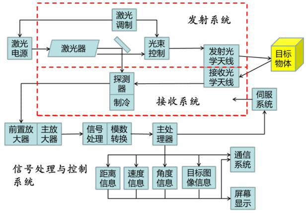

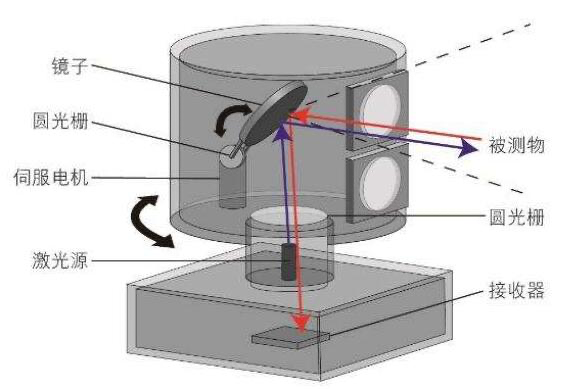

混合固态用半导体"微动"器件（如 MEMS 扫描镜）替代宏观机械扫描器，在微观尺度完成发射端扫描。MEMS 扫描镜是硅基半导体元器件，属固态电子元件，内部集成"可动"的微型镜面，兼具"固态"和"运动"两种属性，所以叫混合固态 [第二章-行车环境感知-激光雷达和点云.pptx · p.9](http://10.188.31.55:5244/Nextcloud/School/Auto-Drive-Intro/课件/%E7%AC%AC%E4%BA%8C%E7%AB%A0-%E8%A1%8C%E8%BD%A6%E7%8E%AF%E5%A2%83%E6%84%9F%E7%9F%A5-%E6%BF%80%E5%85%89%E9%9B%B7%E8%BE%BE%E5%92%8C%E7%82%B9%E4%BA%91.pptx)。好处有两点：降低机械损毁；主要部件用芯片工艺生产后量产能力大幅提高，成本下降。2016 年 1 月的 CES 上，Velodyne 展示了"混合固态超级冰球"（Solid-State Hybrid Ultra Puck Auto）。

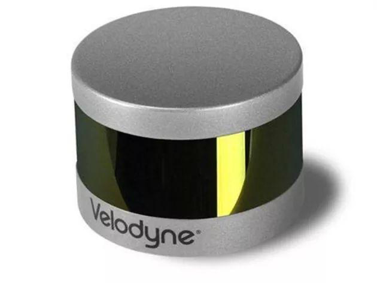

固态里最主流的路线是 OPA (Optical Phased Array，光学相控阵列)。它用相干原理：多个光源组成阵列，通过控制各光源的发光时间差（相位差），合成具有特定方向的主光束；再控制主光束，就能扫到不同方向 [第二章-行车环境感知-激光雷达和点云.pptx · p.10](http://10.188.31.55:5244/Nextcloud/School/Auto-Drive-Intro/课件/%E7%AC%AC%E4%BA%8C%E7%AB%A0-%E8%A1%8C%E8%BD%A6%E7%8E%AF%E5%A2%83%E6%84%9F%E7%9F%A5-%E6%BF%80%E5%85%89%E9%9B%B7%E8%BE%BE%E5%92%8C%E7%82%B9%E4%BA%91.pptx)。优点是扫描速度快、精度高、可控性好、体积小。缺点是容易形成旁瓣，影响光束作用距离和角分辨率，生产难度也高。

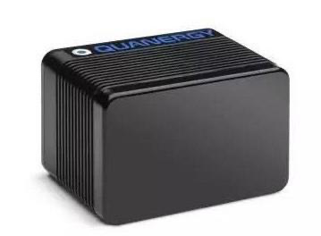

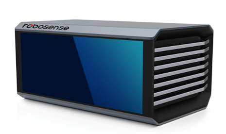

### 常用激光雷达

Velodyne 系列按线数、视野和点频分成几档。线数决定垂直分辨率，线数越高同一距离上打的点越密 [第二章-行车环境感知-激光雷达和点云.pptx · p.12](http://10.188.31.55:5244/Nextcloud/School/Auto-Drive-Intro/课件/%E7%AC%AC%E4%BA%8C%E7%AB%A0-%E8%A1%8C%E8%BD%A6%E7%8E%AF%E5%A2%83%E6%84%9F%E7%9F%A5-%E6%BF%80%E5%85%89%E9%9B%B7%E8%BE%BE%E5%92%8C%E7%82%B9%E4%BA%91.pptx)。

| 型号 | 激光器数 | 尺寸 | 重量 | 激光波长 | 水平视野 | 垂直视野 | 输出频率 | 测量范围 | 距离精度 | 水平分辨率 | 垂直分辨率 | 防护标准 |
| --- | --- | --- | --- | --- | --- | --- | --- | --- | --- | --- | --- | --- |
| HDL-64E | 64 | 203 mm × 284 mm | 13.2 KG | 905 nm | 360° | 26.8°（+2° ~ -24.6°） | 130 万点/秒 | 100–120 M | < 2 cm | 5 Hz: 0.08°、10 Hz: 0.17°、20 Hz: 0.35° | 0.4° | IP67 |
| HDL-32E | 32 | 86 mm × 145 mm | 1.3 KG | 905 nm | 360° | 41.34°（+10.67° ~ -30.67°） | 70 万点/秒 | 80–120 M | < 2 cm | 5 Hz: 0.08°、10 Hz: 0.17°、20 Hz: 0.35° | 1.33° | IP67 |
| VLP-16 / PUCK | 16 | 104 mm × 72 mm | 0.83 KG / 0.53 KG | 905 nm | 360° | 30°（+15° ~ -15°） | 30 万点/秒 | 100 M | < 3 cm | 5 Hz: 0.1°、10 Hz: 0.2°、20 Hz: 0.4° | 2.0° | IP67 |
| Ultra Puck-32A | 32 | 104 mm × 72 mm | 0.8 KG ~ 1.3 KG | 905 nm | 360° | 28° | 70 万点/秒 | 200 M | < 2 cm | — | — | IP67 |

四款都是 905 nm 波长，水平视野一律 360°。差别在垂直视野和测量范围：HDL-64E 垂直视野最窄（26.8°）但量程到 120 M，Ultra Puck-32A 垂直视野 28° 而量程 200 M 最远 [第二章-行车环境感知-激光雷达和点云.pptx · p.12](http://10.188.31.55:5244/Nextcloud/School/Auto-Drive-Intro/课件/%E7%AC%AC%E4%BA%8C%E7%AB%A0-%E8%A1%8C%E8%BD%A6%E7%8E%AF%E5%A2%83%E6%84%9F%E7%9F%A5-%E6%BF%80%E5%85%89%E9%9B%B7%E8%BE%BE%E5%92%8C%E7%82%B9%E4%BA%91.pptx)。课件给每款标了定位：HDL-64E 性能佳但价格贵，HDL-32E 体积更小更轻，VLP-16 适用于无人机，Ultra Puck-32A 汽车专用。

大疆 (DJI) 的 Livox 系列走的是另一条产品线，FOV 和点频的组合跟 Velodyne 不一样 [第二章-行车环境感知-激光雷达和点云.pptx · p.13](http://10.188.31.55:5244/Nextcloud/School/Auto-Drive-Intro/课件/%E7%AC%AC%E4%BA%8C%E7%AB%A0-%E8%A1%8C%E8%BD%A6%E7%8E%AF%E5%A2%83%E6%84%9F%E7%9F%A5-%E6%BF%80%E5%85%89%E9%9B%B7%E8%BE%BE%E5%92%8C%E7%82%B9%E4%BA%91.pptx)。

| 型号 | 探测距离 | 点云数 | FOV | 精度 |
| --- | --- | --- | --- | --- |
| Livox Mid-40 | 260 m | 10 万/秒 | 38.4° 圆形 | 2 cm，0.1° |
| Livox Mid-100 | 260 m | 30 万/秒 | 98.4° × 38.4° | 2 cm，0.1° |
| Livox Horizon | 260 m | 24 万/秒 | 81.7° × 25.1° | 2 cm，0.05° |
| Livox 泰览 TELE-15 | 500 m | — | 14.5° × 16.2° | 2 cm，0.03°，内置 IMU |

Mid-40 是圆形 FOV，TELE-15 量程最远（500 m）且窄视场（14.5° × 16.2°），自带 IMU [第二章-行车环境感知-激光雷达和点云.pptx · p.13](http://10.188.31.55:5244/Nextcloud/School/Auto-Drive-Intro/课件/%E7%AC%AC%E4%BA%8C%E7%AB%A0-%E8%A1%8C%E8%BD%A6%E7%8E%AF%E5%A2%83%E6%84%9F%E7%9F%A5-%E6%BF%80%E5%85%89%E9%9B%B7%E8%BE%BE%E5%92%8C%E7%82%B9%E4%BA%91.pptx)。

VLP-16 是 16 线、30 万点/秒、IP67，课件给的定位是适用于无人机。引脚定义固定了各路信号的走向 [第二章-行车环境感知-激光雷达和点云.pptx · p.14](http://10.188.31.55:5244/Nextcloud/School/Auto-Drive-Intro/课件/%E7%AC%AC%E4%BA%8C%E7%AB%A0-%E8%A1%8C%E8%BD%A6%E7%8E%AF%E5%A2%83%E6%84%9F%E7%9F%A5-%E6%BF%80%E5%85%89%E9%9B%B7%E8%BE%BE%E5%92%8C%E7%82%B9%E4%BA%91.pptx)。

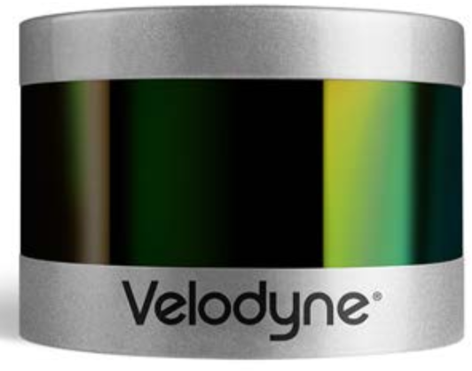

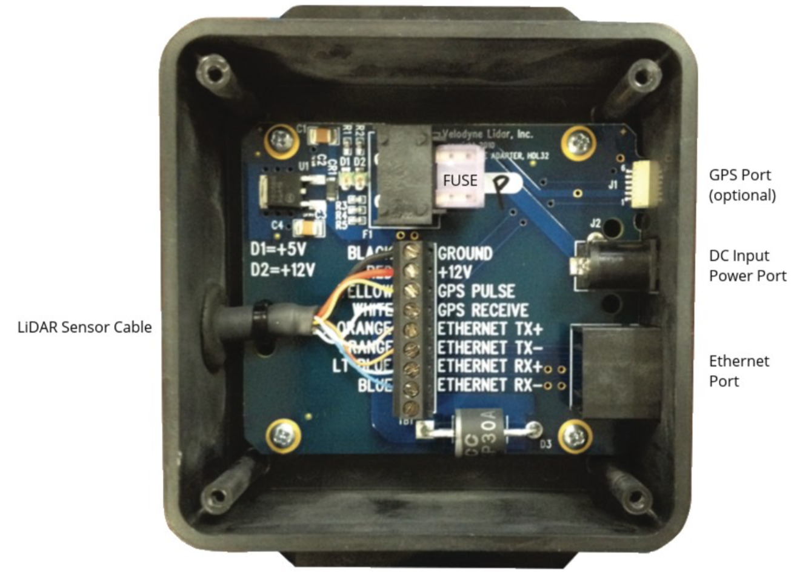

接法很简单：雷达经 Ethernet 接电脑，电源 9 V 到 18 V 供电，INS/GPS 可选。雷达出厂 IP 是 192.168.1.201，电脑端设 192.168.1.77 就在同一网段 [第二章-行车环境感知-激光雷达和点云.pptx · p.15](http://10.188.31.55:5244/Nextcloud/School/Auto-Drive-Intro/课件/%E7%AC%AC%E4%BA%8C%E7%AB%A0-%E8%A1%8C%E8%BD%A6%E7%8E%AF%E5%A2%83%E6%84%9F%E7%9F%A5-%E6%BF%80%E5%85%89%E9%9B%B7%E8%BE%BE%E5%92%8C%E7%82%B9%E4%BA%91.pptx)。

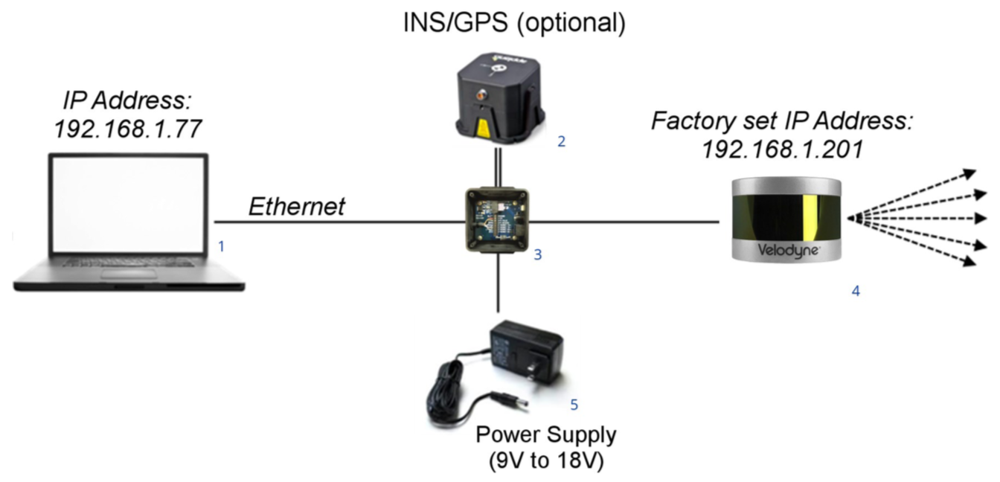

### 激光雷达数据格式

Velodyne 的 UDP 包固定 1248 字节。42 字节是 UDP Header，剩下 1206 字节是载荷：12 个 Data Block，每个 Data Block 头部是 2 字节 flag 加 2 字节 azimuth，后面 32 组通道数据，每组 2 字节 distance 加 1 字节 reflectivity；末尾 4 字节 Timestamp 加 2 字节 Factory [第二章-行车环境感知-激光雷达和点云.pptx · p.16](http://10.188.31.55:5244/Nextcloud/School/Auto-Drive-Intro/课件/%E7%AC%AC%E4%BA%8C%E7%AB%A0-%E8%A1%8C%E8%BD%A6%E7%8E%AF%E5%A2%83%E6%84%9F%E7%9F%A5-%E6%BF%80%E5%85%89%E9%9B%B7%E8%BE%BE%E5%92%8C%E7%82%B9%E4%BA%91.pptx)。

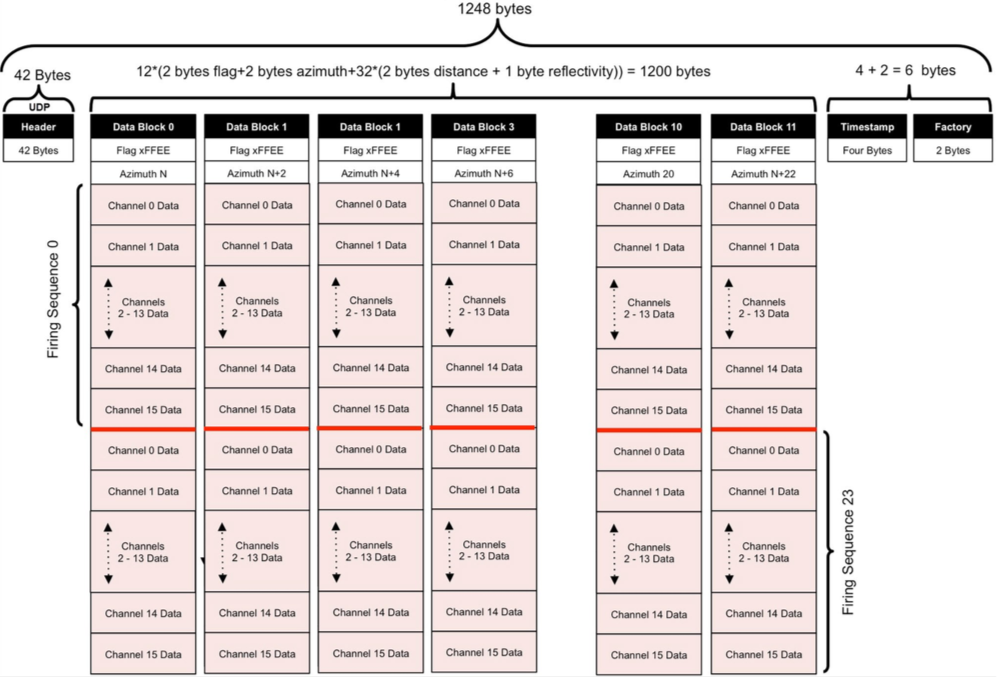

解析的起点是一个三维点在雷达坐标系里的极坐标：距离 $R$、俯仰角 $\omega$、方位角 $\alpha$。转成直角坐标：

$$
\begin{aligned}
X &= R \cos(\omega) \sin(\alpha) \\
Y &= R \cos(\omega) \cos(\alpha) \\
Z &= R \sin(\omega)
\end{aligned}
$$

$p_i = (X_i, Y_i, Z_i)$ 就是第 $i$ 个点的坐标，$I_i$ 是它的反射强度 [第二章-行车环境感知-激光雷达和点云.pptx · p.17](http://10.188.31.55:5244/Nextcloud/School/Auto-Drive-Intro/课件/%E7%AC%AC%E4%BA%8C%E7%AB%A0-%E8%A1%8C%E8%BD%A6%E7%8E%AF%E5%A2%83%E6%84%9F%E7%9F%A5-%E6%BF%80%E5%85%89%E9%9B%B7%E8%BE%BE%E5%92%8C%E7%82%B9%E4%BA%91.pptx)。

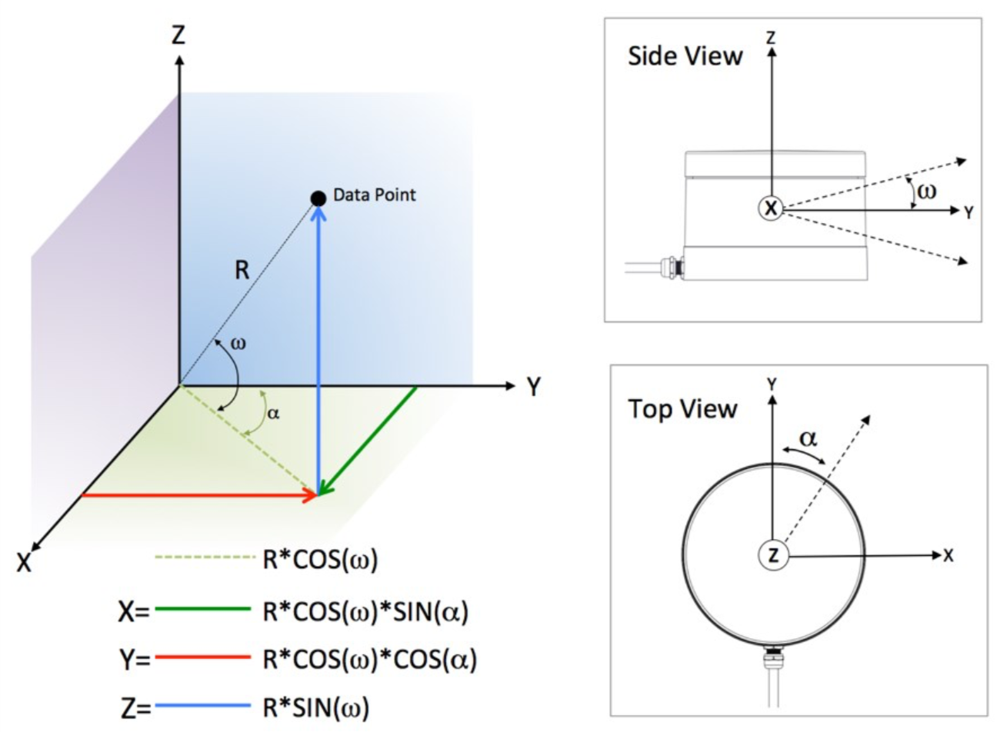

### 点云的表示

点云就是一个 $n \times 3$ 的矩阵加一组反射强度。课件用 64 线 Lidar 的点云做例子 [第二章-行车环境感知-激光雷达和点云.pptx · p.19](http://10.188.31.55:5244/Nextcloud/School/Auto-Drive-Intro/课件/%E7%AC%AC%E4%BA%8C%E7%AB%A0-%E8%A1%8C%E8%BD%A6%E7%8E%AF%E5%A2%83%E6%84%9F%E7%9F%A5-%E6%BF%80%E5%85%89%E9%9B%B7%E8%BE%BE%E5%92%8C%E7%82%B9%E4%BA%91.pptx)。

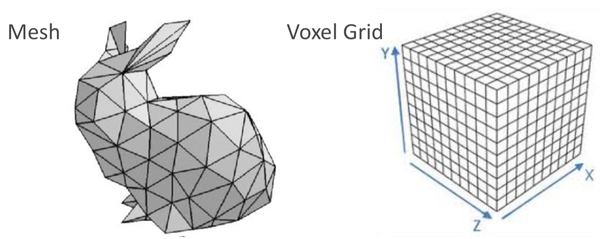

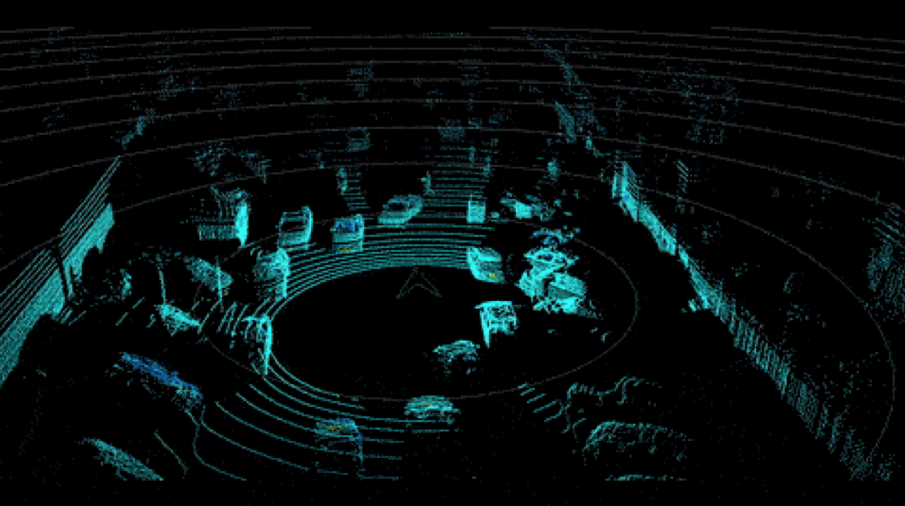

点云和图像的根本差别在于没有像素网格。点存在空间里，不存在行列顺序 [第二章-行车环境感知-激光雷达和点云.pptx · p.19](http://10.188.31.55:5244/Nextcloud/School/Auto-Drive-Intro/课件/%E7%AC%AC%E4%BA%8C%E7%AB%A0-%E8%A1%8C%E8%BD%A6%E7%8E%AF%E5%A2%83%E6%84%9F%E7%9F%A5-%E6%BF%80%E5%85%89%E9%9B%B7%E8%BE%BE%E5%92%8C%E7%82%B9%E4%BA%91.pptx)。

### 点云的特点

课件把点云的特点分成两组 [第二章-行车环境感知-激光雷达和点云.pptx · p.20](http://10.188.31.55:5244/Nextcloud/School/Auto-Drive-Intro/课件/%E7%AC%AC%E4%BA%8C%E7%AB%A0-%E8%A1%8C%E8%BD%A6%E7%8E%AF%E5%A2%83%E6%84%9F%E7%9F%A5-%E6%BF%80%E5%85%89%E9%9B%B7%E8%BE%BE%E5%92%8C%E7%82%B9%E4%BA%91.pptx)。

| 类别 | 特点 | 说明 |
| --- | --- | --- |
| 优势 | 简单 (mathematically simple) | 只有 x、y、z、I 四个量 |
| 优势 | 精确 (precise) | 距离精度 2 cm |
| 劣势 | 稀疏 (sparse) | 点之间有空隙 |
| 劣势 | 缺少纹理 (lack of texture information) | 没有颜色信息 |
| 劣势 | 无序 (un-order) | 点的排列顺序无意义 |
| 劣势 | 旋转等方差 / 不变性 (Rotation equivariance / invariance) | 刚体变换后坐标会变 |

无序性是最容易被低估的一条。点云本质上是一长串点，$n \times 3$ 矩阵，$n$ 是点数。几何上点的顺序不影响它对整体形状的表示，同一个点云可以由两个完全不同的矩阵写出来 [第二章-行车环境感知-激光雷达和点云.pptx · p.21](http://10.188.31.55:5244/Nextcloud/School/Auto-Drive-Intro/课件/%E7%AC%AC%E4%BA%8C%E7%AB%A0-%E8%A1%8C%E8%BD%A6%E7%8E%AF%E5%A2%83%E6%84%9F%E7%9F%A5-%E6%BF%80%E5%85%89%E9%9B%B7%E8%BE%BE%E5%92%8C%E7%82%B9%E4%BA%91.pptx)。

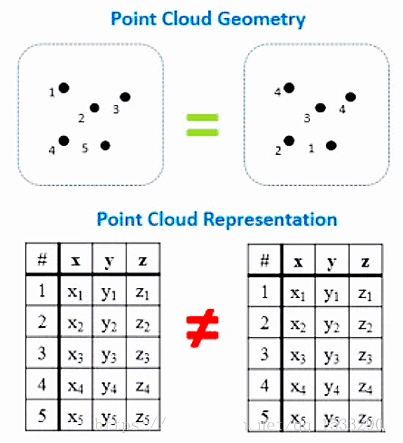

第二层关系是点与点之间的关联性。这些点来自带距离度量的空间，点不是孤立的，相邻点构成有意义的子集。模型要同时抓到局部结构和局部结构之间的组合作用 [第二章-行车环境感知-激光雷达和点云.pptx · p.22](http://10.188.31.55:5244/Nextcloud/School/Auto-Drive-Intro/课件/%E7%AC%AC%E4%BA%8C%E7%AB%A0-%E8%A1%8C%E8%BD%A6%E7%8E%AF%E5%A2%83%E6%84%9F%E7%9F%A5-%E6%BF%80%E5%85%89%E9%9B%B7%E8%BE%BE%E5%92%8C%E7%82%B9%E4%BA%91.pptx)。

第三层是旋转性。同一个点云经过刚性变换（旋转或平移）后坐标就变了。基于点云的任务，期望最终输出对这种几何变换保持鲁棒 [第二章-行车环境感知-激光雷达和点云.pptx · p.23](http://10.188.31.55:5244/Nextcloud/School/Auto-Drive-Intro/课件/%E7%AC%AC%E4%BA%8C%E7%AB%A0-%E8%A1%8C%E8%BD%A6%E7%8E%AF%E5%A2%83%E6%84%9F%E7%9F%A5-%E6%BF%80%E5%85%89%E9%9B%B7%E8%BE%BE%E5%92%8C%E7%82%B9%E4%BA%91.pptx)。

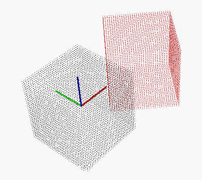

### 点云处理的十类操作

课件列出的操作分十类，涵盖从底层预处理到高层任务 [第二章-行车环境感知-激光雷达和点云.pptx · p.24](http://10.188.31.55:5244/Nextcloud/School/Auto-Drive-Intro/课件/%E7%AC%AC%E4%BA%8C%E7%AB%A0-%E8%A1%8C%E8%BD%A6%E7%8E%AF%E5%A2%83%E6%84%9F%E7%9F%A5-%E6%BF%80%E5%85%89%E9%9B%B7%E8%BE%BE%E5%92%8C%E7%82%B9%E4%BA%91.pptx)。

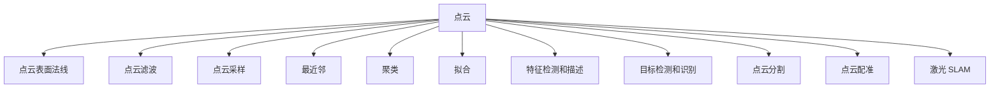

工程上用得最广的工具库是 PCL (The Point Cloud Library)，一个独立的大规模开源项目，覆盖 2D/3D 图像与点云处理 [第二章-行车环境感知-激光雷达和点云.pptx · p.25](http://10.188.31.55:5244/Nextcloud/School/Auto-Drive-Intro/课件/%E7%AC%AC%E4%BA%8C%E7%AB%A0-%E8%A1%8C%E8%BD%A6%E7%8E%AF%E5%A2%83%E6%84%9F%E7%9F%A5-%E6%BF%80%E5%85%89%E9%9B%B7%E8%BE%BE%E5%92%8C%E7%82%B9%E4%BA%91.pptx)。

### 表面法线

给定一个几何曲面，通常用垂直于该点的向量来推断曲面上这一点法线的方向。表面法线在计算机图形里用来产生阴影，在点云处理里则是分割、聚类、平面检测的基础，也能作为深度学习的输入特征 [第二章-行车环境感知-激光雷达和点云.pptx · p.26](http://10.188.31.55:5244/Nextcloud/School/Auto-Drive-Intro/课件/%E7%AC%AC%E4%BA%8C%E7%AB%A0-%E8%A1%8C%E8%BD%A6%E7%8E%AF%E5%A2%83%E6%84%9F%E7%9F%A5-%E6%BF%80%E5%85%89%E9%9B%B7%E8%BE%BE%E5%92%8C%E7%82%B9%E4%BA%91.pptx)。

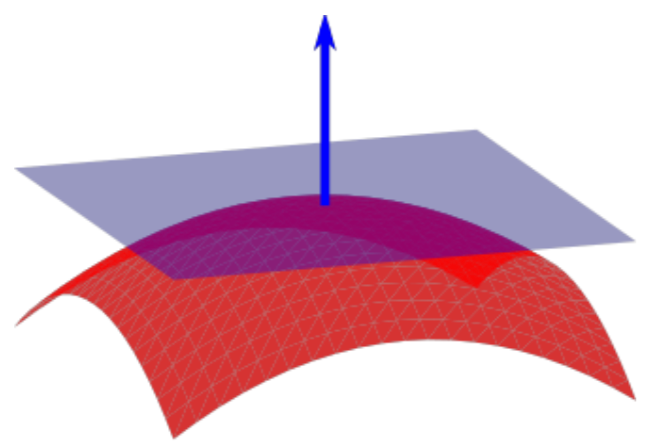

求法线的问题被化成最小二乘平面拟合。课件这样讲：

> 确定曲面上某一点法线的问题近似于估计与曲面相切的平面法线的问题，进而成为一个最小二乘平面拟合估计问题。

于是问题变成对最近邻生成的协方差矩阵做特征值与特征向量分析。法向量取最小特征值对应的特征向量。

记 $p_i$ 为待估计点的 $k$ 个最近邻，$\bar{p}$ 为它们的均值，协方差矩阵写成：

$$
C = \frac{1}{k} \sum_{i=0}^{k} (p_i - \bar{p}) (p_i - \bar{p})^T
$$

$C$ 的特征向量与特征值满足：

$$
C \cdot \vec{v}_j = \lambda_j \cdot \vec{v}_j, \qquad j \in \{0, 1, 2\}
$$

展开成三维矩阵就是：

$$
\begin{pmatrix}
\sum \Delta x_i \Delta x_i & \sum \Delta x_i \Delta y_i & \sum \Delta x_i \Delta z_i \\
\sum \Delta x_i \Delta y_i & \sum \Delta y_i \Delta y_i & \sum \Delta y_i \Delta z_i \\
\sum \Delta x_i \Delta z_i & \sum \Delta y_i \Delta z_i & \sum \Delta z_i \Delta z_i
\end{pmatrix}
\begin{pmatrix} a \\ b \\ c \end{pmatrix}
= \lambda
\begin{pmatrix} a \\ b \\ c \end{pmatrix}
$$

等价于求特征方程 $Ax = \lambda x$ 的解 [第二章-行车环境感知-激光雷达和点云.pptx · p.27](http://10.188.31.55:5244/Nextcloud/School/Auto-Drive-Intro/课件/%E7%AC%AC%E4%BA%8C%E7%AB%A0-%E8%A1%8C%E8%BD%A6%E7%8E%AF%E5%A2%83%E6%84%9F%E7%9F%A5-%E6%BF%80%E5%85%89%E9%9B%B7%E8%BE%BE%E5%92%8C%E7%82%B9%E4%BA%91.pptx)。

### 滤波

噪声有两个来源：设备、环境、操作等因素引起的测量随机噪声；干扰、遮挡等产生的孤立点（离群点）。对应的滤波手段有双边滤波、高斯滤波、条件滤波、直通滤波、基于随机采样一致性滤波等。课件归纳了四种典型情况：孤立点需去除、噪声数据需去除、点云密度不规则需平滑、点云规模大需降采样 [第二章-行车环境感知-激光雷达和点云.pptx · p.28](http://10.188.31.55:5244/Nextcloud/School/Auto-Drive-Intro/课件/%E7%AC%AC%E4%BA%8C%E7%AB%A0-%E8%A1%8C%E8%BD%A6%E7%8E%AF%E5%A2%83%E6%84%9F%E7%9F%A5-%E6%BF%80%E5%85%89%E9%9B%B7%E8%BE%BE%E5%92%8C%E7%82%B9%E4%BA%91.pptx)。

孤立点去除 (Radius Outlier Removal) 只要两步：对每个点找半径 $r$ 的邻域，邻居数 $k$ 小于阈值 $k^*$ 就把这个点删掉 [第二章-行车环境感知-激光雷达和点云.pptx · p.29](http://10.188.31.55:5244/Nextcloud/School/Auto-Drive-Intro/课件/%E7%AC%AC%E4%BA%8C%E7%AB%A0-%E8%A1%8C%E8%BD%A6%E7%8E%AF%E5%A2%83%E6%84%9F%E7%9F%A5-%E6%BF%80%E5%85%89%E9%9B%B7%E8%BE%BE%E5%92%8C%E7%82%B9%E4%BA%91.pptx)。

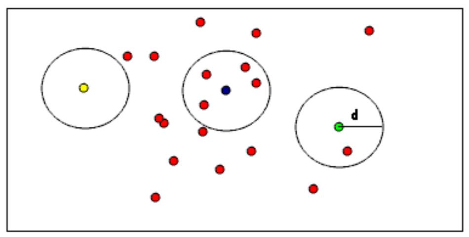

噪声点去除 (Statistical Outlier Removal) 用统计量而不是固定半径。对每个点算它到邻居的距离 $d_{ij}$，把这些距离建模成高斯分布 $d \sim N(\mu, \sigma)$，其中 [第二章-行车环境感知-激光雷达和点云.pptx · p.30](http://10.188.31.55:5244/Nextcloud/School/Auto-Drive-Intro/课件/%E7%AC%AC%E4%BA%8C%E7%AB%A0-%E8%A1%8C%E8%BD%A6%E7%8E%AF%E5%A2%83%E6%84%9F%E7%9F%A5-%E6%BF%80%E5%85%89%E9%9B%B7%E8%BE%BE%E5%92%8C%E7%82%B9%E4%BA%91.pptx)：

$$
\mu = \frac{1}{nk} \sum_{i=1}^{m} \sum_{j=1}^{k} d_{ij}, \qquad
\sigma = \sqrt{ \frac{1}{nk} \sum_{i=1}^{m} \sum_{j=1}^{k} (d_{ij} - \mu)^2 }
$$

再用每个点到邻居的平均距离偏离 $\mu$ 的程度判断离群：

$$
\sum_{j=1}^{k} d_{ij} > \mu + 3\sigma \quad \text{或} \quad \sum_{j=1}^{k} d_{ij} < \mu - 3\sigma
$$

满足就删掉这个点 [第二章-行车环境感知-激光雷达和点云.pptx · p.30](http://10.188.31.55:5244/Nextcloud/School/Auto-Drive-Intro/课件/%E7%AC%AC%E4%BA%8C%E7%AB%A0-%E8%A1%8C%E8%BD%A6%E7%8E%AF%E5%A2%83%E6%84%9F%E7%9F%A5-%E6%BF%80%E5%85%89%E9%9B%B7%E8%BE%BE%E5%92%8C%E7%82%B9%E4%BA%91.pptx)。

> [!NOTE]
> $\mu$ 和 $\sigma$ 的分母课件写的是 $nk$，但求和范围是 $i$ 从 1 到 $m$、$j$ 从 1 到 $k$，共 $mk$ 项。这里照抄课件原样。回查时按课件写，别自己改成 $mk$ 就以为课件写错了。

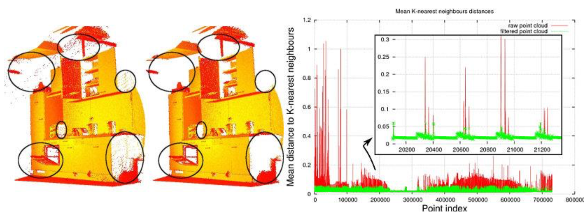

两类滤波的判据不一样：孤立点去除看邻域里有没有点，统计噪声去除看距离分布偏不偏离均值。

> Remove the point, if the mean distance is outside some confidence according to the Gaussian distribution.

### 采样

Voxel Grid Downsampling 把点云划进三维体素网格，每个体素只留一个代表点。六步流程：先算点集的最小值与最大值，定下体素边长 $r$，算网格三个方向的尺寸：

$$
D_x = \frac{x_{max} - x_{min}}{r}, \qquad
D_y = \frac{y_{max} - y_{min}}{r}, \qquad
D_z = \frac{z_{max} - z_{min}}{r}
$$

再给每个点算体素索引：

$$
h_x = \lfloor (x - x_{min}) / r \rfloor, \quad
h_y = \lfloor (y - y_{min}) / r \rfloor, \quad
h_z = \lfloor (z - z_{min}) / r \rfloor
$$

索引压成一个整数：

$$
h = h_x + h_y \cdot D_x + h_z \cdot D_x \cdot D_y
$$

按 $h$ 排序，同一体素内用质心 (Centroid) 或随机 (Random) 方法选一个代表点 [第二章-行车环境感知-激光雷达和点云.pptx · p.32](http://10.188.31.55:5244/Nextcloud/School/Auto-Drive-Intro/课件/%E7%AC%AC%E4%BA%8C%E7%AB%A0-%E8%A1%8C%E8%BD%A6%E7%8E%AF%E5%A2%83%E6%84%9F%E7%9F%A5-%E6%BF%80%E5%85%89%E9%9B%B7%E8%BE%BE%E5%92%8C%E7%82%B9%E4%BA%91.pptx)。

Farthest Point Sampling (FPS) 与随机采样不同，它尽量覆盖空间里所有点。步骤是：从点云里随机抽一个点作为查询点，在剩余点里取距离它最远的那个；把已选点集当作查询点，在剩余点里取距离点集最远的那个；对任意剩余点，算它到已选点集里所有点的距离，取其中最小值作为它到点集的距离；算出每个剩余点到点集的距离后，取距离最大的那个点；重复第二步，直到采到目标数量 $N$ [第二章-行车环境感知-激光雷达和点云.pptx · p.33](http://10.188.31.55:5244/Nextcloud/School/Auto-Drive-Intro/课件/%E7%AC%AC%E4%BA%8C%E7%AB%A0-%E8%A1%8C%E8%BD%A6%E7%8E%AF%E5%A2%83%E6%84%9F%E7%9F%A5-%E6%BF%80%E5%85%89%E9%9B%B7%E8%BE%BE%E5%92%8C%E7%82%B9%E4%BA%91.pptx)。

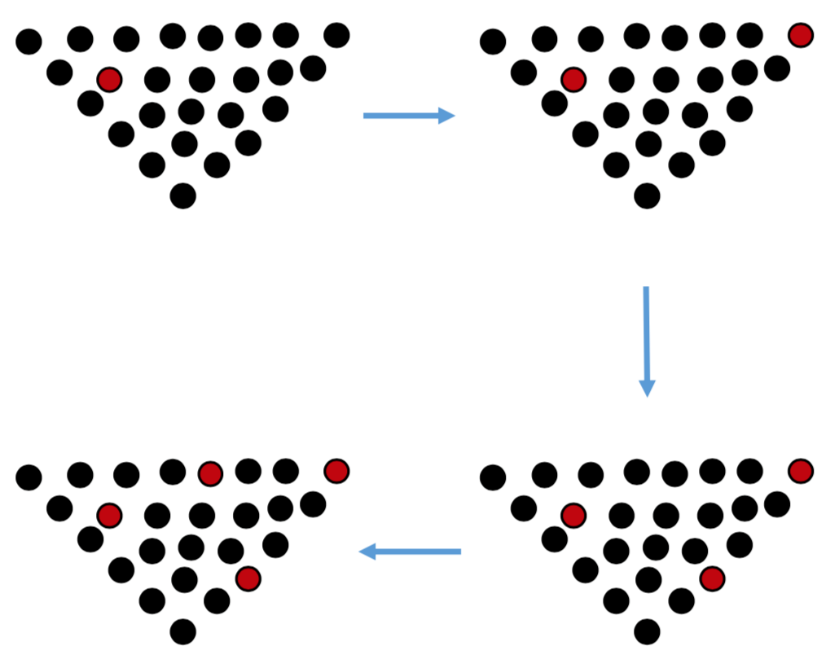

还有一类方法按法向分布采样。Normal Space Sampling (NSS) 把采样点放在法向变化剧烈的地方，而不是均匀铺开；课件引用了 Learning to Sample（CVPR 2019）作为来源 [第二章-行车环境感知-激光雷达和点云.pptx · p.34](http://10.188.31.55:5244/Nextcloud/School/Auto-Drive-Intro/课件/%E7%AC%AC%E4%BA%8C%E7%AB%A0-%E8%A1%8C%E8%BD%A6%E7%8E%AF%E5%A2%83%E6%84%9F%E7%9F%A5-%E6%BF%80%E5%85%89%E9%9B%B7%E8%BE%BE%E5%92%8C%E7%82%B9%E4%BA%91.pptx)。

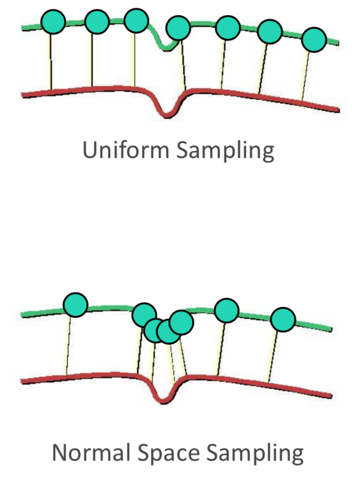

### 最近邻

最近邻是几乎所有点云操作的地基：表面法线估计、噪声滤波、采样、聚类、深度学习、特征检测与描述都要用它 [第二章-行车环境感知-激光雷达和点云.pptx · p.36](http://10.188.31.55:5244/Nextcloud/School/Auto-Drive-Intro/课件/%E7%AC%AC%E4%BA%8C%E7%AB%A0-%E8%A1%8C%E8%BD%A6%E7%8E%AF%E5%A2%83%E6%84%9F%E7%9F%A5-%E6%BF%80%E5%85%89%E9%9B%B7%E8%BE%BE%E5%92%8C%E7%82%B9%E4%BA%91.pptx)。

最近邻的查询有两种定义：K-NN 从点集里找离查询点最近的 $k$ 个点，数量固定；Fixed Radius-NN 找查询点半径 $r$ 内的所有点，数量随局部密度变化 [第二章-行车环境感知-激光雷达和点云.pptx · p.37](http://10.188.31.55:5244/Nextcloud/School/Auto-Drive-Intro/课件/%E7%AC%AC%E4%BA%8C%E7%AB%A0-%E8%A1%8C%E8%BD%A6%E7%8E%AF%E5%A2%83%E6%84%9F%E7%9F%A5-%E6%BF%80%E5%85%89%E9%9B%B7%E8%BE%BE%E5%92%8C%E7%82%B9%E4%BA%91.pptx)。

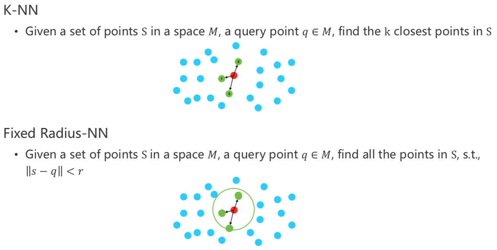

难在数据形态和规模上：点云不规则，没有网格表示（Irregular - no grid based representation）；维度灾难 (Curse of dimensionality)；实时应用的吞吐巨大 (Huge data throughput in real-time applications)。Velodyne HDL-64E 每秒出 220 万点，20 Hz 下每帧 11 万点，暴力自近邻搜索就是 $110000 \times 110000 \times 0.5 = 6 \times 10^9$ 次比较，20 Hz 跑不动 [第二章-行车环境感知-激光雷达和点云.pptx · p.36](http://10.188.31.55:5244/Nextcloud/School/Auto-Drive-Intro/课件/%E7%AC%AC%E4%BA%8C%E7%AB%A0-%E8%A1%8C%E8%BD%A6%E7%8E%AF%E5%A2%83%E6%84%9F%E7%9F%A5-%E6%BF%80%E5%85%89%E9%9B%B7%E8%BE%BE%E5%92%8C%E7%82%B9%E4%BA%91.pptx)。

> [!NOTE]
> 同一台 HDL-64E，课件里有两个点频：参数表写 130 万点/秒，最近邻一节写 2.2 million points per second。前者是课件给的规格，后者是讲暴力搜索开销时用的估值。回查时按各自出处引用，别混用。

解决办法是空间索引。核心思想是空间分割：把点云空间切分，搜索只在某个空间内进行，而不是遍历所有点。常用的树结构有三种 [第二章-行车环境感知-激光雷达和点云.pptx · p.38](http://10.188.31.55:5244/Nextcloud/School/Auto-Drive-Intro/课件/%E7%AC%AC%E4%BA%8C%E7%AB%A0-%E8%A1%8C%E8%BD%A6%E7%8E%AF%E5%A2%83%E6%84%9F%E7%9F%A5-%E6%BF%80%E5%85%89%E9%9B%B7%E8%BE%BE%E5%92%8C%E7%82%B9%E4%BA%91.pptx)：

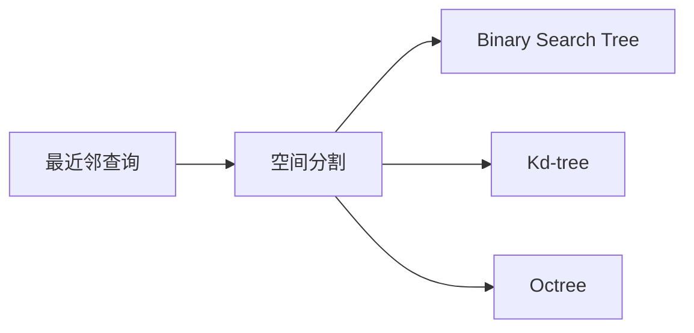

BST 的一个节点包含 Key、Left child、Right child [第二章-行车环境感知-激光雷达和点云.pptx · p.39](http://10.188.31.55:5244/Nextcloud/School/Auto-Drive-Intro/课件/%E7%AC%AC%E4%BA%8C%E7%AB%A0-%E8%A1%8C%E8%BD%A6%E7%8E%AF%E5%A2%83%E6%84%9F%E7%9F%A5-%E6%BF%80%E5%85%89%E9%9B%B7%E8%BE%BE%E5%92%8C%E7%82%B9%E4%BA%91.pptx)。

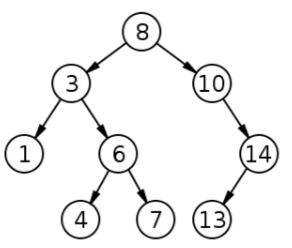

搜索树的高度 $h$ 决定复杂度：最好情况 $h = \log_2 n$，最坏情况退化成 $O(n)$ [第二章-行车环境感知-激光雷达和点云.pptx · p.40](http://10.188.31.55:5244/Nextcloud/School/Auto-Drive-Intro/课件/%E7%AC%AC%E4%BA%8C%E7%AB%A0-%E8%A1%8C%E8%BD%A6%E7%8E%AF%E5%A2%83%E6%84%9F%E7%9F%A5-%E6%BF%80%E5%85%89%E9%9B%B7%E8%BE%BE%E5%92%8C%E7%82%B9%E4%BA%91.pptx)。按序插入 3 到 9，每个新点都落在最右端，树就成了一条链。

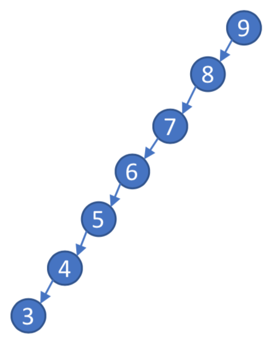

Kd-tree 是带约束条件的二分查找树。它按轴依次切分空间，每层换一个轴，搜索时不必计算所有数据点与查询点之间的距离 [第二章-行车环境感知-激光雷达和点云.pptx · p.43](http://10.188.31.55:5244/Nextcloud/School/Auto-Drive-Intro/课件/%E7%AC%AC%E4%BA%8C%E7%AB%A0-%E8%A1%8C%E8%BD%A6%E7%8E%AF%E5%A2%83%E6%84%9F%E7%9F%A5-%E6%BF%80%E5%85%89%E9%9B%B7%E8%BE%BE%E5%92%8C%E7%82%B9%E4%BA%91.pptx)。


Kd-tree 的 kNN 查找流程：从根节点开始，先到达覆盖查询点的那个叶子节点，比较该叶子内所有点，然后向上回溯继续遍历 [第二章-行车环境感知-激光雷达和点云.pptx · p.62](http://10.188.31.55:5244/Nextcloud/School/Auto-Drive-Intro/课件/%E7%AC%AC%E4%BA%8C%E7%AB%A0-%E8%A1%8C%E8%BD%A6%E7%8E%AF%E5%A2%83%E6%84%9F%E7%9F%A5-%E6%BF%80%E5%85%89%E9%9B%B7%E8%BE%BE%E5%92%8C%E7%82%B9%E4%BA%91.pptx)。


Octree 每个节点有 8 个孩子，三维情形 $2^3 = 8$。Kd-tree 有个麻烦：难以判断最近邻搜索是否已经完成，每次都得回到根节点。Octree 更高效，因为搜索可以就地结束，不必回根 [第二章-行车环境感知-激光雷达和点云.pptx · p.83](http://10.188.31.55:5244/Nextcloud/School/Auto-Drive-Intro/课件/%E7%AC%AC%E4%BA%8C%E7%AB%A0-%E8%A1%8C%E8%BD%A6%E7%8E%AF%E5%A2%83%E6%84%9F%E7%9F%A5-%E6%BF%80%E5%85%89%E9%9B%B7%E8%BE%BE%E5%92%8C%E7%82%B9%E4%BA%91.pptx)。查找时因为每个节点都是小立方体，而查询点的邻域是球体，扩展搜索就涉及球与立方体的位置判断：不相交、部分相交、包含。


> 根据提供的代码，补充完整Kd-tree和Octree的构建和搜索算法。提交你的代码和时间结果。

### 聚类

聚类是把对象分组，同组对象相似，异组对象不相似。

> Clustering is to group objects such that objects in the same group (called a cluster) are similar, while objects belong to different groups are dis-similar.

课件把方法分成两类：理论上更深刻的有 K-Means、GMM (Gaussian Mixture Model)、EM (Expectation-Maximization)；工程上更实用的有 Mean-Shift、DBSCAN (Density-Based Spatial Clustering of Applications with Noise) [第二章-行车环境感知-激光雷达和点云.pptx · p.96](http://10.188.31.55:5244/Nextcloud/School/Auto-Drive-Intro/课件/%E7%AC%AC%E4%BA%8C%E7%AB%A0-%E8%A1%8C%E8%BD%A6%E7%8E%AF%E5%A2%83%E6%84%9F%E7%9F%A5-%E6%BF%80%E5%85%89%E9%9B%B7%E8%BE%BE%E5%92%8C%E7%82%B9%E4%BA%91.pptx)。


K-Means 从 $N$ 个输入点里找 $K$ 个簇。四步循环：随机选 $K$ 个中心点；每个点分配给 $K$ 个中心之一；用每组的均值重算中心；重复第二、三步 [第二章-行车环境感知-激光雷达和点云.pptx · p.97](http://10.188.31.55:5244/Nextcloud/School/Auto-Drive-Intro/课件/%E7%AC%AC%E4%BA%8C%E7%AB%A0-%E8%A1%8C%E8%BD%A6%E7%8E%AF%E5%A2%83%E6%84%9F%E7%9F%A5-%E6%BF%80%E5%85%89%E9%9B%B7%E8%BE%BE%E5%92%8C%E7%82%B9%E4%BA%91.pptx)。

K-Means 有四个局限：硬分配，$\mu_k \in \{0, 1\}$ 是二值标签；有时一个点恰好落在两个中心的边界上；分配结果缺少不确定性度量；$K$ 是未知的 [第二章-行车环境感知-激光雷达和点云.pptx · p.99](http://10.188.31.55:5244/Nextcloud/School/Auto-Drive-Intro/课件/%E7%AC%AC%E4%BA%8C%E7%AB%A0-%E8%A1%8C%E8%BD%A6%E7%8E%AF%E5%A2%83%E6%84%9F%E7%9F%A5-%E6%BF%80%E5%85%89%E9%9B%B7%E8%BE%BE%E5%92%8C%E7%82%B9%E4%BA%91.pptx)。

GMM 和 EM 走的是软分配路线：每个点对每个簇有一个归属概率 $r_{nk}$，目标函数是点集到簇中心的平方距离和，EM 交替做两步——固定 $\mu_k$ 对 $r_{nk}$ 求最小（expectation 步），固定 $r_{nk}$ 对 $\mu_k$ 求最小（maximization 步）[第二章-行车环境感知-激光雷达和点云.pptx · p.98](http://10.188.31.55:5244/Nextcloud/School/Auto-Drive-Intro/课件/%E7%AC%AC%E4%BA%8C%E7%AB%A0-%E8%A1%8C%E8%BD%A6%E7%8E%AF%E5%A2%83%E6%84%9F%E7%9F%A5-%E6%BF%80%E5%85%89%E9%9B%B7%E8%BE%BE%E5%92%8C%E7%82%B9%E4%BA%91.pptx)。

目标函数写成：

$$
J = \sum_{n=1}^{N} \sum_{k=1}^{K} r_{nk} \lVert x_n - \mu_k \rVert^2
$$

硬分配的 K-Means 是这个式子的特例，$r_{nk}$ 只取 0 或 1，代价是丢掉了归属的不确定性。

## 课后实践：APOLLO 平台大作业

四次作业串起一条完整的自动驾驶链路：先让车在 Dreamview 里跑起来并能被观测，再让 Planning 模块在不同场景下算出路径和速度，最后看 Control 模块怎么把规划指令变成方向盘和油门。四份作业报告本身文字很少，图表很多，下面按「这个任务在自动驾驶系统里对应哪一环」重写一遍。


### 四份作业的地图

| 作业 | 对应的 Apollo 环节 | 这一环要回答的问题 |
| --- | --- | --- |
| 一 | cyber / Dreamview | 数据有没有真的进到模块里 |
| 二 | Planning 路径规划 | 走哪条线，路边界在哪 |
| 三 | Planning 速度规划 | 走多快，为什么慢下来 |
| 四 | Control | 规划指令怎么变成方向盘和油门 |

作业一是整条链路的入口检查，作业四是出口检查。中间两次作业都在 Planning 内部，一次管横向一次管纵向。

### 作业一：Dreamview 与 PNC Monitor —— 把车变成可观测量

**任务**是三件事：起 Dreamview、用 cyber 工具打开数据包、用 PNC_monitor 观察车辆运动参数 [作业一：基于百度APOLLO自动驾驶平台的车辆规划可视化与调试.docx · p.1](http://10.188.31.55:5244/Nextcloud/School/Auto-Drive-Intro/作业/%E4%BD%9C%E4%B8%9A%E4%B8%80%EF%BC%9A%E5%9F%BA%E4%BA%8E%E7%99%BE%E5%BA%A6APOLLO%E8%87%AA%E5%8A%A8%E9%A9%BE%E9%A9%B6%E5%B9%B3%E5%8F%B0%E7%9A%84%E8%BD%A6%E8%BE%86%E8%A7%84%E5%88%92%E5%8F%AF%E8%A7%86%E5%8C%96%E4%B8%8E%E8%B0%83%E8%AF%95.docx)。**Apollo 模块**上，它不碰任何感知或规划逻辑，只提供调试通道：Dreamview 是基于 Web 的可视化前端，cyber 是 Apollo 内部的消息总线，PNC_monitor 是挂在 Planning 与 Control 上的曲线面板。**做法**分三步。

先起 Dreamview。`bash scripts/bootstrap_neo.sh` 会在终端打印一行 `Dreamview is running at http://localhost:8888`，浏览器打开这个地址就是可视化界面。启动脚本会在 Docker 里拉起全部 Apollo 节点，终端输出比网页加载早几十秒，看到这行日志再去开浏览器。

再回放离线数据包。`cyber_recorder play -f demo_3.5.record -l` 把录制好的 `.record` 文件灌回系统。`-l` 是循环播放，回放期间 Dreamview 的 3D 视图里能看到车辆沿车道行驶，感知输出的路沿和车道线以绿色线条叠在场景上。


这张截图暴露了第一个坑。回放时 Module Delay 表里每个模块都是 4.8 秒量级的红色超时，Console 里交替刷 `Monitor timed out` 和 `You haven't selected a vehicle yet!`。这不是规划算错了，是数据包回放和模块启动的时序没对齐：录制时用的是实车，模块订阅的 topic 在回放环境里没有对应发布者。查这个问题要从通道层入手，而不是去看规划曲线。

第三步用 `cyber_monitor` 看通道。Apollo 的每个模块都通过 cyber 的 topic 通信，cyber_monitor 列出所有通道名和它们的 FrameRatio。


图里 50 多个通道的 FrameRatio 都是 0.00，`/apollo/planning`、`/apollo/control`、`/apollo/perception/obstacles` 这些关键通道同样为 0。FrameRatio 为 0 表示这条通道上收不到任何消息，模块自然不会产出结果。**这是排查的第一站**：曲线为空时，先确认通道有数据，再去看模块。

通道通了之后，PNC_monitor 才有东西可看。它有三个页签 Planning、Control、Latency，Planning 页签下面是 Planning Speed、Planning Acceleration、Planning Theta 三张图。


这张图说明了一个常见现象：Planning Speed 里只有 SpeedHeuristic 一条线是实的，VehicleSpeed 和 PlannedSpeed 没画出来，Planning Acceleration 整张图是空的。不是曲线渲染坏了，是记录里这几个 topic 没有被录进去。**读 PNC_monitor 的第一条规则是先看图例里哪些线有数据**，空图不代表数值为零。

作业报告让从 PNC_monitor 里挑三个参数曲线做分析，报告选的是轨迹、速度、加速度。轨迹是车辆在平面上的位置变化，速度和加速度是时间序列。


速度从 13 m/s 爬到 58 m/s 又落回 46 m/s，加速度从 +1.2 一路降到 -1.7 m/s²，两条曲线首尾相接。**real 与 plan 几乎完全重合**，说明这段数据里车辆的实际运动跟规划输出的目标值一致，控制环节跟得上。

### 作业二：路径规划 —— 走哪条线

**任务**是对 Planning 模块建立概念，并在 Dreamview 的仿真环境里跑多个场景，观察路径规划、速度规划、开放空间规划三个过程 [作业二：基于百度apollo平台的多场景下路径规划.docx · p.1](http://10.188.31.55:5244/Nextcloud/School/Auto-Drive-Intro/作业/%E4%BD%9C%E4%B8%9A%E4%BA%8C%EF%BC%9A%E5%9F%BA%E4%BA%8E%E7%99%BE%E5%BA%A6apollo%E5%B9%B3%E5%8F%B0%E7%9A%84%E5%A4%9A%E5%9C%BA%E6%99%AF%E4%B8%8B%E8%B7%AF%E5%BE%84%E8%A7%84%E5%88%92.docx)。**Apollo 模块**上，这一章对应 Planning 的两个子任务之一：路径规划（横向决策，决定走哪条线），另一个是速度规划（纵向决策），留到作业三。**做法**是先把仿真环境搭起来，再逐个场景观察。

搭环境分几步。起 Dreamview 之后，在顶栏把 vehicle 下拉选成 Mkz Standard Debug，地图选 Apollo Virtual Map，Others 面板里打开 PNC Monitor 和 Sim Control。等屏幕中央出现 Mkz 车模和地图，就算进入仿真模式。


这里有第二个坑。**Module Delay 表里 Control 和 PerceptionObstacle 显示成横杠**，意思是这两个模块没跑起来。仿真模式不接真实传感器，感知模块没有数据源，自然不启动。随后的 Console 反复刷 `Control triggers safe mode`，原因是控制模块没上线，安全机制一直拦着。

解决它要在左侧 Module Controller 面板里手动启动模块。


这张图同时给出另一个坑：**Components 列表里的 GPS、Lidar 128、Recorder 全是 FATAL，Localization 是 ERROR**。仿真环境里这些硬件本来就没有，FATAL 是正常状态，不要当成故障去查。但 Localization 是 ERROR 而不是 FATAL，这个需要单独确认——定位没有输出，Planning 就拿不到参考线。

模块起来之后，场景从 Profile 页签的 Scenario Profiles 里选，course 场景集提供了这几个案例。


选好场景点开始仿真，路径和路径边界就在 3D 视图里。想看得更清楚，切到 Layer Menu，把 Point of View 选成 Map，切到俯视图。


俯视图里能看清三个要素：**黄色是规划出来的路径**，**青色是路径边界**（规划允许车辆走的车道范围），**红色是车辆已经走过的轨迹**。规划路径必须落在边界带内，超出边界的部分无效。

每个场景的路径策略不同。绕行障碍物场景里，规划器把路径往左挪，绕开挡在车道上的障碍物。


换道场景里，路径跨过车道分隔线，落到右侧车道。


借道绕行和开放空间规划是两个更复杂的场景。借道绕行指的是借用相邻车道通过；开放空间规划（Open Space）指的是在没有车道线约束的区域（比如停车场）里找一条可行轨迹，它用完全不同的算法。


这张图是开放空间规划的调试视图。**Bdr1 到 Bdr4 是四条候选边界**，每条边界围出一个可行的搜索区域，算法在区域内找轨迹。**Smooth 是最终输出的平滑轨迹**，从 x=-6 一路弯到 x=5 再折向 x=1。**WarmStart 是热启动初值**，上一帧的解被拿来当初值，落在 x=-6 到 2 这一带。带 WarmStart 的算法每次迭代从上一次的解出发，比冷启动快。

完整跑通泊车流程，Dreamview 里的状态变化会在 Scenario History 里留下记录。


Scenario History 从 `LANE_FOLLOW`（沿车道行驶）切到 `PARK_AND_GO`（泊车代客模式）再到 `VALET_PARKING`（代客泊车），最后 `APPROACHING_PARKING_SPOT` 和 `PARKING` 表示车已对准车位、正在泊入。**这条序列把「一次泊车要经历哪些决策状态」完整列了出来**，状态机是理解泊车行为的关键。

开放空间规划需要额外的模块：除了 Planning、Prediction、Routing，还要启动 TaskManager。发泊车请求走 Route Editing，在 PNC Monitor 里选 Routing Editing，起点选停车位前主路上的一点，终点选一个车位，然后 Send Routing Request。

> [!WARNING] **仿真模式下的三个常见误判**
>
> - Module Delay 表里某模块显示横杠，是该模块没启动，不是超时。
> - Components 里 GPS、Lidar、Recorder 报 FATAL 在仿真里是正常的，Localization 报 ERROR 才需要查。
> - Console 里的 `Control triggers safe mode` 和 `Guardian triggers safe mode` 说明控制或安全模块没上线，路径算得再对车也不会动。

### 作业三：速度规划 —— 走多快

**任务**是在加速超车、减速让行、掉头这类场景下观察速度规划、采集速度数据、修改速度规划参数看效果 [作业三：基于百度APOLLO平台多场景下的速度规划与数据采集.docx · p.1](http://10.188.31.55:5244/Nextcloud/School/Auto-Drive-Intro/作业/%E4%BD%9C%E4%B8%9A%E4%B8%89%EF%BC%9A%E5%9F%BA%E4%BA%8E%E7%99%BE%E5%BA%A6APOLLO%E5%B9%B3%E5%8F%B0%E5%A4%9A%E5%9C%BA%E6%99%AF%E4%B8%8B%E7%9A%84%E9%80%9F%E5%BA%A6%E8%A7%84%E5%88%92%E4%B8%8E%E6%95%B0%E6%8D%AE%E9%87%87%E9%9B%86.docx)。**Apollo 模块**上对应 Planning 的第二个子任务。**做法**从场景选择开始。

场景在 course 场景集里，选减速让行和加速超车两个，再切到弯道掉头。


速度规划的结果画在 S-T 图上。**S 是沿路径的纵向距离（米），T 是时间（秒）**，把空间和时间分开画，于是「走多远」和「什么时候到」变成一条曲线上的两个维度。


这张图分成上下两幅。**上面一幅只有障碍物**，被离散采样成一串灰点，每个点带一个决策标签，这里标的是 `8839_0 UNKNOWN`。**下面一幅多出一条连续的白色自车曲线**，同时障碍物的标签变成 `8839_0 OVERTAKE`，意思是规划器决定超车。红色 `DEST_STOP` 矩形是硬约束：曲线撞进这个区域就得停车。

减速让行场景的差别体现在曲线形状和标签上。


上面一幅里障碍物的采样点几乎水平停在 s=0，说明它在前方静止或缓慢移动。下面一幅里自车曲线先压到 -10 再缓慢爬升，障碍物标签是 `8839_0 YIELD`。**同一个障碍物，决策标签从 OVERTAKE 变成 YIELD，整条速度曲线就得重画**。这解释了速度规划为什么必须在 S-T 空间做：在空间图上「绕过去」和「停下来等」看起来只是两个不同的轨迹点，但在 S-T 图上它们对应的是完全不同的曲线族。

S-T 曲线怎么算出来的，Apollo 提供了一个离线工具。`modules/planning/tools/plot_st_nlp.py` 读 planning.INFO 日志，按时间戳找到那一帧的规划数据并画出来。


时间戳 `17:19:29` 来自 Data Recorder 记录的时刻，不是随手写的。工具输出的五张图分别是：**s-t 曲线**（optimize_st_curve 与 warm_start_st、dp_st_curve 三条重合，从 0 升到 50，st_bounds_upper 恒在 100）、**v-t 曲线**（速度从 3.5 升到 9.7 m/s）、**a-t 曲线**（加速度从 2.0 降到 0.7 m/s²）、**v-s 上界曲线**（smooth_v_bounds_upper 在 s=70 处从 16.8 跌到 8）、**sk-s 曲率曲线**（在 s=75 到 100 之间冲到 0.155）。

上界曲线那一跌值得注意。**速度上界在 s=70 突然从 16.8 掉到 8 m/s**，对应的曲率曲线在同一位置冲到峰值。原因是前方有个弯，规划器必须先减速再过弯。**速度规划不只看障碍物，弯道曲率也会压住速度上界**。这也是作业二和作业三的接缝：路径的曲率来自路径规划，速度规划再拿这个曲率反推每个位置上的速度上限，两层规划共用同一条路径。

### 作业四：车辆控制结果分析 —— 怎么执行

**任务**是回放实测数据包，用控制分析工具看不同控制参数下的效果，理解纵向 PID 和横向 LQR 两个控制器的作用 [作业四：基于百度APOLLO平台的车辆控制结果分析.docx · p.1](http://10.188.31.55:5244/Nextcloud/School/Auto-Drive-Intro/作业/%E4%BD%9C%E4%B8%9A%E5%9%9B%EF%BC%9A%E5%9F%BA%E4%BA%8E%E7%99%BE%E5%BA%A6APOLLO%E5%B9%B3%E5%8F%B0%E7%9A%84%E8%BD%A6%E8%BE%86%E6%8E%A7%E5%88%B6%E7%BB%93%E6%9E%9C%E5%88%86%E6%9E%90.docx)。**Apollo 模块**上对应 Control 模块，它的位置是「理论数学模型与车辆实际执行机构之间的偏差」这一环。**做法**先跑数据包，再开工具。

回放用的是同一个 `cyber_recorder play -f demo_3.5.record -l`，但控制模块要看的是自己的输出，得单独打开。在 Tasks 面板里关掉 Lock Task Panel，打开 PNC Monitor，再切到 Control 页签。


Control 页的三张图对应控制器的三个输出：**Speed**（纵向）、**Curvature**（横向，路径的曲率）。这张图上 real（实际值）和 plan（规划值）几乎平行，速度差在 0.2 m/s 以内，说明控制精度不错。灰色 autoModeZone 覆盖的那段是自动驾驶未激活的区间。

要看更细的误差分解，得用 `control_info` 工具。它是个 Jupyter notebook，在 `modules/tools/control_info/` 目录下打开，新建 python3 cell 跑命令。

纵向参数在配置文件 `modules/control/conf/control_conf.pb.txt` 里。


这个文件把控制模块的时间节奏写清楚了：**`control_period` 是 0.01 秒（100 Hz），`trajectory_period` 是 0.1 秒（10 Hz）**。控制器跑得比轨迹刷新快十倍，所以每个规划周期内它要基于同一条参考轨迹连续修正十次。`active_controllers` 同时列出 `LAT_CONTROLLER` 和 `LON_CONTROLLER`，横向和纵向控制器是并联的两套。

横向参数在 `lat_controller_conf` 块里，其中 `matrix_q` 是 LQR 的状态权重矩阵。


这四个数字对应四个误差项。**q0 是横向位置误差的权重，q1 是横向位置误差变化率的权重，q2 是航向误差的权重，q3 是航向误差变化率的权重**。

$$
J = q_0 e_y^2 + q_1 \dot e_y^2 + q_2 e_\psi^2 + q_3 \dot e_\psi^2
$$

这个式子表达的是 LQR 控制器选择转向角时用的代价函数：横向位置误差 $e_y$、横向位置误差变化率 $\dot e_y$、航向误差 $e_\psi$、航向误差变化率 $\dot e_\psi$ 四项加权求和。**控制器要同时把车拉回参考线、并且让车头指向参考线方向**，四个权重就是这四个目标之间的取舍。配成 0.05 / 0.0 / 1.0 / 0.0 意味着：位置误差权重 0.05，位置误差变化率不管，航向误差权重 1.0，航向误差变化率不管。**这份默认配置主要盯着航向**，位置只做弱约束。倒车的 `reverse_matrix_q` 换成 0.5 / 0.0 / 0.4 / 0.0，位置权重提到 0.5、航向降到 0.4——倒车时更依赖把车摆正而不是对准方向。

改完参数重启 control 模块，误差和转向的变化用 `control_info` 的四联图看。


纵向的四张图是这条链路的四个环节：**Speed Info**（当前速度、预览速度参考、速度参考）、**Station information**（纵向位置误差）、**Speed error**（速度误差及其限幅）、**Acc Info**（加加速度输出）。速度在 65 到 78 秒之间掉到 0，说明这段是停车让行；`station_error_limited` 在 78 秒冲到 2.4 m，是这个位置误差被限幅了——**限幅值触顶意味着控制器已经把修正力度拉满**。

横向的四张图对应 LQR 的内部状态。


这张图把转向角的来源拆开了。**`steer_angle_heading_contribution` 冲到 14 是主导项**，对应 IMU Info 里那个巨大的绿峰——转向修正主要来自航向误差项，和 `matrix_q` 里 q2=1.0 的配置一致。`steer_angle` 合成图里，蓝色 `steer_angle` 峰值 24，橙色 `steer_angle_feedback` 峰值 12，绿色 `steer_angle_feedforward` 峰值 13.5，红色 `steer_angle_feedback_augment` 几乎是 0。**前馈和反馈各贡献一半，反馈增量项没起作用**。

最后看轨迹。`Trajectory` 图把规划路径和实际轨迹叠在一起。


三条线的含义：**蓝虚线 `planning path` 是规划出的完整路径，红线 `localization pose` 是定位给出的实际行驶轨迹，绿线 `planning path remain` 是还没走完的规划段**。红线与绿线几乎完全重合，说明车辆严格贴着规划路径走完，横向控制的跟踪误差可以忽略。
