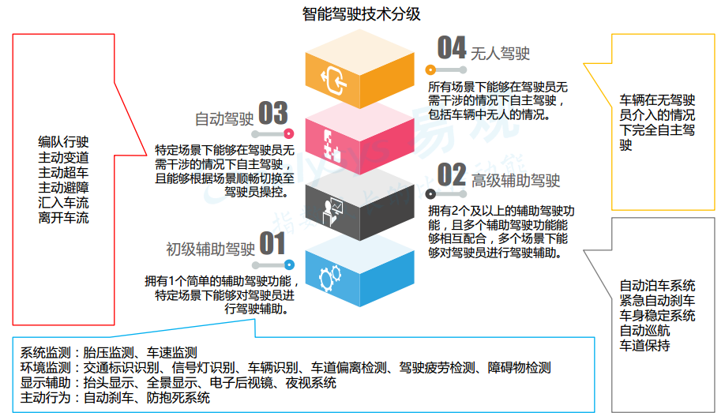
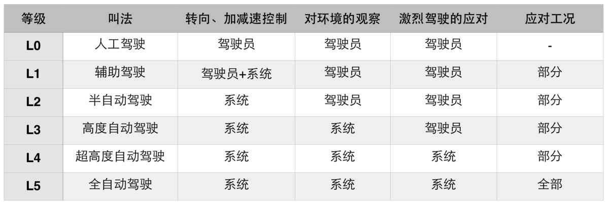
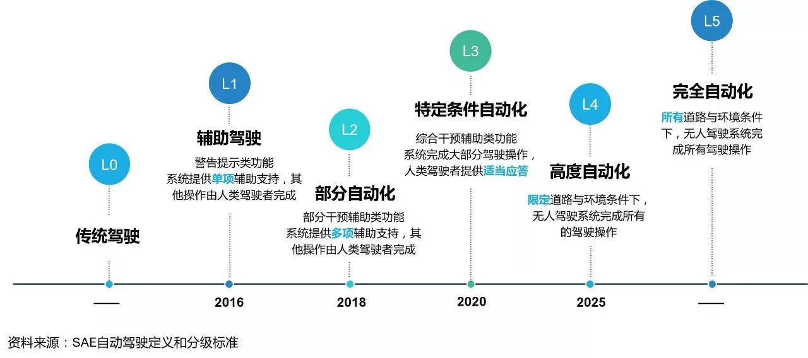
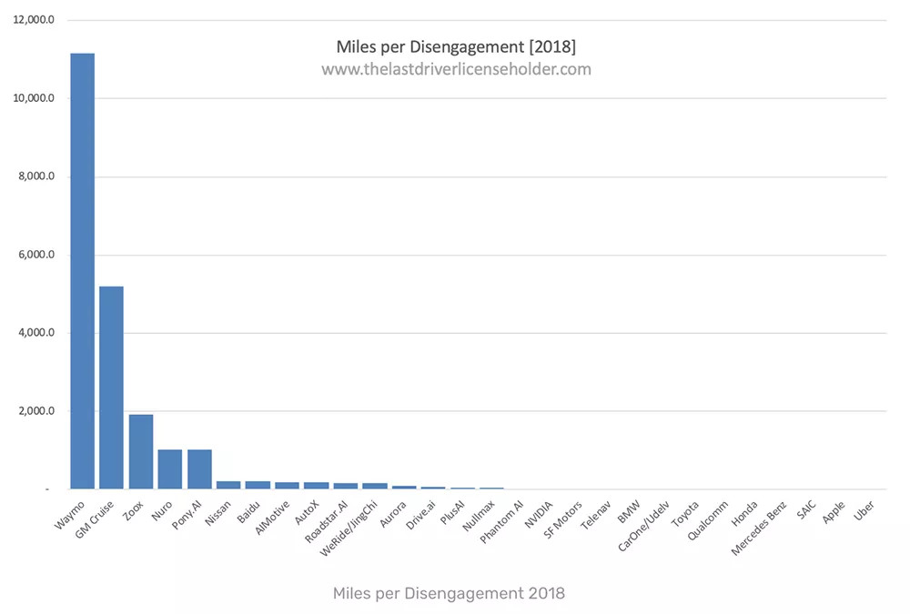
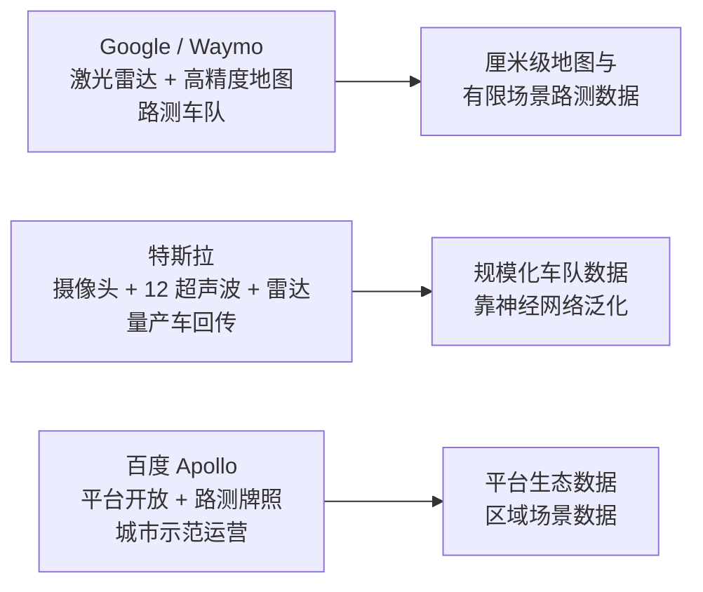

```cardlink
url: http://10.188.31.55:5244/Nextcloud/School/Auto-Drive-Intro/《智能驾驶导论》PPT-2020/
title: "智能驾驶导论 · 全六讲课件"
description: "中南大学人工智能与机器人实验室《智能驾驶导论》的六讲课件"
host: 10.188.31.55:5244
```

[← 返回《Auto-Drive-Intro》目录](../)

## 第 1 章 智能驾驶概述

### 什么是智能驾驶：车辆形态与功能演进

智能驾驶不是某一台机器的代称，而是一整套从感知、决策到执行的功能装车过程。课件用两张整车照片说明它首先是一种产品形态：普通量产车加装摄像头、雷达与计算单元后，人可以随时接管 [第1讲 智能驾驶概述.pptx · p.4](http://10.188.31.55:5244/Nextcloud/School/Auto-Drive-Intro/%E3%80%8A%E6%99%BA%E8%83%BD%E9%A9%BE%E9%A9%B6%E5%AF%BC%E8%AE%BA%E3%80%8BPPT-2020/%E7%AC%AC1%E8%AE%B2%20%E6%99%BA%E8%83%BD%E9%A9%BE%E9%A9%B6%E6%A6%82%E8%BF%B0.pptx)。

课件在「智能驾驶功能演进」这页给出的分级图把能力划成四层，层级越高，系统承担的驾驶操作越多 [第1讲 智能驾驶概述.pptx · p.6](http://10.188.31.55:5244/Nextcloud/School/Auto-Drive-Intro/%E3%80%8A%E6%99%BA%E8%83%BD%E9%A9%BE%E9%A9%B6%E5%AF%BC%E8%AE%BA%E3%80%8BPPT-2020/%E7%AC%AC1%E8%AE%B2%20%E6%99%BA%E8%83%BD%E9%A9%BE%E9%A9%B6%E6%A6%82%E8%BF%B0.pptx)：

- **01 初级辅助驾驶**：只有一个简单的辅助驾驶功能，特定场景下能对驾驶员进行驾驶辅助。
- **02 高级辅助驾驶**：拥有 2 个及以上的辅助驾驶功能，且多个辅助驾驶功能能够相互配合。
- **03 自动驾驶**：特定场景下能够在驾驶员无需干预的情况下自主驾驶，且能够根据场景顺畅切换至驾驶员操控。
- **04 无人驾驶**：所有场景下能够在驾驶员无需干预的情况下自主驾驶，包括车辆中无人的情况。

每一层对应四类能力。**系统监测**包括胎压监测、车速监测；**环境监测**包括交通标识识别、信号灯识别、车辆识别、车道偏离检测、驾驶疲劳检测、障碍物检测；**显示辅助**包括抬头显示、全景显示、电子后视镜、夜视系统；**主动行为**包括自动刹车、防抱死系统。越往上走，能力从「监测与提示」走向「自主执行」，车队行驶、主动变道、主动超车、主动避障、汇入车流、离开车流这类行为只出现在高层级。



### 技术分级：SAE J3016 与发展时间表

业界通用的是 SAE J3016 定义的六级体系，判断一辆车处在哪一级，看的不是它有多少传感器，而是四个维度的责任划分 [第1讲 智能驾驶概述.pptx · p.7](http://10.188.31.55:5244/Nextcloud/School/Auto-Drive-Intro/%E3%80%8A%E6%99%BA%E8%83%BD%E9%A9%BE%E9%A9%B6%E5%AF%BC%E8%AE%BA%E3%80%8BPPT-2020/%E7%AC%AC1%E8%AE%B2%20%E6%99%BA%E8%83%BD%E9%A9%BE%E9%A9%B6%E6%A6%82%E8%BF%B0.pptx)。



| 等级 | 叫法 | 转向、加减速控制 | 对环境的观察 | 激烈驾驶的应对 | 应对工况 |
| --- | --- | --- | --- | --- | --- |
| L0 | 人工驾驶 | 驾驶员 | 驾驶员 | 驾驶员 | — |
| L1 | 辅助驾驶 | 驾驶员 + 系统 | 驾驶员 | 驾驶员 | 部分 |
| L2 | 半自动驾驶 | 系统 | 驾驶员 | 驾驶员 | 部分 |
| L3 | 高度自动驾驶 | 系统 | 系统 | 驾驶员 | 部分 |
| L4 | 超高度自动驾驶 | 系统 | 系统 | 系统 | 部分 |
| L5 | 全自动驾驶 | 系统 | 系统 | 系统 | 全部 |

从 L2 到 L3 是一次责任转移的分水岭：观察权交给系统，但激烈驾驶时仍由驾驶员接管，所以 L3 仍属于「有条件」自动驾驶。L4 起系统自己应对激烈驾驶，L5 则要求在全部工况下都能自动驾驶 [第1讲 智能驾驶概述.pptx · p.7](http://10.188.31.55:5244/Nextcloud/School/Auto-Drive-Intro/%E3%80%8A%E6%99%BA%E8%83%BD%E9%A9%BE%E9%A9%B6%E5%AF%BC%E8%AE%BA%E3%80%8BPPT-2020/%E7%AC%AC1%E8%AE%B2%20%E6%99%BA%E8%83%BD%E9%A9%BE%E9%A9%B6%E6%A6%82%E8%BF%B0.pptx)。

SAE J3016 的原始图把这件事讲得更啰嗦一点：LEVEL0 到 LEVEL2 是「辅助驾驶功能」，驾驶员必须时刻观察各种情况、必须主动制动加速或转向；LEVEL3 到 LEVEL5 是「自动驾驶功能」，功能请求时驾驶员无需接管 [第1讲 智能驾驶概述.pptx · p.8](http://10.188.31.55:5244/Nextcloud/School/Auto-Drive-Intro/%E3%80%8A%E6%99%BA%E8%83%BD%E9%A9%BE%E9%A9%B6%E5%AF%BC%E8%AE%BA%E3%80%8BPPT-2020/%E7%AC%AC1%E8%AE%B2%20%E6%99%BA%E8%83%BD%E9%A9%BE%E9%A9%B6%E6%A6%82%E8%BF%B0.pptx)。

课件给出的时间表是预测值，不是承诺值：2016 年 L1 辅助驾驶（警告提示类功能，系统提供单项辅助支持），2018 年 L2 部分自动化（部分干预辅助类功能，系统提供多项辅助支持），2020 年 L3 特定条件自动化（综合干预辅助类功能，系统完成大部分驾驶操作，人类驾驶者提供适当应答），2025 年 L4 高度自动化（限定道路与环境条件下，无人驾驶系统完成所有的驾驶操作），此后是 L5 完全自动化（所有道路与环境条件下，无人驾驶系统完成所有驾驶操作）[第1讲 智能驾驶概述.pptx · p.9](http://10.188.31.55:5244/Nextcloud/School/Auto-Drive-Intro/%E3%80%8A%E6%99%BA%E8%83%BD%E9%A9%BE%E9%A9%B6%E5%AF%BC%E8%AE%BA%E3%80%8BPPT-2020/%E7%AC%AC1%E8%AE%B2%20%E6%99%BA%E8%83%BD%E9%A9%BE%E9%A9%B6%E6%A6%82%E8%BF%B0.pptx)。



### 无人驾驶汽车的八条优点

课件用八页幻灯片列了八条优点，顺序上从安全一路排到停车场，每条一页配一张说明图 [第1讲 智能驾驶概述.pptx · p.11](http://10.188.31.55:5244/Nextcloud/School/Auto-Drive-Intro/%E3%80%8A%E6%99%BA%E8%83%BD%E9%A9%BE%E9%A9%B6%E5%AF%BC%E8%AE%BA%E3%80%8BPPT-2020/%E7%AC%AC1%E8%AE%B2%20%E6%99%BA%E8%83%BD%E9%A9%BE%E9%A9%B6%E6%A6%82%E8%BF%B0.pptx)：

1. 大幅提升交通安全。
2. 大幅降低温室气体排放。
3. 降低出行费用。
4. 大幅降低交通拥堵。
5. 增加更多自由时间。
6. 提升劳动生产力。
7. 提升特定人群出行能力。
8. 大幅降低停车场需求。

第 7 条值得单独提一句。课件没有展开，但可以推出来：对那些拿不到驾照或者身体条件不允许开车的人，辅助与无人驾驶把「不能开」变成「能出行」，这是一类不体现在经济账上的收益。

### 风险：结构性失业、责任判定、可靠性与伦理

每条优点对面都有一条风险，课件同样列了四条 [第1讲 智能驾驶概述.pptx · p.19](http://10.188.31.55:5244/Nextcloud/School/Auto-Drive-Intro/%E3%80%8A%E6%99%BA%E8%83%BD%E9%A9%BE%E9%A9%B6%E5%AF%BC%E8%AE%BA%E3%80%8BPPT-2020/%E7%AC%AC1%E8%AE%B2%20%E6%99%BA%E8%83%BD%E9%A9%BE%E9%A9%B6%E6%A6%82%E8%BF%B0.pptx)。

- **AI 导致的结构性失业风险**：驾驶岗位本身被替代，冲击的是就业结构而非某个行业 [第1讲 智能驾驶概述.pptx · p.20](http://10.188.31.55:5244/Nextcloud/School/Auto-Drive-Intro/%E3%80%8A%E6%99%BA%E8%83%BD%E9%A9%BE%E9%A9%B6%E5%AF%BC%E8%AE%BA%E3%80%8BPPT-2020/%E7%AC%AC1%E8%AE%B2%20%E6%99%BA%E8%83%BD%E9%A9%BE%E9%A9%B6%E6%A6%82%E8%BF%B0.pptx)。
- **自动驾驶的责任判定**：L3 及以下事故仍由驾驶员担责，责任边界随等级移动 [第1讲 智能驾驶概述.pptx · p.21](http://10.188.31.55:5244/Nextcloud/School/Auto-Drive-Intro/%E3%80%8A%E6%99%BA%E8%83%BD%E9%A9%BE%E9%A9%B6%E5%AF%BC%E8%AE%BA%E3%80%8BPPT-2020/%E7%AC%AC1%E8%AE%B2%20%E6%99%BA%E8%83%BD%E9%A9%BE%E9%A9%B6%E6%A6%82%E8%BF%B0.pptx)。
- **技术的可靠性与安全性**：系统越复杂，失效模式越多 [第1讲 智能驾驶概述.pptx · p.22](http://10.188.31.55:5244/Nextcloud/School/Auto-Drive-Intro/%E3%80%8A%E6%99%BA%E8%83%BD%E9%A9%BE%E9%A9%B6%E5%AF%BC%E8%AE%BA%E3%80%8BPPT-2020/%E7%AC%AC1%E8%AE%B2%20%E6%99%BA%E8%83%BD%E9%A9%BE%E9%A9%B6%E6%A6%82%E8%BF%B0.pptx)。
- **潜在的伦理问题**：算法在极端场景里必须做的取舍，由谁定义 [第1讲 智能驾驶概述.pptx · p.23](http://10.188.31.55:5244/Nextcloud/School/Auto-Drive-Intro/%E3%80%8A%E6%99%BA%E8%83%BD%E9%A9%BE%E9%A9%B6%E5%AF%BC%E8%AE%BA%E3%80%8BPPT-2020/%E7%AC%AC1%E8%AE%B2%20%E6%99%BA%E8%83%BD%E9%A9%BE%E9%A9%B6%E6%A6%82%E8%BF%B0.pptx)。

> [!NOTE] **分级决定了风险落在谁头上**
> 责任争议的根源在 SAE 分级里已经写好：L0 到 L2 的激烈驾驶应对由驾驶员负责，L4 起才交给系统。所以「无人驾驶是不是无人负责」这个问题，在L3 阶段依然成立。

### 全球竞争格局与中国市场

智能驾驶成为全球竞争焦点，各国政策集中在两件事上：允许测试，以及给出标准 [第1讲 智能驾驶概述.pptx · p.24](http://10.188.31.55:5244/Nextcloud/School/Auto-Drive-Intro/%E3%80%8A%E6%99%BA%E8%83%BD%E9%A9%BE%E9%A9%B6%E5%AF%BC%E8%AE%BA%E3%80%8BPPT-2020/%E7%AC%AC1%E8%AE%B2%20%E6%99%BA%E8%83%BD%E9%A9%BE%E9%A9%B6%E6%A6%82%E8%BF%B0.pptx)。课件用一张世界地图列出各国时间线：英国 2014 年发布自动驾驶汽车发展路线图，政府投资 1900 万英镑的无人驾驶测试项目在 4 个城市正式运行；美国 2016 年 3 月表示由人工智能系统驾驶的谷歌无人驾驶车将被视为符合联邦法律；韩国 2016 年 3 月发放该国首个自动驾驶汽车牌照，同年 4 月产业通商资源部宣布从 2017 年起投入 1455 亿韩元用于无人驾驶汽车核心技术开发；日本 2016 年 5 月发布《自动驾驶普及路线图》，计划 2020 年允许在高速公路上行驶；中国 2016 年 3 月在「十三五」汽车工业发展规划意见中写入相关，7 月工信部官员透露正在积极推动制定无人驾驶相关技术规范；法国 2014 年发布路线图，投资 1 亿欧元；欧盟 2014 年 2 月启动「Adaptive」项目；联合国 2016 年 1 月通过《联合国自动驾驶安全全球标准》；德国 2015 年 2 月成立无人驾驶项目委员会。

中国市场的推力来自乘用车销量和渗透率两条线 [第1讲 智能驾驶概述.pptx · p.25](http://10.188.31.55:5244/Nextcloud/School/Auto-Drive-Intro/%E3%80%8A%E6%99%BA%E8%83%BD%E9%A9%BE%E9%A9%B6%E5%AF%BC%E8%AE%BA%E3%80%8BPPT-2020/%E7%AC%AC1%E8%AE%B2%20%E6%99%BA%E8%83%BD%E9%A9%BE%E9%A9%B6%E6%A6%82%E8%BF%B0.pptx)。2015 年中国乘用车销量 2114.6 万台，预计 2020 年达到 2773.3 万台，环比增速从 15.7% 一路回落到 4.9%；同期智能驾驶乘用车渗透率 2014 年 11%、2015 年 15%，预测 2016 年 20%、2017 年 32%、2018 年 47%、2019 年 52%、2020 年 61%。


销量增速放缓而智能驾驶渗透率翻倍，意味着增量不再来自市场变大，而是来自单车智能化的比例上升。易观给出的判断是：全球智能汽车市场到 2019 年会迎来洗牌阶段，缺乏竞争力的企业将被淘汰，率先推出相应产品的企业将在领域中占有一席之地 [第1讲 智能驾驶概述.pptx · p.27](http://10.188.31.55:5244/Nextcloud/School/Auto-Drive-Intro/%E3%80%8A%E6%99%BA%E8%83%BD%E9%A9%BE%E9%A9%B6%E5%AF%BC%E8%AE%BA%E3%80%8BPPT-2020/%E7%AC%AC1%E8%AE%B2%20%E6%99%BA%E8%83%BD%E9%A9%BE%E9%A9%B6%E6%A6%82%E8%BF%B0.pptx)。

### 全球智能驾驶产业生态图谱

产业链被拆成三层加两个应用方向 [第1讲 智能驾驶概述.pptx · p.28](http://10.188.31.55:5244/Nextcloud/School/Auto-Drive-Intro/%E3%80%8A%E6%99%BA%E8%83%BD%E9%A9%BE%E9%A9%B6%E5%AF%BC%E8%AE%BA%E3%80%8BPPT-2020/%E7%AC%AC1%E8%AE%B2%20%E6%99%BA%E8%83%BD%E9%A9%BE%E9%A9%B6%E6%A6%82%E8%BF%B0.pptx)。上游硬件包括处理器与存储器（Intel、NVIDIA、AMD、Samsung）、车载雷达（Continental、北科天绘、北京自适应）、车载摄像头（Mobileye、保千里电子、欧菲光）、电机与电控（Continental、Magna、Siemens）、储能设备（Panasonic、LG、BYD）。上游软件包括高精度地图数据（四维图新、高德、百度、Here、易图通）、智能驾驶算法（Google、百度、Mobileye、UISEE 驭势）、智能驾驶操作系统（Google、百度、Apple、Tesla）。往下是解决方案层，ADAS 芯片给 RENESAS、XILINX、freescale、Analog Devices，整车方案给 Google、百度、智车优行、UISEE；再往下是整车制造，传统厂商有上汽、长安、北汽，互联网公司有 Tesla、Apple、智车优行；商业应用一端是汽车共享，图里给了四家出行平台的 logo。


这张图解释了为什么各家选的路不一样：有芯片和传感器能力的做上游，有地图和算法能力的做中间层，整车厂要么自己做软件，要么采购。百度出现在上游软件的三格（地图数据、算法、操作系统）和解决方案的整车方案里，Tesla 出现在智能驾驶操作系统与互联网汽车制造商两处。

### 加州 DMV 脱离报告：把「无人」变成可比的数字

加州车辆管理局要求持有测试许可的公司报告「脱离」情况，即自动驾驶系统无法继续正常操作、必须由人工接管的那一刻。课件给出的 2018 年数据把各家放在同一把尺子上 [第1讲 智能驾驶概述.pptx · p.29](http://10.188.31.55:5244/Nextcloud/School/Auto-Drive-Intro/%E3%80%8A%E6%99%BA%E8%83%BD%E9%A9%BE%E9%A9%B6%E5%AF%BC%E8%AE%BA%E3%80%8BPPT-2020/%E7%AC%AC1%E8%AE%B2%20%E6%99%BA%E8%83%BD%E9%A9%BE%E9%A9%B6%E6%A6%82%E8%BF%B0.pptx)。

这个指标通常写成每千英里的人为干预次数，算法本身并不复杂：

$$
\text{每千英里干预次数} = \frac{\text{人为干预次数}}{\text{路测里程（英里）}} \times 1000
$$

| 公司 | 车队规模（辆） | 路测里程（英里） | 人为干预次数 | 每千英里干预次数 |
| --- | --- | --- | --- | --- |
| Waymo | 75 | 352545 | 63 | 0.18 |
| 通用 Cruise | 94 | 131676 | 105 | 0.84 |
| 日产 | 5 | 5007 | 24 | 4.79 |
| Zoox | 11 | 2955 | 14 | 6.21 |
| Drive.ai | 7 | 6015 | 92 | 15.30 |
| 百度 | 4 | 1949 | 43 | 22.06 |
| Telenav | 1 | 1824 | 59 | 32.35 |
| 德尔福 | 1 | 1810 | 82 | 45.30 |
| 英伟达 | 2 | 505 | 109 | 215.84 |
| 法雷奥 | 1 | 574 | 215 | 374.56 |

Waymo 每千英里干预 0.18 次，约为通用 Cruise 的五分之一、百度的三十分之一，与排在后面的德尔福、英伟达、法雷奥相差两个到三个量级。同期还有一张按同一口径统计的柱状图，纵轴是「平均每隔多少英里才脱离一次」，最高能到 12000 英里，Waymo 位于最前端 [第1讲 智能驾驶概述.pptx · p.30](http://10.188.31.55:5244/Nextcloud/School/Auto-Drive-Intro/%E3%80%8A%E6%99%BA%E8%83%BD%E9%A9%BE%E9%A9%B6%E5%AF%BC%E8%AE%BA%E3%80%8BPPT-2020/%E7%AC%AC1%E8%AE%B2%20%E6%99%BA%E8%83%BD%E9%A9%BE%E9%A9%B6%E6%A6%82%E8%BF%B0.pptx)。



> [!WARNING] **这份表的两个陷阱**
> 第一，干预次数由各公司自行申报，定义口径不统一，有的公司把「车辆主动减速避险」也记为脱离。第二，路测里程短的公司的比值波动极大。表里 Waymo 与法雷奥的差距，既是技术差距，也是数据规模差距。

### Google 与 Waymo：从项目到公司

Google 的 Driverless Car 项目走的是可查证的时间线 [第1讲 智能驾驶概述.pptx · p.31](http://10.188.31.55:5244/Nextcloud/School/Auto-Drive-Intro/%E3%80%8A%E6%99%BA%E8%83%BD%E9%A9%BE%E9%A9%B6%E5%AF%BC%E8%AE%BA%E3%80%8BPPT-2020/%E7%AC%AC1%E8%AE%B2%20%E6%99%BA%E8%83%BD%E9%A9%BE%E9%A9%B6%E6%A6%82%E8%BF%B0.pptx)：2010 年宣布研发无人驾驶汽车项目，由斯坦福人工智能实验室牵头；2011 年内华达州为运用其实验性自动驾驶技术的丰田 Prius 颁发驾照；2012 年累计行驶里程超过 100 万英里，期间共发生 341 次事故；2015 年美国国家公路安全交通管理局（NHTSA）承认其无人驾驶汽车采用的人工智能系统可以被视为「司机」；2016 年之后公司制运作，合作企业里既有 Chrysler、Ford、Toyota、FIAT、GM、Hyundai 这样的整车厂商，也有 Delphi、RCO、LG、ROUSH、NVIDIA 这样的零部件伙伴。


NHTSA 那次认可的意义被课件讲得很直接：它是无人驾驶进入合法化的重要标志，此前相关技术研发会受制于法律法规，公共部门的积极态度表明对无人汽车有了较为一致并且积极的意见 [第1讲 智能驾驶概述.pptx · p.33](http://10.188.31.55:5244/Nextcloud/School/Auto-Drive-Intro/%E3%80%8A%E6%99%BA%E8%83%BD%E9%A9%BE%E9%A9%B6%E5%AF%BC%E8%AE%BA%E3%80%8BPPT-2020/%E7%AC%AC1%E8%AE%B2%20%E6%99%BA%E8%83%BD%E9%A9%BE%E9%A9%B6%E6%A6%82%E8%BF%B0.pptx)。同一页给出故障数的变化：2014 年第四季度无人驾驶汽车每行驶 785 英里就会出现一次故障；2015 年 5 月开始以后，每月平均出现 15.4 次故障，较 2014 年显著减少。


技术细节上，Google 走的是高精度感知加冗余定位的路线：通过顶部激光雷达绘制周围环境，用激光反射波测量距离；车载雷达与位置传感器测出车辆在三个方向上的加速度、角速度，再结合 GPS 算出车辆位置，所有数据经过处理后由系统作出行驶判断；摄像头用来侦测交通信号灯的变化 [第1讲 智能驾驶概述.pptx · p.32](http://10.188.31.55:5244/Nextcloud/School/Auto-Drive-Intro/%E3%80%8A%E6%99%BA%E8%83%BD%E9%A9%BE%E9%A9%B6%E5%AF%BC%E8%AE%BA%E3%80%8BPPT-2020/%E7%AC%AC1%E8%AE%B2%20%E6%99%BA%E8%83%BD%E9%A9%BE%E9%A9%B6%E6%A6%82%E8%BF%B0.pptx)。商业模式上，课件画了三种形态：无人驾驶解决方案成品整车、无人驾驶运输服务、信息传递智能服务；应用方向选在公共交通、物流货运、汽车租赁，因为这些领域成本承受能力更强 [第1讲 智能驾驶概述.pptx · p.34](http://10.188.31.55:5244/Nextcloud/School/Auto-Drive-Intro/%E3%80%8A%E6%99%BA%E8%83%BD%E9%A9%BE%E9%A9%B6%E5%AF%BC%E8%AE%BA%E3%80%8BPPT-2020/%E7%AC%AC1%E8%AE%B2%20%E6%99%BA%E8%83%BD%E9%A9%BE%E9%A9%B6%E6%A6%82%E8%BF%B0.pptx)。最后 Google 把无人驾驶业务拆成独立公司 Waymo [第1讲 智能驾驶概述.pptx · p.35](http://10.188.31.55:5244/Nextcloud/School/Auto-Drive-Intro/%E3%80%8A%E6%99%BA%E8%83%BD%E9%A9%BE%E9%A9%B6%E5%AF%BC%E8%AE%BA%E3%80%8BPPT-2020/%E7%AC%AC1%E8%AE%B2%20%E6%99%BA%E8%83%BD%E9%A9%BE%E9%A9%B6%E6%A6%82%E8%BF%B0.pptx)。

### 三条技术路线的分歧

Google、特斯拉、百度在课件里代表三种不同的解法，差异不在「要不要无人驾驶」，而在数据从哪来、地图从哪来。



特斯拉的路线最省硬件也最吃算力。它用摄像头当眼睛，前置摄像头装在反光镜前面，软件处理提取的信息来计算距离、识别路标、探测人行横道；配 12 个远距离超声波传感器提供 360 度视角，再加一个前置雷达系统辅助半自动化驾驶。数百万辆 Model 把路上采集的路况数据实时回传中央数据库，每天平均增加百万英里的驾驶数据，软件根据这些反馈不断改善算法 [第1讲 智能驾驶概述.pptx · p.38](http://10.188.31.55:5244/Nextcloud/School/Auto-Drive-Intro/%E3%80%8A%E6%99%BA%E8%83%BD%E9%A9%BE%E9%A9%B6%E5%AF%BC%E8%AE%BA%E3%80%8BPPT-2020/%E7%AC%AC1%E8%AE%B2%20%E6%99%BA%E8%83%BD%E9%A9%BE%E9%A9%B6%E6%A6%82%E8%BF%B0.pptx)。


这条路线的商业前提是电动化：先靠高端产品积聚能量，技术和市场成熟后再推向低价车型 [第1讲 智能驾驶概述.pptx · p.37](http://10.188.31.55:5244/Nextcloud/School/Auto-Drive-Intro/%E3%80%8A%E6%99%BA%E8%83%BD%E9%A9%BE%E9%A9%B6%E5%AF%BC%E8%AE%BA%E3%80%8BPPT-2020/%E7%AC%AC1%E8%AE%B2%20%E6%99%BA%E8%83%BD%E9%A9%BE%E9%A9%B6%E6%A6%82%E8%BF%B0.pptx)。

### 百度与长沙：路测牌照与场景落地

国内一侧，百度被称为中国无人驾驶技术的领头羊 [第1讲 智能驾驶概述.pptx · p.41](http://10.188.31.55:5244/Nextcloud/School/Auto-Drive-Intro/%E3%80%8A%E6%99%BA%E8%83%BD%E9%A9%BE%E9%A9%B6%E5%AF%BC%E8%AE%BA%E3%80%8BPPT-2020/%E7%AC%AC1%E8%AE%B2%20%E6%99%BA%E8%83%BD%E9%A9%BE%E9%A9%B6%E6%A6%82%E8%BF%B0.pptx)。路测是无人驾驶的重要环节，牌照数量直接对应可上路测试的车辆规模 [第1讲 智能驾驶概述.pptx · p.42](http://10.188.31.55:5244/Nextcloud/School/Auto-Drive-Intro/%E3%80%8A%E6%99%BA%E8%83%BD%E9%A9%BE%E9%A9%B6%E5%AF%BC%E8%AE%BA%E3%80%8BPPT-2020/%E7%AC%AC1%E8%AE%B2%20%E6%99%BA%E8%83%BD%E9%A9%BE%E9%A9%B6%E6%A6%82%E8%BF%B0.pptx)。


百度的牌照数量超过 50 张，其余厂商的条形几乎贴着零点，多在个位数。这张图同时暴露了国内路测格局的另一面：拿到牌照的主体里有大量主机厂、零部件商和出行平台，不只是百度一家。

落地路径上，百度牵手长沙打造「智能驾驶第一城」，2018 年 12 月 28 日全场景车队在长沙亮相 [第1讲 智能驾驶概述.pptx · p.44](http://10.188.31.55:5244/Nextcloud/School/Auto-Drive-Intro/%E3%80%8A%E6%99%BA%E8%83%BD%E9%A9%BE%E9%A9%B6%E5%AF%BC%E8%AE%BA%E3%80%8BPPT-2020/%E7%AC%AC1%E8%AE%B2%20%E6%99%BA%E8%83%BD%E9%A9%BE%E9%A9%B6%E6%A6%82%E8%BF%B0.pptx) [第1讲 智能驾驶概述.pptx · p.45](http://10.188.31.55:5244/Nextcloud/School/Auto-Drive-Intro/%E3%80%8A%E6%99%BA%E8%83%BD%E9%A9%BE%E9%A9%B6%E5%AF%BC%E8%AE%BA%E3%80%8BPPT-2020/%E7%AC%AC1%E8%AE%B2%20%E6%99%BA%E8%83%BD%E9%A9%BE%E9%A9%B6%E6%A6%82%E8%BF%B0.pptx)，随后与湖南省人民政府达成全面合作 [第1讲 智能驾驶概述.pptx · p.46](http://10.188.31.55:5244/Nextcloud/School/Auto-Drive-Intro/%E3%80%8A%E6%99%BA%E8%83%BD%E9%A9%BE%E9%A9%B6%E5%AF%BC%E8%AE%BA%E3%80%8BPPT-2020/%E7%AC%AC1%E8%AE%B2%20%E6%99%BA%E8%83%BD%E9%A9%BE%E9%A9%B6%E6%A6%82%E8%BF%B0.pptx)。


### 各大公司的推出时间表

课件最后给出一张各家承诺商业化时间的表 [第1讲 智能驾驶概述.pptx · p.47](http://10.188.31.55:5244/Nextcloud/School/Auto-Drive-Intro/%E3%80%8A%E6%99%BA%E8%83%BD%E9%A9%BE%E9%A9%B6%E5%AF%BC%E8%AE%BA%E3%80%8BPPT-2020/%E7%AC%AC1%E8%AE%B2%20%E6%99%BA%E8%83%BD%E9%A9%BE%E9%A9%B6%E6%A6%82%E8%BF%B0.pptx)：


时间表集中在 2018 到 2020 年之间。Waymo 的无人出租车服务、百度的小巴车量产、特斯拉的全自动驾驶承诺都指向同一个窗口，这个窗口过去之后，所有「预计」都会变成可以核对的事实。
