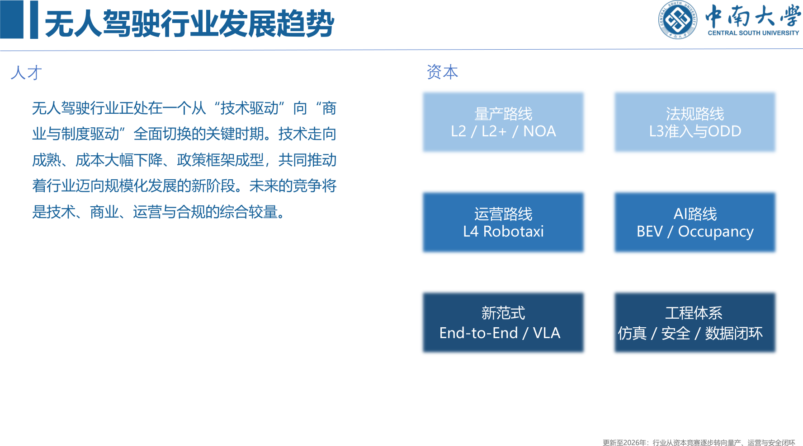
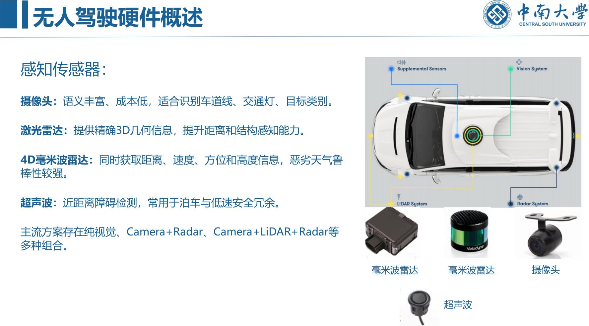
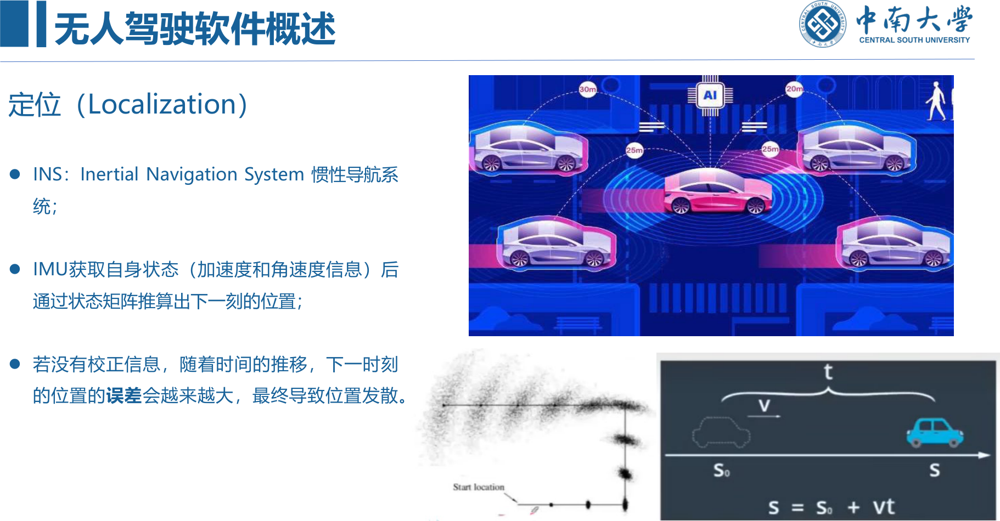
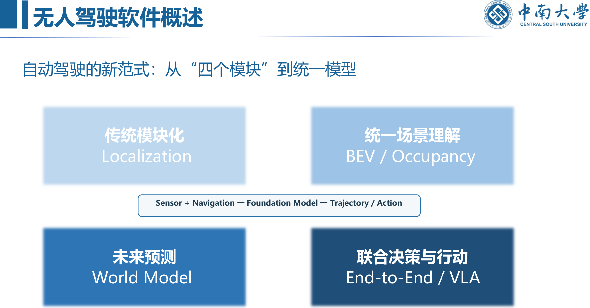

```cardlink
url: http://10.188.31.55:5244/Nextcloud/School/Auto-Drive-Intro/课件/
title: "智能驾驶导论 · 课件"
description: "中南大学《智能驾驶导论》课件，十一份 PDF，覆盖概述、感知、地图、定位、预测、控制与强化学习"
host: 10.188.31.55:5244
```

[← 返回《Auto-Drive-Intro》目录](../)

## 第 1 章 智能驾驶概述

### 什么是无人驾驶：先问四个责任问题

驾驶自动化（Driving Automation）是由系统在特定条件下持续执行部分或全部动态驾驶任务（DDT）的技术 [第一章 无人驾驶概述_2026.pdf · p.4](http://10.188.31.55:5244/Nextcloud/School/Auto-Drive-Intro/%E8%AF%BE%E4%BB%B6/%E7%AC%AC%E4%B8%80%E7%AB%A0%20%E6%97%A0%E4%BA%BA%E9%A9%BE%E9%A9%B6%E6%A6%82%E8%BF%B0_2026.pdf#page=4)。

判断一套系统是不是「无人驾驶」，不看车里有没有方向盘，看四件事 [第一章 无人驾驶概述_2026.pdf · p.4](http://10.188.31.55:5244/Nextcloud/School/Auto-Drive-Intro/%E8%AF%BE%E4%BB%B6/%E7%AC%AC%E4%B8%80%E7%AB%A0%20%E6%97%A0%E4%BA%BA%E9%A9%BE%E9%A9%B6%E6%A6%82%E8%BF%B0_2026.pdf#page=4)：谁执行动态驾驶任务（DDT）、谁监控道路环境、系统失效后谁负责接管或后援（DDT Fallback）、系统适用于什么设计运行范围（ODD）。这四个问题在后面的分级、准入法规、Waymo 案例里会反复出现，分级标准里的每一条判据都落在这四个问题里。

辅助课件从车辆形态讲起：智能驾驶车辆是普通量产车加装摄像头、雷达与计算单元，人可以随时接管 [第1讲 智能驾驶概述.pptx · p.4](http://10.188.31.55:5244/Nextcloud/School/Auto-Drive-Intro/%E3%80%8A%E6%99%BA%E8%83%BD%E9%A9%BE%E9%A9%B6%E5%AF%BC%E8%AE%BA%E3%80%8BPPT-2020/%E7%AC%AC1%E8%AE%B2%20%E6%99%BA%E8%83%BD%E9%A9%BE%E9%A9%B6%E6%A6%82%E8%BF%B0.pptx)。整车系统结构框图、整体框架与整体架构在辅助课件里各占一页 [第2讲 无人车基本框架.pptx · p.4](http://10.188.31.55:5244/Nextcloud/School/Auto-Drive-Intro/%E3%80%8A%E6%99%BA%E8%83%BD%E9%A9%BE%E9%A9%B6%E5%AF%BC%E8%AE%BA%E3%80%8BPPT-2020/%E7%AC%AC2%E8%AE%B2%20%E6%97%A0%E4%BA%BA%E8%BD%A6%E5%9F%BA%E6%9C%AC%E6%A1%86%E6%9E%B6.pptx)。

### 无人驾驶能解决什么，又引入什么

课件把无人驾驶能解决的问题归成三条 [第一章 无人驾驶概述_2026.pdf · p.6](http://10.188.31.55:5244/Nextcloud/School/Auto-Drive-Intro/%E8%AF%BE%E4%BB%B6/%E7%AC%AC%E4%B8%80%E7%AB%A0%20%E6%97%A0%E4%BA%BA%E9%A9%BE%E9%A9%B6%E6%A6%82%E8%BF%B0_2026.pdf#page=6)：**提升交通效率**，在稳定的自动驾驶和车路协同条件下，系统通过更一致的驾驶行为、实时路况感知与协同调度，提高道路利用效率并减少部分拥堵，课件在这里给了限定，效率收益取决于自动驾驶渗透率、道路环境和交通参与者混行程度；**提高车辆利用率**，Robotaxi 与自动泊车减少车辆闲置时间，提高单车利用率，并改变传统停车需求结构，价值更可能先出现在高频运营车辆、园区接驳和城市出行服务里 [第一章 无人驾驶概述_2026.pdf · p.7](http://10.188.31.55:5244/Nextcloud/School/Auto-Drive-Intro/%E8%AF%BE%E4%BB%B6/%E7%AC%AC%E4%B8%80%E7%AB%A0%20%E6%97%A0%E4%BA%BA%E9%A9%BE%E9%A9%B6%E6%A6%82%E8%BF%B0_2026.pdf#page=7)；**提高交通安全性**，自动驾驶降低疲劳、分心、酒驾等人为主风险，同时引入新的系统风险：感知盲区、长尾场景、算法失效、恶劣天气和网络安全，核心问题因此从「能不能开」转向「如何证明足够安全」 [第一章 无人驾驶概述_2026.pdf · p.8](http://10.188.31.55:5244/Nextcloud/School/Auto-Drive-Intro/%E8%AF%BE%E4%BB%B6/%E7%AC%AC%E4%B8%80%E7%AB%A0%20%E6%97%A0%E4%BA%BA%E9%A9%BE%E9%A9%B6%E6%A6%82%E8%BF%B0_2026.pdf#page=8)。

辅助课件把同一件事列成八条优点：大幅提升交通安全、大幅降低温室气体排放、降低出行费用、大幅降低交通拥堵、增加更多自由时间、提升劳动生产力、提升特定人群出行能力、大幅降低停车场需求 [第1讲 智能驾驶概述.pptx · p.11](http://10.188.31.55:5244/Nextcloud/School/Auto-Drive-Intro/%E3%80%8A%E6%99%BA%E8%83%BD%E9%A9%BE%E9%A9%B6%E5%AF%BC%E8%AE%BA%E3%80%8BPPT-2020/%E7%AC%AC1%E8%AE%B2%20%E6%99%BA%E8%83%BD%E9%A9%BE%E9%A9%B6%E6%A6%82%E8%BF%B0.pptx)。风险也对应列了四条：AI 导致的结构性失业风险、自动驾驶的责任判定、技术的可靠性与安全性、潜在的伦理问题 [第1讲 智能驾驶概述.pptx · p.20](http://10.188.31.55:5244/Nextcloud/School/Auto-Drive-Intro/%E3%80%8A%E6%99%BA%E8%83%BD%E9%A9%BE%E9%A9%B6%E5%AF%BC%E8%AE%BA%E3%80%8BPPT-2020/%E7%AC%AC1%E8%AE%B2%20%E6%99%BA%E8%83%BD%E9%A9%BE%E9%A9%B6%E6%A6%82%E8%BF%B0.pptx)。

### 行业趋势：从技术驱动切到商业与制度驱动

技术演进不是一条指数曲线，而是多条路线共同推动：机械化 → 电动化 → 信息化 → 智能化 → AI 驱动驾驶。当前竞争焦点已从单点算法转向整车智能、数据闭环、算力平台与安全验证体系 [第一章 无人驾驶概述_2026.pdf · p.9](http://10.188.31.55:5244/Nextcloud/School/Auto-Drive-Intro/%E8%AF%BE%E4%BB%B6/%E7%AC%AC%E4%B8%80%E7%AB%A0%20%E6%97%A0%E4%BA%BA%E9%A9%BE%E9%A9%B6%E6%A6%82%E8%BF%B0_2026.pdf#page=9)。



课件把当前在跑的路线拆成六条并列推进 [第一章 无人驾驶概述_2026.pdf · p.10](http://10.188.31.55:5244/Nextcloud/School/Auto-Drive-Intro/%E8%AF%BE%E4%BB%B6/%E7%AC%AC%E4%B8%80%E7%AB%A0%20%E6%97%A0%E4%BA%BA%E9%A9%BE%E9%A9%B6%E6%A6%82%E8%BF%B0_2026.pdf#page=10)：量产路线（L2 / L2+ / NOA）、法规路线（L3 准入与 ODD）、运营路线（L4 Robotaxi）、AI 路线（BEV / Occupancy）、新范式（End-to-End / VLA）、工程体系（仿真 / 安全 / 数据闭环）。行业的整体判断是：技术走向成熟、成本大幅下降、政策框架成型，共同推动行业迈向规模化发展，未来的竞争是技术、商业、运营与合规的综合较量。

产业进入「分层竞争」阶段，链条上的位置决定各家在打什么牌 [第一章 无人驾驶概述_2026.pdf · p.11](http://10.188.31.55:5244/Nextcloud/School/Auto-Drive-Intro/%E8%AF%BE%E4%BB%B6/%E7%AC%AC%E4%B8%80%E7%AB%A0%20%E6%97%A0%E4%BA%BA%E9%A9%BE%E9%A9%B6%E6%A6%82%E8%BF%B0_2026.pdf#page=11)：

| 层级 | 做什么 |
| --- | --- |
| 整车厂 | 把高阶辅助驾驶当作核心产品能力 |
| 方案商 / Tier1 | 提供感知、计算平台与系统集成 |
| Robotaxi | 在明确 ODD 内扩大无人化运营 |
| 芯片与基础设施 | 中央计算、AI SoC、V2X、云控平台 |
| AI 平台 | 端到端、世界模型、VLA 与仿真工具链 |

竞争焦点从「谁先做出来」转向「谁能安全、规模化、低成本地部署」。

### 发展历程：四个阶段

**探索阶段（2004 年前）** [第一章 无人驾驶概述_2026.pdf · p.12](http://10.188.31.55:5244/Nextcloud/School/Auto-Drive-Intro/%E8%AF%BE%E4%BB%B6/%E7%AC%AC%E4%B8%80%E7%AB%A0%20%E6%97%A0%E4%BA%BA%E9%A9%BE%E9%A9%B6%E6%A6%82%E8%BF%B0_2026.pdf#page=12)：1921 年美国制造第一辆无人驾驶汽车，实为遥控汽车；1956 年通用汽车第一辆具备自动导航系统的汽车，采用预埋线缆与车端接收器的电子通讯实现车路协同；1960 年斯坦福大学做出第一个全自主轮式机器人 Shakey，具备完整的感知、规划和控制能力，奠定了无人车的基础；1995 年戴姆勒奔驰发布尤里卡-普罗米修斯计划，第一个大规模开发的自动驾驶项目，整个欧洲的大学研究部都参与其中。

课件单独用一页写了这个项目失败的原因：思路主要依靠路上的智能系统，成本太高；自主智能思考不够深远 [第一章 无人驾驶概述_2026.pdf · p.14](http://10.188.31.55:5244/Nextcloud/School/Auto-Drive-Intro/%E8%AF%BE%E4%BB%B6/%E7%AC%AC%E4%B8%80%E7%AB%A0%20%E6%97%A0%E4%BA%BA%E9%A9%BE%E9%A9%B6%E6%A6%82%E8%BF%B0_2026.pdf#page=14)。这条路线的教训一直影响现在的车路云协同思路。

**发展阶段（2004—2016 年）** [第一章 无人驾驶概述_2026.pdf · p.15](http://10.188.31.55:5244/Nextcloud/School/Auto-Drive-Intro/%E8%AF%BE%E4%BB%B6/%E7%AC%AC%E4%B8%80%E7%AB%A0%20%E6%97%A0%E4%BA%BA%E9%A9%BE%E9%A9%B6%E6%A6%82%E8%BF%B0_2026.pdf#page=15)：2004 年 DARPA 举办无人车挑战赛，穿过 240 公里的沙漠道路；2005 年斯坦福大学的 Stanley 夺冠，大部分参赛车使用激光雷达、高精度地理信息系统和惯性导航系统；2004 到 2007 年的挑战赛真正引领了无人车发展，Mobileye、Velodyne、Google X 等公司从此诞生。2014 年 Google 无人车 Firefly 诞生，取消方向盘设计，只用手柄进行调试和接管 [第一章 无人驾驶概述_2026.pdf · p.16](http://10.188.31.55:5244/Nextcloud/School/Auto-Drive-Intro/%E8%AF%BE%E4%BB%B6/%E7%AC%AC%E4%B8%80%E7%AB%A0%20%E6%97%A0%E4%BA%BA%E9%A9%BE%E9%A9%B6%E6%A6%82%E8%BF%B0_2026.pdf#page=16)。

**产业化阶段（2016—2022 年）** [第一章 无人驾驶概述_2026.pdf · p.17](http://10.188.31.55:5244/Nextcloud/School/Auto-Drive-Intro/%E8%AF%BE%E4%BB%B6/%E7%AC%AC%E4%B8%80%E7%AB%A0%20%E6%97%A0%E4%BA%BA%E9%A9%BE%E9%A9%B6%E6%A6%82%E8%BF%B0_2026.pdf#page=17)：AlphaGo 爆火后投资界对 AI 兴趣高涨，无人车开始真正进入中国大众视野。2016 年 Tesla 自动驾驶因为一起致死的交通事故与 Mobileye 分道扬镳，开始了自动驾驶高速投入；同年 Waymo 从 Google 分离出去独立运营；2017 年百度 Apollo 项目正式启动；2018 年 7 月 4 日，百度与厦门金龙合作生产的全球首款 level4 级量产自驾巴士下线，搭载 Apollo 系统，具备高精定位、智能感知、智能控制功能。

**产业化深化阶段（2022—2026 年）** [第一章 无人驾驶概述_2026.pdf · p.18](http://10.188.31.55:5244/Nextcloud/School/Auto-Drive-Intro/%E8%AF%BE%E4%BB%B6/%E7%AC%AC%E4%B8%80%E7%AB%A0%20%E6%97%A0%E4%BA%BA%E9%A9%BE%E9%A9%B6%E6%A6%82%E8%BF%B0_2026.pdf#page=18)：2022 到 2024 年城市 NOA、BEV 感知、Occupancy 与端到端路线快速发展；2025 年中国首批两款 L3 有条件自动驾驶车型获产品准入许可，在北京、重庆限定道路开展上路试点；2026 年 Waymo 已在 14 个城市提供全无人驾驶出行，Reasoning VLA、世界模型与闭环强化学习成为前沿研发方向。

### 分级 L0—L5：判据是责任边界，不是手脚是否解放

驾驶自动化分为 L0 到 L5 六个等级，判断等级的关键不放在「手脚眼是否解放」上，而是那四个责任问题：谁持续执行 DDT、谁监控环境、系统失效时谁负责后援、系统能在多大的 ODD 内工作 [第一章 无人驾驶概述_2026.pdf · p.20](http://10.188.31.55:5244/Nextcloud/School/Auto-Drive-Intro/%E8%AF%BE%E4%BB%B6/%E7%AC%AC%E4%B8%80%E7%AB%A0%20%E6%97%A0%E4%BA%BA%E9%A9%BE%E9%A9%B6%E6%A6%82%E8%BF%B0_2026.pdf#page=20)。

| 等级 | 谁做 DDT | 失效后谁兜底 |
| --- | --- | --- |
| L0—L2 | 驾驶员仍承担 DDT 或环境监控责任 | 驾驶员 |
| L3 | 在规定 ODD 内系统执行完整 DDT | 接管请求后用户承担 Fallback |
| L4 | 在规定 ODD 内系统执行 DDT | 系统自行完成 Fallback |
| L5 | 不受特定 ODD 限制的完全驾驶自动化 | 系统 |

课件专门强调：L4 并不等于任何地方都能无人驾驶，它是在规定 ODD 内由系统自行完成 DDT 和 Fallback；中国的路线是单车智能加车路云协同并行，等级划分应结合 ODD 与责任边界理解 [第一章 无人驾驶概述_2026.pdf · p.21](http://10.188.31.55:5244/Nextcloud/School/Auto-Drive-Intro/%E8%AF%BE%E4%BB%B6/%E7%AC%AC%E4%B8%80%E7%AB%A0%20%E6%97%A0%E4%BA%BA%E9%A9%BE%E9%A9%B6%E6%A6%82%E8%BF%B0_2026.pdf#page=21)。

辅助课件给的是 SAE J3016 的原始分级表：L0 到 L2 属于「辅助驾驶功能」，驾驶员必须时刻观察各种情况；L3 到 L5 属于「自动驾驶功能」，功能请求时驾驶员无需接管 [第1讲 智能驾驶概述.pptx · p.7](http://10.188.31.55:5244/Nextcloud/School/Auto-Drive-Intro/%E3%80%8A%E6%99%BA%E8%83%BD%E9%A9%BE%E9%A9%B6%E5%AF%BC%E8%AE%BA%E3%80%8BPPT-2020/%E7%AC%AC1%E8%AE%B2%20%E6%99%BA%E8%83%BD%E9%A9%BE%E9%A9%B6%E6%A6%82%E8%BF%B0.pptx)。两条口径的差别在责任那一栏：SAE 表用「激烈驾驶的应对由谁负责」区分 L3 和 L4，主参考课件用「Fallback 由谁执行」描述同一件事。

### L2、L3、L4 三档的工程差异

**L2 / L2+** 系统可以在部分场景持续执行横向与纵向控制，实现导航辅助驾驶、自动变道等功能，但驾驶员仍需持续承担道路环境监控与安全责任，并随时准备接管。行业趋势是从高速 NOA 逐步拓展到城市 NOA，本质上仍属于驾驶辅助 [第一章 无人驾驶概述_2026.pdf · p.22](http://10.188.31.55:5244/Nextcloud/School/Auto-Drive-Intro/%E8%AF%BE%E4%BB%B6/%E7%AC%AC%E4%B8%80%E7%AB%A0%20%E6%97%A0%E4%BA%BA%E9%A9%BE%E9%A9%B6%E6%A6%82%E8%BF%B0_2026.pdf#page=22)。

**L3** 的关键在于：在规定 ODD 内系统承担完整 DDT；当系统提出接管请求时，用户需要执行 Fallback。因此 L3 必须同时满足「车辆能力 + ODD + 法规准入 + 安全监测」四个条件 [第一章 无人驾驶概述_2026.pdf · p.23](http://10.188.31.55:5244/Nextcloud/School/Auto-Drive-Intro/%E8%AF%BE%E4%BB%B6/%E7%AC%AC%E4%B8%80%E7%AB%A0%20%E6%97%A0%E4%BA%BA%E9%A9%BE%E9%A9%B6%E6%A6%82%E8%BF%B0_2026.pdf#page=23)。2025 年 12 月，长安、极狐相关车型在北京、重庆指定高速与城市快速路开展上路试点。

**L4** 用 Waymo 做商业运营案例：在服务区域内由系统承担 DDT 与 Fallback，不要求车内安全员持续接管；2026 年 9 月 Waymo 官方称已在 14 个城市提供全无人驾驶出行；主要挑战从「能否无人驾驶」转向规模扩张、成本、安全验证与 ODD 拓展 [第一章 无人驾驶概述_2026.pdf · p.24](http://10.188.31.55:5244/Nextcloud/School/Auto-Drive-Intro/%E8%AF%BE%E4%BB%B6/%E7%AC%AC%E4%B8%80%E7%AB%A0%20%E6%97%A0%E4%BA%BA%E9%A9%BE%E9%A9%B6%E6%A6%82%E8%BF%B0_2026.pdf#page=24)。课件配的素材图里，他车闯红灯的交通灯被框成粉色，一个球闯入街道被框成绿色方块，突然闯入的晨练行人被框成黄色框 [第一章 无人驾驶概述_2026.pdf · p.25](http://10.188.31.55:5244/Nextcloud/School/Auto-Drive-Intro/%E8%AF%BE%E4%BB%B6/%E7%AC%AC%E4%B8%80%E7%AB%A0%20%E6%97%A0%E4%BA%BA%E9%A9%BE%E9%A9%B6%E6%A6%82%E8%BF%B0_2026.pdf#page=25)。这三例被课件单独拎出来一页讲长尾场景 [第一章 无人驾驶概述_2026.pdf · p.25](http://10.188.31.55:5244/Nextcloud/School/Auto-Drive-Intro/%E8%AF%BE%E4%BB%B6/%E7%AC%AC%E4%B8%80%E7%AB%A0%20%E6%97%A0%E4%BA%BA%E9%A9%BE%E9%A9%B6%E6%A6%82%E8%BF%B0_2026.pdf#page=25)。

### 技术路径：车路云协同与单车智能

车路云协同（Vehicle–Road–Cloud）这一侧的构件 [第一章 无人驾驶概述_2026.pdf · p.26](http://10.188.31.55:5244/Nextcloud/School/Auto-Drive-Intro/%E8%AF%BE%E4%BB%B6/%E7%AC%AC%E4%B8%80%E7%AB%A0%20%E6%97%A0%E4%BA%BA%E9%A9%BE%E9%A9%B6%E6%A6%82%E8%BF%B0_2026.pdf#page=26)：

| 构件 | 作用 |
| --- | --- |
| V2X | V2V / V2I / V2P / V2N |
| RSU | 路侧感知与通信节点 |
| OBU | 车载通信单元 |
| Edge | 低时延边缘计算 |
| Cloud | 云控平台、数据服务与交通协同 |

核心价值是让车辆获得「超视距」信息和道路级协同能力，但实时安全决策仍需以车端能力为基础。

单车智能这一侧的技术演进 [第一章 无人驾驶概述_2026.pdf · p.27](http://10.188.31.55:5244/Nextcloud/School/Auto-Drive-Intro/%E8%AF%BE%E4%BB%B6/%E7%AC%AC%E4%B8%80%E7%AB%A0%20%E6%97%A0%E4%BA%BA%E9%A9%BE%E9%A9%B6%E6%A6%82%E8%BF%B0_2026.pdf#page=27)：

- 感知：Camera / LiDAR / 4D Radar → BEV / Occupancy
- 定位：GNSS/IMU + Vision/LiDAR 融合 → 轻地图 / 在线地图
- 预测与规划：规则 / 优化 → 学习式预测与规划
- 系统架构：模块化 → 模块融合 → End-to-End
- 数据体系：道路采集 → 自动标注 → 仿真 → 闭环训练与评测

算法架构的演进链条是 模块化 → BEV → Occupancy → End-to-End → VLA / World Model。课件给了一句限定：产业并非模块化被完全淘汰，模块化、模块融合、端到端加 Safety Layer 将长期并存 [第一章 无人驾驶概述_2026.pdf · p.28](http://10.188.31.55:5244/Nextcloud/School/Auto-Drive-Intro/%E8%AF%BE%E4%BB%B6/%E7%AC%AC%E4%B8%80%E7%AB%A0%20%E6%97%A0%E4%BA%BA%E9%A9%BE%E9%A9%B6%E6%A6%82%E8%BF%B0_2026.pdf#page=28)。

### 系统架构：经典模块化与端到端

经典模块化架构是感知 / 定位 → 预测 → 规划 → 控制，它仍是理解自动驾驶系统的基础；当前端到端方法正在逐步融合模块边界，但安全与工程冗余仍然存在 [第一章 无人驾驶概述_2026.pdf · p.30](http://10.188.31.55:5244/Nextcloud/School/Auto-Drive-Intro/%E8%AF%BE%E4%BB%B6/%E7%AC%AC%E4%B8%80%E7%AB%A0%20%E6%97%A0%E4%BA%BA%E9%A9%BE%E9%A9%B6%E6%A6%82%E8%BF%B0_2026.pdf#page=30)。课件把两种范式并排写在一页 [第一章 无人驾驶概述_2026.pdf · p.31](http://10.188.31.55:5244/Nextcloud/School/Auto-Drive-Intro/%E8%AF%BE%E4%BB%B6/%E7%AC%AC%E4%B8%80%E7%AB%A0%20%E6%97%A0%E4%BA%BA%E9%A9%BE%E9%A9%B6%E6%A6%82%E8%BF%B0_2026.pdf#page=31)：经典模块化是 Perception → Prediction → Planning → Control，端到端 / 模块融合是 Sensor + Navigation → Foundation Model → Trajectory / Action。

辅助课件把软件架构画成数据和控制流图 [第2讲 无人车基本框架.pptx · p.17](http://10.188.31.55:5244/Nextcloud/School/Auto-Drive-Intro/%E3%80%8A%E6%99%BA%E8%83%BD%E9%A9%BE%E9%A9%B6%E5%AF%BC%E8%AE%BA%E3%80%8BPPT-2020/%E7%AC%AC2%E8%AE%B2%20%E6%97%A0%E4%BA%BA%E8%BD%A6%E5%9F%BA%E6%9C%AC%E6%A1%86%E6%9E%B6.pptx)。

### 硬件：传感器、计算平台、线控

感知传感器四类，各有分工 [第一章 无人驾驶概述_2026.pdf · p.33](http://10.188.31.55:5244/Nextcloud/School/Auto-Drive-Intro/%E8%AF%BE%E4%BB%B6/%E7%AC%AC%E4%B8%80%E7%AB%A0%20%E6%97%A0%E4%BA%BA%E9%A9%BE%E9%A9%B6%E6%A6%82%E8%BF%B0_2026.pdf#page=33)：

- **摄像头**：语义丰富、成本低，适合识别车道线、交通灯、目标类别。
- **激光雷达**：提供精确 3D 几何信息，提升距离和结构感知能力。
- **4D 毫米波雷达**：同时获取距离、速度、方位和高度信息，恶劣天气鲁棒性较强。
- **超声波**：近距离障碍检测，常用于泊车与低速安全冗余。



主流方案存在纯视觉、Camera+Radar、Camera+LiDAR+Radar 等多种组合。辅助课件用两页做各类环境感知传感器对比 [第2讲 无人车基本框架.pptx · p.13](http://10.188.31.55:5244/Nextcloud/School/Auto-Drive-Intro/%E3%80%8A%E6%99%BA%E8%83%BD%E9%A9%BE%E9%A9%B6%E5%AF%BC%E8%AE%BA%E3%80%8BPPT-2020/%E7%AC%AC2%E8%AE%B2%20%E6%97%A0%E4%BA%BA%E8%BD%A6%E5%9F%BA%E6%9C%AC%E6%A1%86%E6%9E%B6.pptx)。

定位系统传感器 [第一章 无人驾驶概述_2026.pdf · p.34](http://10.188.31.55:5244/Nextcloud/School/Auto-Drive-Intro/%E8%AF%BE%E4%BB%B6/%E7%AC%AC%E4%B8%80%E7%AB%A0%20%E6%97%A0%E4%BA%BA%E9%A9%BE%E9%A9%B6%E6%A6%82%E8%BF%B0_2026.pdf#page=34)：**IMU** 实时测量自身姿态，200Hz 或更高，包含三个单轴加速度计和三个单轴陀螺仪，加速度计检测物体在载体坐标系独立三轴的加速度信息，陀螺仪检测载体相对于导航坐标系的角速度信号；**GNSS** 即常说的 GPS，无人车一般采用 RTK（载波相位差分技术）定位，频率相对较低，约 10Hz。

车载计算平台从分布式 ECU 走向域控制器、中央计算与区域控制器，AI SoC 承担高带宽感知、融合、规划与大模型推理，需要冗余电源、通信和执行链路避免单点故障。ISO 26262 关注功能安全，ISO 21448（SOTIF）关注「系统没坏但能力不足」的安全风险。高阶自动驾驶还需考虑 Fail-operational、热管理、网络安全和 OTA 升级 [第一章 无人驾驶概述_2026.pdf · p.35](http://10.188.31.55:5244/Nextcloud/School/Auto-Drive-Intro/%E8%AF%BE%E4%BB%B6/%E7%AC%AC%E4%B8%80%E7%AB%A0%20%E6%97%A0%E4%BA%BA%E9%A9%BE%E9%A9%B6%E6%A6%82%E8%BF%B0_2026.pdf#page=35)。

车辆线控系统根据操纵指令完成控制，不做物理操作；传统汽车的控制由液压系统和真空助力泵协助，自动驾驶汽车的线控借助电控化的零部件完成，例如电子液压制动系统 [第一章 无人驾驶概述_2026.pdf · p.36](http://10.188.31.55:5244/Nextcloud/School/Auto-Drive-Intro/%E8%AF%BE%E4%BB%B6/%E7%AC%AC%E4%B8%80%E7%AB%A0%20%E6%97%A0%E4%BA%BA%E9%A9%BE%E9%A9%B6%E6%A6%82%E8%BF%B0_2026.pdf#page=36)。大陆的无人车制动方案取双制动安全策略，MK C1 集成液压和制动模块，用紧凑轻量的设计节省制动单元，通过电信号发出的制动信号使制动距离更短 [第一章 无人驾驶概述_2026.pdf · p.37](http://10.188.31.55:5244/Nextcloud/School/Auto-Drive-Intro/%E8%AF%BE%E4%BB%B6/%E7%AC%AC%E4%B8%80%E7%AB%A0%20%E6%97%A0%E4%BA%BA%E9%A9%BE%E9%A9%B6%E6%A6%82%E8%BF%B0_2026.pdf#page=37)。

### 软件栈：从操作系统到数据闭环

现代自动驾驶软件栈是车载 OS → 中间件 / 通信 → Runtime → 智驾应用 → 数据与云平台，中间件负责跨芯片、跨进程、跨供应商的数据通信与服务编排 [第一章 无人驾驶概述_2026.pdf · p.38](http://10.188.31.55:5244/Nextcloud/School/Auto-Drive-Intro/%E8%AF%BE%E4%BB%B6/%E7%AC%AC%E4%B8%80%E7%AB%A0%20%E6%97%A0%E4%BA%BA%E9%A9%BE%E9%A9%B6%E6%A6%82%E8%BF%B0_2026.pdf#page=38)。

AUTOSAR 是汽车软件架构的重要标准体系：Classic Platform 适合传统 ECU 和强实时控制任务，Adaptive Platform 面向高性能计算、服务化通信和动态应用部署。现代智能汽车还大量采用 SOA、DDS 等机制，把感知、定位、规划、控制、座舱和云服务通过标准接口连接，趋势是从「硬件绑定的软件」走向「中央计算 + 服务化 + 可持续 OTA 的软件定义汽车」 [第一章 无人驾驶概述_2026.pdf · p.39](http://10.188.31.55:5244/Nextcloud/School/Auto-Drive-Intro/%E8%AF%BE%E4%BB%B6/%E7%AC%AC%E4%B8%80%E7%AB%A0%20%E6%97%A0%E4%BA%BA%E9%A9%BE%E9%A9%B6%E6%A6%82%E8%BF%B0_2026.pdf#page=39)。

操作系统与开发框架 [第一章 无人驾驶概述_2026.pdf · p.41](http://10.188.31.55:5244/Nextcloud/School/Auto-Drive-Intro/%E8%AF%BE%E4%BB%B6/%E7%AC%AC%E4%B8%80%E7%AB%A0%20%E6%97%A0%E4%BA%BA%E9%A9%BE%E9%A9%B6%E6%A6%82%E8%BF%B0_2026.pdf#page=41)：车载 OS 有 QNX、Linux、AUTOSAR Classic / Adaptive，机器人与智驾框架有 ROS 2、Apollo Cyber RT，通信中间件有 DDS / SOME-IP 和服务化接口。核心要求是实时性、确定性、功能安全、跨域通信、故障隔离、OTA 与可观测性。

### 地图与定位在软件里的位置

传统 HD Map 提供车道级几何与道路拓扑、限速与路口标线等语义信息，用作定位、规划和感知先验。它的优势是精确稳定，代价是维护成本高、覆盖扩展慢 [第一章 无人驾驶概述_2026.pdf · p.42](http://10.188.31.55:5244/Nextcloud/School/Auto-Drive-Intro/%E8%AF%BE%E4%BB%B6/%E7%AC%AC%E4%B8%80%E7%AB%A0%20%E6%97%A0%E4%BA%BA%E9%A9%BE%E9%A9%B6%E6%A6%82%E8%BF%B0_2026.pdf#page=42)。

地图技术的新趋势是把「HD Map + 精确定位」换成「轻地图（Map Lite）+ 在线地图 + BEV / Vectorized Map」，目标是降低制图维护成本、提升 ODD 扩展能力和跨城市泛化能力 [第一章 无人驾驶概述_2026.pdf · p.43](http://10.188.31.55:5244/Nextcloud/School/Auto-Drive-Intro/%E8%AF%BE%E4%BB%B6/%E7%AC%AC%E4%B8%80%E7%AB%A0%20%E6%97%A0%E4%BA%BA%E9%A9%BE%E9%A9%B6%E6%A6%82%E8%BF%B0_2026.pdf#page=43)。

定位这一块，课件先讲原理：INS 是惯性导航系统，IMU 获取自身状态（加速度和角速度）后通过状态矩阵推算出下一刻的位置；若没有校正信息，随着时间推移，下一时刻的位置误差越来越大，最终导致位置发散 [第一章 无人驾驶概述_2026.pdf · p.44](http://10.188.31.55:5244/Nextcloud/School/Auto-Drive-Intro/%E8%AF%BE%E4%BB%B6/%E7%AC%AC%E4%B8%80%E7%AB%A0%20%E6%97%A0%E4%BA%BA%E9%A9%BE%E9%A9%B6%E6%A6%82%E8%BF%B0_2026.pdf#page=44)。

惯导发散的原因可以用最简的运动积分写清楚。短时间内把车看成匀速直线运动，位置就是初值加速度乘时间的积：

$$
s = s_0 + v t
$$

这个式子里，加速度的微小偏差会被时间积分两次（先积出速度误差，再积出位置误差），误差随时间线性甚至平方级放大，这正是纯惯导不能单独定位置的原因 [第一章 无人驾驶概述_2026.pdf · p.44](http://10.188.31.55:5244/Nextcloud/School/Auto-Drive-Intro/%E8%AF%BE%E4%BB%B6/%E7%AC%AC%E4%B8%80%E7%AB%A0%20%E6%97%A0%E4%BA%BA%E9%A9%BE%E9%A9%B6%E6%A6%82%E8%BF%B0_2026.pdf#page=44)。



RTK 是载波相位差分系统：GNSS 之外多加一个静止基站，它同样能收到定位卫星信号，无人车在与 RTK 相距不远的情况下，把二者之间的干扰信号用差分消除。RTK 通过较低的更新频率提供相对准确的位置信息，INS 以较高频率提供准确性较差的姿态信息，用 Kalman Filter 整合两类数据，合并出高准确性的实时信息 [第一章 无人驾驶概述_2026.pdf · p.45](http://10.188.31.55:5244/Nextcloud/School/Auto-Drive-Intro/%E8%AF%BE%E4%BB%B6/%E7%AC%AC%E4%B8%80%E7%AB%A0%20%E6%97%A0%E4%BA%BA%E9%A9%BE%E9%A9%B6%E6%A6%82%E8%BF%B0_2026.pdf#page=45)。

经典定位方法是 GNSS/RTK、INS、LiDAR/Camera 与 HD Map 匹配，ICP 等几何算法用于点云配准；现代方法是 Visual / LiDAR Odometry、SLAM 与多传感器因子图优化、Map Matching 与在线地图、GNSS/IMU + Vision/LiDAR 深度融合。整体趋势是从「单一高精地图定位」走向多源融合、弱地图和鲁棒定位 [第一章 无人驾驶概述_2026.pdf · p.46](http://10.188.31.55:5244/Nextcloud/School/Auto-Drive-Intro/%E8%AF%BE%E4%BB%B6/%E7%AC%AC%E4%B8%80%E7%AB%A0%20%E6%97%A0%E4%BA%BA%E9%A9%BE%E9%A9%B6%E6%A6%82%E8%BF%B0_2026.pdf#page=46)。

### 感知、预测、规划、控制

感知的基础任务是检测（识别目标位置）、分类（判断对象类别）、跟踪（持续估计目标状态）、分割（理解像素或点级语义），进一步扩展到 3D 检测、车道拓扑、可行驶区域和 Occupancy 空间建模 [第一章 无人驾驶概述_2026.pdf · p.47](http://10.188.31.55:5244/Nextcloud/School/Auto-Drive-Intro/%E8%AF%BE%E4%BB%B6/%E7%AC%AC%E4%B8%80%E7%AB%A0%20%E6%97%A0%E4%BA%BA%E9%A9%BE%E9%A9%B6%E6%A6%82%E8%BF%B0_2026.pdf#page=47)。

感知技术的演进链条是 2D Detection（R-CNN / YOLO / SSD）→ 3D Detection（Camera / LiDAR / Radar 融合）→ BEV Perception（多摄像头统一到鸟瞰空间）→ Occupancy（预测空间占据、可通行区域与动态变化）→ Unified Scene Representation（Transformer + 时序融合，服务预测与规划）。目标已从「识别几个物体」升级为「构建统一的动态三维世界表征」 [第一章 无人驾驶概述_2026.pdf · p.48](http://10.188.31.55:5244/Nextcloud/School/Auto-Drive-Intro/%E8%AF%BE%E4%BB%B6/%E7%AC%AC%E4%B8%80%E7%AB%A0%20%E6%97%A0%E4%BA%BA%E9%A9%BE%E9%A9%B6%E6%A6%82%E8%BF%B0_2026.pdf#page=48)。

预测的经典方法有 Kalman Filter / Particle Filter / 规则模型，学习式方法有 RNN / Transformer / Graph Network。现代重点是 Multi-agent Prediction（考虑车辆与行人之间的相互影响）、Multimodal Prediction（预测多种可能轨迹而不是唯一答案）、Generative / Diffusion Prediction（学习复杂未来分布）。核心难点仍然是开放世界中的不确定性和长尾行为 [第一章 无人驾驶概述_2026.pdf · p.49](http://10.188.31.55:5244/Nextcloud/School/Auto-Drive-Intro/%E8%AF%BE%E4%BB%B6/%E7%AC%AC%E4%B8%80%E7%AB%A0%20%E6%97%A0%E4%BA%BA%E9%A9%BE%E9%A9%B6%E6%A6%82%E8%BF%B0_2026.pdf#page=49)。

规划的经典方法是图搜索、Lattice、采样、优化与 MPC，学习式方法是 Learning-based Planning，融合趋势是 Integrated Prediction & Planning，前沿方向是 End-to-End Planning 与 Reasoning-based Planning。规划目标不只是找到一条能走的路，还要同时优化安全、舒适、效率、规则遵循与不确定性风险 [第一章 无人驾驶概述_2026.pdf · p.50](http://10.188.31.55:5244/Nextcloud/School/Auto-Drive-Intro/%E8%AF%BE%E4%BB%B6/%E7%AC%AC%E4%B8%80%E7%AB%A0%20%E6%97%A0%E4%BA%BA%E9%A9%BE%E9%A9%B6%E6%A6%82%E8%BF%B0_2026.pdf#page=50)。

控制的输入是目标轨迹与车辆状态，输出是转向、驱动、制动，需要准确、稳定、实时，并满足车辆动力学约束。PID、LQR、MPC 仍广泛用于底层控制。即使进入端到端时代，低层控制、安全控制器和执行冗余仍是工程落地的重要保障 [第一章 无人驾驶概述_2026.pdf · p.51](http://10.188.31.55:5244/Nextcloud/School/Auto-Drive-Intro/%E8%AF%BE%E4%BB%B6/%E7%AC%AC%E4%B8%80%E7%AB%A0%20%E6%97%A0%E4%BA%BA%E9%A9%BE%E9%A9%B6%E6%A6%82%E8%BF%B0_2026.pdf#page=51)。辅助课件把决策规划分成反应式、混合式、任务规划三层结构，纵向与横向控制各自有基本结构，间接控制方案是规划加跟踪，直接控制方法则基于人工智能 [第2讲 无人车基本框架.pptx · p.45](http://10.188.31.55:5244/Nextcloud/School/Auto-Drive-Intro/%E3%80%8A%E6%99%BA%E8%83%BD%E9%A9%BE%E9%A9%B6%E5%AF%BC%E8%AE%BA%E3%80%8BPPT-2020/%E7%AC%AC2%E8%AE%B2%20%E6%97%A0%E4%BA%BA%E8%BD%A6%E5%9F%BA%E6%9C%AC%E6%A1%86%E6%9E%B6.pptx)。

### 四个问题到统一模型

课件把无人驾驶技术要解决的问题收成四问 [第一章 无人驾驶概述_2026.pdf · p.52](http://10.188.31.55:5244/Nextcloud/School/Auto-Drive-Intro/%E8%AF%BE%E4%BB%B6/%E7%AC%AC%E4%B8%80%E7%AB%A0%20%E6%97%A0%E4%BA%BA%E9%A9%BE%E9%A9%B6%E6%A6%82%E8%BF%B0_2026.pdf#page=52)：我在哪、我周围有什么、他们到哪去、我要怎么走。传统模块化把四问拆成四个模块，新范式把它们并进一个模型 [第一章 无人驾驶概述_2026.pdf · p.53](http://10.188.31.55:5244/Nextcloud/School/Auto-Drive-Intro/%E8%AF%BE%E4%BB%B6/%E7%AC%AC%E4%B8%80%E7%AB%A0%20%E6%97%A0%E4%BA%BA%E9%A9%BE%E9%A9%B6%E6%A6%82%E8%BF%B0_2026.pdf#page=53)。



### 安全体系

安全不是一个标准，是四层 [第一章 无人驾驶概述_2026.pdf · p.55](http://10.188.31.55:5244/Nextcloud/School/Auto-Drive-Intro/%E8%AF%BE%E4%BB%B6/%E7%AC%AC%E4%B8%80%E7%AB%A0%20%E6%97%A0%E4%BA%BA%E9%A9%BE%E9%A9%B6%E6%A6%82%E8%BF%B0_2026.pdf#page=55)：

1. **Functional Safety，ISO 26262**：解决硬件或软件发生故障后如何保证安全。
2. **SOTIF，ISO 21448**：解决系统没有故障，但感知或算法能力不足导致危险的问题。
3. **Cybersecurity & Data Security**：关注车端、云端、OTA、V2X 和数据链路的攻击面。
4. **AI Safety & Validation**：通过场景库、仿真、闭环评测、影子模式和长尾场景生成验证模型。

2026 年我国已发布《智能网联汽车自动驾驶系统安全要求》GB 44721—2026，面向 L3/L4 系统，拟于 2027-07-01 实施。

### 未来形态：车、路、云、网、图协同

课件给出的目标形态是单车智能 + 车路云协同 + AI 数据闭环 [第一章 无人驾驶概述_2026.pdf · p.56](http://10.188.31.55:5244/Nextcloud/School/Auto-Drive-Intro/%E8%AF%BE%E4%BB%B6/%E7%AC%AC%E4%B8%80%E7%AB%A0%20%E6%97%A0%E4%BA%BA%E9%A9%BE%E9%A9%B6%E6%A6%82%E8%BF%B0_2026.pdf#page=56)：

- 车端：实时感知、定位、决策与控制。
- 路端：RSU、摄像头、雷达、信号机提供超视距信息。
- 边缘：低时延融合与局部协同。
- 云端：数据管理、仿真训练、模型迭代、交通调度。
- 网络：C-V2X 与 5G/6G 演进。
- 地图：HD Map、轻地图与在线地图共同演进。

关键原则是云端提升全局效率，车端承担实时安全闭环。

课件把课程本身分成五个阶段，复习时可以按这个顺序定位自己忘掉的部分：第一阶段掌握无人驾驶基础，第二阶段掌握自动驾驶感知能力，第三阶段自动驾驶地图和定位系统，第四阶段决策规划控制系统，第五阶段强化学习自动驾驶系统 [第一章 无人驾驶概述_2026.pdf · p.58](http://10.188.31.55:5244/Nextcloud/School/Auto-Drive-Intro/%E8%AF%BE%E4%BB%B6/%E7%AC%AC%E4%B8%80%E7%AB%A0%20%E6%97%A0%E4%BA%BA%E9%A9%BE%E9%A9%B6%E6%A6%82%E8%BF%B0_2026.pdf#page=58)。
