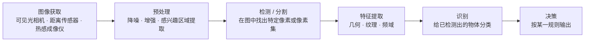

```cardlink
url: http://10.188.31.55:5244/Nextcloud/School/Auto-Drive-Intro/课件/
title: "智能驾驶导论 · 课件"
description: "中南大学《智能驾驶导论》课件，十一份 PDF，覆盖概述、感知、地图、定位、预测、控制与强化学习"
host: 10.188.31.55:5244
```

[← 返回《Auto-Drive-Intro》目录](../)

## 第 2 章 环境感知

### 感知基础与视觉

感知要回答两个问题：外面有什么，自己在哪。课件把这两个问题拆成「感知外界」和「感知自身」两条线。感知外界又分静态环境（车道线、路面、交通标识）与动态物体（运动中的车、人，它们的位置、朝向、速度等运动状态）；感知自身就是定位，靠 GPS、IMU、HDmap、SLAM，传感器是单目、双目、RGBD、激光雷达、超声波雷达 [第二章 无人驾驶感知基础.pdf · p.4](http://10.188.31.55:5244/Nextcloud/School/Auto-Drive-Intro/%E8%AF%BE%E4%BB%B6/%E7%AC%AC%E4%BA%8C%E7%AB%A0%20%E6%97%A0%E4%BA%BA%E9%A9%BE%E9%A9%B6%E6%84%9F%E7%9F%A5%E5%9F%BA%E7%A1%80.pdf#page=4)。

传感器侧的分工决定了算法放在哪里。单目给图片，双目给深度图片与稠密点云，激光雷达给稀疏点云，毫米波雷达与超声波雷达给距离 [第二章 无人驾驶感知基础.pdf · p.4](http://10.188.31.55:5244/Nextcloud/School/Auto-Drive-Intro/%E8%AF%BE%E4%BB%B6/%E7%AC%AC%E4%BA%8C%E7%AB%A0%20%E6%97%A0%E4%BA%BA%E9%A9%BE%E9%A9%B6%E6%84%9F%E7%9F%A5%E5%9F%BA%E7%A1%80.pdf#page=4)。图片与点云是原始数据，要靠外部算法处理才能变成环境信息；毫米波与超声波把处理算法内置在传感器里 [第二章 无人驾驶感知基础.pdf · p.6](http://10.188.31.55:5244/Nextcloud/School/Auto-Drive-Intro/%E8%AF%BE%E4%BB%B6/%E7%AC%AC%E4%BA%8C%E7%AB%A0%20%E6%97%A0%E4%BA%BA%E9%A9%BE%E9%A9%B6%E6%84%9F%E7%9F%A5%E5%9F%BA%E7%A1%80.pdf#page=6)。

感知拿到的信息对应四个任务。分类提升对图像的特征提取能力；分割对像素分类，分割出不同物体（人、车、路面）的形状；检测是框分类，框出图像中的物体再对其做分类；跟踪使用目标物体的全部信息做时序关联，一般对连续帧处理 [第二章 无人驾驶感知基础.pdf · p.5](http://10.188.31.55:5244/Nextcloud/School/Auto-Drive-Intro/%E8%AF%BE%E4%BB%B6/%E7%AC%AC%E4%BA%8C%E7%AB%A0%20%E6%97%A0%E4%BA%BA%E9%A9%BE%E9%A9%B6%E6%84%9F%E7%9F%A5%E5%9F%BA%E7%A1%80.pdf#page=5)。

#### 视觉感知的定义与机器视觉的流程

视觉感知的定义是接收并使用由环境中的物体反射的可见光来解释周围环境的能力 [第3讲 视觉感知.pptx · p.4](http://10.188.31.55:5244/Nextcloud/School/Auto-Drive-Intro/%E3%80%8A%E6%99%BA%E8%83%BD%E9%A9%BE%E9%A9%B6%E5%AF%BC%E8%AE%BA%E3%80%8BPPT-2020/%E7%AC%AC3%E8%AE%B2%20%E8%A7%86%E8%A7%89%E6%84%9F%E7%9F%A5.pptx)。机器视觉是更高一层的目标：让计算机像人一样高层次地理解图像或视频，自动化完成相关任务 [第3讲 视觉感知.pptx · p.6](http://10.188.31.55:5244/Nextcloud/School/Auto-Drive-Intro/%E3%80%8A%E6%99%BA%E8%83%BD%E9%A9%BE%E9%A9%B6%E5%AF%BC%E8%AE%BA%E3%80%8BPPT-2020/%E7%AC%AC3%E8%AE%B2%20%E8%A7%86%E8%A7%89%E6%84%9F%E7%9F%A5.pptx)。这个领域与四个方向交叉：人工智能（机器学习、模式识别）、信息工程（机器视觉通常被看作信息工程的一部分）、固体物理学（视觉传感器）、信号处理（图像处理） [第3讲 视觉感知.pptx · p.7](http://10.188.31.55:5244/Nextcloud/School/Auto-Drive-Intro/%E3%80%8A%E6%99%BA%E8%83%BD%E9%A9%BE%E9%A9%B6%E5%AF%BC%E8%AE%BA%E3%80%8BPPT-2020/%E7%AC%AC3%E8%AE%B2%20%E8%A7%86%E8%A7%89%E6%84%9F%E7%9F%A5.pptx)。

机器视觉的一般流程是固定的六步 [第3讲 视觉感知.pptx · p.11](http://10.188.31.55:5244/Nextcloud/School/Auto-Drive-Intro/%E3%80%8A%E6%99%BA%E8%83%BD%E9%A9%BE%E9%A9%B6%E5%AF%BC%E8%AE%BA%E3%80%8BPPT-2020/%E7%AC%AC3%E8%AE%B2%20%E8%A7%86%E8%A7%89%E6%84%9F%E7%9F%A5.pptx)。



图像获取这一环除了可见光相机，还包括距离传感器与热感成像仪，得到的可以是普通 2D 图像、3D 体积或图像序列，像素值通常对应光强度，也可以对应声波或电磁波的深度、吸收、反射 [第3讲 视觉感知.pptx · p.12](http://10.188.31.55:5244/Nextcloud/School/Auto-Drive-Intro/%E3%80%8A%E6%99%BA%E8%83%BD%E9%A9%BE%E9%A9%B6%E5%AF%BC%E8%AE%BA%E3%80%8BPPT-2020/%E7%AC%AC3%E8%AE%B2%20%E8%A7%86%E8%A7%89%E6%84%9F%E7%9F%A5.pptx)。预处理做降噪、增强、感兴趣区域提取 [第3讲 视觉感知.pptx · p.13](http://10.188.31.55:5244/Nextcloud/School/Auto-Drive-Intro/%E3%80%8A%E6%99%BA%E8%83%BD%E9%A9%BE%E9%A9%B6%E5%AF%BC%E8%AE%BA%E3%80%8BPPT-2020/%E7%AC%AC3%E8%AE%B2%20%E8%A7%86%E8%A7%89%E6%84%9F%E7%9F%A5.pptx)。检测与分割是在图像中寻找特定的像素或像素集 [第3讲 视觉感知.pptx · p.14](http://10.188.31.55:5244/Nextcloud/School/Auto-Drive-Intro/%E3%80%8A%E6%99%BA%E8%83%BD%E9%A9%BE%E9%A9%B6%E5%AF%BC%E8%AE%BA%E3%80%8BPPT-2020/%E7%AC%AC3%E8%AE%B2%20%E8%A7%86%E8%A7%89%E6%84%9F%E7%9F%A5.pptx)。特征提取拿几何、纹理、频域等特征描述对象 [第3讲 视觉感知.pptx · p.15](http://10.188.31.55:5244/Nextcloud/School/Auto-Drive-Intro/%E3%80%8A%E6%99%BA%E8%83%BD%E9%A9%BE%E9%A9%B6%E5%AF%BC%E8%AE%BA%E3%80%8BPPT-2020/%E7%AC%AC3%E8%AE%B2%20%E8%A7%86%E8%A7%89%E6%84%9F%E7%9F%A5.pptx)，识别对已检测出来的物体分类 [第3讲 视觉感知.pptx · p.16](http://10.188.31.55:5244/Nextcloud/School/Auto-Drive-Intro/%E3%80%8A%E6%99%BA%E8%83%BD%E9%A9%BE%E9%A9%B6%E5%AF%BC%E8%AE%BA%E3%80%8BPPT-2020/%E7%AC%AC3%E8%AE%B2%20%E8%A7%86%E8%A7%89%E6%84%9F%E7%9F%A5.pptx)，决策把识别结果按某一规则输出 [第3讲 视觉感知.pptx · p.17](http://10.188.31.55:5244/Nextcloud/School/Auto-Drive-Intro/%E3%80%8A%E6%99%BA%E8%83%BD%E9%A9%BE%E9%A9%B6%E5%AF%BC%E8%AE%BA%E3%80%8BPPT-2020/%E7%AC%AC3%E8%AE%B2%20%E8%A7%86%E8%A7%89%E6%84%9F%E7%9F%A5.pptx)。

在智能驾驶里，这套流程落到具体任务上：道路识别、车道线检测、前方车辆检测与识别、标志牌检测与识别、交通灯检测与识别、行人检测，以及其他 [第3讲 视觉感知.pptx · p.20](http://10.188.31.55:5244/Nextcloud/School/Auto-Drive-Intro/%E3%80%8A%E6%99%BA%E8%83%BD%E9%A9%BE%E9%A9%B6%E5%AF%BC%E8%AE%BA%E3%80%8BPPT-2020/%E7%AC%AC3%E8%AE%B2%20%E8%A7%86%E8%A7%89%E6%84%9F%E7%9F%A5.pptx)。这一讲给出的深度学习工具是 AlexNet、VGGNet、UNet、YOLO（v3）四个网络 [第3讲 视觉感知.pptx · p.31](http://10.188.31.55:5244/Nextcloud/School/Auto-Drive-Intro/%E3%80%8A%E6%99%BA%E8%83%BD%E9%A9%BE%E9%A9%B6%E5%AF%BC%E8%AE%BA%E3%80%8BPPT-2020/%E7%AC%AC3%E8%AE%B2%20%E8%A7%86%E8%A7%89%E6%84%9F%E7%9F%A5.pptx) [第3讲 视觉感知.pptx · p.32](http://10.188.31.55:5244/Nextcloud/School/Auto-Drive-Intro/%E3%80%8A%E6%99%BA%E8%83%BD%E9%A9%BE%E9%A9%B6%E5%AF%BC%E8%AE%BA%E3%80%8BPPT-2020/%E7%AC%AC3%E8%AE%B2%20%E8%A7%86%E8%A7%89%E6%84%9F%E7%9F%A5.pptx) [第3讲 视觉感知.pptx · p.33](http://10.188.31.55:5244/Nextcloud/School/Auto-Drive-Intro/%E3%80%8A%E6%99%BA%E8%83%BD%E9%A9%BE%E9%A9%B6%E5%AF%BC%E8%AE%BA%E3%80%8BPPT-2020/%E7%AC%AC3%E8%AE%B2%20%E8%A7%86%E8%A7%89%E6%84%9F%E7%9F%A5.pptx) [第3讲 视觉感知.pptx · p.34](http://10.188.31.55:5244/Nextcloud/School/Auto-Drive-Intro/%E3%80%8A%E6%99%BA%E8%83%BD%E9%A9%BE%E9%A9%B6%E5%AF%BC%E8%AE%BA%E3%80%8BPPT-2020/%E7%AC%AC3%E8%AE%B2%20%E8%A7%86%E8%A7%89%E6%84%9F%E7%9F%A5.pptx)。

#### 传统方法的车道线检测

课件给的实战是传统方法的车道线检测，参考 Towards Data Science 的 lane detector 教程，代码在 `lane-detector` 仓库 [第二章 无人驾驶感知基础.pdf · p.8](http://10.188.31.55:5244/Nextcloud/School/Auto-Drive-Intro/%E8%AF%BE%E4%BB%B6/%E7%AC%AC%E4%BA%8C%E7%AB%A0%20%E6%97%A0%E4%BA%BA%E9%A9%BE%E9%A9%B6%E6%84%9F%E7%9F%A5%E5%9F%BA%E7%A1%80.pdf#page=8)。整条流水线是：Canny 边缘检测 → 分割路面区域 → 霍夫变换求直线 → 叠加回原图 [第二章 无人驾驶感知基础.pdf · p.9](http://10.188.31.55:5244/Nextcloud/School/Auto-Drive-Intro/%E8%AF%BE%E4%BB%B6/%E7%AC%AC%E4%BA%8C%E7%AB%A0%20%E6%97%A0%E4%BA%BA%E9%A9%BE%E9%A9%B6%E6%84%9F%E7%9F%A5%E5%9F%BA%E7%A1%80.pdf#page=9)。

Canny 检测亮度的急剧变化（大梯度，比如从白色到黑色），在给定阈值下定义为边。预处理是彩色图片转灰度图，算法分四步 [第二章 无人驾驶感知基础.pdf · p.10](http://10.188.31.55:5244/Nextcloud/School/Auto-Drive-Intro/%E8%AF%BE%E4%BB%B6/%E7%AC%AC%E4%BA%8C%E7%AB%A0%20%E6%97%A0%E4%BA%BA%E9%A9%BE%E9%A9%B6%E6%84%9F%E7%9F%A5%E5%9F%BA%E7%A1%80.pdf#page=10)。

1. 降噪。噪声容易导致误检，用 $5 \times 5$ 的高斯滤波器（正态分布核）对图像做卷积，把图像平滑掉。
2. 求亮度梯度。在平滑后的图像上用 Sobel、Roberts、Prewitt 核沿 $x$ 轴和 $y$ 轴检测边缘是水平、垂直还是对角线。
3. 非极大值抑制。检查每个像素值在梯度方向上是否为局部最大值；相比相邻的 B、C，若 A 是局部最大就保留，否则把 A 的像素值置 0。
4. Hysteresis thresholding。梯度大于 `maxVal` 的是边缘，小于 `minVal` 的不是边缘并删除，落在 $[minVal, maxVal]$ 的像素只有在和梯度高于 `maxVal` 的像素相连时才算边缘。

分割路面区域用的是手动指定的三角形，把路面之外的干扰边缘去掉 [第二章 无人驾驶感知基础.pdf · p.11](http://10.188.31.55:5244/Nextcloud/School/Auto-Drive-Intro/%E8%AF%BE%E4%BB%B6/%E7%AC%AC%E4%BA%8C%E7%AB%A0%20%E6%97%A0%E4%BA%BA%E9%A9%BE%E9%A9%B6%E6%84%9F%E7%9F%A5%E5%9F%BA%E7%A1%80.pdf#page=11)。

霍夫变换把「找直线」变成「找点」。在笛卡尔坐标系里直线的方程是 $y = mx + b$，变量是 $(x, y)$、参数是 $(m, b)$；搬进霍夫空间之后变量与参数互换，方程写成

$$
b = -xm + y
$$

笛卡尔系里的一个点 $(x, y)$ 对应霍夫空间里的一条直线，多条经过该点的直线在霍夫空间里交于一点 [第二章 无人驾驶感知基础.pdf · p.12](http://10.188.31.55:5244/Nextcloud/School/Auto-Drive-Intro/%E8%AF%BE%E4%BB%B6/%E7%AC%AC%E4%BA%8C%E7%AB%A0%20%E6%97%A0%E4%BA%BA%E9%A9%BE%E9%A9%B6%E6%84%9F%E7%9F%A5%E5%9F%BA%E7%A1%80.pdf#page=12)。

](images/fig-02-p12.png)

线垂直时斜率是无穷大，$y = mx + b$ 表达不出来，于是改用极坐标表示直线，方程是

$$
d = x\cos\theta + y\sin\theta
$$

此时变量是 $(\theta, d)$、参数是 $(x, y)$，笛卡尔系的一个点对应霍夫空间里的一条曲线 $d_i = x\cos\theta_i + y\sin\theta_i$，一条曲线经过 $(\theta_i, d_i)$ [第二章 无人驾驶感知基础.pdf · p.13](http://10.188.31.55:5244/Nextcloud/School/Auto-Drive-Intro/%E8%AF%BE%E4%BB%B6/%E7%AC%AC%E4%BA%8C%E7%AB%A0%20%E6%97%A0%E4%BA%BA%E9%A9%BE%E9%A9%B6%E6%84%9F%E7%9F%A5%E5%9F%BA%E7%A1%80.pdf#page=13)。

> [!WARNING] **阈值决定漏检还是误检**
> 霍夫空间中相交的曲线越多，交点表示的线在笛卡尔坐标系里对应的点就越多，所以要定义交点的最小阈值来检测线。跟踪帧中每个点的霍夫空间交点，数量超过阈值就确定一条对应参数 $\theta$ 和 $d$ 的线 [第二章 无人驾驶感知基础.pdf · p.13](http://10.188.31.55:5244/Nextcloud/School/Auto-Drive-Intro/%E8%AF%BE%E4%BB%B6/%E7%AC%AC%E4%BA%8C%E7%AB%A0%20%E6%97%A0%E4%BA%BA%E9%A9%BE%E9%A9%B6%E6%84%9F%E7%9F%A5%E5%9F%BA%E7%A1%80.pdf#page=13)。阈值调大则弱线漏检，调小则噪声被当成线。

检测出的所有线求斜率与截距的平均值，得到两条车道线，再叠加回原图 [第二章 无人驾驶感知基础.pdf · p.14](http://10.188.31.55:5244/Nextcloud/School/Auto-Drive-Intro/%E8%AF%BE%E4%BB%B6/%E7%AC%AC%E4%BA%8C%E7%AB%A0%20%E6%97%A0%E4%BA%BA%E9%A9%BE%E9%A9%B6%E6%84%9F%E7%9F%A5%E5%9F%BA%E7%A1%80.pdf#page=14) [第二章 无人驾驶感知基础.pdf · p.15](http://10.188.31.55:5244/Nextcloud/School/Auto-Drive-Intro/%E8%AF%BE%E4%BB%B6/%E7%AC%AC%E4%BA%8C%E7%AB%A0%20%E6%97%A0%E4%BA%BA%E9%A9%BE%E9%A9%B6%E6%84%9F%E7%9F%A5%E5%9F%BA%E7%A1%80.pdf#page=15)。

#### 图像分割的三个层次

图片分割分三层。普通分割把属于不同物体的像素区域分开即可，比如前景与背景分割、狗的区域与猫的区域与背景分开；语义分割在普通分割之上还要分类出每一块区域的语义（类别）；实例分割在语义分割之上还要区分同种物体的不同个体 [第二章 无人驾驶感知基础.pdf · p.16](http://10.188.31.55:5244/Nextcloud/School/Auto-Drive-Intro/%E8%AF%BE%E4%BB%B6/%E7%AC%AC%E4%BA%8C%E7%AB%A0%20%E6%97%A0%E4%BA%BA%E9%A9%BE%E9%A9%B6%E6%84%9F%E7%9F%A5%E5%9F%BA%E7%A1%80.pdf#page=16)。

](images/fig-02-p16.png)

基于深度学习的分割算法有通用框架。前端用全卷积网络做特征提取，经下采样与上采样（Convolution + Deconvolution／Resize）、多尺度特征融合（特征逐点相加或特征拼接），得到像素级的 segmentation map，对每一个像素点判断类别；后端用 CRF（条件随机场）或 MRF（马尔科夫随机场）优化前端输出 [第二章 无人驾驶感知基础.pdf · p.17](http://10.188.31.55:5244/Nextcloud/School/Auto-Drive-Intro/%E8%AF%BE%E4%BB%B6/%E7%AC%AC%E4%BA%8C%E7%AB%A0%20%E6%97%A0%E4%BA%BA%E9%A9%BE%E9%A9%B6%E6%84%9F%E7%9F%A5%E5%9F%BA%E7%A1%80.pdf#page=17)。

#### 分割网络的演进

**FCN。** 首次把深度学习引入图片语义分割，论文《Fully Convolutional Networks for Semantic Segmentation》，三点贡献 [第二章 无人驾驶感知基础.pdf · p.19](http://10.188.31.55:5244/Nextcloud/School/Auto-Drive-Intro/%E8%AF%BE%E4%BB%B6/%E7%AC%AC%E4%BA%8C%E7%AB%A0%20%E6%97%A0%E4%BA%BA%E9%A9%BE%E9%A9%B6%E6%84%9F%E7%9F%A5%E5%9F%BA%E7%A1%80.pdf#page=19)。

1. 全卷积网络。把全连接层替换成全卷积层（全连接等效于卷积核是输入特征大小的卷积），网络可以接受任意大小的图片，输出和原图一样大小的特征图。只有这样才能为每个像素做分类。
2. 反卷积层做上采样。特征图一般只有原图的几分之一，要映射回原图大小必须上采样。反卷积（Deconvolution）并不是卷积的逆操作，更准确的名字是转置卷积（Transposed Convolution），作用是从小的特征图卷出大的特征图。它与卷积类似，都是相乘相加的运算，卷积是多对一，反卷积是一对多；前向与后向传播直接用颠倒卷积的前后向传播即可。
3. Skip Layer。目的是特征融合。把全卷积之后的结果直接上采样得到的结果很粗糙，所以把不同池化层的结果上采样之后融合再做像素分类。课件里给的对比是：数字越小使用反卷积层上采样越多，对应模型结构越复杂，分割效果越精细。

**U-Net。** 原作者参加 ISBI Challenge 时提出，能适应很小的训练集，大约 30 张图。结构像一个 U 字母：先 Conv + Pooling 下采样，再 Deconv 反卷积上采样，把之前的低层 feature map crop 之后融合，然后再次上采样，重复这个过程直到获得 $388 \times 388 \times 2$ 的 feature map，最后经 softmax 得到 output segment map。与 FCN 逐点相加不同，U-Net 把特征在 channel 维度拼接在一起，形成更厚的特征。U-Net 与 FCN 都是很小的分割网络，既没有使用空洞卷积，也没有后接 CRF [第二章 无人驾驶感知基础.pdf · p.20](http://10.188.31.55:5244/Nextcloud/School/Auto-Drive-Intro/%E8%AF%BE%E4%BB%B6/%E7%AC%AC%E4%BA%8C%E7%AB%A0%20%E6%97%A0%E4%BA%BA%E9%A9%BE%E9%A9%B6%E6%84%9F%E7%9F%A5%E5%9F%BA%E7%A1%80.pdf#page=20)。

**SegNet / DeconvNet。** 更好的上采样模式，采用类似自编码器的对称结构，先编码再解码。反卷积同上；上池化的实现要点是池化时记住输出值的位置，上池化时再把值填回原来的位置，其他位置填 0 [第二章 无人驾驶感知基础.pdf · p.21](http://10.188.31.55:5244/Nextcloud/School/Auto-Drive-Intro/%E8%AF%BE%E4%BB%B6/%E7%AC%AC%E4%BA%8C%E7%AB%A0%20%E6%97%A0%E4%BA%BA%E9%A9%BE%E9%A9%B6%E6%84%9F%E7%9F%A5%E5%9F%BA%E7%A1%80.pdf#page=21)。

**DeepLab。** 有 v1、v2、v3，v1 的论文是《DeepLab: Semantic Image Segmentation with Deep Convolutional Nets, Atrous Convolution, and Fully Connected CRFs》，引入的核心方法是空洞卷积（Dilated / Atrous Convolution）：普通卷积核中间插入几个洞，运算与普通卷积保持一样，好处是感受野更大 [第二章 无人驾驶感知基础.pdf · p.22](http://10.188.31.55:5244/Nextcloud/School/Auto-Drive-Intro/%E8%AF%BE%E4%BB%B6/%E7%AC%AC%E4%BA%8C%E7%AB%A0%20%E6%97%A0%E4%BA%BA%E9%A9%BE%E9%A9%B6%E6%84%9F%E7%9F%A5%E5%9F%BA%E7%A1%80.pdf#page=22)。

卷积核尺寸 $k$、膨胀率 $r$ 时，有效感受野的边长是

$$
k_{\text{eff}} = k + (k - 1)(r - 1)
$$

$3 \times 3$ 卷积插入一个洞，视野变成 $5 \times 5$。视野变大的作用是：特征图缩小到同样倍数的情况下可以掌握更多图像的全局信息，这在语义分割中很重要。

**PSPNet。** Pyramid Scene Parsing Network，核心贡献是 Global Pyramid Pooling。把特征图缩放到几个不同的尺寸，上采样后与之前的特征融合，使特征具有更好的全局与多尺度信息，对区分不同类别有帮助。Pyramid Pooling Module 里用 $1 \times 1$ conv 降低 context representation 的维度，backbone 用带空洞卷积的 ResNet [第二章 无人驾驶感知基础.pdf · p.23](http://10.188.31.55:5244/Nextcloud/School/Auto-Drive-Intro/%E8%AF%BE%E4%BB%B6/%E7%AC%AC%E4%BA%8C%E7%AB%A0%20%E6%97%A0%E4%BA%BA%E9%A9%BE%E9%A9%B6%E6%84%9F%E7%9F%A5%E5%9F%BA%E7%A1%80.pdf#page=23)。

**Mask R-CNN。** 检测与分割结合：新增一个分支输出 mask，语义分割（单像素多分类）等价于框检测（box，多分类）加框内的普通分割（二分类 mask），符合人眼先整块粗分再细化形状的直觉。Loss 是分类、回归、mask 三项之和；mask 分支与其它分类分支一样用全卷积网络，输出 $k$ 类 mask，用 sigmoid 与阈值 0.5 比较得到二值 mask，这样避免了类间竞争，每个类别都专门生成本类的 mask [第二章 无人驾驶感知基础.pdf · p.24](http://10.188.31.55:5244/Nextcloud/School/Auto-Drive-Intro/%E8%AF%BE%E4%BB%B6/%E7%AC%AC%E4%BA%8C%E7%AB%A0%20%E6%97%A0%E4%BA%BA%E9%A9%BE%E9%A9%B6%E6%84%9F%E7%9F%A5%E5%9F%BA%E7%A1%80.pdf#page=24)。

#### 用实例分割检测车道线：LaneNet

基于图片分割的车道线检测，论文《Towards End-to-End Lane Detection: an Instance Segmentation Approach》，两个特点 [第二章 无人驾驶感知基础.pdf · p.25](http://10.188.31.55:5244/Nextcloud/School/Auto-Drive-Intro/%E8%AF%BE%E4%BB%B6/%E7%AC%AC%E4%BA%8C%E7%AB%A0%20%E6%97%A0%E4%BA%BA%E9%A9%BE%E9%A9%B6%E6%84%9F%E7%9F%A5%E5%9F%BA%E7%A1%80.pdf#page=25)。

1. 用实例分割来检测车道线。
2. 更灵活的透视变换。一般做法是把图像透视变换到鸟瞰图再优化车道线，固定的透视变换矩阵遇到上下坡就失效，因此提出用 CNN 学习透视变换：输入 RGB 图像加分割结果，经 H-Network 输出透视变换参数。

具体做法是先粗分再细分 [第二章 无人驾驶感知基础.pdf · p.26](http://10.188.31.55:5244/Nextcloud/School/Auto-Drive-Intro/%E8%AF%BE%E4%BB%B6/%E7%AC%AC%E4%BA%8C%E7%AB%A0%20%E6%97%A0%E4%BA%BA%E9%A9%BE%E9%A9%B6%E6%84%9F%E7%9F%A5%E5%9F%BA%E7%A1%80.pdf#page=26)。

1. 语义分割，分割出所有车道线，这是二分类问题。
2. 生成像素 embedding：每个像素生成一个 $n$ 维嵌入，使同一车道的嵌入距离近，不同车道的嵌入距离远。
3. 聚类出具体是哪条车道线：用分割分支的二值分割图做掩码，在 pixel embedding 图像上取出所有车道像素的 $n$ 维嵌入，把车道像素的嵌入（蓝点）聚类得到所属车道类别。

#### 基于图像的检测算法

无人驾驶中的检测任务是：图片或点云进去，2D 或 3D bounding box 出来。图片（相机）走图片检测算法，稀疏点云（激光雷达）走点云检测算法，稠密点云（双目／RGBD 相机）走深度图算法 [第二章 无人驾驶感知基础.pdf · p.29](http://10.188.31.55:5244/Nextcloud/School/Auto-Drive-Intro/%E8%AF%BE%E4%BB%B6/%E7%AC%AC%E4%BA%8C%E7%AB%A0%20%E6%97%A0%E4%BA%BA%E9%A9%BE%E9%A9%B6%E6%84%9F%E7%9F%A5%E5%9F%BA%E7%A1%80.pdf#page=29)。

检测相对分类多出两件事：位置，先找到所有的 ROI（region of interest，bounding box may contain object）；位置修正，bounding box regression。类别仍是对每个 ROI 做分类 [第二章 无人驾驶感知基础.pdf · p.30](http://10.188.31.55:5244/Nextcloud/School/Auto-Drive-Intro/%E8%AF%BE%E4%BB%B6/%E7%AC%AC%E4%BA%8C%E7%AB%A0%20%E6%97%A0%E4%BA%BA%E9%A9%BE%E9%A9%B6%E6%84%9F%E7%9F%A5%E5%9F%BA%E7%A1%80.pdf#page=30)。

](images/fig-02-p30.png)

获取 ROI 有三条路 [第二章 无人驾驶感知基础.pdf · p.31](http://10.188.31.55:5244/Nextcloud/School/Auto-Drive-Intro/%E8%AF%BE%E4%BB%B6/%E7%AC%AC%E4%BA%8C%E7%AB%A0%20%E6%97%A0%E4%BA%BA%E9%A9%BE%E9%A9%B6%E6%84%9F%E7%9F%A5%E5%9F%BA%E7%A1%80.pdf#page=31)。

1. Sliding window。遍历所有位置（上到下、左到右）与所有不同的 scale 和 ratio（远处近处的物体大小不同），无效框多、计算复杂，适合长宽比固定的物体，比如人脸或行人。
2. Region proposal。用分割找出图里可能有物体的区域，减少无效框与需要分类的路径。Selective search 属于这一类：先过度分割，再按相似度合并相邻框。
3. CNN。anchor box（类似 sliding window）与来自 Faster-RCNN 的 RPN。

拿到 ROI 之后抽特征、分类。特征可以用传统方法（Haar、LBP、SIFT、SURF、HOG、DPM），也可以用 CNN；分类器可以用 SVM、Adaboost，也可以用 CNN [第二章 无人驾驶感知基础.pdf · p.32](http://10.188.31.55:5244/Nextcloud/School/Auto-Drive-Intro/%E8%AF%BE%E4%BB%B6/%E7%AC%AC%E4%BA%8C%E7%AB%A0%20%E6%97%A0%E4%BA%BA%E9%A9%BE%E9%A9%B6%E6%84%9F%E7%9F%A5%E5%9F%BA%E7%A1%80.pdf#page=32)。

**Two-step 方法。** 每一步都在把「提候选框」和「分类回归」两端换成 CNN [第二章 无人驾驶感知基础.pdf · p.33](http://10.188.31.55:5244/Nextcloud/School/Auto-Drive-Intro/%E8%AF%BE%E4%BB%B6/%E7%AC%AC%E4%BA%8C%E7%AB%A0%20%E6%97%A0%E4%BA%BA%E9%A9%BE%E9%A9%B6%E6%84%9F%E7%9F%A5%E5%9F%BA%E7%A1%80.pdf#page=33)。这条线的成员是 RCNN、SPPNet、Fast-RCNN、Faster-RCNN、RFCN、Mask-RCNN，它们是端到端的，Get ROI、Extract feature、Classify、box regression 全部用 CNN [第二章 无人驾驶感知基础.pdf · p.43](http://10.188.31.55:5244/Nextcloud/School/Auto-Drive-Intro/%E8%AF%BE%E4%BB%B6/%E7%AC%AC%E4%BA%8C%E7%AB%A0%20%E6%97%A0%E4%BA%BA%E9%A9%BE%E9%A9%B6%E6%84%9F%E7%9F%A5%E5%9F%BA%E7%A1%80.pdf#page=43)。

| 方法 | 位置 | 类别 | 位置修正 |
| --- | --- | --- | --- |
| RCNN | Selective Search 提取候选框 | CNN 提取特征 + SVM 分类 | Linear Regression |
| SPPNet | Selective Search 提取候选框 | CNN 提取特征 + SVM 分类 | Linear Regression |
| Fast-RCNN | Selective Search 提取候选框 | CNN 提取特征 + CNN 分类 | CNN 回归 |
| Faster-RCNN | CNN 提取候选框（RPN） | CNN 提取特征 + CNN 分类 | CNN 回归 |

RCNN 是这条线的起点：候选框靠 Selective Search，特征与分类靠 CNN 加 SVM，位置靠线性回归修正 [第二章 无人驾驶感知基础.pdf · p.34](http://10.188.31.55:5244/Nextcloud/School/Auto-Drive-Intro/%E8%AF%BE%E4%BB%B6/%E7%AC%AC%E4%BA%8C%E7%AB%A0%20%E6%97%A0%E4%BA%BA%E9%A9%BE%E9%A9%B6%E6%84%9F%E7%9F%A5%E5%9F%BA%E7%A1%80.pdf#page=34)。SPPNet 的贡献是共享卷积，大大降低计算量；SPP 层把不同尺度的特征变成固定尺度的特征，才能接全连接层 [第二章 无人驾驶感知基础.pdf · p.35](http://10.188.31.55:5244/Nextcloud/School/Auto-Drive-Intro/%E8%AF%BE%E4%BB%B6/%E7%AC%AC%E4%BA%8C%E7%AB%A0%20%E6%97%A0%E4%BA%BA%E9%A9%BE%E9%A9%B6%E6%84%9F%E7%9F%A5%E5%9F%BA%E7%A1%80.pdf#page=35)。Fast-RCNN 把分类和回归都用 CNN 实现，两种损失可以反传以实现联动调参（半 end-to-end），SPP 层换成 ROI Pooling 提高计算速度 [第二章 无人驾驶感知基础.pdf · p.36](http://10.188.31.55:5244/Nextcloud/School/Auto-Drive-Intro/%E8%AF%BE%E4%BB%B6/%E7%AC%AC%E4%BA%8C%E7%AB%A0%20%E6%97%A0%E4%BA%BA%E9%A9%BE%E9%A9%B6%E6%84%9F%E7%9F%A5%E5%9F%BA%E7%A1%80.pdf#page=36)。

](images/fig-02-p36.png)

Faster-RCNN 把候选框也交给 CNN：RPN（Region Proposal Net）在 feature 点对应的原图感受野框处生成不同 ratio 与 scale 的 anchor box，再对 anchor box 做二分类加回归 [第二章 无人驾驶感知基础.pdf · p.37](http://10.188.31.55:5244/Nextcloud/School/Auto-Drive-Intro/%E8%AF%BE%E4%BB%B6/%E7%AC%AC%E4%BA%8C%E7%AB%A0%20%E6%97%A0%E4%BA%BA%E9%A9%BE%E9%A9%B6%E6%84%9F%E7%9F%A5%E5%9F%BA%E7%A1%80.pdf#page=37)。

**One-step 方法。** 不再分两步，直接对 default box 做全分类加回归，成员是 OverFeat、YOLO、SSD、YOLO-v2、RetinaNet、YOLO-v3 [第二章 无人驾驶感知基础.pdf · p.43](http://10.188.31.55:5244/Nextcloud/School/Auto-Drive-Intro/%E8%AF%BE%E4%BB%B6/%E7%AC%AC%E4%BA%8C%E7%AB%A0%20%E6%97%A0%E4%BA%BA%E9%A9%BE%E9%A9%B6%E6%84%9F%E7%9F%A5%E5%9F%BA%E7%A1%80.pdf#page=43)。

YOLO 把全图划分成 $7 \times 7$ 网格，每个网格对应 2 个 default box，没有候选框，直接对 default box 做全分类加回归。box 中心坐标的 $x$、$y$ 相当于归一化到 0 到 1 之间的网格坐标，$w$、$h$ 用图像的 width 和 height 归一化到 0 到 1 之间 [第二章 无人驾驶感知基础.pdf · p.38](http://10.188.31.55:5244/Nextcloud/School/Auto-Drive-Intro/%E8%AF%BE%E4%BB%B6/%E7%AC%AC%E4%BA%8C%E7%AB%A0%20%E6%97%A0%E4%BA%BA%E9%A9%BE%E9%A9%B6%E6%84%9F%E7%9F%A5%E5%9F%BA%E7%A1%80.pdf#page=38)。它的优点是实时性，缺点是准确率不如 Faster-RCNN：定位精度差，因为 anchor box 不够丰富且只回归修正一次；不规则物体差，因为 anchor 的 ratio 不够多样 [第二章 无人驾驶感知基础.pdf · p.39](http://10.188.31.55:5244/Nextcloud/School/Auto-Drive-Intro/%E8%AF%BE%E4%BB%B6/%E7%AC%AC%E4%BA%8C%E7%AB%A0%20%E6%97%A0%E4%BA%BA%E9%A9%BE%E9%A9%B6%E6%84%9F%E7%9F%A5%E5%9F%BA%E7%A1%80.pdf#page=39)。

SSD 借鉴 RPN 的 anchor box 机制，同样在 feature 点对应的原图感受野框处生成不同 ratio 与 scale 的 default box，也没有候选框，直接对 default box 做全分类加回归。区别在输出层用多感受野特征：前面层感受野小适合小物体，后面层感受野大适合大物体 [第二章 无人驾驶感知基础.pdf · p.40](http://10.188.31.55:5244/Nextcloud/School/Auto-Drive-Intro/%E8%AF%BE%E4%BB%B6/%E7%AC%AC%E4%BA%8C%E7%AB%A0%20%E6%97%A0%E4%BA%BA%E9%A9%BE%E9%A9%B6%E6%84%9F%E7%9F%A5%E5%9F%BA%E7%A1%80.pdf#page=40)。

YOLO-v2 两点改进 [第二章 无人驾驶感知基础.pdf · p.41](http://10.188.31.55:5244/Nextcloud/School/Auto-Drive-Intro/%E8%AF%BE%E4%BB%B6/%E7%AC%AC%E4%BA%8C%E7%AB%A0%20%E6%97%A0%E4%BA%BA%E9%A9%BE%E9%A9%B6%E6%84%9F%E7%9F%A5%E5%9F%BA%E7%A1%80.pdf#page=41)。

1. 更丰富的 default box。用 k-means 从数据集统计出 default box，$k$ 增大时 IOU 也增大（高召回率），复杂度也在增加，最终选择 $k$ 为 5。
2. 更灵活的类别预测。把预测类别的机制从空间位置（cell）中解耦，由 default box 同时预测类别和坐标，有效解决物体重叠。

YOLO-v3 三点改进 [第二章 无人驾驶感知基础.pdf · p.42](http://10.188.31.55:5244/Nextcloud/School/Auto-Drive-Intro/%E8%AF%BE%E4%BB%B6/%E7%AC%AC%E4%BA%8C%E7%AB%A0%20%E6%97%A0%E4%BA%BA%E9%A9%BE%E9%A9%B6%E6%84%9F%E7%9F%A5%E5%9F%BA%E7%A1%80.pdf#page=42)。

1. 更好的基础网络：darknet-19 换成 darknet-53。
2. 考虑多尺度。多感受野的特中层输出，上采样融合之后再输出，借鉴 feature pyramid networks；SSD 是直接输出不融合。
3. 更多 default box：$K = 9$，被 3 个输出平分。

YOLO-v3 的结构图在第 3 讲的 PPT 里单独给了一页：粉色块是 Residual Block，米色块是 Detection Layer，绿色块是 Upsampling Layer，三个检测头各自输出一张带网格的预测图 [第3讲 视觉感知.pptx · p.34](http://10.188.31.55:5244/Nextcloud/School/Auto-Drive-Intro/%E3%80%8A%E6%99%BA%E8%83%BD%E9%A9%BE%E9%A9%B6%E5%AF%BC%E8%AE%BA%E3%80%8BPPT-2020/%E7%AC%AC3%E8%AE%B2%20%E8%A7%86%E8%A7%89%E6%84%9F%E7%9F%A5.pptx)。

### 激光雷达与点云

#### 激光雷达测的是什么

激光雷达（Light Detection And Ranging，缩写 LiDAR）是发射激光束、再从回波里解算目标位置与速度特征的雷达系统。课件把它的物理边界讲得很具体：工作波段落在 0.5 μm 到 10 μm 之间，接收端用光电探测器而不是天线 [第二章-行车环境感知-激光雷达和点云.pdf · p.5](http://10.188.31.55:5244/Nextcloud/School/Auto-Drive-Intro/%E8%AF%BE%E4%BB%B6/%E7%AC%AC%E4%BA%8C%E7%AB%A0-%E8%A1%8C%E8%BD%A6%E7%8E%AF%E5%A2%83%E6%84%9F%E7%9F%A5-%E6%BF%80%E5%85%89%E9%9B%B7%E8%BE%BE%E5%92%8C%E7%82%B9%E4%BA%91.pdf#page=5)。

按发射端的运动方式，课件把激光雷达分成三类：机械式、固态、混合固态 [第二章-行车环境感知-激光雷达和点云.pdf · p.5](http://10.188.31.55:5244/Nextcloud/School/Auto-Drive-Intro/%E8%AF%BE%E4%BB%B6/%E7%AC%AC%E4%BA%8C%E7%AB%A0-%E8%A1%8C%E8%BD%A6%E7%8E%AF%E5%A2%83%E6%84%9F%E7%9F%A5-%E6%BF%80%E5%85%89%E9%9B%B7%E8%BE%BE%E5%92%8C%E7%82%B9%E4%BA%91.pdf#page=5)。这个分类决定了一台设备最贵、最容易坏的部件在哪：机械式的瓶颈是那个要转起来的发射头，固态把它换成了芯片，混合固态则折中。

#### 机械式：把一条线扫成一个面

机械式 LiDAR 让发射头持续旋转，同时在竖直方向上排布多束激光，课件给的线数是 4、16、32 或 64。旋转加上多线排布，扫描面就从一个"线"变成一个"面"，一次扫描拿到的是三维信息 [第二章-行车环境感知-激光雷达和点云.pdf · p.7](http://10.188.31.55:5244/Nextcloud/School/Auto-Drive-Intro/%E8%AF%BE%E4%BB%B6/%E7%AC%AC%E4%BA%8C%E7%AB%A0-%E8%A1%8C%E8%BD%A6%E7%8E%AF%E5%A2%83%E6%84%9F%E7%9F%A5-%E6%BF%80%E5%85%89%E9%9B%B7%E8%BE%BE%E5%92%8C%E7%82%B9%E4%BA%91.pdf#page=7)。

](images/fig-02-p07.png)

这张图解释了这类设备的信号链条：激光器经光束控制打到发射光学天线，出射光打到目标物体；回波由接收光学天线收进探测器，探测器带着制冷模块把光信号转成电信号。电信号再经前置放大、主放大、模数转换和主处理，最后从距离信息、速度信息、角度信息和目标图像信息四路输出。整个旋转机构由伺服系统驱动，镜子在圆光栅上转动 [第二章-行车环境感知-激光雷达和点云.pdf · p.7](http://10.188.31.55:5244/Nextcloud/School/Auto-Drive-Intro/%E8%AF%BE%E4%BB%B6/%E7%AC%AC%E4%BA%8C%E7%AB%A0-%E8%A1%8C%E8%BD%A6%E7%8E%AF%E5%A2%83%E6%84%9F%E7%9F%A5-%E6%BF%80%E5%85%89%E9%9B%B7%E8%BE%BE%E5%92%8C%E7%82%B9%E4%BA%91.pdf#page=7)。机械件在这条链条上的位置决定了它的可靠性成本。

#### 混合固态与固态：把运动做小

混合固态用半导体微动器件（例如 MEMS 扫描镜）代替宏观机械扫描器，在微观尺度上实现发射端的扫描。MEMS 扫描镜是硅基半导体元器件，内部集成一面可动的微型镜面，所以既"固态"又"运动"，叫混合固态 [第二章-行车环境感知-激光雷达和点云.pdf · p.9](http://10.188.31.55:5244/Nextcloud/School/Auto-Drive-Intro/%E8%AF%BE%E4%BB%B6/%E7%AC%AC%E4%BA%8C%E7%AB%A0-%E8%A1%8C%E8%BD%A6%E7%8E%AF%E5%A2%83%E6%84%9F%E7%9F%A5-%E6%BF%80%E5%85%89%E9%9B%B7%E8%BE%BE%E5%92%8C%E7%82%B9%E4%BA%91.pdf#page=9)。课件给出的理由是工程性的：有效降低机械损毁，主部件用芯片工艺生产后量产能力大幅提高，有利于降低激光雷达的成本 [第二章-行车环境感知-激光雷达和点云.pdf · p.9](http://10.188.31.55:5244/Nextcloud/School/Auto-Drive-Intro/%E8%AF%BE%E4%BB%B6/%E7%AC%AC%E4%BA%8C%E7%AB%A0-%E8%A1%8C%E8%BD%A6%E7%8E%AF%E5%A2%83%E6%84%9F%E7%9F%A5-%E6%BF%80%E5%85%89%E9%9B%B7%E8%BE%BE%E5%92%8C%E7%82%B9%E4%BA%91.pdf#page=9)。2016 年 1 月的 CES 上，Velodyne 展示了混合固态方案 Solid-State Hybrid Ultra Puck Auto [第二章-行车环境感知-激光雷达和点云.pdf · p.9](http://10.188.31.55:5244/Nextcloud/School/Auto-Drive-Intro/%E8%AF%BE%E4%BB%B6/%E7%AC%AC%E4%BA%8C%E7%AB%A0-%E8%A1%8C%E8%BD%A6%E7%8E%AF%E5%A2%83%E6%84%9F%E7%9F%A5-%E6%BF%80%E5%85%89%E9%9B%B7%E8%BE%BE%E5%92%8C%E7%82%B9%E4%BA%91.pdf#page=9)。

固态里的一条主流路线是 OPA（Optical Phased Array，光学相控阵列）。它用相干原理，由多个光源组成阵列，通过控制各光源发光的时间差（相位差）合成一束指向特定方向的主光束，再控制主光束扫描不同方向 [第二章-行车环境感知-激光雷达和点云.pdf · p.10](http://10.188.31.55:5244/Nextcloud/School/Auto-Drive-Intro/%E8%AF%BE%E4%BB%B6/%E7%AC%AC%E4%BA%8C%E7%AB%A0-%E8%A1%8C%E8%BD%A6%E7%8E%AF%E5%A2%83%E6%84%9F%E7%9F%A5-%E6%BF%80%E5%85%89%E9%9B%B7%E8%BE%BE%E5%92%8C%E7%82%B9%E4%BA%91.pdf#page=10)。课件给 OPA 的评价是：扫描速度快、精度高、可控性好、体积小，但容易形成旁瓣，影响光束作用距离和角分辨率，而且生产难度高 [第二章-行车环境感知-激光雷达和点云.pdf · p.10](http://10.188.31.55:5244/Nextcloud/School/Auto-Drive-Intro/%E8%AF%BE%E4%BB%B6/%E7%AC%AC%E4%BA%8C%E7%AB%A0-%E8%A1%8C%E8%BD%A6%E7%8E%AF%E5%A2%83%E6%84%9F%E7%9F%A5-%E6%BF%80%E5%85%89%E9%9B%B7%E8%BE%BE%E5%92%8C%E7%82%B9%E4%BA%91.pdf#page=10)。课件里列到的产品是 Quanergy S3 和速腾聚创的 RS-LiDAR-M1Pre [第二章-行车环境感知-激光雷达和点云.pdf · p.10](http://10.188.31.55:5244/Nextcloud/School/Auto-Drive-Intro/%E8%AF%BE%E4%BB%B6/%E7%AC%AC%E4%BA%8C%E7%AB%A0-%E8%A1%8C%E8%BD%A6%E7%8E%AF%E5%A2%83%E6%84%9F%E7%9F%A5-%E6%BF%80%E5%85%89%E9%9B%B7%E8%BE%BE%E5%92%8C%E7%82%B9%E4%BA%91.pdf#page=10)。

#### 选型看四个参数

课件列的 Livox 系列参数正好是选型时要问的四个问题：探测距离、点云数（每秒出多少点）、视场角 FOV、精度 [第二章-行车环境感知-激光雷达和点云.pdf · p.13](http://10.188.31.55:5244/Nextcloud/School/Auto-Drive-Intro/%E8%AF%BE%E4%BB%B6/%E7%AC%AC%E4%BA%8C%E7%AB%A0-%E8%A1%8C%E8%BD%A6%E7%8E%AF%E5%A2%83%E6%84%9F%E7%9F%A5-%E6%BF%80%E5%85%89%E9%9B%B7%E8%BE%BE%E5%92%8C%E7%82%B9%E4%BA%91.pdf#page=13)。以 Mid-40 为例，探测距离 260 m，点云数 10 万/秒，FOV 是 38.4° 圆形，精度 2 cm、0.1°，售价 ¥3999 [第二章-行车环境感知-激光雷达和点云.pdf · p.13](http://10.188.31.55:5244/Nextcloud/School/Auto-Drive-Intro/%E8%AF%BE%E4%BB%B6/%E7%AC%AC%E4%BA%8C%E7%AB%A0-%E8%A1%8C%E8%BD%A6%E7%8E%AF%E5%A2%83%E6%84%9F%E7%9F%A5-%E6%BF%80%E5%85%89%E9%9B%B7%E8%BE%BE%E5%92%8C%E7%82%B9%E4%BA%91.pdf#page=13)。Tele-15 是首款 500 米量程车载激光雷达，FOV 14.5°×16.2°，精度 2 cm、0.03°，内置 IMU，售价 ¥8999 [第二章-行车环境感知-激光雷达和点云.pdf · p.13](http://10.188.31.55:5244/Nextcloud/School/Auto-Drive-Intro/%E8%AF%BE%E4%BB%B6/%E7%AC%AC%E4%BA%8C%E7%AB%A0-%E8%A1%8C%E8%BD%A6%E7%8E%AF%E5%A2%83%E6%84%9F%E7%9F%A5-%E6%BF%80%E5%85%89%E9%9B%B7%E8%BE%BE%E5%92%8C%E7%82%B9%E4%BA%91.pdf#page=13)。Horizon 的点云数是 24 万/秒，FOV 81.7°×25.1°，精度 2 cm、0.05°，售价 ¥6999 [第二章-行车环境感知-激光雷达和点云.pdf · p.13](http://10.188.31.55:5244/Nextcloud/School/Auto-Drive-Intro/%E8%AF%BE%E4%BB%B6/%E7%AC%AC%E4%BA%8C%E7%AB%A0-%E8%A1%8C%E8%BD%A6%E7%8E%AF%E5%A2%83%E6%84%9F%E7%9F%A5-%E6%BF%80%E5%85%89%E9%9B%B7%E8%BE%BE%E5%92%8C%E7%82%B9%E4%BA%91.pdf#page=13)。

点云数这个参数决定下游算力能不能扛住：点云是每秒几百万个点的三维数组，后面每个操作都要在这上面跑。Velodyne 系列在课件里以产品页出现 [第二章-行车环境感知-激光雷达和点云.pdf · p.12](http://10.188.31.55:5244/Nextcloud/School/Auto-Drive-Intro/%E8%AF%BE%E4%BB%B6/%E7%AC%AC%E4%BA%8C%E7%AB%A0-%E8%A1%8C%E8%BD%A6%E7%8E%AF%E5%A2%83%E6%84%9F%E7%9F%A5-%E6%BF%80%E5%85%89%E9%9B%B7%E8%BE%BE%E5%92%8C%E7%82%B9%E4%BA%91.pdf#page=12)，VLP-16 是其中被单独讲的一个型号 [第二章-行车环境感知-激光雷达和点云.pdf · p.15](http://10.188.31.55:5244/Nextcloud/School/Auto-Drive-Intro/%E8%AF%BE%E4%BB%B6/%E7%AC%AC%E4%BA%8C%E7%AB%A0-%E8%A1%8C%E8%BD%A6%E7%8E%AF%E5%A2%83%E6%84%9F%E7%9F%A5-%E6%BF%80%E5%85%89%E9%9B%B7%E8%BE%BE%E5%92%8C%E7%82%B9%E4%BA%91.pdf#page=15)。

#### 数据格式与解析

课件用两页讲激光雷达的数据格式与解析流程 [第二章-行车环境感知-激光雷达和点云.pdf · p.16](http://10.188.31.55:5244/Nextcloud/School/Auto-Drive-Intro/%E8%AF%BE%E4%BB%B6/%E7%AC%AC%E4%BA%8C%E7%AB%A0-%E8%A1%8C%E8%BD%A6%E7%8E%AF%E5%A2%83%E6%84%9F%E7%9F%A5-%E6%BF%80%E5%85%89%E9%9B%B7%E8%BE%BE%E5%92%8C%E7%82%B9%E4%BA%91.pdf#page=16)。这一节的实际作用是把前面的物理量变成程序里的数组：从设备读到的每个点带着自己的坐标、强度和时间戳，后续所有处理都在这个数组上进行 [第二章-行车环境感知-激光雷达和点云.pdf · p.17](http://10.188.31.55:5244/Nextcloud/School/Auto-Drive-Intro/%E8%AF%BE%E4%BB%B6/%E7%AC%AC%E4%BA%8C%E7%AB%A0-%E8%A1%8C%E8%BD%A6%E7%8E%AF%E5%A2%83%E6%84%9F%E7%9F%A5-%E6%BF%80%E5%85%89%E9%9B%B7%E8%BE%BE%E5%92%8C%E7%82%B9%E4%BA%91.pdf#page=17)。

#### 点云是一堆没有顺序的坐标

点云的表示是一个 $N \times 3$ 矩阵，或者带上特征维度的 $N \times (3 + D)$ 矩阵，每一行是一个点的坐标，课件同时给了一幅 64 线 LiDAR 的点云图 [第二章-行车环境感知-激光雷达和点云.pdf · p.19](http://10.188.31.55:5244/Nextcloud/School/Auto-Drive-Intro/%E8%AF%BE%E4%BB%B6/%E7%AC%AC%E4%BA%8C%E7%AB%A0-%E8%A1%8C%E8%BD%A6%E7%8E%AF%E5%A2%83%E6%84%9F%E7%9F%A5-%E6%BF%80%E5%85%89%E9%9B%B7%E8%BE%BE%E5%92%8C%E7%82%B9%E4%BA%91.pdf#page=19)。

](images/fig-02-p19.png)

这页图把点云和其他几种空间表示摆在一起对照：RGBD 图像是稠密的规则栅格，Mesh 是三角面片的连接关系，Voxel Grid 是三维体素划分，Octree 是按八叉递归细分的空间索引。点云自身既不是面片也不是体素，它只是采样点的集合。

课件把点云的特点分成两组。优点是简单和精确：每个点就是 x、y、z 加强度 I，数学形式简单，测距精度到 2 cm [第二章-行车环境感知-激光雷达和点云.pdf · p.20](http://10.188.31.55:5244/Nextcloud/School/Auto-Drive-Intro/%E8%AF%BE%E4%BB%B6/%E7%AC%AC%E4%BA%8C%E7%AB%A0-%E8%A1%8C%E8%BD%A6%E7%8E%AF%E5%A2%83%E6%84%9F%E7%9F%A5-%E6%BF%80%E5%85%89%E9%9B%B7%E8%BE%BE%E5%92%8C%E7%82%B9%E4%BA%91.pdf#page=20)。难点有四个：稀疏、缺少纹理信息、无序、旋转等方差/不变性 [第二章-行车环境感知-激光雷达和点云.pdf · p.20](http://10.188.31.55:5244/Nextcloud/School/Auto-Drive-Intro/%E8%AF%BE%E4%BB%B6/%E7%AC%AC%E4%BA%8C%E7%AB%A0-%E8%A1%8C%E8%BD%A6%E7%8E%AF%E5%A2%83%E6%84%9F%E7%9F%A5-%E6%BF%80%E5%85%89%E9%9B%B7%E8%BE%BE%E5%92%8C%E7%82%B9%E4%BA%91.pdf#page=20)。

无序性的含义是点云本质上是一长串点（$n \times 3$ 矩阵，$n$ 是点数），几何上点的顺序不影响它对整体形状的表示，所以同一片点云可以由两个完全不同的矩阵写出 [第二章-行车环境感知-激光雷达和点云.pdf · p.21](http://10.188.31.55:5244/Nextcloud/School/Auto-Drive-Intro/%E8%AF%BE%E4%BB%B6/%E7%AC%AC%E4%BA%8C%E7%AB%A0-%E8%A1%8C%E8%BD%A6%E7%8E%AF%E5%A2%83%E6%84%9F%E7%9F%A5-%E6%BF%80%E5%85%89%E9%9B%B7%E8%BE%BE%E5%92%8C%E7%82%B9%E4%BA%91.pdf#page=21)。这一条直接否掉了卷积：图像的网格结构给了卷积一个天然的邻域定义，点云没有。

课件给无序性补了一条约束：这些点来自具有距离度量的空间，点不是孤立的，相邻点形成有意义的子集，所以模型既要能捕获附近点的局部结构，也要能表达局部结构之间的组合与相互作用 [第二章-行车环境感知-激光雷达和点云.pdf · p.22](http://10.188.31.55:5244/Nextcloud/School/Auto-Drive-Intro/%E8%AF%BE%E4%BB%B6/%E7%AC%AC%E4%BA%8C%E7%AB%A0-%E8%A1%8C%E8%BD%A6%E7%8E%AF%E5%A2%83%E6%84%9F%E7%9F%A5-%E6%BF%80%E5%85%89%E9%9B%B7%E8%BE%BE%E5%92%8C%E7%82%B9%E4%BA%91.pdf#page=22)。旋转性则是说同一片点云经过刚性变换（旋转或平移）后坐标会变，而基于点云的任务希望输出对这种几何变换保持鲁棒 [第二章-行车环境感知-激光雷达和点云.pdf · p.23](http://10.188.31.55:5244/Nextcloud/School/Auto-Drive-Intro/%E8%AF%BE%E4%BB%B6/%E7%AC%AC%E4%BA%8C%E7%AB%A0-%E8%A1%8C%E8%BD%A6%E7%8E%AF%E5%A2%83%E6%84%9F%E7%9F%A5-%E6%BF%80%E5%85%89%E9%9B%B7%E8%BE%BE%E5%92%8C%E7%82%B9%E4%BA%91.pdf#page=23)。

#### 点云的基本操作

课件列出的基本操作有十一项：点云表面法线、滤波、采样、最近邻、聚类、拟合、特征检测和描述、目标检测和识别、点云分割、点云配准、激光 SLAM [第二章-行车环境感知-激光雷达和点云.pdf · p.24](http://10.188.31.55:5244/Nextcloud/School/Auto-Drive-Intro/%E8%AF%BE%E4%BB%B6/%E7%AC%AC%E4%BA%8C%E7%AB%A0-%E8%A1%8C%E8%BD%A6%E7%8E%AF%E5%A2%83%E6%84%9F%E7%9F%A5-%E6%BF%80%E5%85%89%E9%9B%B7%E8%BE%BE%E5%92%8C%E7%82%B9%E4%BA%91.pdf#page=24)。这些操作对应的开源实现是 PCL（The Point Cloud Library），一个独立的、大规模的开源项目，专门做 2D/3D 图像与点云处理，官网在 pointclouds.org [第二章-行车环境感知-激光雷达和点云.pdf · p.25](http://10.188.31.55:5244/Nextcloud/School/Auto-Drive-Intro/%E8%AF%BE%E4%BB%B6/%E7%AC%AC%E4%BA%8C%E7%AB%A0-%E8%A1%8C%E8%BD%A6%E7%8E%AF%E5%A2%83%E6%84%9F%E7%9F%A5-%E6%BF%80%E5%85%89%E9%9B%B7%E8%BE%BE%E5%92%8C%E7%82%B9%E4%BA%91.pdf#page=25)。后面的算法题就落在这套操作上。

#### 表面法线：把曲面切平了估

给定一个几何曲面，某点的法线方向用垂直于该点的向量来推断。表面法线的用途课件列了四类：计算机图形学里产生阴影等视觉效果、分割与聚类、平面检测、作为深度学习模型的点云特征 [第二章-行车环境感知-激光雷达和点云.pdf · p.26](http://10.188.31.55:5244/Nextcloud/School/Auto-Drive-Intro/%E8%AF%BE%E4%BB%B6/%E7%AC%AC%E4%BA%8C%E7%AB%A0-%E8%A1%8C%E8%BD%A6%E7%8E%AF%E5%A2%83%E6%84%9F%E7%9F%A5-%E6%BF%80%E5%85%89%E9%9B%B7%E8%BE%BE%E5%92%8C%E7%82%B9%E4%BA%91.pdf#page=26)。

求某点法线的问题被近似成估计与该曲面相切的平面法线，于是变成一个最小二乘平面拟合问题：由空间解析几何，法向量是协方差矩阵最小特征值对应的特征向量。课件把这一步写成：取待估计点的最近邻，算出这些点的协方差矩阵

$$
C = \frac{1}{k}\sum_{i=0}^{k}(p_i - \bar{p})(p_i - \bar{p})^{T}
$$

再解特征方程 $C \vec{v}_j = \lambda_j \vec{v}_j$，其中 $k$ 是 $p_i$ 邻域内考虑的点数，$\bar{p}$ 是最近邻的三维质心，$\lambda_j$ 是协方差矩阵的第 $j$ 个特征值，$\vec{v}_j$ 是对应的特征向量 [第二章-行车环境感知-激光雷达和点云.pdf · p.27](http://10.188.31.55:5244/Nextcloud/School/Auto-Drive-Intro/%E8%AF%BE%E4%BB%B6/%E7%AC%AC%E4%BA%8C%E7%AB%A0-%E8%A1%8C%E8%BD%A6%E7%8E%AF%E5%A2%83%E6%84%9F%E7%9F%A5-%E6%BF%80%E5%85%89%E9%9B%B7%E8%BE%BE%E5%92%8C%E7%82%B9%E4%BA%91.pdf#page=27)。最小特征值对应的方向，就是这片点最"平"的方向，也就是法线。

](images/fig-02-p27.png)

图里右下角那片点云上插着一圈箭头，就是每个点估出来的法线。取最近邻而不是全部点，是因为远处点的贡献会把这个局部平面拉歪。

#### 滤波：先去掉不该在那儿的点

点云噪声有两个来源：设备、环境、操作等因素引起的测量随机噪声，以及干扰、遮挡等产生的孤立点（离群点）[第二章-行车环境感知-激光雷达和点云.pdf · p.28](http://10.188.31.55:5244/Nextcloud/School/Auto-Drive-Intro/%E8%AF%BE%E4%BB%B6/%E7%AC%AC%E4%BA%8C%E7%AB%A0-%E8%A1%8C%E8%BD%A6%E7%8E%AF%E5%A2%83%E6%84%9F%E7%9F%A5-%E6%BF%80%E5%85%89%E9%9B%B7%E8%BE%BE%E5%92%8C%E7%82%B9%E4%BA%91.pdf#page=28)。课件给出的滤波手段包括双边滤波、高斯滤波、条件滤波、直通滤波、基于随机采样一致性滤波等 [第二章-行车环境感知-激光雷达和点云.pdf · p.28](http://10.188.31.55:5244/Nextcloud/School/Auto-Drive-Intro/%E8%AF%BE%E4%BB%B6/%E7%AC%AC%E4%BA%8C%E7%AB%A0-%E8%A1%8C%E8%BD%A6%E7%8E%AF%E5%A2%83%E6%84%9F%E7%9F%A5-%E6%BF%80%E5%85%89%E9%9B%B7%E8%BE%BE%E5%92%8C%E7%82%B9%E4%BA%91.pdf#page=28)。

四种典型情况对应四种处理：孤立点要去除、噪声数据要去除、点云密度不规则需要平滑、点云规模大需要降采样 [第二章-行车环境感知-激光雷达和点云.pdf · p.28](http://10.188.31.55:5244/Nextcloud/School/Auto-Drive-Intro/%E8%AF%BE%E4%BB%B6/%E7%AC%AC%E4%BA%8C%E7%AB%A0-%E8%A1%8C%E8%BD%A6%E7%8E%AF%E5%A2%83%E6%84%9F%E7%9F%A5-%E6%BF%80%E5%85%89%E9%9B%B7%E8%BE%BE%E5%92%8C%E7%82%B9%E4%BA%91.pdf#page=28)。

孤立点去除用 Radius Outlier Removal，步骤是：对每个点找半径 $r$ 的邻域，若邻域内的邻居数 $k$ 小于阈值 $k^*$，就把这个点删掉 [第二章-行车环境感知-激光雷达和点云.pdf · p.29](http://10.188.31.55:5244/Nextcloud/School/Auto-Drive-Intro/%E8%AF%BE%E4%BB%B6/%E7%AC%AC%E4%BA%8C%E7%AB%A0-%E8%A1%8C%E8%BD%A6%E7%8E%AF%E5%A2%83%E6%84%9F%E7%9F%A5-%E6%BF%80%E5%85%89%E9%9B%B7%E8%BE%BE%E5%92%8C%E7%82%B9%E4%BA%91.pdf#page=29)。这个判据的直觉是：在真实场景里，一块被扫描到的表面上的点应该有同伴；孤零零一个点多半是打到空气里的杂波。

噪声点去除用 Statistical Outlier Removal，思路是看每个点到邻居平均距离的分布，离群体显著偏离的点被删掉 [第二章-行车环境感知-激光雷达和点云.pdf · p.30](http://10.188.31.55:5244/Nextcloud/School/Auto-Drive-Intro/%E8%AF%BE%E4%BB%B6/%E7%AC%AC%E4%BA%8C%E7%AB%A0-%E8%A1%8C%E8%BD%A6%E7%8E%AF%E5%A2%83%E6%84%9F%E7%9F%A5-%E6%BF%80%E5%85%89%E9%9B%B7%E8%BE%BE%E5%92%8C%E7%82%B9%E4%BA%91.pdf#page=30)。它和前者的区别是：ROR 用固定半径数邻居，SOR 用统计分布描述邻居距离，两者在点云密度不均时的表现不同。

#### 降采样：体素网格与最远点采样

体素网格降采样（Voxel Grid Downsampling）是把空间划成边长固定的小立方体，每个体素里只留代表点，从而把点数压下来 [第二章-行车环境感知-激光雷达和点云.pdf · p.32](http://10.188.31.55:5244/Nextcloud/School/Auto-Drive-Intro/%E8%AF%BE%E4%BB%B6/%E7%AC%AC%E4%BA%8C%E7%AB%A0-%E8%A1%8C%E8%BD%A6%E7%8E%AF%E5%A2%83%E6%84%9F%E7%9F%A5-%E6%BF%80%E5%85%89%E9%9B%B7%E8%BE%BE%E5%92%8C%E7%82%B9%E4%BA%91.pdf#page=32)。它不关心保留哪一点，只保证体素内被压缩，这一步改变的是密度而不是分布。

最远点采样（Farthest Point Sampling，FPS）的目标是尽可能覆盖空间中的所有点，课件给的步骤是：从点云中随机抽一个点作为查询点；从剩余点里取距离最远的点；以已取出的点集作为查询点，对每个剩余点计算它到点集中所有点的距离并取最小值作为它到点集的距离；再取距离最大的那个点；重复直到采到目标数量 $N$ [第二章-行车环境感知-激光雷达和点云.pdf · p.33](http://10.188.31.55:5244/Nextcloud/School/Auto-Drive-Intro/%E8%AF%BE%E4%BB%B6/%E7%AC%AC%E4%BA%8C%E7%AB%A0-%E8%A1%8C%E8%BD%A6%E7%8E%AF%E5%A2%83%E6%84%9F%E7%9F%A5-%E6%BF%80%E5%85%89%E9%9B%B7%E8%BE%BE%E5%92%8C%E7%82%B9%E4%BA%91.pdf#page=33)。这个贪心策略的代价是每加一个点都要遍历剩余点，所以它比随机采样贵，换来的是覆盖均匀。课件还给了一个参考实现，PointNet++ 的 CUDA 采样算子 [第二章-行车环境感知-激光雷达和点云.pdf · p.33](http://10.188.31.55:5244/Nextcloud/School/Auto-Drive-Intro/%E8%AF%BE%E4%BB%B6/%E7%AC%AC%E4%BA%8C%E7%AB%A0-%E8%A1%8C%E8%BD%A6%E7%8E%AF%E5%A2%83%E6%84%9F%E7%9F%A5-%E6%BF%80%E5%85%89%E9%9B%B7%E8%BE%BE%E5%92%8C%E7%82%B9%E4%BA%91.pdf#page=33)。其他采样方法还有 Normal Space Sampling 和 Learning to Sample（CVPR 2019）[第二章-行车环境感知-激光雷达和点云.pdf · p.34](http://10.188.31.55:5244/Nextcloud/School/Auto-Drive-Intro/%E8%AF%BE%E4%BB%B6/%E7%AC%AC%E4%BA%8C%E7%AB%A0-%E8%A1%8C%E8%BD%A6%E7%8E%AF%E5%A2%83%E6%84%9F%E7%9F%A5-%E6%BF%80%E5%85%89%E9%9B%B7%E8%BE%BE%E5%92%8C%E7%82%B9%E4%BA%91.pdf#page=34)。

#### 最近邻：点云上的空间索引

最近邻是点云里被用得最多的原语，课件列了它的六处应用：表面法线估计、噪声滤波、采样、聚类、深度学习、特征检测与描述 [第二章-行车环境感知-激光雷达和点云.pdf · p.36](http://10.188.31.55:5244/Nextcloud/School/Auto-Drive-Intro/%E8%AF%BE%E4%BB%B6/%E7%AC%AC%E4%BA%8C%E7%AB%A0-%E8%A1%8C%E8%BD%A6%E7%8E%AF%E5%A2%83%E6%84%9F%E7%9F%A5-%E6%BF%80%E5%85%89%E9%9B%B7%E8%BE%BE%E5%92%8C%E7%82%B9%E4%BA%91.pdf#page=36)。

难在数据量。课件给的对照是：Velodyne HDL-64E 每秒产出 220 万个点、20 Hz 下每帧 11 万个点，暴力自搜索需要 $110000 \times 110000 \times 0.5 = 6 \times 10^{9}$ 次比较，还要在 20 Hz 内做完 [第二章-行车环境感知-激光雷达和点云.pdf · p.36](http://10.188.31.55:5244/Nextcloud/School/Auto-Drive-Intro/%E8%AF%BE%E4%BB%B6/%E7%AC%AC%E4%BA%8C%E7%AB%A0-%E8%A1%8C%E8%BD%A6%E7%8E%AF%E5%A2%83%E6%84%9F%E7%9F%A5-%E6%BF%80%E5%85%89%E9%9B%B7%E8%BE%BE%E5%92%8C%E7%82%B9%E4%BA%91.pdf#page=36)。三个难点课件也写了：点云不规则，没有基于网格的表示；维度灾难；实时应用的数据吞吐巨大 [第二章-行车环境感知-激光雷达和点云.pdf · p.36](http://10.188.31.55:5244/Nextcloud/School/Auto-Drive-Intro/%E8%AF%BE%E4%BB%B6/%E7%AC%AC%E4%BA%8C%E7%AB%A0-%E8%A1%8C%E8%BD%A6%E7%8E%AF%E5%A2%83%E6%84%9F%E7%9F%A5-%E6%BF%80%E5%85%89%E9%9B%B7%E8%BE%BE%E5%92%8C%E7%82%B9%E4%BA%91.pdf#page=36)。

解法的核心思想是空间分割：把点云空间切分，只在某个空间内搜索 [第二章-行车环境感知-激光雷达和点云.pdf · p.38](http://10.188.31.55:5244/Nextcloud/School/Auto-Drive-Intro/%E8%AF%BE%E4%BB%B6/%E7%AC%AC%E4%BA%8C%E7%AB%A0-%E8%A1%8C%E8%BD%A6%E7%8E%AF%E5%A2%83%E6%84%9F%E7%9F%A5-%E6%BF%80%E5%85%89%E9%9B%B7%E8%BE%BE%E5%92%8C%E7%82%B9%E4%BA%91.pdf#page=38)。课件给了三种结构。

](images/fig-02-p38.png)

二叉搜索树的节点包含 key、左孩子、右孩子等 [第二章-行车环境感知-激光雷达和点云.pdf · p.39](http://10.188.31.55:5244/Nextcloud/School/Auto-Drive-Intro/%E8%AF%BE%E4%BB%B6/%E7%AC%AC%E4%BA%8C%E7%AB%A0-%E8%A1%8C%E8%BD%A6%E7%8E%AF%E5%A2%83%E6%84%9F%E7%9F%A5-%E6%BF%80%E5%85%89%E9%9B%B7%E8%BE%BE%E5%92%8C%E7%82%B9%E4%BA%91.pdf#page=39)。它的复杂度分析课件也给了：最坏情况 $O(n)$，最好情况树高 $h = \log_2 n$ [第二章-行车环境感知-激光雷达和点云.pdf · p.40](http://10.188.31.55:5244/Nextcloud/School/Auto-Drive-Intro/%E8%AF%BE%E4%BB%B6/%E7%AC%AC%E4%BA%8C%E7%AB%A0-%E8%A1%8C%E8%BD%A6%E7%8E%AF%E5%A2%83%E6%84%9F%E7%9F%A5-%E6%BF%80%E5%85%89%E9%9B%B7%E8%BE%BE%E5%92%8C%E7%82%B9%E4%BA%91.pdf#page=40)。点云上没有天然的键，所以 BST 需要额外定义比较规则。

Kd-tree 的近邻查找思路是：先确认待查找点所在的子节点，再根据目标不断向相邻子节点扩展，直到找到满足要求的近邻点；Kd-tree 本身是一个带约束条件的二分查找树，不需要计算所有数据点和待查找点之间的距离，因此能提高查找效率 [第二章-行车环境感知-激光雷达和点云.pdf · p.43](http://10.188.31.55:5244/Nextcloud/School/Auto-Drive-Intro/%E8%AF%BE%E4%BB%B6/%E7%AC%AC%E4%BA%8C%E7%AB%A0-%E8%A1%8C%E8%BD%A6%E7%8E%AF%E5%A2%83%E6%84%9F%E7%9F%A5-%E6%BF%80%E5%85%89%E9%9B%B7%E8%BE%BE%E5%92%8C%E7%82%B9%E4%BA%91.pdf#page=43)。构建步骤是：若只有一个点或点数少于 leaf_size，就建一个叶子；否则用一个垂直于所选分割轴的超平面把点分成两半；递归重复前两步 [第二章-行车环境感知-激光雷达和点云.pdf · p.44](http://10.188.31.55:5244/Nextcloud/School/Auto-Drive-Intro/%E8%AF%BE%E4%BB%B6/%E7%AC%AC%E4%BA%8C%E7%AB%A0-%E8%A1%8C%E8%BD%A6%E7%8E%AF%E5%A2%83%E6%84%9F%E7%9F%A5-%E6%BF%80%E5%85%89%E9%9B%B7%E8%BE%BE%E5%92%8C%E7%82%B9%E4%BA%91.pdf#page=44)。Kd-tree 用 k 个轴轮流切分，在三维里就是 x、y、z 三轮。

八叉树是另一种细分方式，课件给了它的 kNN Search 若干页实现 [第二章-行车环境感知-激光雷达和点云.pdf · p.90](http://10.188.31.55:5244/Nextcloud/School/Auto-Drive-Intro/%E8%AF%BE%E4%BB%B6/%E7%AC%AC%E4%BA%8C%E7%AB%A0-%E8%A1%8C%E8%BD%A6%E7%8E%AF%E5%A2%83%E6%84%9F%E7%9F%A5-%E6%BF%80%E5%85%89%E9%9B%B7%E8%BE%BE%E5%92%8C%E7%82%B9%E4%BA%91.pdf#page=90)。八叉树不按轴切分，而是把空间递归八分，深度与点云密度无关。

#### 聚类：把点分成组

课件给的聚类定义是：把物体分组，使同组内的物体相似、不同组的物体不相似 [第二章-行车环境感知-激光雷达和点云.pdf · p.96](http://10.188.31.55:5244/Nextcloud/School/Auto-Drive-Intro/%E8%AF%BE%E4%BB%B6/%E7%AC%AC%E4%BA%8C%E7%AB%A0-%E8%A1%8C%E8%BD%A6%E7%8E%AF%E5%A2%83%E6%84%9F%E7%9F%A5-%E6%BF%80%E5%85%89%E9%9B%B7%E8%BE%BE%E5%92%8C%E7%82%B9%E4%BA%91.pdf#page=96)。算法被分成两类：理论上深刻的一类包括 K-Means、GMM（高斯混合模型）、EM（Expectation-Maximization）；实用的一类包括 Mean-Shift 和 DBSCAN（Density-Based Spatial Clustering of Applications with Noise）[第二章-行车环境感知-激光雷达和点云.pdf · p.96](http://10.188.31.55:5244/Nextcloud/School/Auto-Drive-Intro/%E8%AF%BE%E4%BB%B6/%E7%AC%AC%E4%BA%8C%E7%AB%A0-%E8%A1%8C%E8%BD%A6%E7%8E%AF%E5%A2%83%E6%84%9F%E7%9F%A5-%E6%BF%80%E5%85%89%E9%9B%B7%E8%BE%BE%E5%92%8C%E7%82%B9%E4%BA%91.pdf#page=96)。

K-Means 的步骤是：随机选 K 个中心点；把每个数据点分配给 K 个中心之一；用每组的均值重新计算 K 个中心；重复第 2、3 步 [第二章-行车环境感知-激光雷达和点云.pdf · p.97](http://10.188.31.55:5244/Nextcloud/School/Auto-Drive-Intro/%E8%AF%BE%E4%BB%B6/%E7%AC%AC%E4%BA%8C%E7%AB%A0-%E8%A1%8C%E8%BD%A6%E7%8E%AF%E5%A2%83%E6%84%9F%E7%9F%A5-%E6%BF%80%E5%85%89%E9%9B%B7%E8%BE%BE%E5%92%8C%E7%82%B9%E4%BA%91.pdf#page=97)。

课件接着给了 K-Means 的三个局限。第一个是硬分配，簇归属只能取 0 或 1，而现实中一个点可能正好落在两个中心的分界线上 [第二章-行车环境感知-激光雷达和点云.pdf · p.99](http://10.188.31.55:5244/Nextcloud/School/Auto-Drive-Intro/%E8%AF%BE%E4%BB%B6/%E7%AC%AC%E4%BA%8C%E7%AB%A0-%E8%A1%8C%E8%BD%A6%E7%8E%AF%E5%A2%83%E6%84%9F%E7%9F%A5-%E6%BF%80%E5%85%89%E9%9B%B7%E8%BE%BE%E5%92%8C%E7%82%B9%E4%BA%91.pdf#page=99)。第二个是分配结果没有不确定性的度量。第三个是 K 值未知 [第二章-行车环境感知-激光雷达和点云.pdf · p.99](http://10.188.31.55:5244/Nextcloud/School/Auto-Drive-Intro/%E8%AF%BE%E4%BB%B6/%E7%AC%AC%E4%BA%8C%E7%AB%A0-%E8%A1%8C%E8%BD%A6%E7%8E%AF%E5%A2%83%E6%84%9F%E7%9F%A5-%E6%BF%80%E5%85%89%E9%9B%B7%E8%BE%BE%E5%92%8C%E7%82%B9%E4%BA%91.pdf#page=99)。前两个正是 GMM 加权软分配和 EM 要解决的。

#### 激光雷达在整条感知链路里的位置

2020 版的课件把激光雷达放回无人车的感知系统里看：感知系统分检测和定位两大功能，检测模块做交通灯与交通标志的检测识别、车辆与行人的检测追踪、可行驶区域检测；定位模块先靠 GPS 粗略定位，再靠高精度地图、激光雷达和复杂算法精确位置 [第4讲 雷达感知.pptx · p.21](http://10.188.31.55:5244/Nextcloud/School/Auto-Drive-Intro/%E3%80%8A%E6%99%BA%E8%83%BD%E9%A9%BE%E9%A9%B6%E5%AF%BC%E8%AE%BA%E3%80%8BPPT-2020/%E7%AC%AC4%E8%AE%B2%20%E9%9B%B7%E8%BE%BE%E6%84%9F%E7%9F%A5.pptx)。

雷达与激光雷达的分工由物理性质决定。雷达（RADAR）利用目标对电磁波的反射测定障碍物位置，作用是检测目标有无、测量距离、测量速度、测量方位 [第4讲 雷达感知.pptx · p.8](http://10.188.31.55:5244/Nextcloud/School/Auto-Drive-Intro/%E3%80%8A%E6%99%BA%E8%83%BD%E9%A9%BE%E9%A9%B6%E5%AF%BC%E8%AE%BA%E3%80%8BPPT-2020/%E7%AC%AC4%E8%AE%B2%20%E9%9B%B7%E8%BE%BE%E6%84%9F%E7%9F%A5.pptx)。毫米波雷达波长在 1 cm 到 1 mm 之间，波段 30 到 300 GHz，车载雷达常用 24、60、77、120 GHz，以锥状波束发射；优点是反射面大所以可靠，缺点是角度分辨力不高 [第4讲 雷达感知.pptx · p.9](http://10.188.31.55:5244/Nextcloud/School/Auto-Drive-Intro/%E3%80%8A%E6%99%BA%E8%83%BD%E9%A9%BE%E9%A9%B6%E5%AF%BC%E8%AE%BA%E3%80%8BPPT-2020/%E7%AC%AC4%E8%AE%B2%20%E9%9B%B7%E8%BE%BE%E6%84%9F%E7%9F%A5.pptx)。测速靠多普勒原理测径向速度，测角靠有指向性的窄波束与相控阵天线（多根天线加信号处理，功耗大、体积大）[第4讲 雷达感知.pptx · p.10](http://10.188.31.55:5244/Nextcloud/School/Auto-Drive-Intro/%E3%80%8A%E6%99%BA%E8%83%BD%E9%A9%BE%E9%A9%B6%E5%AF%BC%E8%AE%BA%E3%80%8BPPT-2020/%E7%AC%AC4%E8%AE%B2%20%E9%9B%B7%E8%BE%BE%E6%84%9F%E7%9F%A5.pptx)。激光雷达的角分辨力和测距精度更高，代价是成本和对天气的敏感。

课件在传感器部署上给了三件事：感知范围、时间同步、传感器标定 [第4讲 雷达感知.pptx · p.15](http://10.188.31.55:5244/Nextcloud/School/Auto-Drive-Intro/%E3%80%8A%E6%99%BA%E8%83%BD%E9%A9%BE%E9%A9%B6%E5%AF%BC%E8%AE%BA%E3%80%8BPPT-2020/%E7%AC%AC4%E8%AE%B2%20%E9%9B%B7%E8%BE%BE%E6%84%9F%E7%9F%A5.pptx)。雷诺的传感器配置是前置激光雷达加前置相机加前置毫米波雷达，再加边角雷达、超声传感和 180 相机 [第4讲 雷达感知.pptx · p.16](http://10.188.31.55:5244/Nextcloud/School/Auto-Drive-Intro/%E3%80%8A%E6%99%BA%E8%83%BD%E9%A9%BE%E9%A9%B6%E5%AF%BC%E8%AE%BA%E3%80%8BPPT-2020/%E7%AC%AC4%E8%AE%B2%20%E9%9B%B7%E8%BE%BE%E6%84%9F%E7%9F%A5.pptx)。感知范围有侧视图和俯视图两种画法 [第4讲 雷达感知.pptx · p.17](http://10.188.31.55:5244/Nextcloud/School/Auto-Drive-Intro/%E3%80%8A%E6%99%BA%E8%83%BD%E9%A9%BE%E9%A9%B6%E5%AF%BC%E8%AE%BA%E3%80%8BPPT-2020/%E7%AC%AC4%E8%AE%B2%20%E9%9B%B7%E8%BE%BE%E6%84%9F%E7%9F%A5.pptx)，标定单独占一页 [第4讲 雷达感知.pptx · p.18](http://10.188.31.55:5244/Nextcloud/School/Auto-Drive-Intro/%E3%80%8A%E6%99%BA%E8%83%BD%E9%A9%BE%E9%A9%B6%E5%AF%BC%E8%AE%BA%E3%80%8BPPT-2020/%E7%AC%AC4%E8%AE%B2%20%E9%9B%B7%E8%BE%BE%E6%84%9F%E7%9F%A5.pptx)。时间同步和标定是多传感器能融合的前提：不同传感器的时间戳和坐标系不对齐，点云和图像就拼不到一起。

#### 从点云到可行驶区域

地面分割是障碍物检测与识别的先决条件，因为自动驾驶车辆要快速识别可行驶区域 [第4讲 雷达感知.pptx · p.26](http://10.188.31.55:5244/Nextcloud/School/Auto-Drive-Intro/%E3%80%8A%E6%99%BA%E8%83%BD%E9%A9%BE%E9%A9%B6%E5%AF%BC%E8%AE%BA%E3%80%8BPPT-2020/%E7%AC%AC4%E8%AE%B2%20%E9%9B%B7%E8%BE%BE%E6%84%9F%E7%9F%A5.pptx)。难点在点云数据稀疏、不均匀，提取特征困难，还有一个概念问题：地面、路面、可行驶区域并不等价 [第4讲 雷达感知.pptx · p.26](http://10.188.31.55:5244/Nextcloud/School/Auto-Drive-Intro/%E3%80%8A%E6%99%BA%E8%83%BD%E9%A9%BE%E9%A9%B6%E5%AF%BC%E8%AE%BA%E3%80%8BPPT-2020/%E7%AC%AC4%E8%AE%B2%20%E9%9B%B7%E8%BE%BE%E6%84%9F%E7%9F%A5.pptx)。

课件把地面分割的方法分成三类。基于几何特征的方法用高度阈值、栅格高度差、平均高度，还有法向量 [第4讲 雷达感知.pptx · p.27](http://10.188.31.55:5244/Nextcloud/School/Auto-Drive-Intro/%E3%80%8A%E6%99%BA%E8%83%BD%E9%A9%BE%E9%A9%B6%E5%AF%BC%E8%AE%BA%E3%80%8BPPT-2020/%E7%AC%AC4%E8%AE%B2%20%E9%9B%B7%E8%BE%BE%E6%84%9F%E7%9F%A5.pptx)。基于模型的方法用最优化方法在点云中找平面，拟合手段是最小二乘法和随机抽样一致性算法 RANSAC [第4讲 雷达感知.pptx · p.27](http://10.188.31.55:5244/Nextcloud/School/Auto-Drive-Intro/%E3%80%8A%E6%99%BA%E8%83%BD%E9%A9%BE%E9%A9%B6%E5%AF%BC%E8%AE%BA%E3%80%8BPPT-2020/%E7%AC%AC4%E8%AE%B2%20%E9%9B%B7%E8%BE%BE%E6%84%9F%E7%9F%A5.pptx)。第三类是基于 CNN 网络的方法 [第4讲 雷达感知.pptx · p.27](http://10.188.31.55:5244/Nextcloud/School/Auto-Drive-Intro/%E3%80%8A%E6%99%BA%E8%83%BD%E9%A9%BE%E9%A9%B6%E5%AF%BC%E8%AE%BA%E3%80%8BPPT-2020/%E7%AC%AC4%E8%AE%B2%20%E9%9B%B7%E8%BE%BE%E6%84%9F%E7%9F%A5.pptx)。法线之所以能用来分割地面，正是因为法线估计给每个点一个朝向，地面点的法线朝上，垂直面的点法线水平。

课件还给了另一条完全不同的思路：基于反射率阈值的车道线检测 [第4讲 雷达感知.pptx · p.29](http://10.188.31.55:5244/Nextcloud/School/Auto-Drive-Intro/%E3%80%8A%E6%99%BA%E8%83%BD%E9%A9%BE%E9%A9%B6%E5%AF%BC%E8%AE%BA%E3%80%8BPPT-2020/%E7%AC%AC4%E8%AE%B2%20%E9%9B%B7%E8%BE%BE%E6%84%9F%E7%9F%A5.pptx)。反射率是激光打在材料上返回的能量比例，路面材料和车道标线的反射率不同，这条路不依赖几何。

#### 目标识别：四条路线

课件给了四个方案 [第4讲 雷达感知.pptx · p.32](http://10.188.31.55:5244/Nextcloud/School/Auto-Drive-Intro/%E3%80%8A%E6%99%BA%E8%83%BD%E9%A9%BE%E9%A9%B6%E5%AF%BC%E8%AE%BA%E3%80%8BPPT-2020/%E7%AC%AC4%E8%AE%B2%20%E9%9B%B7%E8%BE%BE%E6%84%9F%E7%9F%A5.pptx)。方案一：把点云投影到透视图中，用基于图像分割和特征提取的技术来做 [第4讲 雷达感知.pptx · p.32](http://10.188.31.55:5244/Nextcloud/School/Auto-Drive-Intro/%E3%80%8A%E6%99%BA%E8%83%BD%E9%A9%BE%E9%A9%B6%E5%AF%BC%E8%AE%BA%E3%80%8BPPT-2020/%E7%AC%AC4%E8%AE%B2%20%E9%9B%B7%E8%BE%BE%E6%84%9F%E7%9F%A5.pptx)。方案二：基于 3D 几何特性的目标检测，引用的是 D. Z. Wang 和 I. Posner 的 Voting for Voting in Online Point Cloud Object Detection [第4讲 雷达感知.pptx · p.33](http://10.188.31.55:5244/Nextcloud/School/Auto-Drive-Intro/%E3%80%8A%E6%99%BA%E8%83%BD%E9%A9%BE%E9%A9%B6%E5%AF%BC%E8%AE%BA%E3%80%8BPPT-2020/%E7%AC%AC4%E8%AE%B2%20%E9%9B%B7%E8%BE%BE%E6%84%9F%E7%9F%A5.pptx)。方案三：深度学习，直接处理点云的网络结构 PointNet，主要任务有 3D 对象分类、对象零件分割以及大场景下的语义分割 [第4讲 雷达感知.pptx · p.34](http://10.188.31.55:5244/Nextcloud/School/Auto-Drive-Intro/%E3%80%8A%E6%99%BA%E8%83%BD%E9%A9%BE%E9%A9%B6%E5%AF%BC%E8%AE%BA%E3%80%8BPPT-2020/%E7%AC%AC4%E8%AE%B2%20%E9%9B%B7%E8%BE%BE%E6%84%9F%E7%9F%A5.pptx)。方案四：激光加视觉融合，引用的是 Multi-View 3D Object Detection Network for Autonomous Driving [第4讲 雷达感知.pptx · p.36](http://10.188.31.55:5244/Nextcloud/School/Auto-Drive-Intro/%E3%80%8A%E6%99%BA%E8%83%BD%E9%A9%BE%E9%A9%B6%E5%AF%BC%E8%AE%BA%E3%80%8BPPT-2020/%E7%AC%AC4%E8%AE%B2%20%E9%9B%B7%E8%BE%BE%E6%84%9F%E7%9F%A5.pptx)。

从投影到融合，这条路线和点云那四个难点是对着来的。投影方案把三维问题压成二维图像问题，绕开了无序性，但丢掉了深度信息。PointNet 直接吃无序点集，用对称的聚合方式消除顺序影响，但计算量随点数线性增长。融合方案让相机补回激光雷达在纹理和颜色上的短板，用激光雷达给相机补上深度。

#### 感知的下一步

课件在收尾时列了三条趋势：传感器迭代非常快；深度学习加仿真数据加车载 AI 芯片；智能交通设施普及、V2X 落地；人工智能技术进一步提升 [第4讲 雷达感知.pptx · p.39](http://10.188.31.55:5244/Nextcloud/School/Auto-Drive-Intro/%E3%80%8A%E6%99%BA%E8%83%BD%E9%A9%BE%E9%A9%B6%E5%AF%BC%E8%AE%BA%E3%80%8BPPT-2020/%E7%AC%AC4%E8%AE%B2%20%E9%9B%B7%E8%BE%BE%E6%84%9F%E7%9F%A5.pptx)。前两条落在感知系统内部，第三条把感知推到车路协同那一层。
