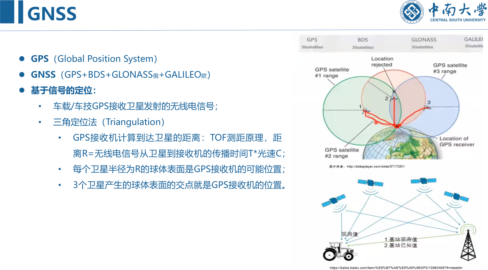
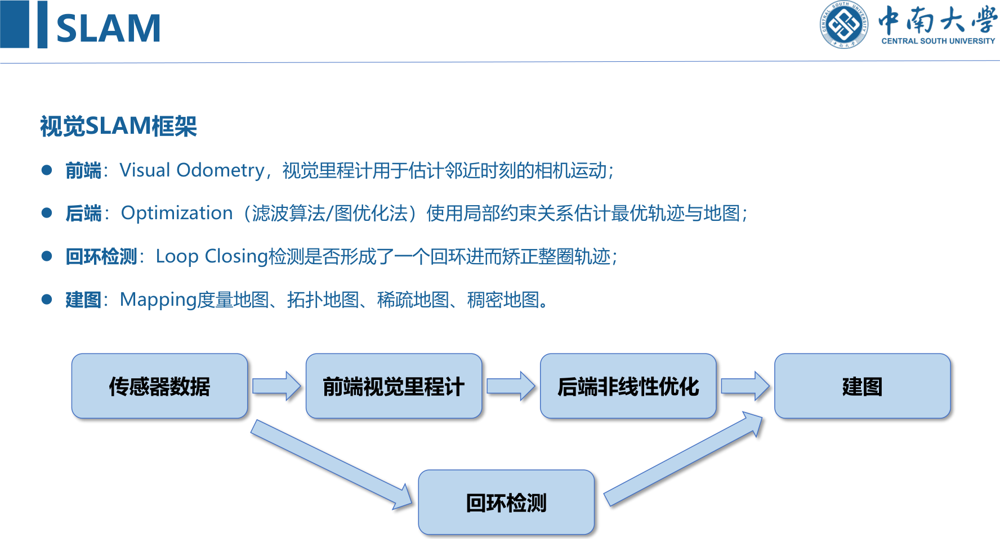
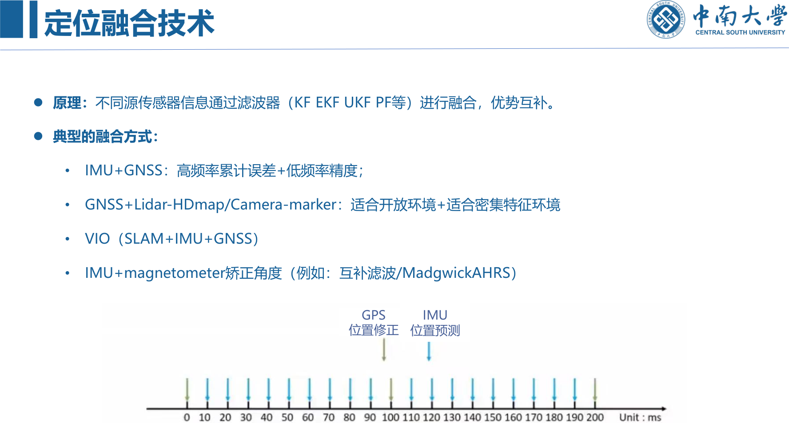
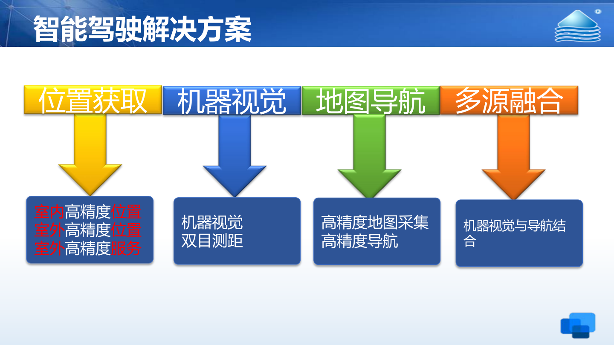

```cardlink
url: http://10.188.31.55:5244/Nextcloud/School/Auto-Drive-Intro/课件/
title: "智能驾驶导论 · 课件"
description: "中南大学《智能驾驶导论》课件，十一份 PDF，覆盖概述、感知、地图、定位、预测、控制与强化学习"
host: 10.188.31.55:5244
```

[← 返回《Auto-Drive-Intro》目录](../)

## 第 4 章 定位系统

### 定位系统原理

#### 定位在整个系统里的位置

定位回答的是「我在哪里」，它只有跟别的模块绑在一起才产生价值 [第四章 无人驾驶定位系统2.pdf · p.4](http://10.188.31.55:5244/Nextcloud/School/Auto-Drive-Intro/%E8%AF%BE%E4%BB%B6/%E7%AC%AC%E5%9B%9B%E7%AB%A0%20%E6%97%A0%E4%BA%BA%E9%A9%BE%E9%A9%B6%E5%AE%9A%E4%BD%8D%E7%B3%BB%E7%BB%9F2.pdf#page=4)：

- 定位 + 高精度地图：给出当前位置的静态环境感知，车道线、交通指示牌、红绿灯、建筑物都挂在这个位置上。
- 定位 + 动态物体感知：把感知到的动态物体正确放进静态环境，否则行人和车会飘在错误的路面上。
- 定位获取位姿：位置加姿态直接给路径规划和决策用。

三问框架把这件事讲得更省事：我在哪里是定位，这是什么地方是建图，我到哪里去是路径规划 [第6讲 地图与定位.pptx · p.3](http://10.188.31.55:5244/Nextcloud/School/Auto-Drive-Intro/%E3%80%8A%E6%99%BA%E8%83%BD%E9%A9%BE%E9%A9%B6%E5%AF%BC%E8%AE%BA%E3%80%8BPPT-2020/%E7%AC%AC6%E8%AE%B2%20%E5%9C%B0%E5%9B%BE%E4%B8%8E%E5%AE%9A%E4%BD%8D.pptx)。

#### 定位技术怎么分类

课件给了三套互相正交的分类方式，复习时对不上号多半是混了这三套 [第四章 无人驾驶定位系统2.pdf · p.5](http://10.188.31.55:5244/Nextcloud/School/Auto-Drive-Intro/%E8%AF%BE%E4%BB%B6/%E7%AC%AC%E5%9B%9B%E7%AB%A0%20%E6%97%A0%E4%BA%BA%E9%A9%BE%E9%A9%B6%E5%AE%9A%E4%BD%8D%E7%B3%BB%E7%BB%9F2.pdf#page=5)。

| 分类依据 | 取值 |
| --- | --- |
| 场景 | 室内（房间、仓库、车库）/ 室外 |
| 感应模式 | outside-in：接收的外界信号里含位置信息（GNSS、UWB、WiFi、Lidar-HDmap、Camera-marker）；inside-out：靠自身观察和感受获取位置（IMU、磁力计、SLAM、VR 墙面 marker） |
| 计算方法 | 基于信号（GNSS、UWB、WiFi、几何关系）；环境特征匹配（Lidar-HDmap、Camera-marker、Radar，需要建图，用观测特征与数据库特征匹配）；航迹推算（IMU odometry，用之前得到的位姿推当前位姿） |

定位系统的融合原理一句话：不同源的传感器信息通过滤波器（KF、EKF、UKF、PF 等）融合，优势互补 [第四章 无人驾驶定位系统2.pdf · p.6](http://10.188.31.55:5244/Nextcloud/School/Auto-Drive-Intro/%E8%AF%BE%E4%BB%B6/%E7%AC%AC%E5%9B%9B%E7%AB%A0%20%E6%97%A0%E4%BA%BA%E9%A9%BE%E9%A9%B6%E5%AE%9A%E4%BD%8D%E7%B3%BB%E7%BB%9F2.pdf#page=6)。四种典型组合要背下来，后面每种传感器的优缺点都挂在这四种组合上：IMU + GNSS 用高频率补累计误差、用低频率换绝对精度；GNSS + Lidar-HDmap 或 Camera-marker，前者适合开放环境、后者适合密集特征环境；VIO 是 SLAM + IMU + GNSS；IMU + 磁力计用互补滤波或 Madgwick AHRS 矫正角度。

#### GNSS：三角定位和它的三个软肋

GNSS 是 GPS 加北斗（BDS）、GLONASS、Galileo 的统称，接收机靠三角定位法（Triangulation）算位置 [第四章 无人驾驶定位系统2.pdf · p.8](http://10.188.31.55:5244/Nextcloud/School/Auto-Drive-Intro/%E8%AF%BE%E4%BB%B6/%E7%AC%AC%E5%9B%9B%E7%AB%A0%20%E6%97%A0%E4%BA%BA%E9%A9%BE%E9%A9%B6%E5%AE%9A%E4%BD%8D%E7%B3%BB%E7%BB%9F2.pdf#page=8)。测距用 TOF 原理，卫星到接收机的距离等于无线电信号的传播时间乘光速：

$$
R = T \cdot c
$$

每颗卫星画出一个半径为 $R$ 的球面，球面交点就是接收机位置，所以至少要 3 个卫星。



三个软肋，每个都有对应的补丁。

**软肋一：大气干扰让测距不准。** 无线电信号的传播时间受传播介质影响，云层稀薄程度、天气都会改变它。补丁是差分 GPS（RTK）：地面建基站，基站位置精确且同样收卫星信号，用它算出的位置和基站精确位置的差就是此刻的信号传播误差。车载接收机离基站 30 km 以内时，两者穿过的是同一片大气区、误差相似，可以用基站的误差去修正车载位置 [第四章 无人驾驶定位系统2.pdf · p.9](http://10.188.31.55:5244/Nextcloud/School/Auto-Drive-Intro/%E8%AF%BE%E4%BB%B6/%E7%AC%AC%E5%9B%9B%E7%AB%A0%20%E6%97%A0%E4%BA%BA%E9%A9%BE%E9%A9%B6%E5%AE%9A%E4%BD%8D%E7%B3%BB%E7%BB%9F2.pdf#page=9)。

**软肋二：遮挡和反射。** 高楼周围会失去某个方向上的所有卫星信号，只剩特定方向的信号，精度下降；信号被楼体反射后再被收到就是多路径信号，多路径算出的距离明显大于实际距离，而接收机很难判断自己收到的是不是多路径 [第四章 无人驾驶定位系统2.pdf · p.10](http://10.188.31.55:5244/Nextcloud/School/Auto-Drive-Intro/%E8%AF%BE%E4%BB%B6/%E7%AC%AC%E5%9B%9B%E7%AB%A0%20%E6%97%A0%E4%BA%BA%E9%A9%BE%E9%A9%B6%E5%AE%9A%E4%BD%8D%E7%B3%BB%E7%BB%9F2.pdf#page=10)。补丁是承认单靠 GPS 难以在复杂场景精确定位，必须引入互补传感器做融合。

**软肋三：频率低。** GPS 定位频率一般只有 10 Hz，车速 72 km/h 时一个定位周期车已经走了 2 m，弯道里每 2 m 才控一次方向，车会沿弯道一会儿偏左一会儿偏右。补丁是引入 IMU 之类的高频传感器提高定位频率，从而提高控制频率 [第四章 无人驾驶定位系统2.pdf · p.10](http://10.188.31.55:5244/Nextcloud/School/Auto-Drive-Intro/%E8%AF%BE%E4%BB%B6/%E7%AC%AC%E5%9B%9B%E7%AB%A0%20%E6%97%A0%E4%BA%BA%E9%A9%BE%E9%A9%B6%E5%AE%9A%E4%BD%8D%E7%B3%BB%E7%BB%9F2.pdf#page=10)。

代价清单：优点是全球、全天候、全时段、高精度。缺点有五条，RTK 基站布设成本高、依赖可视卫星数量、易受电磁环境干扰、定位频率不够高、遮挡与反射带来的多径效应 [第四章 无人驾驶定位系统2.pdf · p.11](http://10.188.31.55:5244/Nextcloud/School/Auto-Drive-Intro/%E8%AF%BE%E4%BB%B6/%E7%AC%AC%E5%9B%9B%E7%AB%A0%20%E6%97%A0%E4%BA%BA%E9%A9%BE%E9%A9%B6%E5%AE%9A%E4%BD%8D%E7%B3%BB%E7%BB%9F2.pdf#page=11)。

#### 惯导：IMU 与捷联系统

惯导是不依赖任何外部信息、也不向外部辐射能量的自主式导航系统，隐蔽性好，能在空中、地面、水下各种复杂环境工作 [第四章 无人驾驶定位系统2.pdf · p.12](http://10.188.31.55:5244/Nextcloud/School/Auto-Drive-Intro/%E8%AF%BE%E4%BB%B6/%E7%AC%AC%E5%9B%9B%E7%AB%A0%20%E6%97%A0%E4%BA%BA%E9%A9%BE%E9%A9%B6%E5%AE%9A%E4%BD%8D%E7%B3%BB%E7%BB%9F2.pdf#page=12)。分平台式和捷联式两类。捷联惯导系统（SINS）是平台式的进一步发展，没有物理平台也没有数字平台，靠计算做姿态变换，结构简单、体积小、重量轻、成本低、维护简单、可靠性高。「捷联」就是捆绑的意思：把惯性敏感元件（陀螺和加速度计）直接捆在运载体机体上完成制导和导航。陀螺测角速度，加速度计测线速度，解算后得到载体的速度、位置、姿态。

IMU（惯性测量单元）主要由陀螺仪和加速度计组成，分消费级（精度低、价格低）和光线 IMU（精度高、价格高）。加速度计测的是载体相对惯性空间所受的力，陀螺仪测的是沿自身轴向的旋转角速度。IMU 是惯性导航系统的基础，直接决定惯导能达到的精度 [第四章 无人驾驶定位系统2.pdf · p.13](http://10.188.31.55:5244/Nextcloud/School/Auto-Drive-Intro/%E8%AF%BE%E4%BB%B6/%E7%AC%AC%E5%9B%9B%E7%AB%A0%20%E6%97%A0%E4%BA%BA%E9%A9%BE%E9%A9%B6%E5%AE%9A%E4%BD%8D%E7%B3%BB%E7%BB%9F2.pdf#page=13)。

辅助课件给了选型用的分级口径 [第6讲 地图与定位.pptx · p.16](http://10.188.31.55:5244/Nextcloud/School/Auto-Drive-Intro/%E3%80%8A%E6%99%BA%E8%83%BD%E9%A9%BE%E9%A9%B6%E5%AF%BC%E8%AE%BA%E3%80%8BPPT-2020/%E7%AC%AC6%E8%AE%B2%20%E5%9C%B0%E5%9B%BE%E4%B8%8E%E5%AE%9A%E4%BD%8D.pptx)：消费级精度低、用在智能终端，0.5 到 10 美元；中级是 IMU + GPS、用在汽车，几百到上千美元；高级高精度、用在导弹和光学瞄准系统，几十万美元。MEMS 六轴惯性传感器是三个轴的加速度传感器加三个轴的陀螺仪。陀螺仪有机械式、激光式、MEMS 式，精度可到 0.01 度，采样率 200 Hz 到 1 kHz [第6讲 地图与定位.pptx · p.17](http://10.188.31.55:5244/Nextcloud/School/Auto-Drive-Intro/%E3%80%8A%E6%99%BA%E8%83%BD%E9%A9%BE%E9%A9%B6%E5%AF%BC%E8%AE%BA%E3%80%8BPPT-2020/%E7%AC%AC6%E8%AE%B2%20%E5%9C%B0%E5%9B%BE%E4%B8%8E%E5%AE%9A%E4%BD%8D.pptx)。加速度计的原理是重物通过弹簧固定在框架上，感知加速度时重物发生相对运动，测这种运动转成电信号；为了得到实际加速度还要减掉重力加速度，精度较低，约 0.1 m/s² [第6讲 地图与定位.pptx · p.18](http://10.188.31.55:5244/Nextcloud/School/Auto-Drive-Intro/%E3%80%8A%E6%99%BA%E8%83%BD%E9%A9%BE%E9%A9%B6%E5%AF%BC%E8%AE%BA%E3%80%8BPPT-2020/%E7%AC%AC6%E8%AE%B2%20%E5%9C%B0%E5%9B%BE%E4%B8%8E%E5%AE%9A%E4%BD%8D.pptx)。

IMU 的三类误差决定它能撑多久 [第6讲 地图与定位.pptx · p.19](http://10.188.31.55:5244/Nextcloud/School/Auto-Drive-Intro/%E3%80%8A%E6%99%BA%E8%83%BD%E9%A9%BE%E9%A9%B6%E5%AF%BC%E8%AE%BA%E3%80%8BPPT-2020/%E7%AC%AC6%E8%AE%B2%20%E5%9C%B0%E5%9B%BE%E4%B8%8E%E5%AE%9A%E4%BD%8D.pptx)：

- 偏移误差：陀螺仪和加速度计即使没有旋转或加速也有非零输出。加速度计输出做两次积分得到位移，很小的偏移误差会被放大，时间一长位移误差不断积累，最后没法再跟踪车的位置。
- 比例误差：测量输出和被检测输入变化之间的比率不对，造成的位移误差同样随时间积累。
- 白噪声：随机噪声，直接体现在输出抖动上。

所以 IMU 的优点是输出频率高、短时精度高、六自由度、可工作于任何复杂环境，缺点只有一个：误差会随时间积累 [第四章 无人驾驶定位系统2.pdf · p.14](http://10.188.31.55:5244/Nextcloud/School/Auto-Drive-Intro/%E8%AF%BE%E4%BB%B6/%E7%AC%AC%E5%9B%9B%E7%AB%A0%20%E6%97%A0%E4%BA%BA%E9%A9%BE%E9%A9%B6%E5%AE%9A%E4%BD%8D%E7%B3%BB%E7%BB%9F2.pdf#page=14)。高频率与短时准是靠 GNSS 来补的，反过来 GNSS 的低频与遮挡是靠 IMU 来补，这就是 IMU + GNSS 组合导航的由来。

#### 环境特征匹配：Lidar-HDmap 与 Camera-marker

Lidar-HDmap 的做法是预先制作 3D 或 2D 的定位地图，车上实时点云与地图匹配计算激光雷达位姿 [第四章 无人驾驶定位系统2.pdf · p.15](http://10.188.31.55:5244/Nextcloud/School/Auto-Drive-Intro/%E8%AF%BE%E4%BB%B6/%E7%AC%AC%E5%9B%9B%E7%AB%A0%20%E6%97%A0%E4%BA%BA%E9%A9%BE%E9%A9%B6%E5%AE%9A%E4%BD%8D%E7%B3%BB%E7%BB%9F2.pdf#page=15)。配准的两条路线：基于 3D 点云匹配的 Scan Matching，以及 ICP（迭代最近点法，最常见，基于当前扫描与目标扫描的距离度量完成配准）和 NDT（基于点云特征直方图配准）。

特点：鲁棒性较好、没有 GPS 也能工作、能做到 10 cm 以内精度；缺点是要预先制作地图并定期更新，雨雪天气 Lidar 被折射导致收到的点云变少，开放路段点云少仍然需要 GNSS [第四章 无人驾驶定位系统2.pdf · p.16](http://10.188.31.55:5244/Nextcloud/School/Auto-Drive-Intro/%E8%AF%BE%E4%BB%B6/%E7%AC%AC%E5%9B%9B%E7%AB%A0%20%E6%97%A0%E4%BA%BA%E9%A9%BE%E9%A9%B6%E5%AE%9A%E4%BD%8D%E7%B3%BB%E7%BB%9F2.pdf#page=16)。

Camera-marker 是街景定位，Waymo 用谷歌的街景数据标注出路牌号码、商店标志、红绿灯等静态数据来确定自己车在哪 [第四章 无人驾驶定位系统2.pdf · p.17](http://10.188.31.55:5244/Nextcloud/School/Auto-Drive-Intro/%E8%AF%BE%E4%BB%B6/%E7%AC%AC%E5%9B%9B%E7%AB%A0%20%E6%97%A0%E4%BA%BA%E9%A9%BE%E9%A9%B6%E5%AE%9A%E4%BD%8D%E7%B3%BB%E7%BB%9F2.pdf#page=17)。原理是预先标出这些 marker 的全球坐标系，车载相机检测出 marker 后通过透视原理或相对距离推算自身全球坐标。优点是简单直接，街景地图标好后车端只需要相机就能实现精准定位和导航；缺点是数据量巨大且要人工标注，强光弱光逆光都会影响检测结果进而影响位置准确性，基于图像算深度图有误差（越远误差越大），开放场景如高速公路上 marker 少甚至没有 [第四章 无人驾驶定位系统2.pdf · p.18](http://10.188.31.55:5244/Nextcloud/School/Auto-Drive-Intro/%E8%AF%BE%E4%BB%B6/%E7%AC%AC%E5%9B%9B%E7%AB%A0%20%E6%97%A0%E4%BA%BA%E9%A9%BE%E9%A9%B6%E5%AE%9A%E4%BD%8D%E7%B3%BB%E7%BB%9F2.pdf#page=18)。

#### SLAM

SLAM 是 Simultaneous Localization and Mapping，同时定位和建图。定位可用于室内和室外，建图可以是稀疏、半稠密、稠密。关键在于这对矛盾：准确的定位需要精确的地图，精确的地图来自准确的定位 [第四章 无人驾驶定位系统2.pdf · p.19](http://10.188.31.55:5244/Nextcloud/School/Auto-Drive-Intro/%E8%AF%BE%E4%BB%B6/%E7%AC%AC%E5%9B%9B%E7%AB%A0%20%E6%97%A0%E4%BA%BA%E9%A9%BE%E9%A9%B6%E5%AE%9A%E4%BD%8D%E7%B3%BB%E7%BB%9F2.pdf#page=19)。类型有激光 SLAM、视觉 SLAM（单目、双目、RGB-D）、VIO（IMU + SLAM），主要应用方向是机器人定位、手持设备定位和自动驾驶定位。

视觉 SLAM 的框架是四个模块 [第四章 无人驾驶定位系统2.pdf · p.20](http://10.188.31.55:5244/Nextcloud/School/Auto-Drive-Intro/%E8%AF%BE%E4%BB%B6/%E7%AC%AC%E5%9B%9B%E7%AB%A0%20%E6%97%A0%E4%BA%BA%E9%A9%BE%E9%A9%B6%E5%AE%9A%E4%BD%8D%E7%B3%BB%E7%BB%9F2.pdf#page=20)：前端是视觉里程计（Visual Odometry），估计邻近时刻的相机运动；后端是优化（滤波算法或图优化法），用局部约束关系估计最优轨迹与地图；回环检测（Loop Closing）判断是否形成回环并矫正整圈轨迹；建图产出度量地图、拓扑地图、稀疏地图或稠密地图。



辅助课件补上了求解手段的谱系 [第6讲 地图与定位.pptx · p.22](http://10.188.31.55:5244/Nextcloud/School/Auto-Drive-Intro/%E3%80%8A%E6%99%BA%E8%83%BD%E9%A9%BE%E9%A9%B6%E5%AF%BC%E8%AE%BA%E3%80%8BPPT-2020/%E7%AC%AC6%E8%AE%B2%20%E5%9C%B0%E5%9B%BE%E4%B8%8E%E5%AE%9A%E4%BD%8D.pptx)：贝叶斯滤波（高斯滤波 EKF/UKF、粒子滤波）、优化方法（线性方法、非线性最小二乘、松弛）。课件把这一整块称作自主机器人研究的圣杯。SLAM 系统的标准表述是：机器人从未知位置出发，在运动中根据自身位姿估计和传感器感知构建增量式地图，同时用地图更新自己的定位，用动态贝叶斯网络建模 [第6讲 地图与定位.pptx · p.21](http://10.188.31.55:5244/Nextcloud/School/Auto-Drive-Intro/%E3%80%8A%E6%99%BA%E8%83%BD%E9%A9%BE%E9%A9%B6%E5%AF%BC%E8%AE%BA%E3%80%8BPPT-2020/%E7%AC%AC6%E8%AE%B2%20%E5%9C%B0%E5%9B%BE%E4%B8%8E%E5%AE%9A%E4%BD%8D.pptx)。

#### 融合：直方图滤波的直观推导

直方图滤波是把状态空间离散成格子、用一串格子上的概率分布表示位姿不确定性的做法。课件的推导按四步走 [第四章 无人驾驶定位系统2.pdf · p.23](http://10.188.31.55:5244/Nextcloud/School/Auto-Drive-Intro/%E8%AF%BE%E4%BB%B6/%E7%AC%AC%E5%9B%9B%E7%AB%A0%20%E6%97%A0%E4%BA%BA%E9%A9%BE%E9%A9%B6%E5%AE%9A%E4%BD%8D%E7%B3%BB%E7%BB%9F2.pdf#page=23)：

1. 初始位置 $x_1$：完全不知道自己在哪，概率分布是均匀的，任何位置的概率都相等。
2. 观测更新：向右移动一步后，发现自己在红色格子里，把红格概率乘 0.6、绿格概率乘 0.2，再归一化成概率分布。写成通式就是一次带权重的归一化：

$$
p_i' = \frac{p_i \, z_i}{\sum_j p_j \, z_j}
$$

3. 移动更新：设计一个 move 函数，输入概率分布 $p$ 和移动步数 $u$（-1 向左一格，2 向右两格），输出移动后的概率分布 [第四章 无人驾驶定位系统2.pdf · p.24](http://10.188.31.55:5244/Nextcloud/School/Auto-Drive-Intro/%E8%AF%BE%E4%BB%B6/%E7%AC%AC%E5%9B%9B%E7%AB%A0%20%E6%97%A0%E4%BA%BA%E9%A9%BE%E9%A9%B6%E5%AE%9A%E4%BD%8D%E7%B3%BB%E7%BB%9F2.pdf#page=24)。实际移动不可能精确，所以 $p = [0\ 1\ 0\ 0\ 0]$ 向右走两步会摊成 $p = [0.01\ 0.01\ 0.16\ 0.66\ 0.16]$，再走一千步就回到 $[0.2\ 0.2\ 0.2\ 0.2\ 0.2]$，也就是完全不确定 [第四章 无人驾驶定位系统2.pdf · p.25](http://10.188.31.55:5244/Nextcloud/School/Auto-Drive-Intro/%E8%AF%BE%E4%BB%B6/%E7%AC%AC%E5%9B%9B%E7%AB%A0%20%E6%97%A0%E4%BA%BA%E9%A9%BE%E9%A9%B6%E5%AE%9A%E4%BD%8D%E7%B3%BB%E7%BB%9F2.pdf#page=25) [第四章 无人驾驶定位系统2.pdf · p.26](http://10.188.31.55:5244/Nextcloud/School/Auto-Drive-Intro/%E8%AF%BE%E4%BB%B6/%E7%AC%AC%E5%9B%9B%E7%AB%A0%20%E6%97%A0%E4%BA%BA%E9%A9%BE%E9%A9%B6%E5%AE%9A%E4%BD%8D%E7%B3%BB%E7%BB%9F2.pdf#page=26)。

结论只有一句：每次移动丢失信息，每次观测增加信息。光靠里程计推，走得越久越糊涂。



组合导航的正式说法在辅助课件里：GPS 定位相对精准但更新频率低，惯性传感器的定位误差随时间累积但更新频率高，短时间能提供稳定的实时位置更新，两者用基于卡尔曼滤波的方法融合 [第6讲 地图与定位.pptx · p.20](http://10.188.31.55:5244/Nextcloud/School/Auto-Drive-Intro/%E3%80%8A%E6%99%BA%E8%83%BD%E9%A9%BE%E9%A9%B6%E5%AF%BC%E8%AE%BA%E3%80%8BPPT-2020/%E7%AC%AC6%E8%AE%B2%20%E5%9C%B0%E5%9B%BE%E4%B8%8E%E5%AE%9A%E4%BD%8D.pptx)。

#### Apollo 定位方案

Apollo 这一节参考的是论文《Robust and Precise Vehicle Localization based on Multisensor Fusion in Diverse City Scenes》 [第四章 无人驾驶定位系统2.pdf · p.28](http://10.188.31.55:5244/Nextcloud/School/Auto-Drive-Intro/%E8%AF%BE%E4%BB%B6/%E7%AC%AC%E5%9B%9B%E7%AB%A0%20%E6%97%A0%E4%BA%BA%E9%A9%BE%E9%A9%B6%E5%AE%9A%E4%BD%8D%E7%B3%BB%E7%BB%9F2.pdf#page=28)。激光点云定位的算法框架是：融合定位给出预测姿态，与 LiDAR 点云一起进图像对齐，投影后点云送 SSD-HF（INTENSITY、ALTITUDE、FUSION）做 $(x, y)$ 计算与航向角（yaw）优化，输出 $(x, y, z, \mathrm{yaw})$ 和协方差矩阵，再回灌融合定位；定位地图同时供给图像对齐和 SSD-HF 两个环节 [第四章 无人驾驶定位系统2.pdf · p.30](http://10.188.31.55:5244/Nextcloud/School/Auto-Drive-Intro/%E8%AF%BE%E4%BB%B6/%E7%AC%AC%E5%9B%9B%E7%AB%A0%20%E6%97%A0%E4%BA%BA%E9%A9%BE%E9%A9%B6%E5%AE%9A%E4%BD%8D%E7%B3%BB%E7%BB%9F2.pdf#page=30)。

其中的二维直方图滤波是这样做的：滤波器中心放在预测姿态 $(x_0, y_0)$，一般选 $21 \times 21 = 441$ 个位置做搜索 [第四章 无人驾驶定位系统2.pdf · p.30](http://10.188.31.55:5244/Nextcloud/School/Auto-Drive-Intro/%E8%AF%BE%E4%BB%B6/%E7%AC%AC%E5%9B%9B%E7%AB%A0%20%E6%97%A0%E4%BA%BA%E9%A9%BE%E9%A9%B6%E5%AE%9A%E4%BD%8D%E7%B3%BB%E7%BB%9F2.pdf#page=30)。这也是直方图滤波思想在工程上的落地：不用一个连续位姿去搜，而是在预测位姿周围铺网格，每个格子带概率。

### 汽车智能驾驶定位解决方案

#### 量产方案：北斗产业链与室内外高精度定位

另一份主参考是一份厂商的智能驾驶定位解决方案，内容比课件更接近落地。

**产业链。** 北斗从 60 年代的地基导航系统，到 80 年代的子午仪等天基导航系统，90 年代的北斗、GPS、GLONASS 地基导航系统并存，再到 21 世纪产业资本双轮驱动、全产业链布局 [第四章-汽车智能驾驶定位解决方案.pdf · p.1](http://10.188.31.55:5244/Nextcloud/School/Auto-Drive-Intro/%E8%AF%BE%E4%BB%B6/%E7%AC%AC%E5%9B%9B%E7%AB%A0-%E6%B1%BD%E8%BD%A6%E6%99%BA%E8%83%BD%E9%A9%BE%E9%A9%B6%E5%AE%9A%E4%BD%8D%E8%A7%A3%E5%86%B3%E6%96%B9%E6%A1%88.pdf#page=1)。产业链局按系统、芯片、天线、模块、整机分层，芯片端由广州润芯等公司供应 [第四章-汽车智能驾驶定位解决方案.pdf · p.2](http://10.188.31.55:5244/Nextcloud/School/Auto-Drive-Intro/%E8%AF%BE%E4%BB%B6/%E7%AC%AC%E5%9B%9B%E7%AB%A0-%E6%B1%BD%E8%BD%A6%E6%99%BA%E8%83%BD%E9%A9%BE%E9%A9%B6%E5%AE%9A%E4%BD%8D%E8%A7%A3%E5%86%B3%E6%96%B9%E6%A1%88.pdf#page=2)。

**整体方案分四块。** 位置获取、机器视觉、地图导航、多源融合，分别往下接室内外高精度位置与室外高精度服务、机器视觉与双目测距、高精度地图采集与高精度导航、机器视觉与导航结合 [第四章-汽车智能驾驶定位解决方案.pdf · p.3](http://10.188.31.55:5244/Nextcloud/School/Auto-Drive-Intro/%E8%AF%BE%E4%BB%B6/%E7%AC%AC%E5%9B%9B%E7%AB%A0-%E6%B1%BD%E8%BD%A6%E6%99%BA%E8%83%BD%E9%A9%BE%E9%A9%B6%E5%AE%9A%E4%BD%8D%E8%A7%A3%E5%86%B3%E6%96%B9%E6%A1%88.pdf#page=3)。



**室外高精度服务。** 广州全域提供高精度服务，一个账号走遍广州，还能帮客户完成测试场建设并最终落地 CORS 站建设。两项关键技术：基础建设加网络冗余保证 99.99% 可用性，远高于行业标准的 95%；用网络专线加服务器的 DPDK 技术实现低延时高并发 [第四章-汽车智能驾驶定位解决方案.pdf · p.5](http://10.188.31.55:5244/Nextcloud/School/Auto-Drive-Intro/%E8%AF%BE%E4%BB%B6/%E7%AC%AC%E5%9B%9B%E7%AB%A0-%E6%B1%BD%E8%BD%A6%E6%99%BA%E8%83%BD%E9%A9%BE%E9%A9%B6%E5%AE%9A%E4%BD%8D%E8%A7%A3%E5%86%B3%E6%96%B9%E6%A1%88.pdf#page=5)。

**位置获取的指标。** 支持频点 BD B3、BD B1、GPS L1、GPS L2；灵敏度北斗捕获 -145 dBm、跟踪 -160 dBm，GPS 捕获 -147 dBm、跟踪 -160 dBm；载波精度（RMS）GPS L1 与 L2 各 1 mm，北斗 B1 与 B3 各 1 mm；RTK 精度 10 mm + 1 mm × 10⁻³ ppm；定向精度（RMS）0.2 度 / 1 米基线；测速精度（RMS）0.03 m/s；姿态误差小于 0.3 度；车速 12 km/h 下，1 分钟的方向误差小于 0.28 度、2 分钟的位置误差小于 2.2 m [第四章-汽车智能驾驶定位解决方案.pdf · p.6](http://10.188.31.55:5244/Nextcloud/School/Auto-Drive-Intro/%E8%AF%BE%E4%BB%B6/%E7%AC%AC%E5%9B%9B%E7%AB%A0-%E6%B1%BD%E8%BD%A6%E6%99%BA%E8%83%BD%E9%A9%BE%E9%A9%B6%E5%AE%9A%E4%BD%8D%E8%A7%A3%E5%86%B3%E6%96%B9%E6%A1%88.pdf#page=6)。

解算结果的构成比单点精度更能说明工程状态：某次两圈测试里输出频度都是 1 Hz，采样 848 和 841 点，固定解比例 91.2% 和 93.8%，浮点解比例都是 0.1%，伪距差分比例 6.1% 和 5.0%，单点解比例 2.6% 和 1.1% [第四章-汽车智能驾驶定位解决方案.pdf · p.7](http://10.188.31.55:5244/Nextcloud/School/Auto-Drive-Intro/%E8%AF%BE%E4%BB%B6/%E7%AC%AC%E5%9B%9B%E7%AB%A0-%E6%B1%BD%E8%BD%A6%E6%99%BA%E8%83%BD%E9%A9%BE%E9%A9%B6%E5%AE%9A%E4%BD%8D%E8%A7%A3%E5%86%B3%E6%96%B9%E6%A1%88.pdf#page=7)。固定解占九成以上，说明 RTK 基站网在城区基本可用。

**硬件与惯导。** 四频定位定向板卡是广州海格通信用自主知识产权做的，在多路径导航信号、树荫遮挡、半边天遮挡等恶劣环境下提供稳定的高精度位置服务 [第四章-汽车智能驾驶定位解决方案.pdf · p.8](http://10.188.31.55:5244/Nextcloud/School/Auto-Drive-Intro/%E8%AF%BE%E4%BB%B6/%E7%AC%AC%E5%9B%9B%E7%AB%A0-%E6%B1%BD%E8%BD%A6%E6%99%BA%E8%83%BD%E9%A9%BE%E9%A9%B6%E5%AE%9A%E4%BD%8D%E8%A7%A3%E5%86%B3%E6%96%B9%E6%A1%88.pdf#page=8)。射频芯片是 RX3902，三通道覆盖北斗、GPS、GLONASS、伽利略的所有频点，三通道同时工作电流约 140 mA（1.8~3.3 V），中频低通滤波器带宽支持 10/20/30/40 MHz 可选，7 mm × 7 mm QFN68 封装，是首款支持所有导航频点的三通道射频芯片 [第四章-汽车智能驾驶定位解决方案.pdf · p.9](http://10.188.31.55:5244/Nextcloud/School/Auto-Drive-Intro/%E8%AF%BE%E4%BB%B6/%E7%AC%AC%E5%9B%9B%E7%AB%A0-%E6%B1%BD%E8%BD%A6%E6%99%BA%E8%83%BD%E9%A9%BE%E9%A9%B6%E5%AE%9A%E4%BD%8D%E8%A7%A3%E5%86%B3%E6%96%B9%E6%A1%88.pdf#page=9)。惯导模块 INS550 系列定位为车载通用惯性和组合导航产品，与汽车 OBD、卫导深度融合 [第四章-汽车智能驾驶定位解决方案.pdf · p.10](http://10.188.31.55:5244/Nextcloud/School/Auto-Drive-Intro/%E8%AF%BE%E4%BB%B6/%E7%AC%AC%E5%9B%9B%E7%AB%A0-%E6%B1%BD%E8%BD%A6%E6%99%BA%E8%83%BD%E9%A9%BE%E9%A9%B6%E5%AE%9A%E4%BD%8D%E8%A7%A3%E5%86%B3%E6%96%B9%E6%A1%88.pdf#page=10)。方案给出的实测是：在室外失去卫导信号 10 到 20 分钟的跑车效果，轨迹仍能维持，但已经能看到可见的漂移 [第四章-汽车智能驾驶定位解决方案.pdf · p.12](http://10.188.31.55:5244/Nextcloud/School/Auto-Drive-Intro/%E8%AF%BE%E4%BB%B6/%E7%AC%AC%E5%9B%9B%E7%AB%A0-%E6%B1%BD%E8%BD%A6%E6%99%BA%E8%83%BD%E9%A9%BE%E9%A9%B6%E5%AE%9A%E4%BD%8D%E8%A7%A3%E5%86%B3%E6%96%B9%E6%A1%88.pdf#page=12)。这就是 IMU 误差随时间积累的量化版本。

**室内高精度定位用 UWB。** 主动定位的 UWB 室内系统，吸顶型基站配定位标签，在 60 m × 60 m 空间提供最高 20 cm 精度；标签 YG-TAG201 装在物体或人员上，实时把位置经基站上报定位引擎，引擎给出实时精确坐标。无遮挡时定位精度 20 cm（RMS），刷新率可调、$\leq 10$ Hz，区域内标签数量不受限制，首次定位时间 $\leq 10$ ms，室内外坐标系统一 [第四章-汽车智能驾驶定位解决方案.pdf · p.14](http://10.188.31.55:5244/Nextcloud/School/Auto-Drive-Intro/%E8%AF%BE%E4%BB%B6/%E7%AC%AC%E5%9B%9B%E7%AB%A0-%E6%B1%BD%E8%BD%A6%E6%99%BA%E8%83%BD%E9%A9%BE%E9%A9%B6%E5%AE%9A%E4%BD%8D%E8%A7%A3%E5%86%B3%E6%96%B9%E6%A1%88.pdf#page=14)。上层是高精度室内地图导航：室内外地图自由切换、室内外整体规划与引导，为车辆自动入库停车和寻车提供稳定连续的定位引导 [第四章-汽车智能驾驶定位解决方案.pdf · p.15](http://10.188.31.55:5244/Nextcloud/School/Auto-Drive-Intro/%E8%AF%BE%E4%BB%B6/%E7%AC%AC%E5%9B%9B%E7%AB%A0-%E6%B1%BD%E8%BD%A6%E6%99%BA%E8%83%BD%E9%A9%BE%E9%A9%B6%E5%AE%9A%E4%BD%8D%E8%A7%A3%E5%86%B3%E6%96%B9%E6%A1%88.pdf#page=15)。

**机器视觉这一块。** 相机用 hi35 系列芯片的单目或双目，宽动态好，适应强光、阴天和明暗反差 [第四章-汽车智能驾驶定位解决方案.pdf · p.18](http://10.188.31.55:5244/Nextcloud/School/Auto-Drive-Intro/%E8%AF%BE%E4%BB%B6/%E7%AC%AC%E5%9B%9B%E7%AB%A0-%E6%B1%BD%E8%BD%A6%E6%99%BA%E8%83%BD%E9%A9%BE%E9%A9%B6%E5%AE%9A%E4%BD%8D%E8%A7%A3%E5%86%B3%E6%96%B9%E6%A1%88.pdf#page=18)。识别任务分五类：车道偏离预警（识别车道线位置、颜色、虚实属性，识别车道线到两侧车轮的水平距离，据此做车道偏离预警，识别减速线，识别同向车道数量和当前车道序号以提供定位辅助）、红绿灯识别（横向竖向、箭头圆形、带倒计时的灯，结合路口转向要求锁定目标灯并跟踪状态）、交通标识识别（最高限速牌与路面限速数字、解除最高限速标识、路面箭头类型）、车辆识别（区分货车卡车轿车，计算与相机的距离并跟踪，按距离变化趋势预警碰撞）、行人识别（正前方、侧前方行人、骑车人并跟踪） [第四章-汽车智能驾驶定位解决方案.pdf · p.19](http://10.188.31.55:5244/Nextcloud/School/Auto-Drive-Intro/%E8%AF%BE%E4%BB%B6/%E7%AC%AC%E5%9B%9B%E7%AB%A0-%E6%B1%BD%E8%BD%A6%E6%99%BA%E8%83%BD%E9%A9%BE%E9%A9%B6%E5%AE%9A%E4%BD%8D%E8%A7%A3%E5%86%B3%E6%96%B9%E6%A1%88.pdf#page=19)。AR 实景导航把车道线、车道方向、行车道测距、限速标志、红绿灯、汽车行人的识别结果与高精度定位、高精度地图融合，输出实景 AR 引导 [第四章-汽车智能驾驶定位解决方案.pdf · p.16](http://10.188.31.55:5244/Nextcloud/School/Auto-Drive-Intro/%E8%AF%BE%E4%BB%B6/%E7%AC%AC%E5%9B%9B%E7%AB%A0-%E6%B1%BD%E8%BD%A6%E6%99%BA%E8%83%BD%E9%A9%BE%E9%A9%B6%E5%AE%9A%E4%BD%8D%E8%A7%A3%E5%86%B3%E6%96%B9%E6%A1%88.pdf#page=16)。

**导航地图与多源融合。** 高精度导航数据格式把车道信息、规制信息、引导信息、道路设施显示信息统一设计，兼容智能辅助驾驶、自动驾驶、手机高精度引导和室内车辆行人引导；配套 2D/3D 融合引擎，3D 引擎显示车道、道路设施和道路显示形态并与 2D 地图融合；车道规划按车道做道路规划与引导，严格依据高精度定位与高精度地图匹配 [第四章-汽车智能驾驶定位解决方案.pdf · p.20](http://10.188.31.55:5244/Nextcloud/School/Auto-Drive-Intro/%E8%AF%BE%E4%BB%B6/%E7%AC%AC%E5%9B%9B%E7%AB%A0-%E6%B1%BD%E8%BD%A6%E6%99%BA%E8%83%BD%E9%A9%BE%E9%A9%B6%E5%AE%9A%E4%BD%8D%E8%A7%A3%E5%86%B3%E6%96%B9%E6%A1%88.pdf#page=20)。高精度地图的采集流程是无人机航拍、点云数据处理、室内采集作业，高精度室外导航地图与高精度室内定位和室内地图融合，从显示、规划、引导等融合算法计算，实现停车场车位导航等场景 [第四章-汽车智能驾驶定位解决方案.pdf · p.22](http://10.188.31.55:5244/Nextcloud/School/Auto-Drive-Intro/%E8%AF%BE%E4%BB%B6/%E7%AC%AC%E5%9B%9B%E7%AB%A0-%E6%B1%BD%E8%BD%A6%E6%99%BA%E8%83%BD%E9%A9%BE%E9%A9%B6%E5%AE%9A%E4%BD%8D%E8%A7%A3%E5%86%B3%E6%96%B9%E6%A1%88.pdf#page=22)。

最后一块是多源融合，数据流的顺序是：机器视觉做特定物体识别 → 地图匹配 → 位置获得 → 位置较准 → 惯导卫导校准 [第四章-汽车智能驾驶定位解决方案.pdf · p.25](http://10.188.31.55:5244/Nextcloud/School/Auto-Drive-Intro/%E8%AF%BE%E4%BB%B6/%E7%AC%AC%E5%9B%9B%E7%AB%A0-%E6%B1%BD%E8%BD%A6%E6%99%BA%E8%83%BD%E9%A9%BE%E9%A9%B6%E5%AE%9A%E4%BD%8D%E8%A7%A3%E5%86%B3%E6%96%B9%E6%A1%88.pdf#page=25)。这套流程和课件的融合原理是同一件事：视觉给相对准确的特征匹配，惯导给高频连续输出，卫导给全局绝对锚点，三者互补。这条路线已经落到量产合作上，小鹏汽车用室内外高精度定位与融合惯导方案为决策系统提供高精度定位与引导服务 [第四章-汽车智能驾驶定位解决方案.pdf · p.26](http://10.188.31.55:5244/Nextcloud/School/Auto-Drive-Intro/%E8%AF%BE%E4%BB%B6/%E7%AC%AC%E5%9B%9B%E7%AB%A0-%E6%B1%BD%E8%BD%A6%E6%99%BA%E8%83%BD%E9%A9%BE%E9%A9%B6%E5%AE%9A%E4%BD%8D%E8%A7%A3%E5%86%B3%E6%96%B9%E6%A1%88.pdf#page=26)。
