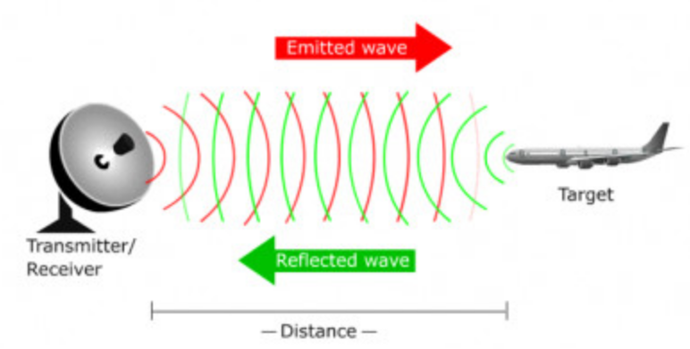
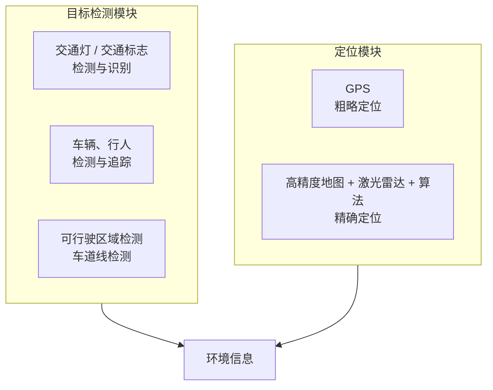
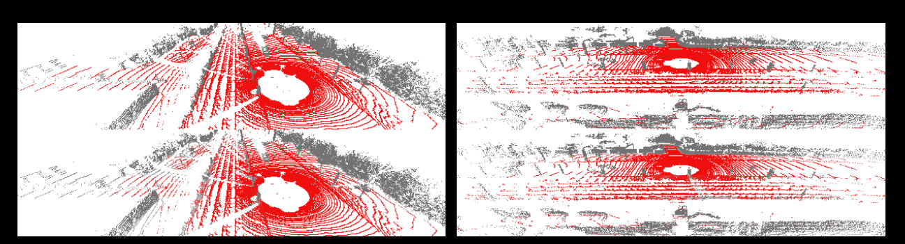
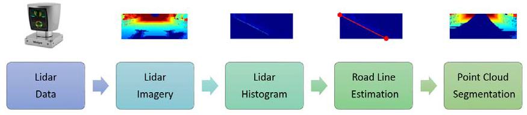
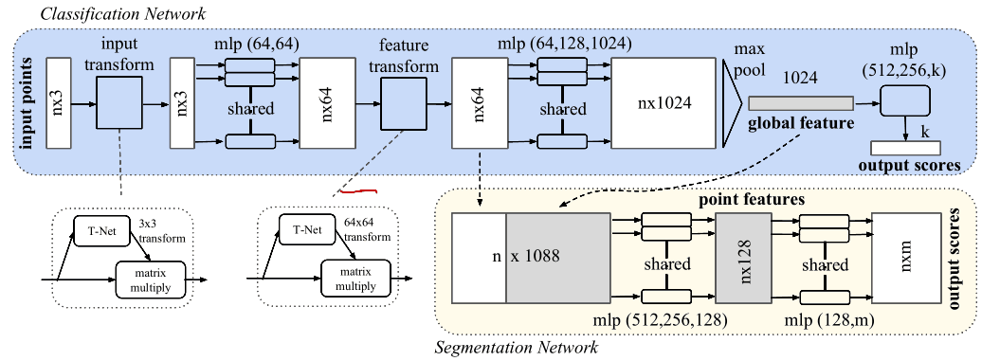
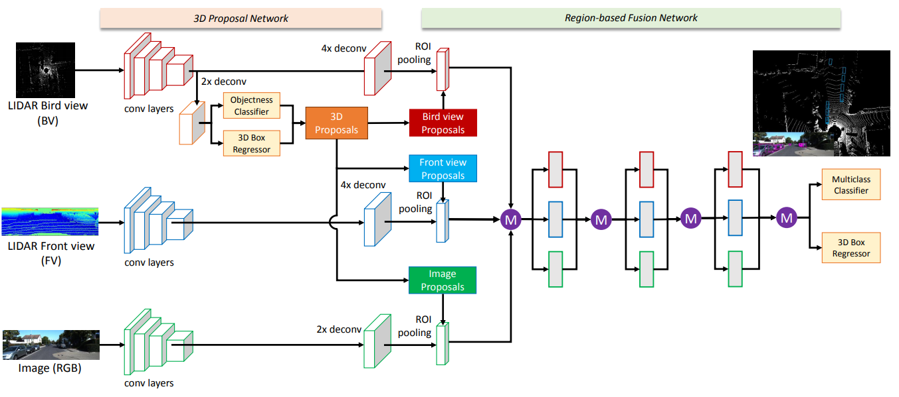

```cardlink
url: http://10.188.31.55:5244/Nextcloud/School/Auto-Drive-Intro/《智能驾驶导论》PPT-2020/
title: "智能驾驶导论 · 全六讲课件"
description: "中南大学人工智能与机器人实验室《智能驾驶导论》的六讲课件"
host: 10.188.31.55:5244
```

[← 返回《Auto-Drive-Intro》目录](../)

## 第 4 章 雷达感知

这一讲由中南大学自动化学院陈白帆老师讲授，课件是《智能驾驶导论》PPT-2020 的第 4 讲。讲的主题是无人车的传感系统，重点在毫米波雷达和激光雷达，以及激光点云拿到之后怎么变成可行驶区域和目标识别结果 [第4讲 雷达感知.pptx · p.1](http://10.188.31.55:5244/Nextcloud/School/Auto-Drive-Intro/%E3%80%8A%E6%99%BA%E8%83%BD%E9%A9%BE%E9%A9%B6%E5%AF%BC%E8%AE%BA%E3%80%8BPPT-2020/%E7%AC%AC4%E8%AE%B2%20%E9%9B%B7%E8%BE%BE%E6%84%9F%E7%9F%A5.pptx)。

### 传感系统

传感系统是用于感知外部环境的硬件集合，主要涉及 GPS/IMU、摄像头、毫米波雷达和激光雷达四类传感器 [第4讲 雷达感知.pptx · p.7](http://10.188.31.55:5244/Nextcloud/School/Auto-Drive-Intro/%E3%80%8A%E6%99%BA%E8%83%BD%E9%A9%BE%E9%A9%B6%E5%AF%BC%E8%AE%BA%E3%80%8BPPT-2020/%E7%AC%AC4%E8%AE%B2%20%E9%9B%B7%E8%BE%BE%E6%84%9F%E7%9F%A5.pptx)。KITTI 和 AnnieWay 两个公开数据集就是这套系统的产物，配套了同步采集的图像、点云和定位真值。


### 雷达原理

RADAR 是 Radio Detection And Ranging 的缩写，利用目标对电磁波的反射来测定障碍物的位置。雷达做四件事：检测目标有无、测量距离、测量速度、测量方位 [第4讲 雷达感知.pptx · p.8](http://10.188.31.55:5244/Nextcloud/School/Auto-Drive-Intro/%E3%80%8A%E6%99%BA%E8%83%BD%E9%A9%BE%E9%A9%B6%E5%AF%BC%E8%AE%BA%E3%80%8BPPT-2020/%E7%AC%AC4%E8%AE%B2%20%E9%9B%B7%E8%BE%BE%E6%84%9F%E7%9F%A5.pptx)。发射机发出电磁波，波打到目标后反射回来，接收机收下回波，回波与发射波之间的时间差对应距离。



### 毫米波雷达

**波长和波段。** 毫米波的波长在 1 cm 到 1 mm 之间，靠近太赫兹或者红外波段。工作波段是 30 GHz 到 300 GHz，车载雷达常用 24 GHz、60 GHz、77 GHz 和 120 GHz [第4讲 雷达感知.pptx · p.9](http://10.188.31.55:5244/Nextcloud/School/Auto-Drive-Intro/%E3%80%8A%E6%99%BA%E8%83%BD%E9%A9%BE%E9%A9%B6%E5%AF%BC%E8%AE%BA%E3%80%8BPPT-2020/%E7%AC%AC4%E8%AE%B2%20%E9%9B%B7%E8%BE%BE%E6%84%9F%E7%9F%A5.pptx)。发射形式是锥状波束。

**优点和缺点。** 优点是可靠，因为目标的反射面大，回波能量足。缺点是角度分辨力不高 [第4讲 雷达感知.pptx · p.9](http://10.188.31.55:5244/Nextcloud/School/Auto-Drive-Intro/%E3%80%8A%E6%99%BA%E8%83%BD%E9%A9%BE%E9%A9%B6%E5%AF%BC%E8%AE%BA%E3%80%8BPPT-2020/%E7%AC%AC4%E8%AE%B2%20%E9%9B%B7%E8%BE%BE%E6%84%9F%E7%9F%A5.pptx)。角度分辨力低直接限制了横向定位精度，这也是毫米波不能单独做车道级感知的原因。

**速度测量。** 用多普勒原理测径向速度：目标相对雷达有速度就改变回波频率，测出频率差就得到目标相对雷达的运动速度 [第4讲 雷达感知.pptx · p.10](http://10.188.31.55:5244/Nextcloud/School/Auto-Drive-Intro/%E3%80%8A%E6%99%BA%E8%83%BD%E9%A9%BE%E9%A9%B6%E5%AF%BC%E8%AE%BA%E3%80%8BPPT-2020/%E7%AC%AC4%E8%AE%B2%20%E9%9B%B7%E8%BE%BE%E6%84%9F%E7%9F%A5.pptx)。回波频率相对发射频率的偏移量与目标的径向速度成正比：

$$
f_d = \frac{2 v_r}{\lambda}
$$

其中 $f_d$ 是多普勒频移，$v_r$ 是径向速度分量，$\lambda$ 是雷达波长。速度只能测径向分量，这解释了为什么正前方横向通过的目标速度读数接近零。

**角度测量。** 靠有指向性的窄波束。相控阵天线用多根天线加信号处理合成窄波束，代价是功耗大、体积大 [第4讲 雷达感知.pptx · p.10](http://10.188.31.55:5244/Nextcloud/School/Auto-Drive-Intro/%E3%80%8A%E6%99%BA%E8%83%BD%E9%A9%BE%E9%A9%B6%E5%AF%BC%E8%AE%BA%E3%80%8BPPT-2020/%E7%AC%AC4%E8%AE%B2%20%E9%9B%B7%E8%BE%BE%E6%84%9F%E7%9F%A5.pptx)。速度还可以靠跟踪位置再做微分得到，课件把它作为补充手段。

**产品。** 课件给了两个代表：德尔福 Delphi ESR (Electronic Scanning Radar) 和大陆 Continental ARS 408-SC3。ARS 408 把远距窄视场和近距宽视场分开画，近距区域视野张开角度更大，远距区域收窄 [第4讲 雷达感知.pptx · p.11](http://10.188.31.55:5244/Nextcloud/School/Auto-Drive-Intro/%E3%80%8A%E6%99%BA%E8%83%BD%E9%A9%BE%E9%A9%B6%E5%AF%BC%E8%AE%BA%E3%80%8BPPT-2020/%E7%AC%AC4%E8%AE%B2%20%E9%9B%B7%E8%BE%BE%E6%84%9F%E7%9F%A5.pptx)。


> [!NOTE]
> 毫米波雷达测的是相对速度，激光雷达测的是绝对位置。两者互补：一个给速度，一个给几何形状。这也是无人车传感器配置里两者都要的原因。

### 激光雷达

LiDAR 是 Light Detection And Ranging 的缩写。2012 年 5 月，谷歌自动驾驶汽车拿到美国内华达州车辆管理局 (DMV) 颁发的执照，这是美国历史上第一张自动驾驶汽车执照，激光雷达因此受到广泛关注 [第4讲 雷达感知.pptx · p.12](http://10.188.31.55:5244/Nextcloud/School/Auto-Drive-Intro/%E3%80%8A%E6%99%BA%E8%83%BD%E9%A9%BE%E9%A9%B6%E5%AF%BC%E8%AE%BA%E3%80%8BPPT-2020/%E7%AC%AC4%E8%AE%B2%20%E9%9B%B7%E8%BE%BE%E6%84%9F%E7%9F%A5.pptx)。

课件列了 Velodyne 系列的参数对比 [第4讲 雷达感知.pptx · p.13](http://10.188.31.55:5244/Nextcloud/School/Auto-Drive-Intro/%E3%80%8A%E6%99%BA%E8%83%BD%E9%A9%BE%E9%A9%B6%E5%AF%BC%E8%AE%BA%E3%80%8BPPT-2020/%E7%AC%AC4%E8%AE%B2%20%E9%9B%B7%E8%BE%BE%E6%84%9F%E7%9F%A5.pptx)：

| 型号 | 激光线数 | 水平分辨率 | 输出频率 | 测量范围 | 防护标准 |
| --- | --- | --- | --- | --- | --- |
| HDL-64E | 64 | 5 Hz | 130 万点/秒 | 100–120 M | IP67 |
| HDL-32E | 32 | 5 Hz | 70 万点/秒 | 80–120 M | IP67 |
| VLP-16/PUCK | 16 | 5 Hz | 30 万点/秒 | 100 M | IP67 |
| Ultra Puck-32A | 32 | 10 Hz | 70 万点/秒 | 200 M | IP67 |

VLP-16 是 16 线产品，接法是经 Ethernet 连电脑，雷达出厂 IP 192.168.1.201，可选接 INS/GPS [第4讲 雷达感知.pptx · p.14](http://10.188.31.55:5244/Nextcloud/School/Auto-Drive-Intro/%E3%80%8A%E6%99%BA%E8%83%BD%E9%A9%BE%E9%A9%B6%E5%AF%BC%E8%AE%BA%E3%80%8BPPT-2020/%E7%AC%AC4%E8%AE%B2%20%E9%9B%B7%E8%BE%BE%E6%84%9F%E7%9F%A5.pptx)。


国产激光雷达方面，课件给了四家：大疆 Livox、浩界 Horizon（为 L3/L4 无人驾驶设计，¥6499）、泰览 Tele-15（首款 500 米量程车载激光雷达，¥8999）、觅道 Mid 系列（高性价比工业级，¥3999）[第4讲 雷达感知.pptx · p.24](http://10.188.31.55:5244/Nextcloud/School/Auto-Drive-Intro/%E3%80%8A%E6%99%BA%E8%83%BD%E9%A9%BE%E9%A9%B6%E5%AF%BC%E8%AE%BA%E3%80%8BPPT-2020/%E7%AC%AC4%E8%AE%B2%20%E9%9B%B7%E8%BE%BE%E6%84%9F%E7%9F%A5.pptx)。觅道用全新的扫描方式，课件强调它的意义不只是低价，而是探索出激光雷达发展的一个新方向。

### 传感器部署

部署要解决三件事：感知范围、时间同步、传感器标定 [第4讲 雷达感知.pptx · p.15](http://10.188.31.55:5244/Nextcloud/School/Auto-Drive-Intro/%E3%80%8A%E6%99%BA%E8%83%BD%E9%A9%BE%E9%A9%B6%E5%AF%BC%E8%AE%BA%E3%80%8BPPT-2020/%E7%AC%AC4%E8%AE%B2%20%E9%9B%B7%E8%BE%BE%E6%84%9F%E7%9F%A5.pptx)。感知范围要画成侧视图和俯视图两张图，毫米波负责远处的锥形区域，激光雷达负责近处的环形扫描区，相机补中间 [第4讲 雷达感知.pptx · p.17](http://10.188.31.55:5244/Nextcloud/School/Auto-Drive-Intro/%E3%80%8A%E6%99%BA%E8%83%BD%E9%A9%BE%E9%A9%B6%E5%AF%BC%E8%AE%BA%E3%80%8BPPT-2020/%E7%AC%AC4%E8%AE%B2%20%E9%9B%B7%E8%BE%BE%E6%84%9F%E7%9F%A5.pptx)。课件给的雷诺配置是：前置激光雷达 + 前置相机 + 前置毫米波雷达 + 边角雷达 + 超声传感 + 180° 相机 [第4讲 雷达感知.pptx · p.16](http://10.188.31.55:5244/Nextcloud/School/Auto-Drive-Intro/%E3%80%8A%E6%99%BA%E8%83%BD%E9%A9%BE%E9%A9%B6%E5%AF%BC%E8%AE%BA%E3%80%8BPPT-2020/%E7%AC%AC4%E8%AE%B2%20%E9%9B%B7%E8%BE%BE%E6%84%9F%E7%9F%A5.pptx)。


标定图里的数字是标定的输入：每个传感器相对车体基准的位置和安装高度、姿态角 [第4讲 雷达感知.pptx · p.18](http://10.188.31.55:5244/Nextcloud/School/Auto-Drive-Intro/%E3%80%8A%E6%99%BA%E8%83%BD%E9%A9%BE%E9%A9%B6%E5%AF%BC%E8%AE%BA%E3%80%8BPPT-2020/%E7%AC%AC4%E8%AE%B2%20%E9%9B%B7%E8%BE%BE%E6%84%9F%E7%9F%A5.pptx)。装了标定参数，激光点才能从雷达坐标系转到车身坐标系，再拼成一张完整的环境图。

### 感知系统的任务

感知系统做的事是把原始数据转化为智能车可识别的环境信息，主要实现检测和定位两大功能 [第4讲 雷达感知.pptx · p.21](http://10.188.31.55:5244/Nextcloud/School/Auto-Drive-Intro/%E3%80%8A%E6%99%BA%E8%83%BD%E9%A9%BE%E9%A9%B6%E5%AF%BC%E8%AE%BA%E3%80%8BPPT-2020/%E7%AC%AC4%E8%AE%B2%20%E9%9B%B7%E8%BE%BE%E6%84%9F%E7%9F%A5.pptx)。



LiDAR 在智能驾驶里的应用被课件归成六项：可行区域检测、路沿检测、路面分割、车道线检测、目标检测与识别（车辆、行人）、地图构建与定位（SLAM）[第4讲 雷达感知.pptx · p.22](http://10.188.31.55:5244/Nextcloud/School/Auto-Drive-Intro/%E3%80%8A%E6%99%BA%E8%83%BD%E9%A9%BE%E9%A9%B6%E5%AF%BC%E8%AE%BA%E3%80%8BPPT-2020/%E7%AC%AC4%E8%AE%B2%20%E9%9B%B7%E8%BE%BE%E6%84%9F%E7%9F%A5.pptx)。

### 激光数据与 PCL

激光数据有四个特点：简单，每个点只有 $x$、$y$、$z$ 和反射强度 $i$；精确，精度到 2 cm；稀疏；无序 [第4讲 雷达感知.pptx · p.25](http://10.188.31.55:5244/Nextcloud/School/Auto-Drive-Intro/%E3%80%8A%E6%99%BA%E8%83%BD%E9%A9%BE%E9%A9%B6%E5%AF%BC%E8%AE%BA%E3%80%8BPPT-2020/%E7%AC%AC4%E8%AE%B2%20%E9%9B%B7%E8%BE%BE%E6%84%9F%E7%9F%A5.pptx)。雷达直接输出距离和角度，点云是这些测量解算到车体坐标系后的结果。工程上处理点云的标准工具是 PCL (The Point Cloud Library) [第二章-行车环境感知-激光雷达和点云.pptx · p.25](http://10.188.31.55:5244/Nextcloud/School/Auto-Drive-Intro/%E8%AF%BE%E4%BB%B6/%E7%AC%AC%E4%BA%8C%E7%AB%A0-%E8%A1%8C%E8%BD%A6%E7%8E%AF%E5%A2%83%E6%84%9F%E7%9F%A5-%E6%BF%80%E5%85%89%E9%9B%B7%E8%BE%BE%E5%92%8C%E7%82%B9%E4%BA%91.pptx)。


### 可行区域检测

**为什么要分割地面。** 自动驾驶车辆需要快速识别可行驶区域，而地面分割是障碍物检测和识别的先决条件 [第4讲 雷达感知.pptx · p.26](http://10.188.31.55:5244/Nextcloud/School/Auto-Drive-Intro/%E3%80%8A%E6%99%BA%E8%83%BD%E9%A9%BE%E9%A9%B6%E5%AF%BC%E8%AE%BA%E3%80%8BPPT-2020/%E7%AC%AC4%E8%AE%B2%20%E9%9B%B7%E8%BE%BE%E6%84%9F%E7%9F%A5.pptx)。

**难点。** 激光雷达点云数据通常是稀疏的、不均匀的，提取特征有困难。另一个问题是地面、路面、可行驶区域三者在概念上并不等价：坡道、起伏路面、路面上的积水都会打破这个等式。

> [!WARNING]
> 把地面直接当成可行驶区域，在有坡道和起伏的路段会出错。分割出来的地面只给出高度为零的参考平面，可行驶区域还要叠加道路语义。

**分割方法。** 课件把方法分成三类 [第4讲 雷达感知.pptx · p.27](http://10.188.31.55:5244/Nextcloud/School/Auto-Drive-Intro/%E3%80%8A%E6%99%BA%E8%83%BD%E9%A9%BE%E9%A9%B6%E5%AF%BC%E8%AE%BA%E3%80%8BPPT-2020/%E7%AC%AC4%E8%AE%B2%20%E9%9B%B7%E8%BE%BE%E6%84%9F%E7%9F%A5.pptx)：

- **基于几何特征的方法**：高度阈值、栅格高度差、平均高度，还有法向量。做法是按栅格把点云切块，比较块内高度关系。
- **基于模型的方法**：用最优化方法在点云中找平面，模型是平面方程，最小二乘法或 RANSAC (RANdom SAmple Consensus) 求解。
- **基于 CNN 网络的方法**：把点云组织成体素或投影图交给卷积网络做分类。

平面拟合的模型写成齐次形式，系数向量由最小二乘解出：

$$
a x + b y + c z + d = 0
$$

RANSAC 在这里的作用是抗离群点：随机取三点定一个平面，数一下有多少点落在平面附近，取内点最多的那个模型，再用所有内点重新做最小二乘。

**路面分割结果。** 课件给的分割结果里，红色是识别出的地面区域，黑色是未分类点 [第4讲 雷达感知.pptx · p.28](http://10.188.31.55:5244/Nextcloud/School/Auto-Drive-Intro/%E3%80%8A%E6%99%BA%E8%83%BD%E9%A9%BE%E9%A9%B6%E5%AF%BC%E8%AE%BA%E3%80%8BPPT-2020/%E7%AC%AC4%E8%AE%B2%20%E9%9B%B7%E8%BE%BE%E6%84%9F%E7%9F%A5.pptx)。



**基于反射率阈值的车道线检测。** 车道漆面的反射率与沥青路面差一个量级，把反射率超过阈值的点筛出来就能得到车道线候选 [第4讲 雷达感知.pptx · p.29](http://10.188.31.55:5244/Nextcloud/School/Auto-Drive-Intro/%E3%80%8A%E6%99%BA%E8%83%BD%E9%A9%BE%E9%A9%B6%E5%AF%BC%E8%AE%BA%E3%80%8BPPT-2020/%E7%AC%AC4%E8%AE%B2%20%E9%9B%B7%E8%BE%BE%E6%84%9F%E7%9F%A5.pptx)。


### 目标识别的四个方案

**方案一：点云投影到透视图。** 把点云投影到透视图中，再套用图像分割和特征提取技术 [第4讲 雷达感知.pptx · p.32](http://10.188.31.55:5244/Nextcloud/School/Auto-Drive-Intro/%E3%80%8A%E6%99%BA%E8%83%BD%E9%A9%BE%E9%A9%B6%E5%AF%BC%E8%AE%BA%E3%80%8BPPT-2020/%E7%AC%AC4%E8%AE%B2%20%E9%9B%B7%E8%BE%BE%E6%84%9F%E7%9F%A5.pptx)。这条路的代价是投影把三维压成二维，深度信息丢了。



**方案二：基于 3D 几何特性。** 直接在三维点云上做检测，用几何特性投票决定哪个点属于目标。课件引用了 D. Z. Wang 和 I. Posner 的 Voting for Voting in Online Point Cloud Object Detection (RSS 2015) [第4讲 雷达感知.pptx · p.33](http://10.188.31.55:5244/Nextcloud/School/Auto-Drive-Intro/%E3%80%8A%E6%99%BA%E8%83%BD%E9%A9%BE%E9%A9%B6%E5%AF%BC%E8%AE%BA%E3%80%8BPPT-2020/%E7%AC%AC4%E8%AE%B2%20%E9%9B%B7%E8%BE%BE%E6%84%9F%E7%9F%A5.pptx)。


**方案三：深度学习 PointNet。** 直接处理点云数据的神经网络结构，三个主要任务是 3D 对象分类、对象零件分割和大场景下的语义分割 [第4讲 雷达感知.pptx · p.34](http://10.188.31.55:5244/Nextcloud/School/Auto-Drive-Intro/%E3%80%8A%E6%99%BA%E8%83%BD%E9%A9%BE%E9%A9%B6%E5%AF%BC%E8%AE%BA%E3%80%8BPPT-2020/%E7%AC%AC4%E8%AE%B2%20%E9%9B%B7%E8%BE%BE%E6%84%9F%E7%9F%A5.pptx)。课件引用 C. R. Qi 等人的 PointNet (CVPR 2017)。PointNet 的结构特点是分类网络和分割网络各有一路 T-Net 负责把输入对齐到规范空间。



**方案四：激光 + 视觉融合。** 激光给几何，视觉给纹理，两者互补。课件引用了 Xiaozhi Chen 等人的 Multi-View 3D Object Detection Network (CVPR 2017) [第4讲 雷达感知.pptx · p.36](http://10.188.31.55:5244/Nextcloud/School/Auto-Drive-Intro/%E3%80%8A%E6%99%BA%E8%83%BD%E9%A9%BE%E9%A9%B6%E5%AF%BC%E8%AE%BA%E3%80%8BPPT-2020/%E7%AC%AC4%E8%AE%B2%20%E9%9B%B7%E8%BE%BE%E6%84%9F%E7%9F%A5.pptx)。



### 感知的未来

课件给了四条走向 [第4讲 雷达感知.pptx · p.39](http://10.188.31.55:5244/Nextcloud/School/Auto-Drive-Intro/%E3%80%8A%E6%99%BA%E8%83%BD%E9%A9%BE%E9%A9%B6%E5%AF%BC%E8%AE%BA%E3%80%8BPPT-2020/%E7%AC%AC4%E8%AE%B2%20%E9%9B%B7%E8%BE%BE%E6%84%9F%E7%9F%A5.pptx)：传感器迭代非常快；深度学习 + 仿真数据 + 车载 AI 芯片成为主线；智能交通设施普及、V2X 铺开；人工智能技术本身继续往上抬感知上限。
