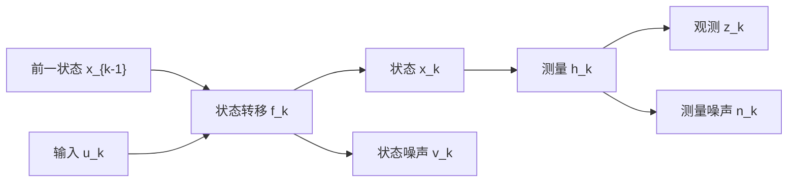
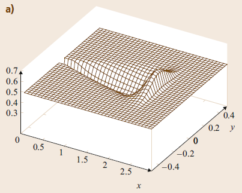
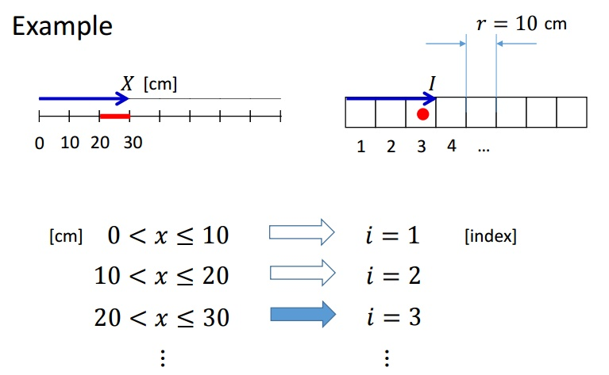
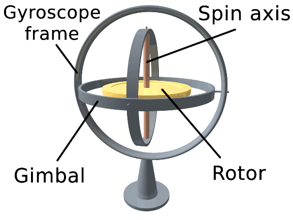
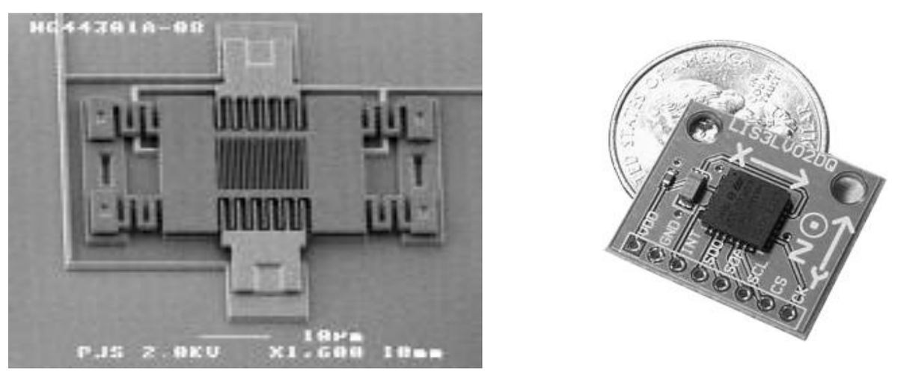
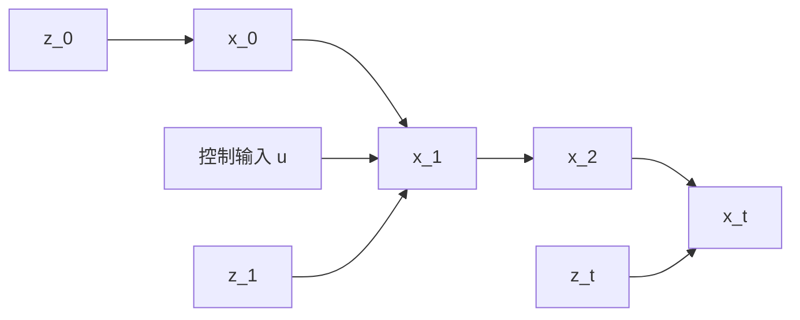
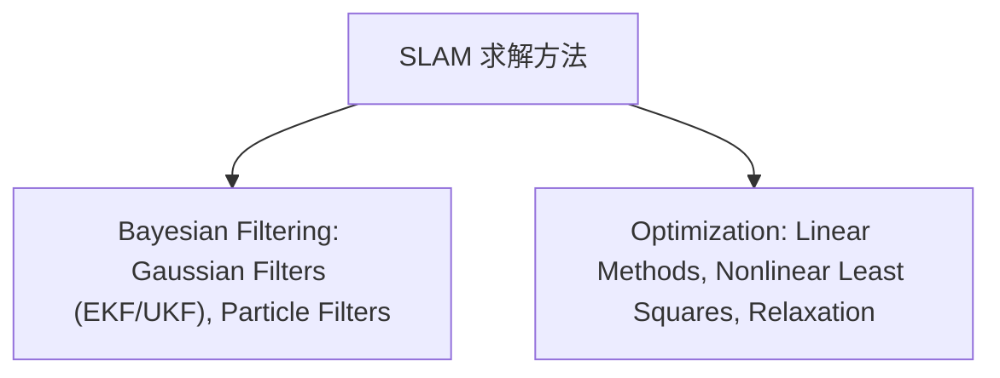

```cardlink
url: http://10.188.31.55:5244/Nextcloud/School/Auto-Drive-Intro/《智能驾驶导论》PPT-2020/
title: "智能驾驶导论 · 全六讲课件"
description: "中南大学人工智能与机器人实验室《智能驾驶导论》的六讲课件"
host: 10.188.31.55:5244
```

[← 返回《Auto-Drive-Intro》目录](../)

## 第 6 章 地图与定位

这一讲由中南大学自动化学院陈白帆老师讲授，课件是《智能驾驶导论》PPT-2020 的第 6 讲。讲的是无人车怎么回答三个问题：我在哪里、这是什么地方、我到哪里去。课件分三段：系统建模 [第6讲 地图与定位.pptx · p.2](http://10.188.31.55:5244/Nextcloud/School/Auto-Drive-Intro/%E3%80%8A%E6%99%BA%E8%83%BD%E9%A9%BE%E9%A9%B6%E5%AF%BC%E8%AE%BA%E3%80%8BPPT-2020/%E7%AC%AC6%E8%AE%B2%20%E5%9C%B0%E5%9B%BE%E4%B8%8E%E5%AE%9A%E4%BD%8D.pptx)、地图创建 [第6讲 地图与定位.pptx · p.9](http://10.188.31.55:5244/Nextcloud/School/Auto-Drive-Intro/%E3%80%8A%E6%99%BA%E8%83%BD%E9%A9%BE%E9%A9%B6%E5%AF%BC%E8%AE%BA%E3%80%8BPPT-2020/%E7%AC%AC6%E8%AE%B2%20%E5%9C%B0%E5%9B%BE%E4%B8%8E%E5%AE%9A%E4%BD%8D.pptx)、定位 [第6讲 地图与定位.pptx · p.14](http://10.188.31.55:5244/Nextcloud/School/Auto-Drive-Intro/%E3%80%8A%E6%99%BA%E8%83%BD%E9%A9%BE%E9%A9%B6%E5%AF%BC%E8%AE%BA%E3%80%8BPPT-2020/%E7%AC%AC6%E8%AE%B2%20%E5%9C%B0%E5%9B%BE%E4%B8%8E%E5%AE%9A%E4%BD%8D.pptx)。

### 终极三问

无人车的全部任务挂在三个问句上：我在哪里 → 定位，这是什么地方 → 建图，我到哪里去 → 路径规划 [第6讲 地图与定位.pptx · p.3](http://10.188.31.55:5244/Nextcloud/School/Auto-Drive-Intro/%E3%80%8A%E6%99%BA%E8%83%BD%E9%A9%BE%E9%A9%B6%E5%AF%BC%E8%AE%BA%E3%80%8BPPT-2020/%E7%AC%AC6%E8%AE%B2%20%E5%9C%B0%E5%9B%BE%E4%B8%8E%E5%AE%9A%E4%BD%8D.pptx)。

三问串成一个 see-think-act 循环。课件画的图把 AI 和 Robotics 放在两侧：左边 Knowledge Representation、Reasoning、Learning，中间 see-think-act 环，右边 Path Planning、Localization、Map、Execution、Actuation [第6讲 地图与定位.pptx · p.4](http://10.188.31.55:5244/Nextcloud/School/Auto-Drive-Intro/%E3%80%8A%E6%99%BA%E8%83%BD%E9%A9%BE%E9%A9%B6%E5%AF%BC%E8%AE%BA%E3%80%8BPPT-2020/%E7%AC%AC6%E8%AE%B2%20%E5%9C%B0%E5%9B%BE%E4%B8%8E%E5%AE%9A%E4%BD%8D.pptx)。


### 系统建模

移动机器人的动态系统用两个方程建模，课件先给通用形式，再给机器人上的具体形式 [第6讲 地图与定位.pptx · p.6](http://10.188.31.55:5244/Nextcloud/School/Auto-Drive-Intro/%E3%80%8A%E6%99%BA%E8%83%BD%E9%A9%BE%E9%A9%B6%E5%AF%BC%E8%AE%BA%E3%80%8BPPT-2020/%E7%AC%AC6%E8%AE%B2%20%E5%9C%B0%E5%9B%BE%E4%B8%8E%E5%AE%9A%E4%BD%8D.pptx)。

状态转移方程把上一时刻状态、已知输入和状态噪声一起送进转移函数，测量方程把当前状态、输入和测量噪声一起送进测量函数：

$$
x_k = f_k(x_{k-1}, u_{k-1}, v_{k-1}), \qquad z_k = h_k(x_k, u_k, n_k)
$$

课件对符号的定义：$f_k$ 是转移函数，可能非线性；$x_k$ 和 $x_{k-1}$ 是当前和前一时刻状态；$u_{k-1}$ 是已知输入；$v_{k-1}$ 是状态噪声，可能是非 Gaussian。$h_k$ 是测量函数，同样可能非线性；$n_k$ 是测量噪声 [第6讲 地图与定位.pptx · p.6](http://10.188.31.55:5244/Nextcloud/School/Auto-Drive-Intro/%E3%80%8A%E6%99%BA%E8%83%BD%E9%A9%BE%E9%A9%B6%E5%AF%BC%E8%AE%BA%E3%80%8BPPT-2020/%E7%AC%AC6%E8%AE%B2%20%E5%9C%B0%E5%9B%BE%E4%B8%8E%E5%AE%9A%E4%BD%8D.pptx)。

移动机器人动态系统状态图里，这两个方程的关系是：输入和噪声进状态转移，状态进测量，测量函数出观测 [第6讲 地图与定位.pptx · p.5](http://10.188.31.55:5244/Nextcloud/School/Auto-Drive-Intro/%E3%80%8A%E6%99%BA%E8%83%BD%E9%A9%BE%E9%A9%B6%E5%AF%BC%E8%AE%BA%E3%80%8BPPT-2020/%E7%AC%AC6%E8%AE%B2%20%E5%9C%B0%E5%9B%BE%E4%B8%8E%E5%AE%9A%E4%BD%8D.pptx)。



机器人的状态取位置和朝向，课件写成三元素向量 [第6讲 地图与定位.pptx · p.7](http://10.188.31.55:5244/Nextcloud/School/Auto-Drive-Intro/%E3%80%8A%E6%99%BA%E8%83%BD%E9%A9%BE%E9%A9%B6%E5%AF%BC%E8%AE%BA%E3%80%8BPPT-2020/%E7%AC%AC6%E8%AE%B2%20%E5%9C%B0%E5%9B%BE%E4%B8%8E%E5%AE%9A%E4%BD%8D.pptx)：

$$
x_t = \begin{bmatrix} x_{r,t} & y_{r,t} & \theta_{r,t} \end{bmatrix}^{T}
$$

$r$ 指机器人本体，$t$ 指时刻。

**式（1）：用位移增量做输入。** 输入是这一段走了多远、转了多少 [第6讲 地图与定位.pptx · p.7](http://10.188.31.55:5244/Nextcloud/School/Auto-Drive-Intro/%E3%80%8A%E6%99%BA%E8%83%BD%E9%A9%BE%E9%A9%B6%E5%AF%BC%E8%AE%BA%E3%80%8BPPT-2020/%E7%AC%AC6%E8%AE%B2%20%E5%9C%B0%E5%9B%BE%E4%B8%8E%E5%AE%9A%E4%BD%8D.pptx)：

$$
u_t = \begin{bmatrix} \Delta d_{r,t} & \Delta \theta_{r,t} \end{bmatrix}^{T}
$$

状态转移方程把上一时刻的位姿按这一段的位移和转角推到当前时刻，噪声单独叠加 [第6讲 地图与定位.pptx · p.7](http://10.188.31.55:5244/Nextcloud/School/Auto-Drive-Intro/%E3%80%8A%E6%99%BA%E8%83%BD%E9%A9%BE%E9%A9%B6%E5%AF%BC%E8%AE%BA%E3%80%8BPPT-2020/%E7%AC%AC6%E8%AE%B2%20%E5%9C%B0%E5%9B%BE%E4%B8%8E%E5%AE%9A%E4%BD%8D.pptx)：

$$
\begin{bmatrix} x_{r,t} \\ y_{r,t} \\ \theta_{r,t} \end{bmatrix} =
\begin{bmatrix} x_{r,t-1} + \Delta d_{r,t} \cos(\theta_{r,t-1} + \Delta \theta_{r,t}) \\ y_{r,t-1} + \Delta d_{r,t} \sin(\theta_{r,t-1} + \Delta \theta_{r,t}) \\ \theta_{r,t-1} + \Delta \theta_{r,t} \end{bmatrix} + v_t
$$

**式（2）：用速度做输入。** 输入换成线速度和角速度 [第6讲 地图与定位.pptx · p.7](http://10.188.31.55:5244/Nextcloud/School/Auto-Drive-Intro/%E3%80%8A%E6%99%BA%E8%83%BD%E9%A9%BE%E9%A9%B6%E5%AF%BC%E8%AE%BA%E3%80%8BPPT-2020/%E7%AC%AC6%E8%AE%B2%20%E5%9C%B0%E5%9B%BE%E4%B8%8E%E5%AE%9A%E4%BD%8D.pptx)：

$$
u_t = \begin{bmatrix} v_t & \omega_t \end{bmatrix}^{T}
$$

同一段运动写成闭式积分：角速度乘时间得到转过的角度，正弦余弦的差再乘 v_t/ω_t 就是这一段在两个坐标上的位移 [第6讲 地图与定位.pptx · p.7](http://10.188.31.55:5244/Nextcloud/School/Auto-Drive-Intro/%E3%80%8A%E6%99%BA%E8%83%BD%E9%A9%BE%E9%A9%B6%E5%AF%BC%E8%AE%BA%E3%80%8BPPT-2020/%E7%AC%AC6%E8%AE%B2%20%E5%9C%B0%E5%9B%BE%E4%B8%8E%E5%AE%9A%E4%BD%8D.pptx)：

$$
\begin{bmatrix} x_{r,t} \\ y_{r,t} \\ \theta_{r,t} \end{bmatrix} =
\begin{bmatrix} x_{r,t-1} + \dfrac{v_t}{\omega_t} \left( \sin(\theta_{r,t-1} + \Delta t \omega_t) - \sin(\theta_{r,t-1}) \right) \\ y_{r,t-1} + \dfrac{v_t}{\omega_t} \left( \cos(\theta_{r,t-1}) - \cos(\theta_{r,t-1} + \Delta t \omega_t) \right) \\ \theta_{r,t-1} + \Delta t \omega_t \end{bmatrix} + v_t
$$

**测量方程。** 机器人的测量是 landmark 观测。课件给了一条极坐标形式：测距 $r_{i,t}$ 和相对朝向 $\phi_{i,t}$，landmark $i$ 的坐标由机器人和它的坐标差反算 [第6讲 地图与定位.pptx · p.8](http://10.188.31.55:5244/Nextcloud/School/Auto-Drive-Intro/%E3%80%8A%E6%99%BA%E8%83%BD%E9%A9%BE%E9%A9%B6%E5%AF%BC%E8%AE%BA%E3%80%8BPPT-2020/%E7%AC%AC6%E8%AE%B2%20%E5%9C%B0%E5%9B%BE%E4%B8%8E%E5%AE%9A%E4%BD%8D.pptx)：

$$
\begin{bmatrix} r_{i,t} \\ \phi_{i,t} \end{bmatrix} =
\begin{bmatrix} \sqrt{(x_{r,t} - x_i)^2 + (y_{r,t} - y_i)^2} \\ \arctan \dfrac{y_{r,t} - y_i}{x_{r,t} - x_i} - \theta_{r,t} \end{bmatrix} + w_t
$$

课件还给了一条笛卡尔形式，直接把 landmark 坐标写成机器人位姿加上一段极坐标位移 [第6讲 地图与定位.pptx · p.8](http://10.188.31.55:5244/Nextcloud/School/Auto-Drive-Intro/%E3%80%8A%E6%99%BA%E8%83%BD%E9%A9%BE%E9%A9%B6%E5%AF%BC%E8%AE%BA%E3%80%8BPPT-2020/%E7%AC%AC6%E8%AE%B2%20%E5%9C%B0%E5%9B%BE%E4%B8%8E%E5%AE%9A%E4%BD%8D.pptx)：

$$
\begin{bmatrix} x_{i,t} \\ y_{i,t} \end{bmatrix} =
\begin{bmatrix} x_{r,t} + r_{i,t} \cos(\theta_{r,t} + \phi_{i,t}) \\ y_{r,t} + r_{i,t} \sin(\theta_{r,t} + \phi_{i,t}) \end{bmatrix} + w_t
$$

### 地图表示方法

课件列了四种地图表示：Occupancy Grid map、Topological Map、Feature Map、Appearance Based map [第6讲 地图与定位.pptx · p.10](http://10.188.31.55:5244/Nextcloud/School/Auto-Drive-Intro/%E3%80%8A%E6%99%BA%E8%83%BD%E9%A9%BE%E9%A9%B6%E5%AF%BC%E8%AE%BA%E3%80%8BPPT-2020/%E7%AC%AC6%E8%AE%B2%20%E5%9C%B0%E5%9B%BE%E4%B8%8E%E5%AE%9A%E4%BD%8D.pptx)。




课件把地图分成三大类，并列出各自的优缺点 [第6讲 地图与定位.pptx · p.11](http://10.188.31.55:5244/Nextcloud/School/Auto-Drive-Intro/%E3%80%8A%E6%99%BA%E8%83%BD%E9%A9%BE%E9%A9%B6%E5%AF%BC%E8%AE%BA%E3%80%8BPPT-2020/%E7%AC%AC6%E8%AE%B2%20%E5%9C%B0%E5%9B%BE%E4%B8%8E%E5%AE%9A%E4%BD%8D.pptx)：

| 类别 | 形式 | 优点 | 缺点 |
| --- | --- | --- | --- |
| 尺度地图 | 栅格地图 | 提供度量信息，易理解、易处理、易融合 | 依赖传感器，数据量大 |
| 尺度地图 | 几何特征地图 | 提供度量信息，存储量较小 | 数据关联困难 |
| 拓扑地图 | 拓扑地图 | 存储空间小，路径规划效率高 | 无度量信息，不适于定位 |
| 直接表征法 | 直接用传感器原始数据构造位姿空间 | 省去特征或栅格表示这一中间环节 | — |

直接表征法的例子是课件给的 RGB-D map of Shenghua 205#，把深度相机数据直接攒成三维场景，不经过特征或栅格这一层。

### 占用栅格地图

Occupancy Grid Map 把环境离散成栅格单元，每个单元存该单元被障碍物占用的概率 p(m_{x,y})，值落在 0 到 1 之间，不是 0 或 1 [第6讲 地图与定位.pptx · p.12](http://10.188.31.55:5244/Nextcloud/School/Auto-Drive-Intro/%E3%80%8A%E6%99%BA%E8%83%BD%E9%A9%BE%E9%A9%B6%E5%AF%BC%E8%AE%BA%E3%80%8BPPT-2020/%E7%AC%AC6%E8%AE%B2%20%E5%9C%B0%E5%9B%BE%E4%B8%8E%E5%AE%9A%E4%BD%8D.pptx)。课件引的原始文献是 Moravec 和 Elfes 1985 年的 High resolution maps from wide angle sonar [第6讲 地图与定位.pptx · p.12](http://10.188.31.55:5244/Nextcloud/School/Auto-Drive-Intro/%E3%80%8A%E6%99%BA%E8%83%BD%E9%A9%BE%E9%A9%B6%E5%AF%BC%E8%AE%BA%E3%80%8BPPT-2020/%E7%AC%AC6%E8%AE%B2%20%E5%9C%B0%E5%9B%BE%E4%B8%8E%E5%AE%9A%E4%BD%8D.pptx)。



### 特征地图

特征地图有两种描述方式：特征元素的集合，或者子地图的集合。创建过程是四步流水线：获取感知数据 → 特征提取 → 坐标转换 → 地图融合 [第6讲 地图与定位.pptx · p.13](http://10.188.31.55:5244/Nextcloud/School/Auto-Drive-Intro/%E3%80%8A%E6%99%BA%E8%83%BD%E9%A9%BE%E9%A9%B6%E5%AF%BC%E8%AE%BA%E3%80%8BPPT-2020/%E7%AC%AC6%E8%AE%B2%20%E5%9C%B0%E5%9B%BE%E4%B8%8E%E5%AE%9A%E4%BD%8D.pptx)。

### 常用的定位技术

课件列了六种定位技术 [第6讲 地图与定位.pptx · p.15](http://10.188.31.55:5244/Nextcloud/School/Auto-Drive-Intro/%E3%80%8A%E6%99%BA%E8%83%BD%E9%A9%BE%E9%A9%B6%E5%AF%BC%E8%AE%BA%E3%80%8BPPT-2020/%E7%AC%AC6%E8%AE%B2%20%E5%9C%B0%E5%9B%BE%E4%B8%8E%E5%AE%9A%E4%BD%8D.pptx)：

- 航迹推算 Dead-Reckoning：用里程计和罗盘得到位移与转向，再用状态转移方程推算位置，定位随时间累计会发散
- 惯性导航 INS
- GPS 定位
- 路标定位
- 地图匹配定位
- 同时定位与建图 SLAM

### IMU

IMU（Inertial Measurement Unit）检测加速度与旋转运动，硬件上是加速度计加角速度计。MEMS 的六轴惯性传感器是三个轴的加速度传感器加三个轴的陀螺仪 [第6讲 地图与定位.pptx · p.16](http://10.188.31.55:5244/Nextcloud/School/Auto-Drive-Intro/%E3%80%8A%E6%99%BA%E8%83%BD%E9%A9%BE%E9%A9%B6%E5%AF%BC%E8%AE%BA%E3%80%8BPPT-2020/%E7%AC%AC6%E8%AE%B2%20%E5%9C%B0%E5%9B%BE%E4%B8%8E%E5%AE%9A%E4%BD%8D.pptx)。课件按精度分三级：消费级是单个 MEMS 芯片，装在智能终端上，价格 $0.5–10；中级是 IMU + GPS，用在汽车上，几百到上千美元；高级是高精度惯导，用在导弹和光学瞄准系统上，几十万美元 [第6讲 地图与定位.pptx · p.16](http://10.188.31.55:5244/Nextcloud/School/Auto-Drive-Intro/%E3%80%8A%E6%99%BA%E8%83%BD%E9%A9%BE%E9%A9%B6%E5%AF%BC%E8%AE%BA%E3%80%8BPPT-2020/%E7%AC%AC6%E8%AE%B2%20%E5%9C%B0%E5%9B%BE%E4%B8%8E%E5%AE%9A%E4%BD%8D.pptx)。

**陀螺仪。** 课件给了三种实现：机械陀螺仪、激光陀螺仪、MEMS 陀螺仪，给出的指标是精度 0.01 度，采样率 200 Hz 到 1 kHz [第6讲 地图与定位.pptx · p.17](http://10.188.31.55:5244/Nextcloud/School/Auto-Drive-Intro/%E3%80%8A%E6%99%BA%E8%83%BD%E9%A9%BE%E9%A9%B6%E5%AF%BC%E8%AE%BA%E3%80%8BPPT-2020/%E7%AC%AC6%E8%AE%B2%20%E5%9C%B0%E5%9B%BE%E4%B8%8E%E5%AE%9A%E4%BD%8D.pptx)。机械陀螺仪靠角动量守恒，转轴指向不随支架旋转而变。




**加速度计。** 原理是重物通过弹簧固定在框架上，框架有加速度时重物发生相对运动，测量这种运动并转成电信号。要拿到物体的实际加速度，还得把重力加速度减掉。精度较低，0.1 m/s² [第6讲 地图与定位.pptx · p.18](http://10.188.31.55:5244/Nextcloud/School/Auto-Drive-Intro/%E3%80%8A%E6%99%BA%E8%83%BD%E9%A9%BE%E9%A9%B6%E5%AF%BC%E8%AE%BA%E3%80%8BPPT-2020/%E7%AC%AC6%E8%AE%B2%20%E5%9C%B0%E5%9B%BE%E4%B8%8E%E5%AE%9A%E4%BD%8D.pptx)。



> [!NOTE]
> MEMS 加速度计靠悬臂结构的惯性工作：中间极板质量大、悬臂弹性系数可设计，不同测量范围配不同悬臂强度。电容变化量与加速度成正比，再由专用芯片转成电压信号，数字化后做零点和灵敏度校正输出。

### IMU 的误差

误差分三类：偏移误差、比例误差、白噪声 [第6讲 地图与定位.pptx · p.19](http://10.188.31.55:5244/Nextcloud/School/Auto-Drive-Intro/%E3%80%8A%E6%99%BA%E8%83%BD%E9%A9%BE%E9%A9%B6%E5%AF%BC%E8%AE%BA%E3%80%8BPPT-2020/%E7%AC%AC6%E8%AE%B2%20%E5%9C%B0%E5%9B%BE%E4%B8%8E%E5%AE%9A%E4%BD%8D.pptx)。偏移误差指陀螺仪和加速度计在静止时也输出非零值；比例误差指输出与输入变化量之间的比值本身有偏差；白噪声是随机的逐次抖动。

偏移误差致命的原因是两次积分。加速度计读出的偏移 $b$ 是一段恒定的假加速度，第一次积分变成速度误差，第二次积分变成位置误差：

$$
\delta v(t) = \int_0^t b \, d\tau = b t, \qquad \delta p(t) = \int_0^t b \tau \, d\tau = \frac{1}{2} b t^2
$$

误差按 $t$ 的平方增长，$b$ 很小也不要紧，跑一分钟就不可用。比例误差有同样的累积特性，只是换成按时间线性放大。

> [!WARNING]
> 惯性定位的误差不会自己收敛。所有修正手段都必须是外部的：GPS 修、地图匹配修、SLAM 修。只靠 IMU 积分，误差单向累积。

### GPS/IMU 融合定位

GPS 定位相对精准，但更新频率低；惯性传感器的定位误差随时间累积，但更新频率高，短时间能给出稳定的实时位置。课件用卡尔曼滤波把两者融合 [第6讲 地图与定位.pptx · p.20](http://10.188.31.55:5244/Nextcloud/School/Auto-Drive-Intro/%E3%80%8A%E6%99%BA%E8%83%BD%E9%A9%BE%E9%A9%B6%E5%AF%BC%E8%AE%BA%E3%80%8BPPT-2020/%E7%AC%AC6%E8%AE%B2%20%E5%9C%B0%E5%9B%BE%E4%B8%8E%E5%AE%9A%E4%BD%8D.pptx)。


卡尔曼滤波分两个阶段。预测阶段用上一时刻的状态和当前输入推算当前状态；更新阶段用当前观测纠正预测。课件的类比是停电摸黑走回卧室：靠数步数预测位置，摸到电视机就用它已知的房间位置纠正预测，然后在这个更准的估计上继续数步数。频率差是融合的收益来源：惯性传感器 1 kHz、GPS 10 Hz 时，每两次 GPS 更新之间有 100 个惯性数据点可以用来做预测。课件列的惯导型号是 XW-ADU5630 [第6讲 地图与定位.pptx · p.20](http://10.188.31.55:5244/Nextcloud/School/Auto-Drive-Intro/%E3%80%8A%E6%99%BA%E8%83%BD%E9%A9%BE%E9%A9%B6%E5%AF%BC%E8%AE%BA%E3%80%8BPPT-2020/%E7%AC%AC6%E8%AE%B2%20%E5%9C%B0%E5%9B%BE%E4%B8%8E%E5%AE%9A%E4%BD%8D.pptx)。

### SLAM

SLAM 是 Simultaneous Localization and Mapping。移动机器人从一个未知位置出发，在运动中根据自身位姿估计和传感器对环境的感知构建增量式地图，同时用这张地图更新自己的定位。备注写得更细：根据之前的轨迹和已建地图，加上当前的控制输入 $u$ 和传感器观测 $z$，估计当前位姿 $x_t$ 并更新地图 [第6讲 地图与定位.pptx · p.21](http://10.188.31.55:5244/Nextcloud/School/Auto-Drive-Intro/%E3%80%8A%E6%99%BA%E8%83%BD%E9%A9%BE%E9%A9%B6%E5%AF%BC%E8%AE%BA%E3%80%8BPPT-2020/%E7%AC%AC6%E8%AE%B2%20%E5%9C%B0%E5%9B%BE%E4%B8%8E%E5%AE%9A%E4%BD%8D.pptx)。

把机器人的位姿和环境地图一起看作系统状态 $S$，并假设当前状态只与前一时刻状态和当前输入有关，SLAM 过程就是一个隐马尔可夫模型（HMM）或动态贝叶斯网络。按备注里的描述画成动态贝叶斯网络：位姿串成一条链，观测挂在每个位姿上，控制输入进状态转移。



求解方法分两大类 [第6讲 地图与定位.pptx · p.22](http://10.188.31.55:5244/Nextcloud/School/Auto-Drive-Intro/%E3%80%8A%E6%99%BA%E8%83%BD%E9%A9%BE%E9%A9%B6%E5%AF%BC%E8%AE%BA%E3%80%8BPPT-2020/%E7%AC%AC6%E8%AE%B2%20%E5%9C%B0%E5%9B%BE%E4%B8%8E%E5%AE%9A%E4%BD%8D.pptx)：



课件把这张方法树标成 autonomous robotics research 的 The Holy Grail，引的是 Adams 等人 2014 年的 Slam gets a PhD [第6讲 地图与定位.pptx · p.22](http://10.188.31.55:5244/Nextcloud/School/Auto-Drive-Intro/%E3%80%8A%E6%99%BA%E8%83%BD%E9%A9%BE%E9%A9%B6%E5%AF%BC%E8%AE%BA%E3%80%8BPPT-2020/%E7%AC%AC6%E8%AE%B2%20%E5%9C%B0%E5%9B%BE%E4%B8%8E%E5%AE%9A%E4%BD%8D.pptx)。

**实测结果。** 激光 SLAM 的结果课件给了楼前场景，实时建图的点云和实际环境照片放在一起对照 [第6讲 地图与定位.pptx · p.23](http://10.188.31.55:5244/Nextcloud/School/Auto-Drive-Intro/%E3%80%8A%E6%99%BA%E8%83%BD%E9%A9%BE%E9%A9%B6%E5%AF%BC%E8%AE%BA%E3%80%8BPPT-2020/%E7%AC%AC6%E8%AE%B2%20%E5%9C%B0%E5%9B%BE%E4%B8%8E%E5%AE%9A%E4%BD%8D.pptx)。


视觉 SLAM 课件放的是一段视频，是苏黎世大学 RPG 组的 SVO 2.0 半直接视觉里程计 [第6讲 地图与定位.pptx · p.24](http://10.188.31.55:5244/Nextcloud/School/Auto-Drive-Intro/%E3%80%8A%E6%99%BA%E8%83%BD%E9%A9%BE%E9%A9%B6%E5%AF%BC%E8%AE%BA%E3%80%8BPPT-2020/%E7%AC%AC6%E8%AE%B2%20%E5%9C%B0%E5%9B%BE%E4%B8%8E%E5%AE%9A%E4%BD%8D.pptx)。


