```cardlink
url: http://10.188.31.55:5244/Nextcloud/School/Auto-Drive-Intro/
title: "Auto-Drive-Intro · 课程课件与作业"
description: "《智能驾驶导论》的六讲课件、感知基础讲义与四次 APOLLO 平台作业"
host: 10.188.31.55:5244
```

- 传统车道线检测 — 灰度、高斯、Canny、三角 ROI、概率霍夫、按斜率分左右取均值。附每个参数调大调小会发生什么
- Apollo 工具链 — 启动脚本、数据包回放、四个调试器、Dreamview 的四个 Tab
- 规划模块 — 三个子模块、四个典型场景、开放空间规划、速度规划的参数、S-T 图的读法
- 控制模块 — 纵向 PID 的结构，横向 LQR 的四个权重，以及参数到曲线的因果链
- 自测题 — 十二道，答案折叠在每道题后面

本文的引用里，`· p.N` 对 docx 是第几份材料，对代码文件是行号。

## 传统车道线检测：从灰度到车道线

这份代码在 `~/Projects/Demo/roadline/detect_lanes.py`，用 `uv run detect_lanes.py` 跑。它是《无人驾驶感知基础》第二章「静态环境感知」的实战，考查点就是传统方法的完整流水线。

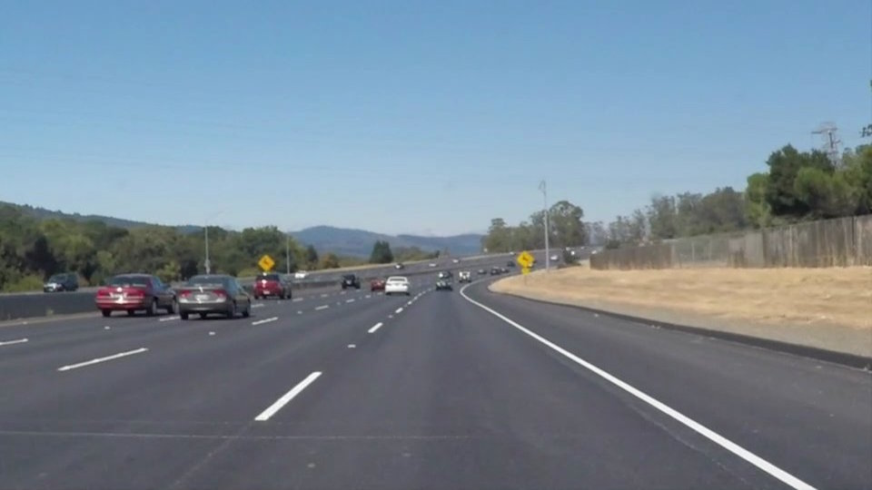

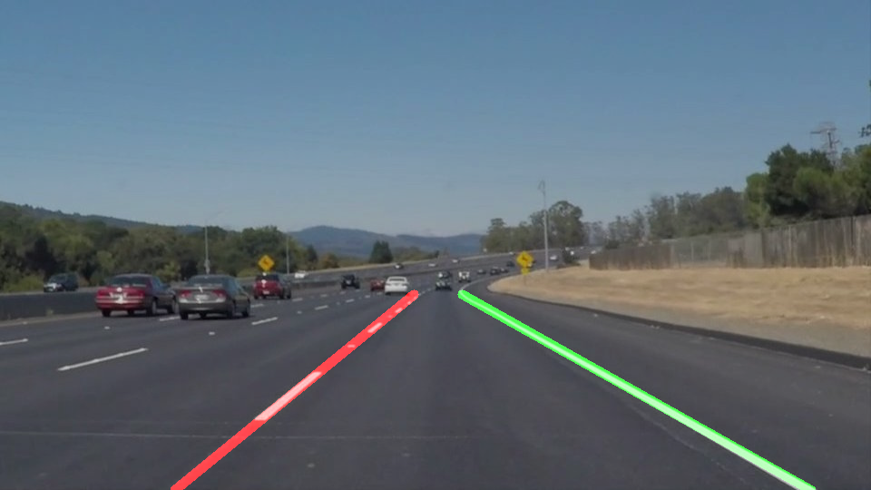

### 流水线总览


六步里每一步都有可调参数，每一步都能单独看到中间结果。考试问「调大某个参数会怎样」，答案就在下面那张因果表里。

### 第一步：灰度与高斯平滑

```python
GAUSSIAN_KERNEL = (5, 5)
CANNY_LOW, CANNY_HIGH = 50, 150

def edges_from_image(image_bgr):
    """灰度 -> 5x5 高斯降噪 -> Canny（Sobel 梯度 + 非极大值抑制 + 双阈值滞后）。"""
    gray = cv2.cvtColor(image_bgr, cv2.COLOR_BGR2GRAY)
    blurred = cv2.GaussianBlur(gray, GAUSSIAN_KERNEL, 0)
    return cv2.Canny(blurred, CANNY_LOW, CANNY_HIGH)
```

`cv2.imread` 读进来的是 BGR 通道顺序，所以转灰度要用 `cv2.COLOR_BGR2GRAY`，写成 `RGB2GRAY` 得到的灰度图红蓝互换，边缘位置会偏。

`cv2.GaussianBlur(gray, (5, 5), 0)` 第三个参数是 sigma，填 0 表示由核大小自动推算 $\sigma = 0.3 \cdot ((\text{ksize}-1) \cdot 0.5 - 1) + 0.8$，5×5 对应 $\sigma \approx 1.1$。高斯的作用是把单个像素的噪声摊开，同时保持边缘位置不偏移。

### 第二步：Canny 边缘检测

Canny 是三件事的组合：

1. **Sobel 梯度**。水平和竖直方向各做一次卷积，得到梯度幅值 $G = \sqrt{G_x^2 + G_y^2}$ 和方向 $\theta = \arctan2(G_y, G_x)$。
2. **非极大值抑制**。每个像素只看梯度方向上的两个邻居，梯度不是最大的就置零。这一步把边缘压成一像素宽。
3. **双阈值滞后**。梯度大于 `CANNY_HIGH` 的像素一定是边缘；梯度大于 `CANNY_LOW` 的像素是候选，还要看它连着的邻居是不是强边缘。

所以 `CANNY_LOW` 和 `CANNY_HIGH` 不是「多严格」的旋钮，而是「强边缘」和「弱边缘候选」的分界。常用的比例是 1:3，这份代码用 50 和 150，正好 1:3。

### 第三步：感兴趣区域掩码

```python
ROI_APEX_Y_RATIO = 0.6   # 三角形 ROI 顶点高度占图高比例

def road_roi_mask(shape):
    """手工指定的三角形路面区域，剔除天空、两侧绿化带与对向车道的干扰边缘。"""
    height, width = shape[:2]
    apex = (int(width * 0.45), int(height * ROI_APEX_Y_RATIO))
    polygon = np.array([[apex, (0, height), (width, height)]], dtype=np.int32)

    mask = np.zeros((height, width), dtype=np.uint8)
    cv2.fillPoly(mask, polygon, 255)
    return mask
```

顶点放在图像宽度的 45%、高度的 60% 处，底边是整条图像下沿。天空、两侧绿化带、对向车道都在三角形外。

掩码和边缘图做按位与：

```python
roi_edges = cv2.bitwise_and(edges, edges, mask=mask)
```

`bitwise_and(src1, src2, mask=mask)` 第三个参数是掩码：掩码为 0 的位置结果强制为 0。这里 `src1` 和 `src2` 传的是同一张图，语义上就是「按掩码裁剪」。

### 第四步：概率霍夫变换

```python
HOUGH_THRESHOLD, HOUGH_MIN_LEN, HOUGH_MAX_GAP = 30, 20, 20

lines = cv2.HoughLinesP(roi_edges, 1, np.pi / 180, HOUGH_THRESHOLD,
                        minLineLength=HOUGH_MIN_LEN, maxLineGap=HOUGH_MAX_GAP)
```

四个参数各管一件事：

- `rho=1`：霍夫空间中 $\rho$ 的分辨率，单位是像素。
- `theta=np.pi/180`：$\theta$ 的分辨率，1 度。
- `threshold=30`：**累加器阈值**。一条直线上有多少个点投票，票数达到 30 才算一条线。这是「多严格的线才算线」的旋钮。
- `minLineLength=20`：线段的最短像素长度，短于此的丢弃。
- `maxLineGap=20`：允许的最大断裂。相距 20 像素以内的两个点算同一条线。

`HoughLinesP` 的 P 是 Probabilistic（概率），它不做完整的投票，而是从随机点出发做梯度方向的爬山，找到一条线段就记一条。所以它比 `HoughLines` 快，代价是结果带随机性（OpenCV 内部有固定随机种子，默认可复现）。

返回值的形状是 `(N, 1, 4)`，每条线段四个数 `(x1, y1, x2, y2)`。`lines.reshape(-1, 4)` 把它压成 `(N, 4)`。

### 第五步：按斜率分左右，取均值

```python
MIN_ABS_SLOPE = 0.5      # 更平缓的线段视为水平噪声线

def average_slope_intercept(lines, shape):
    """按斜率把霍夫线段分成左右两组，各组取斜率与截距均值，得到两条完整车道线。

    图像坐标系 y 轴向下，故左车道斜率 < 0，右车道斜率 > 0。
    """
    left_fit, right_fit = [], []
    if lines is not None:
        for x1, y1, x2, y2 in lines.reshape(-1, 4):
            if x1 == x2:
                continue
            slope, intercept = np.polyfit((x1, x2), (y1, y2), 1)
            if slope < -MIN_ABS_SLOPE:
                left_fit.append((slope, intercept))
            elif slope > MIN_ABS_SLOPE:
                right_fit.append((slope, intercept))
    ...
```

三个要点。

**图像坐标系 y 轴向下。** 所以左车道线在图上从左下往右上走，斜率是负的；右车道线从右下往左上走，斜率是正的。判断左右要靠符号，不是靠数值大小。

**`np.polyfit((x1, x2), (y1, y2), 1)`** 做一次最小二乘直线拟合，返回斜率和截距。斜率为零的竖直直线会让这个除法出错，所以先判 `x1 == x2` 跳过。

**斜率绝对值小于 0.5 的丢弃。** 图像里水平方向的干扰边（护栏、路面纹理、远处地平线）斜率接近零，混进来会把均值拉歪。

取均值：

```python
    height = shape[0]
    lanes = []
    for fit, side in ((left_fit, "left"), (right_fit, "right")):
        if not fit:
            continue
        slope, intercept = np.average(fit, axis=0)
        y_bottom = height
        y_top = int(height * LANE_TOP_Y_RATIO)
        lanes.append((side, int((y_bottom - intercept) / slope), y_bottom,
                      int((y_top - intercept) / slope), y_top))
    return lanes
```

`np.average(fit, axis=0)` 对每列（斜率、截距）取平均。直线方程 $y = kx + b$，给定 $y$ 反解 $x$：$x = (y - b) / k$。所以用图像高度当 $y_{bottom}$、用 `LANE_TOP_Y_RATIO` 对应的高度当 $y_{top}$，两个点一连就是画出来的车道线。

### 第六步：叠加与分步可视化

```python
    lane_overlay = np.zeros_like(image)
    for side, x_bottom, y_bottom, x_top, y_top in lanes:
        color = (0, 0, 255) if side == "left" else (0, 255, 0)
        cv2.line(lane_overlay, (x_bottom, y_bottom), (x_top, y_top), color, 10)

    result = cv2.addWeighted(image, 0.8, lane_overlay, 1.0, 0)
```

`np.zeros_like(image)` 是全黑底，车道线画在黑底上。`cv2.addWeighted(src1, alpha, src2, beta, gamma)` 做线性混合，这里 `0.8` 的原图加 `1.0` 的车道线层，颜色是叠加出来的。

六个中间结果拼成一张三列网格图：

```python
def build_steps_canvas(panels, panel_width=480):
    """把中间步骤拼成一张 3 列网格图，越界处补空格。"""
    tiles = []
    for label, image in panels:
        scale = panel_width / image.shape[1]
        tile = cv2.resize(image, (panel_width, int(image.shape[0] * scale)))
        if tile.ndim == 2:
            tile = cv2.cvtColor(tile, cv2.COLOR_GRAY2BGR)
        cv2.putText(tile, label, (10, 26), cv2.FONT_HERSHEY_SIMPLEX, 0.7,
                    (0, 0, 255), 2, cv2.LINE_AA)
        tiles.append(tile)

    blank = np.zeros_like(tiles[0])
    while len(tiles) % 3:
        tiles.append(blank.copy())
    rows = [np.hstack(tiles[i:i + 3]) for i in range(0, len(tiles), 3)]
    return np.vstack(rows)
```

两个细节：`tile.ndim == 2` 说明是单通道的灰度图，叠到彩色网格上之前要 `cvtColor` 成三通道；`len(tiles) % 3` 不为零就补空白块，保证 `np.hstack` 的每一行宽度一样。

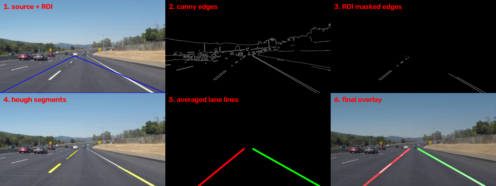

### 参数的因果链

这张表是这份代码最值钱的部分。考试问「调大某个参数会发生什么」，答案在右两列。

| 参数 | 当前值 | 管什么 | 调大的后果 | 调小的后果 |
|---|---|---|---|---|
| `GAUSSIAN_KERNEL` | (5, 5) | 降噪强度 | 边缘变少变钝，远处细弱车道线可能被抹掉 | 噪声边缘变多，霍夫阶段混入更多假线段 |
| `CANNY_LOW` | 50 | 弱边缘候选门槛 | 弱边缘被收进来，噪点变多 | 只有强边缘，噪点少但可能漏掉对比度低的车道线 |
| `CANNY_HIGH` | 150 | 强边缘门槛 | 只剩最强边缘，线段变少容易漏检 | 弱边缘被提升为强边缘，噪点变多 |
| `ROI_APEX_Y_RATIO` | 0.6 | 三角顶点在图高的位置 | 顶点更高，ROI 更大，天空和远处地平线的干扰被放进来 | 顶点更低，ROI 更小，远处车道线被切掉 |
| `LANE_TOP_Y_RATIO` | 0.6 | 拟合线画到多高 | 两条线往更高处延伸，会在消失点上方交叉 | 画得短，两条线不够长 |
| `HOUGH_THRESHOLD` | 30 | 投票门槛 | 线段变少，噪段被滤掉 | 噪段变多，均值被拉歪 |
| `HOUGH_MIN_LEN` | 20 | 最短线段长度 | 短线段被丢，断线更多 | 短线段保留，噪段变多 |
| `HOUGH_MAX_GAP` | 20 | 允许的最大断裂 | 断续点连成一条线，但斜率不同的线会被误连 | 线更碎，均值不稳 |
| `MIN_ABS_SLOPE` | 0.5 | 水平噪声线的门槛 | 斜率小的真车道线被当成噪声丢掉 | 水平干扰线混进均值 |

黄色弯道那张的输出更能看出参数的影响：弯道时车道线不再接近直线，按斜率分组会把同一侧的线段分到两组里。

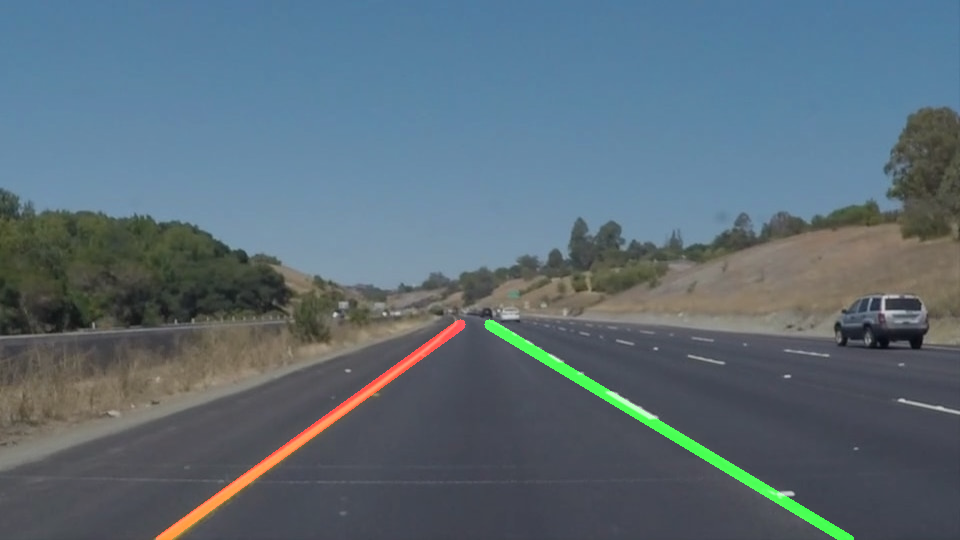

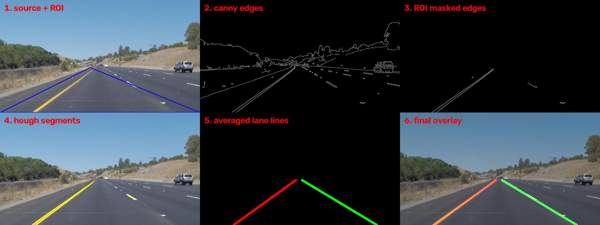

> [!WARNING]
> 这套方法的天花板就在「假设车道线是直线」。弯道、坡道、遮挡都会让它失效。考试如果问「这套方法为什么在真实场景不够用」，答这三条：全局直线假设、依赖手工 ROI、只用灰度信息丢了颜色与纹理。

## Apollo 工具链：命令、通道与调试器

四次作业全都围绕同一套东西：一键启动、回放数据包、用调试器看通道和曲线、改配置再回放看变化 [作业一：基于百度APOLLO自动驾驶平台的车辆规划可视化与调试.docx · p.1](http://10.188.31.55:5244/Nextcloud/School/Auto-Drive-Intro/%E4%BD%9C%E4%B8%9A/%E4%BD%9C%E4%B8%9A%E4%B8%80%EF%BC%9A%E5%9F%BA%E4%BA%8E%E7%99%BE%E5%BA%A6APOLLO%E8%87%AA%E5%8A%A8%E9%A9%BE%E9%A9%B6%E5%B9%B3%E5%8F%B0%E7%9A%84%E8%BD%A6%E8%BE%86%E8%A7%84%E5%88%92%E5%8F%AF%E8%A7%86%E5%8C%96%E4%B8%8E%E8%B0%83%E8%AF%95.docx)。

### 启动与回放

```bash
# 一键拉起整套 Apollo：cyber + dreamview
bash scripts/bootstrap_neo.sh

# 回放一个离线数据包，-l 表示循环播放
cyber_recorder play -f demo_3.5.record -l
```

`bootstrap_neo.sh` 是整套实验的入口。终端出现 `Dreamview is running at http://localhost:8888` 就说明 web 端起来了。

`cyber_recorder` 还有配套的 `list`（看包里有哪些通道）和 `info`（看包的信息）。数据包是从真车或仿真跑出来的 `.record` 文件。

### 四个调试器各管什么

| 工具 | 启动方式 | 看什么 |
|---|---|---|
| Dreamview | 浏览器开 `localhost:8888` | 场景仿真、模块开关、图层、PNC Monitor |
| PNC Monitor | Dreamview 里的 `Tasks` Tab | 规划与控制的实时曲线 |
| cyber_monitor | 终端 `cyber_monitor` | 所有 topic 的实时通道值 |
| control_info | `cd modules/tools/control_info/` 后 `jupyter notebook` | 控制误差的离线分析曲线 |

`cyber_monitor` 和 `PNC Monitor` 的区别值得记：前者看的是**数据流**（某个 topic 上的消息长什么样），后者看的是**信号曲线**（某个量随时间怎么变）。作业三要用 DATA RECORDER 拿到具体时刻，就是从 cyber_monitor 里读的 record time。

### Dreamview 的四个 Tab

- **Module Controller**：启停模块。作业二要启 `Planning`、`Prediction`、`Routing`，做开放空间规划还要加 `TaskManager`。
- **Profile**：选场景集。`Scenario Profiles` 里的 `course` 场景集，自车道内行驶、绕行障碍物、借道绕行、换道都在里面。
- **Layer Menu**：`Point ofView` 选 `Map` 是俯视图，选 `Camera` 是相机视角。
- **Tasks**：关掉 `Lock Task Panel` 才能展开 PNC Monitor 的按钮。

作业一的 PNC Monitor 面板上有六个常用通道：

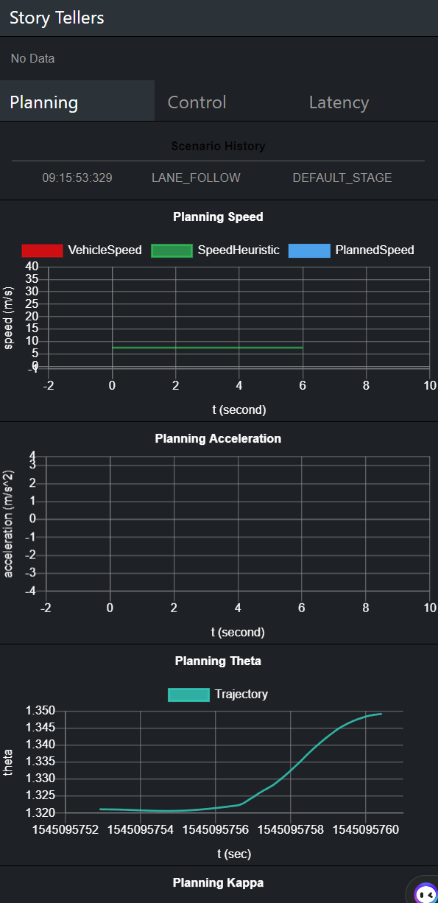

`Planning Speed` 是规划出来的速度曲线，`Reference Line Theta` 是参考线的朝向角，`Planning Kappa` 是参考线的曲率，`Planning Kappa Derivative` 是曲率的变化率——这三个一起看就知道车要打多大方向盘。

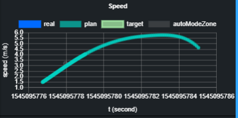

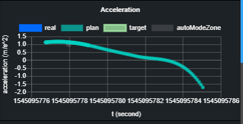

看曲线的读法：横轴是 record time，纵轴是物理量。`real` 是实际值，`plan` 是规划值，`target` 是目标值。规划值和实际值的偏差就是控制误差。

## 规划模块：场景、参数与 S-T 图

作业二和作业三都在 Planning 模块里 [作业二：基于百度apollo平台的多场景下路径规划.docx · p.1](http://10.188.31.55:5244/Nextcloud/School/Auto-Drive-Intro/%E4%BD%9C%E4%B8%9A/%E4%BD%9C%E4%B8%9A%E4%BA%8C%EF%BC%9A%E5%9F%BA%E4%BA%8E%E7%99%BE%E5%BA%A6apollo%E5%B9%B3%E5%8F%B0%E7%9A%84%E5%A4%9A%E5%9C%BA%E6%99%AF%E4%B8%8B%E8%B7%AF%E5%BE%84%E8%A7%84%E5%88%92.docx)。

### Planning 的三个子模块

| 子模块 | 决定什么 | 典型场景 |
|---|---|---|
| 路径规划（path） | 走哪条线，几何形状 | 绕行障碍物、借道绕行、换道 |
| 速度规划（speed） | 沿这条线走多快 | 加速超车、减速让行、掉头、减速带 |
| 开发空间规划（open space） | 没有车道线时怎么走 | 泊车、倒车入库 |

三者有先后也有耦合：路径先定几何，速度再沿路径定时间，开放空间规划是路径规划的特例，没有车道线可用。

### 四个典型场景

`course` 场景集里的四个：

- **自车道内行驶**：最基础的场景，路径贴着车道中心线，速度跟着限速。
- **绕行障碍物**：车道内前方有静态障碍物，路径在车道内横向偏移绕过去。
- **借道绕行**：相邻车道是空的且允许借道，路径横向跨过车道线。
- **换道**：为了超车或前方道路收窄，主动换到相邻车道。

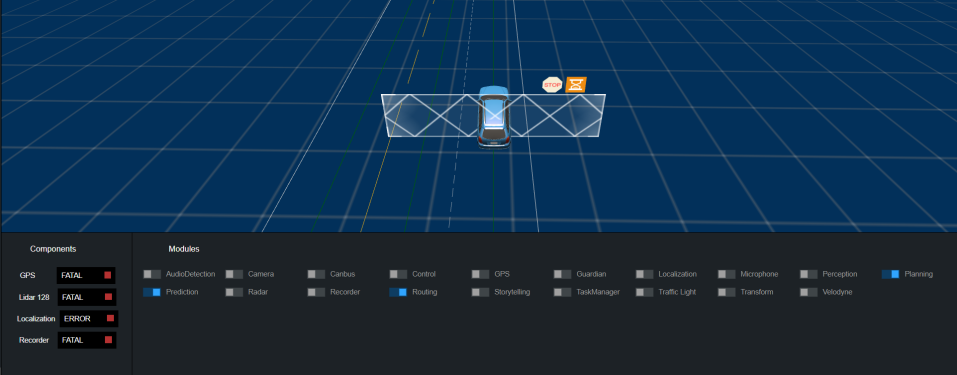

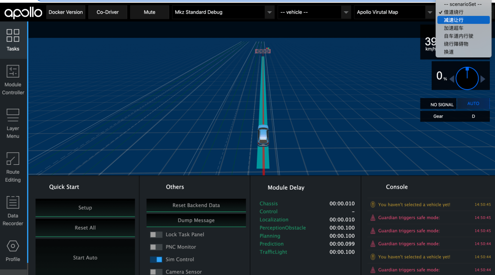

看路径图要同时看两样东西：路径本身（中间的线）和路径边界（两侧的带子）。边界是车辆宽度的余量，边界碰到障碍物说明横向空间不够。

### 开放空间规划

没有车道线的地方（比如停车场），规划要自己生成路径。作业二的操作顺序：

1. Module Controller 里启 `Planning`、`Prediction`、`Routing`、`TaskManager`。
2. PNC Monitor 里点 `RoutingEditing`，在停车位前的主路上点一个点当起点，在某个车位上点一个点当终点。
3. 点 `Send RoutingRequest` 发布路由请求。

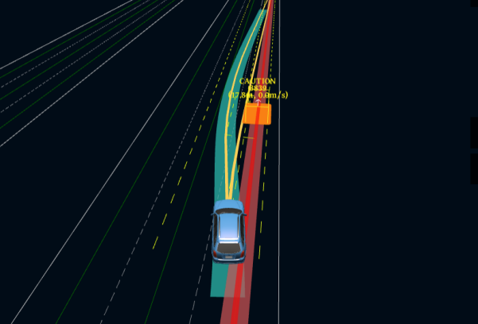

右下角那三个 `Module Delay` 是考点：开放空间规划每次求解都要迭代，比有车道线时的路径规划慢一个数量级。

### 速度规划的参数

作业三要改参数看曲线变化 [作业三：基于百度APOLLO平台多场景下的速度规划与数据采集.docx · p.1](http://10.188.31.55:5244/Nextcloud/School/Auto-Drive-Intro/%E4%BD%9C%E4%B8%9A/%E4%BD%9C%E4%B8%9A%E4%B8%89%EF%BC%9A%E5%9F%BA%E4%BA%8E%E7%99%BE%E5%BA%A6APOLLO%E5%B9%B3%E5%8F%B0%E5%A4%9A%E5%9C%BA%E6%99%AF%E4%B8%8B%E7%9A%84%E9%80%9F%E5%BA%A6%E8%A7%84%E5%88%92%E4%B8%8E%E6%95%B0%E6%8D%AE%E9%87%87%E9%9B%86.docx)。

| 参数 | 管什么 | 调大的后果 | 调小的后果 |
|---|---|---|---|
| 目标速度（target speed） | 想开多快 | 全程更快，但安全余量变小 | 更保守，跟车距离拉大 |
| 道路限速 | 硬上界 | 上界抬高 | 上界压低，车会提前减速 |
| 最大速度限制 | 车上界的兜底 | 允许更快 | 不允许超过这个值 |
| 最小速度限制 | 下界的兜底 | 逼着车加速，容易顶限速 | 允许在低速段龟行 |
| 加速度限制 | 纵向动力学上界 | 起步更快，但舒适性差 | 起步慢 |
| 安全距离 | 跟车时留多少 | 跟得更远，通行效率低 | 跟得更近，容易被加塞，也更容易追尾 |
| 速度权重（speed_weight） | 超过目标速度的惩罚 | 更严格守目标速度 | 允许稍微超一点 |

「增加最小速度限制会导致车辆更积极地加速，减少安全距离会导致车辆更接近其他车辆」——作业三原文这么写 [作业三：基于百度APOLLO平台多场景下的速度规划与数据采集.docx · p.1](http://10.188.31.55:5244/Nextcloud/School/Auto-Drive-Intro/%E4%BD%9C%E4%B8%9A/%E4%BD%9C%E4%B8%9A%E4%B8%89%EF%BC%9A%E5%9F%BA%E4%BA%8E%E7%99%BE%E5%BA%A6APOLLO%E5%B9%B3%E5%8F%B0%E5%A4%9A%E5%9C%BA%E6%99%AF%E4%B8%8B%E7%9A%84%E9%80%9F%E5%BA%A6%E8%A7%84%E5%88%92%E4%B8%8E%E6%95%B0%E6%8D%AE%E9%87%87%E9%9B%86.docx)。

### S-T 图：把时空冲突画成一张图

速度规划的核心是「什么时候到某个位置」。所以把空间和时间换一下：横轴是纵向距离 $s$，纵轴是时间 $t$。一张图上就装下了整个时空决策。

- **障碍物投影成一条线**。前车以速度 $v$ 行驶，它在 ST 图上就是一条斜线，斜率 $\frac{dt}{ds} = \frac{1}{v}$。车越快，线越平。
- **ST Boundary 上界**是速度限制给出的时间下界（同一段路上限速 $v_{max}$ 决定最快能多快通过）。
- **ST Boundary 下界**是障碍物投影线。
- **可行域**是上下界之间、且不在障碍物线下方的那块区域。

决策就来自可行域的连通性：


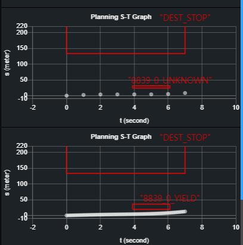

对比这两张：加速超车时 DP 的解走到障碍物线的**上方**（先加速拉开纵向距离再超），减速让行时解只能待在障碍物线的**下方**（跟车减速）。`DECISION: OVERTAKE` 和 `DECISION: YIELD` 就是这么判出来的。

DP 的代价函数大致是三项之和：障碍物代价（离障碍物多近）、横向代价（离参考线多远）、纵向代价（加速度大不大、加速度变化大不大）。

取某一时刻的 ST 图：

```bash
run modules/planning/tools/plot_st_nlp.py \
    -f /opt/apollo/neo/data/log/planning.INFO \
    -t 17:19:29
```

`-f` 指向 `planning.INFO` 日志，`-t` 是时刻（从 DATA RECORDER 里读到）。跑起来是个 jupyter notebook，把 ST 图、DP 网格、决策和对应的 SL 曲线都画出来。

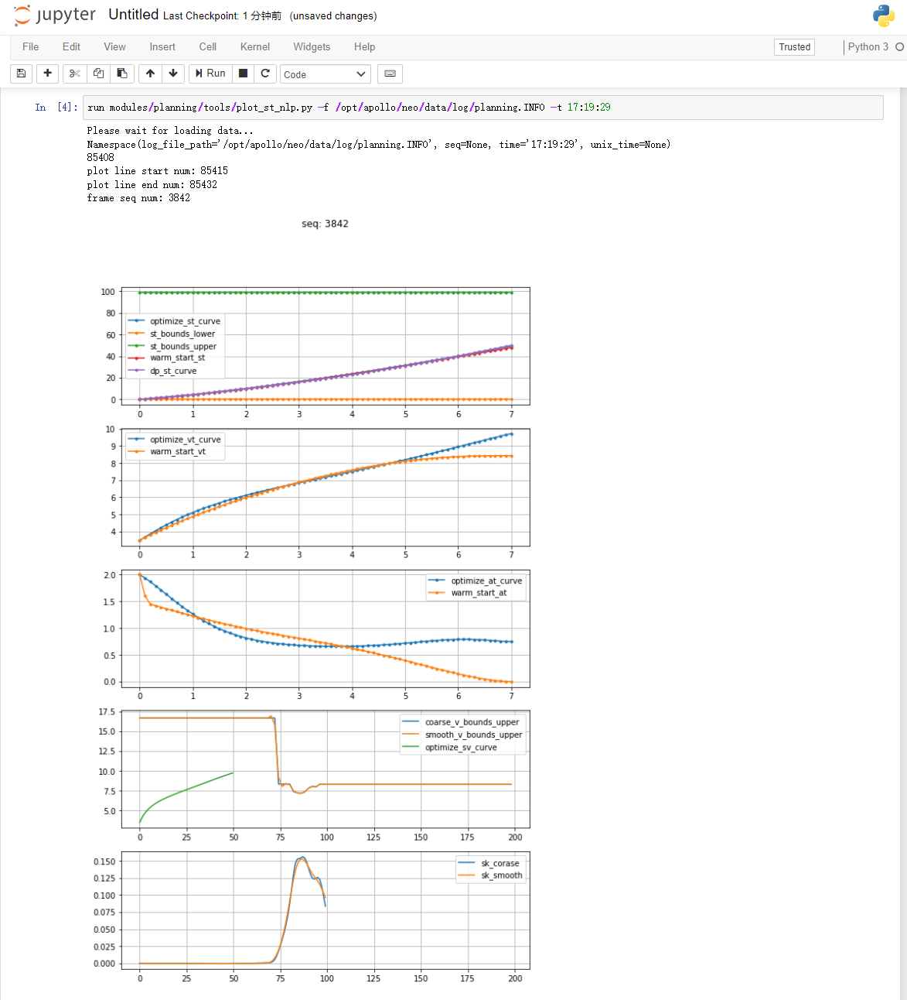

## 控制模块：纵向 PID 与横向 LQR

作业四用实测数据包看控制效果 [作业四：基于百度APOLLO平台的车辆控制结果分析.docx · p.1](http://10.188.31.55:5244/Nextcloud/School/Auto-Drive-Intro/%E4%BD%9C%E4%B8%9A/%E4%BD%9C%E4%B8%9A%E5%9B%9B%EF%BC%9A%E5%9F%BA%E4%BA%8E%E7%99%BE%E5%BA%A6APOLLO%E5%B9%B3%E5%8F%B0%E7%9A%84%E8%BD%A6%E8%BE%86%E6%8E%A7%E5%88%B6%E7%BB%93%E6%9E%9C%E5%88%86%E6%9E%90.docx)。

控制模块的职责是消除「理论模型」和「车辆实际」之间的偏差。纵向用 PID，横向用 LQR。

### 纵向 PID

纵向控制要跟的是速度。Apollo 的做法不是直接对速度误差做 PID，而是先把速度误差积分成「位置误差」，再对位置误差做 PID。这样做的好处是起步和停车都更稳。

配置文件是 `apollo_workspace/modules/control/conf/control_conf.pb.txt` [作业四：基于百度APOLLO平台的车辆控制结果分析.docx · p.1](http://10.188.31.55:5244/Nextcloud/School/Auto-Drive-Intro/%E4%BD%9C%E4%B8%9A/%E4%BD%9C%E4%B8%9A%E5%9B%9B%EF%BC%9A%E5%9F%BA%E4%BA%8E%E7%99%BE%E5%BA%A6APOLLO%E5%B9%B3%E5%8F%B0%E7%9A%84%E8%BD%A6%E8%BE%86%E6%8E%A7%E5%88%B6%E7%BB%93%E6%9E%9C%E5%88%86%E6%9E%90.docx)。里面要看的项：

- **前视**：`lookahead_time` 和 `lookahead_distance`（预瞄）。控制用「前方一小段路」而不是「当前位置」来算误差，纯跟踪的滞后会小很多。
- **误差项**：`station_error` 和 `speed_error`，分别给位置误差项和速度误差项配的滤波时间常数。
- **PID 增益**：`pid_conf` 里的 `kp`、`ki`、`kd`。
- **上界**：`max_acceleration` 和 `max_deceleration`，限制输出。
- **前馈**：由规划给的期望加速度直接加到输出上。

因果关系：

| 改动 | 曲线上的表现 |
|---|---|
| `kp` 调大 | 响应更快，但速度曲线出现超调和振荡 |
| `ki` 调大 | 消除稳态误差更快，但积分饱和后容易过冲、起步时抖 |
| `kd` 调大 | 抑制超调，曲线更平，但噪声被放大，方向盘和油门更毛 |
| `max_acceleration` 调小 | 起步和超车加速变慢，S-T 图上解变保守 |
| 前视时间调大 | 跟踪更平滑，但急弯的切弯精度下降 |

### 横向 LQR 与四个权重

横向控制的状态量是四个：横向位置误差 $e_y$、横向位置误差变化率 $\dot e_y$、航向误差 $e_\psi$、航向误差变化率 $\dot e_\psi$。代价函数是二次型：

$$J = q_0 e_y^2 + q_1 \dot e_y^2 + q_2 e_\psi^2 + q_3 \dot e_\psi^2$$

对应的权重写在 `lat_controller_conf` 里，作业四给的实际取值是：


| 权重 | 对应误差 | 当前值（前进） | 调大的后果 |
|---|---|---|---|
| $q_0$ | 横向位置误差 | 0.05 | 循迹更紧，方向盘动作更小，但急弯容易切内道 |
| $q_1$ | 横向位置误差变化率 | 0.0 | 抑制横向抖动，曲线更平，但跟踪滞后变大 |
| $q_2$ | 航向误差 | 1.0 | 车头更早对准路径，减少车身与路径的夹角 |
| $q_3$ | 航向误差变化率 | 0.0 | 转向动作更平滑，代价是响应变钝 |

注意 $q_2$ 是 $q_0$ 的二十倍。横向 LQR 主要靠航向误差驱动，横向位置误差的权重很小。倒车的 `reverse_matrix` 是另一组值（0.5、0.0、0.4、0.0），因为倒车的误差定义和前进不一样。

LQR 的反馈律：

$$k = (Q_{bar} + R_{bar} A^{T})^{-1} A^{T} Q_{bar}, \qquad u = -k \cdot e$$

$Q_{bar}$ 是把连续时间的 $Q$ 离散化并加上状态增广得到的状态权重矩阵，$R_{bar}$ 是控制量的权重矩阵（Apollo 里主要给方向盘角速度留权重）。稳态前馈则由路径的曲率直接给出。

所以横向控制是「前馈加反馈」：前馈按参考线的曲率打方向盘，反馈把剩下的偏差修掉。改 $q$ 改的是反馈那一半。

### 看哪些曲线判断控制好不好

control_info 工具画的误差曲线是判断依据：

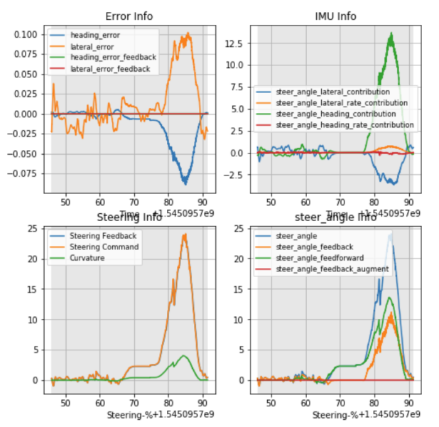

- `cross_track_error`：横向偏差。理想情况是一条零线附近的小幅波动。
- `heading_error`：航向偏差。车头和路径的夹角。
- `left_line_error` / `right_line_error`：车到左右车道线的距离。判断压线。
- `curvature_error`：实际曲率与规划曲率的差，方向盘打得对不对。
- `line_slope_error`：路径的横向斜率误差。

还有一条轨迹图：


判断标准：实际轨迹贴着规划路径，误差曲线在零附近，没有持续偏移（持续偏移说明反馈权重太小或存在稳态误差），没有高频抖动（抖动说明 $q_1$、$q_3$ 太小或 $k_d$ 太大）。

## 自测题

十二道。答案折叠在每道题后面。

<details>
<summary>1. 把 <code>CANNY_HIGH</code> 从 150 调到 60 会发生什么？</summary>

弱边缘被提升为强边缘，边缘数量变多，噪点也变多。后果是霍夫阶段的投票更容易被噪声拉偏，取均值得到的车道线抖动变大。

</details>

<details>
<summary>2. 为什么图像里左车道线的斜率是负的？</summary>

图像坐标系的 y 轴向下。左侧车道线从画面左下走向右上，$x$ 增大时 $y$ 减小，斜率 $k = \Delta y / \Delta x < 0$。所以代码里用 `slope < -MIN_ABS_SLOPE` 判左线。

</details>

<details>
<summary>3. <code>cv2.bitwise_and(edges, edges, mask=mask)</code> 里前两个参数为什么是同一张图？</summary>

因为语义是「按掩码裁剪」。`bitwise_and` 逐像素做与运算，两张相同的图按位与之后还是这张图，但掩码为 0 的位置被强制置 0，于是只保留掩码内的边缘。

</details>

<details>
<summary>4. <code>HoughLinesP</code> 的 <code>threshold</code> 调大会怎样？</summary>

投票门槛提高，需要更多点共线才算一条线，线段变少。远处对比度低的车道线会漏检，斜率均值不稳。

</details>

<details>
<summary>5. <code>maxLineGap</code> 调太大有什么风险？</summary>

断裂 allowance 太大时，两个本来斜率不同的点云会被连成一条线，比如护栏的边缘和相邻的车道线被连起来，斜率均值被拉歪。

</details>

<details>
<summary>6. 启动 Dreamview 的命令是什么？回放数据包并循环的命令是什么？</summary>

`bash scripts/bootstrap_neo.sh` 启动；`cyber_recorder play -f demo_3.5.record -l` 回放并循环，`-l` 是 loop。

</details>

<details>
<summary>7. cyber_monitor 和 PNC Monitor 的区别？</summary>

cyber_monitor 看的是数据流，即某个 topic 上的消息内容；PNC Monitor 看的是信号曲线，即某个物理量随时间的变化。作业三要读 record time 是从 cyber_monitor 里读的。

</details>

<details>
<summary>8. 做开放空间规划要启哪几个模块，做路径规划要启哪几个？</summary>

路径规划启 `Planning`、`Prediction`、`Routing`；开放空间规划还要加 `TaskManager`，并在 PNC Monitor 的 `RoutingEditing` 里选起终点后发 `Send RoutingRequest`。

</details>

<details>
<summary>9. ST 图上，前车画出来的线是什么形状？斜率等于什么？</summary>

前车匀速行驶时在 ST 图上是一条直线，斜率 $\frac{dt}{ds} = \frac{1}{v}$。车越快，线越平。前车匀减速时是向下凹的曲线。

</details>

<details>
<summary>10. OVERTAKE 和 YIELD 这两个决策在 ST 图上怎么区分？</summary>

看 DP 的解在障碍物线的上方还是下方。解能绕到障碍物线以上（先拉开纵向距离再变道超过）就是 OVERTAKE；解只能待在障碍物线以下（跟车减速）就是 YIELD。

</details>

<details>
<summary>11. 横向 LQR 的四个权重分别对应什么误差？</summary>

$q_0$ 横向位置误差、$q_1$ 横向位置误差变化率、$q_2$ 航向误差、$q_3$ 航向误差变化率。当前取值 0.05、0.0、1.0、0.0。

</details>

<details>
<summary>12. 纵向 PID 的 <code>ki</code> 调大，曲线上会看到什么？</summary>

消除稳态误差更快，但积分项容易累积过量，表现为起步或减速段的速度曲线过冲甚至振荡。

</details>
