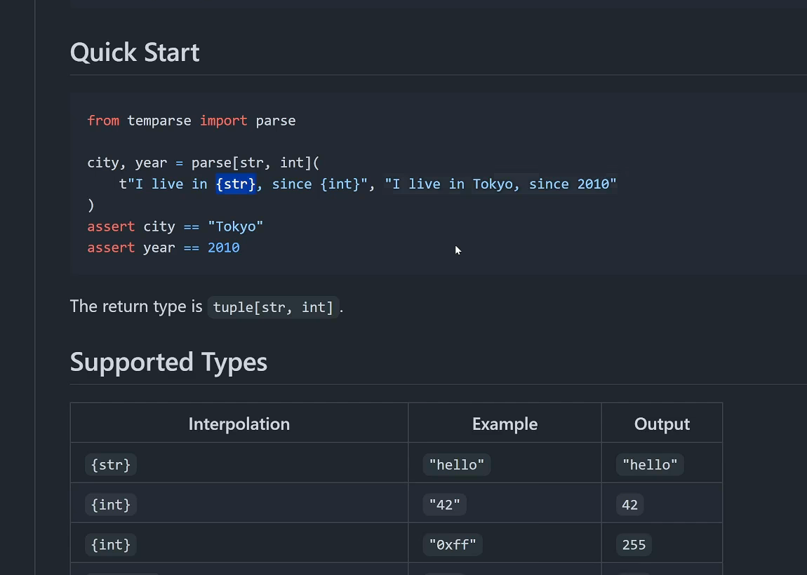
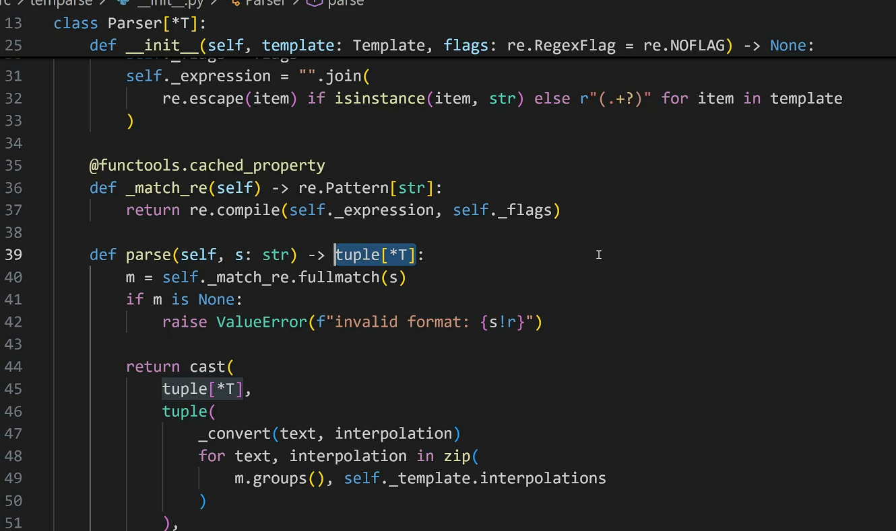
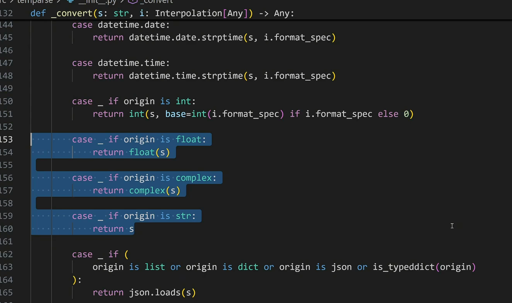
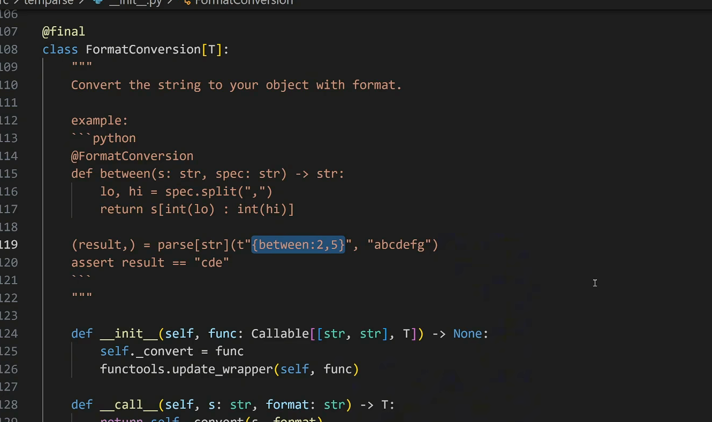
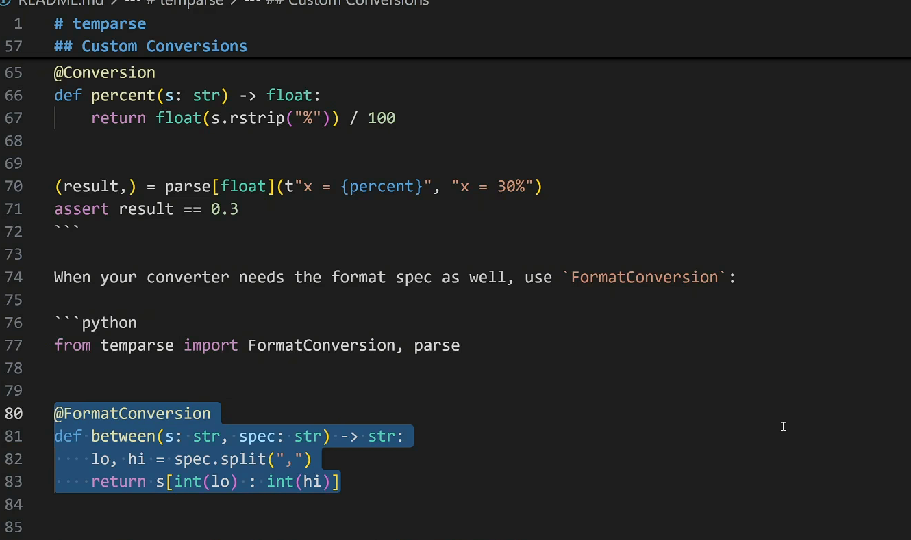
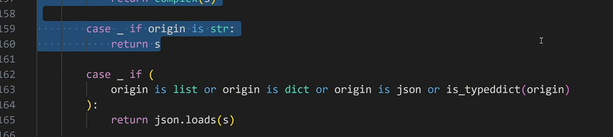

```cardlink
url: https://www.bilibili.com/video/BV1Dh4y1J7iG/
title: "code review 真的有必要吗，到底在review什么？"
description: "御风大世界讲 code review 在公司流程里的位置、要查什么、以及怎么沟通"
host: bilibili.com
image: http://i1.hdslb.com/bfs/archive/12c0b2d9b6f7329aaa4a9d4a389784b530b05c7f.jpg
```

```cardlink
url: https://www.bilibili.com/video/BV1RfaX6sESp/
title: "【Code Review】AI时代的CR还有意义么？一起看一个模板解析库"
description: "码农高天逐行 review temparse 这个模板解析库，从代码走到设计"
host: bilibili.com
image: http://i2.hdslb.com/bfs/archive/4e38bd7d15cede74eb1639ee7e6ac7e8adc1c0e7.jpg
```

```cardlink
url: https://www.bilibili.com/video/BV1punn6JEWi/
title: "实习/科研/学习中不用AI干不完，用AI写代码又看不懂，我该怎么办？"
description: "杜子源源回答实习生的疑问：AI 时代怎么保住自己的判断力"
host: bilibili.com
image: http://i1.hdslb.com/bfs/archive/1bb4755a174aa0e23bfdf390f11a33b4c88182f8.jpg
```

AI 写代码之后，code review 没有变得不重要，只是审的东西换了位置。缩进、变量名格式、重复的样板代码，这些琐碎问题被 AI 加 linter 加 formatter 接管了；design、interface、CI 这些层面的问题浮到水面上，而它们从来不需要 IDE 插件来发现。

这篇教程把三场视频整理在一起读。前两章来自御风大世界，讲 code review 在公司流程里的位置和一份能落地的审查清单。第三到第五章来自码农高天，他当场 review 一个叫 temparse 的模板解析库，从 README 一路读到 `parse` 这个小写 class 的设计理由。第六章是杜子源源回答实习生的问题：AI 写的代码看不懂，问题出在哪。

- [第 1 章 Code Review 在流程中的位置](#ch1) — code review 在开发流程里的位置：什么时候做、谁参与、QA 为什么要在场
- [第 2 章 审查清单与沟通心态](#ch2) — 一份能落地的审查清单：需求、可读性、规范、对现有逻辑的影响、文档，外加 review 时的沟通分寸
- [第 3 章 读一个模板解析库的代码](#ch3) — 以 temparse 为例读一遍代码：t-string 模板、泛型签名、预编译正则、match case 分派转换
- [第 4 章 设计层的分歧：装饰器、interface 与一致性](#ch4) — 三个设计分歧：小写 class parse 的 PEP 718 理由、装饰器该不该存在、JSON 分支破坏 interface 一致性
- [第 5 章 工程化收尾：覆盖率、CI，以及 AI 之后剩下的问题](#ch5) — 测试没有 coverage、workflow 只有一个发布流程；AI 消掉琐碎问题后 design、interface、CI 成为新战场
- [第 6 章 判断力：把工作和知识解耦](#ch6) — 实习生用 AI 写算子却看不懂：把工作与知识解耦，以 50 行代码为目标迭代，按能力、基础、导向分三层

## 第 1 章 Code Review 在流程中的位置 {#ch1}

公司规定，工期超过三天的开发任务都要做 code review [00:10](https://www.bilibili.com/video/BV1Dh4y1J7iG/?t=10)。这个环节固定卡在开发结束、准备提测之前 [00:55](https://www.bilibili.com/video/BV1Dh4y1J7iG/?t=55)。

很多团队赶进度时都有一条潜规则：代码没必要写得太复杂，能跑就行。发布上线以后，代码质量不行、运行性能很差；程序员离职后，接手的人完全看不懂；本来只想改一个很小的 bug，结果无端弄出三个 bug，效率非常低 [00:22](https://www.bilibili.com/video/BV1Dh4y1J7iG/?t=22)。这些坑都源于跳过了 code review。

它的定义很朴素：

> 对别人写的代码做审核，从而确保开发质量的一种手段 [00:45](https://www.bilibili.com/video/BV1Dh4y1J7iG/?t=45)。

它是项目质量管控当中非常重要的一个环节。

### 它排在哪一步

开发人员拿到一个需求，先做设计——这个需求打算怎么做。设计本身也要评审，技术设计没问题了才开始写代码。小需求一个人做，中型或者大型的需求需要一个小组合力开发。技术设计的大方向定了，实现思路上仍可能有差别，code review 就能在这时候发现一些问题 [01:02](https://www.bilibili.com/video/BV1Dh4y1J7iG/?t=62)。

```text
需求 → 设计（设计也要评审）→ 写代码 → code review → 提测
```

放在提测之前做，收益来自提测阶段的性质。提测阶段不该是改代码的阶段，只该是完善代码的阶段：

> 提测阶段不应该在大量的去修改代码，而是去完善代码 [01:33](https://www.bilibili.com/video/BV1Dh4y1J7iG/?t=93)。

> [!NOTE]
> 提测阶段要动的是 QA 提出来的 bug，以及兼容一些极端问题、边界问题。code review 同时也在确认：提测之前所有需求功能点都已经实现，代码逻辑符合业务逻辑 [01:37](https://www.bilibili.com/video/BV1Dh4y1J7iG/?t=97)。

### 谁参加


参与者有三类。代码的开发者自己要在场。还要找技术能力强一点的同事，比如开发组长、架构师。QA 也一起拉上 [01:55](https://www.bilibili.com/video/BV1Dh4y1J7iG/?t=115)。

有人会问，QA 不写代码，为什么还要拉上 QA 参加测试。其实有必要，因为很多 QA 同学也会写代码。他们在听你讲的时候会思考：

> 你这样做是不是符合产品的需求？他那边设计的一些测试 case 是否有遗漏？ [02:18](https://www.bilibili.com/video/BV1Dh4y1J7iG/?t=138)

QA 在场不是陪坐。review 结束时要确认的东西里，有一部分只能由懂业务的人问出来。

## 第 2 章 审查清单与沟通心态 {#ch2}

code review 要审两样东西：代码里该看的地方，以及你自己带着什么心态坐在那场会里。视频里的团队把审查拆成五个维度，顺序固定：产品需求、可读性、代码规范、对现有逻辑的影响、文档。

清单的用法取决于谁坐在对面。[第 1 章 Code Review 在流程中的位置](#ch1)说过参与 review 的三类角色：代码的开发者、技术能力强的同事、QA。QA 在现场不是凑人数，很多 QA 同学本身也写代码。代码里写了判断，QA 会问这些判断是不是全的，有哪些场景会跳过这些判断 [02:26](https://www.bilibili.com/video/BV1Dh4y1J7iG/?t=146)。同一场 review 顺便定下这次改动的范围：你改的是 user control 下面某一个方法，QA 只测这个方法相关的业务逻辑，其余的简单看一眼、不影响流程就放过 [02:36](https://www.bilibili.com/video/BV1Dh4y1J7iG/?t=156)。

### 审查什么：五个维度


**一、产品需求。** 业务逻辑是不是都完全实现了，有没有漏写的代码。发现了就尽量去完善 [02:56](https://www.bilibili.com/video/BV1Dh4y1J7iG/?t=176)。

**二、可读性。** 代码逻辑是否清晰，有没有注释，有没有重复造轮子 [03:07](https://www.bilibili.com/video/BV1Dh4y1J7iG/?t=187)。重复造轮子指什么：别的同事已经实现了你想要的这个功能，你不知道，于是又写了一遍。撞上了直接复用已有的 [03:10](https://www.bilibili.com/video/BV1Dh4y1J7iG/?t=190)。

**三、代码规范。** 进来的参数有没有做校验，判空，空集合；查询数据库有没有加 `LIMIT`，别造成一个非常大的查询把服务给撑爆；权限和数据安全方面有没有做相应的 check [03:23](https://www.bilibili.com/video/BV1Dh4y1J7iG/?t=203)。

`LIMIT` 这一条最容易被漏。有没有它，决定了这次查询是走索引还是扫全表：

```sql
SELECT id, order_no, amount, created_at
FROM orders
WHERE user_id = :user_id
ORDER BY created_at DESC
LIMIT 200;
```

**四、对现有逻辑的影响。** 新功能依赖一个三方 interface 时，要问三方系统挂了或者 interface 报错，会不会影响到自己系统的主流程——用户下不了单、没有办法支付，这些就是线上故障。这段代码有没有加 try-catch，有没有做一些降级策略。这一步每次做 code review 都要花很长时间，也非常重要 [03:42](https://www.bilibili.com/video/BV1Dh4y1J7iG/?t=222)。

降级一般长这样，三方不可用时退回本地缓存，主流程继续走完：

```python
try:
    return payment_gateway.query(order_no)
except GatewayTimeout:
    logger.warning("payment gateway timeout, fallback to cache: %s", order_no)
    return cache.get_cached(order_no)
```

**五、文档。** 本次涉及库表改动、interface 路径变更这些，一定要维护一份非常清晰的文档。上线之前的发布准备，全靠这份文档 [04:06](https://www.bilibili.com/video/BV1Dh4y1J7iG/?t=246)。


### 心态：审代码，别审人


> 我第一次参加 code review 的时候感觉自己在一件一件脱光衣服给别人看 [04:26](https://www.bilibili.com/video/BV1Dh4y1J7iG/?t=266)

难受的往往不是清单本身，是对话。高阶的同事前期没有参加过需求评审，他甚至不知道你这期要开发的是什么样的需求、要做什么样的迭代，所以你还得去讲需求背景、解释为什么这么做。心里非常清楚的一件事情一遍一遍地解释给别人，非常容易失去耐心，情绪管理也可能失控 [04:37](https://www.bilibili.com/video/BV1Dh4y1J7iG/?t=277)。

换一个姿势。视频里的做法是毫无保留：

> 我通常会毫无保留地去告诉每一个人我为什么要这么做，然后当时写代码的时候我的一个想法是怎样的 [05:08](https://www.bilibili.com/video/BV1Dh4y1J7iG/?t=308)

对方一旦全面了解了这件事，给出来的建议都是非常值得采纳的，甚至还会给出更好的解决方案。坐在对面的是架构师、开发组长、CTO 这个级别的人，他们身上有可取之处。视频里每次 code review 都抱着一种学习的心态 [05:26](https://www.bilibili.com/video/BV1Dh4y1J7iG/?t=326)。

反过来的状态是「你看不上我、我看不上你」，这样的 code review 就没有啥意义了。有些程序员直接 code review 完就离职，觉得公司太磨叽，对自己不信任，连细枝末节咋写的、咋实现的都要管 [05:47](https://www.bilibili.com/video/BV1Dh4y1J7iG/?t=347)。

该坚持的时候也要坚持。一件事情你怎么样去做，没有绝对的好，也没有绝对的坏。表达观点、和别人沟通的时候要有耐心，要去想怎么去说服别人 [06:07](https://www.bilibili.com/video/BV1Dh4y1J7iG/?t=367)。

说服别人本身是一种非常重要的技能，沟通的技能同样重要。这一段收尾时说的是：

> 总的来说就是为人谦虚一点然后多听取别人的建议 [06:25](https://www.bilibili.com/video/BV1Dh4y1J7iG/?t=385)

## 第 3 章 读一个模板解析库的代码 {#ch3}

Code review 的第一份材料是 README。它说明这个库要解决什么问题，代码只是那个问题的实现。

这一章 review 的对象叫 temparse，名字来自 template + parse。项目规模很小，全部代码放在一个文件里。

> 今天我们要 review 的项目呢是一个很小的项目啊叫 temparse。

> 这个名字怎么读怎么觉得像 temp ars，就是临时的屁股，这个词儿冲击力还是太大了。

名字之外，这个库值得看的理由是它小。代码短到能整段读完，review 的成本低，适合拿来练手。

### README 说了什么

项目的核心是：从一个字符串里按模板提取数据。模板里写明想提取的内容；大括号里的内容决定原始字符串怎么变成目标数据。[00:37](https://www.bilibili.com/video/BV1RfaX6sESp/?t=37)

README 给的例子：

```python
from temparse import parse

city, year = parse[str, int](
    t"I live in {str}, since {int}", "I live in Tokyo, since 2010"
)
assert city == "Tokyo"
assert year == 2010
```

模板里的 `{str}` 让那段文字原样保留，`{int}` 把那段文字转成整数。所以 year 拿到的是 `2010` 这个 int，模板里写 `{str}` 时拿到的仍是字符串。

类型参数 `parse[str, int]` 提示返回值的类型，对 type check 友好。[01:19](https://www.bilibili.com/video/BV1RfaX6sESp/?t=79)



Supported Types 表列了支持的类型：`str`、`int`、`float`、`complex`、`list`、`dict`、`json`、`datetime.datetime`、`datetime.date`、`datetime.time`。表下面有一条 IMPORTANT：list 和 dict 只是 json 的别名。

### 代码结构：一个文件

全部代码放在 `__init__.py` 里。

> 他的代码本身 review 起来非常轻松啊，因为只有一个文件，他把所有的东西都放到了 INIT 里。在这个项目非常小的情况下这样做也不是不行，但是我还是更推荐大家把它们分别放在不同的文件里啊，不过市面上有一些项目也确实是这么干的。

项目小的时候单文件不算错。规模上去之后，`Conversion`、`FormatConversion` 这些装饰器类和 `parse` 放在同一个文件里，导入路径会变长。[01:40](https://www.bilibili.com/video/BV1RfaX6sESp/?t=100)

### 核心类 Parser

`Parser` 用一个 type variable 表示输出类型，类型参数由调用方给出（PEP 695 的类型参数语法）：

```python
@final
class Parser[*T]:
```

docstring 第一句：

> A compiled template parser that can be reused to parse multiple strings.

写成 `Parser[str, int, float]` 之后，拆包时 type checker 能检查每个位置的类型对不对。[02:15](https://www.bilibili.com/video/BV1RfaX6sESp/?t=135)

`__init__` 把 template 拆成 raw string 与 `(.+?)` 捕获组，拼成一个正则表达式：

```python
    def __init__(self, template: Template, flags: re.RegexFlag = re.NOFLAG) -> None:
        if len(template.interpolations) == 0:
            raise ValueError("template must contain at least one interpolation")

        self._template = template
        self._flags = flags
        self._expression = "".join(
            re.escape(item) if isinstance(item, str) else r"(.+?)" for item in template
        )
```

模板里的字面量部分走 `re.escape`，占位部分换成非贪婪捕获组 `(.+?)`。这个字符串就是后面 match 用的模式。

### 借力 t-string

Python 3.14 的 t-string 会先把自己的内容 parse 成 raw string 和 interpolations，一部分 parser 的活交给 t-string 干。[02:21](https://www.bilibili.com/video/BV1RfaX6sESp/?t=141)

> 比如说例子里的这个 tstring，它可以直接从 Python 端拿到哪些是这种 raw string，哪些是你需要替换的这些模板，包括这个大括号里面。

所以这个库里没有一个手写的 tokenizer。切分模板这件事由 t-string 完成，剩下的活是：把 interpolation 变成正则，用正则去 match 字符串，再把 match 到的文本变成目标类型。

### 正则提前 compile

整个字符串用 regular expression 做 match。编译好的正则用 `functools.cached_property` 缓存住：

```python
    @functools.cached_property
    def _match_re(self) -> re.Pattern[str]:
        return re.compile(self._expression, self._flags)
```

这一点值得学：同一个正则要 match 很多次时，不要每次都重新 match，先 compile 再拿编译结果去 match，能省掉不少时间。[03:01](https://www.bilibili.com/video/BV1RfaX6sESp/?t=181)

`cached_property` 用在这里有两个好处：正则只在第一次用到时编译；每个 `Parser` 实例最多编译一次。



### parse 这个入口

对外暴露的 `parse` 是一个小写开头的 class，调用起来像函数：

```python
@final
class parse[*T]:
    def __new__(cls, t: Template, s: str, flags: re.RegexFlag = re.NOFLAG) -> tuple[*T]:
        return Parser[*T](t, flags).parse(s)
```

小写命名让 `parse(...)` 读起来仍然像函数调用，同时保留 `parse[str, int]` 这种类型参数下标的能力。

### parse 把 match 结果交给 convert

`parse` 方法用 `fullmatch` 匹配整个字符串，匹配不上就抛 `ValueError`；匹配成功时，把每一组捕获到的文本和对应的 interpolation 成对交给 `_convert`：

```python
    def parse(self, s: str) -> tuple[*T]:
        m = self._match_re.fullmatch(s)
        if m is None:
            raise ValueError(f"invalid format: {s!r}")

        return cast(
            tuple[*T],
            tuple(
                _convert(text, interpolation)
                for text, interpolation in zip(
                    m.groups(), self._template.interpolations
                )
            ),
        )
```

`zip` 把捕获组和 interpolation 对齐。这里有个隐含前提：每个 interpolation 在 `__init__` 里恰好生成一个捕获组，所以两边的数量天然一致。改动 `__init__` 的拼接逻辑时，这份前提会被打破，`zip` 会静默截断到较短的一边。这个耦合关系在代码里没有写出来。

### _convert 的两个参数

`_convert` 收两个参数：已经 match 上的字符串，和原来的模板。

```python
def _convert(s: str, i: Interpolation[Any]) -> Any:
```

字符串这个参数用 `s` 表示，这是常见写法。第二个参数作者起名 `i`，这里有一条命名建议：这个参数最好不要叫 `i`，`i` 太常被当 index 用，有时候又被当成 integer，看到 `i.` 后面跟什么都要在脑子里翻译一下。

> 这个 argument 最好不要叫 I，用 S 来表示 string，这个事很常见，但是 I 这个字母啊它太常被用来做 index 了，有些时候呢还被当成 integer 来用，所以我每一次后面看那个 I 点什么的时候我脑子都要反应半天，这里为了可读性建议改一下。

`i.value` 是大括号里的东西求值之后的值。在这个例子里，`{str}` 求值得到 `str` 这个 class，`{int}` 求值得到 `int` 这个 class。[04:17](https://www.bilibili.com/video/BV1RfaX6sESp/?t=257)

### match case 分派类型

`_convert` 先算出 origin，再按 origin 分派：

```python
    origin = get_origin(i.value) or i.value
    match origin:
        case Conversion():
            return i.value(s)

        case FormatConversion():
            return i.value(s, i.format_spec)
```

`Conversion` 和 `FormatConversion` 是两个装饰器类：前者包一个 `s -> T` 的函数，后者包一个 `(s, spec) -> T` 的函数，把用户自己写的转换接进模板。

类型转换本身是几个 case：

```python
        case _ if origin is int:
            return int(s, base=int(i.format_spec) if i.format_spec else 0)

        case _ if origin is float:
            return float(s)

        case _ if origin is complex:
            return complex(s)

        case _ if origin is str:
            return s
```

origin 是 int 就转成整数，float、complex 同理。int 这一支还读了 format spec 当 base，所以 `{int:16}` 能解析十六进制。末尾还有一个 `case _` 兜底，遇到不认识的对象抛 `TypeError`。



用 match case 写在这里比一串 if 判断好读：每个分支的条件写在分支头上，一眼能看出顺序，也能看出 `Conversion()` 这种类模式匹配走在前面。

整个文件不到 170 行，一个挺有趣的小功能就做完了。[04:44](https://www.bilibili.com/video/BV1RfaX6sESp/?t=284)

## 第 4 章 设计层的分歧：装饰器、interface 与一致性 {#ch4}

AI 加上 linter 和 formatter 之后，code review 里那类细节小问题基本消失了。缩进对不齐、空行少一个、命名风格跑偏，工具都会先拦一道。[04:53](https://www.bilibili.com/video/BV1RfaX6sESp/?t=293)

code review 剩下的价值只能从项目层面找。这一章拿 temparse 这个库当例子，看三个设计分歧：装饰器为什么存在，类型参数为什么要写两遍，同一套语义在不同位置有没有保持一致。

### `parse` 为什么是小写 class

temparse 里那个转换入口叫 `parse`，第一眼看上去违和：它带方括号类型参数，写法上和 class 一样，但名字是小写。

作者是故意的。目的只有一个：让使用者的概念里它是一个 function。[05:33](https://www.bilibili.com/video/BV1RfaX6sESp/?t=333)

```python
from temparse import parse

city, year = parse[str, int](
    t"I live in {str}, since {int}", "I live in Tokyo, since 2010"
)
```

读法就是调用一个函数。可 Python 当时的版本没法给函数直接加类型参数，于是作者把它做成 class，用 `__new__` 顶替函数入口（源码见[第 3 章 读一个模板解析库的代码](#ch3)）。

`__new__` 的 docstring 把这个取舍写清楚了：等到 PEP 718 被接受，这个 class 就由同名 function 替回去。视频里提到 PEP 718 由 Guido 本人提出，当时尚未被接受。



> 他为了保这个 typing 去做一些看起来有点奇怪的这个 hack

这个 hack 可以接受。评审时该看的是「作者想清楚了取舍，并且留了退路」。留了退路，说明作者知道自己在绕路，绕路也有终点。

### `Conversion` 却是大写 class

紧跟着的分歧在同一份文件的另一头。`Conversion` 和 `FormatConversion` 都是大写开头的 class。[06:30](https://www.bilibili.com/video/BV1RfaX6sESp/?t=390)

> 这个 conversion 它是个 decorator 对吧，为什么到了 decorate 这块又变成了一个正常的大写开头的 class 了呢

同一个文件里，`parse` 小写是为了伪装成 function，`Conversion` 大写是老老实实承认自己是个 class。命名在这里同时承担了两件事：告诉读者这是 class，以及告诉读者它该被 `@` 装饰。作者在 `parse` 上选了伪装，在 `Conversion` 上选了诚实。评审至少应该指出这个不一致，逼作者说明两处取舍的理由。

### 装饰器的实现

这两个装饰器类和 Python 的 `functools` 装饰器写法没什么关系。整个类只定义了两个方法：`__init__` 存住被装饰的函数，`__call__` 负责调用。[06:45](https://www.bilibili.com/video/BV1RfaX6sESp/?t=405)

```python
@final
class Conversion[T]:
    def __init__(self, func: Callable[[str], T]) -> None:
        self._convert = func
        functools.update_wrapper(self, func)

    def __call__(self, s: str) -> T:
        return self._convert(s)


@final
class FormatConversion[T]:
    def __init__(self, func: Callable[[str, str], T]) -> None:
        self._convert = func
        functools.update_wrapper(self, func)

    def __call__(self, s: str, format: str) -> T:
        return self._convert(s, format)
```

`__init__` 存下来的对象本身是个 callable，把它当函数传给模板，模板在 run time 会用字符串去调用它。`FormatConversion` 多一个参数，用来接 format spec。



模板侧的分派写在 `_convert` 里，用 match case 逐个匹配：`Conversion` 命中第一个分支，`FormatConversion` 命中第二个分支，完整的分派表在[第 3 章 读一个模板解析库的代码](#ch3)。

README 里的自定义转换例子把这条路径讲得最清楚。

```python
from temparse import Conversion, parse


@Conversion
def percent(s: str) -> float:
    return float(s.rstrip("%")) / 100


(result,) = parse[float](t"x = {percent}", "x = 30%")
```

README 最后一行写的是 `assert result == 0.3`。这是浮点等号断言，0.3 在二进制里没有精确表示，断言的成立依赖具体的舍入结果。稳妥的写法是 `abs(result - 0.3) < 1e-9`。这类细节 linter 抓不到，属于 code review 该管的范畴。

### 装饰器给 interface 带来了什么

退一步从 interface 的角度看这套装饰器。[07:45](https://www.bilibili.com/video/BV1RfaX6sESp/?t=465)

转换行为完全由大括号里的东西决定。大括号里写 `percent`，库就在全局找一个叫 `percent` 的函数，把 `30%` 这个字符串喂进去，拿到 float。`Conversion` 在这条链路上干了什么？

视频里给了两个候选作用：显式规定 `percent` 是一种 conversion 方式，好让实现能 match 到这个 case；以及规定函数的 argument 数量，有没有 format spec。

两个都站不住。

第一个作用多余。用户给了什么函数，库就用什么函数转换，`Conversion` 里没有任何检查，只是把原函数原样存住，等会儿再扔出来。

第二个作用在 type check 层面也拿不到额外信息：被装饰的函数本来就带类型标注。argument 数量、有没有 format spec，run time 全都知道。

> 这个 conversion 跟 format conversion 在设计的时候压根就不应该存在，他们俩没有给这个项目带来足够多的价值

更省事的 interface 是让用户直接写一个 conversion 函数传进去，不需要 `Conversion` 这个壳。

### 同一份数据写了两次

基础例子里有两处重复。[09:42](https://www.bilibili.com/video/BV1RfaX6sESp/?t=582)

```python
city, year = parse[str, int](
    t"I live in {str}, since {int}", "I live in Tokyo, since 2010"
)
```

`str` 出现两次，`int` 出现两次。模板里写了一遍 `{str}`、`{int}`，类型参数列表里又写了一遍 `str`、`int`。把字符串转成整数这种最常见的动作，用户要写两次 `int`。

类型参数那部分有明确用途，type checker 靠它推断返回值类型。模板里那一遍是不是必须，作者可以给出理由。

视频里给出的替代思路是：模板里已经声明了要返回什么值，转换方式能不能给一个默认。

interface 设计原则有两条：

- 没有歧义的情况下，让用户输入的东西越少越好。
- 同样的数据，不要让用户输两次。

按这两条量，`{int}` 这个写法在有歧义的时候需要消解，消解的办法就是让用户多写一次类型参数。这个代价能不能降，取决于库有没有给出带默认的方案。

### 大括号里的方向反了

自定义转换这块的直觉冲突更麻烦。

在 f-string 和 t-string 里，大括号里的内容一般表示「要转换哪个变量」。`f"{name}"` 里的 `name` 是数据。作者的设计里，大括号里的 `percent` 表示的是「转换这个 `30%` 的方式」。[10:30](https://www.bilibili.com/video/BV1RfaX6sESp/?t=630)

方向是反的。不熟悉这个库的人第一反应一定是「30% 对应 percent」。

> 我刚开始在读这个 readme 的时候大括号里面是什么东西我其实一直没搞明白

作者在视频里给出的替代方案是利用 t-string 自带的 format spec：冒号后面的内容会被自动带出来，而冒号后面在 Python 的惯例里就代表格式转换。定义「冒号后面出现某个名字就表示用这个函数转换」，语义方向和 f-string 的直觉对齐了。

`FormatConversion` 的例子已经在用这个位置。

```python
(result,) = parse[str](t"{between:2,5}", "abcdefg")
```

冒号后面是 `2,5`，代表转换时用的 format spec。把函数名放进同一个位置，interface 就能统一到「冒号后面是转换指令」这一条规则上。

### JSON 破坏了一致性

设计分歧里最硬的一条在 `json` 上。

作者给 `json` 定的语义是：把 JSON 字符串变成 dict 或 list。于是 `{json}` 出现在模板里。

前面所有设计里，大括号里放的都是 class 或者 function，使用者的心智模型是「我把字符串喂给它」。到了 `json` 这里，大括号里是一个 module。[12:39](https://www.bilibili.com/video/BV1RfaX6sESp/?t=759)

> 你是没有办法把一个 string feed 到这个 module 里的，那这个设计就相当于你自己重新又开辟了一个语义，这个语义是哪儿都没有的，你自己发明的

`json` 是一个 module，没有 `__call__`，字符串没法直接喂给它。库为了让它工作，专门在 match case 里加了一段特例。

```python
case _ if (
    origin is list or origin is dict or origin is json or is_typeddict(origin)
):
    return json.loads(s)
```



这段代码和它前面的 case 长得完全不一样，是整段分派逻辑里自己编出来的特例。README 里也承认了这一点。

> list and dict are just aliases for json

`list`、`dict`、`json` 三个名字对应完全一样的语义。用户写 `{list}` 和写 `{json}` 得到相同结果，还多记两条别名。

修法有两种。

一种是把 `Conversion` 和 `FormatConversion` 这层壳去掉。用户直接写 `json.loads`，库把它当普通 callable 传进去就能用，`json` 不需要特殊语义。

> 如果你是用 json.loads 都会好非常非常多，你甚至不用专门给它规定一个语义

另一种是如果确实要支持 `list` 和 `dict`，那就在 run time 做 type check，确认解析出来的确实是 list 或 dict，而不是把 dict 装在 list 的位置上。

> 这里我觉得如果你支持 list 和 dict 的话，应该做一些 run time 的 type check

最后一条推论也顺下来了：既然这个库这么在意 type check，`parse` 自己接收的字符串和类型参数也该有 run time 校验。现在的实现里，类型不匹配时抛出的错误来自底层库，报错信息指向使用者填错的地方，而不是指向模板声明和实际值不匹配这件事。[13:45](https://www.bilibili.com/video/BV1RfaX6sESp/?t=825)

## 第 5 章 工程化收尾：覆盖率、CI，以及 AI 之后剩下的问题 {#ch5}

一个项目算不算「正式」，根目录里那些工程化的配置说了算，代码写得漂不漂亮排第二。前几章看的是代码内部：类型怎么标、interface 怎么设计、装饰器与 `parse` 的分工怎么划。这一层还没碰。

### 测试是有的，coverage 没有

一个正式的项目还需要什么。temparse 有 `tests` 目录，测试是有的，缺的是 coverage [14:03](https://www.bilibili.com/video/BV1RfaX6sESp/?t=843)。没有 coverage data，就不知道自己的测试写得够不够。

coverage 报告把「哪些代码一次都没被执行过」摆到明面上。少了这一层，「测试都过了」和「测试只走通了主干路径」在日志里长得一样：绿灯，退出码 0。

### 只有一个 publish 的 GitHub workflow

仓库的 `.github/workflows` 目录下只有一个文件，负责发布：release 时构建出 wheel，传到 PyPI [14:13](https://www.bilibili.com/video/BV1RfaX6sESp/?t=853)。


这个文件的内容：

```yaml
name: Publish

on:
  release:
    types: [published]

jobs:
  publish:
    runs-on: ubuntu-latest

    permissions:
      id-token: write

    environment:
      name: pypi
      url: https://pypi.org/p/temparse

    steps:
      - uses: actions/checkout@v6

      - uses: astral-sh/setup-uv@v7

      - run: uv build

      - run: uv publish
```

整个配置里没有测试，没有 lint，没有 format 检查，只有发布。依赖里已经在用 ruff——仓库首页那条提交信息就写着 `build(deps): bump ruff >=0.16.0`（见上图）——但 lint 没有接进 CI。

> 那万一你这个程序出错了，其实你就压根儿不知道对吧。

CI 要搭起来，最低的一套是：push 和 pull request 上跑测试、跑 lint、跑 format 检查，任何一项失败就挡住合并。想把这个项目做成正经的，CI 就得做起来。发布是这套流程里的末尾一步，前面还有一串检查 [14:25](https://www.bilibili.com/video/BV1RfaX6sESp/?t=865)。

### AI 之后，编程细节上的问题变少了

> 现在有了 AI 的存在，确实我们编程小细节上的问题越来越少了。比如什么缩进有问题啊，变量名的格式不对啊，就这些琐碎的问题已经很少了。你的代码看起来都是挺靠谱的代码。

缩进、变量名格式这类琐碎问题基本消失 [14:30](https://www.bilibili.com/video/BV1RfaX6sESp/?t=870)。code review 里最机械的那一档检查，现在基本不需要人看了。

### 项目层面还有大量可以 review 的问题

> 你的代码看起来都是挺靠谱的代码，但是从项目的角度说，我们依然有大量可以 review 的问题。我们的 design，我们的 interface，我们的 CI，有很多东西是我们可以去思考、可以去改进的。

design、interface、CI 三样都摆在那里 [14:51](https://www.bilibili.com/video/BV1RfaX6sESp/?t=891)。代码看着靠谱，项目的骨架还是得有人拍板。[第 4 章 设计层的分歧：装饰器、interface 与一致性](#ch4)那些设计层面的分歧——装饰器怎么分、哪些类型该在 run time 拦下来——取决于你想要一套什么样的 interface。AI 不会替你把这个问题想清楚。

### 这些事 AI 能做吗

> 你说这些东西 AI 能做吗？或许能做，但它肯定不是自动做的。不是你说给我写一个这个项目，他就把我刚才说的那些东西全都给做了。

CI 配置能写，coverage 报告能读，design 的备选方案能给。这些都成立。但它肯定不是自动做的 [15:02](https://www.bilibili.com/video/BV1RfaX6sESp/?t=902)。你没说出口的那些判断，它不会自动补上。

> 你依然脑子里面需要有这根弦儿，你需要不断地跟它去沟通，不断地去跟它较劲。

它在这方面可能有有价值的见解 [15:16](https://www.bilibili.com/video/BV1RfaX6sESp/?t=916)。前提是你带着具体的问题去问，并且顶得住它给出的答案——这两件事都得你来做。

有没有这个意识去跟它沟通，是作为程序员值得培养的能力 [15:20](https://www.bilibili.com/video/BV1RfaX6sESp/?t=920)。

## 第 6 章 判断力：把工作和知识解耦 {#ch6}

一位实习生在实习的公司做 KV 量化，工作内容是优化算子和框架。他发现身边同事几乎都在用 agent，公司也鼓励用，不用就会落后。可他自己用下来几乎没收获：prompt 写好，让 agent 去改代码，第一轮优化还能看懂，几轮迭代之后代码晦涩难懂，只能让 AI 解释它优化了什么、解决了哪些问题。他的目标是看懂优化过程，可自己写不出那么高效的算子，每天只能从大层面了解一点知识 [00:00](https://www.bilibili.com/video/BV1punn6JEWi/?t=0)。

他问：这种情况正常吗。

这个感受正常，而且不限于实习生。中学、大学、科研、已工作的朋友都会碰到。原因是 AI 在逐步替代人的脑力劳动 [01:35](https://www.bilibili.com/video/BV1punn6JEWi/?t=95)。脑力劳动和体力劳动一样，都是劳动，都会被工具接管。

### 两拨人，两种做法

面对 AI，出现了两拨人。

已工作的那拨倾向于全员做 agent。他们不关心实现细节，只做产出的验收，加上极端情况的检查。

在学习的那拨坚持弄懂每一行代码，搞清楚 AI 到底怎么做到的，再把它学清楚。他们认为这是自己的核心竞争力，是认知和学习能力 [02:33](https://www.bilibili.com/video/BV1punn6JEWi/?t=153)。

两种做法都成立。问题的实质是：你要用 AI 来干什么。

那位实习生已经在公司实习了，公司给的任务要带来收益和产出。他既想要产出，又想学到东西，这两个目标凑在一起就困难 [03:09](https://www.bilibili.com/video/BV1punn6JEWi/?t=189)。

### 人在失败中提升

在 AI 之前，人靠失败获得提升。

高中数学有周考、月考、期末考，意义在于测出自己的能力边界在哪。做卷子时列出若干题，标出哪些是立体几何、哪些是圆锥曲线。圆锥曲线不会做，不会怪立体几何做错了，因为边界很清楚：这块知识面不够，下次提升的重点就落在圆锥曲线上 [03:28](https://www.bilibili.com/video/BV1punn6JEWi/?t=208)。

现在的做法变了。问 AI 一个问题，它不会告诉你这个知识属于哪个范围。范围是人裁定的。一个问题可能同时涉及数据库、环境配置、数据结构、AI 相关知识，作为学习者就 loss 掉了，完全不知道该学什么 [04:01](https://www.bilibili.com/video/BV1punn6JEWi/?t=241)。

第一步是把问题的边界定下来，别把问题摊大到吸收不了的程度 [04:27](https://www.bilibili.com/video/BV1punn6JEWi/?t=267)。

### 把工作和知识解耦

给那位实习生的建议是：把工作和知识解耦。

在工作中，核心目标是达到公司既定的要求，没有严重的性能 bug。

在知识上，要明确核心目标和优化方案，以 50 到 100 行为单位不断迭代自己的知识。写不出更高效的算子，就在现有基础上做 50 行的重构，再迭代下一轮 [04:59](https://www.bilibili.com/video/BV1punn6JEWi/?t=299)。


视频只给了 50 行这个单位。落到操作上，先量上一轮改动的规模，再决定这一轮往哪里推：

```bash
git diff --stat HEAD~1
git diff HEAD~1 | wc -l
```

改动超过这个量，说明这一轮摊开了，该收窄；改动不到，说明还没推到边界。

### 分工：概念问题交给 AI，判断留给自己

做领域研究时，AI 会不断扩展知识边界，冒出一堆没听过的名词。

如果这时候去一行一行读 AI 写的东西，人会筋疲力尽。而且读完之后，也不知道 AI 给的东西哪些是对的、哪些是错的。

可行的分工是自己去搜索，先确定问题的边界。遇到具体名词时，让 AI 帮忙搜索和解决。其余大部分工作属于判断性的工作，留在自己手里。概念性的问题交给 AI。

具体到动作上，人负责判断和思考，做 yes-or-no、if-else 这类判断；approve 之类的流程性动作交给 AI。分工明确之后，人和 AI 各自的位置就清楚了 [06:10](https://www.bilibili.com/video/BV1punn6JEWi/?t=370)。

### 卢德运动和脑力劳动

这类问题在历史上出现过。

工业革命时期爆发过卢德运动，一群纺织工人反抗纺织机，因为纺织机替代了他们的生产，威胁到他们的工作。

上世纪又出现了新卢德运动，一批人反对计算机替代自己的岗位。会计岗位被计算机替掉，数据分析等岗位也一样。

现在这一次取代的是脑力 [07:11](https://www.bilibili.com/video/BV1punn6JEWi/?t=431)。

区别在于，AI 的脑力有边界。这个边界就是人的判断能力 [07:26](https://www.bilibili.com/video/BV1punn6JEWi/?t=446)。

### 判断力的三种状态

判断能力体现在三个方面。

第一种，能力强，只是嫌写代码麻烦，或者觉得工作量太大，所以选择让 AI 做。这种人不怎么关心自己的处境，他更关心效率和产出。他的判断力已经足够优秀 [07:35](https://www.bilibili.com/video/BV1punn6JEWi/?t=455)。

第二种，能力没有那么强，不知道具体怎么做，希望 AI 帮忙完成。他的判断力比较模糊，但基础是好的。面对未知知识时，他不清楚哪些要学、哪些要舍弃 [08:11](https://www.bilibili.com/video/BV1punn6JEWi/?t=491)。

第三种，连自己要做什么都不知道，AI 说什么就做什么。这类人最该补的是概念性知识和判断力。判断力的前提是大量阅读，让自己的逻辑更清晰 [08:27](https://www.bilibili.com/video/BV1punn6JEWi/?t=507)。


视频里用「能力、基础、导向」三个词描述这三层：

| 类型 | 能力与基础 | 导向 |
|---|---|---|
| 第一种 | 能力强，但工作量大 | 结果导向 |
| 第二种 | 能力一般，基础好 | 知识导向 |
| 第三种 | 能力不行，基础不行 | 概念导向 |

三种状态的差别，落在「用 AI 干什么」这个问题上。第一种要的是效率，第二种要的是学得会，第三种要的是先知道自己要什么。

把三种状态套到那位实习生身上，他接近第二种：基础不差，第一轮优化还看得懂，但面对 AI 抛出的未知知识，不知道哪些要学、哪些要舍弃。解耦之后，工作的部分交给 agent 换取产出，学习的部分收成 50 行一轮的迭代。

人和 AI 之间怎么配合更高效，抛弃 AI 不现实，把思考全部交出去也不现实 [09:04](https://www.bilibili.com/video/BV1punn6JEWi/?t=544)。答案落在一句话上：

> 我去做核心的判断核心的选择，然后让AI来给我补充相关的背景知识就可以了 [09:19](https://www.bilibili.com/video/BV1punn6JEWi/?t=559)。
