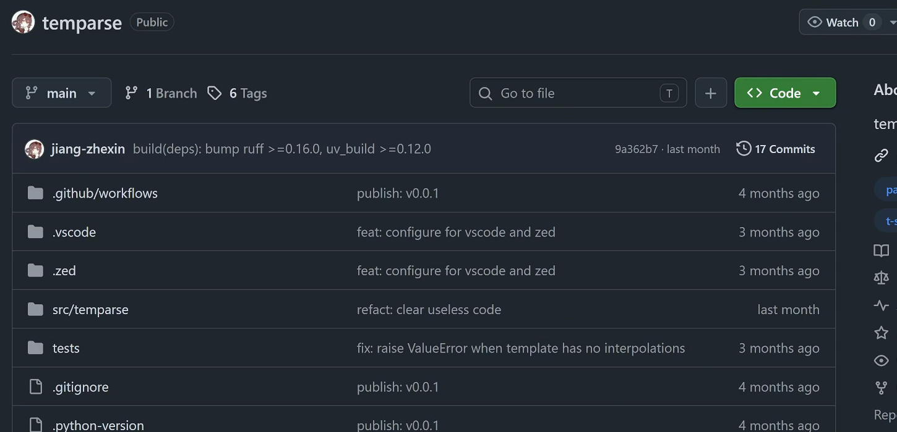

```cardlink
url: https://www.bilibili.com/video/BV1RfaX6sESp/
title: "【Code Review】AI时代的CR还有意义么？一起看一个模板解析库"
description: "码农高天逐行 review temparse 这个模板解析库，从代码走到设计"
host: bilibili.com
image: http://i2.hdslb.com/bfs/archive/4e38bd7d15cede74eb1639ee7e6ac7e8adc1c0e7.jpg
```

[← 返回《AI 时代下的 Code Review 教程》目录](../)

## 第 5 章 工程化收尾：覆盖率、CI，以及 AI 之后剩下的问题

一个项目算不算「正式」，根目录里那些工程化的配置说了算，代码写得漂不漂亮排第二。前几章看的是代码内部：类型怎么标、interface 怎么设计、装饰器与 `parse` 的分工怎么划。这一层还没碰。

### 测试是有的，coverage 没有

一个正式的项目还需要什么。temparse 有 `tests` 目录，测试是有的，缺的是 coverage [14:03](https://www.bilibili.com/video/BV1RfaX6sESp/?t=843)。没有 coverage data，就不知道自己的测试写得够不够。

coverage 报告把「哪些代码一次都没被执行过」摆到明面上。少了这一层，「测试都过了」和「测试只走通了主干路径」在日志里长得一样：绿灯，退出码 0。

### 只有一个 publish 的 GitHub workflow

仓库的 `.github/workflows` 目录下只有一个文件，负责发布：release 时构建出 wheel，传到 PyPI [14:13](https://www.bilibili.com/video/BV1RfaX6sESp/?t=853)。



这个文件的内容：

```yaml
name: Publish

on:
  release:
    types: [published]

jobs:
  publish:
    runs-on: ubuntu-latest

    permissions:
      id-token: write

    environment:
      name: pypi
      url: https://pypi.org/p/temparse

    steps:
      - uses: actions/checkout@v6

      - uses: astral-sh/setup-uv@v7

      - run: uv build

      - run: uv publish
```

整个配置里没有测试，没有 lint，没有 format 检查，只有发布。依赖里已经在用 ruff——仓库首页那条提交信息就写着 `build(deps): bump ruff >=0.16.0`（见上图）——但 lint 没有接进 CI。

> 那万一你这个程序出错了，其实你就压根儿不知道对吧。

CI 要搭起来，最低的一套是：push 和 pull request 上跑测试、跑 lint、跑 format 检查，任何一项失败就挡住合并。想把这个项目做成正经的，CI 就得做起来。发布是这套流程里的末尾一步，前面还有一串检查 [14:25](https://www.bilibili.com/video/BV1RfaX6sESp/?t=865)。

### AI 之后，编程细节上的问题变少了

> 现在有了 AI 的存在，确实我们编程小细节上的问题越来越少了。比如什么缩进有问题啊，变量名的格式不对啊，就这些琐碎的问题已经很少了。你的代码看起来都是挺靠谱的代码。

缩进、变量名格式这类琐碎问题基本消失 [14:30](https://www.bilibili.com/video/BV1RfaX6sESp/?t=870)。code review 里最机械的那一档检查，现在基本不需要人看了。

### 项目层面还有大量可以 review 的问题

> 你的代码看起来都是挺靠谱的代码，但是从项目的角度说，我们依然有大量可以 review 的问题。我们的 design，我们的 interface，我们的 CI，有很多东西是我们可以去思考、可以去改进的。

design、interface、CI 三样都摆在那里 [14:51](https://www.bilibili.com/video/BV1RfaX6sESp/?t=891)。代码看着靠谱，项目的骨架还是得有人拍板。[第 4 章 设计层的分歧：装饰器、interface 与一致性](<../第 4 章 设计层的分歧：装饰器、interface 与一致性>)那些设计层面的分歧——装饰器怎么分、哪些类型该在 run time 拦下来——取决于你想要一套什么样的 interface。AI 不会替你把这个问题想清楚。

### 这些事 AI 能做吗

> 你说这些东西 AI 能做吗？或许能做，但它肯定不是自动做的。不是你说给我写一个这个项目，他就把我刚才说的那些东西全都给做了。

CI 配置能写，coverage 报告能读，design 的备选方案能给。这些都成立。但它肯定不是自动做的 [15:02](https://www.bilibili.com/video/BV1RfaX6sESp/?t=902)。你没说出口的那些判断，它不会自动补上。

> 你依然脑子里面需要有这根弦儿，你需要不断地跟它去沟通，不断地去跟它较劲。

它在这方面可能有有价值的见解 [15:16](https://www.bilibili.com/video/BV1RfaX6sESp/?t=916)。前提是你带着具体的问题去问，并且顶得住它给出的答案——这两件事都得你来做。

有没有这个意识去跟它沟通，是作为程序员值得培养的能力 [15:20](https://www.bilibili.com/video/BV1RfaX6sESp/?t=920)。
