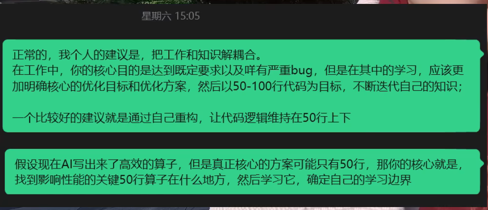

```cardlink
url: https://www.bilibili.com/video/BV1punn6JEWi/
title: "实习/科研/学习中不用AI干不完，用AI写代码又看不懂，我该怎么办？"
description: "杜子源源回答实习生的疑问：AI 时代怎么保住自己的判断力"
host: bilibili.com
image: http://i1.hdslb.com/bfs/archive/1bb4755a174aa0e23bfdf390f11a33b4c88182f8.jpg
```

[← 返回《AI 时代下的 Code Review 教程》目录](../)

## 第 6 章 判断力：把工作和知识解耦

一位实习生在实习的公司做 KV 量化，工作内容是优化算子和框架。他发现身边同事几乎都在用 agent，公司也鼓励用，不用就会落后。可他自己用下来几乎没收获：prompt 写好，让 agent 去改代码，第一轮优化还能看懂，几轮迭代之后代码晦涩难懂，只能让 AI 解释它优化了什么、解决了哪些问题。他的目标是看懂优化过程，可自己写不出那么高效的算子，每天只能从大层面了解一点知识 [00:00](https://www.bilibili.com/video/BV1punn6JEWi/?t=0)。

他问：这种情况正常吗。

这个感受正常，而且不限于实习生。中学、大学、科研、已工作的朋友都会碰到。原因是 AI 在逐步替代人的脑力劳动 [01:35](https://www.bilibili.com/video/BV1punn6JEWi/?t=95)。脑力劳动和体力劳动一样，都是劳动，都会被工具接管。

### 两拨人，两种做法

面对 AI，出现了两拨人。

已工作的那拨倾向于全员做 agent。他们不关心实现细节，只做产出的验收，加上极端情况的检查。

在学习的那拨坚持弄懂每一行代码，搞清楚 AI 到底怎么做到的，再把它学清楚。他们认为这是自己的核心竞争力，是认知和学习能力 [02:33](https://www.bilibili.com/video/BV1punn6JEWi/?t=153)。

两种做法都成立。问题的实质是：你要用 AI 来干什么。

那位实习生已经在公司实习了，公司给的任务要带来收益和产出。他既想要产出，又想学到东西，这两个目标凑在一起就困难 [03:09](https://www.bilibili.com/video/BV1punn6JEWi/?t=189)。

### 人在失败中提升

在 AI 之前，人靠失败获得提升。

高中数学有周考、月考、期末考，意义在于测出自己的能力边界在哪。做卷子时列出若干题，标出哪些是立体几何、哪些是圆锥曲线。圆锥曲线不会做，不会怪立体几何做错了，因为边界很清楚：这块知识面不够，下次提升的重点就落在圆锥曲线上 [03:28](https://www.bilibili.com/video/BV1punn6JEWi/?t=208)。

现在的做法变了。问 AI 一个问题，它不会告诉你这个知识属于哪个范围。范围是人裁定的。一个问题可能同时涉及数据库、环境配置、数据结构、AI 相关知识，作为学习者就 loss 掉了，完全不知道该学什么 [04:01](https://www.bilibili.com/video/BV1punn6JEWi/?t=241)。

第一步是把问题的边界定下来，别把问题摊大到吸收不了的程度 [04:27](https://www.bilibili.com/video/BV1punn6JEWi/?t=267)。

### 把工作和知识解耦

给那位实习生的建议是：把工作和知识解耦。

在工作中，核心目标是达到公司既定的要求，没有严重的性能 bug。

在知识上，要明确核心目标和优化方案，以 50 到 100 行为单位不断迭代自己的知识。写不出更高效的算子，就在现有基础上做 50 行的重构，再迭代下一轮 [04:59](https://www.bilibili.com/video/BV1punn6JEWi/?t=299)。



视频只给了 50 行这个单位。落到操作上，先量上一轮改动的规模，再决定这一轮往哪里推：

```bash
git diff --stat HEAD~1
git diff HEAD~1 | wc -l
```

改动超过这个量，说明这一轮摊开了，该收窄；改动不到，说明还没推到边界。

### 分工：概念问题交给 AI，判断留给自己

做领域研究时，AI 会不断扩展知识边界，冒出一堆没听过的名词。

如果这时候去一行一行读 AI 写的东西，人会筋疲力尽。而且读完之后，也不知道 AI 给的东西哪些是对的、哪些是错的。

可行的分工是自己去搜索，先确定问题的边界。遇到具体名词时，让 AI 帮忙搜索和解决。其余大部分工作属于判断性的工作，留在自己手里。概念性的问题交给 AI。

具体到动作上，人负责判断和思考，做 yes-or-no、if-else 这类判断；approve 之类的流程性动作交给 AI。分工明确之后，人和 AI 各自的位置就清楚了 [06:10](https://www.bilibili.com/video/BV1punn6JEWi/?t=370)。

### 卢德运动和脑力劳动

这类问题在历史上出现过。

工业革命时期爆发过卢德运动，一群纺织工人反抗纺织机，因为纺织机替代了他们的生产，威胁到他们的工作。

上世纪又出现了新卢德运动，一批人反对计算机替代自己的岗位。会计岗位被计算机替掉，数据分析等岗位也一样。

现在这一次取代的是脑力 [07:11](https://www.bilibili.com/video/BV1punn6JEWi/?t=431)。

区别在于，AI 的脑力有边界。这个边界就是人的判断能力 [07:26](https://www.bilibili.com/video/BV1punn6JEWi/?t=446)。

### 判断力的三种状态

判断能力体现在三个方面。

第一种，能力强，只是嫌写代码麻烦，或者觉得工作量太大，所以选择让 AI 做。这种人不怎么关心自己的处境，他更关心效率和产出。他的判断力已经足够优秀 [07:35](https://www.bilibili.com/video/BV1punn6JEWi/?t=455)。

第二种，能力没有那么强，不知道具体怎么做，希望 AI 帮忙完成。他的判断力比较模糊，但基础是好的。面对未知知识时，他不清楚哪些要学、哪些要舍弃 [08:11](https://www.bilibili.com/video/BV1punn6JEWi/?t=491)。

第三种，连自己要做什么都不知道，AI 说什么就做什么。这类人最该补的是概念性知识和判断力。判断力的前提是大量阅读，让自己的逻辑更清晰 [08:27](https://www.bilibili.com/video/BV1punn6JEWi/?t=507)。


视频里用「能力、基础、导向」三个词描述这三层：

| 类型 | 能力与基础 | 导向 |
|---|---|---|
| 第一种 | 能力强，但工作量大 | 结果导向 |
| 第二种 | 能力一般，基础好 | 知识导向 |
| 第三种 | 能力不行，基础不行 | 概念导向 |

三种状态的差别，落在「用 AI 干什么」这个问题上。第一种要的是效率，第二种要的是学得会，第三种要的是先知道自己要什么。

把三种状态套到那位实习生身上，他接近第二种：基础不差，第一轮优化还看得懂，但面对 AI 抛出的未知知识，不知道哪些要学、哪些要舍弃。解耦之后，工作的部分交给 agent 换取产出，学习的部分收成 50 行一轮的迭代。

人和 AI 之间怎么配合更高效，抛弃 AI 不现实，把思考全部交出去也不现实 [09:04](https://www.bilibili.com/video/BV1punn6JEWi/?t=544)。答案落在一句话上：

> 我去做核心的判断核心的选择，然后让AI来给我补充相关的背景知识就可以了 [09:19](https://www.bilibili.com/video/BV1punn6JEWi/?t=559)。
