```cardlink
url: https://www.bilibili.com/video/BV1Ech96cEzW/
title: "vLLM小课堂（十八）：RL-Kernel，大模型RL后训练中的训推一致性实践"
description: "RL-Kernel 项目第一期分享：训推不一致的成因、数值契约、验证方法，以及 v0.1.0 在 CUDA 与 ROCm 上的 200 步结果"
host: bilibili.com
image: http://i2.hdslb.com/bfs/archive/2d388bd039aced3e6eef1f6e5ff577bb1666aa53.jpg
```

- 开场与分享内容 — 讲师介绍、本次分享的四段结构：问题背景、项目定位、v0.1.0 结果、当前边界
- Rollout LogP 与 Training LogP：偏差如何改变 importance ratio — 两个 logprob 的来源、为什么本该相等、偏差怎么先伤到 clipping
- 浮点归约的顺序会影响计算结果 — 四个数相加的两种顺序、GPU 上的分块归约、差异怎么传到最终 LogP
- 比较 LogP 前需要对齐五项条件 — 权重版本、输入边界、位置信息、逻辑状态、随机条件，以及为什么这五项没对齐就不能怪 kernel
- vime 与 RL-Kernel 的分工 — vime 管工作流时序和数据流，RL-Kernel 管关键计算的数值对齐，两者合起来叫数值契约
- RL-Kernel 整体架构 — 四层关系：调度框架、执行引擎、一致性算子、硬件后端
- RL-Kernel 在单个 RL step 中的位置 — rollout 到 training 的完整链路，以及 old logprob 与 current logprob 各自在什么时候算
- 训练两侧需要对齐的计算 — 算术定义、token 顺序、结果合并、精度边界四类
- v0.1.0 覆盖的五类归约与关键算子的归约维度 — RMSNorm、Attention、GEMM/SwiGLU、Linear LogP、Collectives 各自的归约轴与差异来源
- Attention 和 Linear LogP 都依赖 LogSumExp — 同一个 LSE 统计量串起两个模块，以及只看单个 token 的分数为什么不够
- 固定 replay 后定位第一处差异与现场问答 — 逐层定位分叉点的方法，以及判定标准、算子复用、部署形态等问答
- 0 mismatch 的验证过程与 CUDA 实配 — 五步验证流程、并行配置命令、Qwen3-8B 在 8×H100 上跑完 200 步
- ROCm 实配：200 步逐 Bit 一致 — 8×MI300X 上的实验配置、9,400,614 次逐元素比较、性能与原生路径持平
- v0.1.0 的边界、下一步与社区协作 — 已完成与待验证的清单、四条并行线、RFC 认领与贡献方式

## 开场与分享内容

讲者是 Vensen Mu，RL-Kernel 的核心维护者。这次分享基于 v0.1.0 版本，主题是大模型 RL 后训练中的训推一致性 [00:12](https://www.bilibili.com/video/BV1Ech96cEzW/?t=12)。

分享内容分四段。第一段是问题背景：同一个模型、同一批 token，为什么两套引擎算出来的 LogP 还会不一样。第二段是项目定位：vime 负责流程，RL-Kernel 对齐关键计算。第三段是 v0.1.0 的结果：CUDA 和 ROCm 上的 200-step 验证。第四段是当前边界：已验证的范围和下一阶段计划 [00:41](https://www.bilibili.com/video/BV1Ech96cEzW/?t=41)。

这个项目放在 vLLM 社区下面。RL-Kernel 的仓库是 `github.com/RL-Align/RL-Kernel`，vime 本身是 `vllm-project/vime` [01:08:40](https://www.bilibili.com/video/BV1Ech96cEzW/?t=4120)。

## Rollout LogP 与 Training LogP：偏差如何改变 importance ratio

RL 后训练里有两个 logprob 来源。rollout 侧由 vLLM 执行：读取当前版本的权重，喂 prompt 生成 response token，同时记录模型对这些 token 给出的概率，产出 `rollout_logp` [01:54](https://www.bilibili.com/video/BV1Ech96cEzW/?t=114)。training 侧由 Megatron-LM 执行：接收这批 response token，在更新权重之前做一次前向计算，重算出 `train_logp`，后面用它计算 loss，也就是常说的 old logprob [02:16](https://www.bilibili.com/video/BV1Ech96cEzW/?t=136)。

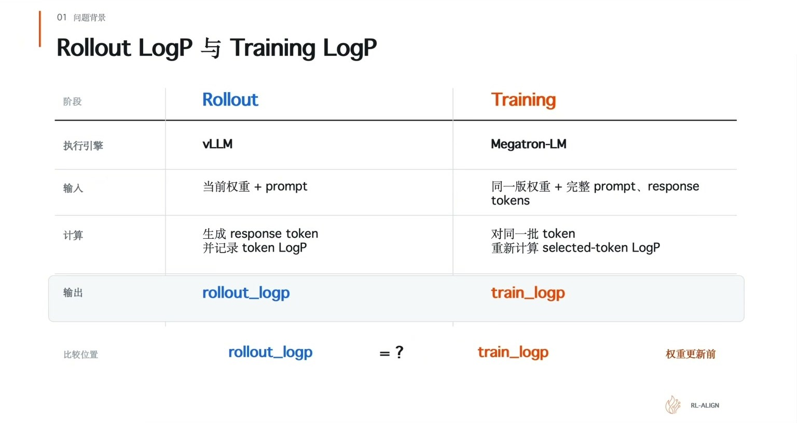

两个数不来自同一次程序执行，但描述的是同一时刻、同一策略对同一 token 的概率。权重还没更新时，它们本该一致 [02:49](https://www.bilibili.com/video/BV1Ech96cEzW/?t=169)。

实际跑起来不一致。两边执行的 kernel 不一样，batch size 不一样，并行布局不一样，规约方式也不一样。同一个模型不等于同一条执行路径 [03:01](https://www.bilibili.com/video/BV1Ech96cEzW/?t=181)。

不一致最先显形的地方是 importance ratio。训练侧用 current logprob 和 old logprob 算出这个比值 $\rho$，衡量新策略相对旧策略偏离了多少 [03:52](https://www.bilibili.com/video/BV1Ech96cEzW/?t=232)。$\rho$ 越远离 1，梯度裁剪就越早触发 [04:00](https://www.bilibili.com/video/BV1Ech96cEzW/?t=240)。

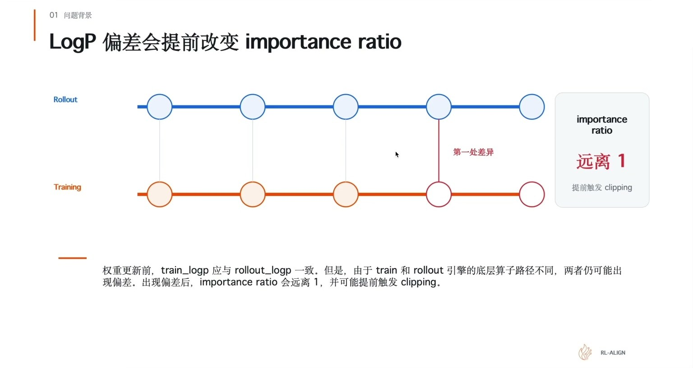

模型没学坏，概率算得不一样。这条链路是训推不一致最先显形的地方。

## 浮点归约的顺序会影响计算结果

四个数相加，数学上等于一个数。浮点世界里，加的顺序会改结果。

拿 a、b、c、d 四个值举例，假设 a 是 1000，c 是 -1000，b 和 d 都是 1，每次加法的结果保留三位有效数字 [05:30](https://www.bilibili.com/video/BV1Ech96cEzW/?t=330)。

顺序一是 `((a + b) + c) + d`：1000 + 1 舍入后还是 1000，1000 - 1000 = 0，0 + 1 = 1。顺序二是 `(a + b) + (c + d)`：-1000 + 1 舍入后是 -1000，1000 + (-1000) = 0 [05:41](https://www.bilibili.com/video/BV1Ech96cEzW/?t=341)。

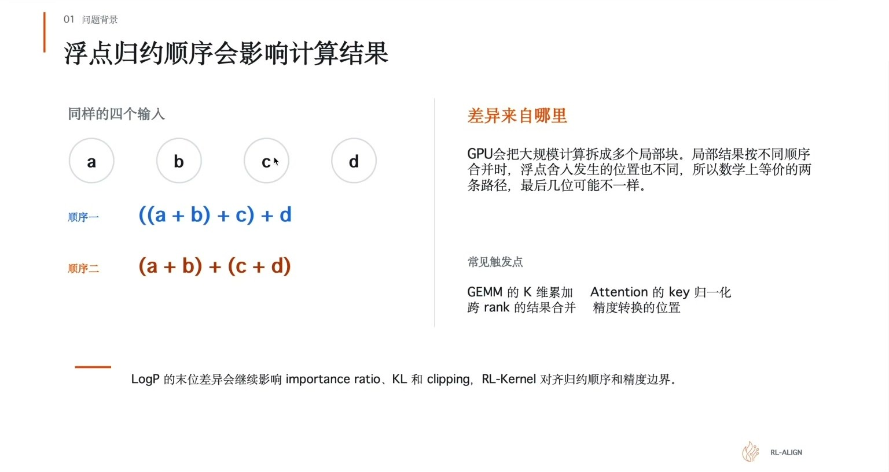

GPU 上大规模计算正是这样发生的。矩阵乘、attention、跨卡求和都要把很多数加起来，为了并行，GPU 把它拆成多个块各自计算，再把局部结果合起来 [06:10](https://www.bilibili.com/video/BV1Ech96cEzW/?t=370)。训练和推理的 batch size、序列长度、并行度不一样，系统就会选不同的 kernel 路径，分块数量和合并顺序跟着变 [06:37](https://www.bilibili.com/video/BV1Ech96cEzW/?t=397)。差异先出现在某个中间结果，再经过后续计算传到最后的 logprob。

所以要保证训推一致，除了同步权重，还要对齐累加顺序、计算精度，以及中间结果的规约位置 [06:56](https://www.bilibili.com/video/BV1Ech96cEzW/?t=416)。

## 比较 LogP 前需要对齐五项条件

查具体 kernel 之前有五项基础条件必须先核对，不核对就容易排查错方向 [07:25](https://www.bilibili.com/video/BV1Ech96cEzW/?t=445)。

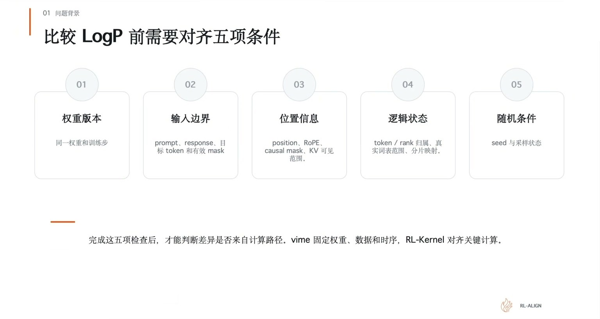

- **权重版本**：同一个 checkpoint、同一版权重、同一个训练步，rollout 和 training 都要对应它 [08:06](https://www.bilibili.com/video/BV1Ech96cEzW/?t=486)。
- **输入边界**：prompt、response、目标 token 和有效 mask [08:19](https://www.bilibili.com/video/BV1Ech96cEzW/?t=499)。
- **位置信息**：position、RoPE、causal mask、KV 可见范围 [08:28](https://www.bilibili.com/video/BV1Ech96cEzW/?t=508)。
- **逻辑状态**：token 与 rank 的归属、真实词表范围、分片映射 [08:36](https://www.bilibili.com/video/BV1Ech96cEzW/?t=516)。
- **随机条件**：seed 与采样状态 [08:48](https://www.bilibili.com/video/BV1Ech96cEzW/?t=528)。

任何一项不同，logprob 的差异都不能直接归因到 kernel。只有这五项都对齐了，剩下的差异才可能往底层计算里找 [09:00](https://www.bilibili.com/video/BV1Ech96cEzW/?t=540)。

> [!WARNING]
> 这一页是最容易漏掉的一页。跳过它直接去查 kernel，多半会查错方向——差异其实来自 seed 或者 mask，不是来自算子。

## vime 与 RL-Kernel 的分工

vime 负责组织完整的 RL 生命周期：什么时候做 rollout，什么时候做 reference，什么时候训练 actor，权重更新之后怎么同步给推理侧。它管的是时序、数据流、权重版本这类上层调度 [09:38](https://www.bilibili.com/video/BV1Ech96cEzW/?t=578)。

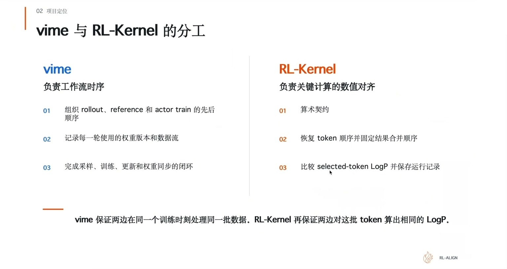

RL-Kernel 关注的是这条流程里的关键计算能不能对齐：attention 局部结果怎么合并，FFN 在哪一步转精度，跨卡求和先加哪一块，运行时有没有走到预期的算子 [10:04](https://www.bilibili.com/video/BV1Ech96cEzW/?t=604)。

两边约定的这套规则叫**数值契约**：把容易产生差异的地方明确写下来，两边必须按这个约定执行 [10:39](https://www.bilibili.com/video/BV1Ech96cEzW/?t=639)。vime 保证两边在正确的时间里处理正确的数据，RL-Kernel 保证关键计算按对齐后的规则执行。两者互补 [10:55](https://www.bilibili.com/video/BV1Ech96cEzW/?t=655)。

## RL-Kernel 整体架构

架构分四层 [11:18](https://www.bilibili.com/video/BV1Ech96cEzW/?t=678)。

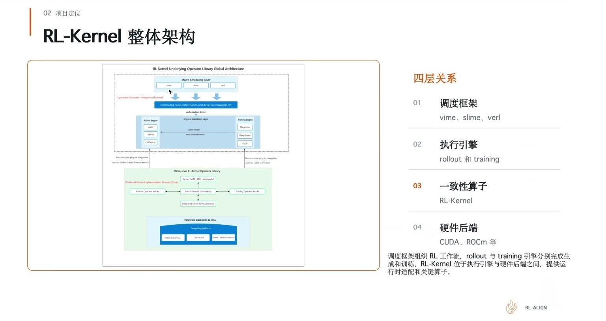

- **01 调度框架**：vime、slime、verl。这一层把生成、训练、权重更新串在一起 [11:44](https://www.bilibili.com/video/BV1Ech96cEzW/?t=704)。
- **02 执行引擎**：rollout 和 training 两侧的引擎，比如 vLLM 和 Megatron [11:56](https://www.bilibili.com/video/BV1Ech96cEzW/?t=716)。
- **03 一致性算子**：RL-Kernel。夹在执行引擎和硬件后端之间，不接管整个训练框架，只在 rollout 和 training 的关键计算位置提供算子、运行时检查和一致性实现 [12:02](https://www.bilibili.com/video/BV1Ech96cEzW/?t=722)。
- **04 硬件后端**：CUDA、ROCm 等。

这个架构的价值是把问题分层。上层框架按自己的调度方式跑，执行引擎也能保留自己的专项优化，比如 vLLM 里的高性能算子 [12:41](https://www.bilibili.com/video/BV1Ech96cEzW/?t=761)。RL-Kernel 这边要明确哪些关键结果必须对齐，因为最后落到 logprob 的计算要按这些约定处理。

## RL-Kernel 在单个 RL step 中的位置

一轮 RL 训练的完整链路 [13:27](https://www.bilibili.com/video/BV1Ech96cEzW/?t=807)。

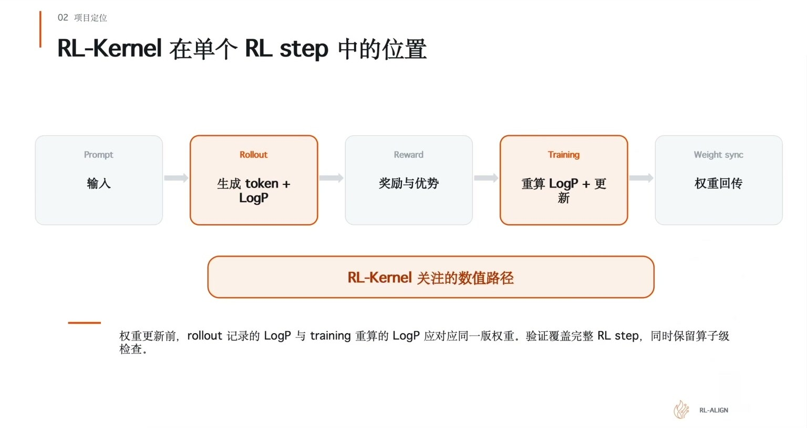

1. vime 根据 prompt 生成回答，保存 token 和对应的 rollout logprob [14:08](https://www.bilibili.com/video/BV1Ech96cEzW/?t=848)。
2. 系统对回答打分，得到 reward。
3. 样本和 reward 打包给训练侧。
4. Megatron-LM 收到数据后，用还没更新的权重对原来的 prompt 和回答做一次无梯度前向，得到 old logprob；同时按 reward 算出 advantage，告诉模型哪些回答该被鼓励、哪些该被降低概率 [14:43](https://www.bilibili.com/video/BV1Ech96cEzW/?t=883)。
5. Megatron-LM 用当前权重做带梯度的前向，得到 current logprob [15:14](https://www.bilibili.com/video/BV1Ech96cEzW/?t=914)。
6. current logprob 和 old logprob 算出 importance ratio，结合 advantage 算出 loss [15:29](https://www.bilibili.com/video/BV1Ech96cEzW/?t=929)。
7. backward 和 optimizer step 更新模型权重 [15:42](https://www.bilibili.com/video/BV1Ech96cEzW/?t=942)。
8. 新权重同步给 vime，开始下一轮生成。

第一次算 current logprob 时权重还没更新，两边的计算条件一致，current 和 old 应该相同或非常接近 [16:03](https://www.bilibili.com/video/BV1Ech96cEzW/?t=963)。同一批数据继续往下跑时，current 用更新后的权重重算，old 保持固定。

验证训推一致是在下一轮开始时用对应的新权重版本再检查一遍：这个 RL step 对应位置上，概率还能不能对得上 [16:42](https://www.bilibili.com/video/BV1Ech96cEzW/?t=1002)。

## 训练两侧需要对齐的计算

需要对齐的计算可以拆成四类 [17:46](https://www.bilibili.com/video/BV1Ech96cEzW/?t=1066)。

- **算术定义**：归一化覆盖哪些元素，mask 在哪一步生效，selected-token LogP 用什么定义。RMSNorm、Attention 和 LogP 要用相同的输入范围与归一化定义 [18:02](https://www.bilibili.com/video/BV1Ech96cEzW/?t=1082)。
- **token 顺序**：开了 TP 或 CP 把 token 分到不同设备以后，比较之前必须恢复成相同的逻辑顺序 [18:21](https://www.bilibili.com/video/BV1Ech96cEzW/?t=1101)。
- **结果合并**：一个大的结果来自多个局部或多个 rank 时，局部结果怎么组合。算这块再算那块，组合顺序影响最后的浮点值 [18:44](https://www.bilibili.com/video/BV1Ech96cEzW/?t=1124)。
- **精度边界**：明确哪些阶段用 FP32 累加，什么时候转回 BF16 或 FP16 [19:09](https://www.bilibili.com/video/BV1Ech96cEzW/?t=1149)。

vLLM 和 Megatron-LM 可以使用不同的 kernel 和内存布局。对同一批 token，两侧计算出的 selected-token LogP 需要一致。

## v0.1.0 覆盖的五类归约与关键算子的归约维度

v0.1.0 沿着当前支持的模型逐段检查，把影响 logprob 的主路径覆盖成五类 [19:30](https://www.bilibili.com/video/BV1Ech96cEzW/?t=1170)。

- **01 RMSNorm**：沿 hidden 维归约 [19:46](https://www.bilibili.com/video/BV1Ech96cEzW/?t=1186)。
- **02 Attention**：在当前 token 能看到的 K 的范围里做 softmax [19:57](https://www.bilibili.com/video/BV1Ech96cEzW/?t=1197)。
- **03 GEMM / SwiGLU**：沿 K 维 [20:08](https://www.bilibili.com/video/BV1Ech96cEzW/?t=1208)。
- **04 Linear LogP**：在整个词表上归一化 [20:26](https://www.bilibili.com/video/BV1Ech96cEzW/?t=1226)。
- **05 Collectives**：合并不同 rank 上的局部结果 [20:43](https://www.bilibili.com/video/BV1Ech96cEzW/?t=1243)。

五类的共同点是都先切分数据，完成局部计算，再把局部结果合起来。分区方式、合并顺序或者中间精度发生变化，最后几位就可能不同 [21:00](https://www.bilibili.com/video/BV1Ech96cEzW/?t=1260)。换模型时这五类要按具体模型重新拆。

每个算子归约的东西不一样，差异来源也不一样 [22:05](https://www.bilibili.com/video/BV1Ech96cEzW/?t=1325)。

| 算子 | 主要累加范围 | 差异来源 |
|---|---|---|
| RMSNorm | hidden dimension | 均值和方差依赖 hidden 维的累加顺序 [22:28](https://www.bilibili.com/video/BV1Ech96cEzW/?t=1348) |
| GEMM | K dimension | 不同 tile 会改变局部和最终合并方式 [22:38](https://www.bilibili.com/video/BV1Ech96cEzW/?t=1358) |
| Attention | visible keys | softmax 依赖可见 key 的最大值与求和 [22:49](https://www.bilibili.com/video/BV1Ech96cEzW/?t=1369) |
| Linear LogP | vocabulary | LogSumExp 需要在整个词表上归一化 [22:59](https://www.bilibili.com/video/BV1Ech96cEzW/?t=1379) |
| Collectives | ranks | 跨卡结果的合并顺序影响末位结果 [23:03](https://www.bilibili.com/video/BV1Ech96cEzW/?t=1383) |

排查时先确认参与归约的元素范围，再检查数据切分、结果合并、精度转换位置。

通信这块有个坑：看到通信后第一次出现差异，不能马上认定是通信的问题。各张卡交给通信层的局部结果本身可能已经不一样了 [23:10](https://www.bilibili.com/video/BV1Ech96cEzW/?t=1390)。

另一个坑是配置。batch size、序列长度、并行度一变，系统可能选另一条 kernel 路径。表面上是配置变了，实际的分块数量、局部结果、合并顺序都跟着变 [23:38](https://www.bilibili.com/video/BV1Ech96cEzW/?t=1418)。

## Attention 和 Linear LogP 都依赖 LogSumExp

LogSumExp（LSE）是把一组分数转换成概率时需要的归约统计量。给定一组分数 $x_1, \dots, x_n$，它的定义是

$$
\mathrm{LSE}(x_1, \dots, x_n) = \log \sum_{i=1}^{n} e^{x_i}
$$

softmax 的分母就是这个值，log-softmax 的归一化项也是它 [24:23](https://www.bilibili.com/video/BV1Ech96cEzW/?t=1463)。

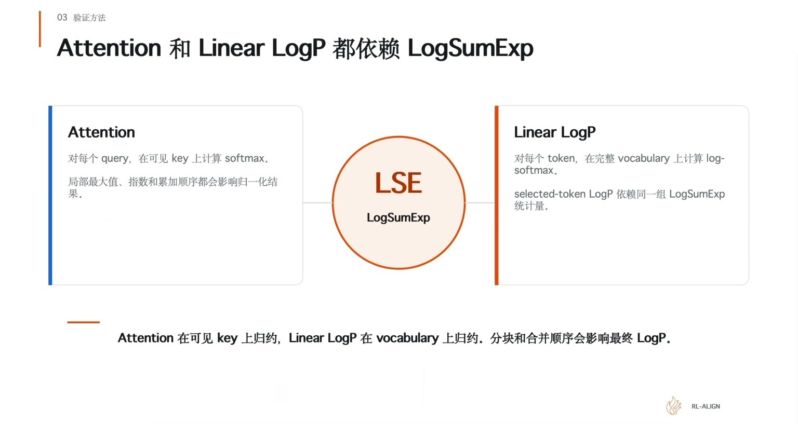

Attention 侧，一个 query 会给多个 key 打分，这些分数要一起做归约，才能决定关注哪些位置 [24:48](https://www.bilibili.com/video/BV1Ech96cEzW/?t=1488)。Linear LogP 侧，模型对整个词表打分，得到各个 token 的完整对数概率 [25:07](https://www.bilibili.com/video/BV1Ech96cEzW/?t=1507)。

两个模块作用不同，但都要处理一组分数的统计归约。

这里有个容易漏的点：只关心某个 token 时，不能只检查它自己那一项分数。其他词表项会影响归约结果，自己那项分数没变，其他项汇总出来的结果变了，最终的概率照样会变 [25:46](https://www.bilibili.com/video/BV1Ech96cEzW/?t=1546)。

要关心的是 LSE 的精度和合并顺序。尤其在词表这一块，以及多个 key 被切成多个块、或者分到多张卡的时候，每块的统计量到底怎么合起来，需要有明确的约定 [26:15](https://www.bilibili.com/video/BV1Ech96cEzW/?t=1575)。

## 固定 replay 后定位第一处差异与现场问答

实际 debug 的做法：先拿一份固定的权重，把已经生成好的 token 保存好，让训练和推理都算同一份输入，然后看中间结果 [26:33](https://www.bilibili.com/video/BV1Ech96cEzW/?t=1593)。

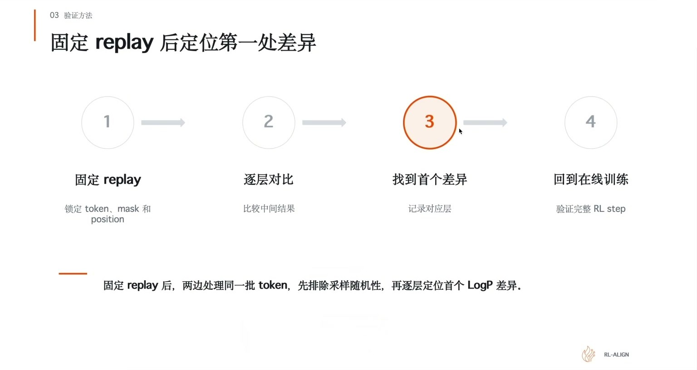

前几层输出都一样，到 attention 开始不一样，范围就缩小到那一层，继续检查这一层的 attention：输入相同、输出不同时，进一步查里面的精度、规约、kernel 选择。如果输入已经不同就往前继续找，因为后面的模块可能只是继承了前面的误差 [27:02](https://www.bilibili.com/video/BV1Ech96cEzW/?t=1622)。

这样能找到第一个分叉的位置，比改很多地方都有用 [27:50](https://www.bilibili.com/video/BV1Ech96cEzW/?t=1670)。debug 时要特意构造边界性的数值，要有对照，就得固定这些边界值来跑 [32:34](https://www.bilibili.com/video/BV1Ech96cEzW/?t=1954)。

**一致性的标准是完全一致。** 现场的提问是：衡量标准是误差在极低范围内，还是必须完全一致？答案是完全一致 [28:31](https://www.bilibili.com/video/BV1Ech96cEzW/?t=1711)。原因是误差在极低范围内不能保证后面不会变大。经过多层累加或者精度转换之后，数值可能越来越大，导致训练不稳定。所以精度、舍入边界、unmask 时机都要考虑进去。通信也一样：都从各分块算结果，最后按照固定的顺序去累加 [28:48](https://www.bilibili.com/video/BV1Ech96cEzW/?t=1728)。

推理侧同样存在这个问题。vLLM 里有一套专门跑这些 model 的 lm-eval 标准，参照它来看模型分数有没有问题 [30:53](https://www.bilibili.com/video/BV1Ech96cEzW/?t=1853)。原本能到 0.99 量级的分数掉到 0.8 几，就说明中间出了偏差，要回头查是哪一环 [30:11](https://www.bilibili.com/video/BV1Ech96cEzW/?t=1811)。

**新算子支持与算子复用。** vLLM 那边一直在持续支持新算子。其他仓库现在也在开始做这块，尤其是针对 NVIDIA 的 H 系列、B 系列这种自带硬件加速技术的卡 [33:45](https://www.bilibili.com/video/BV1Ech96cEzW/?t=2025)。RL-Kernel 的取舍是：保证一致性时会牺牲性能，所以要保性能时尽量复用高性能算子库，比如 vLLM 里的、FlashInfer、AMD 那边的 ROCm 算子库。只有确实保证不了累加顺序或规约顺序的时候，才自己写 kernel [35:04](https://www.bilibili.com/video/BV1Ech96cEzW/?t=2104)。

**部署形态。** 有人问，在真正的模型部署时会不会把算子换回框架原来的算子，这样训练时保证的一致性就迁移不过去了。回答是不会。RL-Kernel 做的不是一个单独算子的替换，而是按模型拆出对应的一套：算子、通信方式、运行时检查、上下游集成代码，这是一个完整体系。部署时也不需要再切回原来的算子，因为 consistency 路径和 fast path 两套都会保留 [36:41](https://www.bilibili.com/video/BV1Ech96cEzW/?t=2201)。

上线用原来的框架代码还是改过的版本，取决于用户。如果保证了一致性，而且性能不比原生差、甚至可能比原生高，两种方式都可以 [38:53](https://www.bilibili.com/video/BV1Ech96cEzW/?t=2333)。

**不一致的严重程度。** 训推不一致的问题很大，会导致训练侧和推理侧的模型表现行为完全不一致，模型会训崩。跑 200 轮就崩，或者跑几百轮才崩 [42:48](https://www.bilibili.com/video/BV1Ech96cEzW/?t=2568)。严重的时候 clip 率会很高，很多 GPU 在空转，成本上受影响 [43:30](https://www.bilibili.com/video/BV1Ech96cEzW/?t=2610)。

**不同卡的标准。** 有提问说，对不同的卡按完全一致的要求判断是不是太高了。确实有些卡强制保证一致性会掉很多性能，跟硬件设计和加速技术有关。目前整体上先走绝对一致性，一些框架可能会设计容差范围，取决于接下来的规划 [45:30](https://www.bilibili.com/video/BV1Ech96cEzW/?t=2730)。

**为什么还需要推理引擎。** 既然 Megatron 那边要做 old logprob 的重算，为什么还需要推理引擎，直接在训练代码里换算子不行吗。这里的区别是走 rollout 的 logprob 还是走重算。vLLM 里有对应的模式可以用 rollout 那边的 logprob，不需要重算，但这两种形式跑下来有一些差别 [47:11](https://www.bilibili.com/video/BV1Ech96cEzW/?t=2831)。

## 0 mismatch 的验证过程与 CUDA 实配

验证过程有五步 [48:30](https://www.bilibili.com/video/BV1Ech96cEzW/?t=2910)。

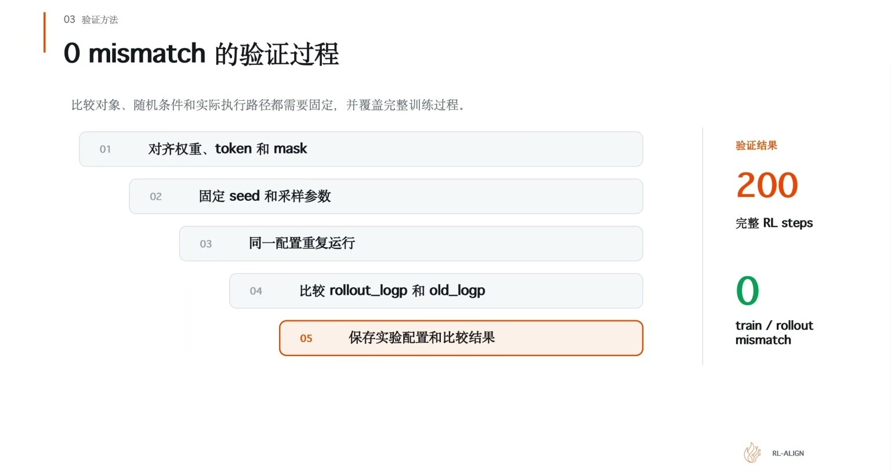

1. 对齐权重、token 和 mask。
2. 固定 seed 和采样参数。
3. 同一配置重复运行，确保问题可以稳定复现，而不是只跑一次拿到一个偶然结果 [49:10](https://www.bilibili.com/video/BV1Ech96cEzW/?t=2950)。
4. 比较 rollout_logp 和 old_logp。
5. 保存实验配置和比较结果。

跑完一个完整的 workflow，rollout、reward、training、权重同步全部走完，连续运行 200 个 RL step，每一步比较都是零 [49:59](https://www.bilibili.com/video/BV1Ech96cEzW/?t=2999)。

配置命令在仓库 README 的 quick start 里 [50:27](https://www.bilibili.com/video/BV1Ech96cEzW/?t=3027)。README Quick Start 给出的形式是：

```bash
./rlk run --tp 4 --rollout-tp 4 --temperature 0.7 --top-p 0.95 \
  --lr 5e-7 --kl-coef 0.01 --max-response-len 6912 \
  --max-tokens-per-gpu 4096 --steps 200
```

公开记录里还列了几组并行组合：Training TP1 CP8 配 rollout TP1，Training TP2 CP4 配 rollout TP4，Training TP4 CP2 配 rollout TP8，Training TP8 CP1 配 rollout TP2。

**CUDA 实验配置。** 跑的是 Qwen3-8B 这个 dense 模型，在一台 8 卡 H100 上，TP4 配 CP2，全局 batch 128，随机种子 1234 [51:00](https://www.bilibili.com/video/BV1Ech96cEzW/?t=3060)。比较的一边是 vime 原生路径，另一边是 vime 加 RL-Kernel，两边用匹配的模型、相同的数据和训练配置，各跑 200 轮 [51:13](https://www.bilibili.com/video/BV1Ech96cEzW/?t=3073)。

这些参数要专门列出来，因为性能跟工作负载关系很大。极限负载下跑出来的和负载稍小的情况不一样，batch 大一点、回答长一点，计算和通信占用的时间都会变 [51:35](https://www.bilibili.com/video/BV1Ech96cEzW/?t=3095)。

**200 步的结果。**

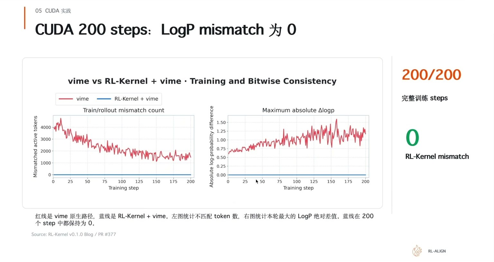

红线是 vime 原生路径，蓝线是 RL-Kernel 加 vime。左图统计不匹配 token 数，右图统计本轮最大的 LogP 绝对差值。蓝线在 200 个 step 里全程保持为 0，200/200 完整训练 steps，0 RL-Kernel mismatch [52:36](https://www.bilibili.com/video/BV1Ech96cEzW/?t=3156)。曲线来源是 RL-Kernel v0.1.0 Blog / PR #377。

**性能不低于原生路径。** 在保持 0 mismatch 的同时，端到端性能与 vime 原生路径相当。公开结论只对应 Qwen3-8B、8×H100 和当前并行配置 [55:14](https://www.bilibili.com/video/BV1Ech96cEzW/?t=3314)。

各条关键路径的做法：

- **GEMM**：auto 选择 cuBLASLt no-split-K 或 SM90，SM90 按完整 K 维度固定顺序累加 [55:40](https://www.bilibili.com/video/BV1Ech96cEzW/?t=3340)。
- **RMSNorm**：vime 严格路径使用 torch RMSNorm，统一归一化语义与参数约束 [56:14](https://www.bilibili.com/video/BV1Ech96cEzW/?t=3374)。
- **Attention**：FA4 strict core 关闭 split-K，训练的 backward 使用 deterministic 路径 [56:25](https://www.bilibili.com/video/BV1Ech96cEzW/?t=3385)。
- **FFN 和 LM head / LogP**：packed gate/up、SwiGLU 与 down GEMM 分段执行，复用 packed 权重；训练与 rollout 各自复用 local logits，减少重复的 LM-head GEMM [56:42](https://www.bilibili.com/video/BV1Ech96cEzW/?t=3402)。
- **CUDA IPC 通信**：单节点 fixed-tree collective，TP1/2/4/8 使用固定 balanced tree [57:01](https://www.bilibili.com/video/BV1Ech96cEzW/?t=3421)。

**快速启动**分四步：安装并指定本地路径、准备数据与 checkpoint、启动 Ray 并检查环境、运行基线与一致性路径 [57:35](https://www.bilibili.com/video/BV1Ech96cEzW/?t=3455)。实际用的时候只需要替换 workspace 和模型目录，标准实验不要求修改 vime 或 RL-Kernel 的脚本 [58:22](https://www.bilibili.com/video/BV1Ech96cEzW/?t=3502)。

## ROCm 实配：200 步逐 Bit 一致

ROCm 侧的配置是单机 8 张 MI300X 192GB，TP4 配 CP2，全局 batch 8，随机种子 1234，比较条件一样 [58:47](https://www.bilibili.com/video/BV1Ech96cEzW/?t=3527)。

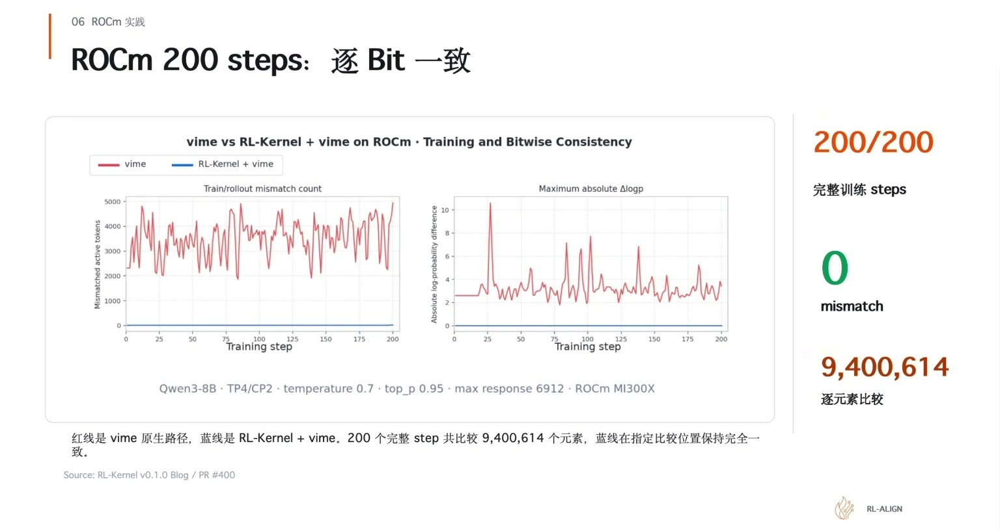

200/200 完整训练 steps，0 mismatch，9,400,614 次逐元素比较 [59:54](https://www.bilibili.com/video/BV1Ech96cEzW/?t=3594)。实验条件是 Qwen3-8B、TP4/CP2、temperature 0.7、top_p 0.95、max response 6912、ROCm MI300X。曲线来源是 RL-Kernel v0.1.0 Blog / PR #400。

ROCm 侧的性能与原生路径基本持平，也做了对应的特定优化：

- **GEMM**：自研 MFMA kernel，固定 chunk 顺序，FP32 合并后写回 BF16 [60:56](https://www.bilibili.com/video/BV1Ech96cEzW/?t=3656)。
- **Attention 默认路径**：AITER 的 CK 和 Triton 实现，处理 K 分块，固定 decode 路径的 CK [61:11](https://www.bilibili.com/video/BV1Ech96cEzW/?t=3671)。
- **LogP**：各 TP shard 先算局部统计量，再按固定 vocab tile 顺序合并 [61:50](https://www.bilibili.com/video/BV1Ech96cEzW/?t=3710)。
- **ROCm 通信与执行**：HIP IPC 与 RCCL 分层传输，小 token 走 HIP IPC，较大的 token 走 RCCL，本地固定树归约，配合 HIP Graph 与 cache 复用 [62:02](https://www.bilibili.com/video/BV1Ech96cEzW/?t=3722)。

ROCm 的快速启动跟 CUDA 稍有不同，走 profile 的路子：先选择公开的机器 profile，执行一轮公开配置，只用 CLI 改拓扑和采样，再检查 200-step 的启动命令。profile 保存机器路径和默认配置，显式 CLI 参数覆盖 profile，plan 只检查最终命令，不启动训练 [62:55](https://www.bilibili.com/video/BV1Ech96cEzW/?t=3775)。

## v0.1.0 的边界、下一步与社区协作

**已完成验证** [63:30](https://www.bilibili.com/video/BV1Ech96cEzW/?t=3810)：

- 200 个训练 step，LogP mismatch 为 0。
- CUDA 与 ROCm 的公开曲线和运行记录。
- vLLM 与 Megatron-LM 的 selected-token LogP 对齐。
- Qwen3-8B Dense，提供单机快速启动。

**仍需验证**：

- 消除 LogP mismatch 后，训练收益是否稳定提升。这需要跑更长的训练和更多组的 seed 验证，看 reward 的提升曲线 [64:12](https://www.bilibili.com/video/BV1Ech96cEzW/?t=3852)。
- MoE、多模态和多机 [64:35](https://www.bilibili.com/video/BV1Ech96cEzW/?t=3875)。

**四条并行的线** [64:51](https://www.bilibili.com/video/BV1Ech96cEzW/?t=3891)：

1. 当前路径：Dense，CUDA / ROCm 已完成公开验证。
2. DeepSeek-V4：Flash MoE 开发中。
3. Gemma / Qwen3-Next：模型与算子 RFC。
4. 更多框架：verl / AReaL 接入 [65:48](https://www.bilibili.com/video/BV1Ech96cEzW/?t=3948)。

更多后端这条线由厂商推进：MUSA 由摩尔线程自己的人在做，昇腾这边有专门做昇腾算子的人去适配 [65:26](https://www.bilibili.com/video/BV1Ech96cEzW/?t=3926)。

**社区参与。** 仓库是 `github.com/RL-Align/RL-Kernel`，Issues 面板里 88 个 open、89 个 closed、34 个 PR。每条线都在拆 RFC，谁认领谁做 [01:08:40](https://www.bilibili.com/video/BV1Ech96cEzW/?t=4120)。

贡献的门槛不在卡的档次上。开发单算子的话，单张 5090 就够了，RL-Kernel 把 MoE 拆开后显存要求很低 [01:08:44](https://www.bilibili.com/video/BV1Ech96cEzW/?t=4124)。分布式部分可以先实现代码，再一起在 H 卡上测，也可以租卡跑 TP2 这样的配置 [01:09:30](https://www.bilibili.com/video/BV1Ech96cEzW/?t=4170)。

认领的入口是那几张 RFC 文档，比如 Nemotron-3-Nano-30B-A3B、BAGEL-7B-MoT、Qwen3-Next-80B-A3B-Instruct、MiniMax-H3、Gemma-4-31B-it、Qwen-Image 各自的 kernel roadmap 和集成计划 [01:10:20](https://www.bilibili.com/video/BV1Ech96cEzW/?t=4220)。RFC 里写的是 acceptance contract，比如 operator acceptance 要求每个融合算子同时满足 batch invariance 和 performance 两项，parallelism acceptance 则规定 TP、CP、EP 三种并行下各自的 invariance 要求 [01:11:00](https://www.bilibili.com/video/BV1Ech96cEzW/?t=4260)。

除了算子，documentation、benchmark 和 CI 测试的活也有不少可以领 [01:12:42](https://www.bilibili.com/video/BV1Ech96cEzW/?t=4362)。社区交流在 Slack 和微信群，进群的时候说清背景就行 [01:13:45](https://www.bilibili.com/video/BV1Ech96cEzW/?t=4425)。
