```cardlink
url: https://www.bilibili.com/video/BV1Ech96cEzW/
title: "vLLM小课堂（十八）：RL-Kernel，大模型RL后训练中的训推一致性实践"
description: "RL-Kernel 项目的第一期分享：训推一致性问题的成因、数值契约、验证方法与 v0.1.0 的结果"
host: bilibili.com
image: http://i2.hdslb.com/bfs/archive/2d388bd039aced3e6eef1f6e5ff577bb1666aa53.jpg
```

## 同一批 token，两套引擎给出两个 logprob

RL 后训练里，同一个模型跑在同一批 token 上，推理引擎和训练引擎却算出两个不同的 logprob。问题在于这两个数本该相等。

推理侧（rollout）由 vLLM 执行：读当前版本权重，喂 prompt，生成 response token，同时记录模型对这些 token 给出的概率，产出 `rollout_logp` [03:10](https://www.bilibili.com/video/BV1Ech96cEzW/?t=190)。

训练侧由 Megatron-LM 执行：接收这批 response token，在更新权重之前先做一次无梯度的前向，重算出 `train_logp`，再拿它去算 loss [01:48](https://www.bilibili.com/video/BV1Ech96cEzW/?t=108)。

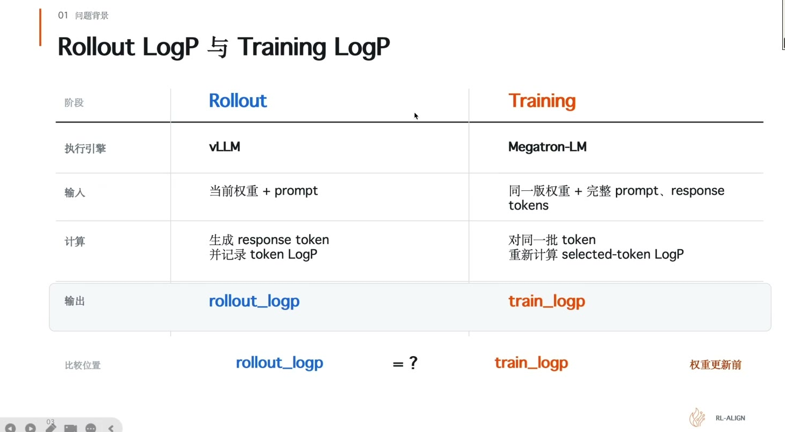

两个数不是来自同一次程序执行，但描述的是同一时刻、同一策略对同一 token 的概率。只要权重还没更新，`rollout_logp` 和 `train_logp` 就应该一致。

而实际跑起来不是这样。两边执行的 kernel 一样，batch 大小不一样，并行布局不一样，规约方式也不一样。模型是同一个模型，但执行路径不是同一条路径 [03:14](https://www.bilibili.com/video/BV1Ech96cEzW/?t=194)。

## logprob 偏差先害到 importance ratio

训练侧算 loss 时要先算 importance ratio $\rho$：用 current logprob 和 old logprob 之比，衡量新策略相对旧策略偏离了多少。

$\rho$ 越远离 1，说明策略变动越大，梯度裁剪（clipping）就越早触发。推理侧和训练侧的 logprob 只要有一点偏差，$\rho$ 就会被推离 1，clipping 提前触发，梯度信号被削掉一部分 [03:37](https://www.bilibili.com/video/BV1Ech96cEzW/?t=217)。

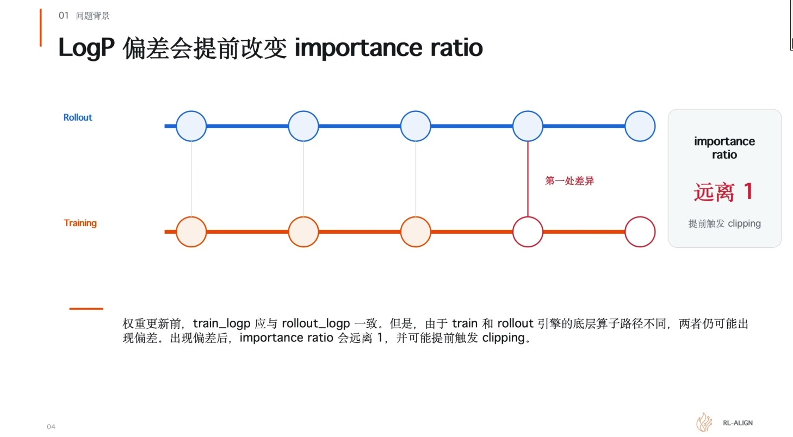

这条链路是训推不一致最先显形的地方。不是模型学坏了，是概率算得不一样。

## 根因：浮点归约顺序

四个数相加，数学上等于一个数。浮点世界里，加的顺序会改结果。

取 a、b、c、d 四个值，假设 a 是 1000，c 是 -1000，b 和 d 都是 1，累加结果保留三位有效数字。

顺序一是 `((a + b) + c) + d`：1000 + 1 舍入后还是 1000，1000 - 1000 = 0，0 + 1 = 1。
顺序二是 `(a + b) + (c + d)`：-1000 + 1 舍入后是 -1000，1000 + (-1000) = 0。

两条路径数学上等价，最后一位差 1 [04:49](https://www.bilibili.com/video/BV1Ech96cEzW/?t=289)。

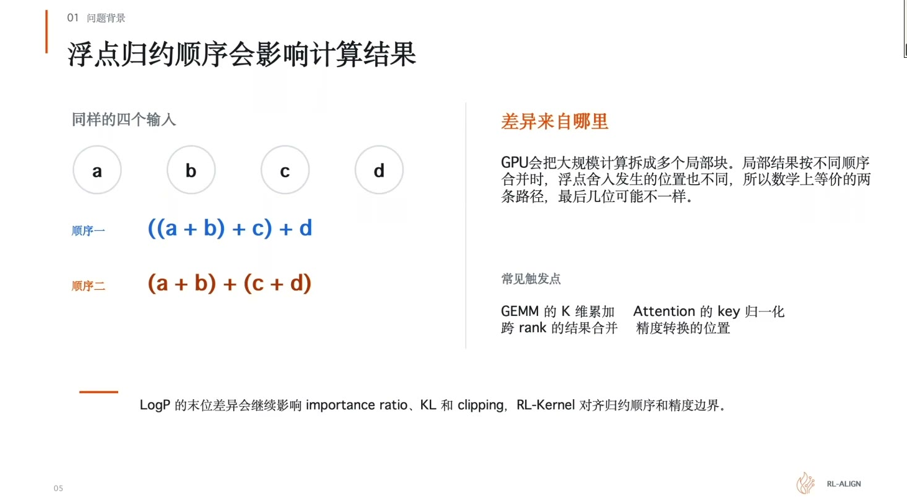

GPU 上的大规模计算正是这样发生的。矩阵乘、attention、跨卡求和都要把很多数加起来，为了并行，GPU 把它拆成多个块各自算，再把局部结果合起来。训练和推理的 batch 大小、序列长度、并行度不一样，系统就会选不同的 kernel 路径，分块数量和合并顺序跟着变。差异先出现在某个中间结果，再经过后续计算传到最后的 logprob。

所以要保证训推一致，除了同步权重，还要对齐累加顺序、计算精度、以及中间结果的规约位置。

## 排查之前先对齐五项条件

查具体 kernel 之前有五项基础条件必须先核对。不核对就容易查错方向。

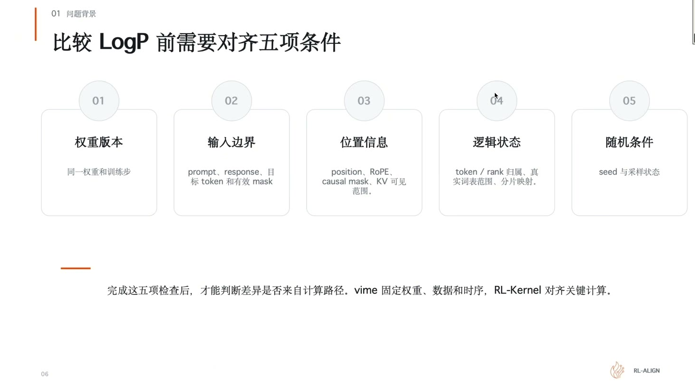

| # | 条件 | 内容 |
|---|---|---|
| 01 | 权重版本 | 同一权重、同一训练步。rollout 和 training 都要对应同一个 checkpoint |
| 02 | 输入边界 | prompt、response、目标 token 和有效 mask |
| 03 | 位置信息 | position、RoPE、causal mask、KV 可见范围 |
| 04 | 逻辑状态 | token 与 rank 的归属、真实词表范围、分片映射 |
| 05 | 随机条件 | seed 与采样状态 |

这五项里任何一项不同，logprob 的差异都不能直接归因到 kernel [07:29](https://www.bilibili.com/video/BV1Ech96cEzW/?t=449)。只有这五项都对齐了，剩下的差异才可能往底层计算里找。

## 分工：vLLM 管时序，RL-Kernel 管数值

vLLM 负责组织完整的 RL 生命周期：什么时候做 rollout，什么时候做 reference，什么时候训练 actor，权重更新之后怎么同步给推理侧。管的是时序、数据流、权重版本这类上层调度 [09:29](https://www.bilibili.com/video/BV1Ech96cEzW/?t=569)。

RL-Kernel 关注的是这条流程里的关键计算能不能对齐：attention 局部结果怎么合并，FFN 在哪一步转精度，跨卡求和先加哪一块，运行时有没有走到预期的算子。

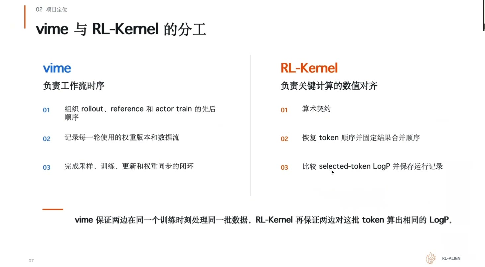

两边约定的这套规则叫**数值契约**（numerical contract）：把容易产生差异的地方明确写下来，两边必须按这个约定执行。vLLM 保证两边在正确时间里处理正确的数据，RL-Kernel 保证关键计算按对齐后的规则执行。两者互补 [10:39](https://www.bilibili.com/video/BV1Ech96cEzW/?t=639)。

四层关系是这样的：上层是同步或异步的训推框架（sync、ARIREAL 那一类），下面是 vLLM 和 Megatron 这样的推理与训练引擎，RL-Kernel 夹在中间，不接管整个训练框架，只在 rollout 和 training 的关键计算位置提供算子、运行时检查和一致性实现，最底层是 CUDA 和 ROCm 算子 [11:18](https://www.bilibili.com/video/BV1Ech96cEzW/?t=678)。

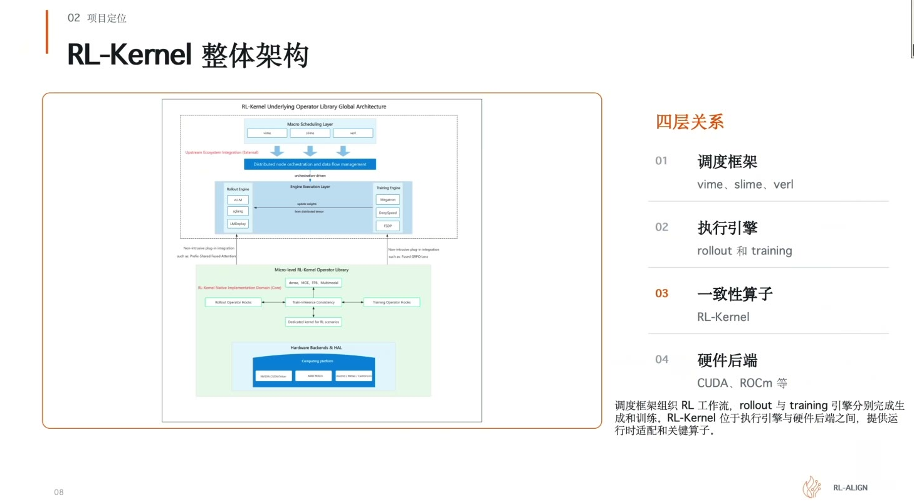

这个架构的价值是分层。上层框架按自己的调度方式跑，执行引擎也能保留自己的专项优化，比如 vLLM 里那些高性能算子和针对特定硬件的实现。但 RL-Kernel 这边要明确哪些关键结果必须对齐，因为最后落到 logprob 的计算要按这些约定处理。

## RL-Kernel 在一个 RL step 里的位置

一轮 RL 训练的完整流程，RL-Kernel 只占其中一段 [13:34](https://www.bilibili.com/video/BV1Ech96cEzW/?t=814)。

1. vLLM 根据 prompt 生成回答，保存 token 和对应的 rollout logprob
2. 系统对回答打分，得到 reward
3. 样本和 reward 打包给训练侧
4. Megatron-LM 收到数据后，用还没更新的权重对原来的 prompt 和回答做一次无梯度前向，得到 old logprob；同时按 reward 算出 advantage，告诉模型哪些回答该被鼓励、哪些该被降低概率
5. Megatron-LM 用当前权重做带梯度的前向，得到 current logprob
6. current logprob 和 old logprob 算出 importance ratio，结合 advantage 算出 loss
7. 反向传播，backward 和 optimizer step 更新模型权重
8. 新权重同步回 vLLM，开始下一轮生成

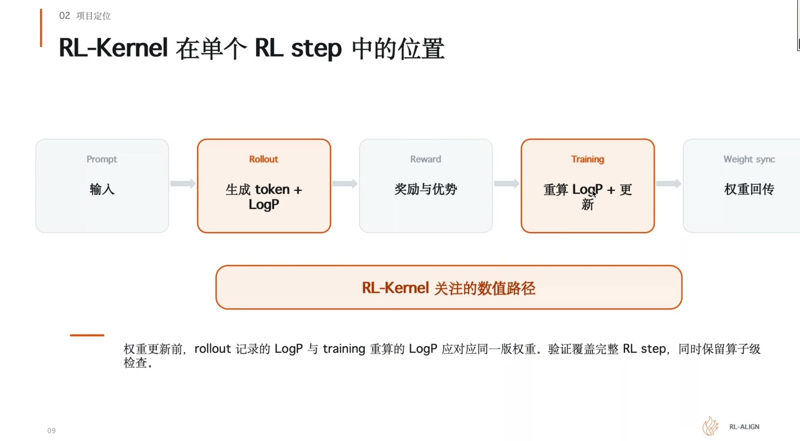

第一次算 current logprob 时权重还没更新，两边的计算条件一致，current 和 old 应该相同或非常接近。同一批数据继续往下跑时，current 用更新后的权重重算，old 保持固定 [15:52](https://www.bilibili.com/video/BV1Ech96cEzW/?t=952)。

所以验证训推一致性，是在下一轮开始时用对应的新权重版本再检查一遍：这个 RL step 对应位置上，概率还能不能对得上。

## 训推两侧要对齐的四类计算

需要对齐的计算可以拆成四类 [17:22](https://www.bilibili.com/video/BV1Ech96cEzW/?t=1042)。

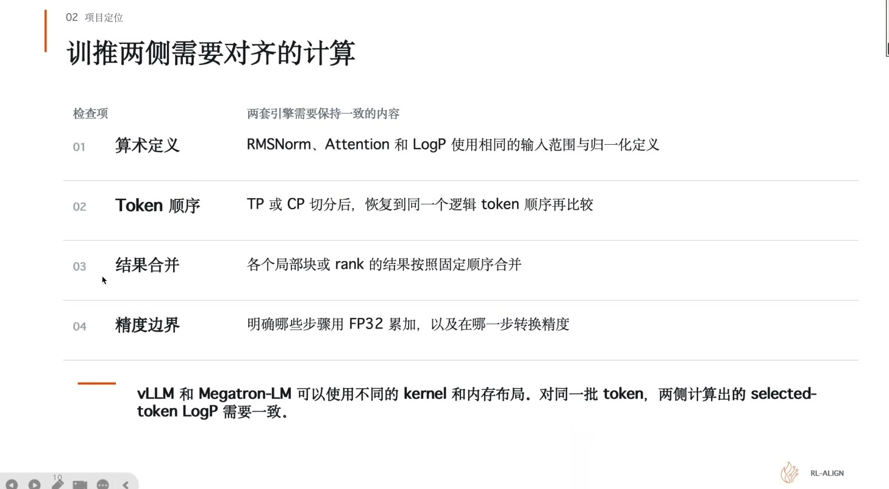

| 类别 | 对齐什么 |
|---|---|
| 算术定义 | 归一化覆盖哪些元素、mask 在哪一步生效、selected-token LogP 用什么定义。RMSNorm、Attention 和 LogP 要用相同的输入最大项定义 |
| token 顺序 | 开了 TP 或 CP 把 token 分到不同设备后，比较之前必须恢复成相同的逻辑顺序 |
| 结果合并 | 一个大的结果来自多个局部或多个 rank 时，局部结果怎么组合。算这块再算那块，组合顺序影响最后的浮点值 |
| 精度边界 | 哪些阶段用 FP32 累加，什么时候转回 BF16 或 FP16 |

## v0.1.0 覆盖的五类归约

v0.1.0 沿着模型逐段检查，把影响 logprob 的主路径覆盖成五类 [19:35](https://www.bilibili.com/video/BV1Ech96cEzW/?t=1175)。

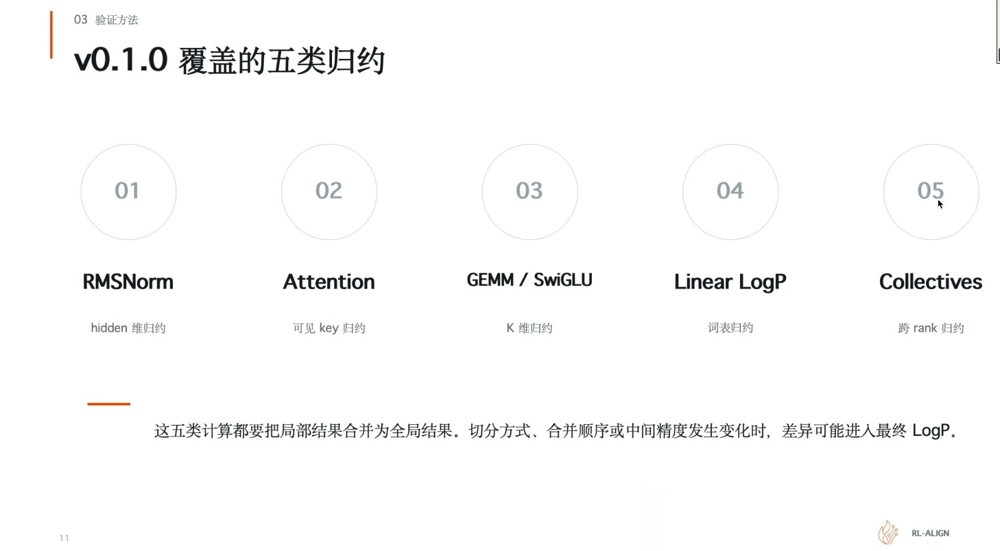

| # | 契约 | 归约范围 |
|---|---|---|
| 01 | RMSNorm | hidden dimension |
| 02 | Attention | 可见 key 的范围 |
| 03 | GEMM / SwiGLU | 沿 K 维 |
| 04 | Linear LogP | 整个词表 |
| 05 | Collectives | 跨 rank |

这五类有一个共同点：都是先切分数据，完成局部计算，再把局部结果合起来。只要分区方式、合并顺序、或者中间精度发生变化，最后几位就可能不同。

换模型时，这五类要按具体模型重新拆。上面列的是当前支持的这个 dense 模型的拆法，MoE 模型要按 MoE 的模块去拆 [20:08](https://www.bilibili.com/video/BV1Ech96cEzW/?t=1208)。

## 关键算子的归约维度

每个算子归约的东西不一样，差异来源也不一样 [22:05](https://www.bilibili.com/video/BV1Ech96cEzW/?t=1325)。

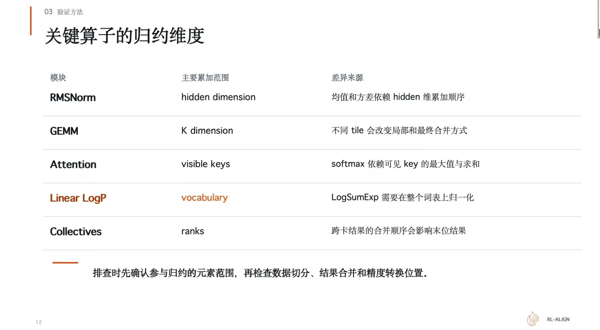

| 算子 | 归约范围 | 差异来源 |
|---|---|---|
| RMSNorm | hidden dimension | 均值和方差依赖 hidden 维的累加顺序 |
| GEMM | K dimension | 不同 tile 会改变局部和最终合并方式 |
| Attention | visible keys | softmax 依赖可见 key 的最大值与求和 |
| Linear LogP | vocabulary | LogSumExp 需要在整个词表上归一化 |
| Collectives | ranks | 跨卡结果的合并顺序影响末位结果 |

排查时的顺序：先确认参与归约的元素范围，再检查数据切分、结果合并、精度转换位置。

通信这块有个坑：看到通信后第一次出现差异，不能马上认定是通信的问题。各张卡交给通信层的局部结果本身可能已经不一样了。要看对应的输入输出，确定差异到底在哪 [23:10](https://www.bilibili.com/video/BV1Ech96cEzW/?t=1390)。

## Attention 和 Linear LogP 都依赖 LogSumExp

LogSumExp（LSE）可以理解成把一组分数转换成概率时需要计算的归约统计量。

Attention 侧，一个 query 会给多个 key 打分，这些分数要一起做归约，才能决定关注哪些位置。Linear LogP 侧，模型对整个词表打分，得到各个 token 的完整对数概率 [24:15](https://www.bilibili.com/video/BV1Ech96cEzW/?t=1455)。

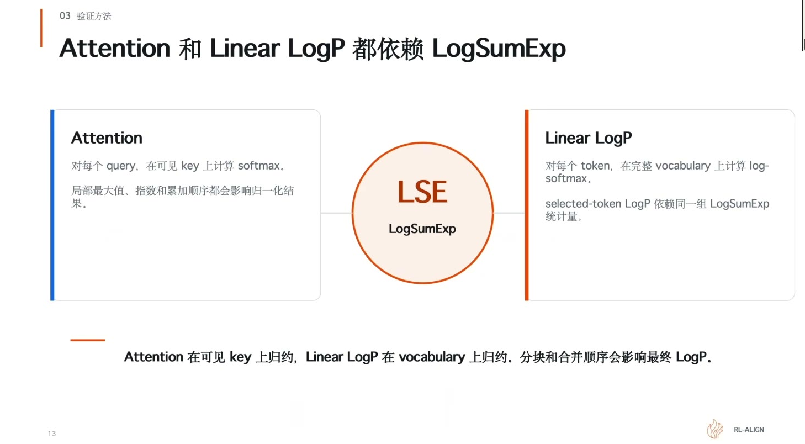

两个模块作用不同，但都要处理一组分数的统计归约。

这里有个容易漏的点：只关心某个 token 时，不能只检查它自己那一项分数。因为其他词表项会影响归约结果。自己那项分数没变，其他项汇总出来的结果变了，最后的概率照样会变 [25:46](https://www.bilibili.com/video/BV1Ech96cEzW/?t=1546)。

所以要关心的是 LSE 的精度和合并顺序。尤其在词表这一块和多个 key 被切成多个块、或者分到多张卡的时候，每块的统计量到底怎么合起来，需要有明确的约定。

## 定位第一处差异

实际 debug 的做法是：先拿一份固定的权重，把已经生成好的 token 保存好，让训练和推理都算同一份输入，然后看中间结果 [26:36](https://www.bilibili.com/video/BV1Ech96cEzW/?t=1596)。

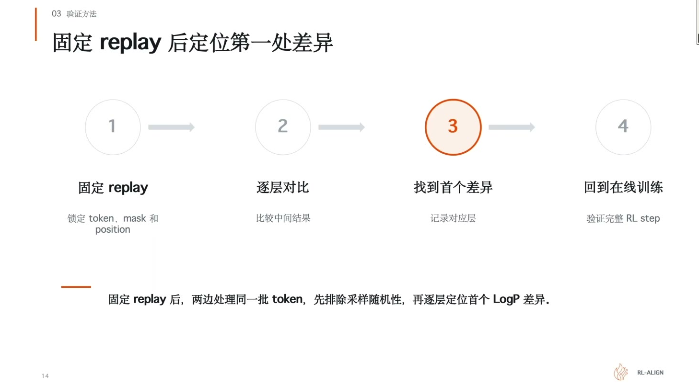

前几层输出都一样，到 attention 开始不一样，范围就缩小到那一层，继续检查这一层的 attention：输入相同、输出不同时，进一步查里面的精度、规约、kernel 选择。输入已经不同就往前继续找，因为后面的模块可能只是继承了前面的误差。

这样能找到第一个分叉的位置，比改很多地方有用 [27:50](https://www.bilibili.com/video/BV1Ech96cEzW/?t=1670)。

debug 时要特意构造边界性的数值。要有对照，就得固定这些边界值来跑 [32:34](https://www.bilibili.com/video/BV1Ech96cEzW/?t=1954)。

## 一致性的标准是完全一致

现场提问：衡量标准是误差在极低范围内，还是必须完全一致？答案是完全一致 [28:31](https://www.bilibili.com/video/BV1Ech96cEzW/?t=1711)。

原因是误差在极低范围内不能保证后面不会变大。经过多层累加或者精度转换之后，数值可能越来越大，导致训练不稳定。所以精度、舍入边界、unmask 时机都要考虑进去，通信也一样：都从各分块算结果，最后按固定顺序累加 [28:48](https://www.bilibili.com/video/BV1Ech96cEzW/?t=1728)。

这个问题在推理侧同样存在。vLLM 有自己的 LM eval 基准，模型跑出来分数偏低就要往回查 [30:11](https://www.bilibili.com/video/BV1Ech96cEzW/?t=1811)。

## 0 mismatch 的验证过程

比较对象、随机条件和实际执行路径都需要固定并完整覆盖 [48:30](https://www.bilibili.com/video/BV1Ech96cEzW/?t=2910)。

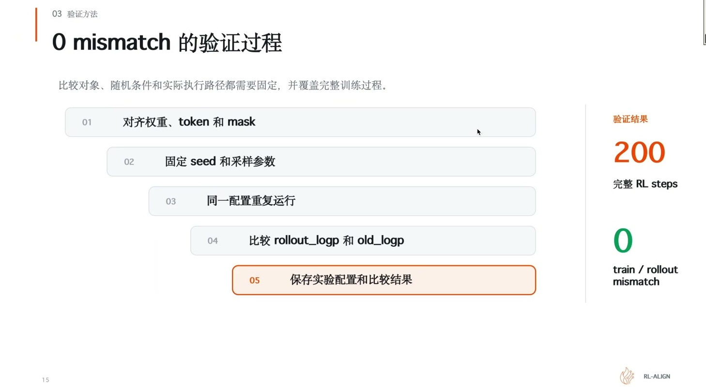

1. 对齐变量：token 与 mask
2. 固定 seed 和采样参数
3. 同一配置重复运行，确保问题可稳定复现
4. 比较 rollout_logp 和 old_logp
5. 保存实验配置和比较结果

跑完一个完整的 workflow，rollout、reward、training、权重同步全部走完，200 个 RL step 每一步比较都是零。

不是只跑一次拿个偶然结果。要固定配置，保证任何人拿这个配置都能复现这个问题 [49:10](https://www.bilibili.com/video/BV1Ech96cEzW/?t=2950)。

## CUDA 上的扩大试验

跑的是 Qwen3-8B [50:56](https://www.bilibili.com/video/BV1Ech96cEzW/?t=3056)。

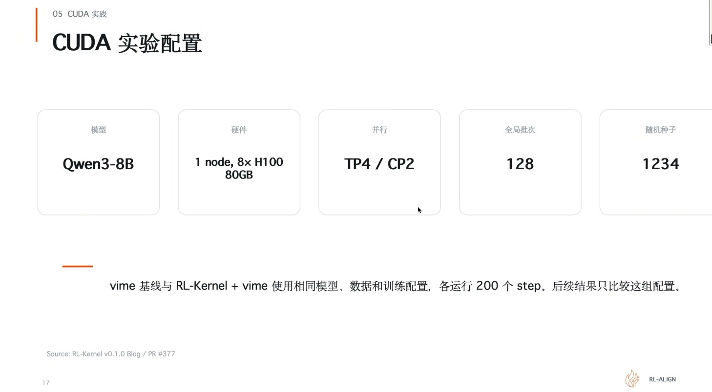

| 项 | 值 |
|---|---|
| 模型 | Qwen3-8B |
| 硬件 | 1 node, 8× H100 80GB |
| 并行 | TP4 / CP2 |
| 全局 batch | 128 |
| 随机种子 | 1234 |

比较的一边是 vLLM 原生路径，另一边是 vLLM 加 RL-Kernel。两边用匹配的模型、相同的数据和训练配置，各跑 200 轮。

参数要专门列出来，因为性能跟工作负载关系很大。极限负载下跑出来的和负载稍小的情况不一样，batch 大一点、回答长一点，计算和通信占用的时间都会变 [51:35](https://www.bilibili.com/video/BV1Ech96cEzW/?t=3095)。

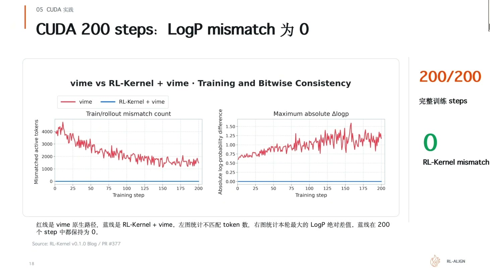

红线是 vLLM 原生路径，蓝线是 RL-Kernel 加 vLLM。左图统计不匹配 token 数，右图统计本轮最大的 logprob 绝对差值。蓝线在 200 个 step 里全程保持 0，右下角的 200/200 完整训练 steps、0 RL-Kernel mismatch 是这么来的。

## 性能不低于原生路径

保证 0 mismatch 的同时，性能不低于原生路径 [55:17](https://www.bilibili.com/video/BV1Ech96cEzW/?t=3317)。

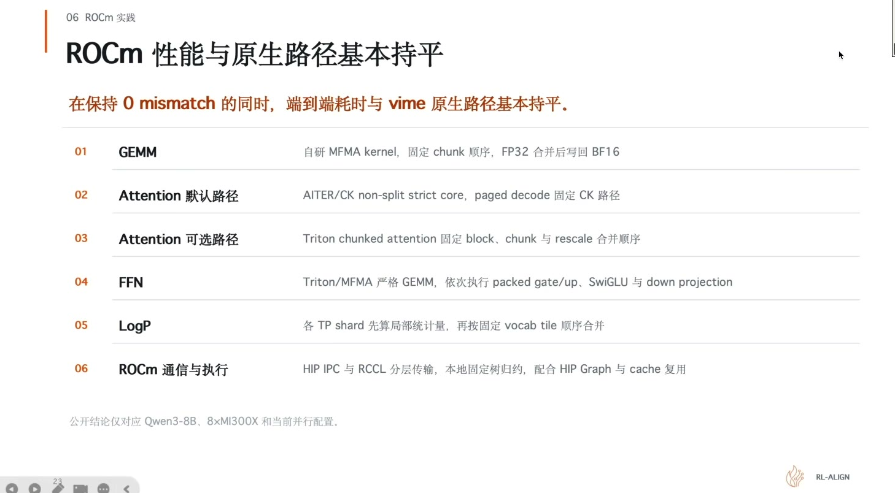

各关键路径的做法：

- **GEMM**：自研的 SM90 路径负责输出的 tile，沿完整的 K 维度按固定顺序累加
- **RMSNorm**：切换到 torch 的一个 RMSNorm 实现，约定它对应参数的语义，避免不同实现带来的差异
- **Attention**：复用 FA4，关掉 split k；训练的 backward 使用 deterministic 路径
- **FFN、embedding 和 logprob**：做了一些特定实现。Linear LogP 复用对应的 local logits，减少重复的 gather
- **通信**：单节点用固定的 collective 树，TP1、TP2、TP4、TP8 都采用固定的 balanced tree，固定数据类型和规约的摄入位置

这里有个 trade-off：保证一致性会牺牲性能，所以尽量复用高性能算子库，比如 vLLM 里的、flashinfer、AMD 那边 ROCm 的算子库。只有确实保证不了累加顺序或规约顺序时，才自己写 kernel [35:04](https://www.bilibili.com/video/BV1Ech96cEzW/?t=2104)。

## ROCm 上的结果

ROCm 那边的配置是单机 8 张 MI300X，训练用 TP4、CP2，全局 batch 8，随机种子 1234，比较条件一样 [58:47](https://www.bilibili.com/video/BV1Ech96cEzW/?t=3527)。

蓝线在 200 步的完整 step 里保持为零。这次试验累积做了 900 多万次逐元素的比较，指定位置的结果全部相同 [01:00:03](https://www.bilibili.com/video/BV1Ech96cEzW/?t=3603)。

ROCm 侧性能与原生路径基本持平，做了对应的特定优化：GEMM 是自研的 MFMA kernel，固定累加顺序，FP32 合并后写回 BF16；Attention 默认路径由 AIT 的 CK 和 Triton 的实现负责，处理 K 分块并固定 decode 路径的 CK；FFN 用 Triton/NVFP4 的 GEMM，依次执行 SwiGLU 的 up projection 和 down projection；LogP 侧各 TP 先算局部统计量，最后按固定的 vocabulary tail 顺序合并；通信用 HIP 的 IPC 和 RCCL 的分层传输，小 token 走 HIP IPC，较大的 token 走 RCCL [01:00:50](https://www.bilibili.com/video/BV1Ech96cEzW/?t=3650)。

## v0.1.0 的边界与下一步

已完成的部分：在 200 个训练 step 里 logprob mismatch 为零，CUDA 和 ROCm 双平台验证，选 vLLM 加 Megatron 作为 baseline，跑通 Qwen3-8B 这个 dense 模型，提供单机快速启动 [01:03:30](https://www.bilibili.com/video/BV1Ech96cEzW/?t=3810)。

待做的部分：

1. 消除 mismatch 之后，训练收益是否稳定提升。这需要跑更长的训练、更多组的 seed 验证，看 reward 的提升曲线
2. MOE 和多模态
3. 多机多卡
4. 更多后端：MUSA 和昇腾这边有厂商的人在做适配
5. 更多框架：verl、AReaL 这些异步框架的接入

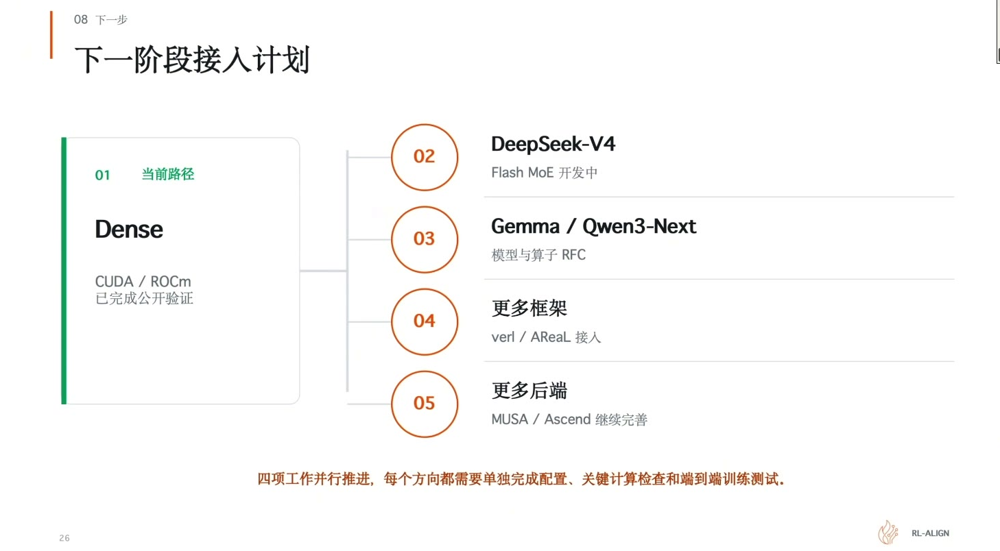

四项并行推进，每个方向都要单独完成配置、关键计算检查和端到端训练测试。

模型侧的拆解也在推进。DeepSeek-V4 是 Flash MoE，在开发中；Gemma 和 Qwen3-Next 提了对应的 RFC，社区有人牵头做适配；Qwen-Image 也在拆 [01:04:12](https://www.bilibili.com/video/BV1Ech96cEzW/?t=3852)。

社区贡献的门槛不高。单算子开发在单卡上就能做，比如 5090 或 190 也可以，RL-Kernel 把 MoE 拆开后显存要求很低。分布式部分可以先实现代码，再一起在 H 卡上测，也可以租卡跑 TP2 这样的配置 [01:07:11](https://www.bilibili.com/video/BV1Ech96cEzW/?t=4031)。
