```cardlink
url: http://10.188.31.55:5244/Nextcloud/School/自动控制原理/
title: "自动控制原理 · 课程课件与复习笔记"
description: "中南大学自动化学院《自动控制原理》的课件、教材与复习笔记"
host: 10.188.31.55:5244
```

- 第 0 章 前置知识 — 拉普拉斯变换、复数与 s 平面、传递函数、矩阵与代数工具
- 第 1 章 自动控制的一般概念 — 自动控制的组成、反馈与两种控制方式、系统分类、性能要求与典型输入
- 第 2 章 控制系统的数学模型 — 线性化、传递函数、方框图与信号流图、梅森增益公式、典型系统建模
- 第 3 章 线性系统的时域分析法 — 时间响应、阶跃响应、二阶系统性能指标、劳斯判据、稳态误差
- 第 4 章 线性系统的根轨迹法 — 绘制规则、实轴区间、穿越次数、根轨迹与稳定性的关系
- 第 5 章 线性系统的频域分析法 — 频率特性、奈奎斯特判据、波特图、稳定裕度、频域性能指标
- 第 6 章 线性系统的校正方法 — 串联校正、频率法校正、超前、滞后、滞后超前校正
- 第 7 章 线性离散系统的分析与校正 — 采样与采样定理、z 变换、脉冲传递函数、离散系统稳定性与校正
- 第 8 章 非线性控制系统分析 — 非线性系统概述、描述函数法、相平面法

自动控制的任务是让一台机器按预定的规律自己运行。要判断它能不能做到、做到什么程度，得有三样东西：把系统写成数学模型，算出响应的性能指标，再在指标不达标时倒推出该加什么校正装置、参数取多少。这篇讲义按教材八章走完这条链：控制的一般概念、数学模型、时域分析、根轨迹法、频域分析法、系统校正、线性离散系统、非线性控制。每个结论后面的链接指回它出处的页码，教材页看完整推导，课件页看考试怎么考。

## 第 0 章 前置知识

### 拉普拉斯变换：把微分方程变成代数方程

整门课的第一个工具是拉普拉斯变换。它把时域的微分方程搬进复频域，微分变成乘法，求解就从"解微分方程"变成"解代数方程"。教材把它列为线性定常微分方程的求解方法之一，与经典法并列 [自动控制原理（第八版） (胡寿松、姜斌、张绍杰) (z-library.sk, 1lib.sk, z-lib.sk)(1).pdf · p.38](http://10.188.31.55:5244/Nextcloud/School/自动控制原理/%E8%87%AA%E5%8A%A8%E6%8E%A7%E5%88%B6%E5%8E%9F%E7%90%86%EF%BC%88%E7%AC%AC%E5%85%AB%E7%89%88%EF%BC%89%20(%E8%83%A1%E5%AF%BF%E6%9D%BE%E3%80%81%E5%A7%9C%E6%96%8C%E3%80%81%E5%BC%A0%E7%BB%8D%E6%9D%B0)%20(z-library.sk,%201lib.sk,%20z-lib.sk)(1).pdf#page=38)。

**拉普拉斯变换**（Laplace transform）的定义式是把时域函数 $f(t)$ 映射成复频域函数 $F(s)$：

$$
F(s)=\int_0^{\infty} f(t)e^{-st}\,dt
$$

定义本身不产生什么魔力，产生魔力的是它带来的三条换算规则。第一条是微分规则，求导变成乘 $s$：

$$
\mathcal{L}\left[\frac{\mathrm{d}f(t)}{\mathrm{d}t}\right]=sF(s)-f(0)
$$

初始值不为零时，右边会多出 $-f(0)$、$-sf(0)-f'(0)$ 这些项，传递函数就不再是纯输入输出之比。第二条是积分规则，积分变成除 $s$：

$$
\mathcal{L}\left[\int_0^t f(\tau)\,\mathrm{d}\tau\right]=\frac{F(s)}{s}
$$

第三条是线性规则，可以逐项拆开算：

$$
\mathcal{L}[af(t)+bg(t)]=aF(s)+bG(s)
$$

> [!IMPORTANT] **终值定理**（final value theorem）
> 有了它就不必求反变换就能拿到稳态值：
>
> $$f(\infty)=\lim_{t\to\infty}f(t)=\lim_{s\to 0}sF(s)$$
>
> 适用条件是 $sF(s)$ 的全部极点都在左半 $s$ 平面，原点最多允许一个一阶极点。条件不满足时右边极限不存在，算出来的是错答案。教材用它从 $s$ 域直接读出网络电压的初值和终值 [自动控制原理（第八版） (胡寿松、姜斌、张绍杰) (z-library.sk, 1lib.sk, z-lib.sk)(1).pdf · p.39](http://10.188.31.55:5244/Nextcloud/School/自动控制原理/%E8%87%AA%E5%8A%A8%E6%8E%A7%E5%88%B6%E5%8E%9F%E7%90%86%EF%BC%88%E7%AC%AC%E5%85%AB%E7%89%88%EF%BC%89%20(%E8%83%A1%E5%AF%BF%E6%9D%BE%E3%80%81%E5%A7%9C%E6%96%8C%E3%80%81%E5%BC%A0%E7%BB%8D%E6%9D%B0)%20(z-library.sk,%201lib.sk,%20z-lib.sk)(1).pdf#page=39)。第 3 章算稳态误差全靠这一条。

常用变换对里只需要先记住两条：单位阶跃 $1(t)$ 对应 $1/s$，单位斜坡 $t$ 对应 $1/s^2$。完整的变换对表在蜂考课件里 [自动控制原理【蜂考系统课】(1).pdf · p.12](http://10.188.31.55:5244/Nextcloud/School/自动控制原理/%E8%87%AA%E5%8A%A8%E6%8E%A7%E5%88%B6%E5%8E%9F%E7%90%86%E3%80%90%E8%9C%82%E8%80%83%E7%B3%BB%E7%BB%9F%E8%AF%BE%E3%80%91(1).pdf#page=12)。

### 复数与 $s$ 平面

复频域变量 $s$ 本身是一个复数，写成直角坐标和极坐标两种形式：

$$
s=\sigma+j\omega \qquad s=|s|\,e^{j\angle s}
$$

$|s|=\sqrt{\sigma^2+\omega^2}$ 是到原点的距离，$\angle s=\arctan(\omega/\sigma)$ 是与正实轴的夹角，注意象限修正。一个实系数多项式的非实根必成共轭对出现，$\bar{s}=\sigma-j\omega$。

$s$ 平面就是复平面上按实部 $\sigma$ 和虚部 $\omega$ 画的一张图：横轴实部，纵轴虚部。位置决定一切行为。连续系统稳定的充要条件是传递函数的极点全部落在左半平面（$\sigma<0$）；极点落在虚轴上是临界稳定；极点跑到右半平面，响应就发散。

教材用一对零极点位置不同的传递函数说明零点的作用：两个系统的极点都在 $-1$ 和 $-2$，零点一个在 $-0.5$、一个在 $-1.33$，单位阶跃响应的形状就完全不同 [自动控制原理（第八版） (胡寿松、姜斌、张绍杰) (z-library.sk, 1lib.sk, z-lib.sk)(1).pdf · p.46](http://10.188.31.55:5244/Nextcloud/School/自动控制原理/%E8%87%AA%E5%8A%A8%E6%8E%A7%E5%88%B6%E5%8E%9F%E7%90%86%EF%BC%88%E7%AC%AC%E5%85%AB%E7%89%88%EF%BC%89%20(%E8%83%A1%E5%AF%BF%E6%9D%BE%E3%80%81%E5%A7%9C%E6%96%8C%E3%80%81%E5%BC%A0%E7%BB%8D%E6%9D%B0)%20(z-library.sk,%201lib.sk,%20z-lib.sk)(1).pdf#page=46)。


把极点画成几何图像的意义，第 3 章的时域指标、第 4 章的根轨迹、第 5 章的 Nyquist 判据，本质上都是在问同一句话：极点在哪儿。

### 从微分方程到传递函数

给定一个线性定常系统，输入 $r(t)$、输出 $c(t)$，建模走三步：


第三步整理出来的比值就是**传递函数**（transfer function），形式上是一个有理分式：

$$
G(s)=\frac{C(s)}{R(s)}=\frac{b_ms^{m}+\cdots+b_1s+b_0}{a_ns^{n}+\cdots+a_1s+a_0},\qquad n\ge m
$$

教材把"零初始条件下输出拉氏变换与输入拉氏变换之比"直接作为传递函数的定义 [自动控制原理（第八版） (胡寿松、姜斌、张绍杰) (z-library.sk, 1lib.sk, z-lib.sk)(1).pdf · p.43](http://10.188.31.55:5244/Nextcloud/School/自动控制原理/%E8%87%AA%E5%8A%A8%E6%8E%A7%E5%88%B6%E5%8E%9F%E7%90%86%EF%BC%88%E7%AC%AC%E5%85%AB%E7%89%88%EF%BC%89%20(%E8%83%A1%E5%AF%BF%E6%9D%BE%E3%80%81%E5%A7%9C%E6%96%8C%E3%80%81%E5%BC%A0%E7%BB%8D%E6%9D%B0)%20(z-library.sk,%201lib.sk,%20z-lib.sk)(1).pdf#page=43)。零初始条件有两层含义：输入在 $t\ge 0$ 才作用，系统加输入前处于稳定工作状态，输出及其各阶导数在 $t=0^-$ 也为零。

> [!WARNING] 电容在 $s$ 域不是 $C$，是 $\frac{1}{Cs}$
> 由 $i=C\frac{\mathrm{d}u}{\mathrm{d}t}$ 取拉氏变换得 $I(s)=CsU(s)$，反过来 $U(s)=\frac{1}{Cs}I(s)$，所以电容的 $s$ 域等效阻抗是 $\frac{1}{Cs}$。写成 $C$ 是零分操作。电感是 $Ls$，电阻仍是 $R$ [2.md · p.13](http://10.188.31.55:5244/Nextcloud/School/自动控制原理/2.md)。教材在无源网络一节给出同样的结论：电容 $C$ 的复数阻抗为 $1/(Cs)$，电感 $L$ 为 $Ls$ [自动控制原理（第八版） (胡寿松、姜斌、张绍杰) (z-library.sk, 1lib.sk, z-lib.sk)(1).pdf · p.50](http://10.188.31.55:5244/Nextcloud/School/自动控制原理/%E8%87%AA%E5%8A%A8%E6%8E%A7%E5%88%B6%E5%8E%9F%E7%90%86%EF%BC%88%E7%AC%AC%E5%85%AB%E7%89%88%EF%BC%89%20(%E8%83%A1%E5%AF%BF%E6%9D%BE%E3%80%81%E5%A7%9C%E6%96%8C%E3%80%81%E5%BC%A0%E7%BB%8D%E6%9D%B0)%20(z-library.sk,%201lib.sk,%20z-lib.sk)(1).pdf#page=50)。

### 矩阵与代数工具

后面几章不需要整门线性代数，只要四件工具：

- **行列式展开**。$2\times 2$、$3\times 3$ 的展开式要能随时写出来。梅森增益公式就是把克拉默法则解出的分子分母，翻译成信号流图上的通路和回路 [自动控制原理（第八版） (胡寿松、姜斌、张绍杰) (z-library.sk, 1lib.sk, z-lib.sk)(1).pdf · p.66](http://10.188.31.55:5244/Nextcloud/School/自动控制原理/%E8%87%AA%E5%8A%A8%E6%8E%A7%E5%88%B6%E5%8E%9F%E7%90%86%EF%BC%88%E7%AC%AC%E5%85%AB%E7%89%88%EF%BC%89%20(%E8%83%A1%E5%AF%BF%E6%9D%BE%E3%80%81%E5%A7%9C%E6%96%8C%E3%80%81%E5%BC%A0%E7%BB%8D%E6%9D%B0)%20(z-library.sk,%201lib.sk,%20z-lib.sk)(1).pdf#page=66)。
- **综合除法**。已知多项式的一个根，用它除出商多项式，剩下的根就是商的根。第 4 章已知一个闭环极点求其余极点必用。
- **根的共轭性**。实系数多项式的根成共轭对出现，所以根轨迹关于实轴对称。
- **特征方程的系数**。劳斯判据只看系数不看根，第 3 章列劳斯表时用。

这四件工具在第 2 章会直接派上用场：梅森公式推导、方框图化简、RC 网络建模。

## 第 1 章 自动控制的一般概念

### 自动控制的定义与组成

**自动控制**（automatic control）指在没有人直接参与的情况下，利用外加的设备或装置，使机器、设备或生产过程的某个工作状态或参数自动地按照预定规律运行。人靠手拧旋钮、脚踩踏板完成的叫手动控制 [自动控制原理（第八版） (胡寿松、姜斌、张绍杰) (z-library.sk, 1lib.sk, z-lib.sk)(1).pdf · p.9](http://10.188.31.55:5244/Nextcloud/School/自动控制原理/%E8%87%AA%E5%8A%A8%E6%8E%A7%E5%88%B6%E5%8E%9F%E7%90%86%EF%BC%88%E7%AC%AC%E5%85%AB%E7%89%88%EF%BC%89%20(%E8%83%A1%E5%AF%BF%E6%9D%BE%E3%80%81%E5%A7%9C%E6%96%8C%E3%80%81%E5%BC%A0%E7%BB%8D%E6%9D%B0)%20(z-library.sk,%201lib.sk,%20z-lib.sk)(1).pdf#page=9)。蜂考课件把研究对象限定为单输入、单输出的线性定常控制系统 [自动控制原理【蜂考系统课】(1).pdf · p.3](http://10.188.31.55:5244/Nextcloud/School/自动控制原理/%E8%87%AA%E5%8A%A8%E6%8E%A7%E5%88%B6%E5%8E%9F%E7%90%86%E3%80%90%E8%9C%82%E8%80%83%E7%B3%BB%E7%BB%9F%E8%AF%BE%E3%80%91(1).pdf#page=3)。

被控制的设备叫**被控对象**（controlled plant），如电机、水箱、加热炉；要求被控制住的物理量叫**被控量**，如转速、液位、温度，也就是输出 $C$；希望被控量达到的目标值叫**给定值**，即输入 $R$。

为完成"测量、比较、放大、执行"这些动作，控制装置要配几类功能元件 [自动控制原理（第八版） (胡寿松、姜斌、张绍杰) (z-library.sk, 1lib.sk, z-lib.sk)(1).pdf · p.13](http://10.188.31.55:5244/Nextcloud/School/自动控制原理/%E8%87%AA%E5%8A%A8%E6%8E%A7%E5%88%B6%E5%8E%9F%E7%90%86%EF%BC%88%E7%AC%AC%E5%85%AB%E7%89%88%EF%BC%89%20(%E8%83%A1%E5%AF%BF%E6%9D%BE%E3%80%81%E5%A7%9C%E6%96%8C%E3%80%81%E5%BC%A0%E7%BB%8D%E6%9D%B0)%20(z-library.sk,%201lib.sk,%20z-lib.sk)(1).pdf#page=13)：**给定元件**给出与期望被控量对应的输入，如电位器；**测量元件**把被控量检测出来并转换成信号，如测速发电机、热电偶；**比较元件**把给定值与测量值相减得到偏差；**放大元件**把微弱的偏差放大到能推动执行机构；**执行器**直接推动被控对象，如阀门、电动机；**控制器**按偏差算出控制量；**校正元件**用来改善系统性能。

### 反馈与两种控制方式

把输出量取出来送回输入端、并与输入信号比较产生偏差信号的过程，叫**反馈**（feedback）。输入与反馈相减、偏差越来越小，是负反馈；相加、偏差越滚越大，是正反馈。用负反馈并利用偏差进行控制的过程叫反馈控制，信号走成闭合的圈，又叫闭环控制。控制装置与被控对象之间只有顺向作用、输出不影响控制作用的，是开环控制 [自动控制原理（第八版） (胡寿松、姜斌、张绍杰) (z-library.sk, 1lib.sk, z-lib.sk)(1).pdf · p.14](http://10.188.31.55:5244/Nextcloud/School/自动控制原理/%E8%87%AA%E5%8A%A8%E6%8E%A7%E5%88%B6%E5%8E%9F%E7%90%86%EF%BC%88%E7%AC%AC%E5%85%AB%E7%89%88%EF%BC%89%20(%E8%83%A1%E5%AF%BF%E6%9D%BE%E3%80%81%E5%A7%9C%E6%96%8C%E3%80%81%E5%BC%A0%E7%BB%8D%E6%9D%B0)%20(z-library.sk,%201lib.sk,%20z-lib.sk)(1).pdf#page=14)。

开环与闭环的差别是工程上最实际的取舍。蜂考课件列得很直白：开环系统结构简单、比较经济，但无法消除干扰带来的误差；闭环系统具有抑制干扰的能力并能改善响应特性，代价是增加了系统的复杂性和不确定性 [自动控制原理【蜂考系统课】(1).pdf · p.6](http://10.188.31.55:5244/Nextcloud/School/自动控制原理/%E8%87%AA%E5%8A%A8%E6%8E%A7%E5%88%B6%E5%8E%9F%E7%90%86%E3%80%90%E8%9C%82%E8%80%83%E7%B3%BB%E7%BB%9F%E8%AF%BE%E3%80%91(1).pdf#page=6)。

下面是全书的认知锚点，也是六个变量的位置图：


输入量 $R$ 从左边进入，比较元件（圆圈）把输入与反馈相减，输出偏差 $E=R-B$；偏差经校正、放大后送到执行元件，执行元件推动被控对象，其输出就是输出量 $C$；输出量经测量元件送回比较点，这条通路叫主反馈通路，送回的量就是反馈信号 $B$。

教材的典型反馈控制系统方框图画得更完整，多出串联校正元件、局部反馈通路和一条从上方直接作用于被控对象的扰动通路 [自动控制原理（第八版） (胡寿松、姜斌、张绍杰) (z-library.sk, 1lib.sk, z-lib.sk)(1).pdf · p.14](http://10.188.31.55:5244/Nextcloud/School/自动控制原理/%E8%87%AA%E5%8A%A8%E6%8E%A7%E5%88%B6%E5%8E%9F%E7%90%86%EF%BC%88%E7%AC%AC%E5%85%AB%E7%89%88%EF%BC%89%20(%E8%83%A1%E5%AF%BF%E6%9D%BE%E3%80%81%E5%A7%9C%E6%96%8C%E3%80%81%E5%BC%A0%E7%BB%8D%E6%9D%B0)%20(z-library.sk,%201lib.sk,%20z-lib.sk)(1).pdf#page=14)。

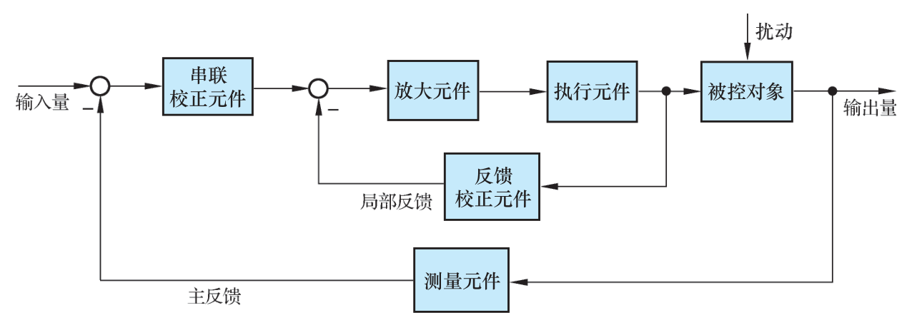

只含一条主反馈通路的叫单回路系统，含两条及以上反馈通路的叫多回路系统。右上角那条扰动箭头是从外部直接作用在被控对象上的独立通路，既不是输入也不是反馈，画图时不要把它接到比较点。

> [!WARNING] 反馈的符号、扰动通路、$H=1$，三个最容易错
> 判断开环还是闭环只看一件事：输出有没有被送回输入端参与比较。只要结构图上输出到输入之间有一条闭合的反馈线，就是闭环。比较点旁边的 $+$ 还是$-$ 决定正负反馈，负反馈分母用加号 $1+GH$，正反馈用减号 $1-GH$，符号一错后面全错。扰动是独立通路，不是反馈。$H=1$ 只在测量元件是直接连线时成立，测速发电机、电位器、热电偶都会带来比例系数或动态特性，此时分母仍是 $1+GH$，但分子和稳态误差都要带上 $H$ [1.md · p.24](http://10.188.31.55:5244/Nextcloud/School/自动控制原理/1.md)。

闭环传递函数的来历可以逐步推出来。比较元件给出偏差 $E(s)=R(s)-B(s)$，反馈信号由输出经测量元件得到 $B(s)=H(s)C(s)$，偏差经前向环节作用到对象得到输出 $C(s)=G(s)E(s)$。把反馈关系代入前向关系再整理：

$$
C(s)=G(s)\bigl[R(s)-H(s)C(s)\bigr]
\;\Longrightarrow\;
C(s)\bigl[1+G(s)H(s)\bigr]=G(s)R(s)
$$

于是负反馈的闭环传递函数是：

$$
\Phi(s)=\frac{C(s)}{R(s)}=\frac{G(s)}{1+G(s)H(s)}
$$

分母令零就是闭环特征方程 $1+G(s)H(s)=0$，它的根是闭环极点，决定系统稳不稳、振不振，这是第 3 章判稳、第 4 章画根轨迹的出发点 [自动控制原理（第八版） (胡寿松、姜斌、张绍杰) (z-library.sk, 1lib.sk, z-lib.sk)(1).pdf · p.58](http://10.188.31.55:5244/Nextcloud/School/自动控制原理/%E8%87%AA%E5%8A%A8%E6%8E%A7%E5%88%B6%E5%8E%9F%E7%90%86%EF%BC%88%E7%AC%AC%E5%85%AB%E7%89%88%EF%BC%89%20(%E8%83%A1%E5%AF%BF%E6%9D%BE%E3%80%81%E5%A7%9C%E6%96%8C%E3%80%81%E5%BC%A0%E7%BB%8D%E6%9D%B0)%20(z-library.sk,%201lib.sk,%20z-lib.sk)(1).pdf#page=58)。比较点改成正反馈时，只需把推导中所有 $H(s)$ 前的减号改成加号，得到 $\Phi(s)=\dfrac{G(s)}{1-G(s)H(s)}$，特征方程相应变成 $1-G(s)H(s)=0$ [1.md · p.20](http://10.188.31.55:5244/Nextcloud/School/自动控制原理/1.md)。

### 按输入变化规律分类

教材按输入量是不是常数、是不是已知，把系统分成三类：**恒值系统**（regulating system）、**随动系统**（servo system）和**程序控制系统** [自动控制原理（第八版） (胡寿松、姜斌、张绍杰) (z-library.sk, 1lib.sk, z-lib.sk)(1).pdf · p.22](http://10.188.31.55:5244/Nextcloud/School/自动控制原理/%E8%87%AA%E5%8A%A8%E6%8E%A7%E5%88%B6%E5%8E%9F%E7%90%86%EF%BC%88%E7%AC%AC%E5%85%AB%E7%89%88%EF%BC%89%20(%E8%83%A1%E5%AF%BF%E6%9D%BE%E3%80%81%E5%A7%9C%E6%96%8C%E3%80%81%E5%BC%A0%E7%BB%8D%E6%9D%B0)%20(z-library.sk,%201lib.sk,%20z-lib.sk)(1).pdf#page=22)：

| 类型 | 输入 | 对输出的要求 | 例子 |
| --- | --- | --- | --- |
| 恒值系统 | 一个常值 | 被控量也等于常值 | 室温、液位、炉温 |
| 随动系统 | 预先未知的随时间任意变化的函数 | 以尽可能小的误差跟随 | 函数记录仪、火炮跟飞机 |
| 程序控制系统 | 按预定规律随时间变化的已知函数 | 迅速准确地复现 | 数控机床 |

一句话辨析：恒值系统输入不变，随动系统输入未知而变，程序控制系统输入已知而变。程序控制系统与随动系统的输入都是时间函数，区别就在已知与未知；恒值控制系统可以看成程序控制系统的特例 [自动控制原理（第八版） (胡寿松、姜斌、张绍杰) (z-library.sk, 1lib.sk, z-lib.sk)(1).pdf · p.23](http://10.188.31.55:5244/Nextcloud/School/自动控制原理/%E8%87%AA%E5%8A%A8%E6%8E%A7%E5%88%B6%E5%8E%9F%E7%90%86%EF%BC%88%E7%AC%AC%E5%85%AB%E7%89%88%EF%BC%89%20(%E8%83%A1%E5%AF%BF%E6%9D%BE%E3%80%81%E5%A7%9C%E6%96%8C%E3%80%81%E5%BC%A0%E7%BB%8D%E6%9D%B0)%20(z-library.sk,%201lib.sk,%20z-lib.sk)(1).pdf#page=23)。期末填空常考这三类系统的辨析 [自动控制原理【蜂考系统课】(1).pdf · p.5](http://10.188.31.55:5244/Nextcloud/School/自动控制原理/%E8%87%AA%E5%8A%A8%E6%8E%A7%E5%88%B6%E5%8E%9F%E7%90%86%E3%80%90%E8%9C%82%E8%80%83%E7%B3%BB%E7%BB%9F%E8%AF%BE%E3%80%91(1).pdf#page=5)。

### 性能要求与典型输入

不管哪一类系统，对被控量变化全过程提的要求都是三条。**稳定性**是扰动后偏差随时间衰减到零，是正常工作的先决条件。**快速性**管过渡过程的时间长短和振荡幅度大小。**准确性**管过渡过程结束后的稳态值与期望值之间的残余误差。合起来就是"稳、快、准"，而稳定性是三者中最基本的，填空时答成准确性就错了 [自动控制原理（第八版） (胡寿松、姜斌、张绍杰) (z-library.sk, 1lib.sk, z-lib.sk)(1).pdf · p.23](http://10.188.31.55:5244/Nextcloud/School/自动控制原理/%E8%87%AA%E5%8A%A8%E6%8E%A7%E5%88%B6%E5%8E%9F%E7%90%86%EF%BC%88%E7%AC%AC%E5%85%AB%E7%89%88%EF%BC%89%20(%E8%83%A1%E5%AF%BF%E6%9D%BE%E3%80%81%E5%A7%9C%E6%96%8C%E3%80%81%E5%BC%A0%E7%BB%8D%E6%9D%B0)%20(z-library.sk,%201lib.sk,%20z-lib.sk)(1).pdf#page=23)。快速性与准确性的具体说法在下一页 [自动控制原理（第八版） (胡寿松、姜斌、张绍杰) (z-library.sk, 1lib.sk, z-lib.sk)(1).pdf · p.24](http://10.188.31.55:5244/Nextcloud/School/自动控制原理/%E8%87%AA%E5%8A%A8%E6%8E%A7%E5%88%B6%E5%8E%9F%E7%90%86%EF%BC%88%E7%AC%AC%E5%85%AB%E7%89%88%EF%BC%89%20(%E8%83%A1%E5%AF%BF%E6%9D%BE%E3%80%81%E5%A7%9C%E6%96%8C%E3%80%81%E5%BC%A0%E7%BB%8D%E6%9D%B0)%20(z-library.sk,%201lib.sk,%20z-lib.sk)(1).pdf#page=24)。

为了让不同的系统能用同一套指标比较，工程上选几种确定性函数作典型输入：阶跃函数在 $t=0$ 突然跳到一个幅值并保持不变，斜坡函数以恒定速率线性增长，抛物线函数的加速度为常数、增长速度随时间加快。评价动态性能一般以阶跃响应为依据 [自动控制原理（第八版） (胡寿松、姜斌、张绍杰) (z-library.sk, 1lib.sk, z-lib.sk)(1).pdf · p.24](http://10.188.31.55:5244/Nextcloud/School/自动控制原理/%E8%87%AA%E5%8A%A8%E6%8E%A7%E5%88%B6%E5%8E%9F%E7%90%86%EF%BC%88%E7%AC%AC%E5%85%AB%E7%89%88%EF%BC%89%20(%E8%83%A1%E5%AF%BF%E6%9D%BE%E3%80%81%E5%A7%9C%E6%96%8C%E3%80%81%E5%BC%A0%E7%BB%8D%E6%9D%B0)%20(z-library.sk,%201lib.sk,%20z-lib.sk)(1).pdf#page=24)。两种函数的图形在教材下一页 [自动控制原理（第八版） (胡寿松、姜斌、张绍杰) (z-library.sk, 1lib.sk, z-lib.sk)(1).pdf · p.25](http://10.188.31.55:5244/Nextcloud/School/自动控制原理/%E8%87%AA%E5%8A%A8%E6%8E%A7%E5%88%B6%E5%8E%9F%E7%90%86%EF%BC%88%E7%AC%AC%E5%85%AB%E7%89%88%EF%BC%89%20(%E8%83%A1%E5%AF%BF%E6%9D%BE%E3%80%81%E5%A7%9C%E6%96%8C%E3%80%81%E5%BC%A0%E7%BB%8D%E6%9D%B0)%20(z-library.sk,%201lib.sk,%20z-lib.sk)(1).pdf#page=25)。


### 一个完整例子：液位自动控制

教材习题给了一个液位自动控制系统原理图，把前面说的四件套一次凑齐 [自动控制原理（第八版） (胡寿松、姜斌、张绍杰) (z-library.sk, 1lib.sk, z-lib.sk)(1).pdf · p.29](http://10.188.31.55:5244/Nextcloud/School/自动控制原理/%E8%87%AA%E5%8A%A8%E6%8E%A7%E5%88%B6%E5%8E%9F%E7%90%86%EF%BC%88%E7%AC%AC%E5%85%AB%E7%89%88%EF%BC%89%20(%E8%83%A1%E5%AF%BF%E6%9D%BE%E3%80%81%E5%A7%9C%E6%96%8C%E3%80%81%E5%BC%A0%E7%BB%8D%E6%9D%B0)%20(z-library.sk,%201lib.sk,%20z-lib.sk)(1).pdf#page=29)。


水箱是被控对象，液面高度 $c$ 是被控量也就是输出，浮子与电位器是测量元件，电动机与阀门是执行器，比较与放大环节是控制器。当出水量 $Q_2$ 增大使液位下降，浮子下降、电位器输出变化，与给定值比较后产生偏差，电动机带动阀门开大进水 $Q_1$，液位回升到给定值。全程无人动手，这就是自动控制。

## 第 2 章 控制系统的数学模型

### 三套坐标

设想一个真实电路：电源经过两级 RC 滤波，中间接一个运放，运放输出又经电容反馈回第一级。如果只会列微分方程、解微分方程，那么每改一个电阻值整条推导都要重来，方程还可能是四五阶，解出来的时间表达式长到几页纸，想比较"哪个参数让它更稳"就变成了猜谜。

省力的办法是换一套描述系统的坐标，本章建立的三套坐标分别管三件事 [自动控制原理（第八版） (胡寿松、姜斌、张绍杰) (z-library.sk, 1lib.sk, z-lib.sk)(1).pdf · p.33](http://10.188.31.55:5244/Nextcloud/School/自动控制原理/%E8%87%AA%E5%8A%A8%E6%8E%A7%E5%88%B6%E5%8E%9F%E7%90%86%EF%BC%88%E7%AC%AC%E5%85%AB%E7%89%88%EF%BC%89%20(%E8%83%A1%E5%AF%BF%E6%9D%BE%E3%80%81%E5%A7%9C%E6%96%8C%E3%80%81%E5%BC%A0%E7%BB%8D%E6%9D%B0)%20(z-library.sk,%201lib.sk,%20z-lib.sk)(1).pdf#page=33)：

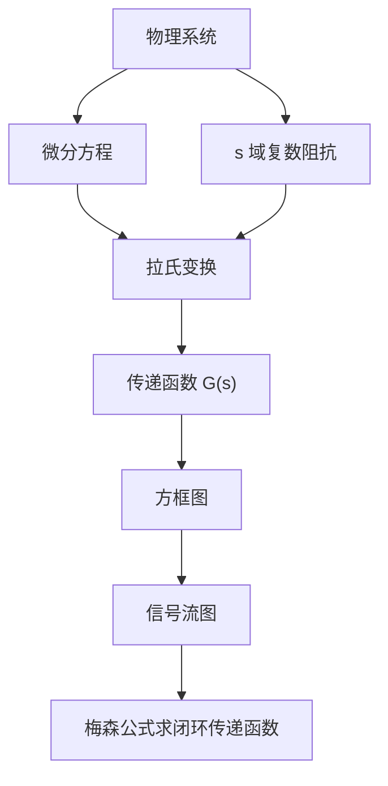

- **传递函数** $G(s)$：把时域微分方程搬到复频域，整个系统压缩成一个有理分式。改一个参数只改一个系数，不必重新解方程。
- **方框图（结构图）**：把系统拆成一个个方块，用箭头画出信号从哪来到哪去，既看得见结构，又能做代数运算。
- **信号流图与梅森增益公式**：当系统有三个以上回路、回路还互相交叉时，"由内向外逐步化简"会越化越乱。梅森公式让我们一步写出闭环传递函数，不做任何化简。

本讲义后面的六章全部建在这三套坐标上。

### 线性化：小偏差法

真实系统里非线性环节占大多数：放大器和电磁元件的饱和特性、运动部件的死区、间隙和摩擦。数学上处理不了非线性方程，教材的做法是在平衡点附近线性化。系统在正常工作状态下处于平衡状态，被控量与期望值保持一致，只有当被控量偏离期望值产生偏差时控制才动作，所以偏差本身不大，用泰勒级数在平衡点展开并略去二阶以上导数项，得到增量线性化方程：

$$
\Delta y=\left(\frac{\partial f}{\partial x_1}\right)_{x_1=x_{10},\,x_2=x_{20}}\Delta x_1+\left(\frac{\partial f}{\partial x_2}\right)_{x_1=x_{10},\,x_2=x_{20}}\Delta x_2
$$

教材用铁心线圈做例子：磁通 $\phi$ 与电流 $i$ 之间是非线性关系，在平衡点 $(u_0,i_0)$ 附近展开后略去高阶项，得到 $\phi(i)-\phi(i_0)=K\Delta i$ 的线性关系 [自动控制原理（第八版） (胡寿松、姜斌、张绍杰) (z-library.sk, 1lib.sk, z-lib.sk)(1).pdf · p.41](http://10.188.31.55:5244/Nextcloud/School/自动控制原理/%E8%87%AA%E5%8A%A8%E6%8E%A7%E5%88%B6%E5%8E%9F%E7%90%86%EF%BC%88%E7%AC%AC%E5%85%AB%E7%89%88%EF%BC%89%20(%E8%83%A1%E5%AF%BF%E6%9D%BE%E3%80%81%E5%A7%9C%E6%96%8C%E3%80%81%E5%BC%A0%E7%BB%8D%E6%9D%B0)%20(z-library.sk,%201lib.sk,%20z-lib.sk)(1).pdf#page=41)。


教材强调这种小偏差法对控制系统大多数工作状态是可行的：控制系统正常情况下都处在一个稳定的工作状态，即平衡状态。

### 传递函数与复数阻抗

传递函数的定义、零初始条件、性质在第 0 章已经给过。教材在定义之后给出两个实用性质：传递函数是复变量 $s$ 的有理分式函数，$m\le n$，且所有系数都是实数；分母多项式是特征多项式，它的根是传递函数的极点 [自动控制原理（第八版） (胡寿松、姜斌、张绍杰) (z-library.sk, 1lib.sk, z-lib.sk)(1).pdf · p.43](http://10.188.31.55:5244/Nextcloud/School/自动控制原理/%E8%87%AA%E5%8A%A8%E6%8E%A7%E5%88%B6%E5%8E%9F%E7%90%86%EF%BC%88%E7%AC%AC%E5%85%AB%E7%89%88%EF%BC%89%20(%E8%83%A1%E5%AF%BF%E6%9D%BE%E3%80%81%E5%A7%9C%E6%96%8C%E3%80%81%E5%BC%A0%E7%BB%8D%E6%9D%B0)%20(z-library.sk,%201lib.sk,%20z-lib.sk)(1).pdf#page=43)。

有了传递函数，建模有两条路。一条是老老实实列微分方程再取拉氏变换；另一条更快：在 $s$ 域里电阻、电容、电感都可以当成一个"电阻"，电阻仍是 $R$，电容是 $\frac{1}{Cs}$，电感是 $Ls$，串联相加、并联按积除以和，于是整个电路可以当分压器算。讲师笔记把这套办法整理成一条万能公式 [复习_建模与结构图化简.md · p.27](http://10.188.31.55:5244/Nextcloud/School/自动控制原理/%E5%A4%8D%E4%B9%A0_%E5%BB%BA%E6%A8%A1%E4%B8%8E%E7%BB%93%E6%9E%84%E5%9B%BE%E5%8C%96%E7%AE%80.md)：

$$
G(s)=\frac{U_o(s)}{U_i(s)}=\frac{Z_{\text{输出侧}}}{Z_{\text{总}}}
$$

教材把 RLC 无源网络用复数阻抗重画了一遍：$Z_1=R+Ls$，$Z_2=\frac{1}{Cs}$，直接按分压器写出传递函数 [自动控制原理（第八版） (胡寿松、姜斌、张绍杰) (z-library.sk, 1lib.sk, z-lib.sk)(1).pdf · p.50](http://10.188.31.55:5244/Nextcloud/School/自动控制原理/%E8%87%AA%E5%8A%A8%E6%8E%A7%E5%88%B6%E5%8E%9F%E7%90%86%EF%BC%88%E7%AC%AC%E5%85%AB%E7%89%88%EF%BC%89%20(%E8%83%A1%E5%AF%BF%E6%9D%BE%E3%80%81%E5%A7%9C%E6%96%8C%E3%80%81%E5%BC%A0%E7%BB%8D%E6%9D%B0)%20(z-library.sk,%201lib.sk,%20z-lib.sk)(1).pdf#page=50)。

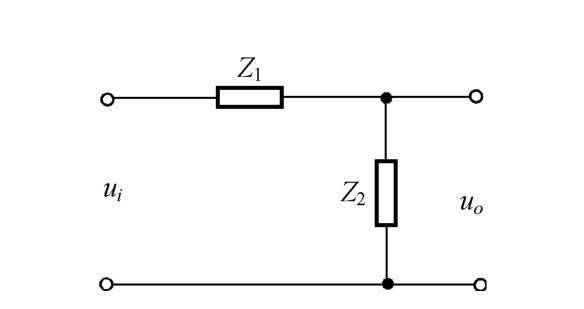

两个例子走一遍。RC 低通滤波器，电阻 $R$ 串联、电容 $C$ 并联到地，输出取自电容：

$$
G(s)=\frac{Z_C}{Z_R+Z_C}=\frac{\frac{1}{Cs}}{R+\frac{1}{Cs}}=\frac{1}{RCs+1}=\frac{1}{Ts+1}
$$

时间常数 $T=RC$，这是一个惯性环节，转折频率 $\omega=1/T$ [复习_建模与结构图化简.md · p.43](http://10.188.31.55:5244/Nextcloud/School/自动控制原理/%E5%A4%8D%E4%B9%A0_%E5%BB%BA%E6%A8%A1%E4%B8%8E%E7%BB%93%E6%9E%84%E5%9B%BE%E5%8C%96%E7%AE%80.md)。RLC 串联电路，输出取自电容：

$$
G(s)=\frac{Z_C}{Z_R+Z_L+Z_C}=\frac{1}{LCs^2+RCs+1}
$$

对照二阶振荡环节的标准形式，可以读出无阻尼自然频率 $\omega_n=\frac{1}{\sqrt{LC}}$ 和阻尼比 $\zeta=\frac{R}{2}\sqrt{\frac{C}{L}}$ [复习_建模与结构图化简.md · p.111](http://10.188.31.55:5244/Nextcloud/School/自动控制原理/%E5%A4%8D%E4%B9%A0_%E5%BB%BA%E6%A8%A1%E4%B8%8E%E7%BB%93%E6%9E%84%E5%9B%BE%E5%8C%96%E7%AE%80.md)。取 $L=1$、$C=1$、$R=2$ 时 $G(s)=\frac{1}{(s+1)^2}$，$\zeta=1$，属临界阻尼，输出不振荡。

有源网络多一条运放的规矩：虚短 $U_+=U_-$、虚断 $I_+=I_-=0$。反相放大器的传递函数就是一个分压比：

$$
G(s)=\frac{U_o(s)}{U_i(s)}=-\frac{Z_f(s)}{Z_i(s)}
$$

蜂考课件用一个反相放大器把输入电阻 $R_1$ 和反馈支路 $R_2$ 串电容算到底，结论是 $G(s)=-\frac{R_2Cs+1}{R_1Cs}$ [自动控制原理【蜂考系统课】(1).pdf · p.20](http://10.188.31.55:5244/Nextcloud/School/自动控制原理/%E8%87%AA%E5%8A%A8%E6%8E%A7%E5%88%B6%E5%8E%9F%E7%90%86%E3%80%90%E8%9C%82%E8%80%83%E7%B3%BB%E7%BB%9F%E8%AF%BE%E3%80%91(1).pdf#page=20)。

> [!TIP] 从电路图到结构图的两条连线法则
> 顺着电流方向走，电流由前级电压减去后级电压除以阻抗得到，前级电压是正输入（顺流生）；逆着看，后级电压升高会减少电流，后级电压是负反馈输入（逆流挡）。看到电容直接画成积分环节 $\frac{1}{Cs}$ [2.md · p.28](http://10.188.31.55:5244/Nextcloud/School/自动控制原理/2.md)。

### 机械系统与机电系统建模

建模对象不限于电路。教材给出的机械位移系统例子由牛顿第二定律列方程，齿轮系通过线速度相同、功率相同的关系把后级负载归化到前级轴上 [自动控制原理（第八版） (胡寿松、姜斌、张绍杰) (z-library.sk, 1lib.sk, z-lib.sk)(1).pdf · p.35](http://10.188.31.55:5244/Nextcloud/School/自动控制原理/%E8%87%AA%E5%8A%A8%E6%8E%A7%E5%88%B6%E5%8E%9F%E7%90%86%EF%BC%88%E7%AC%AC%E5%85%AB%E7%89%88%EF%BC%89%20(%E8%83%A1%E5%AF%BF%E6%9D%BE%E3%80%81%E5%A7%9C%E6%96%8C%E3%80%81%E5%BC%A0%E7%BB%8D%E6%9D%B0)%20(z-library.sk,%201lib.sk,%20z-lib.sk)(1).pdf#page=35)。

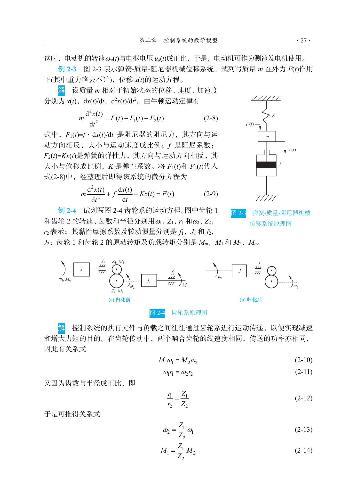

弹簧-质量-阻尼器系统由牛顿运动定律得到运动方程，阻尼器的阻尼力与速度成正比、弹簧的弹性力与位移成正比：

$$
m\frac{\mathrm{d}^2x(t)}{\mathrm{d}t^2}+f\frac{\mathrm{d}x(t)}{\mathrm{d}t}+Kx(t)=F(t)
$$

齿轮系用两个关系把转速和转矩联系起来：啮合齿轮线速度相同 $\omega_1r_1=\omega_2r_2$，传递功率相同 $M_1\omega_1=M_2\omega_2$，于是 $\omega_2=\frac{Z_1}{Z_2}\omega_1$、$M_1=\frac{Z_1}{Z_2}M_2$。电枢控制的直流电动机是三式：电枢回路的电压平衡 $u_a=R_ai+L_a\frac{\mathrm{d}i_a}{\mathrm{d}t}+E_a$，电磁转矩 $M_m=C_mi_a$，电动机轴上的转矩平衡 $J_m\frac{\mathrm{d}\omega_m}{\mathrm{d}t}+f_m\omega_m=M_m-M_c$ [自动控制原理（第八版） (胡寿松、姜斌、张绍杰) (z-library.sk, 1lib.sk, z-lib.sk)(1).pdf · p.34](http://10.188.31.55:5244/Nextcloud/School/自动控制原理/%E8%87%AA%E5%8A%A8%E6%8E%A7%E5%88%B6%E5%8E%9F%E7%90%86%EF%BC%88%E7%AC%AC%E5%85%AB%E7%89%88%EF%BC%89%20(%E8%83%A1%E5%AF%BF%E6%9D%BE%E3%80%81%E5%A7%9C%E6%96%8C%E3%80%81%E5%BC%A0%E7%BB%8D%E6%9D%B0)%20(z-library.sk,%201lib.sk,%20z-lib.sk)(1).pdf#page=34)。

RLC 无源网络和弹簧-质量-阻尼器系统，数学形式都是二阶微分方程：电容储能对应弹簧势能，电感对应质量，电阻对应阻尼。教材把这类系统称为**相似系统**，搞懂一个电网络就等于搞懂对应的机械系统，仿真时也能用一个模型代替另一个 [自动控制原理（第八版） (胡寿松、姜斌、张绍杰) (z-library.sk, 1lib.sk, z-lib.sk)(1).pdf · p.38](http://10.188.31.55:5244/Nextcloud/School/自动控制原理/%E8%87%AA%E5%8A%A8%E6%8E%A7%E5%88%B6%E5%8E%9F%E7%90%86%EF%BC%88%E7%AC%AC%E5%85%AB%E7%89%88%EF%BC%89%20(%E8%83%A1%E5%AF%BF%E6%9D%BE%E3%80%81%E5%A7%9C%E6%96%8C%E3%80%81%E5%BC%A0%E7%BB%8D%E6%9D%B0)%20(z-library.sk,%201lib.sk,%20z-lib.sk)(1).pdf#page=38)。

### 方框图：三种基本连接

**方框图**（block diagram）用方块和箭头表示各环节的信号流向，每个方块里写一个传递函数，整个系统可以逐步化简成单个方块。再复杂的结构图，化简到底也只是三种连接的反复套用。

**串联**（cascade connection）。两个方块首尾相接，前一个的输出就是后一个的输入，等效传递函数是两者相乘：

$$
G=G_1G_2
$$

**并联**（parallel connection）。两个方块输入相同、输出相加或相减，等效传递函数是代数和：

$$
G=G_1\pm G_2
$$

**反馈**（feedback connection）。前向通路 $G(s)$、反馈通路 $H(s)$，负反馈的等效方框是：

$$
\Phi(s)=\frac{G(s)}{1+G(s)H(s)}
$$

正反馈时分母换成 $1-G(s)H(s)$。教材把这三种连接连同"结构图简化规则"表放在同一节里，串联与并联的等效式在 [自动控制原理（第八版） (胡寿松、姜斌、张绍杰) (z-library.sk, 1lib.sk, z-lib.sk)(1).pdf · p.57](http://10.188.31.55:5244/Nextcloud/School/自动控制原理/%E8%87%AA%E5%8A%A8%E6%8E%A7%E5%88%B6%E5%8E%9F%E7%90%86%EF%BC%88%E7%AC%AC%E5%85%AB%E7%89%88%EF%BC%89%20(%E8%83%A1%E5%AF%BF%E6%9D%BE%E3%80%81%E5%A7%9C%E6%96%8C%E3%80%81%E5%BC%A0%E7%BB%8D%E6%9D%B0)%20(z-library.sk,%201lib.sk,%20z-lib.sk)(1).pdf#page=57)，反馈连接的等效式在 [自动控制原理（第八版） (胡寿松、姜斌、张绍杰) (z-library.sk, 1lib.sk, z-lib.sk)(1).pdf · p.58](http://10.188.31.55:5244/Nextcloud/School/自动控制原理/%E8%87%AA%E5%8A%A8%E6%8E%A7%E5%88%B6%E5%8E%9F%E7%90%86%EF%BC%88%E7%AC%AC%E5%85%AB%E7%89%88%EF%BC%89%20(%E8%83%A1%E5%AF%BF%E6%9D%BE%E3%80%81%E5%A7%9C%E6%96%8C%E3%80%81%E5%BC%A0%E7%BB%8D%E6%9D%B0)%20(z-library.sk,%201lib.sk,%20z-lib.sk)(1).pdf#page=58)。蜂考课件把方框图等效变换列成与复数阻抗法并列的必考考点 [自动控制原理【蜂考系统课】(1).pdf · p.20](http://10.188.31.55:5244/Nextcloud/School/自动控制原理/%E8%87%AA%E5%8A%A8%E6%8E%A7%E5%88%B6%E5%8E%9F%E7%90%86%E3%80%90%E8%9C%82%E8%80%83%E7%B3%BB%E7%BB%9F%E8%AF%BE%E3%80%91(1).pdf#page=20)。

结构图有交叉、看不出是哪种基本连接时，要移动引出点或综合点解除交叉，规则只有四条 [复习_建模与结构图化简.md · p.211](http://10.188.31.55:5244/Nextcloud/School/自动控制原理/%E5%A4%8D%E4%B9%A0_%E5%BB%BA%E6%A8%A1%E4%B8%8E%E7%BB%93%E6%9E%84%E5%9B%BE%E5%8C%96%E7%AE%80.md)：引出点前移要在支路上串一个 $G$，引出点后移要串 $\frac{1}{G}$；综合点前移要串 $\frac{1}{G}$，综合点后移要串 $G$。

口诀是"引前乘 G、引后除 G、合前除 G、合后乘 G"。移动后必须保持折返点前后信号乘积不变，否则等效性就破了。化简顺序由内向外：先识别最内层没有嵌套的反馈环，用反馈公式化简它，再看剩下的结构，有交叉就移动节点，重复到只剩一个方块 [复习_建模与结构图化简.md · p.246](http://10.188.31.55:5244/Nextcloud/School/自动控制原理/%E5%A4%8D%E4%B9%A0_%E5%BB%BA%E6%A8%A1%E4%B8%8E%E7%BB%93%E6%9E%84%E5%9B%BE%E5%8C%96%E7%AE%80.md)。

### 信号流图与梅森增益公式

**信号流图**（signal-flow graph）用节点表示变量、用带增益的有向支路表示因果关系。节点相当于乘法器，支路增益相当于乘数，信号只能沿箭头单向传递。教材的定义是：节点标志系统的变量，节点标志的变量是所有流向该节点的信号之代数和 [自动控制原理（第八版） (胡寿松、姜斌、张绍杰) (z-library.sk, 1lib.sk, z-lib.sk)(1).pdf · p.62](http://10.188.31.55:5244/Nextcloud/School/自动控制原理/%E8%87%AA%E5%8A%A8%E6%8E%A7%E5%88%B6%E5%8E%9F%E7%90%86%EF%BC%88%E7%AC%AC%E5%85%AB%E7%89%88%EF%BC%89%20(%E8%83%A1%E5%AF%BF%E6%9D%BE%E3%80%81%E5%A7%9C%E6%96%8C%E3%80%81%E5%BC%A0%E7%BB%8D%E6%9D%B0)%20(z-library.sk,%201lib.sk,%20z-lib.sk)(1).pdf#page=62)。

流图里有四个名词，后面全部要用。

**前向通路**是从输入节点到输出节点、每个节点只经过一次的通路，通路上各支路增益之积是前向通路增益 $P_k$。**回路**是起点和终点在同一节点、每个节点不超过一次的闭合通路，增益之积是回路增益 $L_i$。**不接触回路**是两个回路之间没有任何公共节点。**混合节点**既有输入支路又有输出支路。

教材先画出这张典型的信号流图 [自动控制原理（第八版） (胡寿松、姜斌、张绍杰) (z-library.sk, 1lib.sk, z-lib.sk)(1).pdf · p.62](http://10.188.31.55:5244/Nextcloud/School/自动控制原理/%E8%87%AA%E5%8A%A8%E6%8E%A7%E5%88%B6%E5%8E%9F%E7%90%86%EF%BC%88%E7%AC%AC%E5%85%AB%E7%89%88%EF%BC%89%20(%E8%83%A1%E5%AF%BF%E6%9D%BE%E3%80%81%E5%A7%9C%E6%96%8C%E3%80%81%E5%BC%A0%E7%BB%8D%E6%9D%B0)%20(z-library.sk,%201lib.sk,%20z-lib.sk)(1).pdf#page=62)，再在下一页逐条演示这套术语 [自动控制原理（第八版） (胡寿松、姜斌、张绍杰) (z-library.sk, 1lib.sk, z-lib.sk)(1).pdf · p.63](http://10.188.31.55:5244/Nextcloud/School/自动控制原理/%E8%87%AA%E5%8A%A8%E6%8E%A7%E5%88%B6%E5%8E%9F%E7%90%86%EF%BC%88%E7%AC%AC%E5%85%AB%E7%89%88%EF%BC%89%20(%E8%83%A1%E5%AF%BF%E6%9D%BE%E3%80%81%E5%A7%9C%E6%96%8C%E3%80%81%E5%BC%A0%E7%BB%8D%E6%9D%B0)%20(z-library.sk,%201lib.sk,%20z-lib.sk)(1).pdf#page=63)：


图里源节点是 $x_1$，阱节点是引出单位增益支路的 $x_5$，前向通路有两条：$x_1\to x_2\to x_3\to x_4\to x_5$ 增益 $abc$，$x_1\to x_2\to x_5$ 增益 $d$；回路有三个：$L_1=ae$、$L_2=bf$、$L_3=g$。

梅森增益公式的来源，是把信号流图对应的线性方程组用克拉默法则解出来，再把解的分子分母与图上的通路、回路对应起来。教材用一张五节点流图完整走了一遍 [自动控制原理（第八版） (胡寿松、姜斌、张绍杰) (z-library.sk, 1lib.sk, z-lib.sk)(1).pdf · p.66](http://10.188.31.55:5244/Nextcloud/School/自动控制原理/%E8%87%AA%E5%8A%A8%E6%8E%A7%E5%88%B6%E5%8E%9F%E7%90%86%EF%BC%88%E7%AC%AC%E5%85%AB%E7%89%88%EF%BC%89%20(%E8%83%A1%E5%AF%BF%E6%9D%BE%E3%80%81%E5%A7%9C%E6%96%8C%E3%80%81%E5%BC%A0%E7%BB%8D%E6%9D%B0)%20(z-library.sk,%201lib.sk,%20z-lib.sk)(1).pdf#page=66)：


把因果关系写成方程组，未知量移到左边：

- $X_1-fX_2=aU_i$
- $-bX_1+X_2-gX_3=0$
- $-cX_2+X_3-hX_4=0$
- $-dX_3+X_4=eU_i$

系数行列式展开后是 $\Delta=1-dh-gc-fb+fbdh$，其中出现三个单独回路增益 $fb$、$gc$、$dh$（带负号），以及一项 $fbdh$。把第一列换成右端向量得分子行列式 $\Delta_4=abcd\,U_i+eU_i(1-gc-bf)$，由克拉默法则 $U_o=\Delta_4/\Delta$，整理成传递函数：

$$
\frac{U_o}{U_i}=\frac{abcd+e(1-gc-bf)}{1-(fb+gc+dh)+fbdh}
$$

分子里 $abcd$ 和 $e$ 正是两条前向通路的增益；$e$ 后面乘的 $(1-gc-bf)$，正是与这条前向通路不接触的那些回路构成的因子。分母里 $-(fb+gc+dh)$ 是三个回路增益之和，$fbdh$ 是两个不接触回路（$fb$ 与 $dh$ 没有公共节点）的增益乘积。

推广到任意条前向通路、任意个回路，就得到梅森增益公式：

$$
\Phi(s)=\frac{1}{\Delta}\sum_{k=1}^{n}P_k\Delta_k
$$

其中 $\Delta$ 是流图特征式，$\Delta_k$ 是第 $k$ 条前向通路对应的余子式，等于从 $\Delta$ 中去掉所有与第 $k$ 条前向通路接触的回路后剩下的部分 [自动控制原理（第八版） (胡寿松、姜斌、张绍杰) (z-library.sk, 1lib.sk, z-lib.sk)(1).pdf · p.67](http://10.188.31.55:5244/Nextcloud/School/自动控制原理/%E8%87%AA%E5%8A%A8%E6%8E%A7%E5%88%B6%E5%8E%9F%E7%90%86%EF%BC%88%E7%AC%AC%E5%85%AB%E7%89%88%EF%BC%89%20(%E8%83%A1%E5%AF%BF%E6%9D%BE%E3%80%81%E5%A7%9C%E6%96%8C%E3%80%81%E5%BC%A0%E7%BB%8D%E6%9D%B0)%20(z-library.sk,%201lib.sk,%20z-lib.sk)(1).pdf#page=67)。

特征式的完整展开式是：

$$
\Delta=1-\sum_i L_i+\sum_{i,j\ \text{不接触}}L_iL_j-\sum_{i,j,k\ \text{不接触}}L_iL_jL_k+\cdots
$$

第一项是 $1$，第二项是所有单独回路增益之和带负号，第三项是所有两两不接触回路的增益乘积之和带正号，第四项带负号，依此类推。判断"不接触"的唯一标准是两个回路没有任何公共节点。

 徐德刚教授的课件把梅森公式、特征式展开和例 2-20 放在同一页上 [自控原理（第二章4）.pdf · p.1](http://10.188.31.55:5244/Nextcloud/School/自动控制原理/%E8%87%AA%E6%8E%A7%E5%8E%9F%E7%90%86%EF%BC%88%E7%AC%AC%E4%BA%8C%E7%AB%A04%EF%BC%89.pdf#page=1)。


### 梅森公式怎么用

课件给的例 2-20 是一个六方框、三反馈支路的系统，结构图和信号流图并排放在同一页 [自控原理（第二章4）.pdf · p.1](http://10.188.31.55:5244/Nextcloud/School/自动控制原理/%E8%87%AA%E6%8E%A7%E5%8E%9F%E7%90%86%EF%BC%88%E7%AC%AC%E4%BA%8C%E7%AB%A04%EF%BC%89.pdf#page=1)。按公式走一遍。

第一步找前向通路。从源节点 $R$ 到阱节点 $C$ 有两条：$p_1=G_1G_2G_3$，$p_2=G_1G_4$。

第二步找单独回路。一共五个：$L_1=-G_1G_2H_1$，$L_2=-G_2G_3H_2$，$L_3=-G_1G_2G_3$，$L_4=-G_4H_2$，$L_5=-G_1G_4$。负号来自反馈支路。

第三步判不接触。这一例里两两不接触的回路不存在，特征式里没有交叉项：

$$
\Delta=1-(L_1+L_2+L_3+L_4+L_5)
$$

第四步算余子式。所有回路都与两条前向通路接触，所以 $\Delta_1=\Delta_2=1$。代入梅森公式：

$$
\Phi(s)=\frac{p_1\Delta_1+p_2\Delta_2}{\Delta}
=\frac{G_1G_2G_3+G_1G_4}{1-(L_1+L_2+L_3+L_4+L_5)}
$$

紧接着的例 2-21 演示了余子式不总是 1：那个流图有三个单独回路和一对不接触回路，其中一条前向通路与回路 $-d$ 不接触，它的余子式就是 $\Delta_1=1+d$，另一条与所有回路都接触，$\Delta_2=1$ [自控原理（第二章4）.pdf · p.2](http://10.188.31.55:5244/Nextcloud/School/自动控制原理/%E8%87%AA%E6%8E%A7%E5%8E%9F%E7%90%86%EF%BC%88%E7%AC%AC%E4%BA%8C%E7%AB%A04%EF%BC%89.pdf#page=2)。这是"接触"两个字最实际的用处：不接触的回路在余子式里可以保留下来。

考试怎么考这个方法，期末 A 卷第一题就是：给一个 RC 无源网络，要求先画结构图，再用梅森公式求传递函数，15 分 [自动控制原理A卷 (1).pdf · p.1](http://10.188.31.55:5244/Nextcloud/School/自动控制原理/%E8%87%AA%E5%8A%A8%E6%8E%A7%E5%88%B6%E5%8E%9F%E7%90%86A%E5%8D%B7%20(1).pdf#page=1)。官方答案给的传递函数是 $\frac{1}{R_1C_1R_2C_2s^2+(R_1C_1+R_2C_2+R_1C_2)s+1}$，特征式 $\Delta=1+R_1C_1s+R_1C_2s+R_2C_2s+R_1R_2C_1C_2s^2$ [自动控制原理A卷答案(1).pdf · p.1](http://10.188.31.55:5244/Nextcloud/School/自动控制原理/%E8%87%AA%E5%8A%A8%E6%8E%A7%E5%88%B6%E5%8E%9F%E7%90%86A%E5%8D%B7%E7%AD%94%E6%A1%88(1).pdf#page=1)。型式零把这一题标成"第1题核心"，方法是复数阻抗法加梅森公式 [题型零_前三章考试内容.md · p.12](http://10.188.31.55:5244/Nextcloud/School/自动控制原理/%E9%A2%98%E5%9E%8B%E9%9B%B6_%E5%89%8D%E4%B8%89%E7%AB%A0%E8%80%83%E8%AF%95%E5%86%85%E5%AE%B9.md)。

> [!WARNING] 算 $\Delta$ 时最容易漏的一步
> $\Delta=1-\sum L_i+\sum L_iL_j-\cdots$ 的第三项容易被忽略。列出所有回路后要逐对检查有没有两个回路没有任何公共节点，只要有，把它们的增益乘积加进 $\Delta$。讲师的提醒是"算 $\Delta$ 时，一定要检查有没有两个回路是完全没公共节点的，如果有，记得加上它们的乘积" [2.md · p.34](http://10.188.31.55:5244/Nextcloud/School/自动控制原理/2.md)。另一个高频错是回路增益符号，负反馈的 $-1$ 必须乘进回路增益里，写成 $L=-GH$。

### 复杂系统的处理顺序

拿到一个电路、机械系统或结构图，顺序固定：

1. 确认输入输出，标出所有中间节点。
2. 选方法：节点少的一两个用分压公式，节点多、有交叉就老老实实列 KCL 节点方程。
3. 在 $s$ 域写出各元件阻抗。
4. 联立方程消中间变量，整理成 $U_o(s)/U_i(s)$。
5. 结构图求传递函数时先数回路数：不超过两个用等效变换由内向外化简，三个以上或有交叉直接用梅森公式。

这套流程在讲师笔记里写成了模板 [复习_建模与结构图化简.md · p.416](http://10.188.31.55:5244/Nextcloud/School/自动控制原理/%E5%A4%8D%E4%B9%A0_%E5%BB%BA%E6%A8%A1%E4%B8%8E%E7%BB%93%E6%9E%84%E5%9B%BE%E5%8C%96%E7%AE%80.md)。梅森公式的解题步骤同样有固定顺序：找所有前向通路 $P_k$、找所有回路 $L_i$、找不接触回路对、算 $\Delta$、算每条前向通路的 $\Delta_k$、代入公式 [复习_建模与结构图化简.md · p.429](http://10.188.31.55:5244/Nextcloud/School/自动控制原理/%E5%A4%8D%E4%B9%A0_%E5%BB%BA%E6%A8%A1%E4%B8%8E%E7%BB%93%E6%9E%84%E5%9B%BE%E5%8C%96%E7%AE%80.md)。时间分配上，A 卷第一题 15 分给 15 分钟，策略就一句：梅森公式，别漏回路 [补充_考试出题模式与特殊情况.md · p.507](http://10.188.31.55:5244/Nextcloud/School/自动控制原理/%E8%A1%A5%E5%85%85_%E8%80%83%E8%AF%95%E5%87%BA%E9%A2%98%E6%A8%A1%E5%BC%8F%E4%B8%8E%E7%89%B9%E6%AE%8A%E6%83%85%E5%86%B5.md)。

如果还要误差传递函数，单位反馈时有一条捷径：

$$
\frac{E(s)}{R(s)}=1-\Phi(s)=\frac{1}{1+G(s)}
$$

非单位反馈时不能直接套 $1-\Phi(s)$，要用 $E(s)=R(s)-C(s)H(s)$，也就是 $\frac{E(s)}{R(s)}=1-\frac{C(s)}{R(s)}H(s)$ [复习_建模与结构图化简.md · p.394](http://10.188.31.55:5244/Nextcloud/School/自动控制原理/%E5%A4%8D%E4%B9%A0_%E5%BB%BA%E6%A8%A1%E4%B8%8E%E7%BB%93%E6%9E%84%E5%9B%BE%E5%8C%96%E7%AE%80.md)。

## 第 3 章 线性系统的时域分析法

### 时域分析要回答什么

工程师拿到一个控制系统，问的通常是三句话：上冲多大？多久稳？误差多大？这三个问题分别对应三个能写进验收单的数字：超调量 $\sigma\%$、调节时间 $t_s$、稳态误差 $e_{ss}$。时域分析做的事，就是把这三个数字从传递函数里算出来。

时域分析直接解微分方程、看响应曲线 $c(t)$，优点是直观、准确、信息完整。代价是阶次一高就解不动——三阶方程的根已经写不出解析式，四阶以上基本只能数值求解。教材把时域分析的适用对象限定在线性定常系统，并且要求"先假定系统在单位阶跃输入作用前处于静止状态，输出量及其各阶导数均等于零" [自动控制原理（第八版） (胡寿松、姜斌、张绍杰) (z-library.sk, 1lib.sk, z-lib.sk)(1).pdf · p.84](http://10.188.31.55:5244/Nextcloud/School/自动控制原理/%E8%87%AA%E5%8A%A8%E6%8E%A7%E5%88%B6%E5%8E%9F%E7%90%86%EF%BC%88%E7%AC%AC%E5%85%AB%E7%89%88%EF%BC%89%20(%E8%83%A1%E5%AF%BF%E6%9D%BE%E3%80%81%E5%A7%9C%E6%96%8C%E3%80%81%E5%BC%A0%E7%BB%8D%E6%9D%B0)%20(z-library.sk,%201lib.sk,%20z-lib.sk)(1).pdf#page=84)。

教材把时域分析拆成两半：**动态过程**（过渡过程、瞬态过程）管"稳不稳、快不快"，**稳态过程**（稳态响应）管"准不准" [第三章 线性系统的时域分析法1.pdf · p.3](http://10.188.31.55:5244/Nextcloud/School/自动控制原理/%E7%AC%AC%E4%B8%89%E7%AB%A0%20%E7%BA%BF%E6%80%A7%E7%B3%BB%E7%BB%9F%E7%9A%84%E6%97%B6%E5%9F%9F%E5%88%86%E6%9E%90%E6%B3%951.pdf#page=3)。动态过程可能表现为衰减、发散或等幅振荡三种形式，只有衰减的动态过程对应能实际运行的系统。

### 动态性能指标

对单位阶跃响应曲线 $c(t)$，教材给出五个动态性能指标 [自动控制原理（第八版） (胡寿松、姜斌、张绍杰) (z-library.sk, 1lib.sk, z-lib.sk)(1).pdf · p.84](http://10.188.31.55:5244/Nextcloud/School/自动控制原理/%E8%87%AA%E5%8A%A8%E6%8E%A7%E5%88%B6%E5%8E%9F%E7%90%86%EF%BC%88%E7%AC%AC%E5%85%AB%E7%89%88%EF%BC%89%20(%E8%83%A1%E5%AF%BF%E6%9D%BE%E3%80%81%E5%A7%9C%E6%96%8C%E3%80%81%E5%BC%A0%E7%BB%8D%E6%9D%B0)%20(z-library.sk,%201lib.sk,%20z-lib.sk)(1).pdf#page=84)：

| 指标 | 含义 |
| --- | --- |
| 延迟时间 $t_d$ | 响应曲线第一次达到终值一半所需的时间 |
| 上升时间 $t_r$ | 响应从终值的 10% 上升到 90% 所需的时间；有振荡的系统也可定义为从零第一次升到终值所需的时间 |
| 峰值时间 $t_p$ | 响应超过终值后到达第一个峰值所需的时间 |
| 调节时间 $t_s$ | 响应到达并保持在终值 $\pm 5\%$ 以内所需的最短时间 |
| 超调量 $\sigma\%$ | 响应的最大超调量与终值之比 |

其中调节时间 $t_s$ 是最常用的一个，验收单上写"1 秒内稳定"说的就是它。误差带取 $\Delta=5\%$ 还是 $\Delta=2\%$ 由合同约定，两者算出来的 $t_s$ 差约 33%。

### 二阶系统：一切的基准

二阶系统的闭环传递函数标准形式是本章所有公式的出发点：

$$
\Phi(s)=\frac{\omega_n^{2}}{s^{2}+2\zeta\omega_n s+\omega_n^{2}}
$$

$\zeta$ 是阻尼比，无量纲，决定系统振荡不振荡；$\omega_n$ 是自然频率，单位 rad/s，决定响应快慢。教材由标准二阶系统的闭环极点分布把 $\zeta$ 分成六种情形 [自动控制原理（第八版） (胡寿松、姜斌、张绍杰) (z-library.sk, 1lib.sk, z-lib.sk)(1).pdf · p.90](http://10.188.31.55:5244/Nextcloud/School/自动控制原理/%E8%87%AA%E5%8A%A8%E6%8E%A7%E5%88%B6%E5%8E%9F%E7%90%86%EF%BC%88%E7%AC%AC%E5%85%AB%E7%89%88%EF%BC%89%20(%E8%83%A1%E5%AF%BF%E6%9D%BE%E3%80%81%E5%A7%9C%E6%96%8C%E3%80%81%E5%BC%A0%E7%BB%8D%E6%9D%B0)%20(z-library.sk,%201lib.sk,%20z-lib.sk)(1).pdf#page=90)：

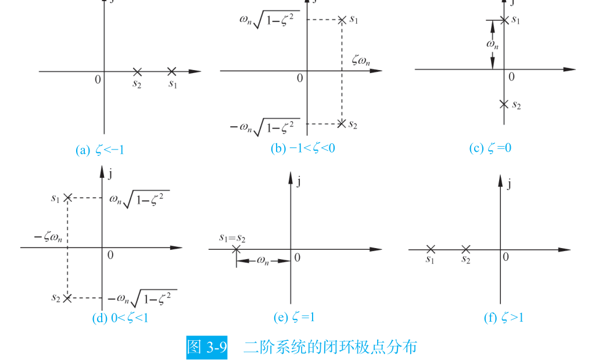

欠阻尼情形 $0<\zeta<1$ 的极点写成 $s_{1,2}=-\zeta\omega_n\pm j\omega_n\sqrt{1-\zeta^2}$，实部 $-\zeta\omega_n$ 叫**衰减系数** $\sigma$，虚部 $\omega_d=\omega_n\sqrt{1-\zeta^2}$ 叫**阻尼振荡频率**。教材强调 $\omega_d$ 恒小于 $\omega_n$，且只有 $\zeta=0$ 时两者才相等 [自动控制原理（第八版） (胡寿松、姜斌、张绍杰) (z-library.sk, 1lib.sk, z-lib.sk)(1).pdf · p.91](http://10.188.31.55:5244/Nextcloud/School/自动控制原理/%E8%87%AA%E5%8A%A8%E6%8E%A7%E5%88%B6%E5%8E%9F%E7%90%86%EF%BC%88%E7%AC%AC%E5%85%AB%E7%89%88%EF%BC%89%20(%E8%83%A1%E5%AF%BF%E6%9D%BE%E3%80%81%E5%A7%9C%E6%96%8C%E3%80%81%E5%BC%A0%E7%BB%8D%E6%9D%B0)%20(z-library.sk,%201lib.sk,%20z-lib.sk)(1).pdf#page=91)。

欠阻尼二阶系统的单位阶跃响应写成正弦加指数的形式，$\beta=\arccos\zeta$：

$$
c(t)=1-\frac{e^{-\zeta\omega_n t}}{\sqrt{1-\zeta^{2}}}\sin(\omega_d t+\beta),\qquad t\ge 0
$$

后面四个指标全部从这一式求导得到 [自动控制原理（第八版） (胡寿松、姜斌、张绍杰) (z-library.sk, 1lib.sk, z-lib.sk)(1).pdf · p.91](http://10.188.31.55:5244/Nextcloud/School/自动控制原理/%E8%87%AA%E5%8A%A8%E6%8E%A7%E5%88%B6%E5%8E%9F%E7%90%86%EF%BC%88%E7%AC%AC%E5%85%AB%E7%89%88%EF%BC%89%20(%E8%83%A1%E5%AF%BF%E6%9D%BE%E3%80%81%E5%A7%9C%E6%96%8C%E3%80%81%E5%BC%A0%E7%BB%8D%E6%9D%B0)%20(z-library.sk,%201lib.sk,%20z-lib.sk)(1).pdf#page=91)。

### 四个性能指标怎么算

**峰值时间**。对 $c(t)$ 求导令其为零，得到 $\tan(\omega_d t+\beta)=\tan\beta$，即 $\omega_d t=k\pi$。取第一个峰，$\omega_d t_p=\pi$：

$$
t_p=\frac{\pi}{\omega_d}=\frac{\pi}{\omega_n\sqrt{1-\zeta^{2}}}
$$

教材指出这等于阻尼振荡周期的一半，与闭环极点虚部成反比 [自动控制原理（第八版） (胡寿松、姜斌、张绍杰) (z-library.sk, 1lib.sk, z-lib.sk)(1).pdf · p.94](http://10.188.31.55:5244/Nextcloud/School/自动控制原理/%E8%87%AA%E5%8A%A8%E6%8E%A7%E5%88%B6%E5%8E%9F%E7%90%86%EF%BC%88%E7%AC%AC%E5%85%AB%E7%89%88%EF%BC%89%20(%E8%83%A1%E5%AF%BF%E6%9D%BE%E3%80%81%E5%A7%9C%E6%96%8C%E3%80%81%E5%BC%A0%E7%BB%8D%E6%9D%B0)%20(z-library.sk,%201lib.sk,%20z-lib.sk)(1).pdf#page=94)。

**超调量**。把 $t_p$ 代回响应式，此时 $\sin(\omega_d t_p+\beta)=\sin(\pi+\beta)=-\sqrt{1-\zeta^2}$，得 $c(t_p)=1+e^{-\pi\zeta/\sqrt{1-\zeta^2}}$。除以终值 1：

$$
\sigma\%=e^{-\pi\zeta/\sqrt{1-\zeta^{2}}}\times 100\%
$$

这个结果只含 $\zeta$，与 $\omega_n$ 无关——超调量由阻尼比单独决定 [自动控制原理（第八版） (胡寿松、姜斌、张绍杰) (z-library.sk, 1lib.sk, z-lib.sk)(1).pdf · p.94](http://10.188.31.55:5244/Nextcloud/School/自动控制原理/%E8%87%AA%E5%8A%A8%E6%8E%A7%E5%88%B6%E5%8E%9F%E7%90%86%EF%BC%88%E7%AC%AC%E5%85%AB%E7%89%88%EF%BC%89%20(%E8%83%A1%E5%AF%BF%E6%9D%BE%E3%80%81%E5%A7%9C%E6%96%8C%E3%80%81%E5%BC%A0%E7%BB%8D%E6%9D%B0)%20(z-library.sk,%201lib.sk,%20z-lib.sk)(1).pdf#page=94)。

教材把这条曲线单独画出来：$\zeta$ 从 0 增到 1，超调量从 100% 单调降到 0，取 $\zeta=0.4\sim0.8$ 时 $\sigma\%$ 落在 1.5% 到 25.4% 之间 [自动控制原理（第八版） (胡寿松、姜斌、张绍杰) (z-library.sk, 1lib.sk, z-lib.sk)(1).pdf · p.94](http://10.188.31.55:5244/Nextcloud/School/自动控制原理/%E8%87%AA%E5%8A%A8%E6%8E%A7%E5%88%B6%E5%8E%9F%E7%90%86%EF%BC%88%E7%AC%AC%E5%85%AB%E7%89%88%EF%BC%89%20(%E8%83%A1%E5%AF%BF%E6%9D%BE%E3%80%81%E5%A7%9C%E6%96%8C%E3%80%81%E5%BC%A0%E7%BB%8D%E6%9D%B0)%20(z-library.sk,%201lib.sk,%20z-lib.sk)(1).pdf#page=94)。


**调节时间**。$c(t)$ 被一对包络线 $1\pm \dfrac{e^{-\zeta\omega_n t}}{\sqrt{1-\zeta^{2}}}$ 夹住，响应一定落在这对包络线内 [自动控制原理（第八版） (胡寿松、姜斌、张绍杰) (z-library.sk, 1lib.sk, z-lib.sk)(1).pdf · p.95](http://10.188.31.55:5244/Nextcloud/School/自动控制原理/%E8%87%AA%E5%8A%A8%E6%8E%A7%E5%88%B6%E5%8E%9F%E7%90%86%EF%BC%88%E7%AC%AC%E5%85%AB%E7%89%88%EF%BC%89%20(%E8%83%A1%E5%AF%BF%E6%9D%BE%E3%80%81%E5%A7%9C%E6%96%8C%E3%80%81%E5%BC%A0%E7%BB%8D%E6%9D%B0)%20(z-library.sk,%201lib.sk,%20z-lib.sk)(1).pdf#page=95)。

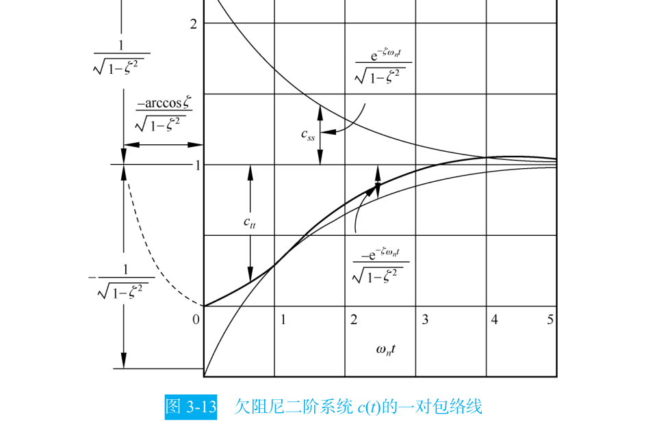

取 $\zeta\le 0.8$、误差带 $\Delta=0.05$，解包络线方程得 $\zeta\omega_n t_s\ge 3.5$；教材在工程上取整写成 $t_s=\dfrac{3.5}{\zeta\omega_n}$，常用近似式是 $t_s\approx \dfrac{3}{\zeta\omega_n}$。2% 误差带对应 $t_s=\dfrac{4.4}{\zeta\omega_n}$，近似 $4/(\zeta\omega_n)$ [自动控制原理（第八版） (胡寿松、姜斌、张绍杰) (z-library.sk, 1lib.sk, z-lib.sk)(1).pdf · p.95](http://10.188.31.55:5244/Nextcloud/School/自动控制原理/%E8%87%AA%E5%8A%A8%E6%8E%A7%E5%88%B6%E5%8E%9F%E7%90%86%EF%BC%88%E7%AC%AC%E5%85%AB%E7%89%88%EF%BC%89%20(%E8%83%A1%E5%AF%BF%E6%9D%BE%E3%80%81%E5%A7%9C%E6%96%8C%E3%80%81%E5%BC%A0%E7%BB%8D%E6%9D%B0)%20(z-library.sk,%201lib.sk,%20z-lib.sk)(1).pdf#page=95)。讲师笔记把这四个公式列成必背表 [题型零_前三章考试内容.md · p.115](http://10.188.31.55:5244/Nextcloud/School/自动控制原理/%E9%A2%98%E5%9E%8B%E9%9B%B6_%E5%89%8D%E4%B8%89%E7%AB%A0%E8%80%83%E8%AF%95%E5%86%85%E5%AE%B9.md)。

**四个指标背后的矛盾**。$t_s$ 与闭环极点实部 $\sigma=\zeta\omega_n$ 成反比，$t_p$ 与极点虚部成反比，$\sigma\%$ 只看 $\zeta$。想让系统快就要 $\omega_n$ 大，但在二阶系统里 $\omega_n=\sqrt{K/T_m}$、$\zeta=1/(2\sqrt{T_m K})$，$T_m$ 是电机时间常数、不可调。增大 $K$ 抬高 $\omega_n$ 的同时必然压低 $\zeta$，超调跟着涨。教材把这一条称为"各指标之间是有矛盾的"，要求"合理的折中方案或补偿方案" [自动控制原理（第八版） (胡寿松、姜斌、张绍杰) (z-library.sk, 1lib.sk, z-lib.sk)(1).pdf · p.95](http://10.188.31.55:5244/Nextcloud/School/自动控制原理/%E8%87%AA%E5%8A%A8%E6%8E%A7%E5%88%B6%E5%8E%9F%E7%90%86%EF%BC%88%E7%AC%AC%E5%85%AB%E7%89%88%EF%BC%89%20(%E8%83%A1%E5%AF%BF%E6%9D%BE%E3%80%81%E5%A7%9C%E6%96%8C%E3%80%81%E5%BC%A0%E7%BB%8D%E6%9D%B0)%20(z-library.sk,%201lib.sk,%20z-lib.sk)(1).pdf#page=95)。这个矛盾是第 6 章引入 PD 控制和超前校正的直接动机。课件把它单列为"二阶系统性能的改善"一节，给出两条路：方法 1 采用比例-微分控制，方法 2 采用测速反馈控制 [自控原理（第三章2）p.pdf · p.4](http://10.188.31.55:5244/Nextcloud/School/自动控制原理/%E8%87%AA%E6%8E%A7%E5%8E%9F%E7%90%86%EF%BC%88%E7%AC%AC%E4%B8%89%E7%AB%A02%EF%BC%89p.pdf#page=4)。

### 高阶系统与主导极点

高阶系统的精确时域响应要解高阶特征方程，实际工程用**主导极点法**：对稳定的高阶系统，若某对共轭复数极点离虚轴的距离比其他极点近 5 倍以上，且其附近没有闭环零点，就把它当成二阶系统处理 [自动控制原理（第八版） (胡寿松、姜斌、张绍杰) (z-library.sk, 1lib.sk, z-lib.sk)(1).pdf · p.111](http://10.188.31.55:5244/Nextcloud/School/自动控制原理/%E8%87%AA%E5%8A%A8%E6%8E%A7%E5%88%B6%E5%8E%9F%E7%90%86%EF%BC%88%E7%AC%AC%E5%85%AB%E7%89%88%EF%BC%89%20(%E8%83%A1%E5%AF%BF%E6%9D%BE%E3%80%81%E5%A7%9C%E6%96%8C%E3%80%81%E5%BC%A0%E7%BB%8D%E6%9D%B0)%20(z-library.sk,%201lib.sk,%20z-lib.sk)(1).pdf#page=111)。

教材给了一个具体例子：四阶系统的共轭复数主导极点 $s_{1,2}=-0.5\pm j0.866$，非主导极点 $s_3=-2$、$s_4=-8$ 的实部模比主导极点大三倍以上，闭环零点 $z=-2.1$ 不在主导极点附近，因此可近似成二阶系统 [自动控制原理（第八版） (胡寿松、姜斌、张绍杰) (z-library.sk, 1lib.sk, z-lib.sk)(1).pdf · p.112](http://10.188.31.55:5244/Nextcloud/School/自动控制原理/%E8%87%AA%E5%8A%A8%E6%8E%A7%E5%88%B6%E5%8E%9F%E7%90%86%EF%BC%88%E7%AC%AC%E5%85%AB%E7%89%88%EF%BC%89%20(%E8%83%A1%E5%AF%BF%E6%9D%BE%E3%80%81%E5%A7%9C%E6%96%8C%E3%80%81%E5%BC%A0%E7%BB%8D%E6%9D%B0)%20(z-library.sk,%201lib.sk,%20z-lib.sk)(1).pdf#page=112)。

> [!WARNING] 主导极点近似的三个前提
> 用主导极点把高阶系统降成二阶，必须同时满足三条：该极点附近没有闭环零点；其余极点的实部模比主导极点实部模大 3～5 倍以上；欠阻尼二阶公式本身只在 $\zeta<0.7$ 左右才比较准。少一条，近似结果就明显偏乐观 [自动控制原理（第八版） (胡寿松、姜斌、张绍杰) (z-library.sk, 1lib.sk, z-lib.sk)(1).pdf · p.112](http://10.188.31.55:5244/Nextcloud/School/自动控制原理/%E8%87%AA%E5%8A%A8%E6%8E%A7%E5%88%B6%E5%8E%9F%E7%90%86%EF%BC%88%E7%AC%AC%E5%85%AB%E7%89%88%EF%BC%89%20(%E8%83%A1%E5%AF%BF%E6%9D%BE%E3%80%81%E5%A7%9C%E6%96%8C%E3%80%81%E5%BC%A0%E7%BB%8D%E6%9D%B0)%20(z-library.sk,%201lib.sk,%20z-lib.sk)(1).pdf#page=112)。

### 稳定性与劳斯-赫尔维茨判据

连续系统稳定的**充分必要条件**是闭环特征方程的所有根都具有负实部，等价说法是闭环传递函数的极点全部严格位于左半 $s$ 平面 [第三章 线性系统的时域分析法1.pdf · p.7](http://10.188.31.55:5244/Nextcloud/School/自动控制原理/%E7%AC%AC%E4%B8%89%E7%AB%A0%20%E7%BA%BF%E6%80%A7%E7%B3%BB%E7%BB%9F%E7%9A%84%E6%97%B6%E5%9F%9F%E5%88%86%E6%9E%90%E6%B3%951.pdf#page=7)。教材证明这条路成立：闭环系统特征方程的所有根均具有负实部时，输出增量的拉氏反变换各项才收敛。

问题在于求全部特征根。三阶方程的根写不出解析式，四阶以上更糟。劳斯-赫尔维茨判据绕开这一步：只看特征方程的系数。

**劳斯表的构造**。特征方程整理成降幂形式、首项系数 $a_0>0$：

$$
D(s)=a_0 s^{n}+a_1 s^{n-1}+\cdots+a_{n-1}s+a_n=0
$$

第一行写 $a_0, a_2, a_4,\ldots$，第二行写 $a_1, a_3, a_5,\ldots$，第三行起逐行递推，每个元素由前两行交叉相乘再相除：

| 行 | 第一列 | 第二列 | 第三列 | 第四列 |
| --- | --- | --- | --- | --- |
| $s^{n}$ | $a_0$ | $a_2$ | $a_4$ | $\cdots$ |
| $s^{n-1}$ | $a_1$ | $a_3$ | $a_5$ | $\cdots$ |
| $s^{n-2}$ | $b_1=\dfrac{a_1a_2-a_0a_3}{a_1}$ | $b_2=\dfrac{a_1a_4-a_0a_5}{a_1}$ | $b_3$ | $\cdots$ |
| $s^{n-3}$ | $c_1=\dfrac{b_1a_3-a_1b_2}{b_1}$ | $c_2=\dfrac{b_1a_5-a_1b_3}{b_1}$ | $c_3$ | $\cdots$ |

教材把完整的劳斯表列在表 3-4 里，含 $n$ 阶时前四行的递推式与各元素的具体表达式 [自动控制原理（第八版） (胡寿松、姜斌、张绍杰) (z-library.sk, 1lib.sk, z-lib.sk)(1).pdf · p.118](http://10.188.31.55:5244/Nextcloud/School/自动控制原理/%E8%87%AA%E5%8A%A8%E6%8E%A7%E5%88%B6%E5%8E%9F%E7%90%86%EF%BC%88%E7%AC%AC%E5%85%AB%E7%89%88%EF%BC%89%20(%E8%83%A1%E5%AF%BF%E6%9D%BE%E3%80%81%E5%A7%9C%E6%96%8C%E3%80%81%E5%BC%A0%E7%BB%8D%E6%9D%B0)%20(z-library.sk,%201lib.sk,%20z-lib.sk)(1).pdf#page=118)。判据是：**第一列各值全部为正则系统稳定；若第一列出现负值，符号改变次数等于特征方程正实部根的数目** [第三章 线性系统的时域分析法1.pdf · p.8](http://10.188.31.55:5244/Nextcloud/School/自动控制原理/%E7%AC%AC%E4%B8%89%E7%AB%A0%20%E7%BA%BF%E6%80%A7%E7%B3%BB%E7%BB%9F%E7%9A%84%E6%97%B6%E5%9F%9F%E5%88%86%E6%9E%90%E6%B3%951.pdf#page=8)。教材补充了它与赫尔维茨判据的等价关系：劳斯表第一列各数与顺序赫尔维茨行列式一一对应，在 $a_0>0$ 时所有顺序赫尔维茨行列式为正，劳斯表第一列元素必全大于零 [第三章 线性系统的时域分析法1.pdf · p.8](http://10.188.31.55:5244/Nextcloud/School/自动控制原理/%E7%AC%AC%E4%B8%89%E7%AB%A0%20%E7%BA%BF%E6%80%A7%E7%B3%BB%E7%BB%9F%E7%9A%84%E6%97%B6%E5%9F%9F%E5%88%86%E6%9E%90%E6%B3%951.pdf#page=8)。

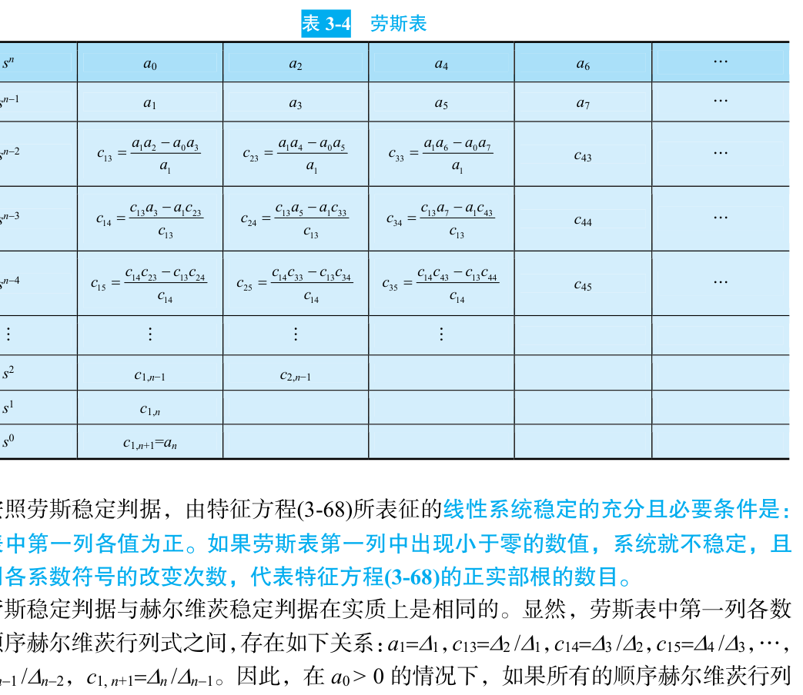

**三种特殊情况**。

第一列某项为零但同行其余项不全为零。此时下一行首项会是无穷大，判据失效。把零换成很小的正数 $\varepsilon$ 继续计算，最后令 $\varepsilon\to 0^+$ 判断符号 [题型零_前三章考试内容.md · p.293](http://10.188.31.55:5244/Nextcloud/School/自动控制原理/%E9%A2%98%E5%9E%8B%E9%9B%B6_%E5%89%8D%E4%B8%89%E7%AB%A0%E8%80%83%E8%AF%95%E5%86%85%E5%AE%B9.md)。

某一行全为零。用这一行的上一行系数构造**辅助方程**，对方程求导，用导数的系数替换全零行，然后继续列表。辅助方程的根就是特征方程中关于原点对称的根 [第三章 线性系统的时域分析法1.pdf · p.9](http://10.188.31.55:5244/Nextcloud/School/自动控制原理/%E7%AC%AC%E4%B8%89%E7%AB%A0%20%E7%BA%BF%E6%80%A7%E7%B3%BB%E7%BB%9F%E7%9A%84%E6%97%B6%E5%9F%9F%E5%88%86%E6%9E%90%E6%B3%951.pdf#page=9)。第 4 章求根轨迹与虚轴的交点，用的正是这一条。

要求 $K$ 的稳定范围。把含 $K$ 的闭环特征方程列劳斯表，令第一列所有元素大于零，联立解不等式。蜂考例题 $G(s)=\dfrac{K}{s(s+1)(2s+1)}$ 的闭环特征方程是 $2s^3+3s^2+s+K=0$，劳斯表给出 $s^1$ 行首项 $(3-2K)/3$，与 $K>0$ 联立得 $0<K<1.5$ [题型零_前三章考试内容.md · p.315](http://10.188.31.55:5244/Nextcloud/School/自动控制原理/%E9%A2%98%E5%9E%8B%E9%9B%B6_%E5%89%8D%E4%B8%89%E7%AB%A0%E8%80%83%E8%AF%95%E5%86%85%E5%AE%B9.md)。

**相对稳定性**。若要求全部闭环极点位于 $s=-\sigma_0$ 垂线之左，令 $s=s_1-\sigma_0$ 代入原特征方程，对新方程列劳斯表 [题型零_前三章考试内容.md · p.330](http://10.188.31.55:5244/Nextcloud/School/自动控制原理/%E9%A2%98%E5%9E%8B%E9%9B%B6_%E5%89%8D%E4%B8%89%E7%AB%A0%E8%80%83%E8%AF%95%E5%86%85%E5%AE%B9.md)。

> [!WARNING] 劳斯表第一列的符号变化次数是逐对比较出来的
> 不是数负数个数。第一列 $1, 3, -4/3, 10$ 里只有一个负数，但符号变化是两次：$1\to 3$ 同号、$3\to-4/3$ 变号、$-4/3\to 10$ 变号，所以有两个正实部根。算错这一条，整个稳定性结论就反了 [第三章 线性系统的时域分析法1.pdf · p.8](http://10.188.31.55:5244/Nextcloud/School/自动控制原理/%E7%AC%AC%E4%B8%89%E7%AB%A0%20%E7%BA%BF%E6%80%A7%E7%B3%BB%E7%BB%9F%E7%9A%84%E6%97%B6%E5%9F%9F%E5%88%86%E6%9E%90%E6%B3%951.pdf#page=8)。

### 稳态误差与静态误差系数

稳态误差是系统控制精度的度量。求它只有一条路：**终值定理**。

$$
e_{ss}=\lim_{t\to\infty}e(t)=\lim_{s\to 0}s\cdot E(s)
$$

教材对终值定理的适用条件写得很明确：$sE(s)$ 的全部极点必须在左半 $s$ 平面，原点最多允许一个一阶极点 [自动控制原理（第八版） (胡寿松、姜斌、张绍杰) (z-library.sk, 1lib.sk, z-lib.sk)(1).pdf · p.123](http://10.188.31.55:5244/Nextcloud/School/自动控制原理/%E8%87%AA%E5%8A%A8%E6%8E%A7%E5%88%B6%E5%8E%9F%E7%90%86%EF%BC%88%E7%AC%AC%E5%85%AB%E7%89%88%EF%BC%89%20(%E8%83%A1%E5%AF%BF%E6%9D%BE%E3%80%81%E5%A7%9C%E6%96%8C%E3%80%81%E5%BC%A0%E7%BB%8D%E6%9D%B0)%20(z-library.sk,%201lib.sk,%20z-lib.sk)(1).pdf#page=123)。条件不满足时这个极限不存在，教材用正弦输入举例：正弦函数的拉氏变换在虚轴上不解析，此时用终值定理会算出"误差为零"的错误结论 [自动控制原理（第八版） (胡寿松、姜斌、张绍杰) (z-library.sk, 1lib.sk, z-lib.sk)(1).pdf · p.124](http://10.188.31.55:5244/Nextcloud/School/自动控制原理/%E8%87%AA%E5%8A%A8%E6%8E%A7%E5%88%B6%E5%8E%9F%E7%90%86%EF%BC%88%E7%AC%AC%E5%85%AB%E7%89%88%EF%BC%89%20(%E8%83%A1%E5%AF%BF%E6%9D%BE%E3%80%81%E5%A7%9C%E6%96%8C%E3%80%81%E5%BC%A0%E7%BB%8D%E6%9D%B0)%20(z-library.sk,%201lib.sk,%20z-lib.sk)(1).pdf#page=124)。

单位反馈时 $E(s)=\dfrac{R(s)}{1+G(s)}$，代入三种典型输入：

$$
e_{ss}=\lim_{s\to 0}\frac{1}{1+K_p},\qquad K_p=\lim_{s\to 0}G(s)
$$

$$
e_{ss}=\lim_{s\to 0}\frac{1}{K_v},\qquad K_v=\lim_{s\to 0}sG(s)
$$

$$
e_{ss}=\lim_{s\to 0}\frac{1}{K_a},\qquad K_a=\lim_{s\to 0}s^{2}G(s)
$$

$K_p$、$K_v$、$K_a$ 分别叫位置误差系数、速度误差系数、加速度误差系数。课件把加速度误差系数写成 $K_a=\lim_{s\to0}s^{2}G(s)H(s)$，并指出 0 型及 I 型系统的 $K_a=0$、II 型系统的 $K_a=K$、III 型及以上系统的 $K_a=\infty$ [自控原理（第三章4）p.pdf · p.5](http://10.188.31.55:5244/Nextcloud/School/自动控制原理/%E8%87%AA%E6%8E%A7%E5%8E%9F%E7%90%86%EF%BC%88%E7%AC%AC%E4%B8%89%E7%AB%A04%EF%BC%89p.pdf#page=5)。

**系统型别**。把开环传递函数写成

$$
G(s)H(s)=\frac{K}{s^{\nu}}\cdot G_0(s)H_0(s),\qquad \lim_{s\to 0}G_0(s)H_0(s)=1
$$

$\nu$ 是开环传递函数中 $1/s$ 的个数，就是系统型别。代入三个误差系数定义，型别与稳态误差的关系固定下来 [复习_稳态误差与Nyquist图.md · p.47](http://10.188.31.55:5244/Nextcloud/School/自动控制原理/%E5%A4%8D%E4%B9%A0_%E7%A8%B3%E6%80%81%E8%AF%AF%E5%B7%AE%E4%B8%8ENyquist%E5%9B%BE.md)：

| 型别 $\nu$ | $K_p$ | $K_v$ | $K_a$ | 阶跃 $e_{ss}$ | 斜坡 $e_{ss}$ | 抛物线 $e_{ss}$ |
| --- | --- | --- | --- | --- | --- | --- |
| 0 型 | $K$ | $0$ | $0$ | $\dfrac{1}{1+K}$ | $\infty$ | $\infty$ |
| I 型 | $\infty$ | $K$ | $0$ | $0$ | $\dfrac{1}{K}$ | $\infty$ |
| II 型 | $\infty$ | $\infty$ | $K$ | $0$ | $0$ | $\dfrac{1}{K}$ |


教材把型别、静态误差系数与输入信号形式的关系统一归纳在表 3-5 里 [自动控制原理（第八版） (胡寿松、姜斌、张绍杰) (z-library.sk, 1lib.sk, z-lib.sk)(1).pdf · p.128](http://10.188.31.55:5244/Nextcloud/School/自动控制原理/%E8%87%AA%E5%8A%A8%E6%8E%A7%E5%88%B6%E5%8E%9F%E7%90%86%EF%BC%88%E7%AC%AC%E5%85%AB%E7%89%88%EF%BC%89%20(%E8%83%A1%E5%AF%BF%E6%9D%BE%E3%80%81%E5%A7%9C%E6%96%8C%E3%80%81%E5%BC%A0%E7%BB%8D%E6%9D%B0)%20(z-library.sk,%201lib.sk,%20z-lib.sk)(1).pdf#page=128)。型别就是系统能"免费跟踪"几阶输入。0 型连阶跃都跟不完美，I 型能跟阶跃但跟不上斜坡，II 型能跟斜坡但跟不上抛物线。教材提醒一句：采用高型别系统对提高控制准确度有利，但"应以确保系统的稳定性为前提，同时还要兼顾系统的动态性能要求"。

> [!WARNING] 稳态误差的三条高频错
> 第一，算 $K_v$ 忘了先判系统是否稳定——稳态误差只对稳定系统有意义。第二，把闭环传函代进 $K_v=\lim sG(s)$——$K_v$ 必须用开环传函算。第三，漏掉终值定理里那个 $s$。讲师把这三条连同另外五条列成易错清单 [题型零_前三章考试内容.md · p.460](http://10.188.31.55:5244/Nextcloud/School/自动控制原理/%E9%A2%98%E5%9E%8B%E9%9B%B6_%E5%89%8D%E4%B8%89%E7%AB%A0%E8%80%83%E8%AF%95%E5%86%85%E5%AE%B9.md)。

### 一个完整的计算例子

某单位负反馈系统开环传递函数 $G(s)=\dfrac{10}{s(s+1)}$，求性能指标与三种输入下的稳态误差。

**第一步，闭环传函与标准式对比**。

$$
\Phi(s)=\frac{10}{s^{2}+s+10}=\frac{10}{s^{2}+2(0.5)s+10}
$$

对比 $\dfrac{\omega_n^2}{s^2+2\zeta\omega_n s+\omega_n^2}$，得 $\omega_n=\sqrt{10}=3.16\ \mathrm{rad/s}$、$\zeta=\dfrac{1}{2\times 3.16}=0.158$。

**第二步，三个动态指标**。

$$
\sigma\%=e^{-\pi\times 0.158/\sqrt{1-0.025}}\times 100\%=60.5\%
$$

$$
t_p=\frac{\pi}{\omega_n\sqrt{1-\zeta^{2}}}=\frac{\pi}{3.12}=1.01\ \mathrm{s}
$$

$$
t_s\approx\frac{3}{\zeta\omega_n}=\frac{3}{0.5}=6\ \mathrm{s}
$$

**第三步，型别与误差系数**。开环传函分母只有一个裸的 $s$，是 I 型系统，开环增益 $K=10$。

$$
K_p=\lim_{s\to 0}G(s)=\infty,\qquad K_v=\lim_{s\to 0}sG(s)=\lim_{s\to 0}\frac{10}{s+1}=10,\qquad K_a=\lim_{s\to 0}s^{2}G(s)=0
$$

于是阶跃误差 $0$、斜坡误差 $1/10=0.1$、抛物线误差 $\infty$。

这个例子对应期末 A 卷第 2 题的题型：给性能指标反求参数 [题型零_前三章考试内容.md · p.131](http://10.188.31.55:5244/Nextcloud/School/自动控制原理/%E9%A2%98%E5%9E%8B%E9%9B%B6_%E5%89%8D%E4%B8%89%E7%AB%A0%E8%80%83%E8%AF%95%E5%86%85%E5%AE%B9.md)。讲师把这类题的做法固定成六步：化简内环、写出开环传函、由 $K_v=\lim sG(s)$ 得方程①、由闭环标准式提 $\zeta,\omega_n$ 得方程②、联立解、再代公式算 $t_s$ 或 $\sigma\%$ [题型零_前三章考试内容.md · p.198](http://10.188.31.55:5244/Nextcloud/School/自动控制原理/%E9%A2%98%E5%9E%8B%E9%9B%B6_%E5%89%8D%E4%B8%89%E7%AB%A0%E8%80%83%E8%AF%95%E5%86%85%E5%AE%B9.md)。

反向题也一样常见：已知 $\sigma\%=20\%$、$t_p=1\ \mathrm{s}$，反求 $\zeta$、$\omega_n$、$t_s$。对 $\sigma_p$ 取自然对数得

$$
\zeta=\frac{\ln(1/\sigma_p)}{\sqrt{\pi^{2}+\left[\ln(1/\sigma_p)\right]^{2}}}
$$

代入 $\sigma_p=0.2$，$\ln 5=1.609$，得 $\zeta=0.456$；再由 $\omega_d=\pi/t_p=3.14$ 反推 $\omega_n=3.53$、$t_s=1.86\ \mathrm{s}$ [题型零_前三章考试内容.md · p.214](http://10.188.31.55:5244/Nextcloud/School/自动控制原理/%E9%A2%98%E5%9E%8B%E9%9B%B6_%E5%89%8D%E4%B8%89%E7%AB%A0%E8%80%83%E8%AF%95%E5%86%85%E5%AE%B9.md)。讲师顺手记了四个常用值：$\sigma=5\%\to\zeta\approx0.69$、$10\%\to0.59$、$16.3\%\to0.5$、$20\%\to0.456$。

## 第 4 章 线性系统的根轨迹法

### 根轨迹在做什么

给定单位负反馈系统的开环传递函数 $G(s)H(s)$，其中增益 $K$ 可调。想知道把 $K$ 从小往大调，系统会在哪个 $K$ 上开始振荡、失稳。

不画图就只能一次次把 $K$ 代进特征方程 $s(s+1)(s+2)+K=0$ 再解三次方程——$K=1$ 解一遍、$K=2$ 再解一遍，手算到崩溃，而且完全看不出趋势。根轨迹把"$K$ 变化时闭环极点往哪跑"一次性画成一张图，稳定性边界、临界阻尼点、任意 $K$ 下的极点位置都能直接从图上读出来。

**根轨迹**的定义：当开环根轨迹增益 $K^{*}$ 从 $0$ 变化到 $+\infty$ 时，闭环特征方程的根（闭环极点）在 $s$ 平面上移动所形成的轨迹 [题型一_根轨迹大题.md · p.44](http://10.188.31.55:5244/Nextcloud/School/自动控制原理/%E9%A2%98%E5%9E%8B%E4%B8%80_%E6%A0%B9%E8%BD%A8%E8%BF%B9%E5%A4%A7%E9%A2%98.md)。

$K^{*}$ 与 $K$ 不是一回事。$K^{*}$ 是首 1 标准形式下的根轨迹增益，$K$ 是尾 1 标准形式下的开环增益，两者一般差一个比例常数。例：$G(s)=\dfrac{K}{s(2s+1)}=\dfrac{K/2}{s(s+0.5)}$，此处 $K^{*}=K/2$ [题型一_根轨迹大题.md · p.95](http://10.188.31.55:5244/Nextcloud/School/自动控制原理/%E9%A2%98%E5%9E%8B%E4%B8%80_%E6%A0%B9%E8%BD%A8%E8%BF%B9%E5%A4%A7%E9%A2%98.md)。画出 $K^{*}$ 的范围后还要换算回 $K$ 的范围。

> 分析和设计时用开环，最终结果和实际响应时用闭环。
>
> ——讲师的全局地图 [复习_根轨迹.md · p.130](http://10.188.31.55:5244/Nextcloud/School/自动控制原理/%E5%A4%8D%E4%B9%A0_%E6%A0%B9%E8%BD%A8%E8%BF%B9.md)

**s 平面的物理含义**。一个极点 $s=\sigma+j\omega$ 对应时域分量 $e^{\sigma t}\sin(\omega t+\varphi)$：$\sigma<0$ 衰减、$\sigma>0$ 发散、$\omega\ne 0$ 振荡。横轴管衰减速度，纵轴管振荡频率。根轨迹上极点的位置直接决定系统的快慢与振荡。

教材用最简单的一阶系统演示这张图长什么样：$G(s)=\dfrac{K}{s(0.5s+1)}$ 的闭环传递函数是 $\Phi(s)=\dfrac{2K}{s^2+2s+2K}$，特征方程的根是 $s_{1,2}=-1\pm\sqrt{1-2K}$ [自控原理（第四章1）p.pdf · p.2](http://10.188.31.55:5244/Nextcloud/School/自动控制原理/%E8%87%AA%E6%8E%A7%E5%8E%9F%E7%90%86%EF%BC%88%E7%AC%AC%E5%9B%9B%E7%AB%A01%EF%BC%89p.pdf#page=2)。


图上的标注就是根轨迹的读法：每个点旁边写的数字是"这个位置的闭环极点对应多大的开环增益 $K$"。$K=0$ 时两个闭环极点就是两个开环极点；$K=0.5$ 时它们在实轴上相遇；$K=1$ 时分离成一对共轭极点；$K$ 继续增大，虚部变大、实部不变，$K\to\infty$ 时极点跑到无穷远。教材对这个图补充了一句：根轨迹上的箭头表示随着 $K$ 值的增加根轨迹的变化趋势，标注的数值代表与闭环极点位置相应的开环增益 $K$ 的数值 [自动控制原理（第八版） (胡寿松、姜斌、张绍杰) (z-library.sk, 1lib.sk, z-lib.sk)(1).pdf · p.161](http://10.188.31.55:5244/Nextcloud/School/自动控制原理/%E8%87%AA%E5%8A%A8%E6%8E%A7%E5%88%B6%E5%8E%9F%E7%90%86%EF%BC%88%E7%AC%AC%E5%85%AB%E7%89%88%EF%BC%89%20(%E8%83%A1%E5%AF%BF%E6%9D%BE%E3%80%81%E5%A7%9C%E6%96%8C%E3%80%81%E5%BC%A0%E7%BB%8D%E6%9D%B0)%20(z-library.sk,%201lib.sk,%20z-lib.sk)(1).pdf#page=161)。

### 根轨迹方程与两个条件

闭环特征方程 $1+G(s)H(s)=0$ 移项即 $G(s)H(s)=-1$。把开环传函写成首 1 的零极点形式 $K^{*}\prod(s-z_j)/\prod(s-p_i)$，代入并同乘 $\prod(s-p_i)$：

$$
\prod_{i=1}^{n}(s-p_i)+K^{*}\prod_{j=1}^{m}(s-z_j)=0
$$

解出 $K^{*}=-\prod(s-p_i)/\prod(s-z_j)$。因为 $K^{*}$ 是正实数，右端必须是正实数：辐角为 $180^\circ$（模 $360^\circ$），模为正。拆成两条就是根轨迹的基本条件。

**相角条件**，决定哪些点在轨迹上：

$$
\sum_{j=1}^{m}\angle(s-z_j)-\sum_{i=1}^{n}\angle(s-p_i)=(2k+1)\times 180^\circ
$$

**模值条件**，在轨迹上确定具体的 $K^{*}$：

$$
K^{*}=\prod_{i=1}^{n}|s-p_i|\Big/\prod_{j=1}^{m}|s-z_j|
$$

直觉：目标点到所有开环极点的距离之积，除以到所有开环零点的距离之积 [题型一_根轨迹大题.md · p.89](http://10.188.31.55:5244/Nextcloud/School/自动控制原理/%E9%A2%98%E5%9E%8B%E4%B8%80_%E6%A0%B9%E8%BD%A8%E8%BF%B9%E5%A4%A7%E9%A2%98.md)。

### 八条绘制法则

**法则 1，起点与终点**。$K^{*}=0$ 时特征方程退化为 $\prod(s-p_i)=0$，根恰是开环极点，所以根轨迹**起于开环极点**。$K^{*}\to\infty$ 时方程两边除以 $K^{*}$，根趋于 $\prod(s-z_j)=0$，即**终于开环零点**。极点有 $n$ 个、零点只有 $m$ 个，多出来的 $n-m$ 个根奔向无穷远 [自动控制原理（第八版） (胡寿松、姜斌、张绍杰) (z-library.sk, 1lib.sk, z-lib.sk)(1).pdf · p.164](http://10.188.31.55:5244/Nextcloud/School/自动控制原理/%E8%87%AA%E5%8A%A8%E6%8E%A7%E5%88%B6%E5%8E%9F%E7%90%86%EF%BC%88%E7%AC%AC%E5%85%AB%E7%89%88%EF%BC%89%20(%E8%83%A1%E5%AF%BF%E6%9D%BE%E3%80%81%E5%A7%9C%E6%96%8C%E3%80%81%E5%BC%A0%E7%BB%8D%E6%9D%B0)%20(z-library.sk,%201lib.sk,%20z-lib.sk)(1).pdf#page=164)。

**法则 2，分支数、对称性、连续性**。分支数等于开环极点数 $n$。特征方程系数全是实数，复数根必共轭成对，所以轨迹**关于实轴对称**。根是系数的连续函数，所以轨迹连续 [自动控制原理（第八版） (胡寿松、姜斌、张绍杰) (z-library.sk, 1lib.sk, z-lib.sk)(1).pdf · p.175](http://10.188.31.55:5244/Nextcloud/School/自动控制原理/%E8%87%AA%E5%8A%A8%E6%8E%A7%E5%88%B6%E5%8E%9F%E7%90%86%EF%BC%88%E7%AC%AC%E5%85%AB%E7%89%88%EF%BC%89%20(%E8%83%A1%E5%AF%BF%E6%9D%BE%E3%80%81%E5%A7%9C%E6%96%8C%E3%80%81%E5%BC%A0%E7%BB%8D%E6%9D%B0)%20(z-library.sk,%201lib.sk,%20z-lib.sk)(1).pdf#page=175)。

**法则 3，实轴上的根轨迹**。实轴上某一段属于根轨迹，当且仅当**该段右侧**的实轴开环零、极点个数之和为**奇数**。

教材给出了完整的几何证明 [自动控制原理（第八版） (胡寿松、姜斌、张绍杰) (z-library.sk, 1lib.sk, z-lib.sk)(1).pdf · p.168](http://10.188.31.55:5244/Nextcloud/School/自动控制原理/%E8%87%AA%E5%8A%A8%E6%8E%A7%E5%88%B6%E5%8E%9F%E7%90%86%EF%BC%88%E7%AC%AC%E5%85%AB%E7%89%88%EF%BC%89%20(%E8%83%A1%E5%AF%BF%E6%9D%BE%E3%80%81%E5%A7%9C%E6%96%8C%E3%80%81%E5%BC%A0%E7%BB%8D%E6%9D%B0)%20(z-library.sk,%201lib.sk,%20z-lib.sk)(1).pdf#page=168)：复数共轭极点到实轴上任一点的向量相角和为 $2\pi$，所以在判定实轴轨迹时可以完全忽略复数零极点；测试点 $s_0$ 左边开环实数零、极点指向 $s_0$ 的向量相角为零，右边的都等于 $\pi$，要满足相角条件 $(2k+1)\pi$，右边必须贡献奇数个 $\pi$。

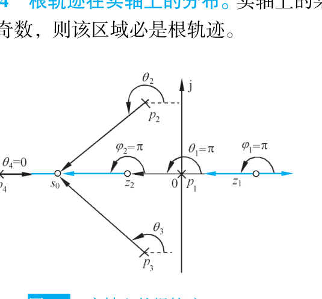

口诀是"右边数奇数"：把实轴上所有零极点从左到右排开，从最右端往左数，每经过一个点翻转一次奇偶 [复习_根轨迹.md · p.349](http://10.188.31.55:5244/Nextcloud/School/自动控制原理/%E5%A4%8D%E4%B9%A0_%E6%A0%B9%E8%BD%A8%E8%BF%B9.md)。**复数零极点完全不管**，只数实轴上的点。

**法则 4，渐近线**。$|s|$ 很大时每个 $(s-p_i)$ 与 $(s-z_j)$ 都近似为 $s$，于是 $G(s)H(s)\approx K^{*}s^{-(n-m)}$。相角条件要求 $-(n-m)\angle s=(2k+1)180^\circ$，解出方向：

$$
\varphi_a=\frac{(2k+1)\times 180^\circ}{n-m},\qquad k=0,1,\dots,n-m-1
$$

交点 $\sigma_a$ 由韦达定理得到：当 $K^{*}\to\infty$ 时 $m$ 个根趋于零点，其余 $n-m$ 个根趋于无穷且虚部两两抵消，实部之和等于 $(n-m)\sigma_a$，于是

$$
\sigma_a=\frac{\sum_{i=1}^{n}p_i-\sum_{j=1}^{m}z_j}{n-m}
$$

把 $n-m$ 代进上式：$n-m=1$ 时渐近线是 $180^\circ$，$n-m=2$ 时是 $\pm 90^\circ$，$n-m=3$ 时是 $60^\circ,180^\circ,300^\circ$，$n-m=4$ 时是 $\pm 45^\circ,\pm 135^\circ$ [自动控制原理（第八版） (胡寿松、姜斌、张绍杰) (z-library.sk, 1lib.sk, z-lib.sk)(1).pdf · p.167](http://10.188.31.55:5244/Nextcloud/School/自动控制原理/%E8%87%AA%E5%8A%A8%E6%8E%A7%E5%88%B6%E5%8E%9F%E7%90%86%EF%BC%88%E7%AC%AC%E5%85%AB%E7%89%88%EF%BC%89%20(%E8%83%A1%E5%AF%BF%E6%9D%BE%E3%80%81%E5%A7%9C%E6%96%8C%E3%80%81%E5%BC%A0%E7%BB%8D%E6%9D%B0)%20(z-library.sk,%201lib.sk,%20z-lib.sk)(1).pdf#page=167)。$\sigma_a$ 落在实轴根轨迹区间之外是正常的，渐近线只描述无穷远处的趋势。

**法则 5，分离点**。分离点是特征方程出现重根的地方，即 $K^{*}$ 对 $s$ 的导数为零。由 $K^{*}(s)=-\prod(s-p_i)/\prod(s-z_j)$ 求导，令导数为零得**分离点方程**：

$$
\sum_{i=1}^{n}\frac{1}{d-p_i}=\sum_{j=1}^{m}\frac{1}{d-z_j}
$$

列方程、通分展开成多项式、解出全部实根 $d$，然后**逐一验证**——只有落在实轴根轨迹区间内的 $d$ 才有效，其余舍去。课件用 $d\approx-3.414$ 的例子画出分离点处的分支走向 [自控原理（第四章2）[.pdf · p.2](http://10.188.31.55:5244/Nextcloud/School/自动控制原理/%E8%87%AA%E6%8E%A7%E5%8E%9F%E7%90%86%EF%BC%88%E7%AC%AC%E5%9B%9B%E7%AB%A02%EF%BC%89%5B.pdf#page=2)。两条分支相遇时分离角为 $\pm 90^\circ$；若 $l$ 条分支在同一点相遇，分离角为 $(2k+1)180^\circ/l$ [自动控制原理（第八版） (胡寿松、姜斌、张绍杰) (z-library.sk, 1lib.sk, z-lib.sk)(1).pdf · p.170](http://10.188.31.55:5244/Nextcloud/School/自动控制原理/%E8%87%AA%E5%8A%A8%E6%8E%A7%E5%88%B6%E5%8E%9F%E7%90%86%EF%BC%88%E7%AC%AC%E5%85%AB%E7%89%88%EF%BC%89%20(%E8%83%A1%E5%AF%BF%E6%9D%BE%E3%80%81%E5%A7%9C%E6%96%8C%E3%80%81%E5%BC%A0%E7%BB%8D%E6%9D%B0)%20(z-library.sk,%201lib.sk,%20z-lib.sk)(1).pdf#page=170)。


**法则 6，出射角与入射角**。开环有复数极点时，根轨迹离开该极点的方向由相角条件确定。把相角条件中除 $p_k$ 自身以外的所有项移到一边：

$$
\theta_{p_k}=\frac{(2l+1)\times 180^\circ+\sum_{j=1}^{m}\angle(p_k-z_j)-\sum_{\substack{i=1\\i\ne k}}^{n}\angle(p_k-p_i)}{q},\qquad l=0,1,\dots,q-1
$$

教材的例 4-3 画出了含复数零极点时的完整根轨迹与出射角、入射角标注 [自动控制原理（第八版） (胡寿松、姜斌、张绍杰) (z-library.sk, 1lib.sk, z-lib.sk)(1).pdf · p.172](http://10.188.31.55:5244/Nextcloud/School/自动控制原理/%E8%87%AA%E5%8A%A8%E6%8E%A7%E5%88%B6%E5%8E%9F%E7%90%86%EF%BC%88%E7%AC%AC%E5%85%AB%E7%89%88%EF%BC%89%20(%E8%83%A1%E5%AF%BF%E6%9D%BE%E3%80%81%E5%A7%9C%E6%96%8C%E3%80%81%E5%BC%A0%E7%BB%8D%E6%9D%B0)%20(z-library.sk,%201lib.sk,%20z-lib.sk)(1).pdf#page=172)。$q$ 是该极点的重数，重极点的相邻分支夹角为 $360^\circ/q$。二重实极点无其它信息干扰时，出射角为 $\pm 90^\circ$，垂直于实轴离开 [题型一_根轨迹大题.md · p.226](http://10.188.31.55:5244/Nextcloud/School/自动控制原理/%E9%A2%98%E5%9E%8B%E4%B8%80_%E6%A0%B9%E8%BD%A8%E8%BF%B9%E5%A4%A7%E9%A2%98.md)。入射角公式对称，把极点项与零点项互换符号。

算 $\angle(p_k-p_i)$ 的步骤固定：先算复数差，再按象限取辐角。第一象限取 $\arctan(b/a)$，第二象限取 $180^\circ-\arctan(|b/a|)$，第三象限取 $-(180^\circ-\arctan(|b/a|))$，第四象限取 $-\arctan(|b/a|)$ [题型一_根轨迹大题.md · p.790](http://10.188.31.55:5244/Nextcloud/School/自动控制原理/%E9%A2%98%E5%9E%8B%E4%B8%80_%E6%A0%B9%E8%BD%A8%E8%BF%B9%E5%A4%A7%E9%A2%98.md)。


**法则 7，与虚轴的交点**。若根轨迹与虚轴相交，交点上的 $K^{*}$ 值和 $\omega$ 值可用劳斯判据确定，也可令 $s=j\omega$ 代入闭环特征方程，然后分别令实部和虚部为零而求得 [自控原理（第四章2）[.pdf · p.4](http://10.188.31.55:5244/Nextcloud/School/自动控制原理/%E8%87%AA%E6%8E%A7%E5%8E%9F%E7%90%86%EF%BC%88%E7%AC%AC%E5%9B%9B%E7%AB%A02%EF%BC%89%5B.pdf#page=4)。

用劳斯判据的流程是：令劳斯表第一列中包含 $K^{*}$ 的项为零，确定交点上的 $K^{*}$；再用 $s^2$ 行的系数构造辅助方程 $As^2+B=0$，解出 $s=\pm j\sqrt{B/A}$，这就是交点坐标。

用 $s=j\omega$ 代入的流程是：实部方程与虚部方程联立。若根轨迹与正虚轴（或负虚轴）有一个以上交点，应采用劳斯表中幂次较大的行构造辅助方程 [自控原理（第四章2）[.pdf · p.4](http://10.188.31.55:5244/Nextcloud/School/自动控制原理/%E8%87%AA%E6%8E%A7%E5%8E%9F%E7%90%86%EF%BC%88%E7%AC%AC%E5%9B%9B%E7%AB%A02%EF%BC%89%5B.pdf#page=4)。

**法则 8，根之和与根之积**。当 $n-m\ge 2$ 时，闭环极点之和恒等于开环极点之和，与 $K^{*}$ 无关：

$$
\sum_{i=1}^{n}s_i=\sum_{i=1}^{n}p_i
$$

用法：已知部分闭环极点时反推其余极点；也用来判断走向——某些极点向右移动时，另一些必向左移动以保持和不变 [题型一_根轨迹大题.md · p.301](http://10.188.31.55:5244/Nextcloud/School/自动控制原理/%E9%A2%98%E5%9E%8B%E4%B8%80_%E6%A0%B9%E8%BD%A8%E8%BF%B9%E5%A4%A7%E9%A2%98.md)。

### 完整走一遍：概略绘制 $\frac{K^{*}}{s(s+1)(s+2)}$

**第一步，零极点与分支数**。开环极点 $p_1=0$、$p_2=-1$、$p_3=-2$，无开环零点。$n=3$、$m=0$、$n-m=3$，共 3 条分支。

**第二步，实轴轨迹**。从右往左数：区间 $(0,+\infty)$ 右侧 0 个（偶），否；$(-1,0)$ 右侧 1 个（奇），是；$(-2,-1)$ 右侧 2 个（偶），否；$(-\infty,-2)$ 右侧 3 个（奇），是。故实轴轨迹为 $(-1,0)$ 与 $(-\infty,-2)$。

**第三步，渐近线**。$\sigma_a=(0-1-2)/3=-1$，$\varphi_a=60^\circ,180^\circ,300^\circ$。

**第四步，分离点**。$\sum 1/(d-p_i)=0$：

$$
\frac{1}{d}+\frac{1}{d+1}+\frac{1}{d+2}=0
$$

通分得 $3d^2+6d+2=0$，解得 $d=-1\pm \dfrac{\sqrt{3}}{3}\approx-1\pm 0.577$。$d_1\approx-0.423$ 落在区间 $(-1,0)$ 内，**有效**；$d_2\approx-1.577$ 不在任何实轴轨迹区间内，**舍去**。

**第五步，与虚轴交点**。闭环特征方程 $s^3+3s^2+2s+K^{*}=0$，劳斯表：

| 行 | 第一列 | 第二列 |
| --- | --- | --- |
| $s^{3}$ | $1$ | $2$ |
| $s^{2}$ | $3$ | $K^{*}$ |
| $s^{1}$ | $\dfrac{6-K^{*}}{3}$ | $0$ |
| $s^{0}$ | $K^{*}$ | |

第一列全正需 $K^{*}>0$ 且 $6-K^{*}>0$，故稳定范围 $0<K^{*}<6$。临界值 $K^{*}=6$，用 $s^2$ 行构造辅助方程 $3s^2+6=0$，得 $s=\pm j\sqrt{2}\approx\pm j1.414$。

**第六步，合成**。三条分支从 $0,-1,-2$ 出发，其中两条在 $d\approx-0.423$ 相遇后垂直分离进入复平面，最终沿 $60^\circ,180^\circ,300^\circ$ 三条渐近线奔向无穷远；$K^{*}=6$ 时两分支恰好穿过 $\pm j\sqrt{2}$。


这张图上还多画了一条虚线，是 $\sigma_a$ 处发出的两条渐近线 [自动控制原理（第八版） (胡寿松、姜斌、张绍杰) (z-library.sk, 1lib.sk, z-lib.sk)(1).pdf · p.174](http://10.188.31.55:5244/Nextcloud/School/自动控制原理/%E8%87%AA%E5%8A%A8%E6%8E%A7%E5%88%B6%E5%8E%9F%E7%90%86%EF%BC%88%E7%AC%AC%E5%85%AB%E7%89%88%EF%BC%89%20(%E8%83%A1%E5%AF%BF%E6%9D%BE%E3%80%81%E5%A7%9C%E6%96%8C%E3%80%81%E5%BC%A0%E7%BB%8D%E6%9D%B0)%20(z-library.sk,%201lib.sk,%20z-lib.sk)(1).pdf#page=174)。曲线上标出 $K^{*}=8.16$、$\omega_1=1.095$，就是该系统与虚轴的交点。

### 从根轨迹读性能

**主导极点**。离虚轴最近、附近无零点的闭环极点，它对时域响应影响最大。若它比其余极点离虚轴近 5 倍以上，系统可近似为二阶 [题型一_根轨迹大题.md · p.909](http://10.188.31.55:5244/Nextcloud/School/自动控制原理/%E9%A2%98%E5%9E%8B%E4%B8%80_%E6%A0%B9%E8%BD%A8%E8%BF%B9%E5%A4%A7%E9%A2%98.md)。根轨迹离虚轴近的部分对应小阻尼、大超调，离得远的部分对应大阻尼、快速响应。

**已知一个闭环极点，反求 $K^{*}$ 并写闭环传函**。例：$G(s)=\dfrac{K}{s(s+2)(s+3)}$，已知闭环极点 $\lambda_1=-4$。

第一步，闭环特征方程 $s^3+5s^2+6s+K=0$，代入 $\lambda_1=-4$：$(-4)^3+5(-4)^2+6(-4)+K=-64+80-24+K=0$，得 $K=8$。

第二步，代入 $K=8$ 得 $s^3+5s^2+6s+8=0$。已知 $s=-4$ 是根，综合除法降阶得 $(s+4)(s^2+s+2)=0$，解 $s^2+s+2=0$ 得 $s=-0.5\pm j1.323$。

第三步，主导极点判定。$|\mathrm{Re}(-0.5)|=0.5$ 远小于 $|\mathrm{Re}(-4)|=4$，且 $4>5\times 0.5$，所以 $\lambda_{2,3}=-0.5\pm j1.323$ 是主导极点。

第四步，换算成时域指标。由 $\omega_n=\sqrt{0.25+1.75}=\sqrt{2}\approx1.414$、$\zeta=0.5/1.414=0.354$，得 $\sigma\%\approx30.5\%$、$t_s\approx 3/0.5=6\ \mathrm{s}$。

综合除法的符号别搞错：根是 $s=-1$ 就用 $-1$ 做除数，不是 $+1$ [复习_根轨迹.md · p.545](http://10.188.31.55:5244/Nextcloud/School/自动控制原理/%E5%A4%8D%E4%B9%A0_%E6%A0%B9%E8%BD%A8%E8%BF%B9.md)。

**附加零点效应**。比较两个系统。系统甲 $G_{\text{甲}}(s)H(s)=\dfrac{K}{s(s+1)(s+2)}$；系统乙在开环中多一个零点 $z=-1.5$，$G_{\text{乙}}(s)H(s)=\dfrac{K(s+1.5)}{s(s+1)(s+2)}$。

系统甲：$n-m=3$，渐近线 $\sigma_a=-1$、角度 $60^\circ,180^\circ,300^\circ$；劳斯表给出稳定范围 $0<K<6$。

系统乙：$n=3$、$m=1$、$n-m=2$，渐近线 $\sigma_a=[(0-1-2)-(-1.5)]/2=-0.75$、$\varphi_a=\pm 90^\circ$。特征方程变成 $s^3+3s^2+(2+K)s+1.5K=0$，劳斯表第一列中 $(6+1.5K)/3>0$ 对一切 $K>0$ 恒成立，$1.5K>0$ 也恒成立，所以**对一切 $K>0$ 都稳定**，不再有失稳的临界 $K$。

增加开环零点把 $n-m$ 从 3 减到 2，渐近线角度由 $60^\circ,180^\circ,300^\circ$ 变成 $\pm90^\circ$（不再指向右半平面），轨迹被零点吸引而弯曲，稳定 $K$ 范围由 $0<K<6$ 扩大到全部正 $K$。反过来增加开环极点则恶化稳定性。工程上 PD 控制带微分环节，正是靠这个效应改善动态性能 [题型一_根轨迹大题.md · p.889](http://10.188.31.55:5244/Nextcloud/School/自动控制原理/%E9%A2%98%E5%9E%8B%E4%B8%80_%E6%A0%B9%E8%BD%A8%E8%BF%B9%E5%A4%A7%E9%A2%98.md)。

> [!TIP] 附加零点、测速反馈、PD 控制在根轨迹上是同一件事
> 加一个微分环节（PD 控制）等效于给开环增加一个零点，根轨迹被"拉向"左半平面，稳定性改善；加一个积分环节（PI 控制）等效于增加一个开环极点，根轨迹右移，稳定性变差。加测速反馈（$\frac{K_t s}{1+\tau s}$）则等效于在开环增加一个零点和一个极点 [自控原理（第四章3）.pdf · p.1](http://10.188.31.55:5244/Nextcloud/School/自动控制原理/%E8%87%AA%E6%8E%A7%E5%8E%9F%E7%90%86%EF%BC%88%E7%AC%AC%E5%9B%9B%E7%AB%A03%EF%BC%89.pdf#page=1)。教材在位置随动系统的三方案对比表里给出数字：比例式 $t_p=3.14\ \mathrm{s}$、$t_s=30.0\ \mathrm{s}$、$\sigma=73.0\%$；比例-微分式 $t_p=2.62$、$t_s=6.1$、$\sigma=24.8\%$；测速反馈式 $t_p=3.62$、$t_s=6.3$、$\sigma=16.3\%$ [自控原理（第四章2）[.pdf · p.9](http://10.188.31.55:5244/Nextcloud/School/自动控制原理/%E8%87%AA%E6%8E%A7%E5%8E%9F%E7%90%86%EF%BC%88%E7%AC%AC%E5%9B%9B%E7%AB%A02%EF%BC%89%5B.pdf#page=9)。

### 参数根轨迹：变化参数不是 $K^{*}$

题目里变的参数若是时间常数 $T_d$ 或系数 $a$，直接画标准根轨迹画不出来，必须先做**等效变换**。步骤固定四步 [题型一_根轨迹大题.md · p.526](http://10.188.31.55:5244/Nextcloud/School/自动控制原理/%E9%A2%98%E5%9E%8B%E4%B8%80_%E6%A0%B9%E8%BD%A8%E8%BF%B9%E5%A4%A7%E9%A2%98.md)：

1. 写出闭环特征方程（关于 $s$ 的多项式 $=0$）。
2. 把所有含可变参数的项全部提到一边，不含参数的项留在另一边。
3. 两边同除以"不含参数的那一项"，凑成标准形式 $1+A\cdot\dfrac{P(s)}{Q(s)}=0$。
4. 此时 $P(s)$ 的根就是**等效开环零点**，$Q(s)$ 的根就是**等效开环极点**，再用八条法则画以 $A$ 为参数的根轨迹。

例：特征方程 $s^3+3s^2+(2+a)s+5a=0$。把含 $a$ 的项集中得 $(s^3+3s^2+2s)+a(s+5)=0$，两边同除以 $s^3+3s^2+2s$，得

$$
1+a\cdot\frac{s+5}{s(s+1)(s+2)}=0
$$

等效开环零点 $z_1=-5$，等效开环极点 $p_1=0$、$p_2=-1$、$p_3=-2$。

有一种情况会让等效变换"不正则"：分子阶次高于分母，即 $n<m$。此时标准八步法则直接用会出问题。解法是两边同除以含 $s$ 的那个多项式，让它跑到分母去，再定义 $K'=1/K$ 改写回正常形式 [复习_根轨迹.md · p.497](http://10.188.31.55:5244/Nextcloud/School/自动控制原理/%E5%A4%8D%E4%B9%A0_%E6%A0%B9%E8%BD%A8%E8%BF%B9.md)。注意参数方向反了：$K'=0$ 对应 $K=\infty$，$K'\to\infty$ 对应 $K\to 0$，画出来的轨迹要按 $K$ 增大的方向反向看。

### 零度根轨迹：正反馈

拿到结构图先看比较点的符号。负反馈分母是 $1+GH$，正反馈分母是 $1-GH$。正反馈对应零度根轨迹，相角条件改成 $0^\circ+360^\circ k$ [题型一_根轨迹大题.md · p.651](http://10.188.31.55:5244/Nextcloud/School/自动控制原理/%E9%A2%98%E5%9E%8B%E4%B8%80_%E6%A0%B9%E8%BD%A8%E8%BF%B9%E5%A4%A7%E9%A2%98.md)。

| 项目 | 常规根轨迹（负反馈） | 零度根轨迹（正反馈） |
| --- | --- | --- |
| 特征方程 | $1+G(s)H(s)=0$ | $1-G(s)H(s)=0$ |
| 相角条件 | $\angle G(s)H(s)=(2k+1)\pi$ | $\angle G(s)H(s)=2k\pi$ |
| 实轴法则 | 右边**奇数**个实零极点 | 右边**偶数**个实零极点（含 0 个） |
| 渐近线角度 | $\dfrac{(2k+1)\pi}{n-m}$ | $\dfrac{2k\pi}{n-m}$ |
| 分离点方程、模值条件、起终点 | 不变 | 不变 |

零度根轨迹的渐近线角度由 $2k\pi/(n-m)$ 逐个 $n-m$ 算出：$n-m=1$ 时是 $0^\circ$，$n-m=2$ 时是 $0^\circ,180^\circ$，$n-m=3$ 时是 $0^\circ,120^\circ,240^\circ$，$n-m=4$ 时是 $0^\circ,90^\circ,180^\circ,270^\circ$ [题型一_根轨迹大题.md · p.663](http://10.188.31.55:5244/Nextcloud/School/自动控制原理/%E9%A2%98%E5%9E%8B%E4%B8%80_%E6%A0%B9%E8%BD%A8%E8%BF%B9%E5%A4%A7%E9%A2%98.md)。

例：正反馈系统 $G(s)H(s)=\dfrac{K^{*}}{s(s+2)(s+4)}$。极点 $0,-2,-4$，无零点。实轴上右边偶数个的是 $(0,+\infty)$ 和 $(-4,-2)$；渐近线交点 $\sigma_a=\dfrac{0-2-4}{3}=-2$，角度 $\dfrac{2k\pi}{3}=0^\circ,120^\circ,240^\circ$。注意 $0^\circ$ 方向的渐近线与实轴上 $(0,+\infty)$ 的根轨迹一致 [题型一_根轨迹大题.md · p.677](http://10.188.31.55:5244/Nextcloud/School/自动控制原理/%E9%A2%98%E5%9E%8B%E4%B8%80_%E6%A0%B9%E8%BD%A8%E8%BF%B9%E5%A4%A7%E9%A2%98.md)。

### 根轨迹题的固定流程

讲师把画根轨迹整理成八步模板 [题型一_根轨迹大题.md · p.939](http://10.188.31.55:5244/Nextcloud/School/自动控制原理/%E9%A2%98%E5%9E%8B%E4%B8%80_%E6%A0%B9%E8%BD%A8%E8%BF%B9%E5%A4%A7%E9%A2%98.md)：

1. 确定题型。参数根轨迹先做等效变换，正反馈改用零度规则。
2. 标出全部开环零极点，算出 $n$、$m$、$n-m$。
3. 确定实轴上的根轨迹。负反馈"右边数奇数"，正反馈"右边数偶数"。
4. 求渐近线：$\sigma_a=(\sum p_i-\sum z_j)/(n-m)$，$\varphi_a=(2k+1)\pi/(n-m)$。
5. 求分离点：$\sum 1/(d-p_i)=\sum 1/(d-z_j)$，解出后验证在根轨迹区间内。
6. 有复数零极点时求出射角/入射角。
7. 求虚轴交点。方法一劳斯判据，方法二 $s=j\omega$ 代入。
8. 综合画图：从极点出发，终于零点或无穷远，保持对称性。

求稳定 $K$ 范围就是第 7 步：列闭环特征方程、列劳斯表、所有首列元素大于零、联立解不等式 [复习_根轨迹.md · p.406](http://10.188.31.55:5244/Nextcloud/School/自动控制原理/%E5%A4%8D%E4%B9%A0_%E6%A0%B9%E8%BD%A8%E8%BF%B9.md)。求闭环传函则是：已知极点代入特征方程求 $K$、$K$ 代回得特征多项式、综合除法降阶、解降阶多项式、写 $\Phi(s)=G(s)/[1+G(s)H(s)]$。

讲师提醒，第(2)问的稳定 $K$ 范围在第(1)问画图时顺带就做出来了——求虚轴交点时临界 $K$ 已经在手，做对第(1)问等于白送第(2)问的分 [复习_根轨迹.md · p.311](http://10.188.31.55:5244/Nextcloud/School/自动控制原理/%E5%A4%8D%E4%B9%A0_%E6%A0%B9%E8%BD%A8%E8%BF%B9.md)。

> [!WARNING] 根轨迹题最常丢分的五处
> 第一，渐近线夹角公式的分子分母搞反：分子是 $(2k+1)180^\circ$、分母恒为 $n-m$，负反馈用 $2k+1$ 不是 $2k$。第二，分离点必须落在根轨迹区间内才有效，上面的 $d_2\approx-1.577$ 就是被舍去的无效根。第三，虚轴交点必须从闭环特征方程 $1+G(s)H(s)=0$ 解出，不能拿开环传函的极点当交点；若劳斯表始终不出现全零行，说明轨迹不穿越虚轴，交点只可能是原点 $s=0$，应直接令特征方程的常数项为零求 $K$。第四，参数根轨迹要先把非 $K$ 参数等价成 $K'$，变换后求出的增益是参数 $A$，若题目要的是开环增益 $K$ 还要乘上系数关系换算回去（例如 $K^{*}=5K$ 时 $K^{*}<20$ 对应 $K<4$）。第五，正反馈要用减号 $1-G(s)H(s)=0$ [题型一_根轨迹大题.md · p.1006](http://10.188.31.55:5244/Nextcloud/School/自动控制原理/%E9%A2%98%E5%9E%8B%E4%B8%80_%E6%A0%B9%E8%BD%A8%E8%BF%B9%E5%A4%A7%E9%A2%98.md)。

## 第 5 章 线性系统的频域分析法

频率特性回答一个问题：给系统喂一个正弦波，出来的是什么形状的波。答案是同频率的正弦波，只是幅值被缩放、相位被搬动。搬动多少、缩放多少，随频率变化。把这个变化画成曲线，就得到波特图和奈奎斯特图。有了这两张图，稳定性、相角裕度、幅值裕度都能读出来。

本章的三类考题在讲师笔记里写得很直白：从 Bode 图反推开环传递函数、用 Nyquist 判据判稳定、求两个裕度 [题型二_频域分析大题_Nyquist与Bode.md · p.3](http://10.188.31.55:5244/Nextcloud/School/自动控制原理/%E9%A2%98%E5%9E%8B%E4%BA%8C_%E9%A2%91%E5%9F%9F%E5%88%86%E6%9E%90%E5%A4%A7%E9%A2%98_Nyquist%E4%B8%8EBode.md)。期末 A 卷第 4 题（20 分）是全卷分值最高的一题。

频率特性的物理意义在教材里是这样立的：把传递函数 $G(s)$ 里的 $s$ 直接换成 $j\omega$，得到的就是频率特性 [自动控制原理（第八版） (胡寿松、姜斌、张绍杰) (z-library.sk, 1lib.sk, z-lib.sk)(1).pdf · p.206](http://10.188.31.55:5244/Nextcloud/School/自动控制原理/%E8%87%AA%E5%8A%A8%E6%8E%A7%E5%88%B6%E5%8E%9F%E7%90%86%EF%BC%88%E7%AC%AC%E5%85%AB%E7%89%88%EF%BC%89%20(%E8%83%A1%E5%AF%BF%E6%9D%BE%E3%80%81%E5%A7%9C%E6%96%8C%E3%80%81%E5%BC%A0%E7%BB%8D%E6%9D%B0)%20(z-library.sk,%201lib.sk,%20z-lib.sk)(1).pdf#page=206)。

### 前置补丁

本章的计算只建立在四件旧工具上。

**频率特性的物理意义。** 稳定线性系统受到正弦输入 $A\sin(\omega t+\varphi)$ 作用后，稳态输出仍是同频率的正弦波，幅值乘以 $|G(j\omega)|$，相位加上 $\angle G(j\omega)$ [自动控制原理（第八版） (胡寿松、姜斌、张绍杰) (z-library.sk, 1lib.sk, z-lib.sk)(1).pdf · p.206](http://10.188.31.55:5244/Nextcloud/School/自动控制原理/%E8%87%AA%E5%8A%A8%E6%8E%A7%E5%88%B6%E5%8E%9F%E7%90%86%EF%BC%88%E7%AC%AC%E5%85%AB%E7%89%88%EF%BC%89%20(%E8%83%A1%E5%AF%BF%E6%9D%BE%E3%80%81%E5%A7%9C%E6%96%8C%E3%80%81%E5%BC%A0%E7%BB%8D%E6%9D%B0)%20(z-library.sk,%201lib.sk,%20z-lib.sk)(1).pdf#page=206)。

**复数代数。** 把 $G(j\omega)$ 写成 $(a+jb)/(c+jd)$，幅值和相角分别是

$$
|G(j\omega)|=\frac{\sqrt{a^{2}+b^{2}}}{\sqrt{c^{2}+d^{2}}},\qquad \angle G(j\omega)=\arctan\frac{b}{a}-\arctan\frac{d}{c}
$$

arctan 只给主值，要按象限修正：第三象限的点相角是 $-(180^\circ-\arctan|b/a|)$，不能直接取 $\arctan(b/a)$ [题型二_频域分析大题_Nyquist与Bode.md · p.674](http://10.188.31.55:5244/Nextcloud/School/自动控制原理/%E9%A2%98%E5%9E%8B%E4%BA%8C_%E9%A2%91%E5%9F%9F%E5%88%86%E6%9E%90%E5%A4%A7%E9%A2%98_Nyquist%E4%B8%8EBode.md)。教材例 5-6 处理 $\omega>20$ 那一段时用的就是这个办法 [自动控制原理（第八版） (胡寿松、姜斌、张绍杰) (z-library.sk, 1lib.sk, z-lib.sk)(1).pdf · p.226](http://10.188.31.55:5244/Nextcloud/School/自动控制原理/%E8%87%AA%E5%8A%A8%E6%8E%A7%E5%88%B6%E5%8E%9F%E7%90%86%EF%BC%88%E7%AC%AC%E5%85%AB%E7%89%88%EF%BC%89%20(%E8%83%A1%E5%AF%BF%E6%9D%BE%E3%80%81%E5%A7%9C%E6%96%8C%E3%80%81%E5%BC%A0%E7%BB%8D%E6%9D%B0)%20(z-library.sk,%201lib.sk,%20z-lib.sk)(1).pdf#page=226)。

**分贝换值。** 对数幅值定义为 $L(\omega)=20\lg|G(j\omega)|$ [自动控制原理（第八版） (胡寿松、姜斌、张绍杰) (z-library.sk, 1lib.sk, z-lib.sk)(1).pdf · p.210](http://10.188.31.55:5244/Nextcloud/School/自动控制原理/%E8%87%AA%E5%8A%A8%E6%8E%A7%E5%88%B6%E5%8E%9F%E7%90%86%EF%BC%88%E7%AC%AC%E5%85%AB%E7%89%88%EF%BC%89%20(%E8%83%A1%E5%AF%BF%E6%9D%BE%E3%80%81%E5%A7%9C%E6%96%8C%E3%80%81%E5%BC%A0%E7%BB%8D%E6%9D%B0)%20(z-library.sk,%201lib.sk,%20z-lib.sk)(1).pdf#page=210)，反过来 $|G|=10^{L/20}$。按这个定义算，三个基准点是：$|G|=1\leftrightarrow 0$ dB，$|G|=0.5\leftrightarrow -6$ dB，$|G|=2\leftrightarrow +6$ dB。

**系统型别与开环增益。** 开环传递函数分母里"光秃秃的 $s$"的个数就是型别 $\nu$；把除 $s^{\nu}$ 以外的部分令 $s\to 0$ 得到开环增益 $K$ [复习_稳态误差与Nyquist图.md · p.43](http://10.188.31.55:5244/Nextcloud/School/自动控制原理/%E5%A4%8D%E4%B9%A0_%E7%A8%B3%E6%80%81%E8%AF%AF%E5%B7%AE%E4%B8%8ENyquist%E5%9B%BE.md)。

> [!TIP] 读本章前必须先会
> 这四件里最容易漏的是**复数代数的象限修正**。Nyquist 图上每个点的相角都要按象限重算一遍，第三象限写成 $\arctan(b/a)$ 会得到一个正角度，把穿越方向数反。

### 从微分方程到 $G(j\omega)$

教材以 RC 滤波网络为例建立频率特性的概念。网络方程是 $T\dfrac{du_o}{dt}+u_o=u_i$，时间常数 $T=RC$。取正弦输入 $u_i=A\sin\omega t$，两边取拉氏变换后解出

$$
u_o(t)=\underbrace{\frac{A}{\sqrt{1+T^{2}\omega^{2}}}\sin\!\left(\omega t-\arctan\omega T\right)}_{\text{稳态分量}}+\underbrace{\frac{A\omega T}{1+T^{2}\omega^{2}}e^{-t/T}\cos\omega t}_{\text{瞬态分量}}
$$

瞬态分量带 $e^{-t/T}$，随时间衰减到零。剩下的稳态分量写成幅相形式：

$$
u_o(t)=\frac{A}{\sqrt{1+T^{2}\omega^{2}}}\sin\!\left(\omega t-\arctan\omega T\right)=A\left|G(j\omega)\right|\sin\!\left(\omega t+\angle G(j\omega)\right)
$$

输入幅值 $A$、相位 $0$，输出幅值 $A|G(j\omega)|$、相位 $\angle G(j\omega)$，一一对应 [自动控制原理（第八版） (胡寿松、姜斌、张绍杰) (z-library.sk, 1lib.sk, z-lib.sk)(1).pdf · p.206](http://10.188.31.55:5244/Nextcloud/School/自动控制原理/%E8%87%AA%E5%8A%A8%E6%8E%A7%E5%88%B6%E5%8E%9F%E7%90%86%EF%BC%88%E7%AC%AC%E5%85%AB%E7%89%88%EF%BC%89%20(%E8%83%A1%E5%AF%BF%E6%9D%BE%E3%80%81%E5%A7%9C%E6%96%8C%E3%80%81%E5%BC%A0%E7%BB%8D%E6%9D%B0)%20(z-library.sk,%201lib.sk,%20z-lib.sk)(1).pdf#page=206)。

把传递函数的 $s$ 换成 $j\omega$ 就能得到 $G(j\omega)$：

$$
G(j\omega)=\frac{1}{1+j\omega T}=\frac{1}{\sqrt{1+T^{2}\omega^{2}}}\,e^{-j\arctan\omega T}
$$

对一般稳定线性定常系统 $G(s)=B(s)/A(s)$，结论相同：稳态输出是 $A|G(j\omega)|\sin(\omega t+\varphi+\angle G(j\omega))$，其中 $A(\omega)=|G(j\omega)|$ 叫幅频特性，$\varphi(\omega)=\angle G(j\omega)$ 叫相频特性 [自动控制原理（第八版） (胡寿松、姜斌、张绍杰) (z-library.sk, 1lib.sk, z-lib.sk)(1).pdf · p.207](http://10.188.31.55:5244/Nextcloud/School/自动控制原理/%E8%87%AA%E5%8A%A8%E6%8E%A7%E5%88%B6%E5%8E%9F%E7%90%86%EF%BC%88%E7%AC%AC%E5%85%AB%E7%89%88%EF%BC%89%20(%E8%83%A1%E5%AF%BF%E6%9D%BE%E3%80%81%E5%A7%9C%E6%96%8C%E3%80%81%E5%BC%A0%E7%BB%8D%E6%9D%B0)%20(z-library.sk,%201lib.sk,%20z-lib.sk)(1).pdf#page=207)。

频率特性还能从频域上再证一次。稳定系统的频率特性等于输出和输入的傅氏变换之比 $G(j\omega)=C(j\omega)/R(j\omega)$，这正是传递函数的定义在频域的翻版 [自动控制原理（第八版） (胡寿松、姜斌、张绍杰) (z-library.sk, 1lib.sk, z-lib.sk)(1).pdf · p.208](http://10.188.31.55:5244/Nextcloud/School/自动控制原理/%E8%87%AA%E5%8A%A8%E6%8E%A7%E5%88%B6%E5%8E%9F%E7%90%86%EF%BC%88%E7%AC%AC%E5%85%AB%E7%89%88%EF%BC%89%20(%E8%83%A1%E5%AF%BF%E6%9D%BE%E3%80%81%E5%A7%9C%E6%96%8C%E3%80%81%E5%BC%A0%E7%BB%8D%E6%9D%B0)%20(z-library.sk,%201lib.sk,%20z-lib.sk)(1).pdf#page=208)。教材把微分方程、传递函数、频率特性画成一张关系图，三者描述同一个系统。

工程上偏爱频域法有两个原因。频率特性可以用实验直接测出来——给定输入端加正弦，测量输出端，算幅值比和相位差，画成曲线 [自控原理（第五章3）.pdf · p.2](http://10.188.31.55:5244/Nextcloud/School/自动控制原理/%E8%87%AA%E6%8E%A7%E5%8E%9F%E7%90%86%EF%BC%88%E7%AC%AC%E4%BA%94%E7%AB%A03%EF%BC%89.pdf#page=2)；稳定性也有直接判据，不用求闭环特征方程的根 [自控原理（第五章4）.pdf · p.1](http://10.188.31.55:5244/Nextcloud/School/自动控制原理/%E8%87%AA%E6%8E%A7%E5%8E%9F%E7%90%86%EF%BC%88%E7%AC%AC%E4%BA%94%E7%AB%A04%EF%BC%89.pdf#page=1)。

### 频率特性的三种画法

**幅相频率特性曲线**（极坐标图）：把 $G(j\omega)$ 当作复平面上的向量，$\omega$ 从 0 变到 $+\infty$ 画出轨迹。向量长度是幅值，与正实轴的夹角是相位。幅频是偶函数、相频是奇函数，$\omega<0$ 的半支与 $\omega>0$ 半支关于实轴对称，所以只画 $\omega\ge 0$ 的一半 [自动控制原理（第八版） (胡寿松、姜斌、张绍杰) (z-library.sk, 1lib.sk, z-lib.sk)(1).pdf · p.208](http://10.188.31.55:5244/Nextcloud/School/自动控制原理/%E8%87%AA%E5%8A%A8%E6%8E%A7%E5%88%B6%E5%8E%9F%E7%90%86%EF%BC%88%E7%AC%AC%E5%85%AB%E7%89%88%EF%BC%89%20(%E8%83%A1%E5%AF%BF%E6%9D%BE%E3%80%81%E5%A7%9C%E6%96%8C%E3%80%81%E5%BC%A0%E7%BB%8D%E6%9D%B0)%20(z-library.sk,%201lib.sk,%20z-lib.sk)(1).pdf#page=208)。

**对数频率特性曲线**（波特图）：横轴按 $\lg\omega$ 分度，纵轴一条是 $L(\omega)=20\lg|A(\omega)|$（dB），一条是 $\varphi(\omega)$（度）。两个好处：$\omega$ 范围能压缩到几个数量级还看得清；幅值的乘除变成加减，画图变成一段段折线叠加 [自动控制原理（第八版） (胡寿松、姜斌、张绍杰) (z-library.sk, 1lib.sk, z-lib.sk)(1).pdf · p.210](http://10.188.31.55:5244/Nextcloud/School/自动控制原理/%E8%87%AA%E5%8A%A8%E6%8E%A7%E5%88%B6%E5%8E%9F%E7%90%86%EF%BC%88%E7%AC%AC%E5%85%AB%E7%89%88%EF%BC%89%20(%E8%83%A1%E5%AF%BF%E6%9D%BE%E3%80%81%E5%A7%9C%E6%96%8C%E3%80%81%E5%BC%A0%E7%BB%8D%E6%9D%B0)%20(z-library.sk,%201lib.sk,%20z-lib.sk)(1).pdf#page=210)。

**对数幅相曲线**（尼科尔斯图）：纵坐标 $L(\omega)$，横坐标 $\varphi(\omega)$，都是线性分度。在这套坐标里可以画等 $M$ 簇线和等 $\alpha$ 簇线，用频域指标直接反推校正网络 [自动控制原理（第八版） (胡寿松、姜斌、张绍杰) (z-library.sk, 1lib.sk, z-lib.sk)(1).pdf · p.210](http://10.188.31.55:5244/Nextcloud/School/自动控制原理/%E8%87%AA%E5%8A%A8%E6%8E%A7%E5%88%B6%E5%8E%9F%E7%90%86%EF%BC%88%E7%AC%AC%E5%85%AB%E7%89%88%EF%BC%89%20(%E8%83%A1%E5%AF%BF%E6%9D%BE%E3%80%81%E5%A7%9C%E6%96%8C%E3%80%81%E5%BC%A0%E7%BB%8D%E6%9D%B0)%20(z-library.sk,%201lib.sk,%20z-lib.sk)(1).pdf#page=210)。

### 典型环节与开环系统的频率特性

开环传递函数按零极点分解成典型环节的串联。教材把典型环节分成最小相位和非最小相位两大类，最小相位的有七种 [自动控制原理（第八版） (胡寿松、姜斌、张绍杰) (z-library.sk, 1lib.sk, z-lib.sk)(1).pdf · p.210](http://10.188.31.55:5244/Nextcloud/School/自动控制原理/%E8%87%AA%E5%8A%A8%E6%8E%A7%E5%88%B6%E5%8E%9F%E7%90%86%EF%BC%88%E7%AC%AC%E5%85%AB%E7%89%88%EF%BC%89%20(%E8%83%A1%E5%AF%BF%E6%9D%BE%E3%80%81%E5%A7%9C%E6%96%8C%E3%80%81%E5%BC%A0%E7%BB%8D%E6%9D%B0)%20(z-library.sk,%201lib.sk,%20z-lib.sk)(1).pdf#page=210)。这七种是比例、惯性、一阶微分、振荡、二阶微分、积分、微分，另有五种非最小相位环节，对应的是把某个参数的符号取反 [自动控制原理（第八版） (胡寿松、姜斌、张绍杰) (z-library.sk, 1lib.sk, z-lib.sk)(1).pdf · p.211](http://10.188.31.55:5244/Nextcloud/School/自动控制原理/%E8%87%AA%E5%8A%A8%E6%8E%A7%E5%88%B6%E5%8E%9F%E7%90%86%EF%BC%88%E7%AC%AC%E5%85%AB%E7%89%88%EF%BC%89%20(%E8%83%A1%E5%AF%BF%E6%9D%BE%E3%80%81%E5%A7%9C%E6%96%8C%E3%80%81%E5%BC%A0%E7%BB%8D%E6%9D%B0)%20(z-library.sk,%201lib.sk,%20z-lib.sk)(1).pdf#page=211)。

**非最小相位与最小相位互为镜像。** 每种非最小相位典型环节都有一种最小相位环节与之对应，区别只在某个参数符号相反。后果是：幅频特性完全相同，对数幅频曲线相同，但相频特性符号相反、相频曲线关于 $0^\circ$ 线对称 [自动控制原理（第八版） (胡寿松、姜斌、张绍杰) (z-library.sk, 1lib.sk, z-lib.sk)(1).pdf · p.213](http://10.188.31.55:5244/Nextcloud/School/自动控制原理/%E8%87%AA%E5%8A%A8%E6%8E%A7%E5%88%B6%E5%8E%9F%E7%90%86%EF%BC%88%E7%AC%AC%E5%85%AB%E7%89%88%EF%BC%89%20(%E8%83%A1%E5%AF%BF%E6%9D%BE%E3%80%81%E5%A7%9C%E6%96%8C%E3%80%81%E5%BC%A0%E7%BB%8D%E6%9D%B0)%20(z-library.sk,%201lib.sk,%20z-lib.sk)(1).pdf#page=213)。课件把这一条列成专门结论，强调它对振荡环节、一阶微分环节、二阶微分环节全都成立 [自控原理（第五章1） 2.pdf · p.3](http://10.188.31.55:5244/Nextcloud/School/自动控制原理/%E8%87%AA%E6%8E%A7%E5%8E%9F%E7%90%86%EF%BC%88%E7%AC%AC%E4%BA%94%E7%AB%A01%EF%BC%89%202.pdf#page=3)。

这一点有直接后果：**只给对数幅频曲线，一般只能确定最小相位系统**。含右半平面零点或延迟环节的系统必须结合实测相频才能确定。

**典型环节分解式。** 开环传递函数写成 $G(s)H(s)=\prod_{i=1}^{N}G_i(s)$，每个 $G_i$ 是一个典型环节 [自动控制原理（第八版） (胡寿松、姜斌、张绍杰) (z-library.sk, 1lib.sk, z-lib.sk)(1).pdf · p.211](http://10.188.31.55:5244/Nextcloud/School/自动控制原理/%E8%87%AA%E5%8A%A8%E6%8E%A7%E5%88%B6%E5%8E%9F%E7%90%86%EF%BC%88%E7%AC%AC%E5%85%AB%E7%89%88%EF%BC%89%20(%E8%83%A1%E5%AF%BF%E6%9D%BE%E3%80%81%E5%A7%9C%E6%96%8C%E3%80%81%E5%BC%A0%E7%BB%8D%E6%9D%B0)%20(z-library.sk,%201lib.sk,%20z-lib.sk)(1).pdf#page=211)。因为对数把乘法变加法，$L(\omega)=\sum_{i=1}^{N}L_i(\omega)$，画图时把各环节的折线叠起来就是总曲线。

**惯性环节的斜率规则。** 惯性环节 $1/(1+Ts)$ 的对数幅值是 $-20\lg\sqrt{1+\omega^2T^2}$。低频段（$\omega T\ll 1$）近似为 0 dB 水平线；高频段（$\omega T\gg 1$）近似为 $-20\lg(\omega T)$，斜率 $-20$ dB/dec。两条直线交在 $\omega=1/T$，这个频率叫交接频率或转折频率 [自动控制原理（第八版） (胡寿松、姜斌、张绍杰) (z-library.sk, 1lib.sk, z-lib.sk)(1).pdf · p.216](http://10.188.31.55:5244/Nextcloud/School/自动控制原理/%E8%87%AA%E5%8A%A8%E6%8E%A7%E5%88%B6%E5%8E%9F%E7%90%86%EF%BC%88%E7%AC%AC%E5%85%AB%E7%89%88%EF%BC%89%20(%E8%83%A1%E5%AF%BF%E6%9D%BE%E3%80%81%E5%A7%9C%E6%96%8C%E3%80%81%E5%BC%A0%E7%BB%8D%E6%9D%B0)%20(z-library.sk,%201lib.sk,%20z-lib.sk)(1).pdf#page=216)。

其余典型环节的斜率变化与惯性环节同源：惯性环节 $1/(1+Ts)$ 的交接频率 $1/T$、斜率减 20 dB/dec，一阶微分环节 $1+Ts$ 的交接频率 $1/T$、斜率加 20 dB/dec，振荡环节 $1/(\frac{s^2}{\omega_n^2}+2\zeta\frac{s}{\omega_n}+1)$ 的交接频率 $\omega_n$、斜率减 40 dB/dec，二阶微分环节的交接频率 $\omega_n$、斜率加 40 dB/dec，积分环节 $1/s$ 的斜率恒为 -20 dB/dec，比例环节的斜率恒为 0 [题型二_频域分析大题_Nyquist与Bode.md · p.85](http://10.188.31.55:5244/Nextcloud/School/自动控制原理/%E9%A2%98%E5%9E%8B%E4%BA%8C_%E9%A2%91%E5%9F%9F%E5%88%86%E6%9E%90%E5%A4%A7%E9%A2%98_Nyquist%E4%B8%8EBode.md)。

课件的示意图把惯性、一阶微分、振荡、二阶微分这四种环节的最小相位与非最小相位成对给出 [自控原理（第五章1） 2.pdf · p.5](http://10.188.31.55:5244/Nextcloud/School/自动控制原理/%E8%87%AA%E6%8E%A7%E5%8E%9F%E7%90%86%EF%BC%88%E7%AC%AC%E4%BA%94%E7%AB%A01%EF%BC%89%202.pdf#page=5)。教材把典型环节的幅相特性曲线（图 5-10）和对数频率特性曲线（图 5-11）分开画 [自动控制原理（第八版） (胡寿松、姜斌、张绍杰) (z-library.sk, 1lib.sk, z-lib.sk)(1).pdf · p.212](http://10.188.31.55:5244/Nextcloud/School/自动控制原理/%E8%87%AA%E5%8A%A8%E6%8E%A7%E5%88%B6%E5%8E%9F%E7%90%86%EF%BC%88%E7%AC%AC%E5%85%AB%E7%89%88%EF%BC%89%20(%E8%83%A1%E5%AF%BF%E6%9D%BE%E3%80%81%E5%A7%9C%E6%96%8C%E3%80%81%E5%BC%A0%E7%BB%8D%E6%9D%B0)%20(z-library.sk,%201lib.sk,%20z-lib.sk)(1).pdf#page=212)。

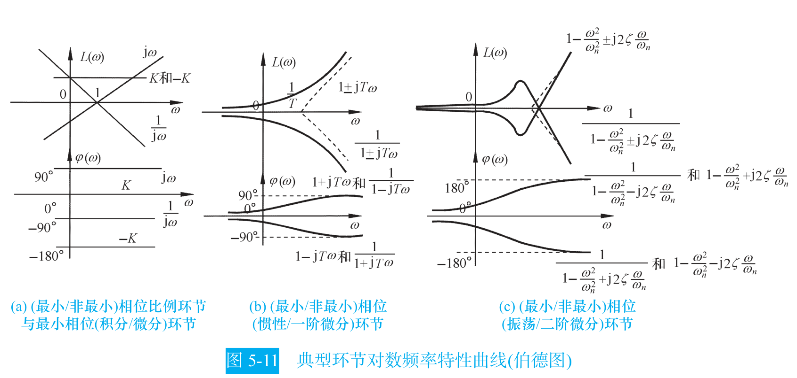

### 低频段与开环增益

低于最小交接频率的那一段，所有一阶、二阶环节的渐近线都是 0 dB，只剩积分环节和比例环节起作用。开环对数幅频渐近线在这段的斜率是 $-20\nu$ dB/dec，$\nu$ 就是系统型别。

这段直线有两个用途。斜率告诉你系统是几型，这是判稳态误差的依据。截距告诉你开环增益 $K$：取 $\omega=1$ rad/s，

$$
L_a(1)=20\lg K
$$

即 $K=10^{L_a(1)/20}$ [自动控制原理（第八版） (胡寿松、姜斌、张绍杰) (z-library.sk, 1lib.sk, z-lib.sk)(1).pdf · p.224](http://10.188.31.55:5244/Nextcloud/School/自动控制原理/%E8%87%AA%E5%8A%A8%E6%8E%A7%E5%88%B6%E5%8E%9F%E7%90%86%EF%BC%88%E7%AC%AC%E5%85%AB%E7%89%88%EF%BC%89%20(%E8%83%A1%E5%AF%BF%E6%9D%BE%E3%80%81%E5%A7%9C%E6%96%8C%E3%80%81%E5%BC%A0%E7%BB%8D%E6%9D%B0)%20(z-library.sk,%201lib.sk,%20z-lib.sk)(1).pdf#page=224)。教材给了三种取 $K$ 的办法：延长线法（取 $\omega=1$）、特定点法（在低频段任取一点 $(\omega_0,L_0)$，$K=10^{(L_0+20\nu\lg\omega_0)/20}$）、零 dB 穿越法（$\omega_b=K^{1/\nu}$）[自动控制原理（第八版） (胡寿松、姜斌、张绍杰) (z-library.sk, 1lib.sk, z-lib.sk)(1).pdf · p.224](http://10.188.31.55:5244/Nextcloud/School/自动控制原理/%E8%87%AA%E5%8A%A8%E6%8E%A7%E5%88%B6%E5%8E%9F%E7%90%86%EF%BC%88%E7%AC%AC%E5%85%AB%E7%89%88%EF%BC%89%20(%E8%83%A1%E5%AF%BF%E6%9D%BE%E3%80%81%E5%A7%9C%E6%96%8C%E3%80%81%E5%BC%A0%E7%BB%8D%E6%9D%B0)%20(z-library.sk,%201lib.sk,%20z-lib.sk)(1).pdf#page=224)。

课件把这一步单独强调了一遍：先做典型环节分解，再定各转折频率和对应环节类型，然后才定 $K$ [自控原理（第五章1） 2.pdf · p.8](http://10.188.31.55:5244/Nextcloud/School/自动控制原理/%E8%87%AA%E6%8E%A7%E5%8E%9F%E7%90%86%EF%BC%88%E7%AC%AC%E4%BA%94%E7%AB%A01%EF%BC%89%202.pdf#page=8)。

### 从波特图反推开环传递函数

这是期末和期中的高频题型。标准四步 [题型二_频域分析大题_Nyquist与Bode.md · p.91](http://10.188.31.55:5244/Nextcloud/School/自动控制原理/%E9%A2%98%E5%9E%8B%E4%BA%8C_%E9%A2%91%E5%9F%9F%E5%88%86%E6%9E%90%E5%A4%A7%E9%A2%98_Nyquist%E4%B8%8EBode.md)：

1. **定系统型别。** 看低频段斜率。0 dB/dec 是 0 型，-20 dB/dec 是 I 型，-40 dB/dec 是 II 型。斜率每 20 dB/dec 对应一个积分环节 $1/s$。
2. **定各转折频率和环节类型。** 从左到右扫渐近线的折点。斜率从 $k_1$ 变到 $k_2$，变化量 $-20$ dB/dec 加一个惯性环节、$+20$ dB/dec 加一阶微分环节、$-40$ dB/dec 加振荡环节、$+40$ dB/dec 加二阶微分环节。时间常数由 $T=1/\omega$ 定出。
3. **定开环增益 $K$。** **只能用低频段延长线在 $\omega=1$ 处的值**，这是最容易错的一步 [题型二_频域分析大题_Nyquist与Bode.md · p.115](http://10.188.31.55:5244/Nextcloud/School/自动控制原理/%E9%A2%98%E5%9E%8B%E4%BA%8C_%E9%A2%91%E5%9F%9F%E5%88%86%E6%9E%90%E5%A4%A7%E9%A2%98_Nyquist%E4%B8%8EBode.md)。
4. **写出传递函数。** 把积分环节、分子环节、分母环节按型别和转折频率组装。

**第 3 步为什么只有一个正确位置。** 讲师给过一个具体例子：低频段是 -20 dB/dec 的斜线，过点 $(0.1, 40\text{ dB})$，求 $K$。正确做法是先把直线延长到 $\omega=1$，由斜率算出该处高度 $40-20=20$ dB，得 $K=10$。若直接读转折点处的 40 dB，就会错得 $K=100$ [题型二_频域分析大题_Nyquist与Bode.md · p.160](http://10.188.31.55:5244/Nextcloud/School/自动控制原理/%E9%A2%98%E5%9E%8B%E4%BA%8C_%E9%A2%91%E5%9F%9F%E5%88%86%E6%9E%90%E5%A4%A7%E9%A2%98_Nyquist%E4%B8%8EBode.md)。其他环节的渐近线在转折频率处的高度含转折频率的幂次，不是 $20\lg K$。

**例题。** 给出对数幅频渐近特性曲线：低频段斜率 -20 dB/dec，$\omega=\omega_1$ 处斜率变为 -40 dB/dec，$\omega=100$ 处斜率变为 -60 dB/dec，低频延长线过 $(1, 20\text{ dB})$ 点 [题型二_频域分析大题_Nyquist与Bode.md · p.138](http://10.188.31.55:5244/Nextcloud/School/自动控制原理/%E9%A2%98%E5%9E%8B%E4%BA%8C_%E9%A2%91%E5%9F%9F%E5%88%86%E6%9E%90%E5%A4%A7%E9%A2%98_Nyquist%E4%B8%8EBode.md)。

- 型别：低频段斜率 -20 dB/dec，I 型系统，含一个积分环节 $1/s$ [题型二_频域分析大题_Nyquist与Bode.md · p.142](http://10.188.31.55:5244/Nextcloud/School/自动控制原理/%E9%A2%98%E5%9E%8B%E4%BA%8C_%E9%A2%91%E5%9F%9F%E5%88%86%E6%9E%90%E5%A4%A7%E9%A2%98_Nyquist%E4%B8%8EBode.md)。
- 环节：$\omega=\omega_1$ 处斜率从 -20 变 -40，变化量 -20 dB/dec，加一个惯性环节 $\dfrac{1}{T_1s+1}$，$T_1=1/\omega_1$ [题型二_频域分析大题_Nyquist与Bode.md · p.145](http://10.188.31.55:5244/Nextcloud/School/自动控制原理/%E9%A2%98%E5%9E%8B%E4%BA%8C_%E9%A2%91%E5%9F%9F%E5%88%86%E6%9E%90%E5%A4%A7%E9%A2%98_Nyquist%E4%B8%8EBode.md)。
- 环节：$\omega=100$ 处斜率从 -40 变 -60，再加一个惯性环节 $\dfrac{1}{T_2s+1}$，$T_2=1/100$ [题型二_频域分析大题_Nyquist与Bode.md · p.146](http://10.188.31.55:5244/Nextcloud/School/自动控制原理/%E9%A2%98%E5%9E%8B%E4%BA%8C_%E9%A2%91%E5%9F%9F%E5%88%86%E6%9E%90%E5%A4%A7%E9%A2%98_Nyquist%E4%B8%8EBode.md)。
- 增益：低频延长线在 $\omega=1$ 处的值是 20 dB，$20\lg K=20$，$K=10$ [题型二_频域分析大题_Nyquist与Bode.md · p.149](http://10.188.31.55:5244/Nextcloud/School/自动控制原理/%E9%A2%98%E5%9E%8B%E4%BA%8C_%E9%A2%91%E5%9F%9F%E5%88%86%E6%9E%90%E5%A4%A7%E9%A2%98_Nyquist%E4%B8%8EBode.md)。
- 结果：$G(s)=\dfrac{10}{s(T_1s+1)(0.01s+1)}$ [题型二_频域分析大题_Nyquist与Bode.md · p.152](http://10.188.31.55:5244/Nextcloud/School/自动控制原理/%E9%A2%98%E5%9E%8B%E4%BA%8C_%E9%A2%91%E5%9F%9F%E5%88%86%E6%9E%90%E5%A4%A7%E9%A2%98_Nyquist%E4%B8%8EBode.md)。

教材例 5-7 给的是同一类图形，图上低频段是 +20 dB/dec（微分环节），$\omega_1$ 处变 0 dB/dec（惯性环节），$\omega_2$ 处变 -40 dB/dec（振荡环节），实际曲线上 $\omega_2$ 附近有谐振峰 [自动控制原理（第八版） (胡寿松、姜斌、张绍杰) (z-library.sk, 1lib.sk, z-lib.sk)(1).pdf · p.227](http://10.188.31.55:5244/Nextcloud/School/自动控制原理/%E8%87%AA%E5%8A%A8%E6%8E%A7%E5%88%B6%E5%8E%9F%E7%90%86%EF%BC%88%E7%AC%AC%E5%85%AB%E7%89%88%EF%BC%89%20(%E8%83%A1%E5%AF%BF%E6%9D%BE%E3%80%81%E5%A7%9C%E6%96%8C%E3%80%81%E5%BC%A0%E7%BB%8D%E6%9D%B0)%20(z-library.sk,%201lib.sk,%20z-lib.sk)(1).pdf#page=227)。

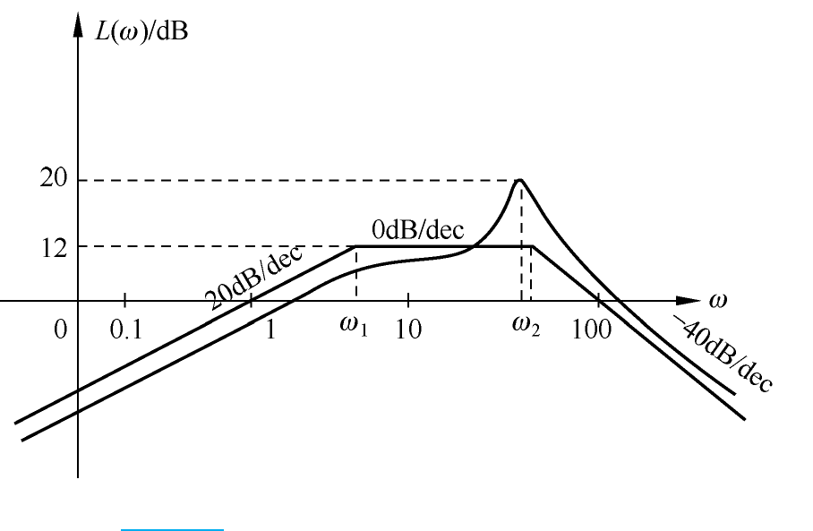

讲师补充了一条更快的路径：给定 Bode 图上的一个具体点时，改用模值方程加相角方程联立 [题型二_频域分析大题_Nyquist与Bode.md · p.717](http://10.188.31.55:5244/Nextcloud/School/自动控制原理/%E9%A2%98%E5%9E%8B%E4%BA%8C_%E9%A2%91%E5%9F%9F%E5%88%86%E6%9E%90%E5%A4%A7%E9%A2%98_Nyquist%E4%B8%8EBode.md)。

### 奈奎斯特判据

**判据的数学基础是幅角原理。** 设 $F(s)$ 为 $s$ 的有理分式，$s$ 平面上的闭合曲线 $\Gamma$ 包围 $F(s)$ 的 $Z$ 个零点和 $P$ 个极点，$s$ 沿 $\Gamma$ 顺时针运动一周时，$F(s)$ 在 $F(s)$ 平面上绕原点的圈数为 $R=P-Z$。

为判定闭环稳定性，取辅助函数

$$
F(s)=1+G(s)H(s)=\frac{A(s)+B(s)}{A(s)}
$$

它的零点是闭环特征方程 $A(s)+B(s)=0$ 的根，即闭环极点；极点是开环分母 $A(s)=0$ 的根，即开环极点 [自动控制原理（第八版） (胡寿松、姜斌、张绍杰) (z-library.sk, 1lib.sk, z-lib.sk)(1).pdf · p.230](http://10.188.31.55:5244/Nextcloud/School/自动控制原理/%E8%87%AA%E5%8A%A8%E6%8E%A7%E5%88%B6%E5%8E%9F%E7%90%86%EF%BC%88%E7%AC%AC%E5%85%AB%E7%89%88%EF%BC%89%20(%E8%83%A1%E5%AF%BF%E6%9D%BE%E3%80%81%E5%A7%9C%E6%96%8C%E3%80%81%E5%BC%A0%E7%BB%8D%E6%9D%B0)%20(z-library.sk,%201lib.sk,%20z-lib.sk)(1).pdf#page=230)。让 $\Gamma$ 包围整个右半 $s$ 平面，$Z$ 就是闭环右半平面极点数，$P$ 就是开环右半平面极点数。

$F(s)=1+G(s)H(s)$ 意味着 $F(s)$ 平面上的原点对应 $G(s)H(s)$ 平面上的点 $(-1,j0)$。$F(s)$ 绕原点的圈数，等于 $G(s)H(s)$ 绕临界点的圈数。

**奈氏路径的补圆。** 幅角原理要求 $\Gamma$ 不通过 $F(s)$ 的极点，而积分环节让原点成为开环极点。处理办法是在原点附近取半径无穷小的半圆 $s=\varepsilon e^{j\theta}$，$\theta\in[-90^\circ,90^\circ]$，绕开原点。对应到 $G(s)H(s)$ 平面上，要从 $G(j0^+)H(j0^+)$ 起补一段半径无穷大、圆心角为 $\nu\times90^\circ$ 的逆时针虚圆弧 [自动控制原理（第八版） (胡寿松、姜斌、张绍杰) (z-library.sk, 1lib.sk, z-lib.sk)(1).pdf · p.231](http://10.188.31.55:5244/Nextcloud/School/自动控制原理/%E8%87%AA%E5%8A%A8%E6%8E%A7%E5%88%B6%E5%8E%9F%E7%90%86%EF%BC%88%E7%AC%AC%E5%85%AB%E7%89%88%EF%BC%89%20(%E8%83%A1%E5%AF%BF%E6%9D%BE%E3%80%81%E5%A7%9C%E6%96%8C%E3%80%81%E5%BC%A0%E7%BB%8D%E6%9D%B0)%20(z-library.sk,%201lib.sk,%20z-lib.sk)(1).pdf#page=231)。开环含等幅振荡环节时，$\pm j\omega_n$ 附近也要补圆，对应圆心角为 $\nu_1\times180^\circ$ 的大圆弧 [自动控制原理（第八版） (胡寿松、姜斌、张绍杰) (z-library.sk, 1lib.sk, z-lib.sk)(1).pdf · p.232](http://10.188.31.55:5244/Nextcloud/School/自动控制原理/%E8%87%AA%E5%8A%A8%E6%8E%A7%E5%88%B6%E5%8E%9F%E7%90%86%EF%BC%88%E7%AC%AC%E5%85%AB%E7%89%88%EF%BC%89%20(%E8%83%A1%E5%AF%BF%E6%9D%BE%E3%80%81%E5%A7%9C%E6%96%8C%E3%80%81%E5%BC%A0%E7%BB%8D%E6%9D%B0)%20(z-library.sk,%201lib.sk,%20z-lib.sk)(1).pdf#page=232)。

这段补圆本身也可能产生穿越，必须计入 $N$ [自控原理（第五章3）.pdf · p.5](http://10.188.31.55:5244/Nextcloud/School/自动控制原理/%E8%87%AA%E6%8E%A7%E5%8E%9F%E7%90%86%EF%BC%88%E7%AC%AC%E4%BA%94%E7%AB%A03%EF%BC%89.pdf#page=5)。

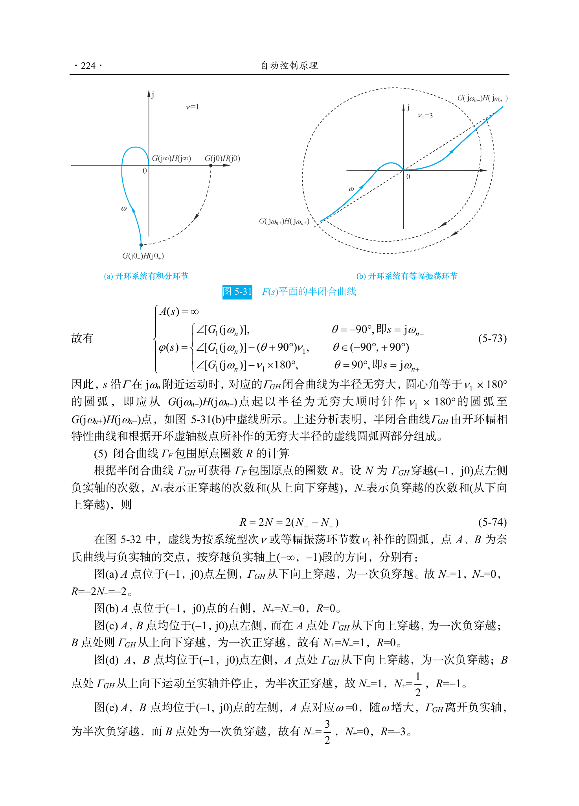

**穿越计数与稳定条件。** 只画 $\omega\ge 0$ 的半闭合曲线时，穿越次数要乘 2。记 $N=N_+-N_-$，其中 $N_+$ 为正穿越次数（曲线从下向上穿过 $(-1,j0)$ 左侧负实轴），$N_-$ 为负穿越次数（从上向下穿过）。$R=2N$，代入 $R=P-Z$ 解出

$$
Z=P-2N
$$

闭环稳定的充要条件是右半平面无闭环极点，即 $Z=P-2N=0$ [自动控制原理（第八版） (胡寿松、姜斌、张绍杰) (z-library.sk, 1lib.sk, z-lib.sk)(1).pdf · p.233](http://10.188.31.55:5244/Nextcloud/School/自动控制原理/%E8%87%AA%E5%8A%A8%E6%8E%A7%E5%88%B6%E5%8E%9F%E7%90%86%EF%BC%88%E7%AC%AC%E5%85%AB%E7%89%88%EF%BC%89%20(%E8%83%A1%E5%AF%BF%E6%9D%BE%E3%80%81%E5%A7%9C%E6%96%8C%E3%80%81%E5%BC%A0%E7%BB%8D%E6%9D%B0)%20(z-library.sk,%201lib.sk,%20z-lib.sk)(1).pdf#page=233)。最常见的开环稳定情形 $P=0$ 时，稳定条件退化为 $N=0$，也就是 Nyquist 曲线不包围、不穿过临界点 $(-1,j0)$ [复习_稳态误差与Nyquist图.md · p.243](http://10.188.31.55:5244/Nextcloud/School/自动控制原理/%E5%A4%8D%E4%B9%A0_%E7%A8%B3%E6%80%81%E8%AF%AF%E5%B7%AE%E4%B8%8ENyquist%E5%9B%BE.md)。

课件把穿越方向写得更细：对数频率稳定判据下，正穿越一次指 $\Gamma_{GH}$ 由上向下穿越 $(-1,j0)$ 点左侧的负实轴一次，等价于在 $L(\omega)>0$ 时 $\Gamma_\varphi$ 由下向上穿越 $(2k+1)\pi$ 线一次；负穿越一次方向相反；半次穿越指曲线止于或起于该点 [自控原理（第五章3）.pdf · p.9](http://10.188.31.55:5244/Nextcloud/School/自动控制原理/%E8%87%AA%E6%8E%A7%E5%8E%9F%E7%90%86%EF%BC%88%E7%AC%AC%E4%BA%94%E7%AB%A03%EF%BC%89.pdf#page=9)。补作的虚直线和虚圆弧所产生的穿越**皆为负穿越**。

**为什么是 $2N$ 而不是 $N$。** 完整的 Nyquist 曲线包含 $\omega$ 从 $-\infty$ 到 $+\infty$，也就是 $\omega>0$ 部分和 $\omega<0$ 部分的对称镜像，等于绕了完整 $s$ 平面闭合曲线一圈。曲线关于实轴对称，所以 $\omega>0$ 段的穿越次数要乘以 2 [题型二_频域分析大题_Nyquist与Bode.md · p.281](http://10.188.31.55:5244/Nextcloud/School/自动控制原理/%E9%A2%98%E5%9E%8B%E4%BA%8C_%E9%A2%91%E5%9F%9F%E5%88%86%E6%9E%90%E5%A4%A7%E9%A2%98_Nyquist%E4%B8%8EBode.md)。

**穿越只针对完整 Nyquist 曲线。** 含大圆弧补充部分的整条曲线，不是只看 $\omega$ 从 0 到 $\infty$ 的那一段 [题型二_频域分析大题_Nyquist与Bode.md · p.325](http://10.188.31.55:5244/Nextcloud/School/自动控制原理/%E9%A2%98%E5%9E%8B%E4%BA%8C_%E9%A2%91%E5%9F%9F%E5%88%86%E6%9E%90%E5%A4%A7%E9%A2%98_Nyquist%E4%B8%8EBode.md)。

**不同 $K$ 值下的稳定区间。** 单位反馈系统 $G(s)=\dfrac{K}{s}G_1(s)$，$\lim_{s\to0}G_1(s)=1$（I 型，$P=0$）。Nyquist 曲线与负实轴有三个交点 $G(j\omega_1)=-2$、$G(j\omega_2)=-1.5$、$G(j\omega_3)=-0.5$，对应临界增益 $K_1=5$、$K_2=20/3$、$K_3=20$ [题型二_频域分析大题_Nyquist与Bode.md · p.366](http://10.188.31.55:5244/Nextcloud/School/自动控制原理/%E9%A2%98%E5%9E%8B%E4%BA%8C_%E9%A2%91%E5%9F%9F%E5%88%86%E6%9E%90%E5%A4%A7%E9%A2%98_Nyquist%E4%B8%8EBode.md)。分段数穿越：

- $0<K<5$：$N_+=N_-=0$，$R=0$，$Z=0$，闭环稳定
- $5<K<20/3$：$R=-2$，$Z=2$，闭环不稳定
- $20/3<K<20$：$N_+=N_-=1$，$R=0$，$Z=0$，闭环稳定
- $K>20$：$R=-2$，$Z=2$，闭环不稳定

稳定区间是 $(0,5)\cup(20/3,20)$。当 $K$ 等于 5、$20/3$、20 时，$\Gamma_G$ 穿过临界点，闭环临界稳定 [自动控制原理（第八版） (胡寿松、姜斌、张绍杰) (z-library.sk, 1lib.sk, z-lib.sk)(1).pdf · p.234](http://10.188.31.55:5244/Nextcloud/School/自动控制原理/%E8%87%AA%E5%8A%A8%E6%8E%A7%E5%88%B6%E5%8E%9F%E7%90%86%EF%BC%88%E7%AC%AC%E5%85%AB%E7%89%88%EF%BC%89%20(%E8%83%A1%E5%AF%BF%E6%9D%BE%E3%80%81%E5%A7%9C%E6%96%8C%E3%80%81%E5%BC%A0%E7%BB%8D%E6%9D%B0)%20(z-library.sk,%201lib.sk,%20z-lib.sk)(1).pdf#page=234)。

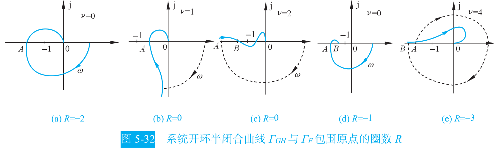

### 稳定裕度

只看稳定性不够，还要知道离不稳定还有多远。教材用两个指标度量这一点。

**相角裕度 $\gamma$。** 设 $\omega_c$ 为截止频率，即 $|G(j\omega_c)H(j\omega_c)|=1$，定义相角裕度为

$$
\gamma=180^\circ+\angle G(j\omega_c)H(j\omega_c)
$$

含义是：闭环稳定的前提下，若开环相频特性再滞后 $\gamma$ 度，系统恰好到达临界稳定 [自动控制原理（第八版） (胡寿松、姜斌、张绍杰) (z-library.sk, 1lib.sk, z-lib.sk)(1).pdf · p.238](http://10.188.31.55:5244/Nextcloud/School/自动控制原理/%E8%87%AA%E5%8A%A8%E6%8E%A7%E5%88%B6%E5%8E%9F%E7%90%86%EF%BC%88%E7%AC%AC%E5%85%AB%E7%89%88%EF%BC%89%20(%E8%83%A1%E5%AF%BF%E6%9D%BE%E3%80%81%E5%A7%9C%E6%96%8C%E3%80%81%E5%BC%A0%E7%BB%8D%E6%9D%B0)%20(z-library.sk,%201lib.sk,%20z-lib.sk)(1).pdf#page=238)。$\gamma>0$ 表示在截止频率处相角还没到 $-180^\circ$，曲线尚未包围临界点，系统稳定；$\gamma<0$ 表示已经越过，系统不稳定 [复习_稳态误差与Nyquist图.md · p.302](http://10.188.31.55:5244/Nextcloud/School/自动控制原理/%E5%A4%8D%E4%B9%A0_%E7%A8%B3%E6%80%81%E8%AF%AF%E5%B7%AE%E4%B8%8ENyquist%E5%9B%BE.md)。

**幅值裕度 $h$。** 设 $\omega_x$ 为相位穿越频率，即 $\angle G(j\omega_x)H(j\omega_x)=(2k+1)\pi$，定义幅值裕度为该处幅值的倒数

$$
h=\frac{1}{|G(j\omega_x)H(j\omega_x)|}
$$

含义是：闭环稳定的前提下，若开环幅频特性再整体放大 $h$ 倍，系统恰好到达临界稳定 [自动控制原理（第八版） (胡寿松、姜斌、张绍杰) (z-library.sk, 1lib.sk, z-lib.sk)(1).pdf · p.238](http://10.188.31.55:5244/Nextcloud/School/自动控制原理/%E8%87%AA%E5%8A%A8%E6%8E%A7%E5%88%B6%E5%8E%9F%E7%90%86%EF%BC%88%E7%AC%AC%E5%85%AB%E7%89%88%EF%BC%89%20(%E8%83%A1%E5%AF%BF%E6%9D%BE%E3%80%81%E5%A7%9C%E6%96%8C%E3%80%81%E5%BC%A0%E7%BB%8D%E6%9D%B0)%20(z-library.sk,%201lib.sk,%20z-lib.sk)(1).pdf#page=238)。用分贝表示时 $h(\text{dB})=-20\lg|G(j\omega_x)H(j\omega_x)|$。

**两个裕度要一起看。** 只用幅值裕度或只用相角裕度，都不足以说明系统的相对稳定性。对最小相位系统，只有当两个裕度都是正值时系统才稳定，负的裕度表示不稳定 [自动控制原理（第八版） (胡寿松、姜斌、张绍杰) (z-library.sk, 1lib.sk, z-lib.sk)(1).pdf · p.242](http://10.188.31.55:5244/Nextcloud/School/自动控制原理/%E8%87%AA%E5%8A%A8%E6%8E%A7%E5%88%B6%E5%8E%9F%E7%90%86%EF%BC%88%E7%AC%AC%E5%85%AB%E7%89%88%EF%BC%89%20(%E8%83%A1%E5%AF%BF%E6%9D%BE%E3%80%81%E5%A7%9C%E6%96%8C%E3%80%81%E5%BC%A0%E7%BB%8D%E6%9D%B0)%20(z-library.sk,%201lib.sk,%20z-lib.sk)(1).pdf#page=242)。工程上一般要求 $\gamma$ 在 $30^\circ\sim60^\circ$ 之间、$h>6$ dB [题型二_频域分析大题_Nyquist与Bode.md · p.464](http://10.188.31.55:5244/Nextcloud/School/自动控制原理/%E9%A2%98%E5%9E%8B%E4%BA%8C_%E9%A2%91%E5%9F%9F%E5%88%86%E6%9E%90%E5%A4%A7%E9%A2%98_Nyquist%E4%B8%8EBode.md)。

**两个测量点不能混。** $\gamma$ 的测量点是 $\omega_c$（由幅值过 0 dB 确定），$h$ 的测量点是 $\omega_x$（由相角过 $-180^\circ$ 确定）。讲师把这条列为专门的易错点：常见错误是把 $\omega_c$ 处的幅值或相角拿去算幅值裕度 [题型二_频域分析大题_Nyquist与Bode.md · p.995](http://10.188.31.55:5244/Nextcloud/School/自动控制原理/%E9%A2%98%E5%9E%8B%E4%BA%8C_%E9%A2%91%E5%9F%9F%E5%88%86%E6%9E%90%E5%A4%A7%E9%A2%98_Nyquist%E4%B8%8EBode.md)。

> [!WARNING] 奈氏题三个最常见的丢分点
> **忘记补圆。** 开环含积分环节时，原点附近要取无穷小半圆，对应 $G(s)H(s)$ 平面上从 $G(j0^+)H(j0^+)$ 起补一段半径无穷大、圆心角 $\nu\times90^\circ$ 的虚圆弧。补圆本身产生的穿越要计入 $N$ [自控原理（第五章3）.pdf · p.5](http://10.188.31.55:5244/Nextcloud/School/自动控制原理/%E8%87%AA%E6%8E%A7%E5%8E%9F%E7%90%86%EF%BC%88%E7%AC%AC%E4%BA%94%E7%AB%A03%EF%BC%89.pdf#page=5)。
>
> **穿越数漏乘 2。** $R=2N$，$N$ 要数完整曲线（含补圆）的穿越次数，不是只数 $\omega\ge0$ 那一段 [题型二_频域分析大题_Nyquist与Bode.md · p.281](http://10.188.31.55:5244/Nextcloud/School/自动控制原理/%E9%A2%98%E5%9E%8B%E4%BA%8C_%E9%A2%91%E5%9F%9F%E5%88%86%E6%9E%90%E5%A4%A7%E9%A2%98_Nyquist%E4%B8%8EBode.md)。
>
> **把 $\omega_c$ 和 $\omega_x$ 用混。** $\gamma$ 在 $\omega_c$ 处读，$h$ 在 $\omega_x$ 处读，两个频率一般不相等 [题型二_频域分析大题_Nyquist与Bode.md · p.995](http://10.188.31.55:5244/Nextcloud/School/自动控制原理/%E9%A2%98%E5%9E%8B%E4%BA%8C_%E9%A2%91%E5%9F%9F%E5%88%86%E6%9E%90%E5%A4%A7%E9%A2%98_Nyquist%E4%B8%8EBode.md)。

**一阶、二阶系统的幅值裕度是无穷大。** 因为这类系统的极坐标图与负实轴不相交，理论上不可能不稳定 [自动控制原理（第八版） (胡寿松、姜斌、张绍杰) (z-library.sk, 1lib.sk, z-lib.sk)(1).pdf · p.239](http://10.188.31.55:5244/Nextcloud/School/自动控制原理/%E8%87%AA%E5%8A%A8%E6%8E%A7%E5%88%B6%E5%8E%9F%E7%90%86%EF%BC%88%E7%AC%AC%E5%85%AB%E7%89%88%EF%BC%89%20(%E8%83%A1%E5%AF%BF%E6%9D%BE%E3%80%81%E5%A7%9C%E6%96%8C%E3%80%81%E5%BC%A0%E7%BB%8D%E6%9D%B0)%20(z-library.sk,%201lib.sk,%20z-lib.sk)(1).pdf#page=239)。

**减小增益能增大相角裕度，但牺牲稳态精度。** 教材例 5-14：$G(s)=\dfrac{K}{s(s+1)(0.1s+1)}$，$K=5$ 时 $\omega_c=2.1$，$\gamma_1\approx13.6^\circ$，$h_1\approx6.85$ dB；$K=20$ 时 $\omega_c=4.23$，$\gamma_2\approx-9.7^\circ$，$h_2\approx-5.2$ dB，系统不稳定 [自动控制原理（第八版） (胡寿松、姜斌、张绍杰) (z-library.sk, 1lib.sk, z-lib.sk)(1).pdf · p.241](http://10.188.31.55:5244/Nextcloud/School/自动控制原理/%E8%87%AA%E5%8A%A8%E6%8E%A7%E5%88%B6%E5%8E%9F%E7%90%86%EF%BC%88%E7%AC%AC%E5%85%AB%E7%89%88%EF%BC%89%20(%E8%83%A1%E5%AF%BF%E6%9D%BE%E3%80%81%E5%A7%9C%E6%96%8C%E3%80%81%E5%BC%A0%E7%BB%8D%E6%9D%B0)%20(z-library.sk,%201lib.sk,%20z-lib.sk)(1).pdf#page=241)。两个 $K$ 值的相频特性相同，幅频特性不同。

**Bode 图上的读法。** $\gamma$ 在截止频率 $\omega_c$（$L=0$ dB）处量到 $-180^\circ$ 线的角度；$h$ 在相位穿越频率 $\omega_x$（$\varphi=-180^\circ$）处量到 0 dB 线的距离。


> 特别要注意的是，仅用相角裕度 γ 或幅值裕度 h，都不足以反映系统的稳定程度。

课件把例 5-15 的两种 $K$ 值画在同一张 Bode 图上：$K=5$ 时 $\omega_c=2.1$，$\gamma\approx13.6^\circ$，$h\approx6.85$ dB，系统稳定；$K=20$ 时 $\omega_c=4.23$，$\gamma\approx-9.7^\circ$，$h\approx-5.2$ dB，系统不稳定 [自控原理（第五章4）.pdf · p.4](http://10.188.31.55:5244/Nextcloud/School/自动控制原理/%E8%87%AA%E6%8E%A7%E5%8E%9F%E7%90%86%EF%BC%88%E7%AC%AC%E4%BA%94%E7%AB%A04%EF%BC%89.pdf#page=4)。

### 频域指标与时域指标的换算

相角裕度不只是一个离不稳定有多远的数，它能换算成时域超调量。

**典型二阶系统的相角裕度只与阻尼比有关。** 对 $G(s)=\dfrac{\omega_n^2}{s(s+2\zeta\omega_n)}$，教材先由截止频率条件 $|G(j\omega_c)|=1$ 解出

$$
\omega_c=\omega_n\sqrt{\sqrt{4\zeta^{4}+1}-2\zeta^{2}}
$$

再按相角裕度定义得到

$$
\gamma=90^\circ-\arctan\frac{2\zeta\omega_n}{\omega_c}
$$

教材指出 $\omega_c$ 是 $\omega_n$ 的增函数、$\zeta$ 的减函数，所以 $\gamma$ 只与阻尼比有关，且是 $\zeta$ 的增函数 [自动控制原理（第八版） (胡寿松、姜斌、张绍杰) (z-library.sk, 1lib.sk, z-lib.sk)(1).pdf · p.241](http://10.188.31.55:5244/Nextcloud/School/自动控制原理/%E8%87%AA%E5%8A%A8%E6%8E%A7%E5%88%B6%E5%8E%9F%E7%90%86%EF%BC%88%E7%AC%AC%E5%85%AB%E7%89%88%EF%BC%89%20(%E8%83%A1%E5%AF%BF%E6%9D%BE%E3%80%81%E5%A7%9C%E6%96%8C%E3%80%81%E5%BC%A0%E7%BB%8D%E6%9D%B0)%20(z-library.sk,%201lib.sk,%20z-lib.sk)(1).pdf#page=241)。

于是有了换算链 $\gamma\to\zeta\to\sigma\%\to t_s$：由 $\gamma$ 查 $\gamma$-$\zeta$ 曲线（图 5-47）得 $\zeta$，再由超调量公式 $\sigma\%=e^{-\pi\zeta/\sqrt{1-\zeta^2}}\times100\%$ 算超调量，$t_s\approx3/(\zeta\omega_n)$ 算调节时间 [自控原理（第五章4）.pdf · p.7](http://10.188.31.55:5244/Nextcloud/School/自动控制原理/%E8%87%AA%E6%8E%A7%E5%8E%9F%E7%90%86%EF%BC%88%E7%AC%AC%E4%BA%94%E7%AB%A04%EF%BC%89.pdf#page=7)。

**高阶系统用经验公式。** 当 $35^\circ\le\gamma\le90^\circ$ 时

$$
\sigma\%\approx0.16+0.4\left(\frac{1}{\sin\gamma}-1\right)\%,\qquad t_s\approx\frac{\pi}{\zeta\omega_n}
$$

其中 $\zeta$ 由 $\gamma$ 查 $\gamma$-$\zeta$ 曲线得到 [自动控制原理（第八版） (胡寿松、姜斌、张绍杰) (z-library.sk, 1lib.sk, z-lib.sk)(1).pdf · p.249](http://10.188.31.55:5244/Nextcloud/School/自动控制原理/%E8%87%AA%E5%8A%A8%E6%8E%A7%E5%88%B6%E5%8E%9F%E7%90%86%EF%BC%88%E7%AC%AC%E5%85%AB%E7%89%88%EF%BC%89%20(%E8%83%A1%E5%AF%BF%E6%9D%BE%E3%80%81%E5%A7%9C%E6%96%8C%E3%80%81%E5%BC%A0%E7%BB%8D%E6%9D%B0)%20(z-library.sk,%201lib.sk,%20z-lib.sk)(1).pdf#page=249)。这个估算偏保守，实际性能比估得好。

**带宽。** 闭环幅频特性下降到中频增益的 0.707 倍（即 -3 dB）对应的频率叫带宽频率 $\omega_b$ [自动控制原理（第八版） (胡寿松、姜斌、张绍杰) (z-library.sk, 1lib.sk, z-lib.sk)(1).pdf · p.243](http://10.188.31.55:5244/Nextcloud/School/自动控制原理/%E8%87%AA%E5%8A%A8%E6%8E%A7%E5%88%B6%E5%8E%9F%E7%90%86%EF%BC%88%E7%AC%AC%E5%85%AB%E7%89%88%EF%BC%89%20(%E8%83%A1%E5%AF%BF%E6%9D%BE%E3%80%81%E5%A7%9C%E6%96%8C%E3%80%81%E5%BC%A0%E7%BB%8D%E6%9D%B0)%20(z-library.sk,%201lib.sk,%20z-lib.sk)(1).pdf#page=243)。带宽反映系统跟踪速度与抗高频噪声的能力，第 6 章设计校正网络时 $\omega_b$ 是重要约束。

**带宽与裕度的关系约束设计。** 教材指出：若截止频率处斜率为 $-40$ dB/dec，系统可能稳定也可能不稳定，且相角裕度偏小；若为 $-60$ dB/dec 或更陡，系统多半不稳定；大多数实际情况要求截止频率处斜率为 $-20$ dB/dec [自动控制原理（第八版） (胡寿松、姜斌、张绍杰) (z-library.sk, 1lib.sk, z-lib.sk)(1).pdf · p.242](http://10.188.31.55:5244/Nextcloud/School/自动控制原理/%E8%87%AA%E5%8A%A8%E6%8E%A7%E5%88%B6%E5%8E%9F%E7%90%86%EF%BC%88%E7%AC%AC%E5%85%AB%E7%89%88%EF%BC%89%20(%E8%83%A1%E5%AF%BF%E6%9D%BE%E3%80%81%E5%A7%9C%E6%96%8C%E3%80%81%E5%BC%A0%E7%BB%8D%E6%9D%B0)%20(z-library.sk,%201lib.sk,%20z-lib.sk)(1).pdf#page=242)。第 6 章的期望特性法就建立在这条经验上。

### 三阶 I 型系统的速算

$G(s)=\dfrac{K}{s(T_1s+1)(T_2s+1)}$ 这种三阶 I 型系统，每道判稳题都会遇到。讲师把它整理成三个公式 [题型二_频域分析大题_Nyquist与Bode.md · p.872](http://10.188.31.55:5244/Nextcloud/School/自动控制原理/%E9%A2%98%E5%9E%8B%E4%BA%8C_%E9%A2%91%E5%9F%9F%E5%88%86%E6%9E%90%E5%A4%A7%E9%A2%98_Nyquist%E4%B8%8EBode.md)。

**穿越频率。** 令相角为 $-180^\circ$：

$$
-90^\circ-\arctan(T_1\omega_x)-\arctan(T_2\omega_x)=-180^\circ
$$

移项得 $\arctan(T_1\omega_x)+\arctan(T_2\omega_x)=90^\circ$。用互余关系"两角之和为 $90^\circ$ 等价于正切之积为 1"：

$$
T_1\omega_x\cdot T_2\omega_x=1
$$

所以 $\omega_x=\dfrac{1}{\sqrt{T_1T_2}}$。

**穿越点幅值。** 把 $\omega_x$ 代回幅值表达式并化简：

$$
|G(j\omega_x)|=\frac{KT_1T_2}{T_1+T_2}
$$

**临界增益。** 令穿越点幅值等于 1，曲线恰好过 $(-1,0)$：

$$
K_{cr}=\frac{T_1+T_2}{T_1T_2}
$$

$K<K_{cr}$ 闭环稳定，$K>K_{cr}$ 闭环不稳定。幅值裕度就是 $h=K_{cr}/K$ [复习_稳态误差与Nyquist图.md · p.367](http://10.188.31.55:5244/Nextcloud/School/自动控制原理/%E5%A4%8D%E4%B9%A0_%E7%A8%B3%E6%80%81%E8%AF%AF%E5%B7%AE%E4%B8%8ENyquist%E5%9B%BE.md)。

### 一个延迟系统的例子

带延迟环节的开环传递函数 $G(s)H(s)=\dfrac{2e^{-\tau s}}{s+1}$，$\tau>0$ [自动控制原理（第八版） (胡寿松、姜斌、张绍杰) (z-library.sk, 1lib.sk, z-lib.sk)(1).pdf · p.234](http://10.188.31.55:5244/Nextcloud/School/自动控制原理/%E8%87%AA%E5%8A%A8%E6%8E%A7%E5%88%B6%E5%8E%9F%E7%90%86%EF%BC%88%E7%AC%AC%E5%85%AB%E7%89%88%EF%BC%89%20(%E8%83%A1%E5%AF%BF%E6%9D%BE%E3%80%81%E5%A7%9C%E6%96%8C%E3%80%81%E5%BC%A0%E7%BB%8D%E6%9D%B0)%20(z-library.sk,%201lib.sk,%20z-lib.sk)(1).pdf#page=234)。延迟环节 $e^{-\tau s}$ 的幅值恒为 1，相角为 $-57.3\tau\omega$ 度 [自动控制原理（第八版） (胡寿松、姜斌、张绍杰) (z-library.sk, 1lib.sk, z-lib.sk)(1).pdf · p.226](http://10.188.31.55:5244/Nextcloud/School/自动控制原理/%E8%87%AA%E5%8A%A8%E6%8E%A7%E5%88%B6%E5%8E%9F%E7%90%86%EF%BC%88%E7%AC%AC%E5%85%AB%E7%89%88%EF%BC%89%20(%E8%83%A1%E5%AF%BF%E6%9D%BE%E3%80%81%E5%A7%9C%E6%96%8C%E3%80%81%E5%BC%A0%E7%BB%8D%E6%9D%B0)%20(z-library.sk,%201lib.sk,%20z-lib.sk)(1).pdf#page=226)。

开环极点 $s=-1$ 在左半平面，$P=0$，稳定条件是曲线与负实轴没有交点。幅相特性是

$$
A(\omega)=\frac{2}{\sqrt{1+\omega^{2}}},\qquad \varphi(\omega)=-\tau\omega-\arctan\omega
$$

相角随 $\omega$ 单调下降，曲线是一条顺时针盘旋的螺旋线。设第一个（最低频 $\omega_{xm}$）交点满足 $-\tau\omega_{xm}-\arctan\omega_{xm}=-\pi$。由于 $A(\omega)$ 随 $\omega$ 增大而减小，第一个交点的幅值最大——只要这个最大幅值小于 1，整条曲线就都不越过临界点。

教材的判据是最大交点幅值 $A(\omega_{xm})$ 必须小于 1，也就是 $\omega_{xm}>\sqrt3$ [自动控制原理（第八版） (胡寿松、姜斌、张绍杰) (z-library.sk, 1lib.sk, z-lib.sk)(1).pdf · p.235](http://10.188.31.55:5244/Nextcloud/School/自动控制原理/%E8%87%AA%E5%8A%A8%E6%8E%A7%E5%88%B6%E5%8E%9F%E7%90%86%EF%BC%88%E7%AC%AC%E5%85%AB%E7%89%88%EF%BC%89%20(%E8%83%A1%E5%AF%BF%E6%9D%BE%E3%80%81%E5%A7%9C%E6%96%8C%E3%80%81%E5%BC%A0%E7%BB%8D%E6%9D%B0)%20(z-library.sk,%201lib.sk,%20z-lib.sk)(1).pdf#page=235)。而 $\omega_{xm}$ 随 $\tau$ 递减，临界点在 $\omega_{xm}=\sqrt3$，对应

$$
\tau_{cr}=\frac{\pi-\arctan\sqrt3}{\sqrt3}=\frac{2\pi}{3\sqrt3}\approx1.21\ \text{s}
$$

所以闭环稳定条件是 $\tau<\dfrac{2\pi}{3\sqrt3}\approx1.21$ s [自动控制原理（第八版） (胡寿松、姜斌、张绍杰) (z-library.sk, 1lib.sk, z-lib.sk)(1).pdf · p.235](http://10.188.31.55:5244/Nextcloud/School/自动控制原理/%E8%87%AA%E5%8A%A8%E6%8E%A7%E5%88%B6%E5%8E%9F%E7%90%86%EF%BC%88%E7%AC%AC%E5%85%AB%E7%89%88%EF%BC%89%20(%E8%83%A1%E5%AF%BF%E6%9D%BE%E3%80%81%E5%A7%9C%E6%96%8C%E3%80%81%E5%BC%A0%E7%BB%8D%E6%9D%B0)%20(z-library.sk,%201lib.sk,%20z-lib.sk)(1).pdf#page=235)。

## 第 6 章 线性系统的校正方法

前五章都是分析：给一个系统，算它能干什么。这一章第一次反向用：先定性能指标，再倒推该加什么零件、参数取多少。

一个系统不满足指标，通常是两种情况之一。**快但不稳**：截止频率高、响应快，相角裕度却是负的，闭环一跑就振荡发散。教材例 6-4 就是这种系统：待校正系统相角裕度只有 $17.9^\circ$，指标要求 $45^\circ$，只能靠串联超前校正补相角 [自动控制原理（第八版） (胡寿松、姜斌、张绍杰) (z-library.sk, 1lib.sk, z-lib.sk)(1).pdf · p.283](http://10.188.31.55:5244/Nextcloud/School/自动控制原理/%E8%87%AA%E5%8A%A8%E6%8E%A7%E5%88%B6%E5%8E%9F%E7%90%86%EF%BC%88%E7%AC%AC%E5%85%AB%E7%89%88%EF%BC%89%20(%E8%83%A1%E5%AF%BF%E6%9D%BE%E3%80%81%E5%A7%9C%E6%96%8C%E3%80%81%E5%BC%A0%E7%BB%8D%E6%9D%B0)%20(z-library.sk,%201lib.sk,%20z-lib.sk)(1).pdf#page=283)。**稳但太慢**：相角裕度很足，截止频率太低，斜坡输入下稳态误差还很大。教材例 6-5 里待校正系统截止频率高达 12 rad/s，远大于要求的 2.3 rad/s，系统本身还不稳定，最后选了串联滞后校正 [自动控制原理（第八版） (胡寿松、姜斌、张绍杰) (z-library.sk, 1lib.sk, z-lib.sk)(1).pdf · p.285](http://10.188.31.55:5244/Nextcloud/School/自动控制原理/%E8%87%AA%E5%8A%A8%E6%8E%A7%E5%88%B6%E5%8E%9F%E7%90%86%EF%BC%88%E7%AC%AC%E5%85%AB%E7%89%88%EF%BC%89%20(%E8%83%A1%E5%AF%BF%E6%9D%BE%E3%80%81%E5%A7%9C%E6%96%8C%E3%80%81%E5%BC%A0%E7%BB%8D%E6%9D%B0)%20(z-library.sk,%201lib.sk,%20z-lib.sk)(1).pdf#page=285)。

拧放大器增益 $K$ 救不回来：增大 $K$ 能减小稳态误差，却把 Bode 幅频曲线整体上抬、截止频率右移、相角裕度变小，很容易从稳滑到不稳。

**校正装置怎么接。** 教材按连接方式分成四种 [自动控制原理（第八版） (胡寿松、姜斌、张绍杰) (z-library.sk, 1lib.sk, z-lib.sk)(1).pdf · p.265](http://10.188.31.55:5244/Nextcloud/School/自动控制原理/%E8%87%AA%E5%8A%A8%E6%8E%A7%E5%88%B6%E5%8E%9F%E7%90%86%EF%BC%88%E7%AC%AC%E5%85%AB%E7%89%88%EF%BC%89%20(%E8%83%A1%E5%AF%BF%E6%9D%BE%E3%80%81%E5%A7%9C%E6%96%8C%E3%80%81%E5%BC%A0%E7%BB%8D%E6%9D%B0)%20(z-library.sk,%201lib.sk,%20z-lib.sk)(1).pdf#page=265)：

- **串联校正**：装置接在误差测量点之后、串接于前向通道中。最常用，校正后开环传函变成 $G_0(s)=G_c(s)G(s)$ [题型三_系统校正大题.md · p.58](http://10.188.31.55:5244/Nextcloud/School/自动控制原理/%E9%A2%98%E5%9E%8B%E4%B8%89_%E7%B3%BB%E7%BB%9F%E6%A0%A1%E6%AD%A3%E5%A4%A7%E9%A2%98.md)。
- **反馈校正**：装置接在系统的局部反馈通路中，通过改变局部闭环特性来改善等效开环特性 [自动控制原理（第八版） (胡寿松、姜斌、张绍杰) (z-library.sk, 1lib.sk, z-lib.sk)(1).pdf · p.265](http://10.188.31.55:5244/Nextcloud/School/自动控制原理/%E8%87%AA%E5%8A%A8%E6%8E%A7%E5%88%B6%E5%8E%9F%E7%90%86%EF%BC%88%E7%AC%AC%E5%85%AB%E7%89%88%EF%BC%89%20(%E8%83%A1%E5%AF%BF%E6%9D%BE%E3%80%81%E5%A7%9C%E6%96%8C%E3%80%81%E5%BC%A0%E7%BB%8D%E6%9D%B0)%20(z-library.sk,%201lib.sk,%20z-lib.sk)(1).pdf#page=265)。
- **前馈校正**（顺馈校正）：在系统主反馈回路之外采用，对给定值信号整形，或对可测扰动补偿 [自控原理（第六章1）.pdf · p.3](http://10.188.31.55:5244/Nextcloud/School/自动控制原理/%E8%87%AA%E6%8E%A7%E5%8E%9F%E7%90%86%EF%BC%88%E7%AC%AC%E5%85%AD%E7%AB%A01%EF%BC%89.pdf#page=3)。
- **复合校正**：反馈回路中再加一条前馈通路，组成一个有机整体 [自动控制原理（第八版） (胡寿松、姜斌、张绍杰) (z-library.sk, 1lib.sk, z-lib.sk)(1).pdf · p.295](http://10.188.31.55:5244/Nextcloud/School/自动控制原理/%E8%87%AA%E5%8A%A8%E6%8E%A7%E5%88%B6%E5%8E%9F%E7%90%86%EF%BC%88%E7%AC%AC%E5%85%AB%E7%89%88%EF%BC%89%20(%E8%83%A1%E5%AF%BF%E6%9D%BE%E3%80%81%E5%A7%9C%E6%96%8C%E3%80%81%E5%BC%A0%E7%BB%8D%E6%9D%B0)%20(z-library.sk,%201lib.sk,%20z-lib.sk)(1).pdf#page=295)。

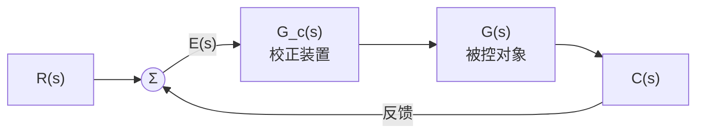

课件指出反馈校正的一个特点：可以减小被包围环节的时间常数，所需元件数目比串联校正少 [自控原理（第六章2）.pdf · p.7](http://10.188.31.55:5244/Nextcloud/School/自动控制原理/%E8%87%AA%E6%8E%A7%E5%8E%9F%E7%90%86%EF%BC%88%E7%AC%AC%E5%85%AD%E7%AB%A02%EF%BC%89.pdf#page=7)。反过来，串联校正设计比反馈校正设计简单，也比较容易对信号做各种形式的变换 [自动控制原理（第八版） (胡寿松、姜斌、张绍杰) (z-library.sk, 1lib.sk, z-lib.sk)(1).pdf · p.266](http://10.188.31.55:5244/Nextcloud/School/自动控制原理/%E8%87%AA%E5%8A%A8%E6%8E%A7%E5%88%B6%E5%8E%9F%E7%90%86%EF%BC%88%E7%AC%AC%E5%85%AB%E7%89%88%EF%BC%89%20(%E8%83%A1%E5%AF%BF%E6%9D%BE%E3%80%81%E5%A7%9C%E6%96%8C%E3%80%81%E5%BC%A0%E7%BB%8D%E6%9D%B0)%20(z-library.sk,%201lib.sk,%20z-lib.sk)(1).pdf#page=266)。工业上考得最多的还是串联校正 [题型三_系统校正大题.md · p.58](http://10.188.31.55:5244/Nextcloud/School/自动控制原理/%E9%A2%98%E5%9E%8B%E4%B8%89_%E7%B3%BB%E7%BB%9F%E6%A0%A1%E6%AD%A3%E5%A4%A7%E9%A2%98.md)。

**本章的四个工具。** 所有校正题都是同一个套路，拆成四件工具：稳态误差方程定开环增益 $K$；截止频率方程 $|G_0(j\omega_c)|=1$ 定网络参数；相角裕度方程 $\gamma=180^\circ+\angle G_0(j\omega_c)$ 做最后校验；劳斯判据保证加了积分环节也没失稳 [题型三_系统校正大题.md · p.976](http://10.188.31.55:5244/Nextcloud/School/自动控制原理/%E9%A2%98%E5%9E%8B%E4%B8%89_%E7%B3%BB%E7%BB%9F%E6%A0%A1%E6%AD%A3%E5%A4%A7%E9%A2%98.md)。

**典型题形。** 已知系统不满足性能要求，设计串联校正装置使系统满足要求；A 卷第 4 题第 (2) 问与频域分析合在一起考，约 10~15 分，期中卷还有独立的 PI/PD 设计题 [题型三_系统校正大题.md · p.4](http://10.188.31.55:5244/Nextcloud/School/自动控制原理/%E9%A2%98%E5%9E%8B%E4%B8%89_%E7%B3%BB%E7%BB%9F%E6%A0%A1%E6%AD%A3%E5%A4%A7%E9%A2%98.md)。

**这一章在整门课里的位置。** 第 5 章的两个裕度是本章的设计目标：超前校正靠在截止频率处补正相角，滞后校正靠压低截止频率，两者都要回到 Bode 图上读。往回看第 4 章：加零点改善稳定性、加极点恶化稳定性，正是根轨迹法的结论，也是 PD（加零点）与 PI（加极点）效果的几何解释。根轨迹那一章的一句话在这里同样成立——分析和设计时用开环，最终结果和实际响应时用闭环 [复习_根轨迹.md · p.130](http://10.188.31.55:5244/Nextcloud/School/自动控制原理/%E5%A4%8D%E4%B9%A0_%E6%A0%B9%E8%BD%A8%E8%BF%B9.md)。校正题全程在开环 Bode 图上操作，只有最后的验稳才回到闭环特征方程 [复习_根轨迹.md · p.164](http://10.188.31.55:5244/Nextcloud/School/自动控制原理/%E5%A4%8D%E4%B9%A0_%E6%A0%B9%E8%BD%A8%E8%BF%B9.md)。

### 无源超前校正网络

无源超前网络的传递函数，教材写成带衰减因子的形式（分度系数 $a>1$）：

$$
aG_c(s)=\frac{1+aTs}{1+Ts}
$$

其中 $a=\dfrac{R_1+R_2}{R_2}>1$，$T=\dfrac{R_1R_2C}{R_1+R_2}$ [自动控制原理（第八版） (胡寿松、姜斌、张绍杰) (z-library.sk, 1lib.sk, z-lib.sk)(1).pdf · p.267](http://10.188.31.55:5244/Nextcloud/School/自动控制原理/%E8%87%AA%E5%8A%A8%E6%8E%A7%E5%88%B6%E5%8E%9F%E7%90%86%EF%BC%88%E7%AC%AC%E5%85%AB%E7%89%88%EF%BC%89%20(%E8%83%A1%E5%AF%BF%E6%9D%BE%E3%80%81%E5%A7%9C%E6%96%8C%E3%80%81%E5%BC%A0%E7%BB%8D%E6%9D%B0)%20(z-library.sk,%201lib.sk,%20z-lib.sk)(1).pdf#page=267)。

**零极点位置是超前的来源。** 由于 $a>1$，超前网络的负实零点总是位于其负实极点之右，两者之间的距离由常数 $a$ 决定。改变 $a$ 和 $T$ 的数值，零极点可在 $s$ 平面的负实轴上任意移动 [自动控制原理（第八版） (胡寿松、姜斌、张绍杰) (z-library.sk, 1lib.sk, z-lib.sk)(1).pdf · p.267](http://10.188.31.55:5244/Nextcloud/School/自动控制原理/%E8%87%AA%E5%8A%A8%E6%8E%A7%E5%88%B6%E5%8E%9F%E7%90%86%EF%BC%88%E7%AC%AC%E5%85%AB%E7%89%88%EF%BC%89%20(%E8%83%A1%E5%AF%BF%E6%9D%BE%E3%80%81%E5%A7%9C%E6%96%8C%E3%80%81%E5%BC%A0%E7%BB%8D%E6%9D%B0)%20(z-library.sk,%201lib.sk,%20z-lib.sk)(1).pdf#page=267)。


**网络的相角。** 分子相角减分母相角：

$$
\varphi_c(\omega)=\arctan(aT\omega)-\arctan(T\omega)
$$

对 $\omega$ 求导令其为零，得最大超前角频率 $\omega_m=\dfrac{1}{T\sqrt a}$；代回得最大超前角 $\varphi_m=\arcsin\dfrac{a-1}{a+1}$ [自动控制原理（第八版） (胡寿松、姜斌、张绍杰) (z-library.sk, 1lib.sk, z-lib.sk)(1).pdf · p.268](http://10.188.31.55:5244/Nextcloud/School/自动控制原理/%E8%87%AA%E5%8A%A8%E6%8E%A7%E5%88%B6%E5%8E%9F%E7%90%86%EF%BC%88%E7%AC%AC%E5%85%AB%E7%89%88%EF%BC%89%20(%E8%83%A1%E5%AF%BF%E6%9D%BE%E3%80%81%E5%A7%9C%E6%96%8C%E3%80%81%E5%BC%A0%E7%BB%8D%E6%9D%B0)%20(z-library.sk,%201lib.sk,%20z-lib.sk)(1).pdf#page=268)。$\omega_m$ 恰好是 $1/(aT)$ 和 $1/T$ 的几何中心。

**网络在 $\omega_m$ 处的幅值。** 教材给的是 $L_c(\omega_m)=20\lg|aG_c(j\omega_m)|=10\lg a$ dB [自动控制原理（第八版） (胡寿松、姜斌、张绍杰) (z-library.sk, 1lib.sk, z-lib.sk)(1).pdf · p.268](http://10.188.31.55:5244/Nextcloud/School/自动控制原理/%E8%87%AA%E5%8A%A8%E6%8E%A7%E5%88%B6%E5%8E%9F%E7%90%86%EF%BC%88%E7%AC%AC%E5%85%AB%E7%89%88%EF%BC%89%20(%E8%83%A1%E5%AF%BF%E6%9D%BE%E3%80%81%E5%A7%9C%E6%96%8C%E3%80%81%E5%BC%A0%E7%BB%8D%E6%9D%B0)%20(z-library.sk,%201lib.sk,%20z-lib.sk)(1).pdf#page=268)。

> 为了保持较高的系统信噪比，实际选用的 a 值一般不超过 20。

**无源网络带 1/a 衰减。** 讲师笔记里有一句提醒：注意前面有衰减因子 $1/a$，这是因为无源网络不能放大信号；有源网络（运放实现）可以直接做成 $\dfrac{1+aTs}{1+Ts}$ 而无衰减 [题型三_系统校正大题.md · p.773](http://10.188.31.55:5244/Nextcloud/School/自动控制原理/%E9%A2%98%E5%9E%8B%E4%B8%89_%E7%B3%BB%E7%BB%9F%E6%A0%A1%E6%AD%A3%E5%A4%A7%E9%A2%98.md)。教材在这一点上说得更具体：采用无源超前网络做串联校正时，整个系统的开环增益要下降为原来的 $1/a$，因此需要提高放大器增益加以补偿 [自动控制原理（第八版） (胡寿松、姜斌、张绍杰) (z-library.sk, 1lib.sk, z-lib.sk)(1).pdf · p.267](http://10.188.31.55:5244/Nextcloud/School/自动控制原理/%E8%87%AA%E5%8A%A8%E6%8E%A7%E5%88%B6%E5%8E%9F%E7%90%86%EF%BC%88%E7%AC%AC%E5%85%AB%E7%89%88%EF%BC%89%20(%E8%83%A1%E5%AF%BF%E6%9D%BE%E3%80%81%E5%A7%9C%E6%96%8C%E3%80%81%E5%BC%A0%E7%BB%8D%E6%9D%B0)%20(z-library.sk,%201lib.sk,%20z-lib.sk)(1).pdf#page=267)。

**零极点频率的次序记牢。** 超前网络的零点频率低于极点频率，零点落在负实轴上极点之右；滞后网络的极点频率低于零点频率。讲师把"混淆超前与滞后的分度系数"列为高频易错点 [题型三_系统校正大题.md · p.920](http://10.188.31.55:5244/Nextcloud/School/自动控制原理/%E9%A2%98%E5%9E%8B%E4%B8%89_%E7%B3%BB%E7%BB%9F%E6%A0%A1%E6%AD%A3%E5%A4%A7%E9%A2%98.md)。

### 无源滞后校正网络

无源滞后网络的传递函数，教材写成

$$
G_c(s)=\frac{1+bTs}{1+Ts}
$$

分度系数 $b<1$，表示滞后深度 [自动控制原理（第八版） (胡寿松、姜斌、张绍杰) (z-library.sk, 1lib.sk, z-lib.sk)(1).pdf · p.268](http://10.188.31.55:5244/Nextcloud/School/自动控制原理/%E8%87%AA%E5%8A%A8%E6%8E%A7%E5%88%B6%E5%8E%9F%E7%90%86%EF%BC%88%E7%AC%AC%E5%85%AB%E7%89%88%EF%BC%89%20(%E8%83%A1%E5%AF%BF%E6%9D%BE%E3%80%81%E5%A7%9C%E6%96%8C%E3%80%81%E5%BC%A0%E7%BB%8D%E6%9D%B0)%20(z-library.sk,%201lib.sk,%20z-lib.sk)(1).pdf#page=268)。零点在 $-1/(bT)$，极点在 $-1/T$，极点频率低于零点频率。


**滞后网络的相角。** 分子相角减分母相角：

$$
\varphi_c(\omega)=\arctan(bT\omega)-\arctan(T\omega)
$$

因为 $b<1$，这个差恒为负。用与超前网络相同的求极值方法，最大滞后角出现在 $\omega_m=\dfrac{1}{T\sqrt b}$，角度 $\varphi_m=-\arcsin\dfrac{1-b}{1+b}$ [自动控制原理（第八版） (胡寿松、姜斌、张绍杰) (z-library.sk, 1lib.sk, z-lib.sk)(1).pdf · p.268](http://10.188.31.55:5244/Nextcloud/School/自动控制原理/%E8%87%AA%E5%8A%A8%E6%8E%A7%E5%88%B6%E5%8E%9F%E7%90%86%EF%BC%88%E7%AC%AC%E5%85%AB%E7%89%88%EF%BC%89%20(%E8%83%A1%E5%AF%BF%E6%9D%BE%E3%80%81%E5%A7%9C%E6%96%8C%E3%80%81%E5%BC%A0%E7%BB%8D%E6%9D%B0)%20(z-library.sk,%201lib.sk,%20z-lib.sk)(1).pdf#page=268)。

**滞后校正真正用的是高频衰减。** 当 $\omega\to\infty$ 时分子分母都趋于无穷，比值趋于常数 $b$，网络在高频段把幅值压低，折合 $L_c(\infty)=20\lg b$ dB（负值）。设计时把这段衰减用来抵消未校正系统在新截止频率处的正增益，从而把截止频率从原来的 $\omega_c'$ 左移到相角更好的 $\omega_c''$ 上 [自动控制原理（第八版） (胡寿松、姜斌、张绍杰) (z-library.sk, 1lib.sk, z-lib.sk)(1).pdf · p.269](http://10.188.31.55:5244/Nextcloud/School/自动控制原理/%E8%87%AA%E5%8A%A8%E6%8E%A7%E5%88%B6%E5%8E%9F%E7%90%86%EF%BC%88%E7%AC%AC%E5%85%AB%E7%89%88%EF%BC%89%20(%E8%83%A1%E5%AF%BF%E6%9D%BE%E3%80%81%E5%A7%9C%E6%96%8C%E3%80%81%E5%BC%A0%E7%BB%8D%E6%9D%B0)%20(z-library.sk,%201lib.sk,%20z-lib.sk)(1).pdf#page=269)。

**参数怎么取。** 教材直接给出经验值：选择滞后网络参数时，通常使网络的交接频率 $1/(bT)$ 远小于 $\omega_c''$，一般取

$$
\frac{1}{bT}=\frac{\omega_c''}{10}
$$

此时滞后网络在 $\omega_c''$ 处产生的相角滞后为

$$
\varphi_c(\omega_c'')\approx\arctan\left[0.1(b-1)\right]
$$

即大约 $-6^\circ$ [自动控制原理（第八版） (胡寿松、姜斌、张绍杰) (z-library.sk, 1lib.sk, z-lib.sk)(1).pdf · p.269](http://10.188.31.55:5244/Nextcloud/School/自动控制原理/%E8%87%AA%E5%8A%A8%E6%8E%A7%E5%88%B6%E5%8E%9F%E7%90%86%EF%BC%88%E7%AC%AC%E5%85%AB%E7%89%88%EF%BC%89%20(%E8%83%A1%E5%AF%BF%E6%9D%BE%E3%80%81%E5%A7%9C%E6%96%8C%E3%80%81%E5%BC%A0%E7%BB%8D%E6%9D%B0)%20(z-library.sk,%201lib.sk,%20z-lib.sk)(1).pdf#page=269)。

**滞后对高频噪声有利。** 教材指出，滞后网络对低频有用信号不产生衰减，对高频噪声信号有削弱作用；$b$ 值越小，通过网络的噪声电平越低 [自动控制原理（第八版） (胡寿松、姜斌、张绍杰) (z-library.sk, 1lib.sk, z-lib.sk)(1).pdf · p.268](http://10.188.31.55:5244/Nextcloud/School/自动控制原理/%E8%87%AA%E5%8A%A8%E6%8E%A7%E5%88%B6%E5%8E%9F%E7%90%86%EF%BC%88%E7%AC%AC%E5%85%AB%E7%89%88%EF%BC%89%20(%E8%83%A1%E5%AF%BF%E6%9D%BE%E3%80%81%E5%A7%9C%E6%96%8C%E3%80%81%E5%BC%A0%E7%BB%8D%E6%9D%B0)%20(z-library.sk,%201lib.sk,%20z-lib.sk)(1).pdf#page=268)。课件用同一套数做过例题：滞后网络的衰减因子 $b=0.09$ 时，$\varphi_c(\omega_c'')\approx-5.2^\circ$ [自控原理（第六章2）.pdf · p.4](http://10.188.31.55:5244/Nextcloud/School/自动控制原理/%E8%87%AA%E6%8E%A7%E5%8E%9F%E7%90%86%EF%BC%88%E7%AC%AC%E5%85%AD%E7%AB%A02%EF%BC%89.pdf#page=4)。

### PID 控制器

工程上最常用的是 PID。教材把控制律分成比例、积分、微分三种基本规律及其组合。

**比例 (P)。** $u(t)=K_p e(t)$。实质是一个可调增益的放大器，只改变信号增益不影响相位。加大 $K_p$ 可以提高系统开环增益、减小稳态误差，但会降低相对稳定性，甚至造成闭环不稳定。教材因此说在系统校正设计中很少单独使用比例控制规律 [自动控制原理（第八版） (胡寿松、姜斌、张绍杰) (z-library.sk, 1lib.sk, z-lib.sk)(1).pdf · p.275](http://10.188.31.55:5244/Nextcloud/School/自动控制原理/%E8%87%AA%E5%8A%A8%E6%8E%A7%E5%88%B6%E5%8E%9F%E7%90%86%EF%BC%88%E7%AC%AC%E5%85%AB%E7%89%88%EF%BC%89%20(%E8%83%A1%E5%AF%BF%E6%9D%BE%E3%80%81%E5%A7%9C%E6%96%8C%E3%80%81%E5%BC%A0%E7%BB%8D%E6%9D%B0)%20(z-library.sk,%201lib.sk,%20z-lib.sk)(1).pdf#page=275)。

**比例-微分 (PD)。** $u(t)=K_p e(t)+K_pT_d\dfrac{de(t)}{dt}$。微分作用能反映输入信号的变化趋势，产生有效的早期修正信号，增加系统的阻尼程度。串联校正时可使系统增加一个 $-1/T_d$ 的开环零点，使相角裕度提高 [自动控制原理（第八版） (胡寿松、姜斌、张绍杰) (z-library.sk, 1lib.sk, z-lib.sk)(1).pdf · p.275](http://10.188.31.55:5244/Nextcloud/School/自动控制原理/%E8%87%AA%E5%8A%A8%E6%8E%A7%E5%88%B6%E5%8E%9F%E7%90%86%EF%BC%88%E7%AC%AC%E5%85%AB%E7%89%88%EF%BC%89%20(%E8%83%A1%E5%AF%BF%E6%9D%BE%E3%80%81%E5%A7%9C%E6%96%8C%E3%80%81%E5%BC%A0%E7%BB%8D%E6%9D%B0)%20(z-library.sk,%201lib.sk,%20z-lib.sk)(1).pdf#page=275)。

**比例-积分 (PI)。** $u(t)=K_p e(t)+K_p\displaystyle\int_0^t e(\tau)d\tau$。串联校正时相当于在系统中增加一个原点的开环极点和负实零点，系统型别提高一级，稳态误差减小。I 型系统采用 PI 控制器后，系统由原来的 I 型提高到含 PI 控制器时的 II 型，对斜坡输入的稳态误差变为零 [自动控制原理（第八版） (胡寿松、姜斌、张绍杰) (z-library.sk, 1lib.sk, z-lib.sk)(1).pdf · p.277](http://10.188.31.55:5244/Nextcloud/School/自动控制原理/%E8%87%AA%E5%8A%A8%E6%8E%A7%E5%88%B6%E5%8E%9F%E7%90%86%EF%BC%88%E7%AC%AC%E5%85%AB%E7%89%88%EF%BC%89%20(%E8%83%A1%E5%AF%BF%E6%9D%BE%E3%80%81%E5%A7%9C%E6%96%8C%E3%80%81%E5%BC%A0%E7%BB%8D%E6%9D%B0)%20(z-library.sk,%201lib.sk,%20z-lib.sk)(1).pdf#page=277)。

**PI 之后必须验稳。** 积分使系统增加了一个原点极点，相角滞后 90 度，对稳定性不利 [自控原理（第六章1）.pdf · p.4](http://10.188.31.55:5244/Nextcloud/School/自动控制原理/%E8%87%AA%E6%8E%A7%E5%8E%9F%E7%90%86%EF%BC%88%E7%AC%AC%E5%85%AD%E7%AB%A01%EF%BC%89.pdf#page=4)。教材给出闭式条件：接入 PI 控制器后特征方程的各项系数都是正数，由劳斯判据可知，调整积分时间常数 $T_i$ 使之大于系统不可变部分的时间常数 $T$，可以保证闭环系统的稳定性 [自动控制原理（第八版） (胡寿松、姜斌、张绍杰) (z-library.sk, 1lib.sk, z-lib.sk)(1).pdf · p.277](http://10.188.31.55:5244/Nextcloud/School/自动控制原理/%E8%87%AA%E5%8A%A8%E6%8E%A7%E5%88%B6%E5%8E%9F%E7%90%86%EF%BC%88%E7%AC%AC%E5%85%AB%E7%89%88%EF%BC%89%20(%E8%83%A1%E5%AF%BF%E6%9D%BE%E3%80%81%E5%A7%9C%E6%96%8C%E3%80%81%E5%BC%A0%E7%BB%8D%E6%9D%B0)%20(z-library.sk,%201lib.sk,%20z-lib.sk)(1).pdf#page=277)。讲师的笔记把这条标成考试重点：使用 PI 控制器后一定要用劳斯判据验证稳定性 [题型三_系统校正大题.md · p.686](http://10.188.31.55:5244/Nextcloud/School/自动控制原理/%E9%A2%98%E5%9E%8B%E4%B8%89_%E7%B3%BB%E7%BB%9F%E6%A0%A1%E6%AD%A3%E5%A4%A7%E9%A2%98.md)。

**比例-积分-微分 (PID)。** 传递函数

$$
G_c(s)=K_p\left(1+\frac{1}{T_i s}+T_d s\right)
$$

积分项提高型别消除稳态误差，微分项提供超前相位改善动态。教材给出两个结论：利用 PID 控制器串联校正时，除可使系统型别提高一级外，还将提供两个负实零点；与 PI 控制器相比，PID 多提供一个负实零点，在提高系统动态性能方面有更大优越性 [自控原理（第六章1）.pdf · p.5](http://10.188.31.55:5244/Nextcloud/School/自动控制原理/%E8%87%AA%E6%8E%A7%E5%8E%9F%E7%90%86%EF%BC%88%E7%AC%AC%E5%85%AD%E7%AB%A01%EF%BC%89.pdf#page=5)。

**PID 的伯德图形状。** 以 $\omega T_d$ 为自变量画，幅频曲线呈中间下凹的 V 形：低频段 -20 dB/dec 由积分作用贡献，中频段 +20 dB/dec 由微分作用贡献。相频曲线从 $-90^\circ$ 单调升向 $+90^\circ$ [自动控制原理（第八版） (胡寿松、姜斌、张绍杰) (z-library.sk, 1lib.sk, z-lib.sk)(1).pdf · p.278](http://10.188.31.55:5244/Nextcloud/School/自动控制原理/%E8%87%AA%E5%8A%A8%E6%8E%A7%E5%88%B6%E5%8E%9F%E7%90%86%EF%BC%88%E7%AC%AC%E5%85%AB%E7%89%88%EF%BC%89%20(%E8%83%A1%E5%AF%BF%E6%9D%BE%E3%80%81%E5%A7%9C%E6%96%8C%E3%80%81%E5%BC%A0%E7%BB%8D%E6%9D%B0)%20(z-library.sk,%201lib.sk,%20z-lib.sk)(1).pdf#page=278)。

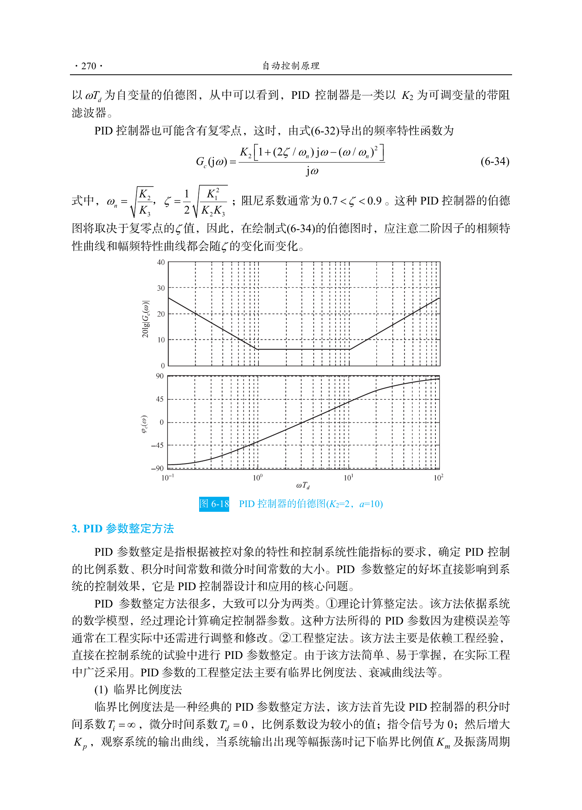

图里的 PID 控制器传递函数当 $T_i\gg T_d$ 时可近似写成 $\dfrac{K_2(1+T_ds)}{T_i s}$，其中 $K_2=K_pT_i/T_d$，就是一个带阻滤波器的形式。取 $K_2=2$、$a=10$ 时的伯德图就是上面那张。

**PID 参数整定。** 教材分理论计算整定法和工程整定法两类。临界比例度法是工程整定法的代表：先令 $T_i=\infty$、$T_d=0$，比例系数取较小值，然后增大 $K_p$，观察到系统输出出现等幅振荡时记下临界比例值 $K_m$ 和振荡周期，再按经验表格整定 [自动控制原理（第八版） (胡寿松、姜斌、张绍杰) (z-library.sk, 1lib.sk, z-lib.sk)(1).pdf · p.278](http://10.188.31.55:5244/Nextcloud/School/自动控制原理/%E8%87%AA%E5%8A%A8%E6%8E%A7%E5%88%B6%E5%8E%9F%E7%90%86%EF%BC%88%E7%AC%AC%E5%85%AB%E7%89%88%EF%BC%89%20(%E8%83%A1%E5%AF%BF%E6%9D%BE%E3%80%81%E5%A7%9C%E6%96%8C%E3%80%81%E5%BC%A0%E7%BB%8D%E6%9D%B0)%20(z-library.sk,%201lib.sk,%20z-lib.sk)(1).pdf#page=278)。

**PID 的局限。** 讲师把三种控制器的效果做了对照：P 调节开环增益，增大 $K$ 减小稳态误差，但相角裕度跟着减小 [题型三_系统校正大题.md · p.644](http://10.188.31.55:5244/Nextcloud/School/自动控制原理/%E9%A2%98%E5%9E%8B%E4%B8%89_%E7%B3%BB%E7%BB%9F%E6%A0%A1%E6%AD%A3%E5%A4%A7%E9%A2%98.md)；PD 加零点提阻尼，但放大高频噪声，微分控制只对动态过程起作用，对稳态过程没有影响，所以单一的 D 控制器在任何情况下都不宜与被控对象串联起来单独使用 [题型三_系统校正大题.md · p.658](http://10.188.31.55:5244/Nextcloud/School/自动控制原理/%E9%A2%98%E5%9E%8B%E4%B8%89_%E7%B3%BB%E7%BB%9F%E6%A0%A1%E6%AD%A3%E5%A4%A7%E9%A2%98.md) [自控原理（第六章1）.pdf · p.4](http://10.188.31.55:5244/Nextcloud/School/自动控制原理/%E8%87%AA%E6%8E%A7%E5%8E%9F%E7%90%86%EF%BC%88%E7%AC%AC%E5%85%AD%E7%AB%A01%EF%BC%89.pdf#page=4)；PI 加原点极点提高型别、消掉稳态误差，但积分带来的 90 度相角滞后对稳定性不利 [题型三_系统校正大题.md · p.676](http://10.188.31.55:5244/Nextcloud/School/自动控制原理/%E9%A2%98%E5%9E%8B%E4%B8%89_%E7%B3%BB%E7%BB%9F%E6%A0%A1%E6%AD%A3%E5%A4%A7%E9%A2%98.md)。

### 频域法设计：串联超前校正

**设计步骤。** 教材给出四步 [自动控制原理（第八版） (胡寿松、姜斌、张绍杰) (z-library.sk, 1lib.sk, z-lib.sk)(1).pdf · p.282](http://10.188.31.55:5244/Nextcloud/School/自动控制原理/%E8%87%AA%E5%8A%A8%E6%8E%A7%E5%88%B6%E5%8E%9F%E7%90%86%EF%BC%88%E7%AC%AC%E5%85%AB%E7%89%88%EF%BC%89%20(%E8%83%A1%E5%AF%BF%E6%9D%BE%E3%80%81%E5%A7%9C%E6%96%8C%E3%80%81%E5%BC%A0%E7%BB%8D%E6%9D%B0)%20(z-library.sk,%201lib.sk,%20z-lib.sk)(1).pdf#page=282)：

1. 根据稳态误差要求确定开环增益 $K$。
2. 利用已确定的 $K$，算出待校正系统的相角裕度。
3. 按截止频率 $\omega_c''$ 的要求计算超前网络参数 $a$ 和 $T$。关键是让最大超前角频率等于要求的截止频率，即 $\omega_m=\omega_c''$。成立条件是

$$
10\lg a=-L(\omega_c'')
$$

由这条求 $a$，再由 $\dfrac{1}{T\sqrt a}=\omega_c''$ 确定 $T$ [自动控制原理（第八版） (胡寿松、姜斌、张绍杰) (z-library.sk, 1lib.sk, z-lib.sk)(1).pdf · p.282](http://10.188.31.55:5244/Nextcloud/School/自动控制原理/%E8%87%AA%E5%8A%A8%E6%8E%A7%E5%88%B6%E5%8E%9F%E7%90%86%EF%BC%88%E7%AC%AC%E5%85%AB%E7%89%88%EF%BC%89%20(%E8%83%A1%E5%AF%BF%E6%9D%BE%E3%80%81%E5%A7%9C%E6%96%8C%E3%80%81%E5%BC%A0%E7%BB%8D%E6%9D%B0)%20(z-library.sk,%201lib.sk,%20z-lib.sk)(1).pdf#page=282)。
4. 验算已校正系统的相角裕度 $\gamma''$。由已知 $a$ 查图或用式 (6-15) 求出 $\varphi_m$，再算待校正系统在 $\omega_c''$ 处的相角裕度，最后得

$$
\gamma''=\varphi_m+\gamma(\omega_c'')
$$

验算结果不满足指标要求时，需重选 $\omega_m$，一般使 $\omega_m$ 增大，然后重复计算 [自动控制原理（第八版） (胡寿松、姜斌、张绍杰) (z-library.sk, 1lib.sk, z-lib.sk)(1).pdf · p.282](http://10.188.31.55:5244/Nextcloud/School/自动控制原理/%E8%87%AA%E5%8A%A8%E6%8E%A7%E5%88%B6%E5%8E%9F%E7%90%86%EF%BC%88%E7%AC%AC%E5%85%AB%E7%89%88%EF%BC%89%20(%E8%83%A1%E5%AF%BF%E6%9D%BE%E3%80%81%E5%A7%9C%E6%96%8C%E3%80%81%E5%BC%A0%E7%BB%8D%E6%9D%B0)%20(z-library.sk,%201lib.sk,%20z-lib.sk)(1).pdf#page=282)。

讲师笔记给的七步版本多了一个补偿余量 [题型三_系统校正大题.md · p.423](http://10.188.31.55:5244/Nextcloud/School/自动控制原理/%E9%A2%98%E5%9E%8B%E4%B8%89_%E7%B3%BB%E7%BB%9F%E6%A0%A1%E6%AD%A3%E5%A4%A7%E9%A2%98.md)：

$$
\varphi_m=\gamma'-\gamma_0(\omega_c')+\varepsilon
$$

其中 $\varepsilon$ 是补偿余量，一般取 $5^\circ\sim12^\circ$ [题型三_系统校正大题.md · p.451](http://10.188.31.55:5244/Nextcloud/School/自动控制原理/%E9%A2%98%E5%9E%8B%E4%B8%89_%E7%B3%BB%E7%BB%9F%E6%A0%A1%E6%AD%A3%E5%A4%A7%E9%A2%98.md)。补偿余量的作用是抵消超前网络抬高增益、导致实际截止频率右移、进而使未校正系统相角更负的影响 [题型三_系统校正大题.md · p.454](http://10.188.31.55:5244/Nextcloud/School/自动控制原理/%E9%A2%98%E5%9E%8B%E4%B8%89_%E7%B3%BB%E7%BB%9F%E6%A0%A1%E6%AD%A3%E5%A4%A7%E9%A2%98.md)。

**由 $\varphi_m$ 反解参数。** 把 $\varphi_m=\arcsin\dfrac{a-1}{a+1}$ 两边取正弦解出 [题型三_系统校正大题.md · p.463](http://10.188.31.55:5244/Nextcloud/School/自动控制原理/%E9%A2%98%E5%9E%8B%E4%B8%89_%E7%B3%BB%E7%BB%9F%E6%A0%A1%E6%AD%A3%E5%A4%A7%E9%A2%98.md)

$$
a=\frac{1+\sin\varphi_m}{1-\sin\varphi_m}
$$

由 $\omega_m=\omega_c''$ 与 $\omega_m=\dfrac{1}{T\sqrt a}$ 解出时间常数

$$
T=\frac{1}{\omega_c''\sqrt a}
$$


**教材例 6-4。** 单位反馈系统 $G(s)=\dfrac{K}{s(s+1)}$，要求单位斜坡输入下位置输出稳态误差 $e_{ss}(\infty)\le0.1$ rad，开环截止频率 $\omega_c''\ge4.4$ rad/s，相角裕度 $\gamma''\ge45^\circ$，幅值裕度 $h''\ge10$ dB。

解的过程 [自动控制原理（第八版） (胡寿松、姜斌、张绍杰) (z-library.sk, 1lib.sk, z-lib.sk)(1).pdf · p.283](http://10.188.31.55:5244/Nextcloud/School/自动控制原理/%E8%87%AA%E5%8A%A8%E6%8E%A7%E5%88%B6%E5%8E%9F%E7%90%86%EF%BC%88%E7%AC%AC%E5%85%AB%E7%89%88%EF%BC%89%20(%E8%83%A1%E5%AF%BF%E6%9D%BE%E3%80%81%E5%A7%9C%E6%96%8C%E3%80%81%E5%BC%A0%E7%BB%8D%E6%9D%B0)%20(z-library.sk,%201lib.sk,%20z-lib.sk)(1).pdf#page=283)：

- 由 $e_{ss}(\infty)=1/K\le0.1$ 取 $K=10$ rad·s⁻¹，待校正系统开环传函 $G_0(s)=\dfrac{10}{s(s+1)}$。
- 由图得待校正系统截止频率 $\omega_c'=3.1$ rad/s，相角裕度 $\gamma(\omega_c')=180^\circ-90^\circ-\arctan\omega_c'=17.9^\circ$。中频区斜率是 -40 dB/dec，相角裕度小，需要串联超前校正。
- 试选 $\omega_m=\omega_c''=4.4$ rad/s，由图查得 $L'(\omega_c'')=-6$ dB，于是 $a=4$、$T=0.114$ s，超前网络传递函数 $G_c(s)=\dfrac{1+0.456s}{1+0.114s}$。为了补偿无源网络产生的增益衰减，放大器增益需提高 4 倍。
- 校正后开环传函 $aG_c(s)G_0(s)=\dfrac{10(1+0.456s)}{s(1+0.114s)(1+s)}$。
- 已校正系统 $\omega_c''=4.4$ rad/s，待校正系统在 $\omega_c''$ 处的相角裕度 $\gamma(\omega_c'')=12.8^\circ$，由式 (6-15) 算出的 $\varphi_m=36.9^\circ$，故 $\gamma''=\varphi_m+\gamma(\omega_c'')=49.7^\circ>45^\circ$，满足要求。

**一个必须说清的陷阱。** $\omega_m$ 与 $\omega_c''$ 不会自动相等。式 (6-35) 的成立条件是 $\omega_m=\omega_c''$，这是设计时**主动取**的结果。若取别的 $\omega_m$，网络在 $\omega_c''$ 处提供的相角不等于 $\varphi_m$，必须把 $\omega_c''$ 代进 $\varphi_c(\omega)=\arctan(aT\omega)-\arctan(T\omega)$ 现算。讲师把这条列为易错点：超前校正后不验证 $\omega_c$，实际截止频率可能偏移，需要验证 [题型三_系统校正大题.md · p.914](http://10.188.31.55:5244/Nextcloud/School/自动控制原理/%E9%A2%98%E5%9E%8B%E4%B8%89_%E7%B3%BB%E7%BB%9F%E6%A0%A1%E6%AD%A3%E5%A4%A7%E9%A2%98.md)。教材的兜底办法是第 4 步的验算，验算不过就重选 $\omega_m$ [自动控制原理（第八版） (胡寿松、姜斌、张绍杰) (z-library.sk, 1lib.sk, z-lib.sk)(1).pdf · p.282](http://10.188.31.55:5244/Nextcloud/School/自动控制原理/%E8%87%AA%E5%8A%A8%E6%8E%A7%E5%88%B6%E5%8E%9F%E7%90%86%EF%BC%88%E7%AC%AC%E5%85%AB%E7%89%88%EF%BC%89%20(%E8%83%A1%E5%AF%BF%E6%9D%BE%E3%80%81%E5%A7%9C%E6%96%8C%E3%80%81%E5%BC%A0%E7%BB%8D%E6%9D%B0)%20(z-library.sk,%201lib.sk,%20z-lib.sk)(1).pdf#page=282)。

**超前校正的适用范围。** 教材给了两条限制 [自动控制原理（第八版） (胡寿松、姜斌、张绍杰) (z-library.sk, 1lib.sk, z-lib.sk)(1).pdf · p.284](http://10.188.31.55:5244/Nextcloud/School/自动控制原理/%E8%87%AA%E5%8A%A8%E6%8E%A7%E5%88%B6%E5%8E%9F%E7%90%86%EF%BC%88%E7%AC%AC%E5%85%AB%E7%89%88%EF%BC%89%20(%E8%83%A1%E5%AF%BF%E6%9D%BE%E3%80%81%E5%A7%9C%E6%96%8C%E3%80%81%E5%BC%A0%E7%BB%8D%E6%9D%B0)%20(z-library.sk,%201lib.sk,%20z-lib.sk)(1).pdf#page=284)：

1. **闭环带宽要求。** 待校正系统不稳定时，为了得到规定的相角裕度，超前网络的 $a$ 值必须选得很大，造成已校正系统带宽过大，高频噪声电平很高。
2. **截止频率附近相角迅速减小。** 产生这种情形的原因通常是截止频率附近有两个交接频率彼此靠近的惯性环节，或两个相等的惯性环节，或有一个振荡环节。这种情况下改用两级串联超前网络、串联滞后校正或测速反馈校正。

### 频域法设计：串联滞后校正

滞后校正用于稳态精度不够、但不要求很快的场合。设计顺序与超前校正是反的：**先定新截止频率，再定衰减量**。

**第一步，定开环增益。** 由稳态误差要求定 $K$。教材例 6-5 要求校正后静态速度误差系数等于 30 s⁻¹，于是直接取 $K=30$，待校正系统开环传函 $G_0(s)=\dfrac{30}{s(0.1s+1)(0.2s+1)}$ [自动控制原理（第八版） (胡寿松、姜斌、张绍杰) (z-library.sk, 1lib.sk, z-lib.sk)(1).pdf · p.285](http://10.188.31.55:5244/Nextcloud/School/自动控制原理/%E8%87%AA%E5%8A%A8%E6%8E%A7%E5%88%B6%E5%8E%9F%E7%90%86%EF%BC%88%E7%AC%AC%E5%85%AB%E7%89%88%EF%BC%89%20(%E8%83%A1%E5%AF%BF%E6%9D%BE%E3%80%81%E5%A7%9C%E6%96%8C%E3%80%81%E5%BC%A0%E7%BB%8D%E6%9D%B0)%20(z-library.sk,%201lib.sk,%20z-lib.sk)(1).pdf#page=285)。

**第二步，算未校正系统的裕度。** 教材例 6-5 的待校正系统截止频率 $\omega_c'=12$ rad/s，相角裕度 $\gamma(\omega_c')=90^\circ-\arctan(0.1\omega_c')-\arctan(0.2\omega_c')=-27.6^\circ$，幅值裕度为负，系统不稳定，且截止频率远大于要求值。这种情况下用串联超前校正无效——可以证明，当超前网络的 $a$ 值取到 100 时，系统的相角裕度仍不满 30 度，而截止频率却增至 26 rad/s。考虑到本例对截止频率要求不大，故选用串联滞后校正 [自动控制原理（第八版） (胡寿松、姜斌、张绍杰) (z-library.sk, 1lib.sk, z-lib.sk)(1).pdf · p.285](http://10.188.31.55:5244/Nextcloud/School/自动控制原理/%E8%87%AA%E5%8A%A8%E6%8E%A7%E5%88%B6%E5%8E%9F%E7%90%86%EF%BC%88%E7%AC%AC%E5%85%AB%E7%89%88%EF%BC%89%20(%E8%83%A1%E5%AF%BF%E6%9D%BE%E3%80%81%E5%A7%9C%E6%96%8C%E3%80%81%E5%BC%A0%E7%BB%8D%E6%9D%B0)%20(z-library.sk,%201lib.sk,%20z-lib.sk)(1).pdf#page=285)。

**第三步，在相频曲线上找新截止频率。** 滞后网络在新截止频率处会带来负相角 $\varphi_c(\omega_c'')$，裕度方程是

$$
\gamma''=\gamma(\omega_c'')+\varphi_c(\omega_c'')
$$

教材在计算时把 $\varphi_c(\omega_c'')$ 取 $-6^\circ$，按式 (6-38) 求得 $\gamma(\omega_c'')\ge46^\circ$，由 $\gamma(\omega_c'')$ 曲线查得 $\omega_c''=2.7$ rad/s。指标要求 $\omega_c''\ge2.3$ rad/s，可在 2.3~2.7 rad/s 内任取；取较大值时响应较快且滞后网络时间常数较小便于实现，故取 $\omega_c''=2.7$ rad/s [自动控制原理（第八版） (胡寿松、姜斌、张绍杰) (z-library.sk, 1lib.sk, z-lib.sk)(1).pdf · p.285](http://10.188.31.55:5244/Nextcloud/School/自动控制原理/%E8%87%AA%E5%8A%A8%E6%8E%A7%E5%88%B6%E5%8E%9F%E7%90%86%EF%BC%88%E7%AC%AC%E5%85%AB%E7%89%88%EF%BC%89%20(%E8%83%A1%E5%AF%BF%E6%9D%BE%E3%80%81%E5%A7%9C%E6%96%8C%E3%80%81%E5%BC%A0%E7%BB%8D%E6%9D%B0)%20(z-library.sk,%201lib.sk,%20z-lib.sk)(1).pdf#page=285)。

**第四步，定衰减量。** 在图上查出 $\omega_c''=2.7$ rad/s 时有 $L'(\omega_c'')=21$ dB，由式 (6-39) 求出 $b=0.09$，再由式 (6-40) 算出 $T=41$ s：

$$
20\lg b+L'(\omega_c'')=0,\qquad \frac{1}{bT}=0.1\,\omega_c''
$$

滞后网络为 $G_c(s)=\dfrac{1+3.7s}{1+41s}$ [自动控制原理（第八版） (胡寿松、姜斌、张绍杰) (z-library.sk, 1lib.sk, z-lib.sk)(1).pdf · p.285](http://10.188.31.55:5244/Nextcloud/School/自动控制原理/%E8%87%AA%E5%8A%A8%E6%8E%A7%E5%88%B6%E5%8E%9F%E7%90%86%EF%BC%88%E7%AC%AC%E5%85%AB%E7%89%88%EF%BC%89%20(%E8%83%A1%E5%AF%BF%E6%9D%BE%E3%80%81%E5%A7%9C%E6%96%8C%E3%80%81%E5%BC%A0%E7%BB%8D%E6%9D%B0)%20(z-library.sk,%201lib.sk,%20z-lib.sk)(1).pdf#page=285)。如果算出的 $T$ 过大难以实现，可把式 (6-40) 的系数 0.1 加大到 0.25 以内，同时把 $\varphi_c$ 的估值从 $-6^\circ$ 放宽到 $-14^\circ$ [自动控制原理（第八版） (胡寿松、姜斌、张绍杰) (z-library.sk, 1lib.sk, z-lib.sk)(1).pdf · p.285](http://10.188.31.55:5244/Nextcloud/School/自动控制原理/%E8%87%AA%E5%8A%A8%E6%8E%A7%E5%88%B6%E5%8E%9F%E7%90%86%EF%BC%88%E7%AC%AC%E5%85%AB%E7%89%88%EF%BC%89%20(%E8%83%A1%E5%AF%BF%E6%9D%BE%E3%80%81%E5%A7%9C%E6%96%8C%E3%80%81%E5%BC%A0%E7%BB%8D%E6%9D%B0)%20(z-library.sk,%201lib.sk,%20z-lib.sk)(1).pdf#page=285)。讲师的笔记用 $1/T$ 与 $\omega_c'$ 的比值表达同一件事 [题型三_系统校正大题.md · p.604](http://10.188.31.55:5244/Nextcloud/School/自动控制原理/%E9%A2%98%E5%9E%8B%E4%B8%89_%E7%B3%BB%E7%BB%9F%E6%A0%A1%E6%AD%A3%E5%A4%A7%E9%A2%98.md)。

**第五步，验算。** 由式 (6-21) 及 $b=0.09$ 算得 $\varphi_c(\omega_c'')=-5.2^\circ$，于是 $\gamma''=41.3^\circ$，满足指标要求。已校正系统对数相频特性为 $-180^\circ$ 时的频率是 6.8 rad/s，幅值裕度 10.5 dB，全部符合要求 [自动控制原理（第八版） (胡寿松、姜斌、张绍杰) (z-library.sk, 1lib.sk, z-lib.sk)(1).pdf · p.286](http://10.188.31.55:5244/Nextcloud/School/自动控制原理/%E8%87%AA%E5%8A%A8%E6%8E%A7%E5%88%B6%E5%8E%9F%E7%90%86%EF%BC%88%E7%AC%AC%E5%85%AB%E7%89%88%EF%BC%89%20(%E8%83%A1%E5%AF%BF%E6%9D%BE%E3%80%81%E5%A7%9C%E6%96%8C%E3%80%81%E5%BC%A0%E7%BB%8D%E6%9D%B0)%20(z-library.sk,%201lib.sk,%20z-lib.sk)(1).pdf#page=286)。

**滞后校正能提精度却不改动态。** 教材用图 6-25 解释：把已校正系统的对数幅频特性向上平移 21 dB，校正前后的相角裕度和截止频率基本相同，但开环增益增大了 11 倍 [自动控制原理（第八版） (胡寿松、姜斌、张绍杰) (z-library.sk, 1lib.sk, z-lib.sk)(1).pdf · p.286](http://10.188.31.55:5244/Nextcloud/School/自动控制原理/%E8%87%AA%E5%8A%A8%E6%8E%A7%E5%88%B6%E5%8E%9F%E7%90%86%EF%BC%88%E7%AC%AC%E5%85%AB%E7%89%88%EF%BC%89%20(%E8%83%A1%E5%AF%BF%E6%9D%BE%E3%80%81%E5%A7%9C%E6%96%8C%E3%80%81%E5%BC%A0%E7%BB%8D%E6%9D%B0)%20(z-library.sk,%201lib.sk,%20z-lib.sk)(1).pdf#page=286)。

**超前与滞后的三点差别。** 教材列了三条 [自动控制原理（第八版） (胡寿松、姜斌、张绍杰) (z-library.sk, 1lib.sk, z-lib.sk)(1).pdf · p.286](http://10.188.31.55:5244/Nextcloud/School/自动控制原理/%E8%87%AA%E5%8A%A8%E6%8E%A7%E5%88%B6%E5%8E%9F%E7%90%86%EF%BC%88%E7%AC%AC%E5%85%AB%E7%89%88%EF%BC%89%20(%E8%83%A1%E5%AF%BF%E6%9D%BE%E3%80%81%E5%A7%9C%E6%96%8C%E3%80%81%E5%BC%A0%E7%BB%8D%E6%9D%B0)%20(z-library.sk,%201lib.sk,%20z-lib.sk)(1).pdf#page=286)：

1. 超前校正是利用超前网络的相角超前特性，滞后校正利用滞后网络的高频幅值衰减特性。
2. 为满足严格的稳态性能要求，采用无源校正网络时，超前校正要求一定的附加增益，滞后校正一般不需要附加增益。
3. 对同一系统，采用超前校正的系统带宽大于采用滞后校正的系统带宽。带宽越大响应越快，但也越易受噪声干扰，因此系统输入端噪声电平较高时，一般不宜选用超前校正。

### 滞后-超前校正

无源滞后-超前网络的传递函数，教材写成

$$
G_c(s)=\frac{(1+T_a s)(1+T_b s)}{(1+\alpha T_a s)\left(1+\dfrac{T_b}{\alpha}s\right)}
$$

其中 $\dfrac{1+T_a s}{1+\alpha T_a s}$ 是网络的滞后部分，$\dfrac{1+T_b s}{1+(T_b/\alpha)s}$ 是超前部分；确定 $\omega_a$、$\omega_b$ 和 $\alpha$ 三个独立变量，图 6-9(b) 的形状就定了 [自动控制原理（第八版） (胡寿松、姜斌、张绍杰) (z-library.sk, 1lib.sk, z-lib.sk)(1).pdf · p.270](http://10.188.31.55:5244/Nextcloud/School/自动控制原理/%E8%87%AA%E5%8A%A8%E6%8E%A7%E5%88%B6%E5%8E%9F%E7%90%86%EF%BC%88%E7%AC%AC%E5%85%AB%E7%89%88%EF%BC%89%20(%E8%83%A1%E5%AF%BF%E6%9D%BE%E3%80%81%E5%A7%9C%E6%96%8C%E3%80%81%E5%BC%A0%E7%BB%8D%E6%9D%B0)%20(z-library.sk,%201lib.sk,%20z-lib.sk)(1).pdf#page=270)。低频段像滞后（保精度），高频段像超前（保动态），两头兼顾。讲师的笔记用另一个写法：$G_c(s)=\dfrac{(1+aT_1 s)(1+T_2 s)}{(1+T_1 s)(1+bT_2 s)}$，$a>1$、$b>1$，低频部分用滞后段提高精度，高频部分用超前段改善稳定性 [题型三_系统校正大题.md · p.138](http://10.188.31.55:5244/Nextcloud/School/自动控制原理/%E9%A2%98%E5%9E%8B%E4%B8%89_%E7%B3%BB%E7%BB%9F%E6%A0%A1%E6%AD%A3%E5%A4%A7%E9%A2%98.md)。

**什么时候非用不可。** 教材的条件是：待校正系统不稳定，且要求校正后系统的响应速度、相角裕度和稳态精度都较高时，以采用串联滞后-超前校正为宜。基本原理是用滞后-超前网络的超前部分来增大系统的相角裕度，同时利用滞后部分来改善系统的稳态性能 [自动控制原理（第八版） (胡寿松、姜斌、张绍杰) (z-library.sk, 1lib.sk, z-lib.sk)(1).pdf · p.286](http://10.188.31.55:5244/Nextcloud/School/自动控制原理/%E8%87%AA%E5%8A%A8%E6%8E%A7%E5%88%B6%E5%8E%9F%E7%90%86%EF%BC%88%E7%AC%AC%E5%85%AB%E7%89%88%EF%BC%89%20(%E8%83%A1%E5%AF%BF%E6%9D%BE%E3%80%81%E5%A7%9C%E6%96%8C%E3%80%81%E5%BC%A0%E7%BB%8D%E6%9D%B0)%20(z-library.sk,%201lib.sk,%20z-lib.sk)(1).pdf#page=286)。

**教材例 6-6。** 待校正系统 $G_0(s)=\dfrac{K_v}{s(\frac{s}{6}+1)(\frac{s}{2}+1)}$，指标是：最大指令速度 $180^\circ$/s 时位置滞后误差不超过 $1^\circ$（等价于 $K_v\ge180$ s⁻¹）、相角裕度 $45^\circ\pm3^\circ$、幅值裕度 $h\ge10$ dB、动态过程调节时间 $t_s\le3$ s。

取 $K_v=180$ 后，待校正系统截止频率 $\omega_c'=12.6$ rad/s，相角裕度

$$
\gamma_0=90^\circ-\arctan\frac{12.6}{6}-\arctan\frac{12.6}{2}\approx-55.5^\circ
$$

幅值裕度约 $-30$ dB，**原系统不稳定** [自动控制原理（第八版） (胡寿松、姜斌、张绍杰) (z-library.sk, 1lib.sk, z-lib.sk)(1).pdf · p.287](http://10.188.31.55:5244/Nextcloud/School/自动控制原理/%E8%87%AA%E5%8A%A8%E6%8E%A7%E5%88%B6%E5%8E%9F%E7%90%86%EF%BC%88%E7%AC%AC%E5%85%AB%E7%89%88%EF%BC%89%20(%E8%83%A1%E5%AF%BF%E6%9D%BE%E3%80%81%E5%A7%9C%E6%96%8C%E3%80%81%E5%BC%A0%E7%BB%8D%E6%9D%B0)%20(z-library.sk,%201lib.sk,%20z-lib.sk)(1).pdf#page=287)。

纯超前和纯滞后都不行，教材给了具体论证 [自动控制原理（第八版） (胡寿松、姜斌、张绍杰) (z-library.sk, 1lib.sk, z-lib.sk)(1).pdf · p.287](http://10.188.31.55:5244/Nextcloud/School/自动控制原理/%E8%87%AA%E5%8A%A8%E6%8E%A7%E5%88%B6%E5%8E%9F%E7%90%86%EF%BC%88%E7%AC%AC%E5%85%AB%E7%89%88%EF%BC%89%20(%E8%83%A1%E5%AF%BF%E6%9D%BE%E3%80%81%E5%A7%9C%E6%96%8C%E3%80%81%E5%BC%A0%E7%BB%8D%E6%9D%B0)%20(z-library.sk,%201lib.sk,%20z-lib.sk)(1).pdf#page=287)：

- **纯超前。** 要把 $-55.5^\circ$ 抬到 $+45^\circ$，至少要两级串联超前网络，校正后截止频率将过大，可能超过 25 rad/s。伺服电机会速度饱和、带宽过大导致输出噪声电平过高、还要附加前置放大器使结构复杂化。
- **纯滞后。** 为满足 $K_v=180$ 需 $\omega_c''=1$，$L'(\omega_c'')=45.1$ dB，由式 (6-39) 求出 $b=1/200$，取 $1/(bT)=0.1\omega_c''$ 算出 $T=2000$ s，物理上无法实现；而且 $t_s\approx9.6$ s 远超 3 s 的要求 [自动控制原理（第八版） (胡寿松、姜斌、张绍杰) (z-library.sk, 1lib.sk, z-lib.sk)(1).pdf · p.288](http://10.188.31.55:5244/Nextcloud/School/自动控制原理/%E8%87%AA%E5%8A%A8%E6%8E%A7%E5%88%B6%E5%8E%9F%E7%90%86%EF%BC%88%E7%AC%AC%E5%85%AB%E7%89%88%EF%BC%89%20(%E8%83%A1%E5%AF%BF%E6%9D%BE%E3%80%81%E5%A7%9C%E6%96%8C%E3%80%81%E5%BC%A0%E7%BB%8D%E6%9D%B0)%20(z-library.sk,%201lib.sk,%20z-lib.sk)(1).pdf#page=288)。

**设计步骤。** 教材给出六步 [自动控制原理（第八版） (胡寿松、姜斌、张绍杰) (z-library.sk, 1lib.sk, z-lib.sk)(1).pdf · p.287](http://10.188.31.55:5244/Nextcloud/School/自动控制原理/%E8%87%AA%E5%8A%A8%E6%8E%A7%E5%88%B6%E5%8E%9F%E7%90%86%EF%BC%88%E7%AC%AC%E5%85%AB%E7%89%88%EF%BC%89%20(%E8%83%A1%E5%AF%BF%E6%9D%BE%E3%80%81%E5%A7%9C%E6%96%8C%E3%80%81%E5%BC%A0%E7%BB%8D%E6%9D%B0)%20(z-library.sk,%201lib.sk,%20z-lib.sk)(1).pdf#page=287)：

1. 根据稳态性能要求确定开环增益 $K$。
2. 绘制待校正系统的开环对数幅频渐近特性，求出 $\omega_c'$、$\gamma$ 及 $h$(dB)。
3. 在渐近特性上选斜率从 -20 dB/dec 变为 -40 dB/dec 的交接频率，作为校正网络**超前部分**的交接频率 $\omega_b$。这样选能降低已校正系统的阶次，且保证中频区斜率为期望的 -20 dB/dec 并占据较宽频带。
4. 根据响应速度要求，选 $\omega_c''$ 和衰减因子 $1/\alpha$。要保证已校正系统的截止频率为所选的 $\omega_c''$，须满足

$$
-20\lg\alpha+20\lg(T_b\omega_c'')+L'(\omega_c'')=0
$$

其中 $T_b=1/\omega_b$ [自动控制原理（第八版） (胡寿松、姜斌、张绍杰) (z-library.sk, 1lib.sk, z-lib.sk)(1).pdf · p.287](http://10.188.31.55:5244/Nextcloud/School/自动控制原理/%E8%87%AA%E5%8A%A8%E6%8E%A7%E5%88%B6%E5%8E%9F%E7%90%86%EF%BC%88%E7%AC%AC%E5%85%AB%E7%89%88%EF%BC%89%20(%E8%83%A1%E5%AF%BF%E6%9D%BE%E3%80%81%E5%A7%9C%E6%96%8C%E3%80%81%E5%BC%A0%E7%BB%8D%E6%9D%B0)%20(z-library.sk,%201lib.sk,%20z-lib.sk)(1).pdf#page=287)。课件把这张图直接标成式 (6-43)，并说明 $-20\lg\alpha$ 是滞后部分在 $\omega_c''$ 产生的对数幅值，$20\lg(T_b\omega_c'')$ 是超前部分在 $\omega_c''$ 产生的对数幅值 [自控原理（第六章2）.pdf · p.5](http://10.188.31.55:5244/Nextcloud/School/自动控制原理/%E8%87%AA%E6%8E%A7%E5%8E%9F%E7%90%86%EF%BC%88%E7%AC%AC%E5%85%AD%E7%AB%A02%EF%BC%89.pdf#page=5)。
5. 根据相角裕度要求，估算校正网络**滞后部分**的交接频率 $\omega_a$。
6. 校验已校正系统的各项性能指标。

**例 6-6 的结果。** 由 $t_s\le3$ s 与 $\gamma^*=45^\circ$ 估算 $\omega_c''\ge3.2$ rad/s；要求中频区斜率为 -20 dB/dec，故 $\omega_c''$ 在 3.2~6 rad/s 内取。为让中频区占据足够宽度，选 $\omega_c''=3.5$ rad/s，相应 $L'(\omega_c'')+20\lg(T_b\omega_c'')=34$ dB，由式 (6-41) 算出 $1/\alpha=0.02$，即 $\alpha=50$ [自动控制原理（第八版） (胡寿松、姜斌、张绍杰) (z-library.sk, 1lib.sk, z-lib.sk)(1).pdf · p.288](http://10.188.31.55:5244/Nextcloud/School/自动控制原理/%E8%87%AA%E5%8A%A8%E6%8E%A7%E5%88%B6%E5%8E%9F%E7%90%86%EF%BC%88%E7%AC%AC%E5%85%AB%E7%89%88%EF%BC%89%20(%E8%83%A1%E5%AF%BF%E6%9D%BE%E3%80%81%E5%A7%9C%E6%96%8C%E3%80%81%E5%BC%A0%E7%BB%8D%E6%9D%B0)%20(z-library.sk,%201lib.sk,%20z-lib.sk)(1).pdf#page=288)。

教材按相角裕度方程定出滞后部分的交接频率 [自动控制原理（第八版） (胡寿松、姜斌、张绍杰) (z-library.sk, 1lib.sk, z-lib.sk)(1).pdf · p.288](http://10.188.31.55:5244/Nextcloud/School/自动控制原理/%E8%87%AA%E5%8A%A8%E6%8E%A7%E5%88%B6%E5%8E%9F%E7%90%86%EF%BC%88%E7%AC%AC%E5%85%AB%E7%89%88%EF%BC%89%20(%E8%83%A1%E5%AF%BF%E6%9D%BE%E3%80%81%E5%A7%9C%E6%96%8C%E3%80%81%E5%BC%A0%E7%BB%8D%E6%9D%B0)%20(z-library.sk,%201lib.sk,%20z-lib.sk)(1).pdf#page=288)：

$$
\gamma''=57.7^\circ+\arctan\frac{3.5}{\omega_a}-\arctan\frac{175}{\omega_a}=45^\circ
$$

解得 $\omega_a=0.78$ rad/s。中频区宽度 $H=6/0.78=7.69$，满足期望特性法的近似关系式 $H\ge\dfrac{1+\sin45^\circ}{1-\sin45^\circ}=5.83$ [自动控制原理（第八版） (胡寿松、姜斌、张绍杰) (z-library.sk, 1lib.sk, z-lib.sk)(1).pdf · p.289](http://10.188.31.55:5244/Nextcloud/School/自动控制原理/%E8%87%AA%E5%8A%A8%E6%8E%A7%E5%88%B6%E5%8E%9F%E7%90%86%EF%BC%88%E7%AC%AC%E5%85%AB%E7%89%88%EF%BC%89%20(%E8%83%A1%E5%AF%BF%E6%9D%BE%E3%80%81%E5%A7%9C%E6%96%8C%E3%80%81%E5%BC%A0%E7%BB%8D%E6%9D%B0)%20(z-library.sk,%201lib.sk,%20z-lib.sk)(1).pdf#page=289)。校正网络与已校正系统为

$$
G_c(s)=\frac{(1+1.28s)(1+0.5s)}{(1+64s)(1+0.01s)},\qquad G_0'(s)=G_c(s)G_0(s)=\frac{180(1+1.28s)}{s(1+0.167s)(1+64s)(1+0.01s)}
$$

算得 $\gamma''=45.5^\circ$、$h''=27$ dB，全部指标满足 [自动控制原理（第八版） (胡寿松、姜斌、张绍杰) (z-library.sk, 1lib.sk, z-lib.sk)(1).pdf · p.289](http://10.188.31.55:5244/Nextcloud/School/自动控制原理/%E8%87%AA%E5%8A%A8%E6%8E%A7%E5%88%B6%E5%8E%9F%E7%90%86%EF%BC%88%E7%AC%AC%E5%85%AB%E7%89%88%EF%BC%89%20(%E8%83%A1%E5%AF%BF%E6%9D%BE%E3%80%81%E5%A7%9C%E6%96%8C%E3%80%81%E5%BC%A0%E7%BB%8D%E6%9D%B0)%20(z-library.sk,%201lib.sk,%20z-lib.sk)(1).pdf#page=289)。


**转角频率的顺序不能颠倒。** 滞后段的转角频率必须在低频、超前段的转角频率必须在中频。讲师把这条列为高频易错点：混淆超前与滞后的 $a$ 和 $b$ [题型三_系统校正大题.md · p.920](http://10.188.31.55:5244/Nextcloud/School/自动控制原理/%E9%A2%98%E5%9E%8B%E4%B8%89_%E7%B3%BB%E7%BB%9F%E6%A0%A1%E6%AD%A3%E5%A4%A7%E9%A2%98.md)。

例 6-6 的校正网络有四个转角频率：滞后段零点 $1/1.28=0.78$ rad/s、滞后段极点 $1/64\approx0.016$ rad/s（最低频），超前段零点 $1/0.5=2$ rad/s、超前段极点 $1/0.01=100$ rad/s（最高频）[自控原理（第六章2）.pdf · p.6](http://10.188.31.55:5244/Nextcloud/School/自动控制原理/%E8%87%AA%E6%8E%A7%E5%8E%9F%E7%90%86%EF%BC%88%E7%AC%AC%E5%85%AD%E7%AB%A02%EF%BC%89.pdf#page=6)。

### 期望根轨迹法与前馈校正

**期望根轨迹法。** 当性能指标是时域量（超调量、调节时间）时，期望根轨迹法更直接：先定期望的闭环主导极点，再用根轨迹的相角条件和模值条件反推校正装置的零极点和增益。相角条件在出射角公式里写得很清楚 [复习_根轨迹.md · p.381](http://10.188.31.55:5244/Nextcloud/School/自动控制原理/%E5%A4%8D%E4%B9%A0_%E6%A0%B9%E8%BD%A8%E8%BF%B9.md)，模值条件在分离点方程里 [复习_根轨迹.md · p.371](http://10.188.31.55:5244/Nextcloud/School/自动控制原理/%E5%A4%8D%E4%B9%A0_%E6%A0%B9%E8%BD%A8%E8%BF%B9.md)。

第一，由时域指标反推期望的闭环主导极点位置。由 $\sigma\%=e^{-\pi\zeta/\sqrt{1-\zeta^{2}}}\times100\%$ 反解阻尼比 $\zeta^*$，由 $t_s\approx3/(\zeta\omega_n)$ 反解自然频率 $\omega_n^*$，于是期望主导极点是

$$
s^{*}=-\zeta^{*}\omega_n^{*}\pm j\omega_n^{*}\sqrt{1-\zeta^{*2}}
$$

第二，用**相角条件**确定校正装置的零极点位置。要求校正后的根轨迹通过 $s^{*}$，即

$$
\angle G_c(s^{*})G(s^{*})=180^\circ
$$

把已知的 $G(s^{*})$ 相角移到一边，剩下的就是 $G_c(s^{*})$ 必须提供的相角。工程上最常用的做法是**用一个零点去对消被控对象的一个慢极点**（靠近虚轴、拖慢响应的那个极点），再**补一个远在左半平面的极点**，让校正装置本身可实现（分母次数不低于分子次数）。零点把根轨迹向左拉、改善阻尼；远极点因为离虚轴很远，对主导极点附近的相角影响很小，不破坏前面的补偿效果。出射角与入射角的公式是相角条件在根轨迹上的具体形式 [复习_根轨迹.md · p.381](http://10.188.31.55:5244/Nextcloud/School/自动控制原理/%E5%A4%8D%E4%B9%A0_%E6%A0%B9%E8%BD%A8%E8%BF%B9.md)。

第三，用**模值条件**定增益。令校正后的开环传函在 $s^{*}$ 处的模值为 1，解出校正装置的增益 $K_c$。

**前馈与复合校正。** 复合校正的前馈装置按不变性原理设计，分按扰动补偿和按输入补偿两种方式。按输入补偿时，设 $G_r(s)$ 为前馈补偿装置，要满足

$$
G_r(s)=\frac{1}{G(s)}
$$

则 $E(s)\equiv0$，系统输出在任何时刻都完全无误地复现输入量，具有理想的时间响应特性 [自动控制原理（第八版） (胡寿松、姜斌、张绍杰) (z-library.sk, 1lib.sk, z-lib.sk)(1).pdf · p.297](http://10.188.31.55:5244/Nextcloud/School/自动控制原理/%E8%87%AA%E5%8A%A8%E6%8E%A7%E5%88%B6%E5%8E%9F%E7%90%86%EF%BC%88%E7%AC%AC%E5%85%AB%E7%89%88%EF%BC%89%20(%E8%83%A1%E5%AF%BF%E6%9D%BE%E3%80%81%E5%A7%9C%E6%96%8C%E3%80%81%E5%BC%A0%E7%BB%8D%E6%9D%B0)%20(z-library.sk,%201lib.sk,%20z-lib.sk)(1).pdf#page=297)。

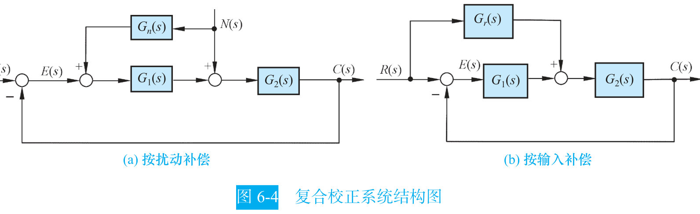

这个条件的代价是前馈装置的分子次数高于分母次数，实际物理装置难以实现。教材的折中做法是取一个可实现的近似式，例如 $G_r(s)=\dfrac{K_1(1+T_1s)}{1+T_2s}$，在扰动信号作用的主要频段内达到近似全补偿 [自动控制原理（第八版） (胡寿松、姜斌、张绍杰) (z-library.sk, 1lib.sk, z-lib.sk)(1).pdf · p.296](http://10.188.31.55:5244/Nextcloud/School/自动控制原理/%E8%87%AA%E5%8A%A8%E6%8E%A7%E5%88%B6%E5%8E%9F%E7%90%86%EF%BC%88%E7%AC%AC%E5%85%AB%E7%89%88%EF%BC%89%20(%E8%83%A1%E5%AF%BF%E6%9D%BE%E3%80%81%E5%A7%9C%E6%96%8C%E3%80%81%E5%BC%A0%E7%BB%8D%E6%9D%B0)%20(z-library.sk,%201lib.sk,%20z-lib.sk)(1).pdf#page=296)。

**一条不能省的校验。** 课件把校正的意义讲得很清楚：校正装置用来补偿系统不可变动部分（控制对象、执行机构和量测部件）在特性上的缺陷，使校正后的系统能够满足预先要求的性能指标 [自控原理（第六章1）.pdf · p.8](http://10.188.31.55:5244/Nextcloud/School/自动控制原理/%E8%87%AA%E6%8E%A7%E5%8E%9F%E7%90%86%EF%BC%88%E7%AC%AC%E5%85%AD%E7%AB%A01%EF%BC%89.pdf#page=8)。但讲师反复强调，验算相角裕度这一步不能省：算出相角裕度后必须验算已校正系统的相角裕度是否满足指标要求，不满足就要重选 $\omega_m$ 值，一般使 $\omega_m$ 增大，然后重复计算步骤 [自控原理（第六章2）.pdf · p.2](http://10.188.31.55:5244/Nextcloud/School/自动控制原理/%E8%87%AA%E6%8E%A7%E5%8E%9F%E7%90%86%EF%BC%88%E7%AC%AC%E5%85%AD%E7%AB%A02%EF%BC%89.pdf#page=2)。

> [!WARNING] 校正题最容易翻车的地方
> **无源网络带 $1/a$ 衰减。** 无源超前网络的实际传递函数带 $1/a$ 的衰减，等于把开环增益缩小了 $a$ 倍。设计完网络后要把放大器的增益相应提高（超前网络提高 $a$ 倍、滞后网络按 $1/b$ 折算），保证校正前后开环增益不变 [题型三_系统校正大题.md · p.776](http://10.188.31.55:5244/Nextcloud/School/自动控制原理/%E9%A2%98%E5%9E%8B%E4%B8%89_%E7%B3%BB%E7%BB%9F%E6%A0%A1%E6%AD%A3%E5%A4%A7%E9%A2%98.md)。
>
> **非最小相位的锅。** 标准无源滞后网络的零极点都在负实轴上，它本身是最小相位的。真正引入右半平面零点的是被控对象自带右半平面零点、含纯滞后 $e^{-\tau s}$，或把校正网络接进反馈通路做反馈校正。这时 $\varphi_m=\arcsin\dfrac{a-1}{a+1}$ 这类公式和"从渐近线读相角"都不再成立，相角必须按实际 Bode 相频曲线读，否则相角裕度会算大。教材也提醒：分析法与综合法这两种频域设计过程一般仅适用于最小相位系统 [自动控制原理（第八版） (胡寿松、姜斌、张绍杰) (z-library.sk, 1lib.sk, z-lib.sk)(1).pdf · p.281](http://10.188.31.55:5244/Nextcloud/School/自动控制原理/%E8%87%AA%E5%8A%A8%E6%8E%A7%E5%88%B6%E5%8E%9F%E7%90%86%EF%BC%88%E7%AC%AC%E5%85%AB%E7%89%88%EF%BC%89%20(%E8%83%A1%E5%AF%BF%E6%9D%BE%E3%80%81%E5%A7%9C%E6%96%8C%E3%80%81%E5%BC%A0%E7%BB%8D%E6%9D%B0)%20(z-library.sk,%201lib.sk,%20z-lib.sk)(1).pdf#page=281)。
>
> **把 $1/s^2$ 当成 I 型。** 低频段斜率是 $-20\nu$ dB/dec，$\nu=2$ 时是 -40 dB/dec，不是 -20 dB/dec。振荡环节的斜率变化是 $\pm40$ dB/dec（二阶），不能按两个独立的 $\pm20$ 去猜 [自控原理（第五章1） 2.pdf · p.5](http://10.188.31.55:5244/Nextcloud/School/自动控制原理/%E8%87%AA%E6%8E%A7%E5%8E%9F%E7%90%86%EF%BC%88%E7%AC%AC%E4%BA%94%E7%AB%A01%EF%BC%89%202.pdf#page=5)。

## 第 7 章 线性离散系统的分析与校正

### 数字控制系统的基本矛盾

前六章的所有方法都建立在一个前提上：信号是时间的连续函数，传递函数 $G(s)=C(s)/R(s)$ 描述任意时刻的输入输出关系。但现代控制器是数字的。单片机、DSP、工控机的输入输出只能是二进制编码的数字信号，时间上每隔 $T$ 秒算一次，幅值上只能取有限个量化值。被控对象（电机、炉子、机械臂）和测量元件仍然是连续的。

于是系统被切成两半：中间是离散的数字控制器，两头是连续的物理环节。D/A 转换把数字信号先译成离散的模拟信号，再由保持器复现成连续信号，两步合起来才把阶梯送回连续对象 [自控原理（第七章1）.pdf · p.3](http://10.188.31.55:5244/Nextcloud/School/自动控制原理/%E8%87%AA%E6%8E%A7%E5%8E%9F%E7%90%86%EF%BC%88%E7%AC%AC%E4%B8%83%E7%AB%A01%EF%BC%89.pdf#page=3)。

这一章的任务只有一句话：把连续系统那套"左半平面判稳"整体搬到"单位圆"上。信号一旦被切成离散的点，$G(s)$ 就不够用了，得换成 $z$ 域的脉冲传递函数 $G(z)$。要会算带零阶保持器的 $G(z)$，会用单位圆或朱利判据判稳，会用离散终值定理算稳态误差。

考试里这一章是 A 卷第 5 题（15 分，三问）的全部内容：第 (1) 问求 $K$ 的稳定范围，第 (2) 问给定 $K$ 求 $r(t)=1+t$ 的稳态误差，第 (3) 问把控制器改成 PI 再求参数范围 [补充_考试出题模式与特殊情况.md · p.40](http://10.188.31.55:5244/Nextcloud/School/自动控制原理/%E8%A1%A5%E5%85%85_%E8%80%83%E8%AF%95%E5%87%BA%E9%A2%98%E6%A8%A1%E5%BC%8F%E4%B8%8E%E7%89%B9%E6%AE%8A%E6%83%85%E5%86%B5.md)。题型固定到可以背流水线：求 $G(z)$ → 列特征方程 → 判稳 → 终值定理。

### 采样系统长什么样

采样系统的典型结构是误差采样型：误差信号 $e(t)$ 经采样开关 $S$ 切成脉冲序列 $e^*(t)$，再经零阶保持器 $G_h(s)$ 还原成阶梯信号 $e_h(t)$ 去驱动被控对象 $G_0(s)$，输出 $c(t)$ 经反馈环节 $H(s)$ 回到输入端。


教材把三种波形并排画在同一页上：$e(t)$ 是连续曲线，$e^*(t)$ 是一串冲量，$e_h(t)$ 是阶梯。阶梯信号的横坐标是连续的，纵坐标只在采样时刻跳变 [自动控制原理（第八版） (胡寿松、姜斌、张绍杰) (z-library.sk, 1lib.sk, z-lib.sk)(1).pdf · p.315](http://10.188.31.55:5244/Nextcloud/School/自动控制原理/%E8%87%AA%E5%8A%A8%E6%8E%A7%E5%88%B6%E5%8E%9F%E7%90%86%EF%BC%88%E7%AC%AC%E5%85%AB%E7%89%88%EF%BC%89%20%28%E8%83%A1%E5%AF%BF%E6%9D%BE%E3%80%81%E5%A7%9C%E6%96%8C%E3%80%81%E5%BC%A0%E7%BB%8D%E6%9D%B0%29%20%28z-library.sk%2C%201lib.sk%2C%20z-lib.sk%29%281%29.pdf#page=315)。脉冲序列的数学表达式写成冲量之和：

$$
e^*(t)=\sum_{n=0}^{\infty}e(nT)\,\delta(t-nT)
$$

这里 $T$ 是采样周期，$\omega_s=2\pi/T$ 是采样角频率。

### 采样定理：为什么要限制采样频率

采样相当于把原信号的频谱以 $\omega_s$ 为周期无限重复。设原信号最高角频率为 $\omega_h$，则采样后第 $k$ 份频谱的中心频率落在 $k\omega_s$ 处。


相邻频谱副本不重叠时原信号可以完整恢复，一旦重叠就发生**混叠**（aliasing），原信号再也恢复不出来 [自控原理（第七章1）.pdf · p.5](http://10.188.31.55:5244/Nextcloud/School/自动控制原理/%E8%87%AA%E6%8E%A7%E5%8E%9F%E7%90%86%EF%BC%88%E7%AC%AC%E4%B8%83%E7%AB%A01%EF%BC%89.pdf#page=5)。所以**香农采样定理**：为保证不失真复现，必须 $\omega_s\ge 2\omega_h$，即 $T\le \pi/\omega_h$。

采样周期不是越小越好。$T$ 太大造成混叠，$T$ 太小加重计算负担。工程上对随动系统常取 $\omega_s\approx10\omega_c$，或按时域指标取 $T\approx t_s/40$。

> [!IMPORTANT] 混叠是双向的
> 混叠之后，原信号的高频成分会伪装成低频成分进入系统。这意味着采样系统看到的"信号"已经不是真实信号了，判稳分析再准也没用。采样频率这个约束在设计的第一步就要定，不是最后再检查。

### 零阶保持器：把脉冲还原成阶梯

零阶保持器（zero-order hold, ZOH）在每个采样时刻取值，然后保持一个采样周期不变。它的传递函数是

$$
G_h(s)=\frac{1-e^{-Ts}}{s}
$$

零阶保持器有两个影响闭环性质的性质。第一个是低通特性：幅值随频率增大而迅速衰减，所以高频分量大部分被挡掉，但仍有部分通过，造成输出中的纹波。第二个是相角滞后特性：相角随频率增大而滞后，在 $\omega=\omega_s$ 处滞后可达 $-180°$，从而使闭环系统的稳定性变差 [自动控制原理（第八版） (胡寿松、姜斌、张绍杰) (z-library.sk, 1lib.sk, z-lib.sk)(1).pdf · p.326](http://10.188.31.55:5244/Nextcloud/School/自动控制原理/%E8%87%AA%E5%8A%A8%E6%8E%A7%E5%88%B6%E5%8E%9F%E7%90%86%EF%BC%88%E7%AC%AC%E5%85%AB%E7%89%88%EF%BC%89%20%28%E8%83%A1%E5%AF%BF%E6%9D%BE%E3%80%81%E5%A7%9C%E6%96%8C%E3%80%81%E5%BC%A0%E7%BB%8D%E6%9D%B0%29%20%28z-library.sk%2C%201lib.sk%2C%20z-lib.sk%29%281%29.pdf#page=326)。


### z 变换：把拉氏变换搬到采样时刻

$z$ 变换是离散信号的拉氏变换变体。它把采样序列 $\{e(nT)\}$ 映射成复变量 $z$ 的函数：

$$
E(z)=\sum_{n=0}^{\infty}e(nT)z^{-n}=e(0)+e(T)z^{-1}+e(2T)z^{-2}+\cdots
$$

$z^{-1}$ 的含义是"延迟一个采样周期"，和 $s$ 域里 $e^{-Ts}$ 表示延迟 $T$ 秒是同一回事 [自控原理（第七章2）.pdf · p.1](http://10.188.31.55:5244/Nextcloud/School/自动控制原理/%E8%87%AA%E6%8E%A7%E5%8E%9F%E7%90%86%EF%BC%88%E7%AC%AC%E4%B8%83%E7%AB%A02%EF%BC%89.pdf#page=1)。

关键的关系是变量替换 $z=e^{sT}$。它把 $s$ 的超越函数换成 $z$ 的幂级数或有理分式，这是所有后续运算的基础。

### s 平面到 z 平面的映射

设 $s=\sigma+j\omega$，代入 $z=e^{sT}$：

$$
z=e^{(\sigma+j\omega)T}=e^{\sigma T}\,e^{j\omega T}
$$

两边取模和辐角，得到映射关系：

$$
|z|=e^{\sigma T},\qquad \angle z=\omega T
$$

由 $|z|=e^{\sigma T}$ 立刻读出三条结论：$\sigma<0$（$s$ 左半平面）对应 $|z|<1$（单位圆内），$\sigma=0$（虚轴）对应 $|z|=1$（单位圆上），$\sigma>0$（右半平面）对应 $|z|>1$（单位圆外）。

一句话记住这张地图：**左半平面 → 单位圆内，虚轴 → 单位圆上，右半平面 → 单位圆外**。这就是离散系统判稳的几何基础。


由 $\angle z=\omega T$ 还可知：$s$ 平面虚轴上 $\omega$ 从 $-\omega_s/2$ 增到 $\omega_s/2$ 时，$z$ 的相角从 $-\pi$ 变到 $\pi$，恰好沿单位圆转一圈。所以 $s$ 平面被分成无穷多条宽 $\omega_s$ 的周期带，其中 $-\omega_s/2\sim\omega_s/2$ 叫**主要带**，其余叫次要带 [自动控制原理（第八版） (胡寿松、姜斌、张绍杰) (z-library.sk, 1lib.sk, z-lib.sk)(1).pdf · p.354](http://10.188.31.55:5244/Nextcloud/School/自动控制原理/%E8%87%AA%E5%8A%A8%E6%8E%A7%E5%88%B6%E5%8E%9F%E7%90%86%EF%BC%88%E7%AC%AC%E5%85%AB%E7%89%88%EF%BC%89%20%28%E8%83%A1%E5%AF%BF%E6%9D%BE%E3%80%81%E5%A7%9C%E6%96%8C%E3%80%81%E5%BC%A0%E7%BB%8D%E6%9D%B0%29%20%28z-library.sk%2C%201lib.sk%2C%20z-lib.sk%29%281%29.pdf#page=354)。

### 脉冲传递函数：离散系统的数学模型

脉冲传递函数（pulse transfer function）是离散系统里 $G(s)$ 的对应物：零初始条件下，输出采样信号的 $z$ 变换与输入采样信号的 $z$ 变换之比。

$$G(z)=\frac{C(z)}{R(z)}$$

求 $G(z)$ 有个绕不开的细节。含零阶保持器时，要先把保持器和被控对象串起来看：$G_h(s)G_0(s)=\dfrac{(1-e^{-Ts})G_0(s)}{s}$。取 $z$ 变换时 $e^{-Ts}$ 对应 $z^{-1}$，所以 $(1-e^{-Ts})$ 变成 $(1-z^{-1})$。于是含 ZOH 的开环脉冲传递函数是

$$
G(z)=(1-z^{-1})\mathcal{Z}\left[\frac{G_c(s)G_p(s)}{s}\right]
$$

控制器 $G_c(s)$ 也要一起放进方括号里 [题型四_离散系统z变换大题.md · p.121](http://10.188.31.55:5244/Nextcloud/School/自动控制原理/%E9%A2%98%E5%9E%8B%E5%9B%9B_%E7%A6%BB%E6%95%A3%E7%B3%BB%E7%BB%9Fz%E5%8F%98%E6%8D%A2%E5%A4%A7%E9%A2%98.md)。


闭环比连续系统多一步推导。连续部分的关系是 $C(s)=G(s)E^*(s)$、$E(s)=R(s)-H(s)C(s)$，离散化后得到误差脉冲传递函数和闭环脉冲传递函数：

$$
E(z)=\frac{R(z)}{1+GH(z)},\qquad \Phi(z)=\frac{C(z)}{R(z)}=\frac{G(z)}{1+GH(z)}
$$

令分母为零即得闭环特征方程 $D(z)=1+GH(z)=0$。单位负反馈（$H=1$）时退化为 $D(z)=1+G(z)=0$，形式和连续系统一模一样，只是变量名从 $s$ 换成了 $z$。

注意：由于采样器位置不同，闭环脉冲传函不能由 $\Phi(s)$ 直接做 $z$ 变换得到，必须按离散化步骤一步步推。

### 稳定性：单位圆、朱利判据、w 变换

离散系统稳定的充要条件是：特征方程 $D(z)=0$ 的全部根都在单位圆内，即 $|z_i|<1$。

判断实根直接看绝对值，复根算 $\sqrt{x^{2}+y^{2}}$。**根是复数时必须算模，不能只看实部**——这是本节的第一个坑。

朱利判据（Jury stability criterion）是离散版的劳斯判据。二阶特征方程 $D(z)=a_2z^{2}+a_1z+a_0=0$（$a_2>0$）的充要条件是三条：

1. $D(1)=a_2+a_1+a_0>0$
2. $D(-1)=a_2-a_1+a_0>0$
3. $|a_0|<a_2$

三条各管一件事。条件 (1) 保证没有根从 $z=1$ 处穿出单位圆；条件 (2) 保证没有根从 $z=-1$ 处穿出（符号依阶数奇偶而定，二阶取正）；条件 (3) 用韦达定理看两根之积，$|z_1z_2|=|a_0/a_2|<1$ 意味着两个根不会同时跑到单位圆外。记忆口诀：**代 1 正，代负一正，末小于首** [题型四_离散系统z变换大题.md · p.179](http://10.188.31.55:5244/Nextcloud/School/自动控制原理/%E9%A2%98%E5%9E%8B%E5%9B%9B_%E7%A6%BB%E6%95%A3%E7%B3%BB%E7%BB%9Fz%E5%8F%98%E6%8D%A2%E5%A4%A7%E9%A2%98.md)。

三阶及以上用 w 变换加劳斯判据。w 变换是双线性变换，教材和课件用的写法是

$$
z=\frac{w+1}{w-1},\qquad w=\frac{z+1}{z-1}
$$

$z$ 与 $w$ 互为线性变换，所以 w 变换又称双线性变换。它把 $z$ 平面的单位圆内映射成 $w$ 平面的左半平面。

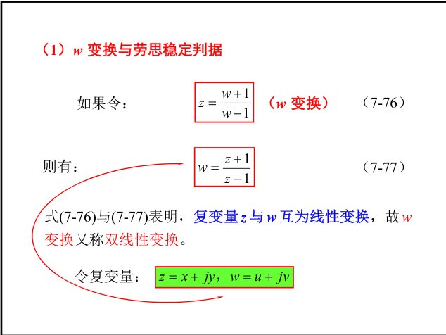

把 $z=x+jy$ 代入 $w=\dfrac{z+1}{z-1}$，分离实部得

$$
u=\operatorname{Re}(w)=\frac{x^{2}+y^{2}-1}{(x-1)^{2}+y^{2}}=\frac{|z|^{2}-1}{|z-1|^{2}}
$$

分母 $(x-1)^2+y^2$ 恒正，$u$ 的符号完全由分子决定，于是三条对应关系成立：$u=0$ 等价于 $x^2+y^2=1$，w 平面的虚轴对应 z 平面上的单位圆周；$u<0$ 等价于 $x^2+y^2<1$，左半 w 平面对应 z 平面单位圆内的区域；$u>0$ 等价于 $x^2+y^2>1$，右半 w 平面对应单位圆外的区域。

于是 $z$ 平面上的特征方程 $1+GH(z)=0$ 可以直接转成 w 平面上的特征方程 $1+GH(w)=0$，对 $w$ 多项式用劳斯判据（第一列全同号则稳定）即可 [自控原理（第七章4）.pdf · p.3](http://10.188.31.55:5244/Nextcloud/School/自动控制原理/%E8%87%AA%E6%8E%A7%E5%8E%9F%E7%90%86%EF%BC%88%E7%AC%AC%E4%B8%83%E7%AB%A04%EF%BC%89.pdf#page=3)。

> [!NOTE] w 变换有两种写法
> 讲师的通关笔记和旧讲义用的是互为倒数的另一种形式 $z=\dfrac{1+w}{1-w}$、$w=\dfrac{z-1}{z+1}$ [题型四_离散系统z变换大题.md · p.192](http://10.188.31.55:5244/Nextcloud/School/自动控制原理/%E9%A2%98%E5%9E%8B%E5%9B%9B_%E7%A6%BB%E6%95%A3%E7%B3%BB%E7%BB%9Fz%E5%8F%98%E6%8D%A2%E5%A4%A7%E9%A2%98.md)。两种形式都把单位圆内映到左半平面，结论一致。做题时用哪一种都行，但同一道题里不能混着写，分子分母写反会得到相反的结论。

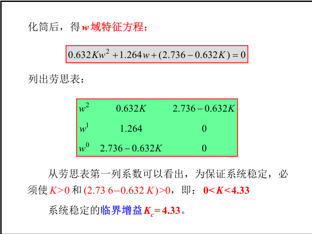

变换时必须整个特征方程一起代换，不能只换某一项。w 变换只换坐标系，不改变极点的稳定性质。

### 稳态误差：离散终值定理

离散终值定理的形式和连续终值定理平行，只是把 $s\to0$ 换成 $z\to1$：

$$
e(\infty)=\lim_{z\to1}(z-1)E(z)
$$

使用前提是系统稳定，即 $(z-1)E(z)$ 的极点全部在单位圆内；否则终值定理不成立。对单位负反馈误差采样系统，$E(z)=R(z)/[1+G(z)]$，于是

$$
e(\infty)=\lim_{z\to1}(z-1)\frac{R(z)}{1+G(z)}
$$

计算技巧：先把 $(z-1)$ 与 $R(z)$ 中的 $(z-1)$ 因子约掉，再代入 $z=1$ [自控原理（第七章4）.pdf · p.5](http://10.188.31.55:5244/Nextcloud/School/自动控制原理/%E8%87%AA%E6%8E%A7%E5%8E%9F%E7%90%86%EF%BC%88%E7%AC%AC%E4%B8%83%E7%AB%A04%EF%BC%89.pdf#page=5)。

系统型别由 $G(z)$ 分母中 $(z-1)$ 因子的个数 $\nu$ 决定。0 型系统分母无 $(z-1)$，阶跃输入误差有限（$e_{ss}=1/(1+K_p)$），斜坡输入误差为无穷大；I 型系统分母有一个 $(z-1)$，阶跃误差为零，斜坡误差有限（$e_{ss}=T/K_v$）；II 型系统斜坡误差也为零。位置误差系数 $K_p=\lim_{z\to1}G(z)$，速度误差系数 $K_v=\frac{1}{T}\lim_{z\to1}(z-1)G(z)$ [题型四_离散系统z变换大题.md · p.233](http://10.188.31.55:5244/Nextcloud/School/自动控制原理/%E9%A2%98%E5%9E%8B%E5%9B%9B_%E7%A6%BB%E6%95%A3%E7%B3%BB%E7%BB%9Fz%E5%8F%98%E6%8D%A2%E5%A4%A7%E9%A2%98.md)。

### A 卷第 5 题：三问完整走一遍

题目给的系统是：控制器 $G_c(s)=K$（$K>0$），零阶保持器 $G_h(s)=\frac{1-e^{-Ts}}{s}$，被控对象 $G_p(s)=\frac{1}{s+1}$，采样周期 $T=1$ s，单位负反馈 [自动控制原理A卷 (1).pdf · p.3](http://10.188.31.55:5244/Nextcloud/School/自动控制原理/%E8%87%AA%E5%8A%A8%E6%8E%A7%E5%88%B6%E5%8E%9F%E7%90%86A%E5%8D%B7%20%281%29.pdf#page=3)。

**第一问：求 $K$ 的稳定范围。**

先做部分分式展开：$\dfrac{K}{s(s+1)}=K\left(\dfrac{1}{s}-\dfrac{1}{s+1}\right)$。逐项查表（$T=1$，$e^{-1}\approx0.368$）：

$$
\mathcal{Z}\left[\frac{K}{s(s+1)}\right]=K\left(\frac{z}{z-1}-\frac{z}{z-0.368}\right)=\frac{0.632Kz}{(z-1)(z-0.368)}
$$

再乘上 $(1-z^{-1})=\frac{z-1}{z}$：

$$
G(z)=(1-z^{-1})\mathcal{Z}\left[\frac{K}{s(s+1)}\right]=\frac{z-1}{z}\cdot\frac{0.632Kz}{(z-1)(z-0.368)}=\frac{0.632K}{z-0.368}
$$

$(z-1)$ 因子被约掉了，$G(z)$ 是一阶的。规律：被控对象 $G_p(s)=1/(s+a)$ 经零阶保持器后，$G(z)$ 一定是一阶的，且分母极点为 $z=e^{-aT}$。

列闭环特征方程 $1+G(z)=0$，得 $z=0.368-0.632K$。一阶特征方程 $az+b=0$ 的稳定条件是 $|z|<1$，所以 $|0.368-0.632K|<1$，解得 $K>-1$ 且 $K<1.368/0.632\approx2.165$。结合 $K>0$：

$$
0<K<2.165
$$

**第二问：$K=1$ 时求 $r(t)=1+t$ 的稳态误差。**

先验证稳定：特征根 $z=0.368-0.632=-0.264$，$|z|=0.264<1$，可以用终值定理。$G(z)=\frac{0.632}{z-0.368}$ 的分母没有 $(z-1)$ 因子，是 **0 型系统**。$r(t)=1+t$ 里含斜坡分量，0 型系统追斜坡误差必然无穷大，所以 $e(\infty)=\infty$。

若只问阶跃部分的误差，$K_p=\lim_{z\to1}G(z)=0.632/(1-0.368)=1$，$e(\infty)=1/(1+K_p)=1/2$。第 (2) 问之所以常取 $r(t)=1+t$，就是为了同时考察对 0 型/I 型系统的理解 [补充_考试出题模式与特殊情况.md · p.40](http://10.188.31.55:5244/Nextcloud/School/自动控制原理/%E8%A1%A5%E5%85%85_%E8%80%83%E8%AF%95%E5%87%BA%E9%A2%98%E6%A8%A1%E5%BC%8F%E4%B8%8E%E7%89%B9%E6%AE%8A%E6%83%85%E5%86%B5.md)。

**第三问：换成 PI 控制器 $G_c(s)=1+\frac{1}{\alpha s}=\frac{\alpha s+1}{\alpha s}$（$\alpha>0$）。**

需要变换的表达式变成 $\dfrac{\alpha s+1}{\alpha s^{2}(s+1)}$。设 $\dfrac{\alpha s+1}{s^{2}(s+1)}=\dfrac{A}{s}+\dfrac{B}{s^{2}}+\dfrac{C}{s+1}$，令 $s=0$ 得 $B=1$，令 $s=-1$ 得 $C=1-\alpha$，比较 $s^{2}$ 系数得 $A=\alpha-1$。

逐项查表再乘 $(1-z^{-1})$，通分后分子中 $z^{2}$ 项恰好抵消：

$$
G(z)=\frac{(0.368+0.632\alpha)z+(0.264-0.632\alpha)}{\alpha(z-1)(z-0.368)}
$$

分母多了一个 $(z-1)$ 因子，说明 PI 把系统从 0 型提升为 I 型——这正是积分项的作用：让阶跃误差变为零。

闭环特征方程两边同乘 $\alpha(z-1)(z-0.368)$，整理得二阶方程 $\alpha z^{2}+(0.368-0.736\alpha)z+0.264(1-\alpha)=0$。对照 $a_2z^{2}+a_1z+a_0=0$，$a_2=\alpha>0$，$a_1=0.368-0.736\alpha$，$a_0=0.264(1-\alpha)$。

朱利三条件逐条查：$D(1)=0.632>0$ 对一切 $\alpha$ 恒成立；$D(-1)=1.472\alpha-0.104>0$ 给出 $\alpha>0.0707$；$|a_0|<a_2$ 在 $\alpha<1$ 时给出 $\alpha>0.209$、在 $\alpha\ge1$ 时恒成立。取交集得 $\alpha>0.209$。

顺带求斜坡稳态误差。$K_v=(1/T)\lim_{z\to1}(z-1)G(z)$，代入化简得 $K_v=1/\alpha$，于是 $r(t)=t$ 的稳态误差 $e(\infty)=T/K_v=\alpha$。

> [!WARNING] 离散系统题的四个高频坑
> **忘了乘 $(1-z^{-1})$。** 含 ZOH 的公式最后一定要乘，且控制器 $G_c(s)$ 也要一起放进方括号里。这是本节最常见的失分点。
>
> **$T$ 代错。** $T=1$ 时 $e^{-1}\approx0.368$，$T=0.1$ 时 $e^{-0.1}\approx0.905$，代错全盘皆错。
>
> **判稳看单位圆，不是看左右半平面。** 单位圆外（$|z|>1$）才是不稳定，单位圆上是临界稳定。做离散题时脑子里的"左半平面"要整体切换成"单位圆内"。
>
> **朱利三条件漏一条。** $D(1)>0$、$D(-1)>0$、$|a_0|<a_2$ 缺一不可，写完一条划一个勾。

### 最少拍数字控制器

最少拍系统指在典型输入作用下能以有限拍结束响应、且在采样时刻上无稳态误差的系统。设典型输入写成 $R(z)=\dfrac{A(z)}{(1-z^{-1})^{m}}$，其中 $m$ 由输入类型决定：阶跃 $m=1$，斜坡 $m=2$，加速度 $m=3$。

误差 $E(z)=\Phi_e(z)R(z)$。稳态误差为零要求 $\Phi_e(z)$ 含 $(1-z^{-1})^{m}$ 因子；为使 $D(z)$ 最简单取 $\Phi_e(z)=(1-z^{-1})^{m}$，$\Phi(z)=1-\Phi_e(z)$。由 $\Phi(z)=\frac{D(z)G(z)}{1+D(z)G(z)}$ 反解得数字控制器

$$
D(z)=\frac{\Phi(z)}{G(z)\,\Phi_e(z)}
$$

三种典型输入的结果：阶跃 $\Phi_e=1-z^{-1}$、$\Phi=z^{-1}$；斜坡 $\Phi_e=(1-z^{-1})^{2}$、$\Phi=2z^{-1}-z^{-2}$；加速度 $\Phi_e=(1-z^{-1})^{3}$、$\Phi=3z^{-1}-3z^{-2}+z^{-3}$。

例：广义对象 $G_0(s)=\frac{10}{s(s+1)}$、$T=1$ s，要求单位斜坡下最少拍。$m=2$，故 $\Phi_e(z)=(1-z^{-1})^{2}$、$\Phi(z)=2z^{-1}-z^{-2}$。先算 $G(z)=\frac{3.68z^{-1}(1+0.717z^{-1})}{(1-z^{-1})(1-0.368z^{-1})}$，代入 $D(z)=\Phi(z)/[G(z)\Phi_e(z)]$ 约去公共因子得

$$
D(z)=\frac{0.543(1-0.368z^{-1})(1-0.5z^{-1})}{(1-z^{-1})(1+0.717z^{-1})}
$$

$\Phi_e(z)$ 的零点 $z=1$ 正好补偿了 $G(z)$ 在单位圆上的极点 $z=1$，$\Phi(z)$ 已包含 $G(z)$ 的延迟因子 $z^{-1}$，满足"对消延迟、补偿单位圆极点"的限制性要求 [自动控制原理（第八版） (胡寿松、姜斌、张绍杰) (z-library.sk, 1lib.sk, z-lib.sk)(1).pdf · p.374](http://10.188.31.55:5244/Nextcloud/School/自动控制原理/%E8%87%AA%E5%8A%A8%E6%8E%A7%E5%88%B6%E5%8E%9F%E7%90%86%EF%BC%88%E7%AC%AC%E5%85%AB%E7%89%88%EF%BC%89%20%28%E8%83%A1%E5%AF%BF%E6%9D%BE%E3%80%81%E5%A7%9C%E6%96%8C%E3%80%81%E5%BC%A0%E7%BB%8D%E6%9D%B0%29%20%28z-library.sk%2C%201lib.sk%2C%20z-lib.sk%29%281%29.pdf#page=374)。

最少拍系统只在采样时刻无误差，非采样时刻一般仍有纹波。要消除纹波，额外要求闭环脉冲传函 $\Phi(z)$ 包含 $G(z)$ 的全部零点，即 $\Phi(z)=P(z)M(z)$，其中 $P(z)$ 是 $G(z)$ 的零点多项式，代价是增加相应拍数。

## 第 8 章 非线性控制系统分析

### 真实的系统都是非线性的

第 5 章用 Nyquist 判据判稳时隐含一个前提：系统是线性的，增益是常数 $K$。真实物理系统里没有哪个环节严格线性：放大器受电源电压限制，输入一大就饱和；电动机要克服静摩擦，电枢电压小到一定程度根本转不动，存在死区；齿轮传动有装配间隙，换向时会"空走"一段。信号小的时候把这些看成线性还过得去，信号一大，继续套线性理论会给出完全错误的结论 [自控原理（第八章1）.pdf · p.1](http://10.188.31.55:5244/Nextcloud/School/自动控制原理/%E8%87%AA%E6%8E%A7%E5%8E%9F%E7%90%86%EF%BC%88%E7%AC%AC%E5%85%AB%E7%AB%A01%EF%BC%89.pdf#page=1)。

教材把随动系统拆成三类元件说明这一点：放大元件受电源电压和输出功率限制，超过线性范围就饱和；执行元件电动机有摩擦力矩和负载力矩，电压低于某值时转不动（死区），高于某值时转速不再增加（饱和）；传动机构受加工和装配精度限制，换向时存在回差 [自动控制原理（第八版） (胡寿松、姜斌、张绍杰) (z-library.sk, 1lib.sk, z-lib.sk)(1).pdf · p.393](http://10.188.31.55:5244/Nextcloud/School/自动控制原理/%E8%87%AA%E5%8A%A8%E6%8E%A7%E5%88%B6%E5%8E%9F%E7%90%86%EF%BC%88%E7%AC%AC%E5%85%AB%E7%89%88%EF%BC%89%20%28%E8%83%A1%E5%AF%BF%E6%9D%BE%E3%80%81%E5%A7%9C%E6%96%8C%E3%80%81%E5%BC%A0%E7%BB%8D%E6%9D%B0%29%20%28z-library.sk%2C%201lib.sk%2C%20z-lib.sk%29%281%29.pdf#page=393)。


非线性系统还有两个线性系统没有的现象。

第一个是**平衡状态可能不唯一**。看一阶系统 $\dot{x}=x^2-x=x(x-1)$，令 $\dot{x}=0$ 得两个平衡状态 $x=0$ 和 $x=1$。分离变量积分得 $x(t)=\frac{x_0e^{-t}}{1-x_0+x_0e^{-t}}$，时间响应随初始条件 $x_0$ 而改变：$x_0>1$ 时 $x(t)$ 递增并在 $t=\ln\frac{x_0}{x_0-1}$ 时趋于无穷大，$x_0<1$ 时 $x(t)$ 递减并趋于 0。


所以非线性系统的稳定性不仅取决于系统的结构和参数，还与系统的初始条件和扰动范围有关。线性系统则不然：它只有一个平衡状态 $x=0$，稳定性只取决于结构和参数。

第二个是**可能存在自振**。自振指没有外部输入，系统自己就维持着等幅等频率的持续振荡，而且扰动消失后还能回到原来的振幅和频率。教材用范德波尔方程 $\ddot{x}-2p(1-x^2)\dot{x}+x=0$（$p>0$）说明：$x<1$ 时 $-p(1-x^2)<0$，系统具有负阻尼，从外部获得能量，$x(t)$ 呈发散形式；$x>1$ 时系统具有正阻尼，消耗能量，$x(t)$ 呈收敛形式；$x=1$ 时零阻尼，$x(t)$ 呈等幅振荡形式 [自控原理（第八章1）.pdf · p.2](http://10.188.31.55:5244/Nextcloud/School/自动控制原理/%E8%87%AA%E6%8E%A7%E5%8E%9F%E7%90%86%EF%BC%88%E7%AC%AC%E5%85%AB%E7%AB%A01%EF%BC%89.pdf#page=2)。

### 三种分析与设计方法

课件把非线性系统的分析方法分成三类 [自控原理（第八章1）.pdf · p.3](http://10.188.31.55:5244/Nextcloud/School/自动控制原理/%E8%87%AA%E6%8E%A7%E5%8E%9F%E7%90%86%EF%BC%88%E7%AC%AC%E5%85%AB%E7%AB%A01%EF%BC%89.pdf#page=3)。

**相平面法**是图形分析方法，通过在相平面上绘制轨迹曲线，确定非线性微分方程在不同初始条件下解的运动形式。缺点是只适用于一阶、二阶系统。

**描述函数法**是基于频域分析法和由线性特性谐波线性化的一种图解分析方法，适用于"一个非线性环节加一个线性部分"闭环连接的结构，通过把非线性特性近似表示为复变增益环节，然后推广应用频率法，去分析非线性系统的稳定性和自激振荡。

**逆系统法**是运用内环非线性反馈控制构成伪线性系统，并以此为基础设计外环控制器，直接研究非线性问题而不必求解非线性系统的运动方程。

本章讲前两种。考试分工是：A 卷第 6 题走描述函数法，填空和选择里偶尔考相平面法概念。

### 描述函数的定义

描述函数法是达尼尔夫（P. J. Daniel）于 1940 年提出的。基本思想是：当系统满足一定条件时，系统中的非线性元件在正弦信号作用下可以用其一次谐波分量来近似，由此导出非线性元件的近似等效频率特性，即描述函数 [自控原理（第八章1）.pdf · p.5](http://10.188.31.55:5244/Nextcloud/School/自动控制原理/%E8%87%AA%E6%8E%A7%E5%8E%9F%E7%90%86%EF%BC%88%E7%AC%AC%E5%85%AB%E7%AB%A01%EF%BC%89.pdf#page=5)。

设非线性环节的输入是 $x(t)=A\sin\omega t$，输出 $y(t)$ 一般是非正弦的周期波。把它做傅里叶展开，取其中的基波 $y_1(t)=B_1\sin\omega t+A_1\cos\omega t$。两个傅里叶系数由积分给出：

$$
B_1=\frac{1}{\pi}\int_0^{2\pi}y(t)\sin\omega t\,d(\omega t),\qquad A_1=\frac{1}{\pi}\int_0^{2\pi}y(t)\cos\omega t\,d(\omega t)
$$

描述函数是输出基波复振幅与输入复振幅之比：

$$
N(A)=\frac{B_1+jA_1}{A}
$$

当 $y(t)$ 是 $t$ 的奇对称函数时可以证明 $A_1=0$，此时 $N(A)=\dfrac{B_1}{A}$ 是**实数**。理想继电器、饱和、死区都是这种情形，所以本章 $N(A)$ 一律按实数处理。

描述函数有两个重要特点：一般只与输入振幅 $A$ 有关，与频率 $\omega$ 无关；它是一种近似方法，忽略了高次谐波 [题型五_描述函数大题.md · p.36](http://10.188.31.55:5244/Nextcloud/School/自动控制原理/%E9%A2%98%E5%9E%8B%E4%BA%94_%E6%8F%8F%E8%BF%B0%E5%87%BD%E6%95%B0%E5%A4%A7%E9%A2%98.md)。

### 描述函数法的三个前提

课件明确列出应用条件，答概念题时会考 [自控原理（第八章1）.pdf · p.6](http://10.188.31.55:5244/Nextcloud/School/自动控制原理/%E8%87%AA%E6%8E%A7%E5%8E%9F%E7%90%86%EF%BC%88%E7%AC%AC%E5%85%AB%E7%AB%A01%EF%BC%89.pdf#page=6)。

**第一，非线性系统应简化成一个非线性环节和一个线性部分闭环连接的典型结构。**


**第二，非线性环节的输入输出特性 $y(x)$ 应是 $x$ 的奇函数**，即 $f(-x)=-f(x)$，或正弦输入下的输出 $y$ 为 $t$ 的奇对称函数 $y(t+\pi/\omega)=-y(t)$，以保证非线性元件的正弦响应不含常值分量 $A_0=0$。

**第三，系统的线性部分 $G(s)$ 应具有较好的低通滤波性能。** 非线性环节的输出一定含有高次谐波，但经线性部分传递之后，由于低通滤波作用，高次谐波分量被大大削弱，闭环通道内近似只有一次谐波流通，从而保证结果比较准确。线性部分 $G(s)$ 的阶次越高，低通滤波性能越好 [自控原理（第八章1）.pdf · p.7](http://10.188.31.55:5244/Nextcloud/School/自动控制原理/%E8%87%AA%E6%8E%A7%E5%8E%9F%E7%90%86%EF%BC%88%E7%AC%AC%E5%85%AB%E7%AB%A01%EF%BC%89.pdf#page=7)。

> [!WARNING] 相切不等于稳定
> 描述函数法还有一个隐含条件：交点处两条曲线要几乎垂直相交。若在交点处几乎相切，高次谐波衰减不够，分析结果就不可靠，甚至可能根本不存在自振。相切时特征方程有重根落在虚轴上，系统处于临界自持振荡状态，对应相平面上的半稳定极限环，不是稳定。

### 常见非线性特性的描述函数

教材表 8-1 把常见非线性特性的静特性和描述函数列在一起，考试给 $N(A)$ 或要求写 $N(A)$ 时直接对照。


这些继电特性的描述函数有统一的来源：都从一个带死区和滞环的通式

$$
N(A)=\frac{2M}{\pi A}\left[\sqrt{1-\left(\frac{mh}{A}\right)^2}+\sqrt{1-\left(\frac{h}{A}\right)^2}\right]+j\frac{2Mh}{\pi A^2}(m-1),\qquad A\ge h
$$

出发，取不同参数得到各特例 [自动控制原理（第八版） (胡寿松、姜斌、张绍杰) (z-library.sk, 1lib.sk, z-lib.sk)(1).pdf · p.424](http://10.188.31.55:5244/Nextcloud/School/自动控制原理/%E8%87%AA%E5%8A%A8%E6%8E%A7%E5%88%B6%E5%8E%9F%E7%90%86%EF%BC%88%E7%AC%AC%E5%85%AB%E7%89%88%EF%BC%89%20%28%E8%83%A1%E5%AF%BF%E6%9D%BE%E3%80%81%E5%A7%9C%E6%96%8C%E3%80%81%E5%BC%A0%E7%BB%8D%E6%9D%B0%29%20%28z-library.sk%2C%201lib.sk%2C%20z-lib.sk%29%281%29.pdf#page=424)。取 $h=0$ 得理想继电 $N(A)=\frac{4M}{\pi A}$；取 $m=1$ 得死区继电 $N(A)=\frac{4M}{\pi A}\sqrt{1-(h/A)^2}$；取 $m=-1$ 得滞环继电 $N(A)=\frac{4M}{\pi A}\sqrt{1-(h/A)^2}-j\frac{4Mh}{\pi A^2}$。

三个最常考的形式记牢：理想继电器 $N(A)=4M/(\pi A)$，饱和 $N(A)=\frac{2k}{\pi}\left[\arcsin\frac{a}{A}+\frac{a}{A}\sqrt{1-(a/A)^2}\right]$（$A\ge a$），死区 $N(A)=\frac{2k}{\pi}\left[\frac{\pi}{2}-\arcsin\frac{\Delta}{A}-\frac{\Delta}{A}\sqrt{1-(\Delta/A)^2}\right]$（$A\ge\Delta$）。

**饱和环节的推导。** 设 $|x|\le a$ 时 $y=kx$，$|x|>a$ 时 $y=\operatorname{sgn}(x)ka$。输入 $x=A\sin\omega t$，$A\ge a$，转折点由 $A\sin\psi=a$ 确定，即 $\psi=\arcsin(a/A)$。输出是奇函数且半周期对称，只需算 $B_1=\frac{4}{\pi}\int_0^{\pi/2}y(t)\sin\omega t\,d(\omega t)$。分段代入并用 $\sin\psi=a/A$、$\cos\psi=\sqrt{1-(a/A)^2}$ 合并同类项，得

$$
N(A)=\frac{2k}{\pi}\left[\arcsin\frac{a}{A}+\frac{a}{A}\sqrt{1-\left(\frac{a}{A}\right)^2}\right],\qquad A\ge a
$$

$A\le a$ 时环节工作在线性区，$N(A)=k$。$N(A)$ 随 $A$ 增大而减小，这是饱和的"变增益"特征。

**死区环节的推导。** 设 $|x|<\Delta$ 时 $y=0$，$|x|\ge\Delta$ 时 $y=k(x-\operatorname{sgn}(x)\Delta)$。转折点 $\psi_1=\arcsin(\Delta/A)$。同样只算 $B_1$，得

$$
N(A)=\frac{2k}{\pi}\left[\frac{\pi}{2}-\arcsin\frac{\Delta}{A}-\frac{\Delta}{A}\sqrt{1-\left(\frac{\Delta}{A}\right)^2}\right],\qquad A\ge\Delta
$$

$A\to\Delta^{+}$ 时 $N(A)\to0$，$A\to\infty$ 时 $N(A)\to k$，即死区把小的等效增益补了回来。


### 从 Nyquist 判据到 -1/N(A)

把非线性环节用描述函数 $N(A)$ 替代，它就变成一个"增益随振幅变化"的比例环节，闭环特征方程变为 $1+N(A)G(j\omega)=0$，即

$$
G(j\omega)=-\frac{1}{N(A)}
$$

原来的固定点 $-1/K$ 换成了**随振幅 $A$ 移动的曲线** $-1/N(A)$，它叫**负倒描述函数**。判据的骨架完全不变：在复平面上同时画 $G(j\omega)$ 与 $-1/N(A)$，看 $G(j\omega)$ 是否包围 $-1/N(A)$ [自动控制原理（第八版） (胡寿松、姜斌、张绍杰) (z-library.sk, 1lib.sk, z-lib.sk)(1).pdf · p.428](http://10.188.31.55:5244/Nextcloud/School/自动控制原理/%E8%87%AA%E5%8A%A8%E6%8E%A7%E5%88%B6%E5%8E%9F%E7%90%86%EF%BC%88%E7%AC%AC%E5%85%AB%E7%89%88%EF%BC%89%20%28%E8%83%A1%E5%AF%BF%E6%9D%BE%E3%80%81%E5%A7%9C%E6%96%8C%E3%80%81%E5%BC%A0%E7%BB%8D%E6%9D%B0%29%20%28z-library.sk%2C%201lib.sk%2C%20z-lib.sk%29%281%29.pdf#page=428)。

两种情形要分清。

**两曲线不相交。** 若 $G(j\omega)$ 不包围 $-1/N(A)$，则对任意振幅 $A$ 等效线性系统都稳定，振幅衰减到零，**非线性系统稳定**；若 $G(j\omega)$ 包围 $-1/N(A)$，则振幅不断增大直至系统故障，**非线性系统不稳定**。


**两曲线相交。** 此时特征方程有纯虚根 $s=\pm j\omega$，系统存在周期运动，即自振。$G(j\omega)$ 上交点对应的频率就是**自振频率 $\omega$**，$-1/N(A)$ 上交点对应的振幅就是**自振振幅 $A$**。当 $N(A)$ 为实数时 $-1/N(A)$ 落在负实轴上，可以把复方程拆成两式：$\operatorname{Im}[G(j\omega)]=0$ 解出 $\omega$，$\operatorname{Re}[G(j\omega)]=-1/N(A)$ 解出 $A$ [题型五_描述函数大题.md · p.134](http://10.188.31.55:5244/Nextcloud/School/自动控制原理/%E9%A2%98%E5%9E%8B%E4%BA%94_%E6%8F%8F%E8%BF%B0%E5%87%BD%E6%95%B0%E5%A4%A7%E9%A2%98.md)。

### 自振稳定性：内出稳定

两曲线相交只说明"存在周期运动"，还得判断这个周期运动受扰后能不能维持。把 $G(j\omega)$ **包围的区域看作不稳定区**、不包围的区域看作稳定区，沿 $-1/N(A)$ 曲线振幅 $A$ **增大**的方向看交点。

**从内部进入外部**，说明振幅小了会被"放大"推回交点、振幅大了会被"衰减"拉回交点，两侧都收敛到交点，该自振**稳定**。**从外部进入内部**，两侧都远离交点，该自振**不稳定**。口诀是"**内出稳定**" [自动控制原理（第八版） (胡寿松、姜斌、张绍杰) (z-library.sk, 1lib.sk, z-lib.sk)(1).pdf · p.431](http://10.188.31.55:5244/Nextcloud/School/自动控制原理/%E8%87%AA%E5%8A%A8%E6%8E%A7%E5%88%B6%E5%8E%9F%E7%90%86%EF%BC%88%E7%AC%AC%E5%85%AB%E7%89%88%EF%BC%89%20%28%E8%83%A1%E5%AF%BF%E6%9D%BE%E3%80%81%E5%A7%9C%E6%96%8C%E3%80%81%E5%BC%A0%E7%BB%8D%E6%9D%B0%29%20%28z-library.sk%2C%201lib.sk%2C%20z-lib.sk%29%281%29.pdf#page=431)。

这个判据与相平面法的极限环完全对应：稳定的自振对应稳定极限环，不稳定的自振对应不稳定极限环，两曲线相切则对应半稳定极限环。

### 相平面法：奇点与极限环

相平面法由庞加莱 1885 年首先提出。它通过图解法将一阶和二阶系统的运动过程转化为位置和速度平面上的相轨迹，从而比较直观地反映稳定性、平衡状态和初始条件的影响 [自动控制原理（第八版） (胡寿松、姜斌、张绍杰) (z-library.sk, 1lib.sk, z-lib.sk)(1).pdf · p.401](http://10.188.31.55:5244/Nextcloud/School/自动控制原理/%E8%87%AA%E5%8A%A8%E6%8E%A7%E5%88%B6%E5%8E%9F%E7%90%86%EF%BC%88%E7%AC%AC%E5%85%AB%E7%89%88%EF%BC%89%20%28%E8%83%A1%E5%AF%BF%E6%9D%BE%E3%80%81%E5%A7%9C%E6%96%8C%E3%80%81%E5%BC%A0%E7%BB%8D%E6%9D%B0%29%20%28z-library.sk%2C%201lib.sk%2C%20z-lib.sk%29%281%29.pdf#page=401)。

**奇点**是相平面上使相轨迹斜率成为不定式 $0/0$ 的点，也即系统速度与加速度同时为零的平衡点。线性二阶系统的奇点按特征根分焦点、节点、鞍点三类。

判断奇点稳定性必须画箭头看走向，不能只看曲线形状。上半平面 $\dot{x}>0$，相轨迹由左向右；下半平面 $\dot{x}<0$，相轨迹由右向左 [自动控制原理（第八版） (胡寿松、姜斌、张绍杰) (z-library.sk, 1lib.sk, z-lib.sk)(1).pdf · p.403](http://10.188.31.55:5244/Nextcloud/School/自动控制原理/%E8%87%AA%E5%8A%A8%E6%8E%A7%E5%88%B6%E5%8E%9F%E7%90%86%EF%BC%88%E7%AC%AC%E5%85%AB%E7%89%88%EF%BC%89%20%28%E8%83%A1%E5%AF%BF%E6%9D%BE%E3%80%81%E5%A7%9C%E6%96%8C%E3%80%81%E5%BC%A0%E7%BB%8D%E6%9D%B0%29%20%28z-library.sk%2C%201lib.sk%2C%20z-lib.sk%29%281%29.pdf#page=403)。稳定焦点是向心螺旋（卷向原点），不稳定焦点是离心螺旋（卷离原点），鞍点则是一条稳定轨迹、一条发散轨迹 [自动控制原理（第八版） (胡寿松、姜斌、张绍杰) (z-library.sk, 1lib.sk, z-lib.sk)(1).pdf · p.409](http://10.188.31.55:5244/Nextcloud/School/自动控制原理/%E8%87%AA%E5%8A%A8%E6%8E%A7%E5%88%B6%E5%8E%9F%E7%90%86%EF%BC%88%E7%AC%AC%E5%85%AB%E7%89%88%EF%BC%89%20%28%E8%83%A1%E5%AF%BF%E6%9D%BE%E3%80%81%E5%A7%9C%E6%96%8C%E3%80%81%E5%BC%A0%E7%BB%8D%E6%9D%B0%29%20%28z-library.sk%2C%201lib.sk%2C%20z-lib.sk%29%281%29.pdf#page=409)。不画箭头就判稳定性，容易把稳定焦点和不稳定焦点看反。

**极限环**是相平面上一条**孤立**的封闭相轨迹，环内、环外的相轨迹都渐近地卷向它或卷离它。极限环把相平面分成运动性质不同的区域，是非线性系统自振的几何对应物。只有稳定的极限环才能在实验中被观察到，不稳定或半稳定的极限环是观察不到的 [自动控制原理（第八版） (胡寿松、姜斌、张绍杰) (z-library.sk, 1lib.sk, z-lib.sk)(1).pdf · p.411](http://10.188.31.55:5244/Nextcloud/School/自动控制原理/%E8%87%AA%E5%8A%A8%E6%8E%A7%E5%88%B6%E5%8E%9F%E7%90%86%EF%BC%88%E7%AC%AC%E5%85%AB%E7%89%88%EF%BC%89%20%28%E8%83%A1%E5%AF%BF%E6%9D%BE%E3%80%81%E5%A7%9C%E6%96%8C%E3%80%81%E5%BC%A0%E7%BB%8D%E6%9D%B0%29%20%28z-library.sk%2C%201lib.sk%2C%20z-lib.sk%29%281%29.pdf#page=411)。


### A 卷第 6 题：自振条件与自振参数

题目给的是：某电机控制系统含理想继电器 $N(A)=4M/(\pi A)$，线性部分 $G(s)=\dfrac{K_2}{s(Ts+1)^2}$，参数 $K_1$、$K_2$、$M$、$T$ 均为正数。求系统发生自振时参数应满足的条件，以及自振频率和输出端振幅 [自动控制原理A卷 (1).pdf · p.3](http://10.188.31.55:5244/Nextcloud/School/自动控制原理/%E8%87%AA%E5%8A%A8%E6%8E%A7%E5%88%B6%E5%8E%9F%E7%90%86A%E5%8D%B7%20%281%29.pdf#page=3)。

**第一步，看清 $K_1$ 和继电器的关系。** 这题的 $K_1$ 与继电器是**并联**的：误差信号同时经过线性支路 $K_1$ 和非线性支路（理想继电器，输出 $\pm M$），两路在 $G(s)$ 之前相加。继电器输出是方波，基波幅值 $4M/\pi$；线性支路输出幅值 $K_1A$。二者同相相加后折算成等效描述函数，是**相加**而不是相乘：

$$
N(A)=K_1+\frac{4M}{\pi A}
$$

负倒描述函数随之是 $-\dfrac{1}{N(A)}=-\dfrac{1}{4M/(\pi A)+K_1}$。这一步是本题最关键的判断：$K_1$ 串联在非线性环节之前时要乘进 $N(A)$，并联时要加到 $N(A)$ 上，结构图看错就全盘错 [自动控制原理A卷答案(1).pdf · p.7](http://10.188.31.55:5244/Nextcloud/School/自动控制原理/%E8%87%AA%E5%8A%A8%E6%8E%A7%E5%88%B6%E5%8E%9F%E7%90%86A%E5%8D%B7%E7%AD%94%E6%A1%88%281%29.pdf#page=7)。

**第二步，求 $G(j\omega)$ 穿越负实轴的交点。** 展开 $(1+jT\omega)^2=(1-T^2\omega^2)+j2T\omega$，分母为 $j\omega[(1-T^2\omega^2)+j2T\omega]=-2T\omega^2+j\omega(1-T^2\omega^2)$。令虚部为零 $\omega(1-T^2\omega^2)=0$，取 $\omega>0$ 得穿越频率 $\omega_x=1/T$；代回得 $G(j\omega_x)=-K_2T/2$。幅频特性是 $\angle G(j\omega)=-90^\circ-2\arctan T\omega$：$\omega\to0$ 时 $G\to\infty\angle(-90^\circ)$，$\omega\to+\infty$ 时 $G\to0\angle(-270^\circ)$。

**第三步，判断相交条件。** $-1/N(A)$ 是一条有限线段：$A\to0^+$ 时 $-\dfrac{1}{N(A)}\to0^-$，$A\to\infty$ 时 $N(A)\to K_1$，所以 $-\dfrac{1}{N(A)}\to-\dfrac{1}{K_1}$。穿越点 $-K_2T/2$ 要落在这段线段内，需要

$$
-\frac{K_2T}{2}>-\frac{1}{K_1}
$$

整理后得到自振条件 [自动控制原理A卷答案(1).pdf · p.8](http://10.188.31.55:5244/Nextcloud/School/自动控制原理/%E8%87%AA%E5%8A%A8%E6%8E%A7%E5%88%B6%E5%8E%9F%E7%90%86A%E5%8D%B7%E7%AD%94%E6%A1%88%281%29.pdf#page=8)：

$$
0<K_1K_2T<2
$$

**第四步，求自振频率与振幅。** 频率就是穿越频率 $\omega=1/T$。振幅由 $-\dfrac{1}{4M/(\pi A)+K_1}=-\dfrac{K_2T}{2}$ 解出：

$$
A=\frac{4MK_2T}{\pi(2-K_1K_2T)}
$$

这个 $A$ 同时就是输出端振幅。因为本题 $r(t)=0$ 且反馈为单位负反馈，误差 $e(t)=-c(t)$，两者幅值相同；代入自振条件 $|G(j\omega_x)|=\dfrac{1}{K_1+4M/(\pi A)}$ 可验算输出幅值 $|G|\cdot\bigl(K_1A+4M/\pi\bigr)=A$。

**第五步，判断自振稳定性。** 官方答案画的极坐标图上，$-\dfrac{1}{N(A)}$ 曲线是从不稳定区穿越到稳定区的情形，按"内出稳定"规则，该自振是**稳定**的自振。

答题时的书写格式是固定的四步 [题型五_描述函数大题.md · p.653](http://10.188.31.55:5244/Nextcloud/School/自动控制原理/%E9%A2%98%E5%9E%8B%E4%BA%94_%E6%8F%8F%E8%BF%B0%E5%87%BD%E6%95%B0%E5%A4%A7%E9%A2%98.md)：

> (1) 自振方程：$G(j\omega)=-\dfrac{1}{N(A)}$
> (2) 令 $\operatorname{Im}[G(j\omega)]=0$，解得 $\omega$
> (3) 代入 $\operatorname{Re}[G(j\omega)]=-\dfrac{1}{N(A)}$，解得 $A$
> (4) 稳定性：沿 $-1/N(A)$ 的 $A$ 增大方向，从 $G(j\omega)$ 包围区域内部移向外部，故自振稳定。

如果结构图上 $K_1$ 是**串联**在非线性环节之前的，算法就换成另一种：等效描述函数 $N'(A)=K_1\cdot N(A)=\dfrac{4K_1M}{\pi A}$，负倒描述函数 $-\dfrac{\pi A}{4K_1M}$ 从原点一路伸到 $-\infty$，覆盖整条负实轴，系统总存在自振，误差端振幅 $A=\dfrac{2K_1K_2MT}{\pi}$，输出端振幅再乘上 $|G(j\omega_0)|=\dfrac{K_2T}{2}$，得 $C_0=\dfrac{K_1K_2^2MT^2}{\pi}$ [题型五_描述函数大题.md · p.241](http://10.188.31.55:5244/Nextcloud/School/自动控制原理/%E9%A2%98%E5%9E%8B%E4%BA%94_%E6%8F%8F%E8%BF%B0%E5%87%BD%E6%95%B0%E5%A4%A7%E9%A2%98.md)。考试时先看结构图再决定用哪一条。

### 饱和系统：求自振幅值与临界增益

再看一个教材例题：某系统含饱和非线性环节（$k=2$、$a=1$），线性部分 $G(s)=\dfrac{K}{s(0.1s+1)(0.2s+1)}$，$K=15$。求自振的振幅与频率，判断自振稳定性，再求使系统不出现自振的 $K$ 临界值 [自动控制原理（第八版） (胡寿松、姜斌、张绍杰) (z-library.sk, 1lib.sk, z-lib.sk)(1).pdf · p.432](http://10.188.31.55:5244/Nextcloud/School/自动控制原理/%E8%87%AA%E5%8A%A8%E6%8E%A7%E5%88%B6%E5%8E%9F%E7%90%86%EF%BC%88%E7%AC%AC%E5%85%AB%E7%89%88%EF%BC%89%20%28%E8%83%A1%E5%AF%BF%E6%9D%BE%E3%80%81%E5%A7%9C%E6%96%8C%E3%80%81%E5%BC%A0%E7%BB%8D%E6%9D%B0%29%20%28z-library.sk%2C%201lib.sk%2C%20z-lib.sk%29%281%29.pdf#page=432)。

饱和环节的 $-1/N(A)$ 是负实轴上从 $-1/k=-0.5$ 向左延伸到 $-\infty$ 的射线。

对 $G(s)=\dfrac{K}{s(T_1s+1)(T_2s+1)}$，$T_1=0.1$、$T_2=0.2$，用三阶 I 型系统速算公式，穿越频率 $\omega_x=\dfrac{1}{\sqrt{T_1T_2}}=7.07$，穿越点的值 $G(j\omega_x)=-\dfrac{KT_1T_2}{T_1+T_2}=-\dfrac{15\times0.02}{0.3}=-1$。

穿越点 $-1$ 落在射线 $(-\infty,-0.5]$ 内，两曲线相交，存在自振。相交处 $-1/N(A)=-1$，即 $N(A)=1$，代入饱和公式解出 $A\approx2.5$。所以自振频率 $\omega=7.07$，非线性环节输入端的自振振幅 $A\approx2.5$，即 $e(t)\approx2.5\sin7.07t$ [自动控制原理（第八版） (胡寿松、姜斌、张绍杰) (z-library.sk, 1lib.sk, z-lib.sk)(1).pdf · p.433](http://10.188.31.55:5244/Nextcloud/School/自动控制原理/%E8%87%AA%E5%8A%A8%E6%8E%A7%E5%88%B6%E5%8E%9F%E7%90%86%EF%BC%88%E7%AC%AC%E5%85%AB%E7%89%88%EF%BC%89%20%28%E8%83%A1%E5%AF%BF%E6%9D%BE%E3%80%81%E5%A7%9C%E6%96%8C%E3%80%81%E5%BC%A0%E7%BB%8D%E6%9D%B0%29%20%28z-library.sk%2C%201lib.sk%2C%20z-lib.sk%29%281%29.pdf#page=433)。

**判断自振稳定性。** 沿 $-1/N(A)$ 曲线 $A$ 增大方向（向左移动）：$A<2.5$ 时 $-1/N(A)$ 落在 $(-0.5,-1)$ 之间，位于 $G(j\omega)$ 包围区**内部**，等效系统不稳定，振幅增大；$A>2.5$ 时 $-1/N(A)$ 越过 $-1$ 继续向左，落在包围区**外部**，等效系统稳定，振幅减小。$A$ 增大方向是从内到外，故该自振**稳定**。

**求临界增益。** 要使系统无自振，需让穿越点与射线不相交，即穿越点落在 $-0.5$ 的右侧。由 $-\dfrac{KT_1T_2}{T_1+T_2}=-0.5$，即 $-0.0667K=-0.5$，解得 $K_{\max}=7.5$。$K<7.5$ 时两曲线不相交、系统稳定无自振；$K>7.5$ 时产生稳定自振。

### 描述函数题的四个高频坑

**$K_1$ 与非线性环节的关系搞错。** $K_1$ 串联在非线性环节之前时，等效描述函数是 $N'(A)=K_1\cdot N(A)$，要乘；$K_1$ 与非线性环节并联时，等效描述函数是 $N(A)=K_1+N_{\text{非线}}(A)$，要加。先画结构图再决定用哪一条。

**虚部等于零解出 $\omega=0$。** 自振频率必须 $\omega>0$，$\omega=0$ 舍去，只取正根。

**误差端振幅和输出端振幅混用。** 题目问哪端就答哪端，输出端等于误差端乘 $|G(j\omega_0)|$。

**自振稳定性方向搞反。** 沿 $-1/N(A)$ 的 $A$ 增大方向，从内到外是稳定，外到内是不稳定；相切是临界（半稳定），不包围才稳定 [补充_考试出题模式与特殊情况.md · p.480](http://10.188.31.55:5244/Nextcloud/School/自动控制原理/%E8%A1%A5%E5%85%85_%E8%80%83%E8%AF%95%E5%87%BA%E9%A2%98%E6%A8%A1%E5%BC%8F%E4%B8%8E%E7%89%B9%E6%AE%8A%E6%83%85%E5%86%B5.md)。

### 描述函数法与相平面法的分工

描述函数法基于频域，把非线性环节折算成等效复增益，适用于"一个非线性环节加低通线性部分"的系统，能给出自振的频率和振幅，且不受系统阶次限制。相平面法基于时域，画 $x$-$\dot{x}$ 平面上的相轨迹，只适用于一阶、二阶系统，但能精确给出初始条件和奇点类型的影响。

两者判断自振稳定性的结论一致：描述函数法的"内出稳定"对应相平面法的"稳定极限环"。

间隙特性值得单独提一句。间隙是非单值函数，同一个输入 $x$ 对应多个输出 $y$，还依赖 $\dot{x}$ 的符号。主动轮换向时要空走两倍齿隙，其间不驱动负载、能量不断积累；越过齿隙后积累的能量突然释放，会让负载运动加剧。等效增益在 $x$ 过零处从 $+\infty$ 跳到 $-\infty$，闭环表现为迅速发散。间隙过大时会造成自振甚至失稳，它和死区"只增大稳态误差"的温和影响完全不同 [自动控制原理（第八版） (胡寿松、姜斌、张绍杰) (z-library.sk, 1lib.sk, z-lib.sk)(1).pdf · p.397](http://10.188.31.55:5244/Nextcloud/School/自动控制原理/%E8%87%AA%E5%8A%A8%E6%8E%A7%E5%88%B6%E5%8E%9F%E7%90%86%EF%BC%88%E7%AC%AC%E5%85%AB%E7%89%88%EF%BC%89%20%28%E8%83%A1%E5%AF%BF%E6%9D%BE%E3%80%81%E5%A7%9C%E6%96%8C%E3%80%81%E5%BC%A0%E7%BB%8D%E6%9D%B0%29%20%28z-library.sk%2C%201lib.sk%2C%20z-lib.sk%29%281%29.pdf#page=397)。
