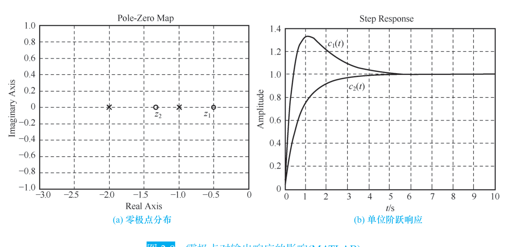

```cardlink
url: http://10.188.31.55:5244/Nextcloud/School/自动控制原理/
title: "自动控制原理 · 课程课件与复习笔记"
description: "中南大学自动化学院《自动控制原理》的课件、教材与复习笔记"
host: 10.188.31.55:5244
```

[← 返回《自动控制原理》目录](../)

## 第 0 章 前置知识

### 拉普拉斯变换：把微分方程变成代数方程

整门课的第一个工具是拉普拉斯变换。它把时域的微分方程搬进复频域，微分变成乘法，求解就从"解微分方程"变成"解代数方程"。教材把它列为线性定常微分方程的求解方法之一，与经典法并列 [自动控制原理（第八版） (胡寿松、姜斌、张绍杰) (z-library.sk, 1lib.sk, z-lib.sk)(1).pdf · p.38](http://10.188.31.55:5244/Nextcloud/School/自动控制原理/%E8%87%AA%E5%8A%A8%E6%8E%A7%E5%88%B6%E5%8E%9F%E7%90%86%EF%BC%88%E7%AC%AC%E5%85%AB%E7%89%88%EF%BC%89%20(%E8%83%A1%E5%AF%BF%E6%9D%BE%E3%80%81%E5%A7%9C%E6%96%8C%E3%80%81%E5%BC%A0%E7%BB%8D%E6%9D%B0)%20(z-library.sk,%201lib.sk,%20z-lib.sk)(1).pdf#page=38)。

**拉普拉斯变换**（Laplace transform）的定义式是把时域函数 $f(t)$ 映射成复频域函数 $F(s)$：

$$
F(s)=\int_0^{\infty} f(t)e^{-st}\,dt
$$

定义本身不产生什么魔力，产生魔力的是它带来的三条换算规则。第一条是微分规则，求导变成乘 $s$：

$$
\mathcal{L}\left[\frac{\mathrm{d}f(t)}{\mathrm{d}t}\right]=sF(s)-f(0)
$$

初始值不为零时，右边会多出 $-f(0)$、$-sf(0)-f'(0)$ 这些项，传递函数就不再是纯输入输出之比。第二条是积分规则，积分变成除 $s$：

$$
\mathcal{L}\left[\int_0^t f(\tau)\,\mathrm{d}\tau\right]=\frac{F(s)}{s}
$$

第三条是线性规则，可以逐项拆开算：

$$
\mathcal{L}[af(t)+bg(t)]=aF(s)+bG(s)
$$

> [!IMPORTANT] **终值定理**（final value theorem）
> 有了它就不必求反变换就能拿到稳态值：
>
> $$f(\infty)=\lim_{t\to\infty}f(t)=\lim_{s\to 0}sF(s)$$
>
> 适用条件是 $sF(s)$ 的全部极点都在左半 $s$ 平面，原点最多允许一个一阶极点。条件不满足时右边极限不存在，算出来的是错答案。教材用它从 $s$ 域直接读出网络电压的初值和终值 [自动控制原理（第八版） (胡寿松、姜斌、张绍杰) (z-library.sk, 1lib.sk, z-lib.sk)(1).pdf · p.39](http://10.188.31.55:5244/Nextcloud/School/自动控制原理/%E8%87%AA%E5%8A%A8%E6%8E%A7%E5%88%B6%E5%8E%9F%E7%90%86%EF%BC%88%E7%AC%AC%E5%85%AB%E7%89%88%EF%BC%89%20(%E8%83%A1%E5%AF%BF%E6%9D%BE%E3%80%81%E5%A7%9C%E6%96%8C%E3%80%81%E5%BC%A0%E7%BB%8D%E6%9D%B0)%20(z-library.sk,%201lib.sk,%20z-lib.sk)(1).pdf#page=39)。第 3 章算稳态误差全靠这一条。

常用变换对里只需要先记住两条：单位阶跃 $1(t)$ 对应 $1/s$，单位斜坡 $t$ 对应 $1/s^2$。完整的变换对表在蜂考课件里 [自动控制原理【蜂考系统课】(1).pdf · p.12](http://10.188.31.55:5244/Nextcloud/School/自动控制原理/%E8%87%AA%E5%8A%A8%E6%8E%A7%E5%88%B6%E5%8E%9F%E7%90%86%E3%80%90%E8%9C%82%E8%80%83%E7%B3%BB%E7%BB%9F%E8%AF%BE%E3%80%91(1).pdf#page=12)。

### 复数与 $s$ 平面

复频域变量 $s$ 本身是一个复数，写成直角坐标和极坐标两种形式：

$$
s=\sigma+j\omega \qquad s=|s|\,e^{j\angle s}
$$

$|s|=\sqrt{\sigma^2+\omega^2}$ 是到原点的距离，$\angle s=\arctan(\omega/\sigma)$ 是与正实轴的夹角，注意象限修正。一个实系数多项式的非实根必成共轭对出现，$\bar{s}=\sigma-j\omega$。

$s$ 平面就是复平面上按实部 $\sigma$ 和虚部 $\omega$ 画的一张图：横轴实部，纵轴虚部。位置决定一切行为。连续系统稳定的充要条件是传递函数的极点全部落在左半平面（$\sigma<0$）；极点落在虚轴上是临界稳定；极点跑到右半平面，响应就发散。

教材用一对零极点位置不同的传递函数说明零点的作用：两个系统的极点都在 $-1$ 和 $-2$，零点一个在 $-0.5$、一个在 $-1.33$，单位阶跃响应的形状就完全不同 [自动控制原理（第八版） (胡寿松、姜斌、张绍杰) (z-library.sk, 1lib.sk, z-lib.sk)(1).pdf · p.46](http://10.188.31.55:5244/Nextcloud/School/自动控制原理/%E8%87%AA%E5%8A%A8%E6%8E%A7%E5%88%B6%E5%8E%9F%E7%90%86%EF%BC%88%E7%AC%AC%E5%85%AB%E7%89%88%EF%BC%89%20(%E8%83%A1%E5%AF%BF%E6%9D%BE%E3%80%81%E5%A7%9C%E6%96%8C%E3%80%81%E5%BC%A0%E7%BB%8D%E6%9D%B0)%20(z-library.sk,%201lib.sk,%20z-lib.sk)(1).pdf#page=46)。



把极点画成几何图像的意义，第 3 章的时域指标、第 4 章的根轨迹、第 5 章的 Nyquist 判据，本质上都是在问同一句话：极点在哪儿。

### 从微分方程到传递函数

给定一个线性定常系统，输入 $r(t)$、输出 $c(t)$，建模走三步：


第三步整理出来的比值就是**传递函数**（transfer function），形式上是一个有理分式：

$$
G(s)=\frac{C(s)}{R(s)}=\frac{b_ms^{m}+\cdots+b_1s+b_0}{a_ns^{n}+\cdots+a_1s+a_0},\qquad n\ge m
$$

教材把"零初始条件下输出拉氏变换与输入拉氏变换之比"直接作为传递函数的定义 [自动控制原理（第八版） (胡寿松、姜斌、张绍杰) (z-library.sk, 1lib.sk, z-lib.sk)(1).pdf · p.43](http://10.188.31.55:5244/Nextcloud/School/自动控制原理/%E8%87%AA%E5%8A%A8%E6%8E%A7%E5%88%B6%E5%8E%9F%E7%90%86%EF%BC%88%E7%AC%AC%E5%85%AB%E7%89%88%EF%BC%89%20(%E8%83%A1%E5%AF%BF%E6%9D%BE%E3%80%81%E5%A7%9C%E6%96%8C%E3%80%81%E5%BC%A0%E7%BB%8D%E6%9D%B0)%20(z-library.sk,%201lib.sk,%20z-lib.sk)(1).pdf#page=43)。零初始条件有两层含义：输入在 $t\ge 0$ 才作用，系统加输入前处于稳定工作状态，输出及其各阶导数在 $t=0^-$ 也为零。

> [!WARNING] 电容在 $s$ 域不是 $C$，是 $\frac{1}{Cs}$
> 由 $i=C\frac{\mathrm{d}u}{\mathrm{d}t}$ 取拉氏变换得 $I(s)=CsU(s)$，反过来 $U(s)=\frac{1}{Cs}I(s)$，所以电容的 $s$ 域等效阻抗是 $\frac{1}{Cs}$。写成 $C$ 是零分操作。电感是 $Ls$，电阻仍是 $R$ [2.md · p.13](http://10.188.31.55:5244/Nextcloud/School/自动控制原理/2.md)。教材在无源网络一节给出同样的结论：电容 $C$ 的复数阻抗为 $1/(Cs)$，电感 $L$ 为 $Ls$ [自动控制原理（第八版） (胡寿松、姜斌、张绍杰) (z-library.sk, 1lib.sk, z-lib.sk)(1).pdf · p.50](http://10.188.31.55:5244/Nextcloud/School/自动控制原理/%E8%87%AA%E5%8A%A8%E6%8E%A7%E5%88%B6%E5%8E%9F%E7%90%86%EF%BC%88%E7%AC%AC%E5%85%AB%E7%89%88%EF%BC%89%20(%E8%83%A1%E5%AF%BF%E6%9D%BE%E3%80%81%E5%A7%9C%E6%96%8C%E3%80%81%E5%BC%A0%E7%BB%8D%E6%9D%B0)%20(z-library.sk,%201lib.sk,%20z-lib.sk)(1).pdf#page=50)。

### 矩阵与代数工具

后面几章不需要整门线性代数，只要四件工具：

- **行列式展开**。$2\times 2$、$3\times 3$ 的展开式要能随时写出来。梅森增益公式就是把克拉默法则解出的分子分母，翻译成信号流图上的通路和回路 [自动控制原理（第八版） (胡寿松、姜斌、张绍杰) (z-library.sk, 1lib.sk, z-lib.sk)(1).pdf · p.66](http://10.188.31.55:5244/Nextcloud/School/自动控制原理/%E8%87%AA%E5%8A%A8%E6%8E%A7%E5%88%B6%E5%8E%9F%E7%90%86%EF%BC%88%E7%AC%AC%E5%85%AB%E7%89%88%EF%BC%89%20(%E8%83%A1%E5%AF%BF%E6%9D%BE%E3%80%81%E5%A7%9C%E6%96%8C%E3%80%81%E5%BC%A0%E7%BB%8D%E6%9D%B0)%20(z-library.sk,%201lib.sk,%20z-lib.sk)(1).pdf#page=66)。
- **综合除法**。已知多项式的一个根，用它除出商多项式，剩下的根就是商的根。第 4 章已知一个闭环极点求其余极点必用。
- **根的共轭性**。实系数多项式的根成共轭对出现，所以根轨迹关于实轴对称。
- **特征方程的系数**。劳斯判据只看系数不看根，第 3 章列劳斯表时用。

这四件工具在第 2 章会直接派上用场：梅森公式推导、方框图化简、RC 网络建模。
