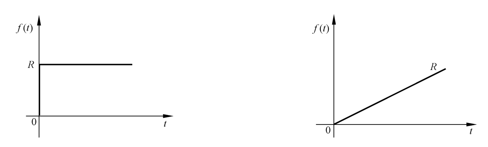
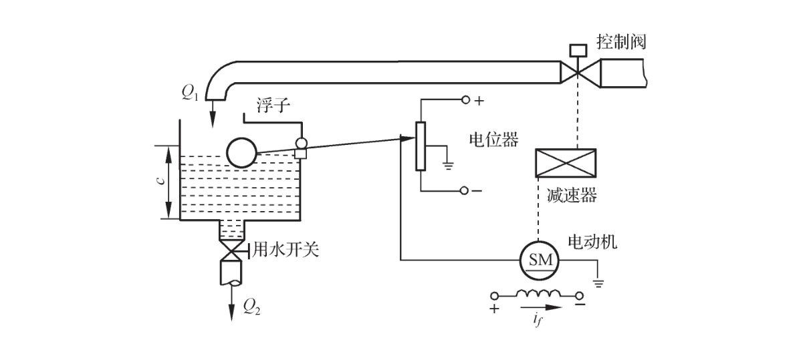

```cardlink
url: http://10.188.31.55:5244/Nextcloud/School/自动控制原理/
title: "自动控制原理 · 课程课件与复习笔记"
description: "中南大学自动化学院《自动控制原理》的课件、教材与复习笔记"
host: 10.188.31.55:5244
```

[← 返回《自动控制原理》目录](../)

## 第 1 章 自动控制的一般概念

### 自动控制的定义与组成

**自动控制**（automatic control）指在没有人直接参与的情况下，利用外加的设备或装置，使机器、设备或生产过程的某个工作状态或参数自动地按照预定规律运行。人靠手拧旋钮、脚踩踏板完成的叫手动控制 [自动控制原理（第八版） (胡寿松、姜斌、张绍杰) (z-library.sk, 1lib.sk, z-lib.sk)(1).pdf · p.9](http://10.188.31.55:5244/Nextcloud/School/自动控制原理/%E8%87%AA%E5%8A%A8%E6%8E%A7%E5%88%B6%E5%8E%9F%E7%90%86%EF%BC%88%E7%AC%AC%E5%85%AB%E7%89%88%EF%BC%89%20(%E8%83%A1%E5%AF%BF%E6%9D%BE%E3%80%81%E5%A7%9C%E6%96%8C%E3%80%81%E5%BC%A0%E7%BB%8D%E6%9D%B0)%20(z-library.sk,%201lib.sk,%20z-lib.sk)(1).pdf#page=9)。蜂考课件把研究对象限定为单输入、单输出的线性定常控制系统 [自动控制原理【蜂考系统课】(1).pdf · p.3](http://10.188.31.55:5244/Nextcloud/School/自动控制原理/%E8%87%AA%E5%8A%A8%E6%8E%A7%E5%88%B6%E5%8E%9F%E7%90%86%E3%80%90%E8%9C%82%E8%80%83%E7%B3%BB%E7%BB%9F%E8%AF%BE%E3%80%91(1).pdf#page=3)。

被控制的设备叫**被控对象**（controlled plant），如电机、水箱、加热炉；要求被控制住的物理量叫**被控量**，如转速、液位、温度，也就是输出 $C$；希望被控量达到的目标值叫**给定值**，即输入 $R$。

为完成"测量、比较、放大、执行"这些动作，控制装置要配几类功能元件 [自动控制原理（第八版） (胡寿松、姜斌、张绍杰) (z-library.sk, 1lib.sk, z-lib.sk)(1).pdf · p.13](http://10.188.31.55:5244/Nextcloud/School/自动控制原理/%E8%87%AA%E5%8A%A8%E6%8E%A7%E5%88%B6%E5%8E%9F%E7%90%86%EF%BC%88%E7%AC%AC%E5%85%AB%E7%89%88%EF%BC%89%20(%E8%83%A1%E5%AF%BF%E6%9D%BE%E3%80%81%E5%A7%9C%E6%96%8C%E3%80%81%E5%BC%A0%E7%BB%8D%E6%9D%B0)%20(z-library.sk,%201lib.sk,%20z-lib.sk)(1).pdf#page=13)：**给定元件**给出与期望被控量对应的输入，如电位器；**测量元件**把被控量检测出来并转换成信号，如测速发电机、热电偶；**比较元件**把给定值与测量值相减得到偏差；**放大元件**把微弱的偏差放大到能推动执行机构；**执行器**直接推动被控对象，如阀门、电动机；**控制器**按偏差算出控制量；**校正元件**用来改善系统性能。

### 反馈与两种控制方式

把输出量取出来送回输入端、并与输入信号比较产生偏差信号的过程，叫**反馈**（feedback）。输入与反馈相减、偏差越来越小，是负反馈；相加、偏差越滚越大，是正反馈。用负反馈并利用偏差进行控制的过程叫反馈控制，信号走成闭合的圈，又叫闭环控制。控制装置与被控对象之间只有顺向作用、输出不影响控制作用的，是开环控制 [自动控制原理（第八版） (胡寿松、姜斌、张绍杰) (z-library.sk, 1lib.sk, z-lib.sk)(1).pdf · p.14](http://10.188.31.55:5244/Nextcloud/School/自动控制原理/%E8%87%AA%E5%8A%A8%E6%8E%A7%E5%88%B6%E5%8E%9F%E7%90%86%EF%BC%88%E7%AC%AC%E5%85%AB%E7%89%88%EF%BC%89%20(%E8%83%A1%E5%AF%BF%E6%9D%BE%E3%80%81%E5%A7%9C%E6%96%8C%E3%80%81%E5%BC%A0%E7%BB%8D%E6%9D%B0)%20(z-library.sk,%201lib.sk,%20z-lib.sk)(1).pdf#page=14)。

开环与闭环的差别是工程上最实际的取舍。蜂考课件列得很直白：开环系统结构简单、比较经济，但无法消除干扰带来的误差；闭环系统具有抑制干扰的能力并能改善响应特性，代价是增加了系统的复杂性和不确定性 [自动控制原理【蜂考系统课】(1).pdf · p.6](http://10.188.31.55:5244/Nextcloud/School/自动控制原理/%E8%87%AA%E5%8A%A8%E6%8E%A7%E5%88%B6%E5%8E%9F%E7%90%86%E3%80%90%E8%9C%82%E8%80%83%E7%B3%BB%E7%BB%9F%E8%AF%BE%E3%80%91(1).pdf#page=6)。

下面是全书的认知锚点，也是六个变量的位置图：


输入量 $R$ 从左边进入，比较元件（圆圈）把输入与反馈相减，输出偏差 $E=R-B$；偏差经校正、放大后送到执行元件，执行元件推动被控对象，其输出就是输出量 $C$；输出量经测量元件送回比较点，这条通路叫主反馈通路，送回的量就是反馈信号 $B$。

教材的典型反馈控制系统方框图画得更完整，多出串联校正元件、局部反馈通路和一条从上方直接作用于被控对象的扰动通路 [自动控制原理（第八版） (胡寿松、姜斌、张绍杰) (z-library.sk, 1lib.sk, z-lib.sk)(1).pdf · p.14](http://10.188.31.55:5244/Nextcloud/School/自动控制原理/%E8%87%AA%E5%8A%A8%E6%8E%A7%E5%88%B6%E5%8E%9F%E7%90%86%EF%BC%88%E7%AC%AC%E5%85%AB%E7%89%88%EF%BC%89%20(%E8%83%A1%E5%AF%BF%E6%9D%BE%E3%80%81%E5%A7%9C%E6%96%8C%E3%80%81%E5%BC%A0%E7%BB%8D%E6%9D%B0)%20(z-library.sk,%201lib.sk,%20z-lib.sk)(1).pdf#page=14)。


只含一条主反馈通路的叫单回路系统，含两条及以上反馈通路的叫多回路系统。右上角那条扰动箭头是从外部直接作用在被控对象上的独立通路，既不是输入也不是反馈，画图时不要把它接到比较点。

> [!WARNING] 反馈的符号、扰动通路、$H=1$，三个最容易错
> 判断开环还是闭环只看一件事：输出有没有被送回输入端参与比较。只要结构图上输出到输入之间有一条闭合的反馈线，就是闭环。比较点旁边的 $+$ 还是$-$ 决定正负反馈，负反馈分母用加号 $1+GH$，正反馈用减号 $1-GH$，符号一错后面全错。扰动是独立通路，不是反馈。$H=1$ 只在测量元件是直接连线时成立，测速发电机、电位器、热电偶都会带来比例系数或动态特性，此时分母仍是 $1+GH$，但分子和稳态误差都要带上 $H$ [1.md · p.24](http://10.188.31.55:5244/Nextcloud/School/自动控制原理/1.md)。

闭环传递函数的来历可以逐步推出来。比较元件给出偏差 $E(s)=R(s)-B(s)$，反馈信号由输出经测量元件得到 $B(s)=H(s)C(s)$，偏差经前向环节作用到对象得到输出 $C(s)=G(s)E(s)$。把反馈关系代入前向关系再整理：

$$
C(s)=G(s)\bigl[R(s)-H(s)C(s)\bigr]
\;\Longrightarrow\;
C(s)\bigl[1+G(s)H(s)\bigr]=G(s)R(s)
$$

于是负反馈的闭环传递函数是：

$$
\Phi(s)=\frac{C(s)}{R(s)}=\frac{G(s)}{1+G(s)H(s)}
$$

分母令零就是闭环特征方程 $1+G(s)H(s)=0$，它的根是闭环极点，决定系统稳不稳、振不振，这是第 3 章判稳、第 4 章画根轨迹的出发点 [自动控制原理（第八版） (胡寿松、姜斌、张绍杰) (z-library.sk, 1lib.sk, z-lib.sk)(1).pdf · p.58](http://10.188.31.55:5244/Nextcloud/School/自动控制原理/%E8%87%AA%E5%8A%A8%E6%8E%A7%E5%88%B6%E5%8E%9F%E7%90%86%EF%BC%88%E7%AC%AC%E5%85%AB%E7%89%88%EF%BC%89%20(%E8%83%A1%E5%AF%BF%E6%9D%BE%E3%80%81%E5%A7%9C%E6%96%8C%E3%80%81%E5%BC%A0%E7%BB%8D%E6%9D%B0)%20(z-library.sk,%201lib.sk,%20z-lib.sk)(1).pdf#page=58)。比较点改成正反馈时，只需把推导中所有 $H(s)$ 前的减号改成加号，得到 $\Phi(s)=\dfrac{G(s)}{1-G(s)H(s)}$，特征方程相应变成 $1-G(s)H(s)=0$ [1.md · p.20](http://10.188.31.55:5244/Nextcloud/School/自动控制原理/1.md)。

### 按输入变化规律分类

教材按输入量是不是常数、是不是已知，把系统分成三类：**恒值系统**（regulating system）、**随动系统**（servo system）和**程序控制系统** [自动控制原理（第八版） (胡寿松、姜斌、张绍杰) (z-library.sk, 1lib.sk, z-lib.sk)(1).pdf · p.22](http://10.188.31.55:5244/Nextcloud/School/自动控制原理/%E8%87%AA%E5%8A%A8%E6%8E%A7%E5%88%B6%E5%8E%9F%E7%90%86%EF%BC%88%E7%AC%AC%E5%85%AB%E7%89%88%EF%BC%89%20(%E8%83%A1%E5%AF%BF%E6%9D%BE%E3%80%81%E5%A7%9C%E6%96%8C%E3%80%81%E5%BC%A0%E7%BB%8D%E6%9D%B0)%20(z-library.sk,%201lib.sk,%20z-lib.sk)(1).pdf#page=22)：

| 类型 | 输入 | 对输出的要求 | 例子 |
| --- | --- | --- | --- |
| 恒值系统 | 一个常值 | 被控量也等于常值 | 室温、液位、炉温 |
| 随动系统 | 预先未知的随时间任意变化的函数 | 以尽可能小的误差跟随 | 函数记录仪、火炮跟飞机 |
| 程序控制系统 | 按预定规律随时间变化的已知函数 | 迅速准确地复现 | 数控机床 |

一句话辨析：恒值系统输入不变，随动系统输入未知而变，程序控制系统输入已知而变。程序控制系统与随动系统的输入都是时间函数，区别就在已知与未知；恒值控制系统可以看成程序控制系统的特例 [自动控制原理（第八版） (胡寿松、姜斌、张绍杰) (z-library.sk, 1lib.sk, z-lib.sk)(1).pdf · p.23](http://10.188.31.55:5244/Nextcloud/School/自动控制原理/%E8%87%AA%E5%8A%A8%E6%8E%A7%E5%88%B6%E5%8E%9F%E7%90%86%EF%BC%88%E7%AC%AC%E5%85%AB%E7%89%88%EF%BC%89%20(%E8%83%A1%E5%AF%BF%E6%9D%BE%E3%80%81%E5%A7%9C%E6%96%8C%E3%80%81%E5%BC%A0%E7%BB%8D%E6%9D%B0)%20(z-library.sk,%201lib.sk,%20z-lib.sk)(1).pdf#page=23)。期末填空常考这三类系统的辨析 [自动控制原理【蜂考系统课】(1).pdf · p.5](http://10.188.31.55:5244/Nextcloud/School/自动控制原理/%E8%87%AA%E5%8A%A8%E6%8E%A7%E5%88%B6%E5%8E%9F%E7%90%86%E3%80%90%E8%9C%82%E8%80%83%E7%B3%BB%E7%BB%9F%E8%AF%BE%E3%80%91(1).pdf#page=5)。

### 性能要求与典型输入

不管哪一类系统，对被控量变化全过程提的要求都是三条。**稳定性**是扰动后偏差随时间衰减到零，是正常工作的先决条件。**快速性**管过渡过程的时间长短和振荡幅度大小。**准确性**管过渡过程结束后的稳态值与期望值之间的残余误差。合起来就是"稳、快、准"，而稳定性是三者中最基本的，填空时答成准确性就错了 [自动控制原理（第八版） (胡寿松、姜斌、张绍杰) (z-library.sk, 1lib.sk, z-lib.sk)(1).pdf · p.23](http://10.188.31.55:5244/Nextcloud/School/自动控制原理/%E8%87%AA%E5%8A%A8%E6%8E%A7%E5%88%B6%E5%8E%9F%E7%90%86%EF%BC%88%E7%AC%AC%E5%85%AB%E7%89%88%EF%BC%89%20(%E8%83%A1%E5%AF%BF%E6%9D%BE%E3%80%81%E5%A7%9C%E6%96%8C%E3%80%81%E5%BC%A0%E7%BB%8D%E6%9D%B0)%20(z-library.sk,%201lib.sk,%20z-lib.sk)(1).pdf#page=23)。快速性与准确性的具体说法在下一页 [自动控制原理（第八版） (胡寿松、姜斌、张绍杰) (z-library.sk, 1lib.sk, z-lib.sk)(1).pdf · p.24](http://10.188.31.55:5244/Nextcloud/School/自动控制原理/%E8%87%AA%E5%8A%A8%E6%8E%A7%E5%88%B6%E5%8E%9F%E7%90%86%EF%BC%88%E7%AC%AC%E5%85%AB%E7%89%88%EF%BC%89%20(%E8%83%A1%E5%AF%BF%E6%9D%BE%E3%80%81%E5%A7%9C%E6%96%8C%E3%80%81%E5%BC%A0%E7%BB%8D%E6%9D%B0)%20(z-library.sk,%201lib.sk,%20z-lib.sk)(1).pdf#page=24)。

为了让不同的系统能用同一套指标比较，工程上选几种确定性函数作典型输入：阶跃函数在 $t=0$ 突然跳到一个幅值并保持不变，斜坡函数以恒定速率线性增长，抛物线函数的加速度为常数、增长速度随时间加快。评价动态性能一般以阶跃响应为依据 [自动控制原理（第八版） (胡寿松、姜斌、张绍杰) (z-library.sk, 1lib.sk, z-lib.sk)(1).pdf · p.24](http://10.188.31.55:5244/Nextcloud/School/自动控制原理/%E8%87%AA%E5%8A%A8%E6%8E%A7%E5%88%B6%E5%8E%9F%E7%90%86%EF%BC%88%E7%AC%AC%E5%85%AB%E7%89%88%EF%BC%89%20(%E8%83%A1%E5%AF%BF%E6%9D%BE%E3%80%81%E5%A7%9C%E6%96%8C%E3%80%81%E5%BC%A0%E7%BB%8D%E6%9D%B0)%20(z-library.sk,%201lib.sk,%20z-lib.sk)(1).pdf#page=24)。两种函数的图形在教材下一页 [自动控制原理（第八版） (胡寿松、姜斌、张绍杰) (z-library.sk, 1lib.sk, z-lib.sk)(1).pdf · p.25](http://10.188.31.55:5244/Nextcloud/School/自动控制原理/%E8%87%AA%E5%8A%A8%E6%8E%A7%E5%88%B6%E5%8E%9F%E7%90%86%EF%BC%88%E7%AC%AC%E5%85%AB%E7%89%88%EF%BC%89%20(%E8%83%A1%E5%AF%BF%E6%9D%BE%E3%80%81%E5%A7%9C%E6%96%8C%E3%80%81%E5%BC%A0%E7%BB%8D%E6%9D%B0)%20(z-library.sk,%201lib.sk,%20z-lib.sk)(1).pdf#page=25)。



### 一个完整例子：液位自动控制

教材习题给了一个液位自动控制系统原理图，把前面说的四件套一次凑齐 [自动控制原理（第八版） (胡寿松、姜斌、张绍杰) (z-library.sk, 1lib.sk, z-lib.sk)(1).pdf · p.29](http://10.188.31.55:5244/Nextcloud/School/自动控制原理/%E8%87%AA%E5%8A%A8%E6%8E%A7%E5%88%B6%E5%8E%9F%E7%90%86%EF%BC%88%E7%AC%AC%E5%85%AB%E7%89%88%EF%BC%89%20(%E8%83%A1%E5%AF%BF%E6%9D%BE%E3%80%81%E5%A7%9C%E6%96%8C%E3%80%81%E5%BC%A0%E7%BB%8D%E6%9D%B0)%20(z-library.sk,%201lib.sk,%20z-lib.sk)(1).pdf#page=29)。



水箱是被控对象，液面高度 $c$ 是被控量也就是输出，浮子与电位器是测量元件，电动机与阀门是执行器，比较与放大环节是控制器。当出水量 $Q_2$ 增大使液位下降，浮子下降、电位器输出变化，与给定值比较后产生偏差，电动机带动阀门开大进水 $Q_1$，液位回升到给定值。全程无人动手，这就是自动控制。
