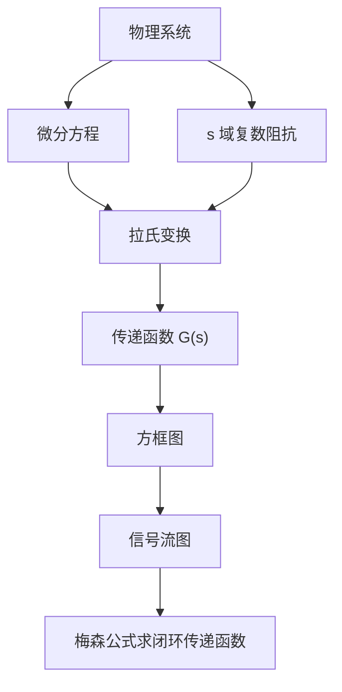
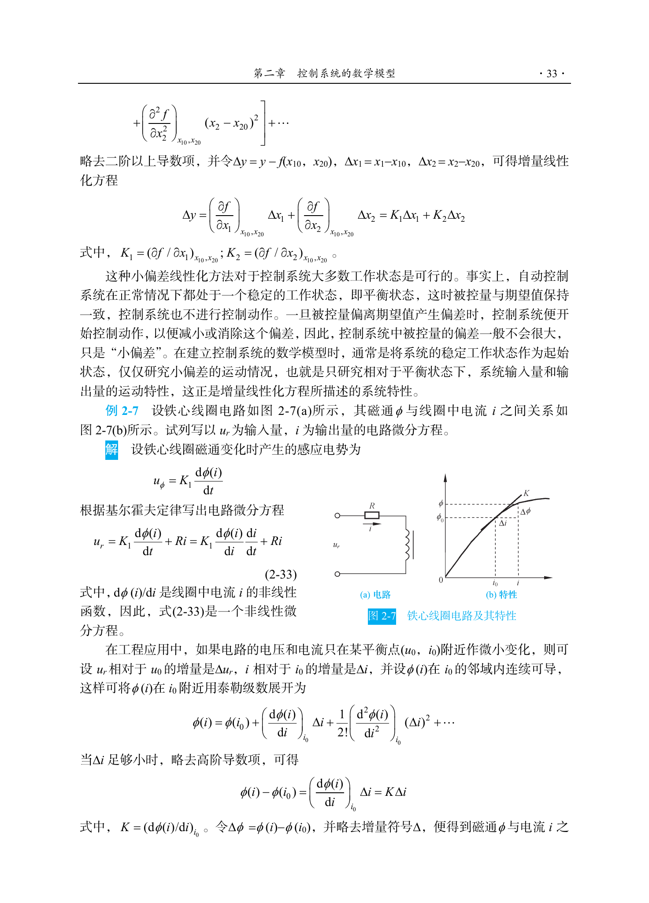
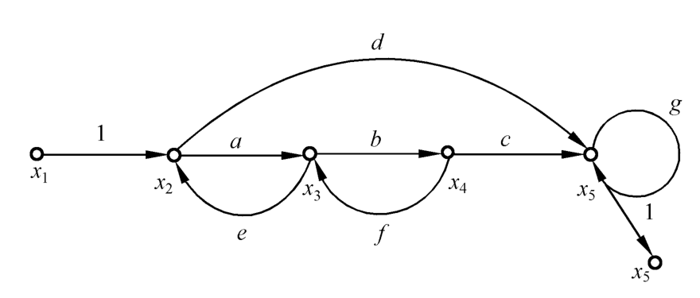
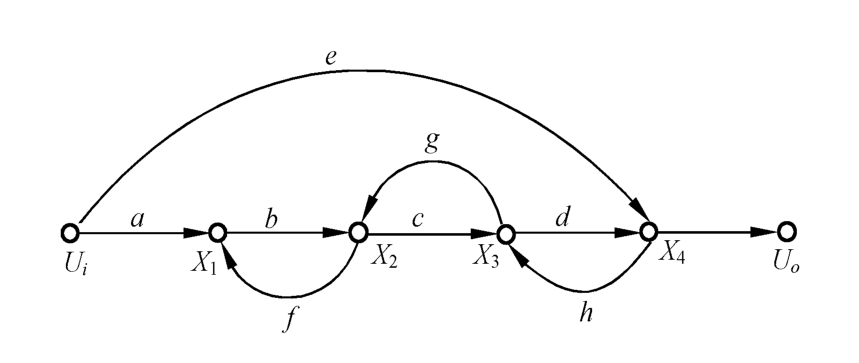
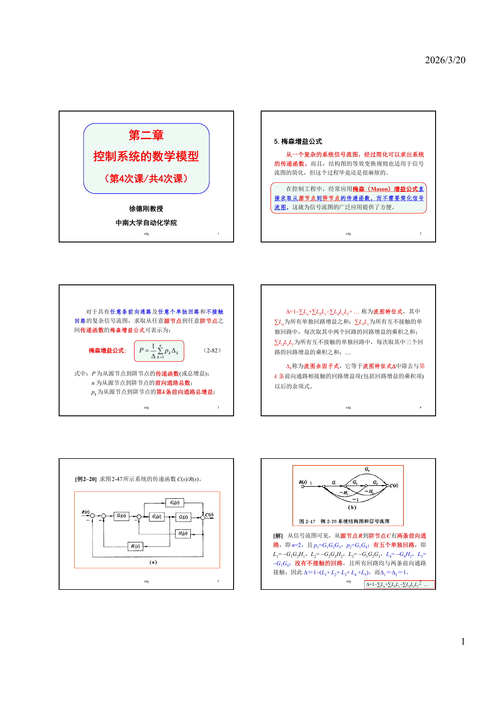

```cardlink
url: http://10.188.31.55:5244/Nextcloud/School/自动控制原理/
title: "自动控制原理 · 课程课件与复习笔记"
description: "中南大学自动化学院《自动控制原理》的课件、教材与复习笔记"
host: 10.188.31.55:5244
```

[← 返回《自动控制原理》目录](../)

## 第 2 章 控制系统的数学模型

### 三套坐标

设想一个真实电路：电源经过两级 RC 滤波，中间接一个运放，运放输出又经电容反馈回第一级。如果只会列微分方程、解微分方程，那么每改一个电阻值整条推导都要重来，方程还可能是四五阶，解出来的时间表达式长到几页纸，想比较"哪个参数让它更稳"就变成了猜谜。

省力的办法是换一套描述系统的坐标，本章建立的三套坐标分别管三件事 [自动控制原理（第八版） (胡寿松、姜斌、张绍杰) (z-library.sk, 1lib.sk, z-lib.sk)(1).pdf · p.33](http://10.188.31.55:5244/Nextcloud/School/自动控制原理/%E8%87%AA%E5%8A%A8%E6%8E%A7%E5%88%B6%E5%8E%9F%E7%90%86%EF%BC%88%E7%AC%AC%E5%85%AB%E7%89%88%EF%BC%89%20(%E8%83%A1%E5%AF%BF%E6%9D%BE%E3%80%81%E5%A7%9C%E6%96%8C%E3%80%81%E5%BC%A0%E7%BB%8D%E6%9D%B0)%20(z-library.sk,%201lib.sk,%20z-lib.sk)(1).pdf#page=33)：



- **传递函数** $G(s)$：把时域微分方程搬到复频域，整个系统压缩成一个有理分式。改一个参数只改一个系数，不必重新解方程。
- **方框图（结构图）**：把系统拆成一个个方块，用箭头画出信号从哪来到哪去，既看得见结构，又能做代数运算。
- **信号流图与梅森增益公式**：当系统有三个以上回路、回路还互相交叉时，"由内向外逐步化简"会越化越乱。梅森公式让我们一步写出闭环传递函数，不做任何化简。

本讲义后面的六章全部建在这三套坐标上。

### 线性化：小偏差法

真实系统里非线性环节占大多数：放大器和电磁元件的饱和特性、运动部件的死区、间隙和摩擦。数学上处理不了非线性方程，教材的做法是在平衡点附近线性化。系统在正常工作状态下处于平衡状态，被控量与期望值保持一致，只有当被控量偏离期望值产生偏差时控制才动作，所以偏差本身不大，用泰勒级数在平衡点展开并略去二阶以上导数项，得到增量线性化方程：

$$
\Delta y=\left(\frac{\partial f}{\partial x_1}\right)_{x_1=x_{10},\,x_2=x_{20}}\Delta x_1+\left(\frac{\partial f}{\partial x_2}\right)_{x_1=x_{10},\,x_2=x_{20}}\Delta x_2
$$

教材用铁心线圈做例子：磁通 $\phi$ 与电流 $i$ 之间是非线性关系，在平衡点 $(u_0,i_0)$ 附近展开后略去高阶项，得到 $\phi(i)-\phi(i_0)=K\Delta i$ 的线性关系 [自动控制原理（第八版） (胡寿松、姜斌、张绍杰) (z-library.sk, 1lib.sk, z-lib.sk)(1).pdf · p.41](http://10.188.31.55:5244/Nextcloud/School/自动控制原理/%E8%87%AA%E5%8A%A8%E6%8E%A7%E5%88%B6%E5%8E%9F%E7%90%86%EF%BC%88%E7%AC%AC%E5%85%AB%E7%89%88%EF%BC%89%20(%E8%83%A1%E5%AF%BF%E6%9D%BE%E3%80%81%E5%A7%9C%E6%96%8C%E3%80%81%E5%BC%A0%E7%BB%8D%E6%9D%B0)%20(z-library.sk,%201lib.sk,%20z-lib.sk)(1).pdf#page=41)。



教材强调这种小偏差法对控制系统大多数工作状态是可行的：控制系统正常情况下都处在一个稳定的工作状态，即平衡状态。

### 传递函数与复数阻抗

传递函数的定义、零初始条件、性质在第 0 章已经给过。教材在定义之后给出两个实用性质：传递函数是复变量 $s$ 的有理分式函数，$m\le n$，且所有系数都是实数；分母多项式是特征多项式，它的根是传递函数的极点 [自动控制原理（第八版） (胡寿松、姜斌、张绍杰) (z-library.sk, 1lib.sk, z-lib.sk)(1).pdf · p.43](http://10.188.31.55:5244/Nextcloud/School/自动控制原理/%E8%87%AA%E5%8A%A8%E6%8E%A7%E5%88%B6%E5%8E%9F%E7%90%86%EF%BC%88%E7%AC%AC%E5%85%AB%E7%89%88%EF%BC%89%20(%E8%83%A1%E5%AF%BF%E6%9D%BE%E3%80%81%E5%A7%9C%E6%96%8C%E3%80%81%E5%BC%A0%E7%BB%8D%E6%9D%B0)%20(z-library.sk,%201lib.sk,%20z-lib.sk)(1).pdf#page=43)。

有了传递函数，建模有两条路。一条是老老实实列微分方程再取拉氏变换；另一条更快：在 $s$ 域里电阻、电容、电感都可以当成一个"电阻"，电阻仍是 $R$，电容是 $\frac{1}{Cs}$，电感是 $Ls$，串联相加、并联按积除以和，于是整个电路可以当分压器算。讲师笔记把这套办法整理成一条万能公式 [复习_建模与结构图化简.md · p.27](http://10.188.31.55:5244/Nextcloud/School/自动控制原理/%E5%A4%8D%E4%B9%A0_%E5%BB%BA%E6%A8%A1%E4%B8%8E%E7%BB%93%E6%9E%84%E5%9B%BE%E5%8C%96%E7%AE%80.md)：

$$
G(s)=\frac{U_o(s)}{U_i(s)}=\frac{Z_{\text{输出侧}}}{Z_{\text{总}}}
$$

教材把 RLC 无源网络用复数阻抗重画了一遍：$Z_1=R+Ls$，$Z_2=\frac{1}{Cs}$，直接按分压器写出传递函数 [自动控制原理（第八版） (胡寿松、姜斌、张绍杰) (z-library.sk, 1lib.sk, z-lib.sk)(1).pdf · p.50](http://10.188.31.55:5244/Nextcloud/School/自动控制原理/%E8%87%AA%E5%8A%A8%E6%8E%A7%E5%88%B6%E5%8E%9F%E7%90%86%EF%BC%88%E7%AC%AC%E5%85%AB%E7%89%88%EF%BC%89%20(%E8%83%A1%E5%AF%BF%E6%9D%BE%E3%80%81%E5%A7%9C%E6%96%8C%E3%80%81%E5%BC%A0%E7%BB%8D%E6%9D%B0)%20(z-library.sk,%201lib.sk,%20z-lib.sk)(1).pdf#page=50)。


两个例子走一遍。RC 低通滤波器，电阻 $R$ 串联、电容 $C$ 并联到地，输出取自电容：

$$
G(s)=\frac{Z_C}{Z_R+Z_C}=\frac{\frac{1}{Cs}}{R+\frac{1}{Cs}}=\frac{1}{RCs+1}=\frac{1}{Ts+1}
$$

时间常数 $T=RC$，这是一个惯性环节，转折频率 $\omega=1/T$ [复习_建模与结构图化简.md · p.43](http://10.188.31.55:5244/Nextcloud/School/自动控制原理/%E5%A4%8D%E4%B9%A0_%E5%BB%BA%E6%A8%A1%E4%B8%8E%E7%BB%93%E6%9E%84%E5%9B%BE%E5%8C%96%E7%AE%80.md)。RLC 串联电路，输出取自电容：

$$
G(s)=\frac{Z_C}{Z_R+Z_L+Z_C}=\frac{1}{LCs^2+RCs+1}
$$

对照二阶振荡环节的标准形式，可以读出无阻尼自然频率 $\omega_n=\frac{1}{\sqrt{LC}}$ 和阻尼比 $\zeta=\frac{R}{2}\sqrt{\frac{C}{L}}$ [复习_建模与结构图化简.md · p.111](http://10.188.31.55:5244/Nextcloud/School/自动控制原理/%E5%A4%8D%E4%B9%A0_%E5%BB%BA%E6%A8%A1%E4%B8%8E%E7%BB%93%E6%9E%84%E5%9B%BE%E5%8C%96%E7%AE%80.md)。取 $L=1$、$C=1$、$R=2$ 时 $G(s)=\frac{1}{(s+1)^2}$，$\zeta=1$，属临界阻尼，输出不振荡。

有源网络多一条运放的规矩：虚短 $U_+=U_-$、虚断 $I_+=I_-=0$。反相放大器的传递函数就是一个分压比：

$$
G(s)=\frac{U_o(s)}{U_i(s)}=-\frac{Z_f(s)}{Z_i(s)}
$$

蜂考课件用一个反相放大器把输入电阻 $R_1$ 和反馈支路 $R_2$ 串电容算到底，结论是 $G(s)=-\frac{R_2Cs+1}{R_1Cs}$ [自动控制原理【蜂考系统课】(1).pdf · p.20](http://10.188.31.55:5244/Nextcloud/School/自动控制原理/%E8%87%AA%E5%8A%A8%E6%8E%A7%E5%88%B6%E5%8E%9F%E7%90%86%E3%80%90%E8%9C%82%E8%80%83%E7%B3%BB%E7%BB%9F%E8%AF%BE%E3%80%91(1).pdf#page=20)。

> [!TIP] 从电路图到结构图的两条连线法则
> 顺着电流方向走，电流由前级电压减去后级电压除以阻抗得到，前级电压是正输入（顺流生）；逆着看，后级电压升高会减少电流，后级电压是负反馈输入（逆流挡）。看到电容直接画成积分环节 $\frac{1}{Cs}$ [2.md · p.28](http://10.188.31.55:5244/Nextcloud/School/自动控制原理/2.md)。

### 机械系统与机电系统建模

建模对象不限于电路。教材给出的机械位移系统例子由牛顿第二定律列方程，齿轮系通过线速度相同、功率相同的关系把后级负载归化到前级轴上 [自动控制原理（第八版） (胡寿松、姜斌、张绍杰) (z-library.sk, 1lib.sk, z-lib.sk)(1).pdf · p.35](http://10.188.31.55:5244/Nextcloud/School/自动控制原理/%E8%87%AA%E5%8A%A8%E6%8E%A7%E5%88%B6%E5%8E%9F%E7%90%86%EF%BC%88%E7%AC%AC%E5%85%AB%E7%89%88%EF%BC%89%20(%E8%83%A1%E5%AF%BF%E6%9D%BE%E3%80%81%E5%A7%9C%E6%96%8C%E3%80%81%E5%BC%A0%E7%BB%8D%E6%9D%B0)%20(z-library.sk,%201lib.sk,%20z-lib.sk)(1).pdf#page=35)。


弹簧-质量-阻尼器系统由牛顿运动定律得到运动方程，阻尼器的阻尼力与速度成正比、弹簧的弹性力与位移成正比：

$$
m\frac{\mathrm{d}^2x(t)}{\mathrm{d}t^2}+f\frac{\mathrm{d}x(t)}{\mathrm{d}t}+Kx(t)=F(t)
$$

齿轮系用两个关系把转速和转矩联系起来：啮合齿轮线速度相同 $\omega_1r_1=\omega_2r_2$，传递功率相同 $M_1\omega_1=M_2\omega_2$，于是 $\omega_2=\frac{Z_1}{Z_2}\omega_1$、$M_1=\frac{Z_1}{Z_2}M_2$。电枢控制的直流电动机是三式：电枢回路的电压平衡 $u_a=R_ai+L_a\frac{\mathrm{d}i_a}{\mathrm{d}t}+E_a$，电磁转矩 $M_m=C_mi_a$，电动机轴上的转矩平衡 $J_m\frac{\mathrm{d}\omega_m}{\mathrm{d}t}+f_m\omega_m=M_m-M_c$ [自动控制原理（第八版） (胡寿松、姜斌、张绍杰) (z-library.sk, 1lib.sk, z-lib.sk)(1).pdf · p.34](http://10.188.31.55:5244/Nextcloud/School/自动控制原理/%E8%87%AA%E5%8A%A8%E6%8E%A7%E5%88%B6%E5%8E%9F%E7%90%86%EF%BC%88%E7%AC%AC%E5%85%AB%E7%89%88%EF%BC%89%20(%E8%83%A1%E5%AF%BF%E6%9D%BE%E3%80%81%E5%A7%9C%E6%96%8C%E3%80%81%E5%BC%A0%E7%BB%8D%E6%9D%B0)%20(z-library.sk,%201lib.sk,%20z-lib.sk)(1).pdf#page=34)。

RLC 无源网络和弹簧-质量-阻尼器系统，数学形式都是二阶微分方程：电容储能对应弹簧势能，电感对应质量，电阻对应阻尼。教材把这类系统称为**相似系统**，搞懂一个电网络就等于搞懂对应的机械系统，仿真时也能用一个模型代替另一个 [自动控制原理（第八版） (胡寿松、姜斌、张绍杰) (z-library.sk, 1lib.sk, z-lib.sk)(1).pdf · p.38](http://10.188.31.55:5244/Nextcloud/School/自动控制原理/%E8%87%AA%E5%8A%A8%E6%8E%A7%E5%88%B6%E5%8E%9F%E7%90%86%EF%BC%88%E7%AC%AC%E5%85%AB%E7%89%88%EF%BC%89%20(%E8%83%A1%E5%AF%BF%E6%9D%BE%E3%80%81%E5%A7%9C%E6%96%8C%E3%80%81%E5%BC%A0%E7%BB%8D%E6%9D%B0)%20(z-library.sk,%201lib.sk,%20z-lib.sk)(1).pdf#page=38)。

### 方框图：三种基本连接

**方框图**（block diagram）用方块和箭头表示各环节的信号流向，每个方块里写一个传递函数，整个系统可以逐步化简成单个方块。再复杂的结构图，化简到底也只是三种连接的反复套用。

**串联**（cascade connection）。两个方块首尾相接，前一个的输出就是后一个的输入，等效传递函数是两者相乘：

$$
G=G_1G_2
$$

**并联**（parallel connection）。两个方块输入相同、输出相加或相减，等效传递函数是代数和：

$$
G=G_1\pm G_2
$$

**反馈**（feedback connection）。前向通路 $G(s)$、反馈通路 $H(s)$，负反馈的等效方框是：

$$
\Phi(s)=\frac{G(s)}{1+G(s)H(s)}
$$

正反馈时分母换成 $1-G(s)H(s)$。教材把这三种连接连同"结构图简化规则"表放在同一节里，串联与并联的等效式在 [自动控制原理（第八版） (胡寿松、姜斌、张绍杰) (z-library.sk, 1lib.sk, z-lib.sk)(1).pdf · p.57](http://10.188.31.55:5244/Nextcloud/School/自动控制原理/%E8%87%AA%E5%8A%A8%E6%8E%A7%E5%88%B6%E5%8E%9F%E7%90%86%EF%BC%88%E7%AC%AC%E5%85%AB%E7%89%88%EF%BC%89%20(%E8%83%A1%E5%AF%BF%E6%9D%BE%E3%80%81%E5%A7%9C%E6%96%8C%E3%80%81%E5%BC%A0%E7%BB%8D%E6%9D%B0)%20(z-library.sk,%201lib.sk,%20z-lib.sk)(1).pdf#page=57)，反馈连接的等效式在 [自动控制原理（第八版） (胡寿松、姜斌、张绍杰) (z-library.sk, 1lib.sk, z-lib.sk)(1).pdf · p.58](http://10.188.31.55:5244/Nextcloud/School/自动控制原理/%E8%87%AA%E5%8A%A8%E6%8E%A7%E5%88%B6%E5%8E%9F%E7%90%86%EF%BC%88%E7%AC%AC%E5%85%AB%E7%89%88%EF%BC%89%20(%E8%83%A1%E5%AF%BF%E6%9D%BE%E3%80%81%E5%A7%9C%E6%96%8C%E3%80%81%E5%BC%A0%E7%BB%8D%E6%9D%B0)%20(z-library.sk,%201lib.sk,%20z-lib.sk)(1).pdf#page=58)。蜂考课件把方框图等效变换列成与复数阻抗法并列的必考考点 [自动控制原理【蜂考系统课】(1).pdf · p.20](http://10.188.31.55:5244/Nextcloud/School/自动控制原理/%E8%87%AA%E5%8A%A8%E6%8E%A7%E5%88%B6%E5%8E%9F%E7%90%86%E3%80%90%E8%9C%82%E8%80%83%E7%B3%BB%E7%BB%9F%E8%AF%BE%E3%80%91(1).pdf#page=20)。

结构图有交叉、看不出是哪种基本连接时，要移动引出点或综合点解除交叉，规则只有四条 [复习_建模与结构图化简.md · p.211](http://10.188.31.55:5244/Nextcloud/School/自动控制原理/%E5%A4%8D%E4%B9%A0_%E5%BB%BA%E6%A8%A1%E4%B8%8E%E7%BB%93%E6%9E%84%E5%9B%BE%E5%8C%96%E7%AE%80.md)：引出点前移要在支路上串一个 $G$，引出点后移要串 $\frac{1}{G}$；综合点前移要串 $\frac{1}{G}$，综合点后移要串 $G$。

口诀是"引前乘 G、引后除 G、合前除 G、合后乘 G"。移动后必须保持折返点前后信号乘积不变，否则等效性就破了。化简顺序由内向外：先识别最内层没有嵌套的反馈环，用反馈公式化简它，再看剩下的结构，有交叉就移动节点，重复到只剩一个方块 [复习_建模与结构图化简.md · p.246](http://10.188.31.55:5244/Nextcloud/School/自动控制原理/%E5%A4%8D%E4%B9%A0_%E5%BB%BA%E6%A8%A1%E4%B8%8E%E7%BB%93%E6%9E%84%E5%9B%BE%E5%8C%96%E7%AE%80.md)。

### 信号流图与梅森增益公式

**信号流图**（signal-flow graph）用节点表示变量、用带增益的有向支路表示因果关系。节点相当于乘法器，支路增益相当于乘数，信号只能沿箭头单向传递。教材的定义是：节点标志系统的变量，节点标志的变量是所有流向该节点的信号之代数和 [自动控制原理（第八版） (胡寿松、姜斌、张绍杰) (z-library.sk, 1lib.sk, z-lib.sk)(1).pdf · p.62](http://10.188.31.55:5244/Nextcloud/School/自动控制原理/%E8%87%AA%E5%8A%A8%E6%8E%A7%E5%88%B6%E5%8E%9F%E7%90%86%EF%BC%88%E7%AC%AC%E5%85%AB%E7%89%88%EF%BC%89%20(%E8%83%A1%E5%AF%BF%E6%9D%BE%E3%80%81%E5%A7%9C%E6%96%8C%E3%80%81%E5%BC%A0%E7%BB%8D%E6%9D%B0)%20(z-library.sk,%201lib.sk,%20z-lib.sk)(1).pdf#page=62)。

流图里有四个名词，后面全部要用。

**前向通路**是从输入节点到输出节点、每个节点只经过一次的通路，通路上各支路增益之积是前向通路增益 $P_k$。**回路**是起点和终点在同一节点、每个节点不超过一次的闭合通路，增益之积是回路增益 $L_i$。**不接触回路**是两个回路之间没有任何公共节点。**混合节点**既有输入支路又有输出支路。

教材先画出这张典型的信号流图 [自动控制原理（第八版） (胡寿松、姜斌、张绍杰) (z-library.sk, 1lib.sk, z-lib.sk)(1).pdf · p.62](http://10.188.31.55:5244/Nextcloud/School/自动控制原理/%E8%87%AA%E5%8A%A8%E6%8E%A7%E5%88%B6%E5%8E%9F%E7%90%86%EF%BC%88%E7%AC%AC%E5%85%AB%E7%89%88%EF%BC%89%20(%E8%83%A1%E5%AF%BF%E6%9D%BE%E3%80%81%E5%A7%9C%E6%96%8C%E3%80%81%E5%BC%A0%E7%BB%8D%E6%9D%B0)%20(z-library.sk,%201lib.sk,%20z-lib.sk)(1).pdf#page=62)，再在下一页逐条演示这套术语 [自动控制原理（第八版） (胡寿松、姜斌、张绍杰) (z-library.sk, 1lib.sk, z-lib.sk)(1).pdf · p.63](http://10.188.31.55:5244/Nextcloud/School/自动控制原理/%E8%87%AA%E5%8A%A8%E6%8E%A7%E5%88%B6%E5%8E%9F%E7%90%86%EF%BC%88%E7%AC%AC%E5%85%AB%E7%89%88%EF%BC%89%20(%E8%83%A1%E5%AF%BF%E6%9D%BE%E3%80%81%E5%A7%9C%E6%96%8C%E3%80%81%E5%BC%A0%E7%BB%8D%E6%9D%B0)%20(z-library.sk,%201lib.sk,%20z-lib.sk)(1).pdf#page=63)：



图里源节点是 $x_1$，阱节点是引出单位增益支路的 $x_5$，前向通路有两条：$x_1\to x_2\to x_3\to x_4\to x_5$ 增益 $abc$，$x_1\to x_2\to x_5$ 增益 $d$；回路有三个：$L_1=ae$、$L_2=bf$、$L_3=g$。

梅森增益公式的来源，是把信号流图对应的线性方程组用克拉默法则解出来，再把解的分子分母与图上的通路、回路对应起来。教材用一张五节点流图完整走了一遍 [自动控制原理（第八版） (胡寿松、姜斌、张绍杰) (z-library.sk, 1lib.sk, z-lib.sk)(1).pdf · p.66](http://10.188.31.55:5244/Nextcloud/School/自动控制原理/%E8%87%AA%E5%8A%A8%E6%8E%A7%E5%88%B6%E5%8E%9F%E7%90%86%EF%BC%88%E7%AC%AC%E5%85%AB%E7%89%88%EF%BC%89%20(%E8%83%A1%E5%AF%BF%E6%9D%BE%E3%80%81%E5%A7%9C%E6%96%8C%E3%80%81%E5%BC%A0%E7%BB%8D%E6%9D%B0)%20(z-library.sk,%201lib.sk,%20z-lib.sk)(1).pdf#page=66)：



把因果关系写成方程组，未知量移到左边：

- $X_1-fX_2=aU_i$
- $-bX_1+X_2-gX_3=0$
- $-cX_2+X_3-hX_4=0$
- $-dX_3+X_4=eU_i$

系数行列式展开后是 $\Delta=1-dh-gc-fb+fbdh$，其中出现三个单独回路增益 $fb$、$gc$、$dh$（带负号），以及一项 $fbdh$。把第一列换成右端向量得分子行列式 $\Delta_4=abcd\,U_i+eU_i(1-gc-bf)$，由克拉默法则 $U_o=\Delta_4/\Delta$，整理成传递函数：

$$
\frac{U_o}{U_i}=\frac{abcd+e(1-gc-bf)}{1-(fb+gc+dh)+fbdh}
$$

分子里 $abcd$ 和 $e$ 正是两条前向通路的增益；$e$ 后面乘的 $(1-gc-bf)$，正是与这条前向通路不接触的那些回路构成的因子。分母里 $-(fb+gc+dh)$ 是三个回路增益之和，$fbdh$ 是两个不接触回路（$fb$ 与 $dh$ 没有公共节点）的增益乘积。

推广到任意条前向通路、任意个回路，就得到梅森增益公式：

$$
\Phi(s)=\frac{1}{\Delta}\sum_{k=1}^{n}P_k\Delta_k
$$

其中 $\Delta$ 是流图特征式，$\Delta_k$ 是第 $k$ 条前向通路对应的余子式，等于从 $\Delta$ 中去掉所有与第 $k$ 条前向通路接触的回路后剩下的部分 [自动控制原理（第八版） (胡寿松、姜斌、张绍杰) (z-library.sk, 1lib.sk, z-lib.sk)(1).pdf · p.67](http://10.188.31.55:5244/Nextcloud/School/自动控制原理/%E8%87%AA%E5%8A%A8%E6%8E%A7%E5%88%B6%E5%8E%9F%E7%90%86%EF%BC%88%E7%AC%AC%E5%85%AB%E7%89%88%EF%BC%89%20(%E8%83%A1%E5%AF%BF%E6%9D%BE%E3%80%81%E5%A7%9C%E6%96%8C%E3%80%81%E5%BC%A0%E7%BB%8D%E6%9D%B0)%20(z-library.sk,%201lib.sk,%20z-lib.sk)(1).pdf#page=67)。

特征式的完整展开式是：

$$
\Delta=1-\sum_i L_i+\sum_{i,j\ \text{不接触}}L_iL_j-\sum_{i,j,k\ \text{不接触}}L_iL_jL_k+\cdots
$$

第一项是 $1$，第二项是所有单独回路增益之和带负号，第三项是所有两两不接触回路的增益乘积之和带正号，第四项带负号，依此类推。判断"不接触"的唯一标准是两个回路没有任何公共节点。

 徐德刚教授的课件把梅森公式、特征式展开和例 2-20 放在同一页上 [自控原理（第二章4）.pdf · p.1](http://10.188.31.55:5244/Nextcloud/School/自动控制原理/%E8%87%AA%E6%8E%A7%E5%8E%9F%E7%90%86%EF%BC%88%E7%AC%AC%E4%BA%8C%E7%AB%A04%EF%BC%89.pdf#page=1)。



### 梅森公式怎么用

课件给的例 2-20 是一个六方框、三反馈支路的系统，结构图和信号流图并排放在同一页 [自控原理（第二章4）.pdf · p.1](http://10.188.31.55:5244/Nextcloud/School/自动控制原理/%E8%87%AA%E6%8E%A7%E5%8E%9F%E7%90%86%EF%BC%88%E7%AC%AC%E4%BA%8C%E7%AB%A04%EF%BC%89.pdf#page=1)。按公式走一遍。

第一步找前向通路。从源节点 $R$ 到阱节点 $C$ 有两条：$p_1=G_1G_2G_3$，$p_2=G_1G_4$。

第二步找单独回路。一共五个：$L_1=-G_1G_2H_1$，$L_2=-G_2G_3H_2$，$L_3=-G_1G_2G_3$，$L_4=-G_4H_2$，$L_5=-G_1G_4$。负号来自反馈支路。

第三步判不接触。这一例里两两不接触的回路不存在，特征式里没有交叉项：

$$
\Delta=1-(L_1+L_2+L_3+L_4+L_5)
$$

第四步算余子式。所有回路都与两条前向通路接触，所以 $\Delta_1=\Delta_2=1$。代入梅森公式：

$$
\Phi(s)=\frac{p_1\Delta_1+p_2\Delta_2}{\Delta}
=\frac{G_1G_2G_3+G_1G_4}{1-(L_1+L_2+L_3+L_4+L_5)}
$$

紧接着的例 2-21 演示了余子式不总是 1：那个流图有三个单独回路和一对不接触回路，其中一条前向通路与回路 $-d$ 不接触，它的余子式就是 $\Delta_1=1+d$，另一条与所有回路都接触，$\Delta_2=1$ [自控原理（第二章4）.pdf · p.2](http://10.188.31.55:5244/Nextcloud/School/自动控制原理/%E8%87%AA%E6%8E%A7%E5%8E%9F%E7%90%86%EF%BC%88%E7%AC%AC%E4%BA%8C%E7%AB%A04%EF%BC%89.pdf#page=2)。这是"接触"两个字最实际的用处：不接触的回路在余子式里可以保留下来。

考试怎么考这个方法，期末 A 卷第一题就是：给一个 RC 无源网络，要求先画结构图，再用梅森公式求传递函数，15 分 [自动控制原理A卷 (1).pdf · p.1](http://10.188.31.55:5244/Nextcloud/School/自动控制原理/%E8%87%AA%E5%8A%A8%E6%8E%A7%E5%88%B6%E5%8E%9F%E7%90%86A%E5%8D%B7%20(1).pdf#page=1)。官方答案给的传递函数是 $\frac{1}{R_1C_1R_2C_2s^2+(R_1C_1+R_2C_2+R_1C_2)s+1}$，特征式 $\Delta=1+R_1C_1s+R_1C_2s+R_2C_2s+R_1R_2C_1C_2s^2$ [自动控制原理A卷答案(1).pdf · p.1](http://10.188.31.55:5244/Nextcloud/School/自动控制原理/%E8%87%AA%E5%8A%A8%E6%8E%A7%E5%88%B6%E5%8E%9F%E7%90%86A%E5%8D%B7%E7%AD%94%E6%A1%88(1).pdf#page=1)。型式零把这一题标成"第1题核心"，方法是复数阻抗法加梅森公式 [题型零_前三章考试内容.md · p.12](http://10.188.31.55:5244/Nextcloud/School/自动控制原理/%E9%A2%98%E5%9E%8B%E9%9B%B6_%E5%89%8D%E4%B8%89%E7%AB%A0%E8%80%83%E8%AF%95%E5%86%85%E5%AE%B9.md)。

> [!WARNING] 算 $\Delta$ 时最容易漏的一步
> $\Delta=1-\sum L_i+\sum L_iL_j-\cdots$ 的第三项容易被忽略。列出所有回路后要逐对检查有没有两个回路没有任何公共节点，只要有，把它们的增益乘积加进 $\Delta$。讲师的提醒是"算 $\Delta$ 时，一定要检查有没有两个回路是完全没公共节点的，如果有，记得加上它们的乘积" [2.md · p.34](http://10.188.31.55:5244/Nextcloud/School/自动控制原理/2.md)。另一个高频错是回路增益符号，负反馈的 $-1$ 必须乘进回路增益里，写成 $L=-GH$。

### 复杂系统的处理顺序

拿到一个电路、机械系统或结构图，顺序固定：

1. 确认输入输出，标出所有中间节点。
2. 选方法：节点少的一两个用分压公式，节点多、有交叉就老老实实列 KCL 节点方程。
3. 在 $s$ 域写出各元件阻抗。
4. 联立方程消中间变量，整理成 $U_o(s)/U_i(s)$。
5. 结构图求传递函数时先数回路数：不超过两个用等效变换由内向外化简，三个以上或有交叉直接用梅森公式。

这套流程在讲师笔记里写成了模板 [复习_建模与结构图化简.md · p.416](http://10.188.31.55:5244/Nextcloud/School/自动控制原理/%E5%A4%8D%E4%B9%A0_%E5%BB%BA%E6%A8%A1%E4%B8%8E%E7%BB%93%E6%9E%84%E5%9B%BE%E5%8C%96%E7%AE%80.md)。梅森公式的解题步骤同样有固定顺序：找所有前向通路 $P_k$、找所有回路 $L_i$、找不接触回路对、算 $\Delta$、算每条前向通路的 $\Delta_k$、代入公式 [复习_建模与结构图化简.md · p.429](http://10.188.31.55:5244/Nextcloud/School/自动控制原理/%E5%A4%8D%E4%B9%A0_%E5%BB%BA%E6%A8%A1%E4%B8%8E%E7%BB%93%E6%9E%84%E5%9B%BE%E5%8C%96%E7%AE%80.md)。时间分配上，A 卷第一题 15 分给 15 分钟，策略就一句：梅森公式，别漏回路 [补充_考试出题模式与特殊情况.md · p.507](http://10.188.31.55:5244/Nextcloud/School/自动控制原理/%E8%A1%A5%E5%85%85_%E8%80%83%E8%AF%95%E5%87%BA%E9%A2%98%E6%A8%A1%E5%BC%8F%E4%B8%8E%E7%89%B9%E6%AE%8A%E6%83%85%E5%86%B5.md)。

如果还要误差传递函数，单位反馈时有一条捷径：

$$
\frac{E(s)}{R(s)}=1-\Phi(s)=\frac{1}{1+G(s)}
$$

非单位反馈时不能直接套 $1-\Phi(s)$，要用 $E(s)=R(s)-C(s)H(s)$，也就是 $\frac{E(s)}{R(s)}=1-\frac{C(s)}{R(s)}H(s)$ [复习_建模与结构图化简.md · p.394](http://10.188.31.55:5244/Nextcloud/School/自动控制原理/%E5%A4%8D%E4%B9%A0_%E5%BB%BA%E6%A8%A1%E4%B8%8E%E7%BB%93%E6%9E%84%E5%9B%BE%E5%8C%96%E7%AE%80.md)。
