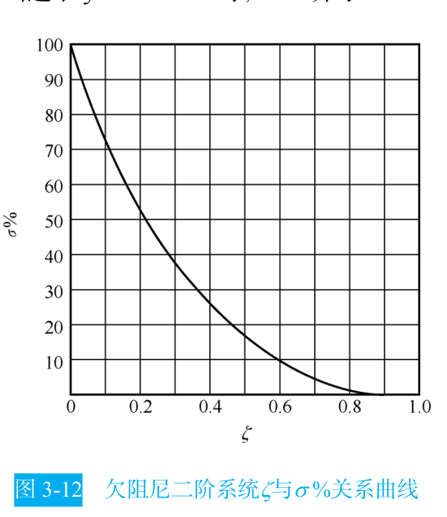
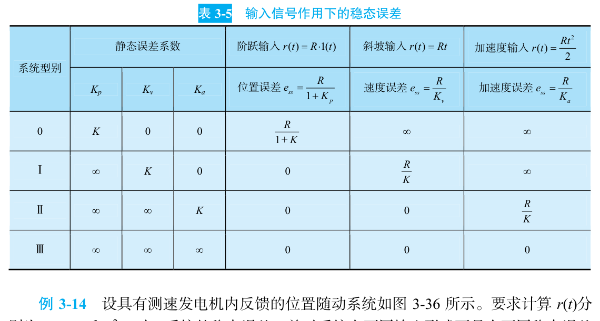

```cardlink
url: http://10.188.31.55:5244/Nextcloud/School/自动控制原理/
title: "自动控制原理 · 课程课件与复习笔记"
description: "中南大学自动化学院《自动控制原理》的课件、教材与复习笔记"
host: 10.188.31.55:5244
```

[← 返回《自动控制原理》目录](../)

## 第 3 章 线性系统的时域分析法

### 时域分析要回答什么

工程师拿到一个控制系统，问的通常是三句话：上冲多大？多久稳？误差多大？这三个问题分别对应三个能写进验收单的数字：超调量 $\sigma\%$、调节时间 $t_s$、稳态误差 $e_{ss}$。时域分析做的事，就是把这三个数字从传递函数里算出来。

时域分析直接解微分方程、看响应曲线 $c(t)$，优点是直观、准确、信息完整。代价是阶次一高就解不动——三阶方程的根已经写不出解析式，四阶以上基本只能数值求解。教材把时域分析的适用对象限定在线性定常系统，并且要求"先假定系统在单位阶跃输入作用前处于静止状态，输出量及其各阶导数均等于零" [自动控制原理（第八版） (胡寿松、姜斌、张绍杰) (z-library.sk, 1lib.sk, z-lib.sk)(1).pdf · p.84](http://10.188.31.55:5244/Nextcloud/School/自动控制原理/%E8%87%AA%E5%8A%A8%E6%8E%A7%E5%88%B6%E5%8E%9F%E7%90%86%EF%BC%88%E7%AC%AC%E5%85%AB%E7%89%88%EF%BC%89%20(%E8%83%A1%E5%AF%BF%E6%9D%BE%E3%80%81%E5%A7%9C%E6%96%8C%E3%80%81%E5%BC%A0%E7%BB%8D%E6%9D%B0)%20(z-library.sk,%201lib.sk,%20z-lib.sk)(1).pdf#page=84)。

教材把时域分析拆成两半：**动态过程**（过渡过程、瞬态过程）管"稳不稳、快不快"，**稳态过程**（稳态响应）管"准不准" [第三章 线性系统的时域分析法1.pdf · p.3](http://10.188.31.55:5244/Nextcloud/School/自动控制原理/%E7%AC%AC%E4%B8%89%E7%AB%A0%20%E7%BA%BF%E6%80%A7%E7%B3%BB%E7%BB%9F%E7%9A%84%E6%97%B6%E5%9F%9F%E5%88%86%E6%9E%90%E6%B3%951.pdf#page=3)。动态过程可能表现为衰减、发散或等幅振荡三种形式，只有衰减的动态过程对应能实际运行的系统。

### 动态性能指标

对单位阶跃响应曲线 $c(t)$，教材给出五个动态性能指标 [自动控制原理（第八版） (胡寿松、姜斌、张绍杰) (z-library.sk, 1lib.sk, z-lib.sk)(1).pdf · p.84](http://10.188.31.55:5244/Nextcloud/School/自动控制原理/%E8%87%AA%E5%8A%A8%E6%8E%A7%E5%88%B6%E5%8E%9F%E7%90%86%EF%BC%88%E7%AC%AC%E5%85%AB%E7%89%88%EF%BC%89%20(%E8%83%A1%E5%AF%BF%E6%9D%BE%E3%80%81%E5%A7%9C%E6%96%8C%E3%80%81%E5%BC%A0%E7%BB%8D%E6%9D%B0)%20(z-library.sk,%201lib.sk,%20z-lib.sk)(1).pdf#page=84)：

| 指标 | 含义 |
| --- | --- |
| 延迟时间 $t_d$ | 响应曲线第一次达到终值一半所需的时间 |
| 上升时间 $t_r$ | 响应从终值的 10% 上升到 90% 所需的时间；有振荡的系统也可定义为从零第一次升到终值所需的时间 |
| 峰值时间 $t_p$ | 响应超过终值后到达第一个峰值所需的时间 |
| 调节时间 $t_s$ | 响应到达并保持在终值 $\pm 5\%$ 以内所需的最短时间 |
| 超调量 $\sigma\%$ | 响应的最大超调量与终值之比 |

其中调节时间 $t_s$ 是最常用的一个，验收单上写"1 秒内稳定"说的就是它。误差带取 $\Delta=5\%$ 还是 $\Delta=2\%$ 由合同约定，两者算出来的 $t_s$ 差约 33%。

### 二阶系统：一切的基准

二阶系统的闭环传递函数标准形式是本章所有公式的出发点：

$$
\Phi(s)=\frac{\omega_n^{2}}{s^{2}+2\zeta\omega_n s+\omega_n^{2}}
$$

$\zeta$ 是阻尼比，无量纲，决定系统振荡不振荡；$\omega_n$ 是自然频率，单位 rad/s，决定响应快慢。教材由标准二阶系统的闭环极点分布把 $\zeta$ 分成六种情形 [自动控制原理（第八版） (胡寿松、姜斌、张绍杰) (z-library.sk, 1lib.sk, z-lib.sk)(1).pdf · p.90](http://10.188.31.55:5244/Nextcloud/School/自动控制原理/%E8%87%AA%E5%8A%A8%E6%8E%A7%E5%88%B6%E5%8E%9F%E7%90%86%EF%BC%88%E7%AC%AC%E5%85%AB%E7%89%88%EF%BC%89%20(%E8%83%A1%E5%AF%BF%E6%9D%BE%E3%80%81%E5%A7%9C%E6%96%8C%E3%80%81%E5%BC%A0%E7%BB%8D%E6%9D%B0)%20(z-library.sk,%201lib.sk,%20z-lib.sk)(1).pdf#page=90)：


欠阻尼情形 $0<\zeta<1$ 的极点写成 $s_{1,2}=-\zeta\omega_n\pm j\omega_n\sqrt{1-\zeta^2}$，实部 $-\zeta\omega_n$ 叫**衰减系数** $\sigma$，虚部 $\omega_d=\omega_n\sqrt{1-\zeta^2}$ 叫**阻尼振荡频率**。教材强调 $\omega_d$ 恒小于 $\omega_n$，且只有 $\zeta=0$ 时两者才相等 [自动控制原理（第八版） (胡寿松、姜斌、张绍杰) (z-library.sk, 1lib.sk, z-lib.sk)(1).pdf · p.91](http://10.188.31.55:5244/Nextcloud/School/自动控制原理/%E8%87%AA%E5%8A%A8%E6%8E%A7%E5%88%B6%E5%8E%9F%E7%90%86%EF%BC%88%E7%AC%AC%E5%85%AB%E7%89%88%EF%BC%89%20(%E8%83%A1%E5%AF%BF%E6%9D%BE%E3%80%81%E5%A7%9C%E6%96%8C%E3%80%81%E5%BC%A0%E7%BB%8D%E6%9D%B0)%20(z-library.sk,%201lib.sk,%20z-lib.sk)(1).pdf#page=91)。

欠阻尼二阶系统的单位阶跃响应写成正弦加指数的形式，$\beta=\arccos\zeta$：

$$
c(t)=1-\frac{e^{-\zeta\omega_n t}}{\sqrt{1-\zeta^{2}}}\sin(\omega_d t+\beta),\qquad t\ge 0
$$

后面四个指标全部从这一式求导得到 [自动控制原理（第八版） (胡寿松、姜斌、张绍杰) (z-library.sk, 1lib.sk, z-lib.sk)(1).pdf · p.91](http://10.188.31.55:5244/Nextcloud/School/自动控制原理/%E8%87%AA%E5%8A%A8%E6%8E%A7%E5%88%B6%E5%8E%9F%E7%90%86%EF%BC%88%E7%AC%AC%E5%85%AB%E7%89%88%EF%BC%89%20(%E8%83%A1%E5%AF%BF%E6%9D%BE%E3%80%81%E5%A7%9C%E6%96%8C%E3%80%81%E5%BC%A0%E7%BB%8D%E6%9D%B0)%20(z-library.sk,%201lib.sk,%20z-lib.sk)(1).pdf#page=91)。

### 四个性能指标怎么算

**峰值时间**。对 $c(t)$ 求导令其为零，得到 $\tan(\omega_d t+\beta)=\tan\beta$，即 $\omega_d t=k\pi$。取第一个峰，$\omega_d t_p=\pi$：

$$
t_p=\frac{\pi}{\omega_d}=\frac{\pi}{\omega_n\sqrt{1-\zeta^{2}}}
$$

教材指出这等于阻尼振荡周期的一半，与闭环极点虚部成反比 [自动控制原理（第八版） (胡寿松、姜斌、张绍杰) (z-library.sk, 1lib.sk, z-lib.sk)(1).pdf · p.94](http://10.188.31.55:5244/Nextcloud/School/自动控制原理/%E8%87%AA%E5%8A%A8%E6%8E%A7%E5%88%B6%E5%8E%9F%E7%90%86%EF%BC%88%E7%AC%AC%E5%85%AB%E7%89%88%EF%BC%89%20(%E8%83%A1%E5%AF%BF%E6%9D%BE%E3%80%81%E5%A7%9C%E6%96%8C%E3%80%81%E5%BC%A0%E7%BB%8D%E6%9D%B0)%20(z-library.sk,%201lib.sk,%20z-lib.sk)(1).pdf#page=94)。

**超调量**。把 $t_p$ 代回响应式，此时 $\sin(\omega_d t_p+\beta)=\sin(\pi+\beta)=-\sqrt{1-\zeta^2}$，得 $c(t_p)=1+e^{-\pi\zeta/\sqrt{1-\zeta^2}}$。除以终值 1：

$$
\sigma\%=e^{-\pi\zeta/\sqrt{1-\zeta^{2}}}\times 100\%
$$

这个结果只含 $\zeta$，与 $\omega_n$ 无关——超调量由阻尼比单独决定 [自动控制原理（第八版） (胡寿松、姜斌、张绍杰) (z-library.sk, 1lib.sk, z-lib.sk)(1).pdf · p.94](http://10.188.31.55:5244/Nextcloud/School/自动控制原理/%E8%87%AA%E5%8A%A8%E6%8E%A7%E5%88%B6%E5%8E%9F%E7%90%86%EF%BC%88%E7%AC%AC%E5%85%AB%E7%89%88%EF%BC%89%20(%E8%83%A1%E5%AF%BF%E6%9D%BE%E3%80%81%E5%A7%9C%E6%96%8C%E3%80%81%E5%BC%A0%E7%BB%8D%E6%9D%B0)%20(z-library.sk,%201lib.sk,%20z-lib.sk)(1).pdf#page=94)。

教材把这条曲线单独画出来：$\zeta$ 从 0 增到 1，超调量从 100% 单调降到 0，取 $\zeta=0.4\sim0.8$ 时 $\sigma\%$ 落在 1.5% 到 25.4% 之间 [自动控制原理（第八版） (胡寿松、姜斌、张绍杰) (z-library.sk, 1lib.sk, z-lib.sk)(1).pdf · p.94](http://10.188.31.55:5244/Nextcloud/School/自动控制原理/%E8%87%AA%E5%8A%A8%E6%8E%A7%E5%88%B6%E5%8E%9F%E7%90%86%EF%BC%88%E7%AC%AC%E5%85%AB%E7%89%88%EF%BC%89%20(%E8%83%A1%E5%AF%BF%E6%9D%BE%E3%80%81%E5%A7%9C%E6%96%8C%E3%80%81%E5%BC%A0%E7%BB%8D%E6%9D%B0)%20(z-library.sk,%201lib.sk,%20z-lib.sk)(1).pdf#page=94)。



**调节时间**。$c(t)$ 被一对包络线 $1\pm \dfrac{e^{-\zeta\omega_n t}}{\sqrt{1-\zeta^{2}}}$ 夹住，响应一定落在这对包络线内 [自动控制原理（第八版） (胡寿松、姜斌、张绍杰) (z-library.sk, 1lib.sk, z-lib.sk)(1).pdf · p.95](http://10.188.31.55:5244/Nextcloud/School/自动控制原理/%E8%87%AA%E5%8A%A8%E6%8E%A7%E5%88%B6%E5%8E%9F%E7%90%86%EF%BC%88%E7%AC%AC%E5%85%AB%E7%89%88%EF%BC%89%20(%E8%83%A1%E5%AF%BF%E6%9D%BE%E3%80%81%E5%A7%9C%E6%96%8C%E3%80%81%E5%BC%A0%E7%BB%8D%E6%9D%B0)%20(z-library.sk,%201lib.sk,%20z-lib.sk)(1).pdf#page=95)。


取 $\zeta\le 0.8$、误差带 $\Delta=0.05$，解包络线方程得 $\zeta\omega_n t_s\ge 3.5$；教材在工程上取整写成 $t_s=\dfrac{3.5}{\zeta\omega_n}$，常用近似式是 $t_s\approx \dfrac{3}{\zeta\omega_n}$。2% 误差带对应 $t_s=\dfrac{4.4}{\zeta\omega_n}$，近似 $4/(\zeta\omega_n)$ [自动控制原理（第八版） (胡寿松、姜斌、张绍杰) (z-library.sk, 1lib.sk, z-lib.sk)(1).pdf · p.95](http://10.188.31.55:5244/Nextcloud/School/自动控制原理/%E8%87%AA%E5%8A%A8%E6%8E%A7%E5%88%B6%E5%8E%9F%E7%90%86%EF%BC%88%E7%AC%AC%E5%85%AB%E7%89%88%EF%BC%89%20(%E8%83%A1%E5%AF%BF%E6%9D%BE%E3%80%81%E5%A7%9C%E6%96%8C%E3%80%81%E5%BC%A0%E7%BB%8D%E6%9D%B0)%20(z-library.sk,%201lib.sk,%20z-lib.sk)(1).pdf#page=95)。讲师笔记把这四个公式列成必背表 [题型零_前三章考试内容.md · p.115](http://10.188.31.55:5244/Nextcloud/School/自动控制原理/%E9%A2%98%E5%9E%8B%E9%9B%B6_%E5%89%8D%E4%B8%89%E7%AB%A0%E8%80%83%E8%AF%95%E5%86%85%E5%AE%B9.md)。

**四个指标背后的矛盾**。$t_s$ 与闭环极点实部 $\sigma=\zeta\omega_n$ 成反比，$t_p$ 与极点虚部成反比，$\sigma\%$ 只看 $\zeta$。想让系统快就要 $\omega_n$ 大，但在二阶系统里 $\omega_n=\sqrt{K/T_m}$、$\zeta=1/(2\sqrt{T_m K})$，$T_m$ 是电机时间常数、不可调。增大 $K$ 抬高 $\omega_n$ 的同时必然压低 $\zeta$，超调跟着涨。教材把这一条称为"各指标之间是有矛盾的"，要求"合理的折中方案或补偿方案" [自动控制原理（第八版） (胡寿松、姜斌、张绍杰) (z-library.sk, 1lib.sk, z-lib.sk)(1).pdf · p.95](http://10.188.31.55:5244/Nextcloud/School/自动控制原理/%E8%87%AA%E5%8A%A8%E6%8E%A7%E5%88%B6%E5%8E%9F%E7%90%86%EF%BC%88%E7%AC%AC%E5%85%AB%E7%89%88%EF%BC%89%20(%E8%83%A1%E5%AF%BF%E6%9D%BE%E3%80%81%E5%A7%9C%E6%96%8C%E3%80%81%E5%BC%A0%E7%BB%8D%E6%9D%B0)%20(z-library.sk,%201lib.sk,%20z-lib.sk)(1).pdf#page=95)。这个矛盾是第 6 章引入 PD 控制和超前校正的直接动机。课件把它单列为"二阶系统性能的改善"一节，给出两条路：方法 1 采用比例-微分控制，方法 2 采用测速反馈控制 [自控原理（第三章2）p.pdf · p.4](http://10.188.31.55:5244/Nextcloud/School/自动控制原理/%E8%87%AA%E6%8E%A7%E5%8E%9F%E7%90%86%EF%BC%88%E7%AC%AC%E4%B8%89%E7%AB%A02%EF%BC%89p.pdf#page=4)。

### 高阶系统与主导极点

高阶系统的精确时域响应要解高阶特征方程，实际工程用**主导极点法**：对稳定的高阶系统，若某对共轭复数极点离虚轴的距离比其他极点近 5 倍以上，且其附近没有闭环零点，就把它当成二阶系统处理 [自动控制原理（第八版） (胡寿松、姜斌、张绍杰) (z-library.sk, 1lib.sk, z-lib.sk)(1).pdf · p.111](http://10.188.31.55:5244/Nextcloud/School/自动控制原理/%E8%87%AA%E5%8A%A8%E6%8E%A7%E5%88%B6%E5%8E%9F%E7%90%86%EF%BC%88%E7%AC%AC%E5%85%AB%E7%89%88%EF%BC%89%20(%E8%83%A1%E5%AF%BF%E6%9D%BE%E3%80%81%E5%A7%9C%E6%96%8C%E3%80%81%E5%BC%A0%E7%BB%8D%E6%9D%B0)%20(z-library.sk,%201lib.sk,%20z-lib.sk)(1).pdf#page=111)。

教材给了一个具体例子：四阶系统的共轭复数主导极点 $s_{1,2}=-0.5\pm j0.866$，非主导极点 $s_3=-2$、$s_4=-8$ 的实部模比主导极点大三倍以上，闭环零点 $z=-2.1$ 不在主导极点附近，因此可近似成二阶系统 [自动控制原理（第八版） (胡寿松、姜斌、张绍杰) (z-library.sk, 1lib.sk, z-lib.sk)(1).pdf · p.112](http://10.188.31.55:5244/Nextcloud/School/自动控制原理/%E8%87%AA%E5%8A%A8%E6%8E%A7%E5%88%B6%E5%8E%9F%E7%90%86%EF%BC%88%E7%AC%AC%E5%85%AB%E7%89%88%EF%BC%89%20(%E8%83%A1%E5%AF%BF%E6%9D%BE%E3%80%81%E5%A7%9C%E6%96%8C%E3%80%81%E5%BC%A0%E7%BB%8D%E6%9D%B0)%20(z-library.sk,%201lib.sk,%20z-lib.sk)(1).pdf#page=112)。

> [!WARNING] 主导极点近似的三个前提
> 用主导极点把高阶系统降成二阶，必须同时满足三条：该极点附近没有闭环零点；其余极点的实部模比主导极点实部模大 3～5 倍以上；欠阻尼二阶公式本身只在 $\zeta<0.7$ 左右才比较准。少一条，近似结果就明显偏乐观 [自动控制原理（第八版） (胡寿松、姜斌、张绍杰) (z-library.sk, 1lib.sk, z-lib.sk)(1).pdf · p.112](http://10.188.31.55:5244/Nextcloud/School/自动控制原理/%E8%87%AA%E5%8A%A8%E6%8E%A7%E5%88%B6%E5%8E%9F%E7%90%86%EF%BC%88%E7%AC%AC%E5%85%AB%E7%89%88%EF%BC%89%20(%E8%83%A1%E5%AF%BF%E6%9D%BE%E3%80%81%E5%A7%9C%E6%96%8C%E3%80%81%E5%BC%A0%E7%BB%8D%E6%9D%B0)%20(z-library.sk,%201lib.sk,%20z-lib.sk)(1).pdf#page=112)。

### 稳定性与劳斯-赫尔维茨判据

连续系统稳定的**充分必要条件**是闭环特征方程的所有根都具有负实部，等价说法是闭环传递函数的极点全部严格位于左半 $s$ 平面 [第三章 线性系统的时域分析法1.pdf · p.7](http://10.188.31.55:5244/Nextcloud/School/自动控制原理/%E7%AC%AC%E4%B8%89%E7%AB%A0%20%E7%BA%BF%E6%80%A7%E7%B3%BB%E7%BB%9F%E7%9A%84%E6%97%B6%E5%9F%9F%E5%88%86%E6%9E%90%E6%B3%951.pdf#page=7)。教材证明这条路成立：闭环系统特征方程的所有根均具有负实部时，输出增量的拉氏反变换各项才收敛。

问题在于求全部特征根。三阶方程的根写不出解析式，四阶以上更糟。劳斯-赫尔维茨判据绕开这一步：只看特征方程的系数。

**劳斯表的构造**。特征方程整理成降幂形式、首项系数 $a_0>0$：

$$
D(s)=a_0 s^{n}+a_1 s^{n-1}+\cdots+a_{n-1}s+a_n=0
$$

第一行写 $a_0, a_2, a_4,\ldots$，第二行写 $a_1, a_3, a_5,\ldots$，第三行起逐行递推，每个元素由前两行交叉相乘再相除：

| 行 | 第一列 | 第二列 | 第三列 | 第四列 |
| --- | --- | --- | --- | --- |
| $s^{n}$ | $a_0$ | $a_2$ | $a_4$ | $\cdots$ |
| $s^{n-1}$ | $a_1$ | $a_3$ | $a_5$ | $\cdots$ |
| $s^{n-2}$ | $b_1=\dfrac{a_1a_2-a_0a_3}{a_1}$ | $b_2=\dfrac{a_1a_4-a_0a_5}{a_1}$ | $b_3$ | $\cdots$ |
| $s^{n-3}$ | $c_1=\dfrac{b_1a_3-a_1b_2}{b_1}$ | $c_2=\dfrac{b_1a_5-a_1b_3}{b_1}$ | $c_3$ | $\cdots$ |

教材把完整的劳斯表列在表 3-4 里，含 $n$ 阶时前四行的递推式与各元素的具体表达式 [自动控制原理（第八版） (胡寿松、姜斌、张绍杰) (z-library.sk, 1lib.sk, z-lib.sk)(1).pdf · p.118](http://10.188.31.55:5244/Nextcloud/School/自动控制原理/%E8%87%AA%E5%8A%A8%E6%8E%A7%E5%88%B6%E5%8E%9F%E7%90%86%EF%BC%88%E7%AC%AC%E5%85%AB%E7%89%88%EF%BC%89%20(%E8%83%A1%E5%AF%BF%E6%9D%BE%E3%80%81%E5%A7%9C%E6%96%8C%E3%80%81%E5%BC%A0%E7%BB%8D%E6%9D%B0)%20(z-library.sk,%201lib.sk,%20z-lib.sk)(1).pdf#page=118)。判据是：**第一列各值全部为正则系统稳定；若第一列出现负值，符号改变次数等于特征方程正实部根的数目** [第三章 线性系统的时域分析法1.pdf · p.8](http://10.188.31.55:5244/Nextcloud/School/自动控制原理/%E7%AC%AC%E4%B8%89%E7%AB%A0%20%E7%BA%BF%E6%80%A7%E7%B3%BB%E7%BB%9F%E7%9A%84%E6%97%B6%E5%9F%9F%E5%88%86%E6%9E%90%E6%B3%951.pdf#page=8)。教材补充了它与赫尔维茨判据的等价关系：劳斯表第一列各数与顺序赫尔维茨行列式一一对应，在 $a_0>0$ 时所有顺序赫尔维茨行列式为正，劳斯表第一列元素必全大于零 [第三章 线性系统的时域分析法1.pdf · p.8](http://10.188.31.55:5244/Nextcloud/School/自动控制原理/%E7%AC%AC%E4%B8%89%E7%AB%A0%20%E7%BA%BF%E6%80%A7%E7%B3%BB%E7%BB%9F%E7%9A%84%E6%97%B6%E5%9F%9F%E5%88%86%E6%9E%90%E6%B3%951.pdf#page=8)。


**三种特殊情况**。

第一列某项为零但同行其余项不全为零。此时下一行首项会是无穷大，判据失效。把零换成很小的正数 $\varepsilon$ 继续计算，最后令 $\varepsilon\to 0^+$ 判断符号 [题型零_前三章考试内容.md · p.293](http://10.188.31.55:5244/Nextcloud/School/自动控制原理/%E9%A2%98%E5%9E%8B%E9%9B%B6_%E5%89%8D%E4%B8%89%E7%AB%A0%E8%80%83%E8%AF%95%E5%86%85%E5%AE%B9.md)。

某一行全为零。用这一行的上一行系数构造**辅助方程**，对方程求导，用导数的系数替换全零行，然后继续列表。辅助方程的根就是特征方程中关于原点对称的根 [第三章 线性系统的时域分析法1.pdf · p.9](http://10.188.31.55:5244/Nextcloud/School/自动控制原理/%E7%AC%AC%E4%B8%89%E7%AB%A0%20%E7%BA%BF%E6%80%A7%E7%B3%BB%E7%BB%9F%E7%9A%84%E6%97%B6%E5%9F%9F%E5%88%86%E6%9E%90%E6%B3%951.pdf#page=9)。第 4 章求根轨迹与虚轴的交点，用的正是这一条。

要求 $K$ 的稳定范围。把含 $K$ 的闭环特征方程列劳斯表，令第一列所有元素大于零，联立解不等式。蜂考例题 $G(s)=\dfrac{K}{s(s+1)(2s+1)}$ 的闭环特征方程是 $2s^3+3s^2+s+K=0$，劳斯表给出 $s^1$ 行首项 $(3-2K)/3$，与 $K>0$ 联立得 $0<K<1.5$ [题型零_前三章考试内容.md · p.315](http://10.188.31.55:5244/Nextcloud/School/自动控制原理/%E9%A2%98%E5%9E%8B%E9%9B%B6_%E5%89%8D%E4%B8%89%E7%AB%A0%E8%80%83%E8%AF%95%E5%86%85%E5%AE%B9.md)。

**相对稳定性**。若要求全部闭环极点位于 $s=-\sigma_0$ 垂线之左，令 $s=s_1-\sigma_0$ 代入原特征方程，对新方程列劳斯表 [题型零_前三章考试内容.md · p.330](http://10.188.31.55:5244/Nextcloud/School/自动控制原理/%E9%A2%98%E5%9E%8B%E9%9B%B6_%E5%89%8D%E4%B8%89%E7%AB%A0%E8%80%83%E8%AF%95%E5%86%85%E5%AE%B9.md)。

> [!WARNING] 劳斯表第一列的符号变化次数是逐对比较出来的
> 不是数负数个数。第一列 $1, 3, -4/3, 10$ 里只有一个负数，但符号变化是两次：$1\to 3$ 同号、$3\to-4/3$ 变号、$-4/3\to 10$ 变号，所以有两个正实部根。算错这一条，整个稳定性结论就反了 [第三章 线性系统的时域分析法1.pdf · p.8](http://10.188.31.55:5244/Nextcloud/School/自动控制原理/%E7%AC%AC%E4%B8%89%E7%AB%A0%20%E7%BA%BF%E6%80%A7%E7%B3%BB%E7%BB%9F%E7%9A%84%E6%97%B6%E5%9F%9F%E5%88%86%E6%9E%90%E6%B3%951.pdf#page=8)。

### 稳态误差与静态误差系数

稳态误差是系统控制精度的度量。求它只有一条路：**终值定理**。

$$
e_{ss}=\lim_{t\to\infty}e(t)=\lim_{s\to 0}s\cdot E(s)
$$

教材对终值定理的适用条件写得很明确：$sE(s)$ 的全部极点必须在左半 $s$ 平面，原点最多允许一个一阶极点 [自动控制原理（第八版） (胡寿松、姜斌、张绍杰) (z-library.sk, 1lib.sk, z-lib.sk)(1).pdf · p.123](http://10.188.31.55:5244/Nextcloud/School/自动控制原理/%E8%87%AA%E5%8A%A8%E6%8E%A7%E5%88%B6%E5%8E%9F%E7%90%86%EF%BC%88%E7%AC%AC%E5%85%AB%E7%89%88%EF%BC%89%20(%E8%83%A1%E5%AF%BF%E6%9D%BE%E3%80%81%E5%A7%9C%E6%96%8C%E3%80%81%E5%BC%A0%E7%BB%8D%E6%9D%B0)%20(z-library.sk,%201lib.sk,%20z-lib.sk)(1).pdf#page=123)。条件不满足时这个极限不存在，教材用正弦输入举例：正弦函数的拉氏变换在虚轴上不解析，此时用终值定理会算出"误差为零"的错误结论 [自动控制原理（第八版） (胡寿松、姜斌、张绍杰) (z-library.sk, 1lib.sk, z-lib.sk)(1).pdf · p.124](http://10.188.31.55:5244/Nextcloud/School/自动控制原理/%E8%87%AA%E5%8A%A8%E6%8E%A7%E5%88%B6%E5%8E%9F%E7%90%86%EF%BC%88%E7%AC%AC%E5%85%AB%E7%89%88%EF%BC%89%20(%E8%83%A1%E5%AF%BF%E6%9D%BE%E3%80%81%E5%A7%9C%E6%96%8C%E3%80%81%E5%BC%A0%E7%BB%8D%E6%9D%B0)%20(z-library.sk,%201lib.sk,%20z-lib.sk)(1).pdf#page=124)。

单位反馈时 $E(s)=\dfrac{R(s)}{1+G(s)}$，代入三种典型输入：

$$
e_{ss}=\lim_{s\to 0}\frac{1}{1+K_p},\qquad K_p=\lim_{s\to 0}G(s)
$$

$$
e_{ss}=\lim_{s\to 0}\frac{1}{K_v},\qquad K_v=\lim_{s\to 0}sG(s)
$$

$$
e_{ss}=\lim_{s\to 0}\frac{1}{K_a},\qquad K_a=\lim_{s\to 0}s^{2}G(s)
$$

$K_p$、$K_v$、$K_a$ 分别叫位置误差系数、速度误差系数、加速度误差系数。课件把加速度误差系数写成 $K_a=\lim_{s\to0}s^{2}G(s)H(s)$，并指出 0 型及 I 型系统的 $K_a=0$、II 型系统的 $K_a=K$、III 型及以上系统的 $K_a=\infty$ [自控原理（第三章4）p.pdf · p.5](http://10.188.31.55:5244/Nextcloud/School/自动控制原理/%E8%87%AA%E6%8E%A7%E5%8E%9F%E7%90%86%EF%BC%88%E7%AC%AC%E4%B8%89%E7%AB%A04%EF%BC%89p.pdf#page=5)。

**系统型别**。把开环传递函数写成

$$
G(s)H(s)=\frac{K}{s^{\nu}}\cdot G_0(s)H_0(s),\qquad \lim_{s\to 0}G_0(s)H_0(s)=1
$$

$\nu$ 是开环传递函数中 $1/s$ 的个数，就是系统型别。代入三个误差系数定义，型别与稳态误差的关系固定下来 [复习_稳态误差与Nyquist图.md · p.47](http://10.188.31.55:5244/Nextcloud/School/自动控制原理/%E5%A4%8D%E4%B9%A0_%E7%A8%B3%E6%80%81%E8%AF%AF%E5%B7%AE%E4%B8%8ENyquist%E5%9B%BE.md)：

| 型别 $\nu$ | $K_p$ | $K_v$ | $K_a$ | 阶跃 $e_{ss}$ | 斜坡 $e_{ss}$ | 抛物线 $e_{ss}$ |
| --- | --- | --- | --- | --- | --- | --- |
| 0 型 | $K$ | $0$ | $0$ | $\dfrac{1}{1+K}$ | $\infty$ | $\infty$ |
| I 型 | $\infty$ | $K$ | $0$ | $0$ | $\dfrac{1}{K}$ | $\infty$ |
| II 型 | $\infty$ | $\infty$ | $K$ | $0$ | $0$ | $\dfrac{1}{K}$ |



教材把型别、静态误差系数与输入信号形式的关系统一归纳在表 3-5 里 [自动控制原理（第八版） (胡寿松、姜斌、张绍杰) (z-library.sk, 1lib.sk, z-lib.sk)(1).pdf · p.128](http://10.188.31.55:5244/Nextcloud/School/自动控制原理/%E8%87%AA%E5%8A%A8%E6%8E%A7%E5%88%B6%E5%8E%9F%E7%90%86%EF%BC%88%E7%AC%AC%E5%85%AB%E7%89%88%EF%BC%89%20(%E8%83%A1%E5%AF%BF%E6%9D%BE%E3%80%81%E5%A7%9C%E6%96%8C%E3%80%81%E5%BC%A0%E7%BB%8D%E6%9D%B0)%20(z-library.sk,%201lib.sk,%20z-lib.sk)(1).pdf#page=128)。型别就是系统能"免费跟踪"几阶输入。0 型连阶跃都跟不完美，I 型能跟阶跃但跟不上斜坡，II 型能跟斜坡但跟不上抛物线。教材提醒一句：采用高型别系统对提高控制准确度有利，但"应以确保系统的稳定性为前提，同时还要兼顾系统的动态性能要求"。

> [!WARNING] 稳态误差的三条高频错
> 第一，算 $K_v$ 忘了先判系统是否稳定——稳态误差只对稳定系统有意义。第二，把闭环传函代进 $K_v=\lim sG(s)$——$K_v$ 必须用开环传函算。第三，漏掉终值定理里那个 $s$。讲师把这三条连同另外五条列成易错清单 [题型零_前三章考试内容.md · p.460](http://10.188.31.55:5244/Nextcloud/School/自动控制原理/%E9%A2%98%E5%9E%8B%E9%9B%B6_%E5%89%8D%E4%B8%89%E7%AB%A0%E8%80%83%E8%AF%95%E5%86%85%E5%AE%B9.md)。

### 一个完整的计算例子

某单位负反馈系统开环传递函数 $G(s)=\dfrac{10}{s(s+1)}$，求性能指标与三种输入下的稳态误差。

**第一步，闭环传函与标准式对比**。

$$
\Phi(s)=\frac{10}{s^{2}+s+10}=\frac{10}{s^{2}+2(0.5)s+10}
$$

对比 $\dfrac{\omega_n^2}{s^2+2\zeta\omega_n s+\omega_n^2}$，得 $\omega_n=\sqrt{10}=3.16\ \mathrm{rad/s}$、$\zeta=\dfrac{1}{2\times 3.16}=0.158$。

**第二步，三个动态指标**。

$$
\sigma\%=e^{-\pi\times 0.158/\sqrt{1-0.025}}\times 100\%=60.5\%
$$

$$
t_p=\frac{\pi}{\omega_n\sqrt{1-\zeta^{2}}}=\frac{\pi}{3.12}=1.01\ \mathrm{s}
$$

$$
t_s\approx\frac{3}{\zeta\omega_n}=\frac{3}{0.5}=6\ \mathrm{s}
$$

**第三步，型别与误差系数**。开环传函分母只有一个裸的 $s$，是 I 型系统，开环增益 $K=10$。

$$
K_p=\lim_{s\to 0}G(s)=\infty,\qquad K_v=\lim_{s\to 0}sG(s)=\lim_{s\to 0}\frac{10}{s+1}=10,\qquad K_a=\lim_{s\to 0}s^{2}G(s)=0
$$

于是阶跃误差 $0$、斜坡误差 $1/10=0.1$、抛物线误差 $\infty$。

这个例子对应期末 A 卷第 2 题的题型：给性能指标反求参数 [题型零_前三章考试内容.md · p.131](http://10.188.31.55:5244/Nextcloud/School/自动控制原理/%E9%A2%98%E5%9E%8B%E9%9B%B6_%E5%89%8D%E4%B8%89%E7%AB%A0%E8%80%83%E8%AF%95%E5%86%85%E5%AE%B9.md)。讲师把这类题的做法固定成六步：化简内环、写出开环传函、由 $K_v=\lim sG(s)$ 得方程①、由闭环标准式提 $\zeta,\omega_n$ 得方程②、联立解、再代公式算 $t_s$ 或 $\sigma\%$ [题型零_前三章考试内容.md · p.198](http://10.188.31.55:5244/Nextcloud/School/自动控制原理/%E9%A2%98%E5%9E%8B%E9%9B%B6_%E5%89%8D%E4%B8%89%E7%AB%A0%E8%80%83%E8%AF%95%E5%86%85%E5%AE%B9.md)。

反向题也一样常见：已知 $\sigma\%=20\%$、$t_p=1\ \mathrm{s}$，反求 $\zeta$、$\omega_n$、$t_s$。对 $\sigma_p$ 取自然对数得

$$
\zeta=\frac{\ln(1/\sigma_p)}{\sqrt{\pi^{2}+\left[\ln(1/\sigma_p)\right]^{2}}}
$$

代入 $\sigma_p=0.2$，$\ln 5=1.609$，得 $\zeta=0.456$；再由 $\omega_d=\pi/t_p=3.14$ 反推 $\omega_n=3.53$、$t_s=1.86\ \mathrm{s}$ [题型零_前三章考试内容.md · p.214](http://10.188.31.55:5244/Nextcloud/School/自动控制原理/%E9%A2%98%E5%9E%8B%E9%9B%B6_%E5%89%8D%E4%B8%89%E7%AB%A0%E8%80%83%E8%AF%95%E5%86%85%E5%AE%B9.md)。讲师顺手记了四个常用值：$\sigma=5\%\to\zeta\approx0.69$、$10\%\to0.59$、$16.3\%\to0.5$、$20\%\to0.456$。
