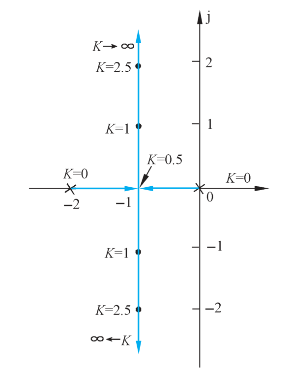
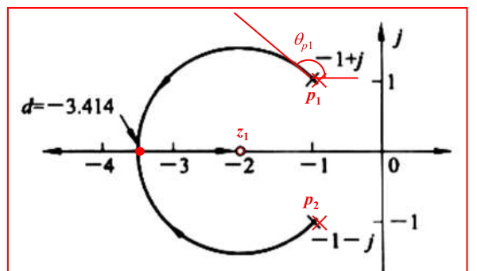
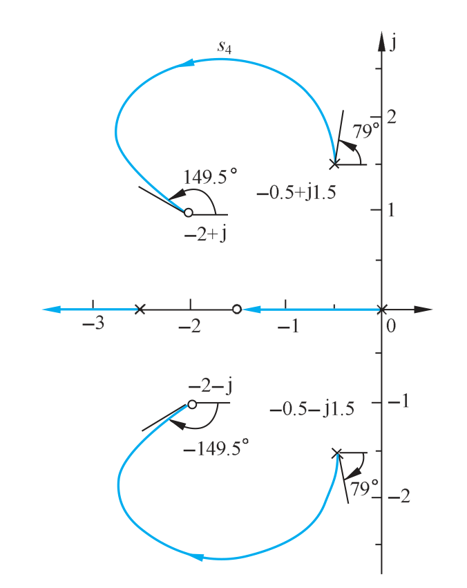
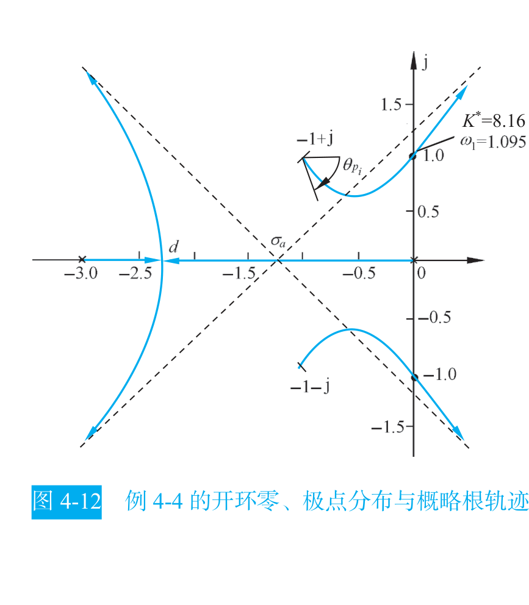

```cardlink
url: http://10.188.31.55:5244/Nextcloud/School/自动控制原理/
title: "自动控制原理 · 课程课件与复习笔记"
description: "中南大学自动化学院《自动控制原理》的课件、教材与复习笔记"
host: 10.188.31.55:5244
```

[← 返回《自动控制原理》目录](../)

## 第 4 章 线性系统的根轨迹法

### 根轨迹在做什么

给定单位负反馈系统的开环传递函数 $G(s)H(s)$，其中增益 $K$ 可调。想知道把 $K$ 从小往大调，系统会在哪个 $K$ 上开始振荡、失稳。

不画图就只能一次次把 $K$ 代进特征方程 $s(s+1)(s+2)+K=0$ 再解三次方程——$K=1$ 解一遍、$K=2$ 再解一遍，手算到崩溃，而且完全看不出趋势。根轨迹把"$K$ 变化时闭环极点往哪跑"一次性画成一张图，稳定性边界、临界阻尼点、任意 $K$ 下的极点位置都能直接从图上读出来。

**根轨迹**的定义：当开环根轨迹增益 $K^{*}$ 从 $0$ 变化到 $+\infty$ 时，闭环特征方程的根（闭环极点）在 $s$ 平面上移动所形成的轨迹 [题型一_根轨迹大题.md · p.44](http://10.188.31.55:5244/Nextcloud/School/自动控制原理/%E9%A2%98%E5%9E%8B%E4%B8%80_%E6%A0%B9%E8%BD%A8%E8%BF%B9%E5%A4%A7%E9%A2%98.md)。

$K^{*}$ 与 $K$ 不是一回事。$K^{*}$ 是首 1 标准形式下的根轨迹增益，$K$ 是尾 1 标准形式下的开环增益，两者一般差一个比例常数。例：$G(s)=\dfrac{K}{s(2s+1)}=\dfrac{K/2}{s(s+0.5)}$，此处 $K^{*}=K/2$ [题型一_根轨迹大题.md · p.95](http://10.188.31.55:5244/Nextcloud/School/自动控制原理/%E9%A2%98%E5%9E%8B%E4%B8%80_%E6%A0%B9%E8%BD%A8%E8%BF%B9%E5%A4%A7%E9%A2%98.md)。画出 $K^{*}$ 的范围后还要换算回 $K$ 的范围。

> 分析和设计时用开环，最终结果和实际响应时用闭环。
>
> ——讲师的全局地图 [复习_根轨迹.md · p.130](http://10.188.31.55:5244/Nextcloud/School/自动控制原理/%E5%A4%8D%E4%B9%A0_%E6%A0%B9%E8%BD%A8%E8%BF%B9.md)

**s 平面的物理含义**。一个极点 $s=\sigma+j\omega$ 对应时域分量 $e^{\sigma t}\sin(\omega t+\varphi)$：$\sigma<0$ 衰减、$\sigma>0$ 发散、$\omega\ne 0$ 振荡。横轴管衰减速度，纵轴管振荡频率。根轨迹上极点的位置直接决定系统的快慢与振荡。

教材用最简单的一阶系统演示这张图长什么样：$G(s)=\dfrac{K}{s(0.5s+1)}$ 的闭环传递函数是 $\Phi(s)=\dfrac{2K}{s^2+2s+2K}$，特征方程的根是 $s_{1,2}=-1\pm\sqrt{1-2K}$ [自控原理（第四章1）p.pdf · p.2](http://10.188.31.55:5244/Nextcloud/School/自动控制原理/%E8%87%AA%E6%8E%A7%E5%8E%9F%E7%90%86%EF%BC%88%E7%AC%AC%E5%9B%9B%E7%AB%A01%EF%BC%89p.pdf#page=2)。



图上的标注就是根轨迹的读法：每个点旁边写的数字是"这个位置的闭环极点对应多大的开环增益 $K$"。$K=0$ 时两个闭环极点就是两个开环极点；$K=0.5$ 时它们在实轴上相遇；$K=1$ 时分离成一对共轭极点；$K$ 继续增大，虚部变大、实部不变，$K\to\infty$ 时极点跑到无穷远。教材对这个图补充了一句：根轨迹上的箭头表示随着 $K$ 值的增加根轨迹的变化趋势，标注的数值代表与闭环极点位置相应的开环增益 $K$ 的数值 [自动控制原理（第八版） (胡寿松、姜斌、张绍杰) (z-library.sk, 1lib.sk, z-lib.sk)(1).pdf · p.161](http://10.188.31.55:5244/Nextcloud/School/自动控制原理/%E8%87%AA%E5%8A%A8%E6%8E%A7%E5%88%B6%E5%8E%9F%E7%90%86%EF%BC%88%E7%AC%AC%E5%85%AB%E7%89%88%EF%BC%89%20(%E8%83%A1%E5%AF%BF%E6%9D%BE%E3%80%81%E5%A7%9C%E6%96%8C%E3%80%81%E5%BC%A0%E7%BB%8D%E6%9D%B0)%20(z-library.sk,%201lib.sk,%20z-lib.sk)(1).pdf#page=161)。

### 根轨迹方程与两个条件

闭环特征方程 $1+G(s)H(s)=0$ 移项即 $G(s)H(s)=-1$。把开环传函写成首 1 的零极点形式 $K^{*}\prod(s-z_j)/\prod(s-p_i)$，代入并同乘 $\prod(s-p_i)$：

$$
\prod_{i=1}^{n}(s-p_i)+K^{*}\prod_{j=1}^{m}(s-z_j)=0
$$

解出 $K^{*}=-\prod(s-p_i)/\prod(s-z_j)$。因为 $K^{*}$ 是正实数，右端必须是正实数：辐角为 $180^\circ$（模 $360^\circ$），模为正。拆成两条就是根轨迹的基本条件。

**相角条件**，决定哪些点在轨迹上：

$$
\sum_{j=1}^{m}\angle(s-z_j)-\sum_{i=1}^{n}\angle(s-p_i)=(2k+1)\times 180^\circ
$$

**模值条件**，在轨迹上确定具体的 $K^{*}$：

$$
K^{*}=\prod_{i=1}^{n}|s-p_i|\Big/\prod_{j=1}^{m}|s-z_j|
$$

直觉：目标点到所有开环极点的距离之积，除以到所有开环零点的距离之积 [题型一_根轨迹大题.md · p.89](http://10.188.31.55:5244/Nextcloud/School/自动控制原理/%E9%A2%98%E5%9E%8B%E4%B8%80_%E6%A0%B9%E8%BD%A8%E8%BF%B9%E5%A4%A7%E9%A2%98.md)。

### 八条绘制法则

**法则 1，起点与终点**。$K^{*}=0$ 时特征方程退化为 $\prod(s-p_i)=0$，根恰是开环极点，所以根轨迹**起于开环极点**。$K^{*}\to\infty$ 时方程两边除以 $K^{*}$，根趋于 $\prod(s-z_j)=0$，即**终于开环零点**。极点有 $n$ 个、零点只有 $m$ 个，多出来的 $n-m$ 个根奔向无穷远 [自动控制原理（第八版） (胡寿松、姜斌、张绍杰) (z-library.sk, 1lib.sk, z-lib.sk)(1).pdf · p.164](http://10.188.31.55:5244/Nextcloud/School/自动控制原理/%E8%87%AA%E5%8A%A8%E6%8E%A7%E5%88%B6%E5%8E%9F%E7%90%86%EF%BC%88%E7%AC%AC%E5%85%AB%E7%89%88%EF%BC%89%20(%E8%83%A1%E5%AF%BF%E6%9D%BE%E3%80%81%E5%A7%9C%E6%96%8C%E3%80%81%E5%BC%A0%E7%BB%8D%E6%9D%B0)%20(z-library.sk,%201lib.sk,%20z-lib.sk)(1).pdf#page=164)。

**法则 2，分支数、对称性、连续性**。分支数等于开环极点数 $n$。特征方程系数全是实数，复数根必共轭成对，所以轨迹**关于实轴对称**。根是系数的连续函数，所以轨迹连续 [自动控制原理（第八版） (胡寿松、姜斌、张绍杰) (z-library.sk, 1lib.sk, z-lib.sk)(1).pdf · p.175](http://10.188.31.55:5244/Nextcloud/School/自动控制原理/%E8%87%AA%E5%8A%A8%E6%8E%A7%E5%88%B6%E5%8E%9F%E7%90%86%EF%BC%88%E7%AC%AC%E5%85%AB%E7%89%88%EF%BC%89%20(%E8%83%A1%E5%AF%BF%E6%9D%BE%E3%80%81%E5%A7%9C%E6%96%8C%E3%80%81%E5%BC%A0%E7%BB%8D%E6%9D%B0)%20(z-library.sk,%201lib.sk,%20z-lib.sk)(1).pdf#page=175)。

**法则 3，实轴上的根轨迹**。实轴上某一段属于根轨迹，当且仅当**该段右侧**的实轴开环零、极点个数之和为**奇数**。

教材给出了完整的几何证明 [自动控制原理（第八版） (胡寿松、姜斌、张绍杰) (z-library.sk, 1lib.sk, z-lib.sk)(1).pdf · p.168](http://10.188.31.55:5244/Nextcloud/School/自动控制原理/%E8%87%AA%E5%8A%A8%E6%8E%A7%E5%88%B6%E5%8E%9F%E7%90%86%EF%BC%88%E7%AC%AC%E5%85%AB%E7%89%88%EF%BC%89%20(%E8%83%A1%E5%AF%BF%E6%9D%BE%E3%80%81%E5%A7%9C%E6%96%8C%E3%80%81%E5%BC%A0%E7%BB%8D%E6%9D%B0)%20(z-library.sk,%201lib.sk,%20z-lib.sk)(1).pdf#page=168)：复数共轭极点到实轴上任一点的向量相角和为 $2\pi$，所以在判定实轴轨迹时可以完全忽略复数零极点；测试点 $s_0$ 左边开环实数零、极点指向 $s_0$ 的向量相角为零，右边的都等于 $\pi$，要满足相角条件 $(2k+1)\pi$，右边必须贡献奇数个 $\pi$。


口诀是"右边数奇数"：把实轴上所有零极点从左到右排开，从最右端往左数，每经过一个点翻转一次奇偶 [复习_根轨迹.md · p.349](http://10.188.31.55:5244/Nextcloud/School/自动控制原理/%E5%A4%8D%E4%B9%A0_%E6%A0%B9%E8%BD%A8%E8%BF%B9.md)。**复数零极点完全不管**，只数实轴上的点。

**法则 4，渐近线**。$|s|$ 很大时每个 $(s-p_i)$ 与 $(s-z_j)$ 都近似为 $s$，于是 $G(s)H(s)\approx K^{*}s^{-(n-m)}$。相角条件要求 $-(n-m)\angle s=(2k+1)180^\circ$，解出方向：

$$
\varphi_a=\frac{(2k+1)\times 180^\circ}{n-m},\qquad k=0,1,\dots,n-m-1
$$

交点 $\sigma_a$ 由韦达定理得到：当 $K^{*}\to\infty$ 时 $m$ 个根趋于零点，其余 $n-m$ 个根趋于无穷且虚部两两抵消，实部之和等于 $(n-m)\sigma_a$，于是

$$
\sigma_a=\frac{\sum_{i=1}^{n}p_i-\sum_{j=1}^{m}z_j}{n-m}
$$

把 $n-m$ 代进上式：$n-m=1$ 时渐近线是 $180^\circ$，$n-m=2$ 时是 $\pm 90^\circ$，$n-m=3$ 时是 $60^\circ,180^\circ,300^\circ$，$n-m=4$ 时是 $\pm 45^\circ,\pm 135^\circ$ [自动控制原理（第八版） (胡寿松、姜斌、张绍杰) (z-library.sk, 1lib.sk, z-lib.sk)(1).pdf · p.167](http://10.188.31.55:5244/Nextcloud/School/自动控制原理/%E8%87%AA%E5%8A%A8%E6%8E%A7%E5%88%B6%E5%8E%9F%E7%90%86%EF%BC%88%E7%AC%AC%E5%85%AB%E7%89%88%EF%BC%89%20(%E8%83%A1%E5%AF%BF%E6%9D%BE%E3%80%81%E5%A7%9C%E6%96%8C%E3%80%81%E5%BC%A0%E7%BB%8D%E6%9D%B0)%20(z-library.sk,%201lib.sk,%20z-lib.sk)(1).pdf#page=167)。$\sigma_a$ 落在实轴根轨迹区间之外是正常的，渐近线只描述无穷远处的趋势。

**法则 5，分离点**。分离点是特征方程出现重根的地方，即 $K^{*}$ 对 $s$ 的导数为零。由 $K^{*}(s)=-\prod(s-p_i)/\prod(s-z_j)$ 求导，令导数为零得**分离点方程**：

$$
\sum_{i=1}^{n}\frac{1}{d-p_i}=\sum_{j=1}^{m}\frac{1}{d-z_j}
$$

列方程、通分展开成多项式、解出全部实根 $d$，然后**逐一验证**——只有落在实轴根轨迹区间内的 $d$ 才有效，其余舍去。课件用 $d\approx-3.414$ 的例子画出分离点处的分支走向 [自控原理（第四章2）[.pdf · p.2](http://10.188.31.55:5244/Nextcloud/School/自动控制原理/%E8%87%AA%E6%8E%A7%E5%8E%9F%E7%90%86%EF%BC%88%E7%AC%AC%E5%9B%9B%E7%AB%A02%EF%BC%89%5B.pdf#page=2)。两条分支相遇时分离角为 $\pm 90^\circ$；若 $l$ 条分支在同一点相遇，分离角为 $(2k+1)180^\circ/l$ [自动控制原理（第八版） (胡寿松、姜斌、张绍杰) (z-library.sk, 1lib.sk, z-lib.sk)(1).pdf · p.170](http://10.188.31.55:5244/Nextcloud/School/自动控制原理/%E8%87%AA%E5%8A%A8%E6%8E%A7%E5%88%B6%E5%8E%9F%E7%90%86%EF%BC%88%E7%AC%AC%E5%85%AB%E7%89%88%EF%BC%89%20(%E8%83%A1%E5%AF%BF%E6%9D%BE%E3%80%81%E5%A7%9C%E6%96%8C%E3%80%81%E5%BC%A0%E7%BB%8D%E6%9D%B0)%20(z-library.sk,%201lib.sk,%20z-lib.sk)(1).pdf#page=170)。



**法则 6，出射角与入射角**。开环有复数极点时，根轨迹离开该极点的方向由相角条件确定。把相角条件中除 $p_k$ 自身以外的所有项移到一边：

$$
\theta_{p_k}=\frac{(2l+1)\times 180^\circ+\sum_{j=1}^{m}\angle(p_k-z_j)-\sum_{\substack{i=1\\i\ne k}}^{n}\angle(p_k-p_i)}{q},\qquad l=0,1,\dots,q-1
$$

教材的例 4-3 画出了含复数零极点时的完整根轨迹与出射角、入射角标注 [自动控制原理（第八版） (胡寿松、姜斌、张绍杰) (z-library.sk, 1lib.sk, z-lib.sk)(1).pdf · p.172](http://10.188.31.55:5244/Nextcloud/School/自动控制原理/%E8%87%AA%E5%8A%A8%E6%8E%A7%E5%88%B6%E5%8E%9F%E7%90%86%EF%BC%88%E7%AC%AC%E5%85%AB%E7%89%88%EF%BC%89%20(%E8%83%A1%E5%AF%BF%E6%9D%BE%E3%80%81%E5%A7%9C%E6%96%8C%E3%80%81%E5%BC%A0%E7%BB%8D%E6%9D%B0)%20(z-library.sk,%201lib.sk,%20z-lib.sk)(1).pdf#page=172)。$q$ 是该极点的重数，重极点的相邻分支夹角为 $360^\circ/q$。二重实极点无其它信息干扰时，出射角为 $\pm 90^\circ$，垂直于实轴离开 [题型一_根轨迹大题.md · p.226](http://10.188.31.55:5244/Nextcloud/School/自动控制原理/%E9%A2%98%E5%9E%8B%E4%B8%80_%E6%A0%B9%E8%BD%A8%E8%BF%B9%E5%A4%A7%E9%A2%98.md)。入射角公式对称，把极点项与零点项互换符号。

算 $\angle(p_k-p_i)$ 的步骤固定：先算复数差，再按象限取辐角。第一象限取 $\arctan(b/a)$，第二象限取 $180^\circ-\arctan(|b/a|)$，第三象限取 $-(180^\circ-\arctan(|b/a|))$，第四象限取 $-\arctan(|b/a|)$ [题型一_根轨迹大题.md · p.790](http://10.188.31.55:5244/Nextcloud/School/自动控制原理/%E9%A2%98%E5%9E%8B%E4%B8%80_%E6%A0%B9%E8%BD%A8%E8%BF%B9%E5%A4%A7%E9%A2%98.md)。



**法则 7，与虚轴的交点**。若根轨迹与虚轴相交，交点上的 $K^{*}$ 值和 $\omega$ 值可用劳斯判据确定，也可令 $s=j\omega$ 代入闭环特征方程，然后分别令实部和虚部为零而求得 [自控原理（第四章2）[.pdf · p.4](http://10.188.31.55:5244/Nextcloud/School/自动控制原理/%E8%87%AA%E6%8E%A7%E5%8E%9F%E7%90%86%EF%BC%88%E7%AC%AC%E5%9B%9B%E7%AB%A02%EF%BC%89%5B.pdf#page=4)。

用劳斯判据的流程是：令劳斯表第一列中包含 $K^{*}$ 的项为零，确定交点上的 $K^{*}$；再用 $s^2$ 行的系数构造辅助方程 $As^2+B=0$，解出 $s=\pm j\sqrt{B/A}$，这就是交点坐标。

用 $s=j\omega$ 代入的流程是：实部方程与虚部方程联立。若根轨迹与正虚轴（或负虚轴）有一个以上交点，应采用劳斯表中幂次较大的行构造辅助方程 [自控原理（第四章2）[.pdf · p.4](http://10.188.31.55:5244/Nextcloud/School/自动控制原理/%E8%87%AA%E6%8E%A7%E5%8E%9F%E7%90%86%EF%BC%88%E7%AC%AC%E5%9B%9B%E7%AB%A02%EF%BC%89%5B.pdf#page=4)。

**法则 8，根之和与根之积**。当 $n-m\ge 2$ 时，闭环极点之和恒等于开环极点之和，与 $K^{*}$ 无关：

$$
\sum_{i=1}^{n}s_i=\sum_{i=1}^{n}p_i
$$

用法：已知部分闭环极点时反推其余极点；也用来判断走向——某些极点向右移动时，另一些必向左移动以保持和不变 [题型一_根轨迹大题.md · p.301](http://10.188.31.55:5244/Nextcloud/School/自动控制原理/%E9%A2%98%E5%9E%8B%E4%B8%80_%E6%A0%B9%E8%BD%A8%E8%BF%B9%E5%A4%A7%E9%A2%98.md)。

### 完整走一遍：概略绘制 $\frac{K^{*}}{s(s+1)(s+2)}$

**第一步，零极点与分支数**。开环极点 $p_1=0$、$p_2=-1$、$p_3=-2$，无开环零点。$n=3$、$m=0$、$n-m=3$，共 3 条分支。

**第二步，实轴轨迹**。从右往左数：区间 $(0,+\infty)$ 右侧 0 个（偶），否；$(-1,0)$ 右侧 1 个（奇），是；$(-2,-1)$ 右侧 2 个（偶），否；$(-\infty,-2)$ 右侧 3 个（奇），是。故实轴轨迹为 $(-1,0)$ 与 $(-\infty,-2)$。

**第三步，渐近线**。$\sigma_a=(0-1-2)/3=-1$，$\varphi_a=60^\circ,180^\circ,300^\circ$。

**第四步，分离点**。$\sum 1/(d-p_i)=0$：

$$
\frac{1}{d}+\frac{1}{d+1}+\frac{1}{d+2}=0
$$

通分得 $3d^2+6d+2=0$，解得 $d=-1\pm \dfrac{\sqrt{3}}{3}\approx-1\pm 0.577$。$d_1\approx-0.423$ 落在区间 $(-1,0)$ 内，**有效**；$d_2\approx-1.577$ 不在任何实轴轨迹区间内，**舍去**。

**第五步，与虚轴交点**。闭环特征方程 $s^3+3s^2+2s+K^{*}=0$，劳斯表：

| 行 | 第一列 | 第二列 |
| --- | --- | --- |
| $s^{3}$ | $1$ | $2$ |
| $s^{2}$ | $3$ | $K^{*}$ |
| $s^{1}$ | $\dfrac{6-K^{*}}{3}$ | $0$ |
| $s^{0}$ | $K^{*}$ | |

第一列全正需 $K^{*}>0$ 且 $6-K^{*}>0$，故稳定范围 $0<K^{*}<6$。临界值 $K^{*}=6$，用 $s^2$ 行构造辅助方程 $3s^2+6=0$，得 $s=\pm j\sqrt{2}\approx\pm j1.414$。

**第六步，合成**。三条分支从 $0,-1,-2$ 出发，其中两条在 $d\approx-0.423$ 相遇后垂直分离进入复平面，最终沿 $60^\circ,180^\circ,300^\circ$ 三条渐近线奔向无穷远；$K^{*}=6$ 时两分支恰好穿过 $\pm j\sqrt{2}$。



这张图上还多画了一条虚线，是 $\sigma_a$ 处发出的两条渐近线 [自动控制原理（第八版） (胡寿松、姜斌、张绍杰) (z-library.sk, 1lib.sk, z-lib.sk)(1).pdf · p.174](http://10.188.31.55:5244/Nextcloud/School/自动控制原理/%E8%87%AA%E5%8A%A8%E6%8E%A7%E5%88%B6%E5%8E%9F%E7%90%86%EF%BC%88%E7%AC%AC%E5%85%AB%E7%89%88%EF%BC%89%20(%E8%83%A1%E5%AF%BF%E6%9D%BE%E3%80%81%E5%A7%9C%E6%96%8C%E3%80%81%E5%BC%A0%E7%BB%8D%E6%9D%B0)%20(z-library.sk,%201lib.sk,%20z-lib.sk)(1).pdf#page=174)。曲线上标出 $K^{*}=8.16$、$\omega_1=1.095$，就是该系统与虚轴的交点。

### 从根轨迹读性能

**主导极点**。离虚轴最近、附近无零点的闭环极点，它对时域响应影响最大。若它比其余极点离虚轴近 5 倍以上，系统可近似为二阶 [题型一_根轨迹大题.md · p.909](http://10.188.31.55:5244/Nextcloud/School/自动控制原理/%E9%A2%98%E5%9E%8B%E4%B8%80_%E6%A0%B9%E8%BD%A8%E8%BF%B9%E5%A4%A7%E9%A2%98.md)。根轨迹离虚轴近的部分对应小阻尼、大超调，离得远的部分对应大阻尼、快速响应。

**已知一个闭环极点，反求 $K^{*}$ 并写闭环传函**。例：$G(s)=\dfrac{K}{s(s+2)(s+3)}$，已知闭环极点 $\lambda_1=-4$。

第一步，闭环特征方程 $s^3+5s^2+6s+K=0$，代入 $\lambda_1=-4$：$(-4)^3+5(-4)^2+6(-4)+K=-64+80-24+K=0$，得 $K=8$。

第二步，代入 $K=8$ 得 $s^3+5s^2+6s+8=0$。已知 $s=-4$ 是根，综合除法降阶得 $(s+4)(s^2+s+2)=0$，解 $s^2+s+2=0$ 得 $s=-0.5\pm j1.323$。

第三步，主导极点判定。$|\mathrm{Re}(-0.5)|=0.5$ 远小于 $|\mathrm{Re}(-4)|=4$，且 $4>5\times 0.5$，所以 $\lambda_{2,3}=-0.5\pm j1.323$ 是主导极点。

第四步，换算成时域指标。由 $\omega_n=\sqrt{0.25+1.75}=\sqrt{2}\approx1.414$、$\zeta=0.5/1.414=0.354$，得 $\sigma\%\approx30.5\%$、$t_s\approx 3/0.5=6\ \mathrm{s}$。

综合除法的符号别搞错：根是 $s=-1$ 就用 $-1$ 做除数，不是 $+1$ [复习_根轨迹.md · p.545](http://10.188.31.55:5244/Nextcloud/School/自动控制原理/%E5%A4%8D%E4%B9%A0_%E6%A0%B9%E8%BD%A8%E8%BF%B9.md)。

**附加零点效应**。比较两个系统。系统甲 $G_{\text{甲}}(s)H(s)=\dfrac{K}{s(s+1)(s+2)}$；系统乙在开环中多一个零点 $z=-1.5$，$G_{\text{乙}}(s)H(s)=\dfrac{K(s+1.5)}{s(s+1)(s+2)}$。

系统甲：$n-m=3$，渐近线 $\sigma_a=-1$、角度 $60^\circ,180^\circ,300^\circ$；劳斯表给出稳定范围 $0<K<6$。

系统乙：$n=3$、$m=1$、$n-m=2$，渐近线 $\sigma_a=[(0-1-2)-(-1.5)]/2=-0.75$、$\varphi_a=\pm 90^\circ$。特征方程变成 $s^3+3s^2+(2+K)s+1.5K=0$，劳斯表第一列中 $(6+1.5K)/3>0$ 对一切 $K>0$ 恒成立，$1.5K>0$ 也恒成立，所以**对一切 $K>0$ 都稳定**，不再有失稳的临界 $K$。

增加开环零点把 $n-m$ 从 3 减到 2，渐近线角度由 $60^\circ,180^\circ,300^\circ$ 变成 $\pm90^\circ$（不再指向右半平面），轨迹被零点吸引而弯曲，稳定 $K$ 范围由 $0<K<6$ 扩大到全部正 $K$。反过来增加开环极点则恶化稳定性。工程上 PD 控制带微分环节，正是靠这个效应改善动态性能 [题型一_根轨迹大题.md · p.889](http://10.188.31.55:5244/Nextcloud/School/自动控制原理/%E9%A2%98%E5%9E%8B%E4%B8%80_%E6%A0%B9%E8%BD%A8%E8%BF%B9%E5%A4%A7%E9%A2%98.md)。

> [!TIP] 附加零点、测速反馈、PD 控制在根轨迹上是同一件事
> 加一个微分环节（PD 控制）等效于给开环增加一个零点，根轨迹被"拉向"左半平面，稳定性改善；加一个积分环节（PI 控制）等效于增加一个开环极点，根轨迹右移，稳定性变差。加测速反馈（$\frac{K_t s}{1+\tau s}$）则等效于在开环增加一个零点和一个极点 [自控原理（第四章3）.pdf · p.1](http://10.188.31.55:5244/Nextcloud/School/自动控制原理/%E8%87%AA%E6%8E%A7%E5%8E%9F%E7%90%86%EF%BC%88%E7%AC%AC%E5%9B%9B%E7%AB%A03%EF%BC%89.pdf#page=1)。教材在位置随动系统的三方案对比表里给出数字：比例式 $t_p=3.14\ \mathrm{s}$、$t_s=30.0\ \mathrm{s}$、$\sigma=73.0\%$；比例-微分式 $t_p=2.62$、$t_s=6.1$、$\sigma=24.8\%$；测速反馈式 $t_p=3.62$、$t_s=6.3$、$\sigma=16.3\%$ [自控原理（第四章2）[.pdf · p.9](http://10.188.31.55:5244/Nextcloud/School/自动控制原理/%E8%87%AA%E6%8E%A7%E5%8E%9F%E7%90%86%EF%BC%88%E7%AC%AC%E5%9B%9B%E7%AB%A02%EF%BC%89%5B.pdf#page=9)。

### 参数根轨迹：变化参数不是 $K^{*}$

题目里变的参数若是时间常数 $T_d$ 或系数 $a$，直接画标准根轨迹画不出来，必须先做**等效变换**。步骤固定四步 [题型一_根轨迹大题.md · p.526](http://10.188.31.55:5244/Nextcloud/School/自动控制原理/%E9%A2%98%E5%9E%8B%E4%B8%80_%E6%A0%B9%E8%BD%A8%E8%BF%B9%E5%A4%A7%E9%A2%98.md)：

1. 写出闭环特征方程（关于 $s$ 的多项式 $=0$）。
2. 把所有含可变参数的项全部提到一边，不含参数的项留在另一边。
3. 两边同除以"不含参数的那一项"，凑成标准形式 $1+A\cdot\dfrac{P(s)}{Q(s)}=0$。
4. 此时 $P(s)$ 的根就是**等效开环零点**，$Q(s)$ 的根就是**等效开环极点**，再用八条法则画以 $A$ 为参数的根轨迹。

例：特征方程 $s^3+3s^2+(2+a)s+5a=0$。把含 $a$ 的项集中得 $(s^3+3s^2+2s)+a(s+5)=0$，两边同除以 $s^3+3s^2+2s$，得

$$
1+a\cdot\frac{s+5}{s(s+1)(s+2)}=0
$$

等效开环零点 $z_1=-5$，等效开环极点 $p_1=0$、$p_2=-1$、$p_3=-2$。

有一种情况会让等效变换"不正则"：分子阶次高于分母，即 $n<m$。此时标准八步法则直接用会出问题。解法是两边同除以含 $s$ 的那个多项式，让它跑到分母去，再定义 $K'=1/K$ 改写回正常形式 [复习_根轨迹.md · p.497](http://10.188.31.55:5244/Nextcloud/School/自动控制原理/%E5%A4%8D%E4%B9%A0_%E6%A0%B9%E8%BD%A8%E8%BF%B9.md)。注意参数方向反了：$K'=0$ 对应 $K=\infty$，$K'\to\infty$ 对应 $K\to 0$，画出来的轨迹要按 $K$ 增大的方向反向看。

### 零度根轨迹：正反馈

拿到结构图先看比较点的符号。负反馈分母是 $1+GH$，正反馈分母是 $1-GH$。正反馈对应零度根轨迹，相角条件改成 $0^\circ+360^\circ k$ [题型一_根轨迹大题.md · p.651](http://10.188.31.55:5244/Nextcloud/School/自动控制原理/%E9%A2%98%E5%9E%8B%E4%B8%80_%E6%A0%B9%E8%BD%A8%E8%BF%B9%E5%A4%A7%E9%A2%98.md)。

| 项目 | 常规根轨迹（负反馈） | 零度根轨迹（正反馈） |
| --- | --- | --- |
| 特征方程 | $1+G(s)H(s)=0$ | $1-G(s)H(s)=0$ |
| 相角条件 | $\angle G(s)H(s)=(2k+1)\pi$ | $\angle G(s)H(s)=2k\pi$ |
| 实轴法则 | 右边**奇数**个实零极点 | 右边**偶数**个实零极点（含 0 个） |
| 渐近线角度 | $\dfrac{(2k+1)\pi}{n-m}$ | $\dfrac{2k\pi}{n-m}$ |
| 分离点方程、模值条件、起终点 | 不变 | 不变 |

零度根轨迹的渐近线角度由 $2k\pi/(n-m)$ 逐个 $n-m$ 算出：$n-m=1$ 时是 $0^\circ$，$n-m=2$ 时是 $0^\circ,180^\circ$，$n-m=3$ 时是 $0^\circ,120^\circ,240^\circ$，$n-m=4$ 时是 $0^\circ,90^\circ,180^\circ,270^\circ$ [题型一_根轨迹大题.md · p.663](http://10.188.31.55:5244/Nextcloud/School/自动控制原理/%E9%A2%98%E5%9E%8B%E4%B8%80_%E6%A0%B9%E8%BD%A8%E8%BF%B9%E5%A4%A7%E9%A2%98.md)。

例：正反馈系统 $G(s)H(s)=\dfrac{K^{*}}{s(s+2)(s+4)}$。极点 $0,-2,-4$，无零点。实轴上右边偶数个的是 $(0,+\infty)$ 和 $(-4,-2)$；渐近线交点 $\sigma_a=\dfrac{0-2-4}{3}=-2$，角度 $\dfrac{2k\pi}{3}=0^\circ,120^\circ,240^\circ$。注意 $0^\circ$ 方向的渐近线与实轴上 $(0,+\infty)$ 的根轨迹一致 [题型一_根轨迹大题.md · p.677](http://10.188.31.55:5244/Nextcloud/School/自动控制原理/%E9%A2%98%E5%9E%8B%E4%B8%80_%E6%A0%B9%E8%BD%A8%E8%BF%B9%E5%A4%A7%E9%A2%98.md)。

### 根轨迹题的固定流程

讲师把画根轨迹整理成八步模板 [题型一_根轨迹大题.md · p.939](http://10.188.31.55:5244/Nextcloud/School/自动控制原理/%E9%A2%98%E5%9E%8B%E4%B8%80_%E6%A0%B9%E8%BD%A8%E8%BF%B9%E5%A4%A7%E9%A2%98.md)：

1. 确定题型。参数根轨迹先做等效变换，正反馈改用零度规则。
2. 标出全部开环零极点，算出 $n$、$m$、$n-m$。
3. 确定实轴上的根轨迹。负反馈"右边数奇数"，正反馈"右边数偶数"。
4. 求渐近线：$\sigma_a=(\sum p_i-\sum z_j)/(n-m)$，$\varphi_a=(2k+1)\pi/(n-m)$。
5. 求分离点：$\sum 1/(d-p_i)=\sum 1/(d-z_j)$，解出后验证在根轨迹区间内。
6. 有复数零极点时求出射角/入射角。
7. 求虚轴交点。方法一劳斯判据，方法二 $s=j\omega$ 代入。
8. 综合画图：从极点出发，终于零点或无穷远，保持对称性。

求稳定 $K$ 范围就是第 7 步：列闭环特征方程、列劳斯表、所有首列元素大于零、联立解不等式 [复习_根轨迹.md · p.406](http://10.188.31.55:5244/Nextcloud/School/自动控制原理/%E5%A4%8D%E4%B9%A0_%E6%A0%B9%E8%BD%A8%E8%BF%B9.md)。求闭环传函则是：已知极点代入特征方程求 $K$、$K$ 代回得特征多项式、综合除法降阶、解降阶多项式、写 $\Phi(s)=G(s)/[1+G(s)H(s)]$。

讲师提醒，第(2)问的稳定 $K$ 范围在第(1)问画图时顺带就做出来了——求虚轴交点时临界 $K$ 已经在手，做对第(1)问等于白送第(2)问的分 [复习_根轨迹.md · p.311](http://10.188.31.55:5244/Nextcloud/School/自动控制原理/%E5%A4%8D%E4%B9%A0_%E6%A0%B9%E8%BD%A8%E8%BF%B9.md)。

> [!WARNING] 根轨迹题最常丢分的五处
> 第一，渐近线夹角公式的分子分母搞反：分子是 $(2k+1)180^\circ$、分母恒为 $n-m$，负反馈用 $2k+1$ 不是 $2k$。第二，分离点必须落在根轨迹区间内才有效，上面的 $d_2\approx-1.577$ 就是被舍去的无效根。第三，虚轴交点必须从闭环特征方程 $1+G(s)H(s)=0$ 解出，不能拿开环传函的极点当交点；若劳斯表始终不出现全零行，说明轨迹不穿越虚轴，交点只可能是原点 $s=0$，应直接令特征方程的常数项为零求 $K$。第四，参数根轨迹要先把非 $K$ 参数等价成 $K'$，变换后求出的增益是参数 $A$，若题目要的是开环增益 $K$ 还要乘上系数关系换算回去（例如 $K^{*}=5K$ 时 $K^{*}<20$ 对应 $K<4$）。第五，正反馈要用减号 $1-G(s)H(s)=0$ [题型一_根轨迹大题.md · p.1006](http://10.188.31.55:5244/Nextcloud/School/自动控制原理/%E9%A2%98%E5%9E%8B%E4%B8%80_%E6%A0%B9%E8%BD%A8%E8%BF%B9%E5%A4%A7%E9%A2%98.md)。
