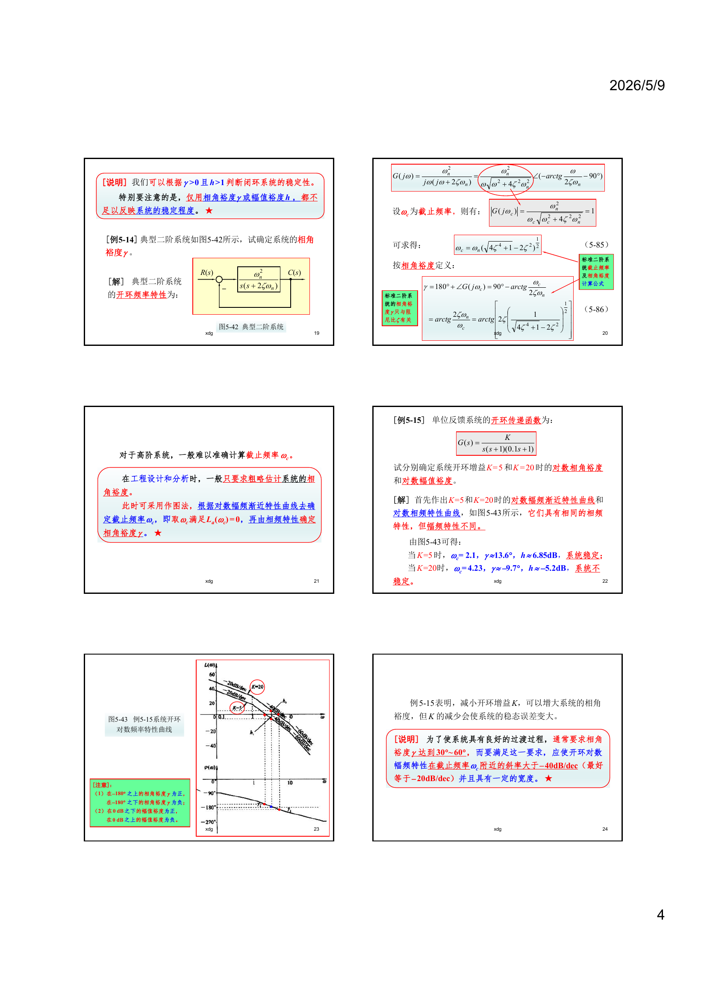

```cardlink
url: http://10.188.31.55:5244/Nextcloud/School/自动控制原理/
title: "自动控制原理 · 课程课件与复习笔记"
description: "中南大学自动化学院《自动控制原理》的课件、教材与复习笔记"
host: 10.188.31.55:5244
```

[← 返回《自动控制原理》目录](../)

## 第 5 章 线性系统的频域分析法

频率特性回答一个问题：给系统喂一个正弦波，出来的是什么形状的波。答案是同频率的正弦波，只是幅值被缩放、相位被搬动。搬动多少、缩放多少，随频率变化。把这个变化画成曲线，就得到波特图和奈奎斯特图。有了这两张图，稳定性、相角裕度、幅值裕度都能读出来。

本章的三类考题在讲师笔记里写得很直白：从 Bode 图反推开环传递函数、用 Nyquist 判据判稳定、求两个裕度 [题型二_频域分析大题_Nyquist与Bode.md · p.3](http://10.188.31.55:5244/Nextcloud/School/自动控制原理/%E9%A2%98%E5%9E%8B%E4%BA%8C_%E9%A2%91%E5%9F%9F%E5%88%86%E6%9E%90%E5%A4%A7%E9%A2%98_Nyquist%E4%B8%8EBode.md)。期末 A 卷第 4 题（20 分）是全卷分值最高的一题。

频率特性的物理意义在教材里是这样立的：把传递函数 $G(s)$ 里的 $s$ 直接换成 $j\omega$，得到的就是频率特性 [自动控制原理（第八版） (胡寿松、姜斌、张绍杰) (z-library.sk, 1lib.sk, z-lib.sk)(1).pdf · p.206](http://10.188.31.55:5244/Nextcloud/School/自动控制原理/%E8%87%AA%E5%8A%A8%E6%8E%A7%E5%88%B6%E5%8E%9F%E7%90%86%EF%BC%88%E7%AC%AC%E5%85%AB%E7%89%88%EF%BC%89%20(%E8%83%A1%E5%AF%BF%E6%9D%BE%E3%80%81%E5%A7%9C%E6%96%8C%E3%80%81%E5%BC%A0%E7%BB%8D%E6%9D%B0)%20(z-library.sk,%201lib.sk,%20z-lib.sk)(1).pdf#page=206)。

### 前置补丁

本章的计算只建立在四件旧工具上。

**频率特性的物理意义。** 稳定线性系统受到正弦输入 $A\sin(\omega t+\varphi)$ 作用后，稳态输出仍是同频率的正弦波，幅值乘以 $|G(j\omega)|$，相位加上 $\angle G(j\omega)$ [自动控制原理（第八版） (胡寿松、姜斌、张绍杰) (z-library.sk, 1lib.sk, z-lib.sk)(1).pdf · p.206](http://10.188.31.55:5244/Nextcloud/School/自动控制原理/%E8%87%AA%E5%8A%A8%E6%8E%A7%E5%88%B6%E5%8E%9F%E7%90%86%EF%BC%88%E7%AC%AC%E5%85%AB%E7%89%88%EF%BC%89%20(%E8%83%A1%E5%AF%BF%E6%9D%BE%E3%80%81%E5%A7%9C%E6%96%8C%E3%80%81%E5%BC%A0%E7%BB%8D%E6%9D%B0)%20(z-library.sk,%201lib.sk,%20z-lib.sk)(1).pdf#page=206)。

**复数代数。** 把 $G(j\omega)$ 写成 $(a+jb)/(c+jd)$，幅值和相角分别是

$$
|G(j\omega)|=\frac{\sqrt{a^{2}+b^{2}}}{\sqrt{c^{2}+d^{2}}},\qquad \angle G(j\omega)=\arctan\frac{b}{a}-\arctan\frac{d}{c}
$$

arctan 只给主值，要按象限修正：第三象限的点相角是 $-(180^\circ-\arctan|b/a|)$，不能直接取 $\arctan(b/a)$ [题型二_频域分析大题_Nyquist与Bode.md · p.674](http://10.188.31.55:5244/Nextcloud/School/自动控制原理/%E9%A2%98%E5%9E%8B%E4%BA%8C_%E9%A2%91%E5%9F%9F%E5%88%86%E6%9E%90%E5%A4%A7%E9%A2%98_Nyquist%E4%B8%8EBode.md)。教材例 5-6 处理 $\omega>20$ 那一段时用的就是这个办法 [自动控制原理（第八版） (胡寿松、姜斌、张绍杰) (z-library.sk, 1lib.sk, z-lib.sk)(1).pdf · p.226](http://10.188.31.55:5244/Nextcloud/School/自动控制原理/%E8%87%AA%E5%8A%A8%E6%8E%A7%E5%88%B6%E5%8E%9F%E7%90%86%EF%BC%88%E7%AC%AC%E5%85%AB%E7%89%88%EF%BC%89%20(%E8%83%A1%E5%AF%BF%E6%9D%BE%E3%80%81%E5%A7%9C%E6%96%8C%E3%80%81%E5%BC%A0%E7%BB%8D%E6%9D%B0)%20(z-library.sk,%201lib.sk,%20z-lib.sk)(1).pdf#page=226)。

**分贝换值。** 对数幅值定义为 $L(\omega)=20\lg|G(j\omega)|$ [自动控制原理（第八版） (胡寿松、姜斌、张绍杰) (z-library.sk, 1lib.sk, z-lib.sk)(1).pdf · p.210](http://10.188.31.55:5244/Nextcloud/School/自动控制原理/%E8%87%AA%E5%8A%A8%E6%8E%A7%E5%88%B6%E5%8E%9F%E7%90%86%EF%BC%88%E7%AC%AC%E5%85%AB%E7%89%88%EF%BC%89%20(%E8%83%A1%E5%AF%BF%E6%9D%BE%E3%80%81%E5%A7%9C%E6%96%8C%E3%80%81%E5%BC%A0%E7%BB%8D%E6%9D%B0)%20(z-library.sk,%201lib.sk,%20z-lib.sk)(1).pdf#page=210)，反过来 $|G|=10^{L/20}$。按这个定义算，三个基准点是：$|G|=1\leftrightarrow 0$ dB，$|G|=0.5\leftrightarrow -6$ dB，$|G|=2\leftrightarrow +6$ dB。

**系统型别与开环增益。** 开环传递函数分母里"光秃秃的 $s$"的个数就是型别 $\nu$；把除 $s^{\nu}$ 以外的部分令 $s\to 0$ 得到开环增益 $K$ [复习_稳态误差与Nyquist图.md · p.43](http://10.188.31.55:5244/Nextcloud/School/自动控制原理/%E5%A4%8D%E4%B9%A0_%E7%A8%B3%E6%80%81%E8%AF%AF%E5%B7%AE%E4%B8%8ENyquist%E5%9B%BE.md)。

> [!TIP] 读本章前必须先会
> 这四件里最容易漏的是**复数代数的象限修正**。Nyquist 图上每个点的相角都要按象限重算一遍，第三象限写成 $\arctan(b/a)$ 会得到一个正角度，把穿越方向数反。

### 从微分方程到 $G(j\omega)$

教材以 RC 滤波网络为例建立频率特性的概念。网络方程是 $T\dfrac{du_o}{dt}+u_o=u_i$，时间常数 $T=RC$。取正弦输入 $u_i=A\sin\omega t$，两边取拉氏变换后解出

$$
u_o(t)=\underbrace{\frac{A}{\sqrt{1+T^{2}\omega^{2}}}\sin\!\left(\omega t-\arctan\omega T\right)}_{\text{稳态分量}}+\underbrace{\frac{A\omega T}{1+T^{2}\omega^{2}}e^{-t/T}\cos\omega t}_{\text{瞬态分量}}
$$

瞬态分量带 $e^{-t/T}$，随时间衰减到零。剩下的稳态分量写成幅相形式：

$$
u_o(t)=\frac{A}{\sqrt{1+T^{2}\omega^{2}}}\sin\!\left(\omega t-\arctan\omega T\right)=A\left|G(j\omega)\right|\sin\!\left(\omega t+\angle G(j\omega)\right)
$$

输入幅值 $A$、相位 $0$，输出幅值 $A|G(j\omega)|$、相位 $\angle G(j\omega)$，一一对应 [自动控制原理（第八版） (胡寿松、姜斌、张绍杰) (z-library.sk, 1lib.sk, z-lib.sk)(1).pdf · p.206](http://10.188.31.55:5244/Nextcloud/School/自动控制原理/%E8%87%AA%E5%8A%A8%E6%8E%A7%E5%88%B6%E5%8E%9F%E7%90%86%EF%BC%88%E7%AC%AC%E5%85%AB%E7%89%88%EF%BC%89%20(%E8%83%A1%E5%AF%BF%E6%9D%BE%E3%80%81%E5%A7%9C%E6%96%8C%E3%80%81%E5%BC%A0%E7%BB%8D%E6%9D%B0)%20(z-library.sk,%201lib.sk,%20z-lib.sk)(1).pdf#page=206)。

把传递函数的 $s$ 换成 $j\omega$ 就能得到 $G(j\omega)$：

$$
G(j\omega)=\frac{1}{1+j\omega T}=\frac{1}{\sqrt{1+T^{2}\omega^{2}}}\,e^{-j\arctan\omega T}
$$

对一般稳定线性定常系统 $G(s)=B(s)/A(s)$，结论相同：稳态输出是 $A|G(j\omega)|\sin(\omega t+\varphi+\angle G(j\omega))$，其中 $A(\omega)=|G(j\omega)|$ 叫幅频特性，$\varphi(\omega)=\angle G(j\omega)$ 叫相频特性 [自动控制原理（第八版） (胡寿松、姜斌、张绍杰) (z-library.sk, 1lib.sk, z-lib.sk)(1).pdf · p.207](http://10.188.31.55:5244/Nextcloud/School/自动控制原理/%E8%87%AA%E5%8A%A8%E6%8E%A7%E5%88%B6%E5%8E%9F%E7%90%86%EF%BC%88%E7%AC%AC%E5%85%AB%E7%89%88%EF%BC%89%20(%E8%83%A1%E5%AF%BF%E6%9D%BE%E3%80%81%E5%A7%9C%E6%96%8C%E3%80%81%E5%BC%A0%E7%BB%8D%E6%9D%B0)%20(z-library.sk,%201lib.sk,%20z-lib.sk)(1).pdf#page=207)。

频率特性还能从频域上再证一次。稳定系统的频率特性等于输出和输入的傅氏变换之比 $G(j\omega)=C(j\omega)/R(j\omega)$，这正是传递函数的定义在频域的翻版 [自动控制原理（第八版） (胡寿松、姜斌、张绍杰) (z-library.sk, 1lib.sk, z-lib.sk)(1).pdf · p.208](http://10.188.31.55:5244/Nextcloud/School/自动控制原理/%E8%87%AA%E5%8A%A8%E6%8E%A7%E5%88%B6%E5%8E%9F%E7%90%86%EF%BC%88%E7%AC%AC%E5%85%AB%E7%89%88%EF%BC%89%20(%E8%83%A1%E5%AF%BF%E6%9D%BE%E3%80%81%E5%A7%9C%E6%96%8C%E3%80%81%E5%BC%A0%E7%BB%8D%E6%9D%B0)%20(z-library.sk,%201lib.sk,%20z-lib.sk)(1).pdf#page=208)。教材把微分方程、传递函数、频率特性画成一张关系图，三者描述同一个系统。

工程上偏爱频域法有两个原因。频率特性可以用实验直接测出来——给定输入端加正弦，测量输出端，算幅值比和相位差，画成曲线 [自控原理（第五章3）.pdf · p.2](http://10.188.31.55:5244/Nextcloud/School/自动控制原理/%E8%87%AA%E6%8E%A7%E5%8E%9F%E7%90%86%EF%BC%88%E7%AC%AC%E4%BA%94%E7%AB%A03%EF%BC%89.pdf#page=2)；稳定性也有直接判据，不用求闭环特征方程的根 [自控原理（第五章4）.pdf · p.1](http://10.188.31.55:5244/Nextcloud/School/自动控制原理/%E8%87%AA%E6%8E%A7%E5%8E%9F%E7%90%86%EF%BC%88%E7%AC%AC%E4%BA%94%E7%AB%A04%EF%BC%89.pdf#page=1)。

### 频率特性的三种画法

**幅相频率特性曲线**（极坐标图）：把 $G(j\omega)$ 当作复平面上的向量，$\omega$ 从 0 变到 $+\infty$ 画出轨迹。向量长度是幅值，与正实轴的夹角是相位。幅频是偶函数、相频是奇函数，$\omega<0$ 的半支与 $\omega>0$ 半支关于实轴对称，所以只画 $\omega\ge 0$ 的一半 [自动控制原理（第八版） (胡寿松、姜斌、张绍杰) (z-library.sk, 1lib.sk, z-lib.sk)(1).pdf · p.208](http://10.188.31.55:5244/Nextcloud/School/自动控制原理/%E8%87%AA%E5%8A%A8%E6%8E%A7%E5%88%B6%E5%8E%9F%E7%90%86%EF%BC%88%E7%AC%AC%E5%85%AB%E7%89%88%EF%BC%89%20(%E8%83%A1%E5%AF%BF%E6%9D%BE%E3%80%81%E5%A7%9C%E6%96%8C%E3%80%81%E5%BC%A0%E7%BB%8D%E6%9D%B0)%20(z-library.sk,%201lib.sk,%20z-lib.sk)(1).pdf#page=208)。

**对数频率特性曲线**（波特图）：横轴按 $\lg\omega$ 分度，纵轴一条是 $L(\omega)=20\lg|A(\omega)|$（dB），一条是 $\varphi(\omega)$（度）。两个好处：$\omega$ 范围能压缩到几个数量级还看得清；幅值的乘除变成加减，画图变成一段段折线叠加 [自动控制原理（第八版） (胡寿松、姜斌、张绍杰) (z-library.sk, 1lib.sk, z-lib.sk)(1).pdf · p.210](http://10.188.31.55:5244/Nextcloud/School/自动控制原理/%E8%87%AA%E5%8A%A8%E6%8E%A7%E5%88%B6%E5%8E%9F%E7%90%86%EF%BC%88%E7%AC%AC%E5%85%AB%E7%89%88%EF%BC%89%20(%E8%83%A1%E5%AF%BF%E6%9D%BE%E3%80%81%E5%A7%9C%E6%96%8C%E3%80%81%E5%BC%A0%E7%BB%8D%E6%9D%B0)%20(z-library.sk,%201lib.sk,%20z-lib.sk)(1).pdf#page=210)。

**对数幅相曲线**（尼科尔斯图）：纵坐标 $L(\omega)$，横坐标 $\varphi(\omega)$，都是线性分度。在这套坐标里可以画等 $M$ 簇线和等 $\alpha$ 簇线，用频域指标直接反推校正网络 [自动控制原理（第八版） (胡寿松、姜斌、张绍杰) (z-library.sk, 1lib.sk, z-lib.sk)(1).pdf · p.210](http://10.188.31.55:5244/Nextcloud/School/自动控制原理/%E8%87%AA%E5%8A%A8%E6%8E%A7%E5%88%B6%E5%8E%9F%E7%90%86%EF%BC%88%E7%AC%AC%E5%85%AB%E7%89%88%EF%BC%89%20(%E8%83%A1%E5%AF%BF%E6%9D%BE%E3%80%81%E5%A7%9C%E6%96%8C%E3%80%81%E5%BC%A0%E7%BB%8D%E6%9D%B0)%20(z-library.sk,%201lib.sk,%20z-lib.sk)(1).pdf#page=210)。

### 典型环节与开环系统的频率特性

开环传递函数按零极点分解成典型环节的串联。教材把典型环节分成最小相位和非最小相位两大类，最小相位的有七种 [自动控制原理（第八版） (胡寿松、姜斌、张绍杰) (z-library.sk, 1lib.sk, z-lib.sk)(1).pdf · p.210](http://10.188.31.55:5244/Nextcloud/School/自动控制原理/%E8%87%AA%E5%8A%A8%E6%8E%A7%E5%88%B6%E5%8E%9F%E7%90%86%EF%BC%88%E7%AC%AC%E5%85%AB%E7%89%88%EF%BC%89%20(%E8%83%A1%E5%AF%BF%E6%9D%BE%E3%80%81%E5%A7%9C%E6%96%8C%E3%80%81%E5%BC%A0%E7%BB%8D%E6%9D%B0)%20(z-library.sk,%201lib.sk,%20z-lib.sk)(1).pdf#page=210)。这七种是比例、惯性、一阶微分、振荡、二阶微分、积分、微分，另有五种非最小相位环节，对应的是把某个参数的符号取反 [自动控制原理（第八版） (胡寿松、姜斌、张绍杰) (z-library.sk, 1lib.sk, z-lib.sk)(1).pdf · p.211](http://10.188.31.55:5244/Nextcloud/School/自动控制原理/%E8%87%AA%E5%8A%A8%E6%8E%A7%E5%88%B6%E5%8E%9F%E7%90%86%EF%BC%88%E7%AC%AC%E5%85%AB%E7%89%88%EF%BC%89%20(%E8%83%A1%E5%AF%BF%E6%9D%BE%E3%80%81%E5%A7%9C%E6%96%8C%E3%80%81%E5%BC%A0%E7%BB%8D%E6%9D%B0)%20(z-library.sk,%201lib.sk,%20z-lib.sk)(1).pdf#page=211)。

**非最小相位与最小相位互为镜像。** 每种非最小相位典型环节都有一种最小相位环节与之对应，区别只在某个参数符号相反。后果是：幅频特性完全相同，对数幅频曲线相同，但相频特性符号相反、相频曲线关于 $0^\circ$ 线对称 [自动控制原理（第八版） (胡寿松、姜斌、张绍杰) (z-library.sk, 1lib.sk, z-lib.sk)(1).pdf · p.213](http://10.188.31.55:5244/Nextcloud/School/自动控制原理/%E8%87%AA%E5%8A%A8%E6%8E%A7%E5%88%B6%E5%8E%9F%E7%90%86%EF%BC%88%E7%AC%AC%E5%85%AB%E7%89%88%EF%BC%89%20(%E8%83%A1%E5%AF%BF%E6%9D%BE%E3%80%81%E5%A7%9C%E6%96%8C%E3%80%81%E5%BC%A0%E7%BB%8D%E6%9D%B0)%20(z-library.sk,%201lib.sk,%20z-lib.sk)(1).pdf#page=213)。课件把这一条列成专门结论，强调它对振荡环节、一阶微分环节、二阶微分环节全都成立 [自控原理（第五章1） 2.pdf · p.3](http://10.188.31.55:5244/Nextcloud/School/自动控制原理/%E8%87%AA%E6%8E%A7%E5%8E%9F%E7%90%86%EF%BC%88%E7%AC%AC%E4%BA%94%E7%AB%A01%EF%BC%89%202.pdf#page=3)。

这一点有直接后果：**只给对数幅频曲线，一般只能确定最小相位系统**。含右半平面零点或延迟环节的系统必须结合实测相频才能确定。

**典型环节分解式。** 开环传递函数写成 $G(s)H(s)=\prod_{i=1}^{N}G_i(s)$，每个 $G_i$ 是一个典型环节 [自动控制原理（第八版） (胡寿松、姜斌、张绍杰) (z-library.sk, 1lib.sk, z-lib.sk)(1).pdf · p.211](http://10.188.31.55:5244/Nextcloud/School/自动控制原理/%E8%87%AA%E5%8A%A8%E6%8E%A7%E5%88%B6%E5%8E%9F%E7%90%86%EF%BC%88%E7%AC%AC%E5%85%AB%E7%89%88%EF%BC%89%20(%E8%83%A1%E5%AF%BF%E6%9D%BE%E3%80%81%E5%A7%9C%E6%96%8C%E3%80%81%E5%BC%A0%E7%BB%8D%E6%9D%B0)%20(z-library.sk,%201lib.sk,%20z-lib.sk)(1).pdf#page=211)。因为对数把乘法变加法，$L(\omega)=\sum_{i=1}^{N}L_i(\omega)$，画图时把各环节的折线叠起来就是总曲线。

**惯性环节的斜率规则。** 惯性环节 $1/(1+Ts)$ 的对数幅值是 $-20\lg\sqrt{1+\omega^2T^2}$。低频段（$\omega T\ll 1$）近似为 0 dB 水平线；高频段（$\omega T\gg 1$）近似为 $-20\lg(\omega T)$，斜率 $-20$ dB/dec。两条直线交在 $\omega=1/T$，这个频率叫交接频率或转折频率 [自动控制原理（第八版） (胡寿松、姜斌、张绍杰) (z-library.sk, 1lib.sk, z-lib.sk)(1).pdf · p.216](http://10.188.31.55:5244/Nextcloud/School/自动控制原理/%E8%87%AA%E5%8A%A8%E6%8E%A7%E5%88%B6%E5%8E%9F%E7%90%86%EF%BC%88%E7%AC%AC%E5%85%AB%E7%89%88%EF%BC%89%20(%E8%83%A1%E5%AF%BF%E6%9D%BE%E3%80%81%E5%A7%9C%E6%96%8C%E3%80%81%E5%BC%A0%E7%BB%8D%E6%9D%B0)%20(z-library.sk,%201lib.sk,%20z-lib.sk)(1).pdf#page=216)。

其余典型环节的斜率变化与惯性环节同源：惯性环节 $1/(1+Ts)$ 的交接频率 $1/T$、斜率减 20 dB/dec，一阶微分环节 $1+Ts$ 的交接频率 $1/T$、斜率加 20 dB/dec，振荡环节 $1/(\frac{s^2}{\omega_n^2}+2\zeta\frac{s}{\omega_n}+1)$ 的交接频率 $\omega_n$、斜率减 40 dB/dec，二阶微分环节的交接频率 $\omega_n$、斜率加 40 dB/dec，积分环节 $1/s$ 的斜率恒为 -20 dB/dec，比例环节的斜率恒为 0 [题型二_频域分析大题_Nyquist与Bode.md · p.85](http://10.188.31.55:5244/Nextcloud/School/自动控制原理/%E9%A2%98%E5%9E%8B%E4%BA%8C_%E9%A2%91%E5%9F%9F%E5%88%86%E6%9E%90%E5%A4%A7%E9%A2%98_Nyquist%E4%B8%8EBode.md)。

课件的示意图把惯性、一阶微分、振荡、二阶微分这四种环节的最小相位与非最小相位成对给出 [自控原理（第五章1） 2.pdf · p.5](http://10.188.31.55:5244/Nextcloud/School/自动控制原理/%E8%87%AA%E6%8E%A7%E5%8E%9F%E7%90%86%EF%BC%88%E7%AC%AC%E4%BA%94%E7%AB%A01%EF%BC%89%202.pdf#page=5)。教材把典型环节的幅相特性曲线（图 5-10）和对数频率特性曲线（图 5-11）分开画 [自动控制原理（第八版） (胡寿松、姜斌、张绍杰) (z-library.sk, 1lib.sk, z-lib.sk)(1).pdf · p.212](http://10.188.31.55:5244/Nextcloud/School/自动控制原理/%E8%87%AA%E5%8A%A8%E6%8E%A7%E5%88%B6%E5%8E%9F%E7%90%86%EF%BC%88%E7%AC%AC%E5%85%AB%E7%89%88%EF%BC%89%20(%E8%83%A1%E5%AF%BF%E6%9D%BE%E3%80%81%E5%A7%9C%E6%96%8C%E3%80%81%E5%BC%A0%E7%BB%8D%E6%9D%B0)%20(z-library.sk,%201lib.sk,%20z-lib.sk)(1).pdf#page=212)。


### 低频段与开环增益

低于最小交接频率的那一段，所有一阶、二阶环节的渐近线都是 0 dB，只剩积分环节和比例环节起作用。开环对数幅频渐近线在这段的斜率是 $-20\nu$ dB/dec，$\nu$ 就是系统型别。

这段直线有两个用途。斜率告诉你系统是几型，这是判稳态误差的依据。截距告诉你开环增益 $K$：取 $\omega=1$ rad/s，

$$
L_a(1)=20\lg K
$$

即 $K=10^{L_a(1)/20}$ [自动控制原理（第八版） (胡寿松、姜斌、张绍杰) (z-library.sk, 1lib.sk, z-lib.sk)(1).pdf · p.224](http://10.188.31.55:5244/Nextcloud/School/自动控制原理/%E8%87%AA%E5%8A%A8%E6%8E%A7%E5%88%B6%E5%8E%9F%E7%90%86%EF%BC%88%E7%AC%AC%E5%85%AB%E7%89%88%EF%BC%89%20(%E8%83%A1%E5%AF%BF%E6%9D%BE%E3%80%81%E5%A7%9C%E6%96%8C%E3%80%81%E5%BC%A0%E7%BB%8D%E6%9D%B0)%20(z-library.sk,%201lib.sk,%20z-lib.sk)(1).pdf#page=224)。教材给了三种取 $K$ 的办法：延长线法（取 $\omega=1$）、特定点法（在低频段任取一点 $(\omega_0,L_0)$，$K=10^{(L_0+20\nu\lg\omega_0)/20}$）、零 dB 穿越法（$\omega_b=K^{1/\nu}$）[自动控制原理（第八版） (胡寿松、姜斌、张绍杰) (z-library.sk, 1lib.sk, z-lib.sk)(1).pdf · p.224](http://10.188.31.55:5244/Nextcloud/School/自动控制原理/%E8%87%AA%E5%8A%A8%E6%8E%A7%E5%88%B6%E5%8E%9F%E7%90%86%EF%BC%88%E7%AC%AC%E5%85%AB%E7%89%88%EF%BC%89%20(%E8%83%A1%E5%AF%BF%E6%9D%BE%E3%80%81%E5%A7%9C%E6%96%8C%E3%80%81%E5%BC%A0%E7%BB%8D%E6%9D%B0)%20(z-library.sk,%201lib.sk,%20z-lib.sk)(1).pdf#page=224)。

课件把这一步单独强调了一遍：先做典型环节分解，再定各转折频率和对应环节类型，然后才定 $K$ [自控原理（第五章1） 2.pdf · p.8](http://10.188.31.55:5244/Nextcloud/School/自动控制原理/%E8%87%AA%E6%8E%A7%E5%8E%9F%E7%90%86%EF%BC%88%E7%AC%AC%E4%BA%94%E7%AB%A01%EF%BC%89%202.pdf#page=8)。

### 从波特图反推开环传递函数

这是期末和期中的高频题型。标准四步 [题型二_频域分析大题_Nyquist与Bode.md · p.91](http://10.188.31.55:5244/Nextcloud/School/自动控制原理/%E9%A2%98%E5%9E%8B%E4%BA%8C_%E9%A2%91%E5%9F%9F%E5%88%86%E6%9E%90%E5%A4%A7%E9%A2%98_Nyquist%E4%B8%8EBode.md)：

1. **定系统型别。** 看低频段斜率。0 dB/dec 是 0 型，-20 dB/dec 是 I 型，-40 dB/dec 是 II 型。斜率每 20 dB/dec 对应一个积分环节 $1/s$。
2. **定各转折频率和环节类型。** 从左到右扫渐近线的折点。斜率从 $k_1$ 变到 $k_2$，变化量 $-20$ dB/dec 加一个惯性环节、$+20$ dB/dec 加一阶微分环节、$-40$ dB/dec 加振荡环节、$+40$ dB/dec 加二阶微分环节。时间常数由 $T=1/\omega$ 定出。
3. **定开环增益 $K$。** **只能用低频段延长线在 $\omega=1$ 处的值**，这是最容易错的一步 [题型二_频域分析大题_Nyquist与Bode.md · p.115](http://10.188.31.55:5244/Nextcloud/School/自动控制原理/%E9%A2%98%E5%9E%8B%E4%BA%8C_%E9%A2%91%E5%9F%9F%E5%88%86%E6%9E%90%E5%A4%A7%E9%A2%98_Nyquist%E4%B8%8EBode.md)。
4. **写出传递函数。** 把积分环节、分子环节、分母环节按型别和转折频率组装。

**第 3 步为什么只有一个正确位置。** 讲师给过一个具体例子：低频段是 -20 dB/dec 的斜线，过点 $(0.1, 40\text{ dB})$，求 $K$。正确做法是先把直线延长到 $\omega=1$，由斜率算出该处高度 $40-20=20$ dB，得 $K=10$。若直接读转折点处的 40 dB，就会错得 $K=100$ [题型二_频域分析大题_Nyquist与Bode.md · p.160](http://10.188.31.55:5244/Nextcloud/School/自动控制原理/%E9%A2%98%E5%9E%8B%E4%BA%8C_%E9%A2%91%E5%9F%9F%E5%88%86%E6%9E%90%E5%A4%A7%E9%A2%98_Nyquist%E4%B8%8EBode.md)。其他环节的渐近线在转折频率处的高度含转折频率的幂次，不是 $20\lg K$。

**例题。** 给出对数幅频渐近特性曲线：低频段斜率 -20 dB/dec，$\omega=\omega_1$ 处斜率变为 -40 dB/dec，$\omega=100$ 处斜率变为 -60 dB/dec，低频延长线过 $(1, 20\text{ dB})$ 点 [题型二_频域分析大题_Nyquist与Bode.md · p.138](http://10.188.31.55:5244/Nextcloud/School/自动控制原理/%E9%A2%98%E5%9E%8B%E4%BA%8C_%E9%A2%91%E5%9F%9F%E5%88%86%E6%9E%90%E5%A4%A7%E9%A2%98_Nyquist%E4%B8%8EBode.md)。

- 型别：低频段斜率 -20 dB/dec，I 型系统，含一个积分环节 $1/s$ [题型二_频域分析大题_Nyquist与Bode.md · p.142](http://10.188.31.55:5244/Nextcloud/School/自动控制原理/%E9%A2%98%E5%9E%8B%E4%BA%8C_%E9%A2%91%E5%9F%9F%E5%88%86%E6%9E%90%E5%A4%A7%E9%A2%98_Nyquist%E4%B8%8EBode.md)。
- 环节：$\omega=\omega_1$ 处斜率从 -20 变 -40，变化量 -20 dB/dec，加一个惯性环节 $\dfrac{1}{T_1s+1}$，$T_1=1/\omega_1$ [题型二_频域分析大题_Nyquist与Bode.md · p.145](http://10.188.31.55:5244/Nextcloud/School/自动控制原理/%E9%A2%98%E5%9E%8B%E4%BA%8C_%E9%A2%91%E5%9F%9F%E5%88%86%E6%9E%90%E5%A4%A7%E9%A2%98_Nyquist%E4%B8%8EBode.md)。
- 环节：$\omega=100$ 处斜率从 -40 变 -60，再加一个惯性环节 $\dfrac{1}{T_2s+1}$，$T_2=1/100$ [题型二_频域分析大题_Nyquist与Bode.md · p.146](http://10.188.31.55:5244/Nextcloud/School/自动控制原理/%E9%A2%98%E5%9E%8B%E4%BA%8C_%E9%A2%91%E5%9F%9F%E5%88%86%E6%9E%90%E5%A4%A7%E9%A2%98_Nyquist%E4%B8%8EBode.md)。
- 增益：低频延长线在 $\omega=1$ 处的值是 20 dB，$20\lg K=20$，$K=10$ [题型二_频域分析大题_Nyquist与Bode.md · p.149](http://10.188.31.55:5244/Nextcloud/School/自动控制原理/%E9%A2%98%E5%9E%8B%E4%BA%8C_%E9%A2%91%E5%9F%9F%E5%88%86%E6%9E%90%E5%A4%A7%E9%A2%98_Nyquist%E4%B8%8EBode.md)。
- 结果：$G(s)=\dfrac{10}{s(T_1s+1)(0.01s+1)}$ [题型二_频域分析大题_Nyquist与Bode.md · p.152](http://10.188.31.55:5244/Nextcloud/School/自动控制原理/%E9%A2%98%E5%9E%8B%E4%BA%8C_%E9%A2%91%E5%9F%9F%E5%88%86%E6%9E%90%E5%A4%A7%E9%A2%98_Nyquist%E4%B8%8EBode.md)。

教材例 5-7 给的是同一类图形，图上低频段是 +20 dB/dec（微分环节），$\omega_1$ 处变 0 dB/dec（惯性环节），$\omega_2$ 处变 -40 dB/dec（振荡环节），实际曲线上 $\omega_2$ 附近有谐振峰 [自动控制原理（第八版） (胡寿松、姜斌、张绍杰) (z-library.sk, 1lib.sk, z-lib.sk)(1).pdf · p.227](http://10.188.31.55:5244/Nextcloud/School/自动控制原理/%E8%87%AA%E5%8A%A8%E6%8E%A7%E5%88%B6%E5%8E%9F%E7%90%86%EF%BC%88%E7%AC%AC%E5%85%AB%E7%89%88%EF%BC%89%20(%E8%83%A1%E5%AF%BF%E6%9D%BE%E3%80%81%E5%A7%9C%E6%96%8C%E3%80%81%E5%BC%A0%E7%BB%8D%E6%9D%B0)%20(z-library.sk,%201lib.sk,%20z-lib.sk)(1).pdf#page=227)。


讲师补充了一条更快的路径：给定 Bode 图上的一个具体点时，改用模值方程加相角方程联立 [题型二_频域分析大题_Nyquist与Bode.md · p.717](http://10.188.31.55:5244/Nextcloud/School/自动控制原理/%E9%A2%98%E5%9E%8B%E4%BA%8C_%E9%A2%91%E5%9F%9F%E5%88%86%E6%9E%90%E5%A4%A7%E9%A2%98_Nyquist%E4%B8%8EBode.md)。

### 奈奎斯特判据

**判据的数学基础是幅角原理。** 设 $F(s)$ 为 $s$ 的有理分式，$s$ 平面上的闭合曲线 $\Gamma$ 包围 $F(s)$ 的 $Z$ 个零点和 $P$ 个极点，$s$ 沿 $\Gamma$ 顺时针运动一周时，$F(s)$ 在 $F(s)$ 平面上绕原点的圈数为 $R=P-Z$。

为判定闭环稳定性，取辅助函数

$$
F(s)=1+G(s)H(s)=\frac{A(s)+B(s)}{A(s)}
$$

它的零点是闭环特征方程 $A(s)+B(s)=0$ 的根，即闭环极点；极点是开环分母 $A(s)=0$ 的根，即开环极点 [自动控制原理（第八版） (胡寿松、姜斌、张绍杰) (z-library.sk, 1lib.sk, z-lib.sk)(1).pdf · p.230](http://10.188.31.55:5244/Nextcloud/School/自动控制原理/%E8%87%AA%E5%8A%A8%E6%8E%A7%E5%88%B6%E5%8E%9F%E7%90%86%EF%BC%88%E7%AC%AC%E5%85%AB%E7%89%88%EF%BC%89%20(%E8%83%A1%E5%AF%BF%E6%9D%BE%E3%80%81%E5%A7%9C%E6%96%8C%E3%80%81%E5%BC%A0%E7%BB%8D%E6%9D%B0)%20(z-library.sk,%201lib.sk,%20z-lib.sk)(1).pdf#page=230)。让 $\Gamma$ 包围整个右半 $s$ 平面，$Z$ 就是闭环右半平面极点数，$P$ 就是开环右半平面极点数。

$F(s)=1+G(s)H(s)$ 意味着 $F(s)$ 平面上的原点对应 $G(s)H(s)$ 平面上的点 $(-1,j0)$。$F(s)$ 绕原点的圈数，等于 $G(s)H(s)$ 绕临界点的圈数。

**奈氏路径的补圆。** 幅角原理要求 $\Gamma$ 不通过 $F(s)$ 的极点，而积分环节让原点成为开环极点。处理办法是在原点附近取半径无穷小的半圆 $s=\varepsilon e^{j\theta}$，$\theta\in[-90^\circ,90^\circ]$，绕开原点。对应到 $G(s)H(s)$ 平面上，要从 $G(j0^+)H(j0^+)$ 起补一段半径无穷大、圆心角为 $\nu\times90^\circ$ 的逆时针虚圆弧 [自动控制原理（第八版） (胡寿松、姜斌、张绍杰) (z-library.sk, 1lib.sk, z-lib.sk)(1).pdf · p.231](http://10.188.31.55:5244/Nextcloud/School/自动控制原理/%E8%87%AA%E5%8A%A8%E6%8E%A7%E5%88%B6%E5%8E%9F%E7%90%86%EF%BC%88%E7%AC%AC%E5%85%AB%E7%89%88%EF%BC%89%20(%E8%83%A1%E5%AF%BF%E6%9D%BE%E3%80%81%E5%A7%9C%E6%96%8C%E3%80%81%E5%BC%A0%E7%BB%8D%E6%9D%B0)%20(z-library.sk,%201lib.sk,%20z-lib.sk)(1).pdf#page=231)。开环含等幅振荡环节时，$\pm j\omega_n$ 附近也要补圆，对应圆心角为 $\nu_1\times180^\circ$ 的大圆弧 [自动控制原理（第八版） (胡寿松、姜斌、张绍杰) (z-library.sk, 1lib.sk, z-lib.sk)(1).pdf · p.232](http://10.188.31.55:5244/Nextcloud/School/自动控制原理/%E8%87%AA%E5%8A%A8%E6%8E%A7%E5%88%B6%E5%8E%9F%E7%90%86%EF%BC%88%E7%AC%AC%E5%85%AB%E7%89%88%EF%BC%89%20(%E8%83%A1%E5%AF%BF%E6%9D%BE%E3%80%81%E5%A7%9C%E6%96%8C%E3%80%81%E5%BC%A0%E7%BB%8D%E6%9D%B0)%20(z-library.sk,%201lib.sk,%20z-lib.sk)(1).pdf#page=232)。

这段补圆本身也可能产生穿越，必须计入 $N$ [自控原理（第五章3）.pdf · p.5](http://10.188.31.55:5244/Nextcloud/School/自动控制原理/%E8%87%AA%E6%8E%A7%E5%8E%9F%E7%90%86%EF%BC%88%E7%AC%AC%E4%BA%94%E7%AB%A03%EF%BC%89.pdf#page=5)。


**穿越计数与稳定条件。** 只画 $\omega\ge 0$ 的半闭合曲线时，穿越次数要乘 2。记 $N=N_+-N_-$，其中 $N_+$ 为正穿越次数（曲线从下向上穿过 $(-1,j0)$ 左侧负实轴），$N_-$ 为负穿越次数（从上向下穿过）。$R=2N$，代入 $R=P-Z$ 解出

$$
Z=P-2N
$$

闭环稳定的充要条件是右半平面无闭环极点，即 $Z=P-2N=0$ [自动控制原理（第八版） (胡寿松、姜斌、张绍杰) (z-library.sk, 1lib.sk, z-lib.sk)(1).pdf · p.233](http://10.188.31.55:5244/Nextcloud/School/自动控制原理/%E8%87%AA%E5%8A%A8%E6%8E%A7%E5%88%B6%E5%8E%9F%E7%90%86%EF%BC%88%E7%AC%AC%E5%85%AB%E7%89%88%EF%BC%89%20(%E8%83%A1%E5%AF%BF%E6%9D%BE%E3%80%81%E5%A7%9C%E6%96%8C%E3%80%81%E5%BC%A0%E7%BB%8D%E6%9D%B0)%20(z-library.sk,%201lib.sk,%20z-lib.sk)(1).pdf#page=233)。最常见的开环稳定情形 $P=0$ 时，稳定条件退化为 $N=0$，也就是 Nyquist 曲线不包围、不穿过临界点 $(-1,j0)$ [复习_稳态误差与Nyquist图.md · p.243](http://10.188.31.55:5244/Nextcloud/School/自动控制原理/%E5%A4%8D%E4%B9%A0_%E7%A8%B3%E6%80%81%E8%AF%AF%E5%B7%AE%E4%B8%8ENyquist%E5%9B%BE.md)。

课件把穿越方向写得更细：对数频率稳定判据下，正穿越一次指 $\Gamma_{GH}$ 由上向下穿越 $(-1,j0)$ 点左侧的负实轴一次，等价于在 $L(\omega)>0$ 时 $\Gamma_\varphi$ 由下向上穿越 $(2k+1)\pi$ 线一次；负穿越一次方向相反；半次穿越指曲线止于或起于该点 [自控原理（第五章3）.pdf · p.9](http://10.188.31.55:5244/Nextcloud/School/自动控制原理/%E8%87%AA%E6%8E%A7%E5%8E%9F%E7%90%86%EF%BC%88%E7%AC%AC%E4%BA%94%E7%AB%A03%EF%BC%89.pdf#page=9)。补作的虚直线和虚圆弧所产生的穿越**皆为负穿越**。

**为什么是 $2N$ 而不是 $N$。** 完整的 Nyquist 曲线包含 $\omega$ 从 $-\infty$ 到 $+\infty$，也就是 $\omega>0$ 部分和 $\omega<0$ 部分的对称镜像，等于绕了完整 $s$ 平面闭合曲线一圈。曲线关于实轴对称，所以 $\omega>0$ 段的穿越次数要乘以 2 [题型二_频域分析大题_Nyquist与Bode.md · p.281](http://10.188.31.55:5244/Nextcloud/School/自动控制原理/%E9%A2%98%E5%9E%8B%E4%BA%8C_%E9%A2%91%E5%9F%9F%E5%88%86%E6%9E%90%E5%A4%A7%E9%A2%98_Nyquist%E4%B8%8EBode.md)。

**穿越只针对完整 Nyquist 曲线。** 含大圆弧补充部分的整条曲线，不是只看 $\omega$ 从 0 到 $\infty$ 的那一段 [题型二_频域分析大题_Nyquist与Bode.md · p.325](http://10.188.31.55:5244/Nextcloud/School/自动控制原理/%E9%A2%98%E5%9E%8B%E4%BA%8C_%E9%A2%91%E5%9F%9F%E5%88%86%E6%9E%90%E5%A4%A7%E9%A2%98_Nyquist%E4%B8%8EBode.md)。

**不同 $K$ 值下的稳定区间。** 单位反馈系统 $G(s)=\dfrac{K}{s}G_1(s)$，$\lim_{s\to0}G_1(s)=1$（I 型，$P=0$）。Nyquist 曲线与负实轴有三个交点 $G(j\omega_1)=-2$、$G(j\omega_2)=-1.5$、$G(j\omega_3)=-0.5$，对应临界增益 $K_1=5$、$K_2=20/3$、$K_3=20$ [题型二_频域分析大题_Nyquist与Bode.md · p.366](http://10.188.31.55:5244/Nextcloud/School/自动控制原理/%E9%A2%98%E5%9E%8B%E4%BA%8C_%E9%A2%91%E5%9F%9F%E5%88%86%E6%9E%90%E5%A4%A7%E9%A2%98_Nyquist%E4%B8%8EBode.md)。分段数穿越：

- $0<K<5$：$N_+=N_-=0$，$R=0$，$Z=0$，闭环稳定
- $5<K<20/3$：$R=-2$，$Z=2$，闭环不稳定
- $20/3<K<20$：$N_+=N_-=1$，$R=0$，$Z=0$，闭环稳定
- $K>20$：$R=-2$，$Z=2$，闭环不稳定

稳定区间是 $(0,5)\cup(20/3,20)$。当 $K$ 等于 5、$20/3$、20 时，$\Gamma_G$ 穿过临界点，闭环临界稳定 [自动控制原理（第八版） (胡寿松、姜斌、张绍杰) (z-library.sk, 1lib.sk, z-lib.sk)(1).pdf · p.234](http://10.188.31.55:5244/Nextcloud/School/自动控制原理/%E8%87%AA%E5%8A%A8%E6%8E%A7%E5%88%B6%E5%8E%9F%E7%90%86%EF%BC%88%E7%AC%AC%E5%85%AB%E7%89%88%EF%BC%89%20(%E8%83%A1%E5%AF%BF%E6%9D%BE%E3%80%81%E5%A7%9C%E6%96%8C%E3%80%81%E5%BC%A0%E7%BB%8D%E6%9D%B0)%20(z-library.sk,%201lib.sk,%20z-lib.sk)(1).pdf#page=234)。


### 稳定裕度

只看稳定性不够，还要知道离不稳定还有多远。教材用两个指标度量这一点。

**相角裕度 $\gamma$。** 设 $\omega_c$ 为截止频率，即 $|G(j\omega_c)H(j\omega_c)|=1$，定义相角裕度为

$$
\gamma=180^\circ+\angle G(j\omega_c)H(j\omega_c)
$$

含义是：闭环稳定的前提下，若开环相频特性再滞后 $\gamma$ 度，系统恰好到达临界稳定 [自动控制原理（第八版） (胡寿松、姜斌、张绍杰) (z-library.sk, 1lib.sk, z-lib.sk)(1).pdf · p.238](http://10.188.31.55:5244/Nextcloud/School/自动控制原理/%E8%87%AA%E5%8A%A8%E6%8E%A7%E5%88%B6%E5%8E%9F%E7%90%86%EF%BC%88%E7%AC%AC%E5%85%AB%E7%89%88%EF%BC%89%20(%E8%83%A1%E5%AF%BF%E6%9D%BE%E3%80%81%E5%A7%9C%E6%96%8C%E3%80%81%E5%BC%A0%E7%BB%8D%E6%9D%B0)%20(z-library.sk,%201lib.sk,%20z-lib.sk)(1).pdf#page=238)。$\gamma>0$ 表示在截止频率处相角还没到 $-180^\circ$，曲线尚未包围临界点，系统稳定；$\gamma<0$ 表示已经越过，系统不稳定 [复习_稳态误差与Nyquist图.md · p.302](http://10.188.31.55:5244/Nextcloud/School/自动控制原理/%E5%A4%8D%E4%B9%A0_%E7%A8%B3%E6%80%81%E8%AF%AF%E5%B7%AE%E4%B8%8ENyquist%E5%9B%BE.md)。

**幅值裕度 $h$。** 设 $\omega_x$ 为相位穿越频率，即 $\angle G(j\omega_x)H(j\omega_x)=(2k+1)\pi$，定义幅值裕度为该处幅值的倒数

$$
h=\frac{1}{|G(j\omega_x)H(j\omega_x)|}
$$

含义是：闭环稳定的前提下，若开环幅频特性再整体放大 $h$ 倍，系统恰好到达临界稳定 [自动控制原理（第八版） (胡寿松、姜斌、张绍杰) (z-library.sk, 1lib.sk, z-lib.sk)(1).pdf · p.238](http://10.188.31.55:5244/Nextcloud/School/自动控制原理/%E8%87%AA%E5%8A%A8%E6%8E%A7%E5%88%B6%E5%8E%9F%E7%90%86%EF%BC%88%E7%AC%AC%E5%85%AB%E7%89%88%EF%BC%89%20(%E8%83%A1%E5%AF%BF%E6%9D%BE%E3%80%81%E5%A7%9C%E6%96%8C%E3%80%81%E5%BC%A0%E7%BB%8D%E6%9D%B0)%20(z-library.sk,%201lib.sk,%20z-lib.sk)(1).pdf#page=238)。用分贝表示时 $h(\text{dB})=-20\lg|G(j\omega_x)H(j\omega_x)|$。

**两个裕度要一起看。** 只用幅值裕度或只用相角裕度，都不足以说明系统的相对稳定性。对最小相位系统，只有当两个裕度都是正值时系统才稳定，负的裕度表示不稳定 [自动控制原理（第八版） (胡寿松、姜斌、张绍杰) (z-library.sk, 1lib.sk, z-lib.sk)(1).pdf · p.242](http://10.188.31.55:5244/Nextcloud/School/自动控制原理/%E8%87%AA%E5%8A%A8%E6%8E%A7%E5%88%B6%E5%8E%9F%E7%90%86%EF%BC%88%E7%AC%AC%E5%85%AB%E7%89%88%EF%BC%89%20(%E8%83%A1%E5%AF%BF%E6%9D%BE%E3%80%81%E5%A7%9C%E6%96%8C%E3%80%81%E5%BC%A0%E7%BB%8D%E6%9D%B0)%20(z-library.sk,%201lib.sk,%20z-lib.sk)(1).pdf#page=242)。工程上一般要求 $\gamma$ 在 $30^\circ\sim60^\circ$ 之间、$h>6$ dB [题型二_频域分析大题_Nyquist与Bode.md · p.464](http://10.188.31.55:5244/Nextcloud/School/自动控制原理/%E9%A2%98%E5%9E%8B%E4%BA%8C_%E9%A2%91%E5%9F%9F%E5%88%86%E6%9E%90%E5%A4%A7%E9%A2%98_Nyquist%E4%B8%8EBode.md)。

**两个测量点不能混。** $\gamma$ 的测量点是 $\omega_c$（由幅值过 0 dB 确定），$h$ 的测量点是 $\omega_x$（由相角过 $-180^\circ$ 确定）。讲师把这条列为专门的易错点：常见错误是把 $\omega_c$ 处的幅值或相角拿去算幅值裕度 [题型二_频域分析大题_Nyquist与Bode.md · p.995](http://10.188.31.55:5244/Nextcloud/School/自动控制原理/%E9%A2%98%E5%9E%8B%E4%BA%8C_%E9%A2%91%E5%9F%9F%E5%88%86%E6%9E%90%E5%A4%A7%E9%A2%98_Nyquist%E4%B8%8EBode.md)。

> [!WARNING] 奈氏题三个最常见的丢分点
> **忘记补圆。** 开环含积分环节时，原点附近要取无穷小半圆，对应 $G(s)H(s)$ 平面上从 $G(j0^+)H(j0^+)$ 起补一段半径无穷大、圆心角 $\nu\times90^\circ$ 的虚圆弧。补圆本身产生的穿越要计入 $N$ [自控原理（第五章3）.pdf · p.5](http://10.188.31.55:5244/Nextcloud/School/自动控制原理/%E8%87%AA%E6%8E%A7%E5%8E%9F%E7%90%86%EF%BC%88%E7%AC%AC%E4%BA%94%E7%AB%A03%EF%BC%89.pdf#page=5)。
>
> **穿越数漏乘 2。** $R=2N$，$N$ 要数完整曲线（含补圆）的穿越次数，不是只数 $\omega\ge0$ 那一段 [题型二_频域分析大题_Nyquist与Bode.md · p.281](http://10.188.31.55:5244/Nextcloud/School/自动控制原理/%E9%A2%98%E5%9E%8B%E4%BA%8C_%E9%A2%91%E5%9F%9F%E5%88%86%E6%9E%90%E5%A4%A7%E9%A2%98_Nyquist%E4%B8%8EBode.md)。
>
> **把 $\omega_c$ 和 $\omega_x$ 用混。** $\gamma$ 在 $\omega_c$ 处读，$h$ 在 $\omega_x$ 处读，两个频率一般不相等 [题型二_频域分析大题_Nyquist与Bode.md · p.995](http://10.188.31.55:5244/Nextcloud/School/自动控制原理/%E9%A2%98%E5%9E%8B%E4%BA%8C_%E9%A2%91%E5%9F%9F%E5%88%86%E6%9E%90%E5%A4%A7%E9%A2%98_Nyquist%E4%B8%8EBode.md)。

**一阶、二阶系统的幅值裕度是无穷大。** 因为这类系统的极坐标图与负实轴不相交，理论上不可能不稳定 [自动控制原理（第八版） (胡寿松、姜斌、张绍杰) (z-library.sk, 1lib.sk, z-lib.sk)(1).pdf · p.239](http://10.188.31.55:5244/Nextcloud/School/自动控制原理/%E8%87%AA%E5%8A%A8%E6%8E%A7%E5%88%B6%E5%8E%9F%E7%90%86%EF%BC%88%E7%AC%AC%E5%85%AB%E7%89%88%EF%BC%89%20(%E8%83%A1%E5%AF%BF%E6%9D%BE%E3%80%81%E5%A7%9C%E6%96%8C%E3%80%81%E5%BC%A0%E7%BB%8D%E6%9D%B0)%20(z-library.sk,%201lib.sk,%20z-lib.sk)(1).pdf#page=239)。

**减小增益能增大相角裕度，但牺牲稳态精度。** 教材例 5-14：$G(s)=\dfrac{K}{s(s+1)(0.1s+1)}$，$K=5$ 时 $\omega_c=2.1$，$\gamma_1\approx13.6^\circ$，$h_1\approx6.85$ dB；$K=20$ 时 $\omega_c=4.23$，$\gamma_2\approx-9.7^\circ$，$h_2\approx-5.2$ dB，系统不稳定 [自动控制原理（第八版） (胡寿松、姜斌、张绍杰) (z-library.sk, 1lib.sk, z-lib.sk)(1).pdf · p.241](http://10.188.31.55:5244/Nextcloud/School/自动控制原理/%E8%87%AA%E5%8A%A8%E6%8E%A7%E5%88%B6%E5%8E%9F%E7%90%86%EF%BC%88%E7%AC%AC%E5%85%AB%E7%89%88%EF%BC%89%20(%E8%83%A1%E5%AF%BF%E6%9D%BE%E3%80%81%E5%A7%9C%E6%96%8C%E3%80%81%E5%BC%A0%E7%BB%8D%E6%9D%B0)%20(z-library.sk,%201lib.sk,%20z-lib.sk)(1).pdf#page=241)。两个 $K$ 值的相频特性相同，幅频特性不同。

**Bode 图上的读法。** $\gamma$ 在截止频率 $\omega_c$（$L=0$ dB）处量到 $-180^\circ$ 线的角度；$h$ 在相位穿越频率 $\omega_x$（$\varphi=-180^\circ$）处量到 0 dB 线的距离。



> 特别要注意的是，仅用相角裕度 γ 或幅值裕度 h，都不足以反映系统的稳定程度。

课件把例 5-15 的两种 $K$ 值画在同一张 Bode 图上：$K=5$ 时 $\omega_c=2.1$，$\gamma\approx13.6^\circ$，$h\approx6.85$ dB，系统稳定；$K=20$ 时 $\omega_c=4.23$，$\gamma\approx-9.7^\circ$，$h\approx-5.2$ dB，系统不稳定 [自控原理（第五章4）.pdf · p.4](http://10.188.31.55:5244/Nextcloud/School/自动控制原理/%E8%87%AA%E6%8E%A7%E5%8E%9F%E7%90%86%EF%BC%88%E7%AC%AC%E4%BA%94%E7%AB%A04%EF%BC%89.pdf#page=4)。

### 频域指标与时域指标的换算

相角裕度不只是一个离不稳定有多远的数，它能换算成时域超调量。

**典型二阶系统的相角裕度只与阻尼比有关。** 对 $G(s)=\dfrac{\omega_n^2}{s(s+2\zeta\omega_n)}$，教材先由截止频率条件 $|G(j\omega_c)|=1$ 解出

$$
\omega_c=\omega_n\sqrt{\sqrt{4\zeta^{4}+1}-2\zeta^{2}}
$$

再按相角裕度定义得到

$$
\gamma=90^\circ-\arctan\frac{2\zeta\omega_n}{\omega_c}
$$

教材指出 $\omega_c$ 是 $\omega_n$ 的增函数、$\zeta$ 的减函数，所以 $\gamma$ 只与阻尼比有关，且是 $\zeta$ 的增函数 [自动控制原理（第八版） (胡寿松、姜斌、张绍杰) (z-library.sk, 1lib.sk, z-lib.sk)(1).pdf · p.241](http://10.188.31.55:5244/Nextcloud/School/自动控制原理/%E8%87%AA%E5%8A%A8%E6%8E%A7%E5%88%B6%E5%8E%9F%E7%90%86%EF%BC%88%E7%AC%AC%E5%85%AB%E7%89%88%EF%BC%89%20(%E8%83%A1%E5%AF%BF%E6%9D%BE%E3%80%81%E5%A7%9C%E6%96%8C%E3%80%81%E5%BC%A0%E7%BB%8D%E6%9D%B0)%20(z-library.sk,%201lib.sk,%20z-lib.sk)(1).pdf#page=241)。

于是有了换算链 $\gamma\to\zeta\to\sigma\%\to t_s$：由 $\gamma$ 查 $\gamma$-$\zeta$ 曲线（图 5-47）得 $\zeta$，再由超调量公式 $\sigma\%=e^{-\pi\zeta/\sqrt{1-\zeta^2}}\times100\%$ 算超调量，$t_s\approx3/(\zeta\omega_n)$ 算调节时间 [自控原理（第五章4）.pdf · p.7](http://10.188.31.55:5244/Nextcloud/School/自动控制原理/%E8%87%AA%E6%8E%A7%E5%8E%9F%E7%90%86%EF%BC%88%E7%AC%AC%E4%BA%94%E7%AB%A04%EF%BC%89.pdf#page=7)。

**高阶系统用经验公式。** 当 $35^\circ\le\gamma\le90^\circ$ 时

$$
\sigma\%\approx0.16+0.4\left(\frac{1}{\sin\gamma}-1\right)\%,\qquad t_s\approx\frac{\pi}{\zeta\omega_n}
$$

其中 $\zeta$ 由 $\gamma$ 查 $\gamma$-$\zeta$ 曲线得到 [自动控制原理（第八版） (胡寿松、姜斌、张绍杰) (z-library.sk, 1lib.sk, z-lib.sk)(1).pdf · p.249](http://10.188.31.55:5244/Nextcloud/School/自动控制原理/%E8%87%AA%E5%8A%A8%E6%8E%A7%E5%88%B6%E5%8E%9F%E7%90%86%EF%BC%88%E7%AC%AC%E5%85%AB%E7%89%88%EF%BC%89%20(%E8%83%A1%E5%AF%BF%E6%9D%BE%E3%80%81%E5%A7%9C%E6%96%8C%E3%80%81%E5%BC%A0%E7%BB%8D%E6%9D%B0)%20(z-library.sk,%201lib.sk,%20z-lib.sk)(1).pdf#page=249)。这个估算偏保守，实际性能比估得好。

**带宽。** 闭环幅频特性下降到中频增益的 0.707 倍（即 -3 dB）对应的频率叫带宽频率 $\omega_b$ [自动控制原理（第八版） (胡寿松、姜斌、张绍杰) (z-library.sk, 1lib.sk, z-lib.sk)(1).pdf · p.243](http://10.188.31.55:5244/Nextcloud/School/自动控制原理/%E8%87%AA%E5%8A%A8%E6%8E%A7%E5%88%B6%E5%8E%9F%E7%90%86%EF%BC%88%E7%AC%AC%E5%85%AB%E7%89%88%EF%BC%89%20(%E8%83%A1%E5%AF%BF%E6%9D%BE%E3%80%81%E5%A7%9C%E6%96%8C%E3%80%81%E5%BC%A0%E7%BB%8D%E6%9D%B0)%20(z-library.sk,%201lib.sk,%20z-lib.sk)(1).pdf#page=243)。带宽反映系统跟踪速度与抗高频噪声的能力，第 6 章设计校正网络时 $\omega_b$ 是重要约束。

**带宽与裕度的关系约束设计。** 教材指出：若截止频率处斜率为 $-40$ dB/dec，系统可能稳定也可能不稳定，且相角裕度偏小；若为 $-60$ dB/dec 或更陡，系统多半不稳定；大多数实际情况要求截止频率处斜率为 $-20$ dB/dec [自动控制原理（第八版） (胡寿松、姜斌、张绍杰) (z-library.sk, 1lib.sk, z-lib.sk)(1).pdf · p.242](http://10.188.31.55:5244/Nextcloud/School/自动控制原理/%E8%87%AA%E5%8A%A8%E6%8E%A7%E5%88%B6%E5%8E%9F%E7%90%86%EF%BC%88%E7%AC%AC%E5%85%AB%E7%89%88%EF%BC%89%20(%E8%83%A1%E5%AF%BF%E6%9D%BE%E3%80%81%E5%A7%9C%E6%96%8C%E3%80%81%E5%BC%A0%E7%BB%8D%E6%9D%B0)%20(z-library.sk,%201lib.sk,%20z-lib.sk)(1).pdf#page=242)。第 6 章的期望特性法就建立在这条经验上。

### 三阶 I 型系统的速算

$G(s)=\dfrac{K}{s(T_1s+1)(T_2s+1)}$ 这种三阶 I 型系统，每道判稳题都会遇到。讲师把它整理成三个公式 [题型二_频域分析大题_Nyquist与Bode.md · p.872](http://10.188.31.55:5244/Nextcloud/School/自动控制原理/%E9%A2%98%E5%9E%8B%E4%BA%8C_%E9%A2%91%E5%9F%9F%E5%88%86%E6%9E%90%E5%A4%A7%E9%A2%98_Nyquist%E4%B8%8EBode.md)。

**穿越频率。** 令相角为 $-180^\circ$：

$$
-90^\circ-\arctan(T_1\omega_x)-\arctan(T_2\omega_x)=-180^\circ
$$

移项得 $\arctan(T_1\omega_x)+\arctan(T_2\omega_x)=90^\circ$。用互余关系"两角之和为 $90^\circ$ 等价于正切之积为 1"：

$$
T_1\omega_x\cdot T_2\omega_x=1
$$

所以 $\omega_x=\dfrac{1}{\sqrt{T_1T_2}}$。

**穿越点幅值。** 把 $\omega_x$ 代回幅值表达式并化简：

$$
|G(j\omega_x)|=\frac{KT_1T_2}{T_1+T_2}
$$

**临界增益。** 令穿越点幅值等于 1，曲线恰好过 $(-1,0)$：

$$
K_{cr}=\frac{T_1+T_2}{T_1T_2}
$$

$K<K_{cr}$ 闭环稳定，$K>K_{cr}$ 闭环不稳定。幅值裕度就是 $h=K_{cr}/K$ [复习_稳态误差与Nyquist图.md · p.367](http://10.188.31.55:5244/Nextcloud/School/自动控制原理/%E5%A4%8D%E4%B9%A0_%E7%A8%B3%E6%80%81%E8%AF%AF%E5%B7%AE%E4%B8%8ENyquist%E5%9B%BE.md)。

### 一个延迟系统的例子

带延迟环节的开环传递函数 $G(s)H(s)=\dfrac{2e^{-\tau s}}{s+1}$，$\tau>0$ [自动控制原理（第八版） (胡寿松、姜斌、张绍杰) (z-library.sk, 1lib.sk, z-lib.sk)(1).pdf · p.234](http://10.188.31.55:5244/Nextcloud/School/自动控制原理/%E8%87%AA%E5%8A%A8%E6%8E%A7%E5%88%B6%E5%8E%9F%E7%90%86%EF%BC%88%E7%AC%AC%E5%85%AB%E7%89%88%EF%BC%89%20(%E8%83%A1%E5%AF%BF%E6%9D%BE%E3%80%81%E5%A7%9C%E6%96%8C%E3%80%81%E5%BC%A0%E7%BB%8D%E6%9D%B0)%20(z-library.sk,%201lib.sk,%20z-lib.sk)(1).pdf#page=234)。延迟环节 $e^{-\tau s}$ 的幅值恒为 1，相角为 $-57.3\tau\omega$ 度 [自动控制原理（第八版） (胡寿松、姜斌、张绍杰) (z-library.sk, 1lib.sk, z-lib.sk)(1).pdf · p.226](http://10.188.31.55:5244/Nextcloud/School/自动控制原理/%E8%87%AA%E5%8A%A8%E6%8E%A7%E5%88%B6%E5%8E%9F%E7%90%86%EF%BC%88%E7%AC%AC%E5%85%AB%E7%89%88%EF%BC%89%20(%E8%83%A1%E5%AF%BF%E6%9D%BE%E3%80%81%E5%A7%9C%E6%96%8C%E3%80%81%E5%BC%A0%E7%BB%8D%E6%9D%B0)%20(z-library.sk,%201lib.sk,%20z-lib.sk)(1).pdf#page=226)。

开环极点 $s=-1$ 在左半平面，$P=0$，稳定条件是曲线与负实轴没有交点。幅相特性是

$$
A(\omega)=\frac{2}{\sqrt{1+\omega^{2}}},\qquad \varphi(\omega)=-\tau\omega-\arctan\omega
$$

相角随 $\omega$ 单调下降，曲线是一条顺时针盘旋的螺旋线。设第一个（最低频 $\omega_{xm}$）交点满足 $-\tau\omega_{xm}-\arctan\omega_{xm}=-\pi$。由于 $A(\omega)$ 随 $\omega$ 增大而减小，第一个交点的幅值最大——只要这个最大幅值小于 1，整条曲线就都不越过临界点。

教材的判据是最大交点幅值 $A(\omega_{xm})$ 必须小于 1，也就是 $\omega_{xm}>\sqrt3$ [自动控制原理（第八版） (胡寿松、姜斌、张绍杰) (z-library.sk, 1lib.sk, z-lib.sk)(1).pdf · p.235](http://10.188.31.55:5244/Nextcloud/School/自动控制原理/%E8%87%AA%E5%8A%A8%E6%8E%A7%E5%88%B6%E5%8E%9F%E7%90%86%EF%BC%88%E7%AC%AC%E5%85%AB%E7%89%88%EF%BC%89%20(%E8%83%A1%E5%AF%BF%E6%9D%BE%E3%80%81%E5%A7%9C%E6%96%8C%E3%80%81%E5%BC%A0%E7%BB%8D%E6%9D%B0)%20(z-library.sk,%201lib.sk,%20z-lib.sk)(1).pdf#page=235)。而 $\omega_{xm}$ 随 $\tau$ 递减，临界点在 $\omega_{xm}=\sqrt3$，对应

$$
\tau_{cr}=\frac{\pi-\arctan\sqrt3}{\sqrt3}=\frac{2\pi}{3\sqrt3}\approx1.21\ \text{s}
$$

所以闭环稳定条件是 $\tau<\dfrac{2\pi}{3\sqrt3}\approx1.21$ s [自动控制原理（第八版） (胡寿松、姜斌、张绍杰) (z-library.sk, 1lib.sk, z-lib.sk)(1).pdf · p.235](http://10.188.31.55:5244/Nextcloud/School/自动控制原理/%E8%87%AA%E5%8A%A8%E6%8E%A7%E5%88%B6%E5%8E%9F%E7%90%86%EF%BC%88%E7%AC%AC%E5%85%AB%E7%89%88%EF%BC%89%20(%E8%83%A1%E5%AF%BF%E6%9D%BE%E3%80%81%E5%A7%9C%E6%96%8C%E3%80%81%E5%BC%A0%E7%BB%8D%E6%9D%B0)%20(z-library.sk,%201lib.sk,%20z-lib.sk)(1).pdf#page=235)。
