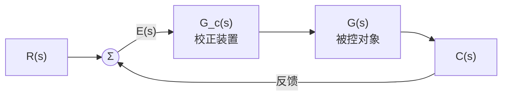
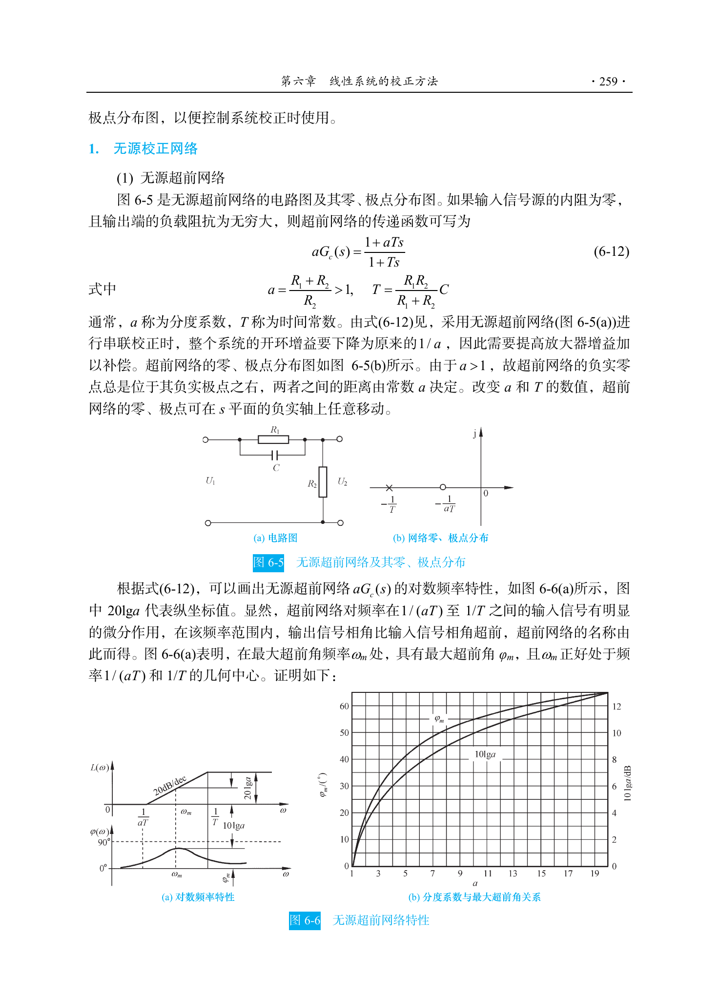
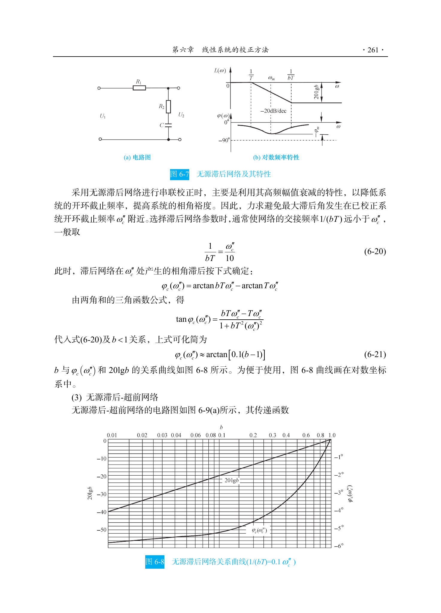
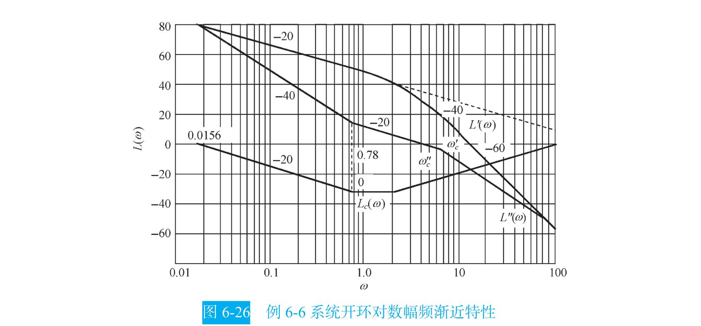

```cardlink
url: http://10.188.31.55:5244/Nextcloud/School/自动控制原理/
title: "自动控制原理 · 课程课件与复习笔记"
description: "中南大学自动化学院《自动控制原理》的课件、教材与复习笔记"
host: 10.188.31.55:5244
```

[← 返回《自动控制原理》目录](../)

## 第 6 章 线性系统的校正方法

前五章都是分析：给一个系统，算它能干什么。这一章第一次反向用：先定性能指标，再倒推该加什么零件、参数取多少。

一个系统不满足指标，通常是两种情况之一。**快但不稳**：截止频率高、响应快，相角裕度却是负的，闭环一跑就振荡发散。教材例 6-4 就是这种系统：待校正系统相角裕度只有 $17.9^\circ$，指标要求 $45^\circ$，只能靠串联超前校正补相角 [自动控制原理（第八版） (胡寿松、姜斌、张绍杰) (z-library.sk, 1lib.sk, z-lib.sk)(1).pdf · p.283](http://10.188.31.55:5244/Nextcloud/School/自动控制原理/%E8%87%AA%E5%8A%A8%E6%8E%A7%E5%88%B6%E5%8E%9F%E7%90%86%EF%BC%88%E7%AC%AC%E5%85%AB%E7%89%88%EF%BC%89%20(%E8%83%A1%E5%AF%BF%E6%9D%BE%E3%80%81%E5%A7%9C%E6%96%8C%E3%80%81%E5%BC%A0%E7%BB%8D%E6%9D%B0)%20(z-library.sk,%201lib.sk,%20z-lib.sk)(1).pdf#page=283)。**稳但太慢**：相角裕度很足，截止频率太低，斜坡输入下稳态误差还很大。教材例 6-5 里待校正系统截止频率高达 12 rad/s，远大于要求的 2.3 rad/s，系统本身还不稳定，最后选了串联滞后校正 [自动控制原理（第八版） (胡寿松、姜斌、张绍杰) (z-library.sk, 1lib.sk, z-lib.sk)(1).pdf · p.285](http://10.188.31.55:5244/Nextcloud/School/自动控制原理/%E8%87%AA%E5%8A%A8%E6%8E%A7%E5%88%B6%E5%8E%9F%E7%90%86%EF%BC%88%E7%AC%AC%E5%85%AB%E7%89%88%EF%BC%89%20(%E8%83%A1%E5%AF%BF%E6%9D%BE%E3%80%81%E5%A7%9C%E6%96%8C%E3%80%81%E5%BC%A0%E7%BB%8D%E6%9D%B0)%20(z-library.sk,%201lib.sk,%20z-lib.sk)(1).pdf#page=285)。

拧放大器增益 $K$ 救不回来：增大 $K$ 能减小稳态误差，却把 Bode 幅频曲线整体上抬、截止频率右移、相角裕度变小，很容易从稳滑到不稳。

**校正装置怎么接。** 教材按连接方式分成四种 [自动控制原理（第八版） (胡寿松、姜斌、张绍杰) (z-library.sk, 1lib.sk, z-lib.sk)(1).pdf · p.265](http://10.188.31.55:5244/Nextcloud/School/自动控制原理/%E8%87%AA%E5%8A%A8%E6%8E%A7%E5%88%B6%E5%8E%9F%E7%90%86%EF%BC%88%E7%AC%AC%E5%85%AB%E7%89%88%EF%BC%89%20(%E8%83%A1%E5%AF%BF%E6%9D%BE%E3%80%81%E5%A7%9C%E6%96%8C%E3%80%81%E5%BC%A0%E7%BB%8D%E6%9D%B0)%20(z-library.sk,%201lib.sk,%20z-lib.sk)(1).pdf#page=265)：

- **串联校正**：装置接在误差测量点之后、串接于前向通道中。最常用，校正后开环传函变成 $G_0(s)=G_c(s)G(s)$ [题型三_系统校正大题.md · p.58](http://10.188.31.55:5244/Nextcloud/School/自动控制原理/%E9%A2%98%E5%9E%8B%E4%B8%89_%E7%B3%BB%E7%BB%9F%E6%A0%A1%E6%AD%A3%E5%A4%A7%E9%A2%98.md)。
- **反馈校正**：装置接在系统的局部反馈通路中，通过改变局部闭环特性来改善等效开环特性 [自动控制原理（第八版） (胡寿松、姜斌、张绍杰) (z-library.sk, 1lib.sk, z-lib.sk)(1).pdf · p.265](http://10.188.31.55:5244/Nextcloud/School/自动控制原理/%E8%87%AA%E5%8A%A8%E6%8E%A7%E5%88%B6%E5%8E%9F%E7%90%86%EF%BC%88%E7%AC%AC%E5%85%AB%E7%89%88%EF%BC%89%20(%E8%83%A1%E5%AF%BF%E6%9D%BE%E3%80%81%E5%A7%9C%E6%96%8C%E3%80%81%E5%BC%A0%E7%BB%8D%E6%9D%B0)%20(z-library.sk,%201lib.sk,%20z-lib.sk)(1).pdf#page=265)。
- **前馈校正**（顺馈校正）：在系统主反馈回路之外采用，对给定值信号整形，或对可测扰动补偿 [自控原理（第六章1）.pdf · p.3](http://10.188.31.55:5244/Nextcloud/School/自动控制原理/%E8%87%AA%E6%8E%A7%E5%8E%9F%E7%90%86%EF%BC%88%E7%AC%AC%E5%85%AD%E7%AB%A01%EF%BC%89.pdf#page=3)。
- **复合校正**：反馈回路中再加一条前馈通路，组成一个有机整体 [自动控制原理（第八版） (胡寿松、姜斌、张绍杰) (z-library.sk, 1lib.sk, z-lib.sk)(1).pdf · p.295](http://10.188.31.55:5244/Nextcloud/School/自动控制原理/%E8%87%AA%E5%8A%A8%E6%8E%A7%E5%88%B6%E5%8E%9F%E7%90%86%EF%BC%88%E7%AC%AC%E5%85%AB%E7%89%88%EF%BC%89%20(%E8%83%A1%E5%AF%BF%E6%9D%BE%E3%80%81%E5%A7%9C%E6%96%8C%E3%80%81%E5%BC%A0%E7%BB%8D%E6%9D%B0)%20(z-library.sk,%201lib.sk,%20z-lib.sk)(1).pdf#page=295)。



课件指出反馈校正的一个特点：可以减小被包围环节的时间常数，所需元件数目比串联校正少 [自控原理（第六章2）.pdf · p.7](http://10.188.31.55:5244/Nextcloud/School/自动控制原理/%E8%87%AA%E6%8E%A7%E5%8E%9F%E7%90%86%EF%BC%88%E7%AC%AC%E5%85%AD%E7%AB%A02%EF%BC%89.pdf#page=7)。反过来，串联校正设计比反馈校正设计简单，也比较容易对信号做各种形式的变换 [自动控制原理（第八版） (胡寿松、姜斌、张绍杰) (z-library.sk, 1lib.sk, z-lib.sk)(1).pdf · p.266](http://10.188.31.55:5244/Nextcloud/School/自动控制原理/%E8%87%AA%E5%8A%A8%E6%8E%A7%E5%88%B6%E5%8E%9F%E7%90%86%EF%BC%88%E7%AC%AC%E5%85%AB%E7%89%88%EF%BC%89%20(%E8%83%A1%E5%AF%BF%E6%9D%BE%E3%80%81%E5%A7%9C%E6%96%8C%E3%80%81%E5%BC%A0%E7%BB%8D%E6%9D%B0)%20(z-library.sk,%201lib.sk,%20z-lib.sk)(1).pdf#page=266)。工业上考得最多的还是串联校正 [题型三_系统校正大题.md · p.58](http://10.188.31.55:5244/Nextcloud/School/自动控制原理/%E9%A2%98%E5%9E%8B%E4%B8%89_%E7%B3%BB%E7%BB%9F%E6%A0%A1%E6%AD%A3%E5%A4%A7%E9%A2%98.md)。

**本章的四个工具。** 所有校正题都是同一个套路，拆成四件工具：稳态误差方程定开环增益 $K$；截止频率方程 $|G_0(j\omega_c)|=1$ 定网络参数；相角裕度方程 $\gamma=180^\circ+\angle G_0(j\omega_c)$ 做最后校验；劳斯判据保证加了积分环节也没失稳 [题型三_系统校正大题.md · p.976](http://10.188.31.55:5244/Nextcloud/School/自动控制原理/%E9%A2%98%E5%9E%8B%E4%B8%89_%E7%B3%BB%E7%BB%9F%E6%A0%A1%E6%AD%A3%E5%A4%A7%E9%A2%98.md)。

**典型题形。** 已知系统不满足性能要求，设计串联校正装置使系统满足要求；A 卷第 4 题第 (2) 问与频域分析合在一起考，约 10~15 分，期中卷还有独立的 PI/PD 设计题 [题型三_系统校正大题.md · p.4](http://10.188.31.55:5244/Nextcloud/School/自动控制原理/%E9%A2%98%E5%9E%8B%E4%B8%89_%E7%B3%BB%E7%BB%9F%E6%A0%A1%E6%AD%A3%E5%A4%A7%E9%A2%98.md)。

**这一章在整门课里的位置。** 第 5 章的两个裕度是本章的设计目标：超前校正靠在截止频率处补正相角，滞后校正靠压低截止频率，两者都要回到 Bode 图上读。往回看第 4 章：加零点改善稳定性、加极点恶化稳定性，正是根轨迹法的结论，也是 PD（加零点）与 PI（加极点）效果的几何解释。根轨迹那一章的一句话在这里同样成立——分析和设计时用开环，最终结果和实际响应时用闭环 [复习_根轨迹.md · p.130](http://10.188.31.55:5244/Nextcloud/School/自动控制原理/%E5%A4%8D%E4%B9%A0_%E6%A0%B9%E8%BD%A8%E8%BF%B9.md)。校正题全程在开环 Bode 图上操作，只有最后的验稳才回到闭环特征方程 [复习_根轨迹.md · p.164](http://10.188.31.55:5244/Nextcloud/School/自动控制原理/%E5%A4%8D%E4%B9%A0_%E6%A0%B9%E8%BD%A8%E8%BF%B9.md)。

### 无源超前校正网络

无源超前网络的传递函数，教材写成带衰减因子的形式（分度系数 $a>1$）：

$$
aG_c(s)=\frac{1+aTs}{1+Ts}
$$

其中 $a=\dfrac{R_1+R_2}{R_2}>1$，$T=\dfrac{R_1R_2C}{R_1+R_2}$ [自动控制原理（第八版） (胡寿松、姜斌、张绍杰) (z-library.sk, 1lib.sk, z-lib.sk)(1).pdf · p.267](http://10.188.31.55:5244/Nextcloud/School/自动控制原理/%E8%87%AA%E5%8A%A8%E6%8E%A7%E5%88%B6%E5%8E%9F%E7%90%86%EF%BC%88%E7%AC%AC%E5%85%AB%E7%89%88%EF%BC%89%20(%E8%83%A1%E5%AF%BF%E6%9D%BE%E3%80%81%E5%A7%9C%E6%96%8C%E3%80%81%E5%BC%A0%E7%BB%8D%E6%9D%B0)%20(z-library.sk,%201lib.sk,%20z-lib.sk)(1).pdf#page=267)。

**零极点位置是超前的来源。** 由于 $a>1$，超前网络的负实零点总是位于其负实极点之右，两者之间的距离由常数 $a$ 决定。改变 $a$ 和 $T$ 的数值，零极点可在 $s$ 平面的负实轴上任意移动 [自动控制原理（第八版） (胡寿松、姜斌、张绍杰) (z-library.sk, 1lib.sk, z-lib.sk)(1).pdf · p.267](http://10.188.31.55:5244/Nextcloud/School/自动控制原理/%E8%87%AA%E5%8A%A8%E6%8E%A7%E5%88%B6%E5%8E%9F%E7%90%86%EF%BC%88%E7%AC%AC%E5%85%AB%E7%89%88%EF%BC%89%20(%E8%83%A1%E5%AF%BF%E6%9D%BE%E3%80%81%E5%A7%9C%E6%96%8C%E3%80%81%E5%BC%A0%E7%BB%8D%E6%9D%B0)%20(z-library.sk,%201lib.sk,%20z-lib.sk)(1).pdf#page=267)。



**网络的相角。** 分子相角减分母相角：

$$
\varphi_c(\omega)=\arctan(aT\omega)-\arctan(T\omega)
$$

对 $\omega$ 求导令其为零，得最大超前角频率 $\omega_m=\dfrac{1}{T\sqrt a}$；代回得最大超前角 $\varphi_m=\arcsin\dfrac{a-1}{a+1}$ [自动控制原理（第八版） (胡寿松、姜斌、张绍杰) (z-library.sk, 1lib.sk, z-lib.sk)(1).pdf · p.268](http://10.188.31.55:5244/Nextcloud/School/自动控制原理/%E8%87%AA%E5%8A%A8%E6%8E%A7%E5%88%B6%E5%8E%9F%E7%90%86%EF%BC%88%E7%AC%AC%E5%85%AB%E7%89%88%EF%BC%89%20(%E8%83%A1%E5%AF%BF%E6%9D%BE%E3%80%81%E5%A7%9C%E6%96%8C%E3%80%81%E5%BC%A0%E7%BB%8D%E6%9D%B0)%20(z-library.sk,%201lib.sk,%20z-lib.sk)(1).pdf#page=268)。$\omega_m$ 恰好是 $1/(aT)$ 和 $1/T$ 的几何中心。

**网络在 $\omega_m$ 处的幅值。** 教材给的是 $L_c(\omega_m)=20\lg|aG_c(j\omega_m)|=10\lg a$ dB [自动控制原理（第八版） (胡寿松、姜斌、张绍杰) (z-library.sk, 1lib.sk, z-lib.sk)(1).pdf · p.268](http://10.188.31.55:5244/Nextcloud/School/自动控制原理/%E8%87%AA%E5%8A%A8%E6%8E%A7%E5%88%B6%E5%8E%9F%E7%90%86%EF%BC%88%E7%AC%AC%E5%85%AB%E7%89%88%EF%BC%89%20(%E8%83%A1%E5%AF%BF%E6%9D%BE%E3%80%81%E5%A7%9C%E6%96%8C%E3%80%81%E5%BC%A0%E7%BB%8D%E6%9D%B0)%20(z-library.sk,%201lib.sk,%20z-lib.sk)(1).pdf#page=268)。

> 为了保持较高的系统信噪比，实际选用的 a 值一般不超过 20。

**无源网络带 1/a 衰减。** 讲师笔记里有一句提醒：注意前面有衰减因子 $1/a$，这是因为无源网络不能放大信号；有源网络（运放实现）可以直接做成 $\dfrac{1+aTs}{1+Ts}$ 而无衰减 [题型三_系统校正大题.md · p.773](http://10.188.31.55:5244/Nextcloud/School/自动控制原理/%E9%A2%98%E5%9E%8B%E4%B8%89_%E7%B3%BB%E7%BB%9F%E6%A0%A1%E6%AD%A3%E5%A4%A7%E9%A2%98.md)。教材在这一点上说得更具体：采用无源超前网络做串联校正时，整个系统的开环增益要下降为原来的 $1/a$，因此需要提高放大器增益加以补偿 [自动控制原理（第八版） (胡寿松、姜斌、张绍杰) (z-library.sk, 1lib.sk, z-lib.sk)(1).pdf · p.267](http://10.188.31.55:5244/Nextcloud/School/自动控制原理/%E8%87%AA%E5%8A%A8%E6%8E%A7%E5%88%B6%E5%8E%9F%E7%90%86%EF%BC%88%E7%AC%AC%E5%85%AB%E7%89%88%EF%BC%89%20(%E8%83%A1%E5%AF%BF%E6%9D%BE%E3%80%81%E5%A7%9C%E6%96%8C%E3%80%81%E5%BC%A0%E7%BB%8D%E6%9D%B0)%20(z-library.sk,%201lib.sk,%20z-lib.sk)(1).pdf#page=267)。

**零极点频率的次序记牢。** 超前网络的零点频率低于极点频率，零点落在负实轴上极点之右；滞后网络的极点频率低于零点频率。讲师把"混淆超前与滞后的分度系数"列为高频易错点 [题型三_系统校正大题.md · p.920](http://10.188.31.55:5244/Nextcloud/School/自动控制原理/%E9%A2%98%E5%9E%8B%E4%B8%89_%E7%B3%BB%E7%BB%9F%E6%A0%A1%E6%AD%A3%E5%A4%A7%E9%A2%98.md)。

### 无源滞后校正网络

无源滞后网络的传递函数，教材写成

$$
G_c(s)=\frac{1+bTs}{1+Ts}
$$

分度系数 $b<1$，表示滞后深度 [自动控制原理（第八版） (胡寿松、姜斌、张绍杰) (z-library.sk, 1lib.sk, z-lib.sk)(1).pdf · p.268](http://10.188.31.55:5244/Nextcloud/School/自动控制原理/%E8%87%AA%E5%8A%A8%E6%8E%A7%E5%88%B6%E5%8E%9F%E7%90%86%EF%BC%88%E7%AC%AC%E5%85%AB%E7%89%88%EF%BC%89%20(%E8%83%A1%E5%AF%BF%E6%9D%BE%E3%80%81%E5%A7%9C%E6%96%8C%E3%80%81%E5%BC%A0%E7%BB%8D%E6%9D%B0)%20(z-library.sk,%201lib.sk,%20z-lib.sk)(1).pdf#page=268)。零点在 $-1/(bT)$，极点在 $-1/T$，极点频率低于零点频率。



**滞后网络的相角。** 分子相角减分母相角：

$$
\varphi_c(\omega)=\arctan(bT\omega)-\arctan(T\omega)
$$

因为 $b<1$，这个差恒为负。用与超前网络相同的求极值方法，最大滞后角出现在 $\omega_m=\dfrac{1}{T\sqrt b}$，角度 $\varphi_m=-\arcsin\dfrac{1-b}{1+b}$ [自动控制原理（第八版） (胡寿松、姜斌、张绍杰) (z-library.sk, 1lib.sk, z-lib.sk)(1).pdf · p.268](http://10.188.31.55:5244/Nextcloud/School/自动控制原理/%E8%87%AA%E5%8A%A8%E6%8E%A7%E5%88%B6%E5%8E%9F%E7%90%86%EF%BC%88%E7%AC%AC%E5%85%AB%E7%89%88%EF%BC%89%20(%E8%83%A1%E5%AF%BF%E6%9D%BE%E3%80%81%E5%A7%9C%E6%96%8C%E3%80%81%E5%BC%A0%E7%BB%8D%E6%9D%B0)%20(z-library.sk,%201lib.sk,%20z-lib.sk)(1).pdf#page=268)。

**滞后校正真正用的是高频衰减。** 当 $\omega\to\infty$ 时分子分母都趋于无穷，比值趋于常数 $b$，网络在高频段把幅值压低，折合 $L_c(\infty)=20\lg b$ dB（负值）。设计时把这段衰减用来抵消未校正系统在新截止频率处的正增益，从而把截止频率从原来的 $\omega_c'$ 左移到相角更好的 $\omega_c''$ 上 [自动控制原理（第八版） (胡寿松、姜斌、张绍杰) (z-library.sk, 1lib.sk, z-lib.sk)(1).pdf · p.269](http://10.188.31.55:5244/Nextcloud/School/自动控制原理/%E8%87%AA%E5%8A%A8%E6%8E%A7%E5%88%B6%E5%8E%9F%E7%90%86%EF%BC%88%E7%AC%AC%E5%85%AB%E7%89%88%EF%BC%89%20(%E8%83%A1%E5%AF%BF%E6%9D%BE%E3%80%81%E5%A7%9C%E6%96%8C%E3%80%81%E5%BC%A0%E7%BB%8D%E6%9D%B0)%20(z-library.sk,%201lib.sk,%20z-lib.sk)(1).pdf#page=269)。

**参数怎么取。** 教材直接给出经验值：选择滞后网络参数时，通常使网络的交接频率 $1/(bT)$ 远小于 $\omega_c''$，一般取

$$
\frac{1}{bT}=\frac{\omega_c''}{10}
$$

此时滞后网络在 $\omega_c''$ 处产生的相角滞后为

$$
\varphi_c(\omega_c'')\approx\arctan\left[0.1(b-1)\right]
$$

即大约 $-6^\circ$ [自动控制原理（第八版） (胡寿松、姜斌、张绍杰) (z-library.sk, 1lib.sk, z-lib.sk)(1).pdf · p.269](http://10.188.31.55:5244/Nextcloud/School/自动控制原理/%E8%87%AA%E5%8A%A8%E6%8E%A7%E5%88%B6%E5%8E%9F%E7%90%86%EF%BC%88%E7%AC%AC%E5%85%AB%E7%89%88%EF%BC%89%20(%E8%83%A1%E5%AF%BF%E6%9D%BE%E3%80%81%E5%A7%9C%E6%96%8C%E3%80%81%E5%BC%A0%E7%BB%8D%E6%9D%B0)%20(z-library.sk,%201lib.sk,%20z-lib.sk)(1).pdf#page=269)。

**滞后对高频噪声有利。** 教材指出，滞后网络对低频有用信号不产生衰减，对高频噪声信号有削弱作用；$b$ 值越小，通过网络的噪声电平越低 [自动控制原理（第八版） (胡寿松、姜斌、张绍杰) (z-library.sk, 1lib.sk, z-lib.sk)(1).pdf · p.268](http://10.188.31.55:5244/Nextcloud/School/自动控制原理/%E8%87%AA%E5%8A%A8%E6%8E%A7%E5%88%B6%E5%8E%9F%E7%90%86%EF%BC%88%E7%AC%AC%E5%85%AB%E7%89%88%EF%BC%89%20(%E8%83%A1%E5%AF%BF%E6%9D%BE%E3%80%81%E5%A7%9C%E6%96%8C%E3%80%81%E5%BC%A0%E7%BB%8D%E6%9D%B0)%20(z-library.sk,%201lib.sk,%20z-lib.sk)(1).pdf#page=268)。课件用同一套数做过例题：滞后网络的衰减因子 $b=0.09$ 时，$\varphi_c(\omega_c'')\approx-5.2^\circ$ [自控原理（第六章2）.pdf · p.4](http://10.188.31.55:5244/Nextcloud/School/自动控制原理/%E8%87%AA%E6%8E%A7%E5%8E%9F%E7%90%86%EF%BC%88%E7%AC%AC%E5%85%AD%E7%AB%A02%EF%BC%89.pdf#page=4)。

### PID 控制器

工程上最常用的是 PID。教材把控制律分成比例、积分、微分三种基本规律及其组合。

**比例 (P)。** $u(t)=K_p e(t)$。实质是一个可调增益的放大器，只改变信号增益不影响相位。加大 $K_p$ 可以提高系统开环增益、减小稳态误差，但会降低相对稳定性，甚至造成闭环不稳定。教材因此说在系统校正设计中很少单独使用比例控制规律 [自动控制原理（第八版） (胡寿松、姜斌、张绍杰) (z-library.sk, 1lib.sk, z-lib.sk)(1).pdf · p.275](http://10.188.31.55:5244/Nextcloud/School/自动控制原理/%E8%87%AA%E5%8A%A8%E6%8E%A7%E5%88%B6%E5%8E%9F%E7%90%86%EF%BC%88%E7%AC%AC%E5%85%AB%E7%89%88%EF%BC%89%20(%E8%83%A1%E5%AF%BF%E6%9D%BE%E3%80%81%E5%A7%9C%E6%96%8C%E3%80%81%E5%BC%A0%E7%BB%8D%E6%9D%B0)%20(z-library.sk,%201lib.sk,%20z-lib.sk)(1).pdf#page=275)。

**比例-微分 (PD)。** $u(t)=K_p e(t)+K_pT_d\dfrac{de(t)}{dt}$。微分作用能反映输入信号的变化趋势，产生有效的早期修正信号，增加系统的阻尼程度。串联校正时可使系统增加一个 $-1/T_d$ 的开环零点，使相角裕度提高 [自动控制原理（第八版） (胡寿松、姜斌、张绍杰) (z-library.sk, 1lib.sk, z-lib.sk)(1).pdf · p.275](http://10.188.31.55:5244/Nextcloud/School/自动控制原理/%E8%87%AA%E5%8A%A8%E6%8E%A7%E5%88%B6%E5%8E%9F%E7%90%86%EF%BC%88%E7%AC%AC%E5%85%AB%E7%89%88%EF%BC%89%20(%E8%83%A1%E5%AF%BF%E6%9D%BE%E3%80%81%E5%A7%9C%E6%96%8C%E3%80%81%E5%BC%A0%E7%BB%8D%E6%9D%B0)%20(z-library.sk,%201lib.sk,%20z-lib.sk)(1).pdf#page=275)。

**比例-积分 (PI)。** $u(t)=K_p e(t)+K_p\displaystyle\int_0^t e(\tau)d\tau$。串联校正时相当于在系统中增加一个原点的开环极点和负实零点，系统型别提高一级，稳态误差减小。I 型系统采用 PI 控制器后，系统由原来的 I 型提高到含 PI 控制器时的 II 型，对斜坡输入的稳态误差变为零 [自动控制原理（第八版） (胡寿松、姜斌、张绍杰) (z-library.sk, 1lib.sk, z-lib.sk)(1).pdf · p.277](http://10.188.31.55:5244/Nextcloud/School/自动控制原理/%E8%87%AA%E5%8A%A8%E6%8E%A7%E5%88%B6%E5%8E%9F%E7%90%86%EF%BC%88%E7%AC%AC%E5%85%AB%E7%89%88%EF%BC%89%20(%E8%83%A1%E5%AF%BF%E6%9D%BE%E3%80%81%E5%A7%9C%E6%96%8C%E3%80%81%E5%BC%A0%E7%BB%8D%E6%9D%B0)%20(z-library.sk,%201lib.sk,%20z-lib.sk)(1).pdf#page=277)。

**PI 之后必须验稳。** 积分使系统增加了一个原点极点，相角滞后 90 度，对稳定性不利 [自控原理（第六章1）.pdf · p.4](http://10.188.31.55:5244/Nextcloud/School/自动控制原理/%E8%87%AA%E6%8E%A7%E5%8E%9F%E7%90%86%EF%BC%88%E7%AC%AC%E5%85%AD%E7%AB%A01%EF%BC%89.pdf#page=4)。教材给出闭式条件：接入 PI 控制器后特征方程的各项系数都是正数，由劳斯判据可知，调整积分时间常数 $T_i$ 使之大于系统不可变部分的时间常数 $T$，可以保证闭环系统的稳定性 [自动控制原理（第八版） (胡寿松、姜斌、张绍杰) (z-library.sk, 1lib.sk, z-lib.sk)(1).pdf · p.277](http://10.188.31.55:5244/Nextcloud/School/自动控制原理/%E8%87%AA%E5%8A%A8%E6%8E%A7%E5%88%B6%E5%8E%9F%E7%90%86%EF%BC%88%E7%AC%AC%E5%85%AB%E7%89%88%EF%BC%89%20(%E8%83%A1%E5%AF%BF%E6%9D%BE%E3%80%81%E5%A7%9C%E6%96%8C%E3%80%81%E5%BC%A0%E7%BB%8D%E6%9D%B0)%20(z-library.sk,%201lib.sk,%20z-lib.sk)(1).pdf#page=277)。讲师的笔记把这条标成考试重点：使用 PI 控制器后一定要用劳斯判据验证稳定性 [题型三_系统校正大题.md · p.686](http://10.188.31.55:5244/Nextcloud/School/自动控制原理/%E9%A2%98%E5%9E%8B%E4%B8%89_%E7%B3%BB%E7%BB%9F%E6%A0%A1%E6%AD%A3%E5%A4%A7%E9%A2%98.md)。

**比例-积分-微分 (PID)。** 传递函数

$$
G_c(s)=K_p\left(1+\frac{1}{T_i s}+T_d s\right)
$$

积分项提高型别消除稳态误差，微分项提供超前相位改善动态。教材给出两个结论：利用 PID 控制器串联校正时，除可使系统型别提高一级外，还将提供两个负实零点；与 PI 控制器相比，PID 多提供一个负实零点，在提高系统动态性能方面有更大优越性 [自控原理（第六章1）.pdf · p.5](http://10.188.31.55:5244/Nextcloud/School/自动控制原理/%E8%87%AA%E6%8E%A7%E5%8E%9F%E7%90%86%EF%BC%88%E7%AC%AC%E5%85%AD%E7%AB%A01%EF%BC%89.pdf#page=5)。

**PID 的伯德图形状。** 以 $\omega T_d$ 为自变量画，幅频曲线呈中间下凹的 V 形：低频段 -20 dB/dec 由积分作用贡献，中频段 +20 dB/dec 由微分作用贡献。相频曲线从 $-90^\circ$ 单调升向 $+90^\circ$ [自动控制原理（第八版） (胡寿松、姜斌、张绍杰) (z-library.sk, 1lib.sk, z-lib.sk)(1).pdf · p.278](http://10.188.31.55:5244/Nextcloud/School/自动控制原理/%E8%87%AA%E5%8A%A8%E6%8E%A7%E5%88%B6%E5%8E%9F%E7%90%86%EF%BC%88%E7%AC%AC%E5%85%AB%E7%89%88%EF%BC%89%20(%E8%83%A1%E5%AF%BF%E6%9D%BE%E3%80%81%E5%A7%9C%E6%96%8C%E3%80%81%E5%BC%A0%E7%BB%8D%E6%9D%B0)%20(z-library.sk,%201lib.sk,%20z-lib.sk)(1).pdf#page=278)。


图里的 PID 控制器传递函数当 $T_i\gg T_d$ 时可近似写成 $\dfrac{K_2(1+T_ds)}{T_i s}$，其中 $K_2=K_pT_i/T_d$，就是一个带阻滤波器的形式。取 $K_2=2$、$a=10$ 时的伯德图就是上面那张。

**PID 参数整定。** 教材分理论计算整定法和工程整定法两类。临界比例度法是工程整定法的代表：先令 $T_i=\infty$、$T_d=0$，比例系数取较小值，然后增大 $K_p$，观察到系统输出出现等幅振荡时记下临界比例值 $K_m$ 和振荡周期，再按经验表格整定 [自动控制原理（第八版） (胡寿松、姜斌、张绍杰) (z-library.sk, 1lib.sk, z-lib.sk)(1).pdf · p.278](http://10.188.31.55:5244/Nextcloud/School/自动控制原理/%E8%87%AA%E5%8A%A8%E6%8E%A7%E5%88%B6%E5%8E%9F%E7%90%86%EF%BC%88%E7%AC%AC%E5%85%AB%E7%89%88%EF%BC%89%20(%E8%83%A1%E5%AF%BF%E6%9D%BE%E3%80%81%E5%A7%9C%E6%96%8C%E3%80%81%E5%BC%A0%E7%BB%8D%E6%9D%B0)%20(z-library.sk,%201lib.sk,%20z-lib.sk)(1).pdf#page=278)。

**PID 的局限。** 讲师把三种控制器的效果做了对照：P 调节开环增益，增大 $K$ 减小稳态误差，但相角裕度跟着减小 [题型三_系统校正大题.md · p.644](http://10.188.31.55:5244/Nextcloud/School/自动控制原理/%E9%A2%98%E5%9E%8B%E4%B8%89_%E7%B3%BB%E7%BB%9F%E6%A0%A1%E6%AD%A3%E5%A4%A7%E9%A2%98.md)；PD 加零点提阻尼，但放大高频噪声，微分控制只对动态过程起作用，对稳态过程没有影响，所以单一的 D 控制器在任何情况下都不宜与被控对象串联起来单独使用 [题型三_系统校正大题.md · p.658](http://10.188.31.55:5244/Nextcloud/School/自动控制原理/%E9%A2%98%E5%9E%8B%E4%B8%89_%E7%B3%BB%E7%BB%9F%E6%A0%A1%E6%AD%A3%E5%A4%A7%E9%A2%98.md) [自控原理（第六章1）.pdf · p.4](http://10.188.31.55:5244/Nextcloud/School/自动控制原理/%E8%87%AA%E6%8E%A7%E5%8E%9F%E7%90%86%EF%BC%88%E7%AC%AC%E5%85%AD%E7%AB%A01%EF%BC%89.pdf#page=4)；PI 加原点极点提高型别、消掉稳态误差，但积分带来的 90 度相角滞后对稳定性不利 [题型三_系统校正大题.md · p.676](http://10.188.31.55:5244/Nextcloud/School/自动控制原理/%E9%A2%98%E5%9E%8B%E4%B8%89_%E7%B3%BB%E7%BB%9F%E6%A0%A1%E6%AD%A3%E5%A4%A7%E9%A2%98.md)。

### 频域法设计：串联超前校正

**设计步骤。** 教材给出四步 [自动控制原理（第八版） (胡寿松、姜斌、张绍杰) (z-library.sk, 1lib.sk, z-lib.sk)(1).pdf · p.282](http://10.188.31.55:5244/Nextcloud/School/自动控制原理/%E8%87%AA%E5%8A%A8%E6%8E%A7%E5%88%B6%E5%8E%9F%E7%90%86%EF%BC%88%E7%AC%AC%E5%85%AB%E7%89%88%EF%BC%89%20(%E8%83%A1%E5%AF%BF%E6%9D%BE%E3%80%81%E5%A7%9C%E6%96%8C%E3%80%81%E5%BC%A0%E7%BB%8D%E6%9D%B0)%20(z-library.sk,%201lib.sk,%20z-lib.sk)(1).pdf#page=282)：

1. 根据稳态误差要求确定开环增益 $K$。
2. 利用已确定的 $K$，算出待校正系统的相角裕度。
3. 按截止频率 $\omega_c''$ 的要求计算超前网络参数 $a$ 和 $T$。关键是让最大超前角频率等于要求的截止频率，即 $\omega_m=\omega_c''$。成立条件是

$$
10\lg a=-L(\omega_c'')
$$

由这条求 $a$，再由 $\dfrac{1}{T\sqrt a}=\omega_c''$ 确定 $T$ [自动控制原理（第八版） (胡寿松、姜斌、张绍杰) (z-library.sk, 1lib.sk, z-lib.sk)(1).pdf · p.282](http://10.188.31.55:5244/Nextcloud/School/自动控制原理/%E8%87%AA%E5%8A%A8%E6%8E%A7%E5%88%B6%E5%8E%9F%E7%90%86%EF%BC%88%E7%AC%AC%E5%85%AB%E7%89%88%EF%BC%89%20(%E8%83%A1%E5%AF%BF%E6%9D%BE%E3%80%81%E5%A7%9C%E6%96%8C%E3%80%81%E5%BC%A0%E7%BB%8D%E6%9D%B0)%20(z-library.sk,%201lib.sk,%20z-lib.sk)(1).pdf#page=282)。
4. 验算已校正系统的相角裕度 $\gamma''$。由已知 $a$ 查图或用式 (6-15) 求出 $\varphi_m$，再算待校正系统在 $\omega_c''$ 处的相角裕度，最后得

$$
\gamma''=\varphi_m+\gamma(\omega_c'')
$$

验算结果不满足指标要求时，需重选 $\omega_m$，一般使 $\omega_m$ 增大，然后重复计算 [自动控制原理（第八版） (胡寿松、姜斌、张绍杰) (z-library.sk, 1lib.sk, z-lib.sk)(1).pdf · p.282](http://10.188.31.55:5244/Nextcloud/School/自动控制原理/%E8%87%AA%E5%8A%A8%E6%8E%A7%E5%88%B6%E5%8E%9F%E7%90%86%EF%BC%88%E7%AC%AC%E5%85%AB%E7%89%88%EF%BC%89%20(%E8%83%A1%E5%AF%BF%E6%9D%BE%E3%80%81%E5%A7%9C%E6%96%8C%E3%80%81%E5%BC%A0%E7%BB%8D%E6%9D%B0)%20(z-library.sk,%201lib.sk,%20z-lib.sk)(1).pdf#page=282)。

讲师笔记给的七步版本多了一个补偿余量 [题型三_系统校正大题.md · p.423](http://10.188.31.55:5244/Nextcloud/School/自动控制原理/%E9%A2%98%E5%9E%8B%E4%B8%89_%E7%B3%BB%E7%BB%9F%E6%A0%A1%E6%AD%A3%E5%A4%A7%E9%A2%98.md)：

$$
\varphi_m=\gamma'-\gamma_0(\omega_c')+\varepsilon
$$

其中 $\varepsilon$ 是补偿余量，一般取 $5^\circ\sim12^\circ$ [题型三_系统校正大题.md · p.451](http://10.188.31.55:5244/Nextcloud/School/自动控制原理/%E9%A2%98%E5%9E%8B%E4%B8%89_%E7%B3%BB%E7%BB%9F%E6%A0%A1%E6%AD%A3%E5%A4%A7%E9%A2%98.md)。补偿余量的作用是抵消超前网络抬高增益、导致实际截止频率右移、进而使未校正系统相角更负的影响 [题型三_系统校正大题.md · p.454](http://10.188.31.55:5244/Nextcloud/School/自动控制原理/%E9%A2%98%E5%9E%8B%E4%B8%89_%E7%B3%BB%E7%BB%9F%E6%A0%A1%E6%AD%A3%E5%A4%A7%E9%A2%98.md)。

**由 $\varphi_m$ 反解参数。** 把 $\varphi_m=\arcsin\dfrac{a-1}{a+1}$ 两边取正弦解出 [题型三_系统校正大题.md · p.463](http://10.188.31.55:5244/Nextcloud/School/自动控制原理/%E9%A2%98%E5%9E%8B%E4%B8%89_%E7%B3%BB%E7%BB%9F%E6%A0%A1%E6%AD%A3%E5%A4%A7%E9%A2%98.md)

$$
a=\frac{1+\sin\varphi_m}{1-\sin\varphi_m}
$$

由 $\omega_m=\omega_c''$ 与 $\omega_m=\dfrac{1}{T\sqrt a}$ 解出时间常数

$$
T=\frac{1}{\omega_c''\sqrt a}
$$


**教材例 6-4。** 单位反馈系统 $G(s)=\dfrac{K}{s(s+1)}$，要求单位斜坡输入下位置输出稳态误差 $e_{ss}(\infty)\le0.1$ rad，开环截止频率 $\omega_c''\ge4.4$ rad/s，相角裕度 $\gamma''\ge45^\circ$，幅值裕度 $h''\ge10$ dB。

解的过程 [自动控制原理（第八版） (胡寿松、姜斌、张绍杰) (z-library.sk, 1lib.sk, z-lib.sk)(1).pdf · p.283](http://10.188.31.55:5244/Nextcloud/School/自动控制原理/%E8%87%AA%E5%8A%A8%E6%8E%A7%E5%88%B6%E5%8E%9F%E7%90%86%EF%BC%88%E7%AC%AC%E5%85%AB%E7%89%88%EF%BC%89%20(%E8%83%A1%E5%AF%BF%E6%9D%BE%E3%80%81%E5%A7%9C%E6%96%8C%E3%80%81%E5%BC%A0%E7%BB%8D%E6%9D%B0)%20(z-library.sk,%201lib.sk,%20z-lib.sk)(1).pdf#page=283)：

- 由 $e_{ss}(\infty)=1/K\le0.1$ 取 $K=10$ rad·s⁻¹，待校正系统开环传函 $G_0(s)=\dfrac{10}{s(s+1)}$。
- 由图得待校正系统截止频率 $\omega_c'=3.1$ rad/s，相角裕度 $\gamma(\omega_c')=180^\circ-90^\circ-\arctan\omega_c'=17.9^\circ$。中频区斜率是 -40 dB/dec，相角裕度小，需要串联超前校正。
- 试选 $\omega_m=\omega_c''=4.4$ rad/s，由图查得 $L'(\omega_c'')=-6$ dB，于是 $a=4$、$T=0.114$ s，超前网络传递函数 $G_c(s)=\dfrac{1+0.456s}{1+0.114s}$。为了补偿无源网络产生的增益衰减，放大器增益需提高 4 倍。
- 校正后开环传函 $aG_c(s)G_0(s)=\dfrac{10(1+0.456s)}{s(1+0.114s)(1+s)}$。
- 已校正系统 $\omega_c''=4.4$ rad/s，待校正系统在 $\omega_c''$ 处的相角裕度 $\gamma(\omega_c'')=12.8^\circ$，由式 (6-15) 算出的 $\varphi_m=36.9^\circ$，故 $\gamma''=\varphi_m+\gamma(\omega_c'')=49.7^\circ>45^\circ$，满足要求。

**一个必须说清的陷阱。** $\omega_m$ 与 $\omega_c''$ 不会自动相等。式 (6-35) 的成立条件是 $\omega_m=\omega_c''$，这是设计时**主动取**的结果。若取别的 $\omega_m$，网络在 $\omega_c''$ 处提供的相角不等于 $\varphi_m$，必须把 $\omega_c''$ 代进 $\varphi_c(\omega)=\arctan(aT\omega)-\arctan(T\omega)$ 现算。讲师把这条列为易错点：超前校正后不验证 $\omega_c$，实际截止频率可能偏移，需要验证 [题型三_系统校正大题.md · p.914](http://10.188.31.55:5244/Nextcloud/School/自动控制原理/%E9%A2%98%E5%9E%8B%E4%B8%89_%E7%B3%BB%E7%BB%9F%E6%A0%A1%E6%AD%A3%E5%A4%A7%E9%A2%98.md)。教材的兜底办法是第 4 步的验算，验算不过就重选 $\omega_m$ [自动控制原理（第八版） (胡寿松、姜斌、张绍杰) (z-library.sk, 1lib.sk, z-lib.sk)(1).pdf · p.282](http://10.188.31.55:5244/Nextcloud/School/自动控制原理/%E8%87%AA%E5%8A%A8%E6%8E%A7%E5%88%B6%E5%8E%9F%E7%90%86%EF%BC%88%E7%AC%AC%E5%85%AB%E7%89%88%EF%BC%89%20(%E8%83%A1%E5%AF%BF%E6%9D%BE%E3%80%81%E5%A7%9C%E6%96%8C%E3%80%81%E5%BC%A0%E7%BB%8D%E6%9D%B0)%20(z-library.sk,%201lib.sk,%20z-lib.sk)(1).pdf#page=282)。

**超前校正的适用范围。** 教材给了两条限制 [自动控制原理（第八版） (胡寿松、姜斌、张绍杰) (z-library.sk, 1lib.sk, z-lib.sk)(1).pdf · p.284](http://10.188.31.55:5244/Nextcloud/School/自动控制原理/%E8%87%AA%E5%8A%A8%E6%8E%A7%E5%88%B6%E5%8E%9F%E7%90%86%EF%BC%88%E7%AC%AC%E5%85%AB%E7%89%88%EF%BC%89%20(%E8%83%A1%E5%AF%BF%E6%9D%BE%E3%80%81%E5%A7%9C%E6%96%8C%E3%80%81%E5%BC%A0%E7%BB%8D%E6%9D%B0)%20(z-library.sk,%201lib.sk,%20z-lib.sk)(1).pdf#page=284)：

1. **闭环带宽要求。** 待校正系统不稳定时，为了得到规定的相角裕度，超前网络的 $a$ 值必须选得很大，造成已校正系统带宽过大，高频噪声电平很高。
2. **截止频率附近相角迅速减小。** 产生这种情形的原因通常是截止频率附近有两个交接频率彼此靠近的惯性环节，或两个相等的惯性环节，或有一个振荡环节。这种情况下改用两级串联超前网络、串联滞后校正或测速反馈校正。

### 频域法设计：串联滞后校正

滞后校正用于稳态精度不够、但不要求很快的场合。设计顺序与超前校正是反的：**先定新截止频率，再定衰减量**。

**第一步，定开环增益。** 由稳态误差要求定 $K$。教材例 6-5 要求校正后静态速度误差系数等于 30 s⁻¹，于是直接取 $K=30$，待校正系统开环传函 $G_0(s)=\dfrac{30}{s(0.1s+1)(0.2s+1)}$ [自动控制原理（第八版） (胡寿松、姜斌、张绍杰) (z-library.sk, 1lib.sk, z-lib.sk)(1).pdf · p.285](http://10.188.31.55:5244/Nextcloud/School/自动控制原理/%E8%87%AA%E5%8A%A8%E6%8E%A7%E5%88%B6%E5%8E%9F%E7%90%86%EF%BC%88%E7%AC%AC%E5%85%AB%E7%89%88%EF%BC%89%20(%E8%83%A1%E5%AF%BF%E6%9D%BE%E3%80%81%E5%A7%9C%E6%96%8C%E3%80%81%E5%BC%A0%E7%BB%8D%E6%9D%B0)%20(z-library.sk,%201lib.sk,%20z-lib.sk)(1).pdf#page=285)。

**第二步，算未校正系统的裕度。** 教材例 6-5 的待校正系统截止频率 $\omega_c'=12$ rad/s，相角裕度 $\gamma(\omega_c')=90^\circ-\arctan(0.1\omega_c')-\arctan(0.2\omega_c')=-27.6^\circ$，幅值裕度为负，系统不稳定，且截止频率远大于要求值。这种情况下用串联超前校正无效——可以证明，当超前网络的 $a$ 值取到 100 时，系统的相角裕度仍不满 30 度，而截止频率却增至 26 rad/s。考虑到本例对截止频率要求不大，故选用串联滞后校正 [自动控制原理（第八版） (胡寿松、姜斌、张绍杰) (z-library.sk, 1lib.sk, z-lib.sk)(1).pdf · p.285](http://10.188.31.55:5244/Nextcloud/School/自动控制原理/%E8%87%AA%E5%8A%A8%E6%8E%A7%E5%88%B6%E5%8E%9F%E7%90%86%EF%BC%88%E7%AC%AC%E5%85%AB%E7%89%88%EF%BC%89%20(%E8%83%A1%E5%AF%BF%E6%9D%BE%E3%80%81%E5%A7%9C%E6%96%8C%E3%80%81%E5%BC%A0%E7%BB%8D%E6%9D%B0)%20(z-library.sk,%201lib.sk,%20z-lib.sk)(1).pdf#page=285)。

**第三步，在相频曲线上找新截止频率。** 滞后网络在新截止频率处会带来负相角 $\varphi_c(\omega_c'')$，裕度方程是

$$
\gamma''=\gamma(\omega_c'')+\varphi_c(\omega_c'')
$$

教材在计算时把 $\varphi_c(\omega_c'')$ 取 $-6^\circ$，按式 (6-38) 求得 $\gamma(\omega_c'')\ge46^\circ$，由 $\gamma(\omega_c'')$ 曲线查得 $\omega_c''=2.7$ rad/s。指标要求 $\omega_c''\ge2.3$ rad/s，可在 2.3~2.7 rad/s 内任取；取较大值时响应较快且滞后网络时间常数较小便于实现，故取 $\omega_c''=2.7$ rad/s [自动控制原理（第八版） (胡寿松、姜斌、张绍杰) (z-library.sk, 1lib.sk, z-lib.sk)(1).pdf · p.285](http://10.188.31.55:5244/Nextcloud/School/自动控制原理/%E8%87%AA%E5%8A%A8%E6%8E%A7%E5%88%B6%E5%8E%9F%E7%90%86%EF%BC%88%E7%AC%AC%E5%85%AB%E7%89%88%EF%BC%89%20(%E8%83%A1%E5%AF%BF%E6%9D%BE%E3%80%81%E5%A7%9C%E6%96%8C%E3%80%81%E5%BC%A0%E7%BB%8D%E6%9D%B0)%20(z-library.sk,%201lib.sk,%20z-lib.sk)(1).pdf#page=285)。

**第四步，定衰减量。** 在图上查出 $\omega_c''=2.7$ rad/s 时有 $L'(\omega_c'')=21$ dB，由式 (6-39) 求出 $b=0.09$，再由式 (6-40) 算出 $T=41$ s：

$$
20\lg b+L'(\omega_c'')=0,\qquad \frac{1}{bT}=0.1\,\omega_c''
$$

滞后网络为 $G_c(s)=\dfrac{1+3.7s}{1+41s}$ [自动控制原理（第八版） (胡寿松、姜斌、张绍杰) (z-library.sk, 1lib.sk, z-lib.sk)(1).pdf · p.285](http://10.188.31.55:5244/Nextcloud/School/自动控制原理/%E8%87%AA%E5%8A%A8%E6%8E%A7%E5%88%B6%E5%8E%9F%E7%90%86%EF%BC%88%E7%AC%AC%E5%85%AB%E7%89%88%EF%BC%89%20(%E8%83%A1%E5%AF%BF%E6%9D%BE%E3%80%81%E5%A7%9C%E6%96%8C%E3%80%81%E5%BC%A0%E7%BB%8D%E6%9D%B0)%20(z-library.sk,%201lib.sk,%20z-lib.sk)(1).pdf#page=285)。如果算出的 $T$ 过大难以实现，可把式 (6-40) 的系数 0.1 加大到 0.25 以内，同时把 $\varphi_c$ 的估值从 $-6^\circ$ 放宽到 $-14^\circ$ [自动控制原理（第八版） (胡寿松、姜斌、张绍杰) (z-library.sk, 1lib.sk, z-lib.sk)(1).pdf · p.285](http://10.188.31.55:5244/Nextcloud/School/自动控制原理/%E8%87%AA%E5%8A%A8%E6%8E%A7%E5%88%B6%E5%8E%9F%E7%90%86%EF%BC%88%E7%AC%AC%E5%85%AB%E7%89%88%EF%BC%89%20(%E8%83%A1%E5%AF%BF%E6%9D%BE%E3%80%81%E5%A7%9C%E6%96%8C%E3%80%81%E5%BC%A0%E7%BB%8D%E6%9D%B0)%20(z-library.sk,%201lib.sk,%20z-lib.sk)(1).pdf#page=285)。讲师的笔记用 $1/T$ 与 $\omega_c'$ 的比值表达同一件事 [题型三_系统校正大题.md · p.604](http://10.188.31.55:5244/Nextcloud/School/自动控制原理/%E9%A2%98%E5%9E%8B%E4%B8%89_%E7%B3%BB%E7%BB%9F%E6%A0%A1%E6%AD%A3%E5%A4%A7%E9%A2%98.md)。

**第五步，验算。** 由式 (6-21) 及 $b=0.09$ 算得 $\varphi_c(\omega_c'')=-5.2^\circ$，于是 $\gamma''=41.3^\circ$，满足指标要求。已校正系统对数相频特性为 $-180^\circ$ 时的频率是 6.8 rad/s，幅值裕度 10.5 dB，全部符合要求 [自动控制原理（第八版） (胡寿松、姜斌、张绍杰) (z-library.sk, 1lib.sk, z-lib.sk)(1).pdf · p.286](http://10.188.31.55:5244/Nextcloud/School/自动控制原理/%E8%87%AA%E5%8A%A8%E6%8E%A7%E5%88%B6%E5%8E%9F%E7%90%86%EF%BC%88%E7%AC%AC%E5%85%AB%E7%89%88%EF%BC%89%20(%E8%83%A1%E5%AF%BF%E6%9D%BE%E3%80%81%E5%A7%9C%E6%96%8C%E3%80%81%E5%BC%A0%E7%BB%8D%E6%9D%B0)%20(z-library.sk,%201lib.sk,%20z-lib.sk)(1).pdf#page=286)。

**滞后校正能提精度却不改动态。** 教材用图 6-25 解释：把已校正系统的对数幅频特性向上平移 21 dB，校正前后的相角裕度和截止频率基本相同，但开环增益增大了 11 倍 [自动控制原理（第八版） (胡寿松、姜斌、张绍杰) (z-library.sk, 1lib.sk, z-lib.sk)(1).pdf · p.286](http://10.188.31.55:5244/Nextcloud/School/自动控制原理/%E8%87%AA%E5%8A%A8%E6%8E%A7%E5%88%B6%E5%8E%9F%E7%90%86%EF%BC%88%E7%AC%AC%E5%85%AB%E7%89%88%EF%BC%89%20(%E8%83%A1%E5%AF%BF%E6%9D%BE%E3%80%81%E5%A7%9C%E6%96%8C%E3%80%81%E5%BC%A0%E7%BB%8D%E6%9D%B0)%20(z-library.sk,%201lib.sk,%20z-lib.sk)(1).pdf#page=286)。

**超前与滞后的三点差别。** 教材列了三条 [自动控制原理（第八版） (胡寿松、姜斌、张绍杰) (z-library.sk, 1lib.sk, z-lib.sk)(1).pdf · p.286](http://10.188.31.55:5244/Nextcloud/School/自动控制原理/%E8%87%AA%E5%8A%A8%E6%8E%A7%E5%88%B6%E5%8E%9F%E7%90%86%EF%BC%88%E7%AC%AC%E5%85%AB%E7%89%88%EF%BC%89%20(%E8%83%A1%E5%AF%BF%E6%9D%BE%E3%80%81%E5%A7%9C%E6%96%8C%E3%80%81%E5%BC%A0%E7%BB%8D%E6%9D%B0)%20(z-library.sk,%201lib.sk,%20z-lib.sk)(1).pdf#page=286)：

1. 超前校正是利用超前网络的相角超前特性，滞后校正利用滞后网络的高频幅值衰减特性。
2. 为满足严格的稳态性能要求，采用无源校正网络时，超前校正要求一定的附加增益，滞后校正一般不需要附加增益。
3. 对同一系统，采用超前校正的系统带宽大于采用滞后校正的系统带宽。带宽越大响应越快，但也越易受噪声干扰，因此系统输入端噪声电平较高时，一般不宜选用超前校正。

### 滞后-超前校正

无源滞后-超前网络的传递函数，教材写成

$$
G_c(s)=\frac{(1+T_a s)(1+T_b s)}{(1+\alpha T_a s)\left(1+\dfrac{T_b}{\alpha}s\right)}
$$

其中 $\dfrac{1+T_a s}{1+\alpha T_a s}$ 是网络的滞后部分，$\dfrac{1+T_b s}{1+(T_b/\alpha)s}$ 是超前部分；确定 $\omega_a$、$\omega_b$ 和 $\alpha$ 三个独立变量，图 6-9(b) 的形状就定了 [自动控制原理（第八版） (胡寿松、姜斌、张绍杰) (z-library.sk, 1lib.sk, z-lib.sk)(1).pdf · p.270](http://10.188.31.55:5244/Nextcloud/School/自动控制原理/%E8%87%AA%E5%8A%A8%E6%8E%A7%E5%88%B6%E5%8E%9F%E7%90%86%EF%BC%88%E7%AC%AC%E5%85%AB%E7%89%88%EF%BC%89%20(%E8%83%A1%E5%AF%BF%E6%9D%BE%E3%80%81%E5%A7%9C%E6%96%8C%E3%80%81%E5%BC%A0%E7%BB%8D%E6%9D%B0)%20(z-library.sk,%201lib.sk,%20z-lib.sk)(1).pdf#page=270)。低频段像滞后（保精度），高频段像超前（保动态），两头兼顾。讲师的笔记用另一个写法：$G_c(s)=\dfrac{(1+aT_1 s)(1+T_2 s)}{(1+T_1 s)(1+bT_2 s)}$，$a>1$、$b>1$，低频部分用滞后段提高精度，高频部分用超前段改善稳定性 [题型三_系统校正大题.md · p.138](http://10.188.31.55:5244/Nextcloud/School/自动控制原理/%E9%A2%98%E5%9E%8B%E4%B8%89_%E7%B3%BB%E7%BB%9F%E6%A0%A1%E6%AD%A3%E5%A4%A7%E9%A2%98.md)。

**什么时候非用不可。** 教材的条件是：待校正系统不稳定，且要求校正后系统的响应速度、相角裕度和稳态精度都较高时，以采用串联滞后-超前校正为宜。基本原理是用滞后-超前网络的超前部分来增大系统的相角裕度，同时利用滞后部分来改善系统的稳态性能 [自动控制原理（第八版） (胡寿松、姜斌、张绍杰) (z-library.sk, 1lib.sk, z-lib.sk)(1).pdf · p.286](http://10.188.31.55:5244/Nextcloud/School/自动控制原理/%E8%87%AA%E5%8A%A8%E6%8E%A7%E5%88%B6%E5%8E%9F%E7%90%86%EF%BC%88%E7%AC%AC%E5%85%AB%E7%89%88%EF%BC%89%20(%E8%83%A1%E5%AF%BF%E6%9D%BE%E3%80%81%E5%A7%9C%E6%96%8C%E3%80%81%E5%BC%A0%E7%BB%8D%E6%9D%B0)%20(z-library.sk,%201lib.sk,%20z-lib.sk)(1).pdf#page=286)。

**教材例 6-6。** 待校正系统 $G_0(s)=\dfrac{K_v}{s(\frac{s}{6}+1)(\frac{s}{2}+1)}$，指标是：最大指令速度 $180^\circ$/s 时位置滞后误差不超过 $1^\circ$（等价于 $K_v\ge180$ s⁻¹）、相角裕度 $45^\circ\pm3^\circ$、幅值裕度 $h\ge10$ dB、动态过程调节时间 $t_s\le3$ s。

取 $K_v=180$ 后，待校正系统截止频率 $\omega_c'=12.6$ rad/s，相角裕度

$$
\gamma_0=90^\circ-\arctan\frac{12.6}{6}-\arctan\frac{12.6}{2}\approx-55.5^\circ
$$

幅值裕度约 $-30$ dB，**原系统不稳定** [自动控制原理（第八版） (胡寿松、姜斌、张绍杰) (z-library.sk, 1lib.sk, z-lib.sk)(1).pdf · p.287](http://10.188.31.55:5244/Nextcloud/School/自动控制原理/%E8%87%AA%E5%8A%A8%E6%8E%A7%E5%88%B6%E5%8E%9F%E7%90%86%EF%BC%88%E7%AC%AC%E5%85%AB%E7%89%88%EF%BC%89%20(%E8%83%A1%E5%AF%BF%E6%9D%BE%E3%80%81%E5%A7%9C%E6%96%8C%E3%80%81%E5%BC%A0%E7%BB%8D%E6%9D%B0)%20(z-library.sk,%201lib.sk,%20z-lib.sk)(1).pdf#page=287)。

纯超前和纯滞后都不行，教材给了具体论证 [自动控制原理（第八版） (胡寿松、姜斌、张绍杰) (z-library.sk, 1lib.sk, z-lib.sk)(1).pdf · p.287](http://10.188.31.55:5244/Nextcloud/School/自动控制原理/%E8%87%AA%E5%8A%A8%E6%8E%A7%E5%88%B6%E5%8E%9F%E7%90%86%EF%BC%88%E7%AC%AC%E5%85%AB%E7%89%88%EF%BC%89%20(%E8%83%A1%E5%AF%BF%E6%9D%BE%E3%80%81%E5%A7%9C%E6%96%8C%E3%80%81%E5%BC%A0%E7%BB%8D%E6%9D%B0)%20(z-library.sk,%201lib.sk,%20z-lib.sk)(1).pdf#page=287)：

- **纯超前。** 要把 $-55.5^\circ$ 抬到 $+45^\circ$，至少要两级串联超前网络，校正后截止频率将过大，可能超过 25 rad/s。伺服电机会速度饱和、带宽过大导致输出噪声电平过高、还要附加前置放大器使结构复杂化。
- **纯滞后。** 为满足 $K_v=180$ 需 $\omega_c''=1$，$L'(\omega_c'')=45.1$ dB，由式 (6-39) 求出 $b=1/200$，取 $1/(bT)=0.1\omega_c''$ 算出 $T=2000$ s，物理上无法实现；而且 $t_s\approx9.6$ s 远超 3 s 的要求 [自动控制原理（第八版） (胡寿松、姜斌、张绍杰) (z-library.sk, 1lib.sk, z-lib.sk)(1).pdf · p.288](http://10.188.31.55:5244/Nextcloud/School/自动控制原理/%E8%87%AA%E5%8A%A8%E6%8E%A7%E5%88%B6%E5%8E%9F%E7%90%86%EF%BC%88%E7%AC%AC%E5%85%AB%E7%89%88%EF%BC%89%20(%E8%83%A1%E5%AF%BF%E6%9D%BE%E3%80%81%E5%A7%9C%E6%96%8C%E3%80%81%E5%BC%A0%E7%BB%8D%E6%9D%B0)%20(z-library.sk,%201lib.sk,%20z-lib.sk)(1).pdf#page=288)。

**设计步骤。** 教材给出六步 [自动控制原理（第八版） (胡寿松、姜斌、张绍杰) (z-library.sk, 1lib.sk, z-lib.sk)(1).pdf · p.287](http://10.188.31.55:5244/Nextcloud/School/自动控制原理/%E8%87%AA%E5%8A%A8%E6%8E%A7%E5%88%B6%E5%8E%9F%E7%90%86%EF%BC%88%E7%AC%AC%E5%85%AB%E7%89%88%EF%BC%89%20(%E8%83%A1%E5%AF%BF%E6%9D%BE%E3%80%81%E5%A7%9C%E6%96%8C%E3%80%81%E5%BC%A0%E7%BB%8D%E6%9D%B0)%20(z-library.sk,%201lib.sk,%20z-lib.sk)(1).pdf#page=287)：

1. 根据稳态性能要求确定开环增益 $K$。
2. 绘制待校正系统的开环对数幅频渐近特性，求出 $\omega_c'$、$\gamma$ 及 $h$(dB)。
3. 在渐近特性上选斜率从 -20 dB/dec 变为 -40 dB/dec 的交接频率，作为校正网络**超前部分**的交接频率 $\omega_b$。这样选能降低已校正系统的阶次，且保证中频区斜率为期望的 -20 dB/dec 并占据较宽频带。
4. 根据响应速度要求，选 $\omega_c''$ 和衰减因子 $1/\alpha$。要保证已校正系统的截止频率为所选的 $\omega_c''$，须满足

$$
-20\lg\alpha+20\lg(T_b\omega_c'')+L'(\omega_c'')=0
$$

其中 $T_b=1/\omega_b$ [自动控制原理（第八版） (胡寿松、姜斌、张绍杰) (z-library.sk, 1lib.sk, z-lib.sk)(1).pdf · p.287](http://10.188.31.55:5244/Nextcloud/School/自动控制原理/%E8%87%AA%E5%8A%A8%E6%8E%A7%E5%88%B6%E5%8E%9F%E7%90%86%EF%BC%88%E7%AC%AC%E5%85%AB%E7%89%88%EF%BC%89%20(%E8%83%A1%E5%AF%BF%E6%9D%BE%E3%80%81%E5%A7%9C%E6%96%8C%E3%80%81%E5%BC%A0%E7%BB%8D%E6%9D%B0)%20(z-library.sk,%201lib.sk,%20z-lib.sk)(1).pdf#page=287)。课件把这张图直接标成式 (6-43)，并说明 $-20\lg\alpha$ 是滞后部分在 $\omega_c''$ 产生的对数幅值，$20\lg(T_b\omega_c'')$ 是超前部分在 $\omega_c''$ 产生的对数幅值 [自控原理（第六章2）.pdf · p.5](http://10.188.31.55:5244/Nextcloud/School/自动控制原理/%E8%87%AA%E6%8E%A7%E5%8E%9F%E7%90%86%EF%BC%88%E7%AC%AC%E5%85%AD%E7%AB%A02%EF%BC%89.pdf#page=5)。
5. 根据相角裕度要求，估算校正网络**滞后部分**的交接频率 $\omega_a$。
6. 校验已校正系统的各项性能指标。

**例 6-6 的结果。** 由 $t_s\le3$ s 与 $\gamma^*=45^\circ$ 估算 $\omega_c''\ge3.2$ rad/s；要求中频区斜率为 -20 dB/dec，故 $\omega_c''$ 在 3.2~6 rad/s 内取。为让中频区占据足够宽度，选 $\omega_c''=3.5$ rad/s，相应 $L'(\omega_c'')+20\lg(T_b\omega_c'')=34$ dB，由式 (6-41) 算出 $1/\alpha=0.02$，即 $\alpha=50$ [自动控制原理（第八版） (胡寿松、姜斌、张绍杰) (z-library.sk, 1lib.sk, z-lib.sk)(1).pdf · p.288](http://10.188.31.55:5244/Nextcloud/School/自动控制原理/%E8%87%AA%E5%8A%A8%E6%8E%A7%E5%88%B6%E5%8E%9F%E7%90%86%EF%BC%88%E7%AC%AC%E5%85%AB%E7%89%88%EF%BC%89%20(%E8%83%A1%E5%AF%BF%E6%9D%BE%E3%80%81%E5%A7%9C%E6%96%8C%E3%80%81%E5%BC%A0%E7%BB%8D%E6%9D%B0)%20(z-library.sk,%201lib.sk,%20z-lib.sk)(1).pdf#page=288)。

教材按相角裕度方程定出滞后部分的交接频率 [自动控制原理（第八版） (胡寿松、姜斌、张绍杰) (z-library.sk, 1lib.sk, z-lib.sk)(1).pdf · p.288](http://10.188.31.55:5244/Nextcloud/School/自动控制原理/%E8%87%AA%E5%8A%A8%E6%8E%A7%E5%88%B6%E5%8E%9F%E7%90%86%EF%BC%88%E7%AC%AC%E5%85%AB%E7%89%88%EF%BC%89%20(%E8%83%A1%E5%AF%BF%E6%9D%BE%E3%80%81%E5%A7%9C%E6%96%8C%E3%80%81%E5%BC%A0%E7%BB%8D%E6%9D%B0)%20(z-library.sk,%201lib.sk,%20z-lib.sk)(1).pdf#page=288)：

$$
\gamma''=57.7^\circ+\arctan\frac{3.5}{\omega_a}-\arctan\frac{175}{\omega_a}=45^\circ
$$

解得 $\omega_a=0.78$ rad/s。中频区宽度 $H=6/0.78=7.69$，满足期望特性法的近似关系式 $H\ge\dfrac{1+\sin45^\circ}{1-\sin45^\circ}=5.83$ [自动控制原理（第八版） (胡寿松、姜斌、张绍杰) (z-library.sk, 1lib.sk, z-lib.sk)(1).pdf · p.289](http://10.188.31.55:5244/Nextcloud/School/自动控制原理/%E8%87%AA%E5%8A%A8%E6%8E%A7%E5%88%B6%E5%8E%9F%E7%90%86%EF%BC%88%E7%AC%AC%E5%85%AB%E7%89%88%EF%BC%89%20(%E8%83%A1%E5%AF%BF%E6%9D%BE%E3%80%81%E5%A7%9C%E6%96%8C%E3%80%81%E5%BC%A0%E7%BB%8D%E6%9D%B0)%20(z-library.sk,%201lib.sk,%20z-lib.sk)(1).pdf#page=289)。校正网络与已校正系统为

$$
G_c(s)=\frac{(1+1.28s)(1+0.5s)}{(1+64s)(1+0.01s)},\qquad G_0'(s)=G_c(s)G_0(s)=\frac{180(1+1.28s)}{s(1+0.167s)(1+64s)(1+0.01s)}
$$

算得 $\gamma''=45.5^\circ$、$h''=27$ dB，全部指标满足 [自动控制原理（第八版） (胡寿松、姜斌、张绍杰) (z-library.sk, 1lib.sk, z-lib.sk)(1).pdf · p.289](http://10.188.31.55:5244/Nextcloud/School/自动控制原理/%E8%87%AA%E5%8A%A8%E6%8E%A7%E5%88%B6%E5%8E%9F%E7%90%86%EF%BC%88%E7%AC%AC%E5%85%AB%E7%89%88%EF%BC%89%20(%E8%83%A1%E5%AF%BF%E6%9D%BE%E3%80%81%E5%A7%9C%E6%96%8C%E3%80%81%E5%BC%A0%E7%BB%8D%E6%9D%B0)%20(z-library.sk,%201lib.sk,%20z-lib.sk)(1).pdf#page=289)。



**转角频率的顺序不能颠倒。** 滞后段的转角频率必须在低频、超前段的转角频率必须在中频。讲师把这条列为高频易错点：混淆超前与滞后的 $a$ 和 $b$ [题型三_系统校正大题.md · p.920](http://10.188.31.55:5244/Nextcloud/School/自动控制原理/%E9%A2%98%E5%9E%8B%E4%B8%89_%E7%B3%BB%E7%BB%9F%E6%A0%A1%E6%AD%A3%E5%A4%A7%E9%A2%98.md)。

例 6-6 的校正网络有四个转角频率：滞后段零点 $1/1.28=0.78$ rad/s、滞后段极点 $1/64\approx0.016$ rad/s（最低频），超前段零点 $1/0.5=2$ rad/s、超前段极点 $1/0.01=100$ rad/s（最高频）[自控原理（第六章2）.pdf · p.6](http://10.188.31.55:5244/Nextcloud/School/自动控制原理/%E8%87%AA%E6%8E%A7%E5%8E%9F%E7%90%86%EF%BC%88%E7%AC%AC%E5%85%AD%E7%AB%A02%EF%BC%89.pdf#page=6)。

### 期望根轨迹法与前馈校正

**期望根轨迹法。** 当性能指标是时域量（超调量、调节时间）时，期望根轨迹法更直接：先定期望的闭环主导极点，再用根轨迹的相角条件和模值条件反推校正装置的零极点和增益。相角条件在出射角公式里写得很清楚 [复习_根轨迹.md · p.381](http://10.188.31.55:5244/Nextcloud/School/自动控制原理/%E5%A4%8D%E4%B9%A0_%E6%A0%B9%E8%BD%A8%E8%BF%B9.md)，模值条件在分离点方程里 [复习_根轨迹.md · p.371](http://10.188.31.55:5244/Nextcloud/School/自动控制原理/%E5%A4%8D%E4%B9%A0_%E6%A0%B9%E8%BD%A8%E8%BF%B9.md)。

第一，由时域指标反推期望的闭环主导极点位置。由 $\sigma\%=e^{-\pi\zeta/\sqrt{1-\zeta^{2}}}\times100\%$ 反解阻尼比 $\zeta^*$，由 $t_s\approx3/(\zeta\omega_n)$ 反解自然频率 $\omega_n^*$，于是期望主导极点是

$$
s^{*}=-\zeta^{*}\omega_n^{*}\pm j\omega_n^{*}\sqrt{1-\zeta^{*2}}
$$

第二，用**相角条件**确定校正装置的零极点位置。要求校正后的根轨迹通过 $s^{*}$，即

$$
\angle G_c(s^{*})G(s^{*})=180^\circ
$$

把已知的 $G(s^{*})$ 相角移到一边，剩下的就是 $G_c(s^{*})$ 必须提供的相角。工程上最常用的做法是**用一个零点去对消被控对象的一个慢极点**（靠近虚轴、拖慢响应的那个极点），再**补一个远在左半平面的极点**，让校正装置本身可实现（分母次数不低于分子次数）。零点把根轨迹向左拉、改善阻尼；远极点因为离虚轴很远，对主导极点附近的相角影响很小，不破坏前面的补偿效果。出射角与入射角的公式是相角条件在根轨迹上的具体形式 [复习_根轨迹.md · p.381](http://10.188.31.55:5244/Nextcloud/School/自动控制原理/%E5%A4%8D%E4%B9%A0_%E6%A0%B9%E8%BD%A8%E8%BF%B9.md)。

第三，用**模值条件**定增益。令校正后的开环传函在 $s^{*}$ 处的模值为 1，解出校正装置的增益 $K_c$。

**前馈与复合校正。** 复合校正的前馈装置按不变性原理设计，分按扰动补偿和按输入补偿两种方式。按输入补偿时，设 $G_r(s)$ 为前馈补偿装置，要满足

$$
G_r(s)=\frac{1}{G(s)}
$$

则 $E(s)\equiv0$，系统输出在任何时刻都完全无误地复现输入量，具有理想的时间响应特性 [自动控制原理（第八版） (胡寿松、姜斌、张绍杰) (z-library.sk, 1lib.sk, z-lib.sk)(1).pdf · p.297](http://10.188.31.55:5244/Nextcloud/School/自动控制原理/%E8%87%AA%E5%8A%A8%E6%8E%A7%E5%88%B6%E5%8E%9F%E7%90%86%EF%BC%88%E7%AC%AC%E5%85%AB%E7%89%88%EF%BC%89%20(%E8%83%A1%E5%AF%BF%E6%9D%BE%E3%80%81%E5%A7%9C%E6%96%8C%E3%80%81%E5%BC%A0%E7%BB%8D%E6%9D%B0)%20(z-library.sk,%201lib.sk,%20z-lib.sk)(1).pdf#page=297)。


这个条件的代价是前馈装置的分子次数高于分母次数，实际物理装置难以实现。教材的折中做法是取一个可实现的近似式，例如 $G_r(s)=\dfrac{K_1(1+T_1s)}{1+T_2s}$，在扰动信号作用的主要频段内达到近似全补偿 [自动控制原理（第八版） (胡寿松、姜斌、张绍杰) (z-library.sk, 1lib.sk, z-lib.sk)(1).pdf · p.296](http://10.188.31.55:5244/Nextcloud/School/自动控制原理/%E8%87%AA%E5%8A%A8%E6%8E%A7%E5%88%B6%E5%8E%9F%E7%90%86%EF%BC%88%E7%AC%AC%E5%85%AB%E7%89%88%EF%BC%89%20(%E8%83%A1%E5%AF%BF%E6%9D%BE%E3%80%81%E5%A7%9C%E6%96%8C%E3%80%81%E5%BC%A0%E7%BB%8D%E6%9D%B0)%20(z-library.sk,%201lib.sk,%20z-lib.sk)(1).pdf#page=296)。

**一条不能省的校验。** 课件把校正的意义讲得很清楚：校正装置用来补偿系统不可变动部分（控制对象、执行机构和量测部件）在特性上的缺陷，使校正后的系统能够满足预先要求的性能指标 [自控原理（第六章1）.pdf · p.8](http://10.188.31.55:5244/Nextcloud/School/自动控制原理/%E8%87%AA%E6%8E%A7%E5%8E%9F%E7%90%86%EF%BC%88%E7%AC%AC%E5%85%AD%E7%AB%A01%EF%BC%89.pdf#page=8)。但讲师反复强调，验算相角裕度这一步不能省：算出相角裕度后必须验算已校正系统的相角裕度是否满足指标要求，不满足就要重选 $\omega_m$ 值，一般使 $\omega_m$ 增大，然后重复计算步骤 [自控原理（第六章2）.pdf · p.2](http://10.188.31.55:5244/Nextcloud/School/自动控制原理/%E8%87%AA%E6%8E%A7%E5%8E%9F%E7%90%86%EF%BC%88%E7%AC%AC%E5%85%AD%E7%AB%A02%EF%BC%89.pdf#page=2)。

> [!WARNING] 校正题最容易翻车的地方
> **无源网络带 $1/a$ 衰减。** 无源超前网络的实际传递函数带 $1/a$ 的衰减，等于把开环增益缩小了 $a$ 倍。设计完网络后要把放大器的增益相应提高（超前网络提高 $a$ 倍、滞后网络按 $1/b$ 折算），保证校正前后开环增益不变 [题型三_系统校正大题.md · p.776](http://10.188.31.55:5244/Nextcloud/School/自动控制原理/%E9%A2%98%E5%9E%8B%E4%B8%89_%E7%B3%BB%E7%BB%9F%E6%A0%A1%E6%AD%A3%E5%A4%A7%E9%A2%98.md)。
>
> **非最小相位的锅。** 标准无源滞后网络的零极点都在负实轴上，它本身是最小相位的。真正引入右半平面零点的是被控对象自带右半平面零点、含纯滞后 $e^{-\tau s}$，或把校正网络接进反馈通路做反馈校正。这时 $\varphi_m=\arcsin\dfrac{a-1}{a+1}$ 这类公式和"从渐近线读相角"都不再成立，相角必须按实际 Bode 相频曲线读，否则相角裕度会算大。教材也提醒：分析法与综合法这两种频域设计过程一般仅适用于最小相位系统 [自动控制原理（第八版） (胡寿松、姜斌、张绍杰) (z-library.sk, 1lib.sk, z-lib.sk)(1).pdf · p.281](http://10.188.31.55:5244/Nextcloud/School/自动控制原理/%E8%87%AA%E5%8A%A8%E6%8E%A7%E5%88%B6%E5%8E%9F%E7%90%86%EF%BC%88%E7%AC%AC%E5%85%AB%E7%89%88%EF%BC%89%20(%E8%83%A1%E5%AF%BF%E6%9D%BE%E3%80%81%E5%A7%9C%E6%96%8C%E3%80%81%E5%BC%A0%E7%BB%8D%E6%9D%B0)%20(z-library.sk,%201lib.sk,%20z-lib.sk)(1).pdf#page=281)。
>
> **把 $1/s^2$ 当成 I 型。** 低频段斜率是 $-20\nu$ dB/dec，$\nu=2$ 时是 -40 dB/dec，不是 -20 dB/dec。振荡环节的斜率变化是 $\pm40$ dB/dec（二阶），不能按两个独立的 $\pm20$ 去猜 [自控原理（第五章1） 2.pdf · p.5](http://10.188.31.55:5244/Nextcloud/School/自动控制原理/%E8%87%AA%E6%8E%A7%E5%8E%9F%E7%90%86%EF%BC%88%E7%AC%AC%E4%BA%94%E7%AB%A01%EF%BC%89%202.pdf#page=5)。
