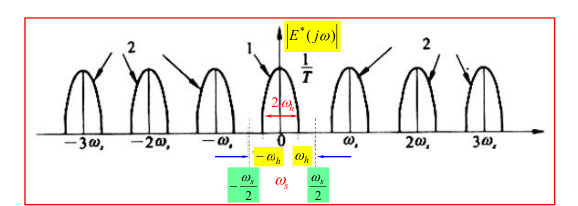
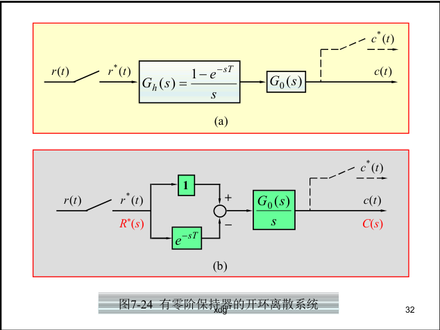

```cardlink
url: http://10.188.31.55:5244/Nextcloud/School/自动控制原理/
title: "自动控制原理 · 课程课件与复习笔记"
description: "中南大学自动化学院《自动控制原理》的课件、教材与复习笔记"
host: 10.188.31.55:5244
```

[← 返回《自动控制原理》目录](../)

## 第 7 章 线性离散系统的分析与校正

### 数字控制系统的基本矛盾

前六章的所有方法都建立在一个前提上：信号是时间的连续函数，传递函数 $G(s)=C(s)/R(s)$ 描述任意时刻的输入输出关系。但现代控制器是数字的。单片机、DSP、工控机的输入输出只能是二进制编码的数字信号，时间上每隔 $T$ 秒算一次，幅值上只能取有限个量化值。被控对象（电机、炉子、机械臂）和测量元件仍然是连续的。

于是系统被切成两半：中间是离散的数字控制器，两头是连续的物理环节。D/A 转换把数字信号先译成离散的模拟信号，再由保持器复现成连续信号，两步合起来才把阶梯送回连续对象 [自控原理（第七章1）.pdf · p.3](http://10.188.31.55:5244/Nextcloud/School/自动控制原理/%E8%87%AA%E6%8E%A7%E5%8E%9F%E7%90%86%EF%BC%88%E7%AC%AC%E4%B8%83%E7%AB%A01%EF%BC%89.pdf#page=3)。

这一章的任务只有一句话：把连续系统那套"左半平面判稳"整体搬到"单位圆"上。信号一旦被切成离散的点，$G(s)$ 就不够用了，得换成 $z$ 域的脉冲传递函数 $G(z)$。要会算带零阶保持器的 $G(z)$，会用单位圆或朱利判据判稳，会用离散终值定理算稳态误差。

考试里这一章是 A 卷第 5 题（15 分，三问）的全部内容：第 (1) 问求 $K$ 的稳定范围，第 (2) 问给定 $K$ 求 $r(t)=1+t$ 的稳态误差，第 (3) 问把控制器改成 PI 再求参数范围 [补充_考试出题模式与特殊情况.md · p.40](http://10.188.31.55:5244/Nextcloud/School/自动控制原理/%E8%A1%A5%E5%85%85_%E8%80%83%E8%AF%95%E5%87%BA%E9%A2%98%E6%A8%A1%E5%BC%8F%E4%B8%8E%E7%89%B9%E6%AE%8A%E6%83%85%E5%86%B5.md)。题型固定到可以背流水线：求 $G(z)$ → 列特征方程 → 判稳 → 终值定理。

### 采样系统长什么样

采样系统的典型结构是误差采样型：误差信号 $e(t)$ 经采样开关 $S$ 切成脉冲序列 $e^*(t)$，再经零阶保持器 $G_h(s)$ 还原成阶梯信号 $e_h(t)$ 去驱动被控对象 $G_0(s)$，输出 $c(t)$ 经反馈环节 $H(s)$ 回到输入端。


教材把三种波形并排画在同一页上：$e(t)$ 是连续曲线，$e^*(t)$ 是一串冲量，$e_h(t)$ 是阶梯。阶梯信号的横坐标是连续的，纵坐标只在采样时刻跳变 [自动控制原理（第八版） (胡寿松、姜斌、张绍杰) (z-library.sk, 1lib.sk, z-lib.sk)(1).pdf · p.315](http://10.188.31.55:5244/Nextcloud/School/自动控制原理/%E8%87%AA%E5%8A%A8%E6%8E%A7%E5%88%B6%E5%8E%9F%E7%90%86%EF%BC%88%E7%AC%AC%E5%85%AB%E7%89%88%EF%BC%89%20%28%E8%83%A1%E5%AF%BF%E6%9D%BE%E3%80%81%E5%A7%9C%E6%96%8C%E3%80%81%E5%BC%A0%E7%BB%8D%E6%9D%B0%29%20%28z-library.sk%2C%201lib.sk%2C%20z-lib.sk%29%281%29.pdf#page=315)。脉冲序列的数学表达式写成冲量之和：

$$
e^*(t)=\sum_{n=0}^{\infty}e(nT)\,\delta(t-nT)
$$

这里 $T$ 是采样周期，$\omega_s=2\pi/T$ 是采样角频率。

### 采样定理：为什么要限制采样频率

采样相当于把原信号的频谱以 $\omega_s$ 为周期无限重复。设原信号最高角频率为 $\omega_h$，则采样后第 $k$ 份频谱的中心频率落在 $k\omega_s$ 处。



相邻频谱副本不重叠时原信号可以完整恢复，一旦重叠就发生**混叠**（aliasing），原信号再也恢复不出来 [自控原理（第七章1）.pdf · p.5](http://10.188.31.55:5244/Nextcloud/School/自动控制原理/%E8%87%AA%E6%8E%A7%E5%8E%9F%E7%90%86%EF%BC%88%E7%AC%AC%E4%B8%83%E7%AB%A01%EF%BC%89.pdf#page=5)。所以**香农采样定理**：为保证不失真复现，必须 $\omega_s\ge 2\omega_h$，即 $T\le \pi/\omega_h$。

采样周期不是越小越好。$T$ 太大造成混叠，$T$ 太小加重计算负担。工程上对随动系统常取 $\omega_s\approx10\omega_c$，或按时域指标取 $T\approx t_s/40$。

> [!IMPORTANT] 混叠是双向的
> 混叠之后，原信号的高频成分会伪装成低频成分进入系统。这意味着采样系统看到的"信号"已经不是真实信号了，判稳分析再准也没用。采样频率这个约束在设计的第一步就要定，不是最后再检查。

### 零阶保持器：把脉冲还原成阶梯

零阶保持器（zero-order hold, ZOH）在每个采样时刻取值，然后保持一个采样周期不变。它的传递函数是

$$
G_h(s)=\frac{1-e^{-Ts}}{s}
$$

零阶保持器有两个影响闭环性质的性质。第一个是低通特性：幅值随频率增大而迅速衰减，所以高频分量大部分被挡掉，但仍有部分通过，造成输出中的纹波。第二个是相角滞后特性：相角随频率增大而滞后，在 $\omega=\omega_s$ 处滞后可达 $-180°$，从而使闭环系统的稳定性变差 [自动控制原理（第八版） (胡寿松、姜斌、张绍杰) (z-library.sk, 1lib.sk, z-lib.sk)(1).pdf · p.326](http://10.188.31.55:5244/Nextcloud/School/自动控制原理/%E8%87%AA%E5%8A%A8%E6%8E%A7%E5%88%B6%E5%8E%9F%E7%90%86%EF%BC%88%E7%AC%AC%E5%85%AB%E7%89%88%EF%BC%89%20%28%E8%83%A1%E5%AF%BF%E6%9D%BE%E3%80%81%E5%A7%9C%E6%96%8C%E3%80%81%E5%BC%A0%E7%BB%8D%E6%9D%B0%29%20%28z-library.sk%2C%201lib.sk%2C%20z-lib.sk%29%281%29.pdf#page=326)。


### z 变换：把拉氏变换搬到采样时刻

$z$ 变换是离散信号的拉氏变换变体。它把采样序列 $\{e(nT)\}$ 映射成复变量 $z$ 的函数：

$$
E(z)=\sum_{n=0}^{\infty}e(nT)z^{-n}=e(0)+e(T)z^{-1}+e(2T)z^{-2}+\cdots
$$

$z^{-1}$ 的含义是"延迟一个采样周期"，和 $s$ 域里 $e^{-Ts}$ 表示延迟 $T$ 秒是同一回事 [自控原理（第七章2）.pdf · p.1](http://10.188.31.55:5244/Nextcloud/School/自动控制原理/%E8%87%AA%E6%8E%A7%E5%8E%9F%E7%90%86%EF%BC%88%E7%AC%AC%E4%B8%83%E7%AB%A02%EF%BC%89.pdf#page=1)。

关键的关系是变量替换 $z=e^{sT}$。它把 $s$ 的超越函数换成 $z$ 的幂级数或有理分式，这是所有后续运算的基础。

### s 平面到 z 平面的映射

设 $s=\sigma+j\omega$，代入 $z=e^{sT}$：

$$
z=e^{(\sigma+j\omega)T}=e^{\sigma T}\,e^{j\omega T}
$$

两边取模和辐角，得到映射关系：

$$
|z|=e^{\sigma T},\qquad \angle z=\omega T
$$

由 $|z|=e^{\sigma T}$ 立刻读出三条结论：$\sigma<0$（$s$ 左半平面）对应 $|z|<1$（单位圆内），$\sigma=0$（虚轴）对应 $|z|=1$（单位圆上），$\sigma>0$（右半平面）对应 $|z|>1$（单位圆外）。

一句话记住这张地图：**左半平面 → 单位圆内，虚轴 → 单位圆上，右半平面 → 单位圆外**。这就是离散系统判稳的几何基础。


由 $\angle z=\omega T$ 还可知：$s$ 平面虚轴上 $\omega$ 从 $-\omega_s/2$ 增到 $\omega_s/2$ 时，$z$ 的相角从 $-\pi$ 变到 $\pi$，恰好沿单位圆转一圈。所以 $s$ 平面被分成无穷多条宽 $\omega_s$ 的周期带，其中 $-\omega_s/2\sim\omega_s/2$ 叫**主要带**，其余叫次要带 [自动控制原理（第八版） (胡寿松、姜斌、张绍杰) (z-library.sk, 1lib.sk, z-lib.sk)(1).pdf · p.354](http://10.188.31.55:5244/Nextcloud/School/自动控制原理/%E8%87%AA%E5%8A%A8%E6%8E%A7%E5%88%B6%E5%8E%9F%E7%90%86%EF%BC%88%E7%AC%AC%E5%85%AB%E7%89%88%EF%BC%89%20%28%E8%83%A1%E5%AF%BF%E6%9D%BE%E3%80%81%E5%A7%9C%E6%96%8C%E3%80%81%E5%BC%A0%E7%BB%8D%E6%9D%B0%29%20%28z-library.sk%2C%201lib.sk%2C%20z-lib.sk%29%281%29.pdf#page=354)。

### 脉冲传递函数：离散系统的数学模型

脉冲传递函数（pulse transfer function）是离散系统里 $G(s)$ 的对应物：零初始条件下，输出采样信号的 $z$ 变换与输入采样信号的 $z$ 变换之比。

$$G(z)=\frac{C(z)}{R(z)}$$

求 $G(z)$ 有个绕不开的细节。含零阶保持器时，要先把保持器和被控对象串起来看：$G_h(s)G_0(s)=\dfrac{(1-e^{-Ts})G_0(s)}{s}$。取 $z$ 变换时 $e^{-Ts}$ 对应 $z^{-1}$，所以 $(1-e^{-Ts})$ 变成 $(1-z^{-1})$。于是含 ZOH 的开环脉冲传递函数是

$$
G(z)=(1-z^{-1})\mathcal{Z}\left[\frac{G_c(s)G_p(s)}{s}\right]
$$

控制器 $G_c(s)$ 也要一起放进方括号里 [题型四_离散系统z变换大题.md · p.121](http://10.188.31.55:5244/Nextcloud/School/自动控制原理/%E9%A2%98%E5%9E%8B%E5%9B%9B_%E7%A6%BB%E6%95%A3%E7%B3%BB%E7%BB%9Fz%E5%8F%98%E6%8D%A2%E5%A4%A7%E9%A2%98.md)。



闭环比连续系统多一步推导。连续部分的关系是 $C(s)=G(s)E^*(s)$、$E(s)=R(s)-H(s)C(s)$，离散化后得到误差脉冲传递函数和闭环脉冲传递函数：

$$
E(z)=\frac{R(z)}{1+GH(z)},\qquad \Phi(z)=\frac{C(z)}{R(z)}=\frac{G(z)}{1+GH(z)}
$$

令分母为零即得闭环特征方程 $D(z)=1+GH(z)=0$。单位负反馈（$H=1$）时退化为 $D(z)=1+G(z)=0$，形式和连续系统一模一样，只是变量名从 $s$ 换成了 $z$。

注意：由于采样器位置不同，闭环脉冲传函不能由 $\Phi(s)$ 直接做 $z$ 变换得到，必须按离散化步骤一步步推。

### 稳定性：单位圆、朱利判据、w 变换

离散系统稳定的充要条件是：特征方程 $D(z)=0$ 的全部根都在单位圆内，即 $|z_i|<1$。

判断实根直接看绝对值，复根算 $\sqrt{x^{2}+y^{2}}$。**根是复数时必须算模，不能只看实部**——这是本节的第一个坑。

朱利判据（Jury stability criterion）是离散版的劳斯判据。二阶特征方程 $D(z)=a_2z^{2}+a_1z+a_0=0$（$a_2>0$）的充要条件是三条：

1. $D(1)=a_2+a_1+a_0>0$
2. $D(-1)=a_2-a_1+a_0>0$
3. $|a_0|<a_2$

三条各管一件事。条件 (1) 保证没有根从 $z=1$ 处穿出单位圆；条件 (2) 保证没有根从 $z=-1$ 处穿出（符号依阶数奇偶而定，二阶取正）；条件 (3) 用韦达定理看两根之积，$|z_1z_2|=|a_0/a_2|<1$ 意味着两个根不会同时跑到单位圆外。记忆口诀：**代 1 正，代负一正，末小于首** [题型四_离散系统z变换大题.md · p.179](http://10.188.31.55:5244/Nextcloud/School/自动控制原理/%E9%A2%98%E5%9E%8B%E5%9B%9B_%E7%A6%BB%E6%95%A3%E7%B3%BB%E7%BB%9Fz%E5%8F%98%E6%8D%A2%E5%A4%A7%E9%A2%98.md)。

三阶及以上用 w 变换加劳斯判据。w 变换是双线性变换，教材和课件用的写法是

$$
z=\frac{w+1}{w-1},\qquad w=\frac{z+1}{z-1}
$$

$z$ 与 $w$ 互为线性变换，所以 w 变换又称双线性变换。它把 $z$ 平面的单位圆内映射成 $w$ 平面的左半平面。


把 $z=x+jy$ 代入 $w=\dfrac{z+1}{z-1}$，分离实部得

$$
u=\operatorname{Re}(w)=\frac{x^{2}+y^{2}-1}{(x-1)^{2}+y^{2}}=\frac{|z|^{2}-1}{|z-1|^{2}}
$$

分母 $(x-1)^2+y^2$ 恒正，$u$ 的符号完全由分子决定，于是三条对应关系成立：$u=0$ 等价于 $x^2+y^2=1$，w 平面的虚轴对应 z 平面上的单位圆周；$u<0$ 等价于 $x^2+y^2<1$，左半 w 平面对应 z 平面单位圆内的区域；$u>0$ 等价于 $x^2+y^2>1$，右半 w 平面对应单位圆外的区域。

于是 $z$ 平面上的特征方程 $1+GH(z)=0$ 可以直接转成 w 平面上的特征方程 $1+GH(w)=0$，对 $w$ 多项式用劳斯判据（第一列全同号则稳定）即可 [自控原理（第七章4）.pdf · p.3](http://10.188.31.55:5244/Nextcloud/School/自动控制原理/%E8%87%AA%E6%8E%A7%E5%8E%9F%E7%90%86%EF%BC%88%E7%AC%AC%E4%B8%83%E7%AB%A04%EF%BC%89.pdf#page=3)。

> [!NOTE] w 变换有两种写法
> 讲师的通关笔记和旧讲义用的是互为倒数的另一种形式 $z=\dfrac{1+w}{1-w}$、$w=\dfrac{z-1}{z+1}$ [题型四_离散系统z变换大题.md · p.192](http://10.188.31.55:5244/Nextcloud/School/自动控制原理/%E9%A2%98%E5%9E%8B%E5%9B%9B_%E7%A6%BB%E6%95%A3%E7%B3%BB%E7%BB%9Fz%E5%8F%98%E6%8D%A2%E5%A4%A7%E9%A2%98.md)。两种形式都把单位圆内映到左半平面，结论一致。做题时用哪一种都行，但同一道题里不能混着写，分子分母写反会得到相反的结论。


变换时必须整个特征方程一起代换，不能只换某一项。w 变换只换坐标系，不改变极点的稳定性质。

### 稳态误差：离散终值定理

离散终值定理的形式和连续终值定理平行，只是把 $s\to0$ 换成 $z\to1$：

$$
e(\infty)=\lim_{z\to1}(z-1)E(z)
$$

使用前提是系统稳定，即 $(z-1)E(z)$ 的极点全部在单位圆内；否则终值定理不成立。对单位负反馈误差采样系统，$E(z)=R(z)/[1+G(z)]$，于是

$$
e(\infty)=\lim_{z\to1}(z-1)\frac{R(z)}{1+G(z)}
$$

计算技巧：先把 $(z-1)$ 与 $R(z)$ 中的 $(z-1)$ 因子约掉，再代入 $z=1$ [自控原理（第七章4）.pdf · p.5](http://10.188.31.55:5244/Nextcloud/School/自动控制原理/%E8%87%AA%E6%8E%A7%E5%8E%9F%E7%90%86%EF%BC%88%E7%AC%AC%E4%B8%83%E7%AB%A04%EF%BC%89.pdf#page=5)。

系统型别由 $G(z)$ 分母中 $(z-1)$ 因子的个数 $\nu$ 决定。0 型系统分母无 $(z-1)$，阶跃输入误差有限（$e_{ss}=1/(1+K_p)$），斜坡输入误差为无穷大；I 型系统分母有一个 $(z-1)$，阶跃误差为零，斜坡误差有限（$e_{ss}=T/K_v$）；II 型系统斜坡误差也为零。位置误差系数 $K_p=\lim_{z\to1}G(z)$，速度误差系数 $K_v=\frac{1}{T}\lim_{z\to1}(z-1)G(z)$ [题型四_离散系统z变换大题.md · p.233](http://10.188.31.55:5244/Nextcloud/School/自动控制原理/%E9%A2%98%E5%9E%8B%E5%9B%9B_%E7%A6%BB%E6%95%A3%E7%B3%BB%E7%BB%9Fz%E5%8F%98%E6%8D%A2%E5%A4%A7%E9%A2%98.md)。

### A 卷第 5 题：三问完整走一遍

题目给的系统是：控制器 $G_c(s)=K$（$K>0$），零阶保持器 $G_h(s)=\frac{1-e^{-Ts}}{s}$，被控对象 $G_p(s)=\frac{1}{s+1}$，采样周期 $T=1$ s，单位负反馈 [自动控制原理A卷 (1).pdf · p.3](http://10.188.31.55:5244/Nextcloud/School/自动控制原理/%E8%87%AA%E5%8A%A8%E6%8E%A7%E5%88%B6%E5%8E%9F%E7%90%86A%E5%8D%B7%20%281%29.pdf#page=3)。

**第一问：求 $K$ 的稳定范围。**

先做部分分式展开：$\dfrac{K}{s(s+1)}=K\left(\dfrac{1}{s}-\dfrac{1}{s+1}\right)$。逐项查表（$T=1$，$e^{-1}\approx0.368$）：

$$
\mathcal{Z}\left[\frac{K}{s(s+1)}\right]=K\left(\frac{z}{z-1}-\frac{z}{z-0.368}\right)=\frac{0.632Kz}{(z-1)(z-0.368)}
$$

再乘上 $(1-z^{-1})=\frac{z-1}{z}$：

$$
G(z)=(1-z^{-1})\mathcal{Z}\left[\frac{K}{s(s+1)}\right]=\frac{z-1}{z}\cdot\frac{0.632Kz}{(z-1)(z-0.368)}=\frac{0.632K}{z-0.368}
$$

$(z-1)$ 因子被约掉了，$G(z)$ 是一阶的。规律：被控对象 $G_p(s)=1/(s+a)$ 经零阶保持器后，$G(z)$ 一定是一阶的，且分母极点为 $z=e^{-aT}$。

列闭环特征方程 $1+G(z)=0$，得 $z=0.368-0.632K$。一阶特征方程 $az+b=0$ 的稳定条件是 $|z|<1$，所以 $|0.368-0.632K|<1$，解得 $K>-1$ 且 $K<1.368/0.632\approx2.165$。结合 $K>0$：

$$
0<K<2.165
$$

**第二问：$K=1$ 时求 $r(t)=1+t$ 的稳态误差。**

先验证稳定：特征根 $z=0.368-0.632=-0.264$，$|z|=0.264<1$，可以用终值定理。$G(z)=\frac{0.632}{z-0.368}$ 的分母没有 $(z-1)$ 因子，是 **0 型系统**。$r(t)=1+t$ 里含斜坡分量，0 型系统追斜坡误差必然无穷大，所以 $e(\infty)=\infty$。

若只问阶跃部分的误差，$K_p=\lim_{z\to1}G(z)=0.632/(1-0.368)=1$，$e(\infty)=1/(1+K_p)=1/2$。第 (2) 问之所以常取 $r(t)=1+t$，就是为了同时考察对 0 型/I 型系统的理解 [补充_考试出题模式与特殊情况.md · p.40](http://10.188.31.55:5244/Nextcloud/School/自动控制原理/%E8%A1%A5%E5%85%85_%E8%80%83%E8%AF%95%E5%87%BA%E9%A2%98%E6%A8%A1%E5%BC%8F%E4%B8%8E%E7%89%B9%E6%AE%8A%E6%83%85%E5%86%B5.md)。

**第三问：换成 PI 控制器 $G_c(s)=1+\frac{1}{\alpha s}=\frac{\alpha s+1}{\alpha s}$（$\alpha>0$）。**

需要变换的表达式变成 $\dfrac{\alpha s+1}{\alpha s^{2}(s+1)}$。设 $\dfrac{\alpha s+1}{s^{2}(s+1)}=\dfrac{A}{s}+\dfrac{B}{s^{2}}+\dfrac{C}{s+1}$，令 $s=0$ 得 $B=1$，令 $s=-1$ 得 $C=1-\alpha$，比较 $s^{2}$ 系数得 $A=\alpha-1$。

逐项查表再乘 $(1-z^{-1})$，通分后分子中 $z^{2}$ 项恰好抵消：

$$
G(z)=\frac{(0.368+0.632\alpha)z+(0.264-0.632\alpha)}{\alpha(z-1)(z-0.368)}
$$

分母多了一个 $(z-1)$ 因子，说明 PI 把系统从 0 型提升为 I 型——这正是积分项的作用：让阶跃误差变为零。

闭环特征方程两边同乘 $\alpha(z-1)(z-0.368)$，整理得二阶方程 $\alpha z^{2}+(0.368-0.736\alpha)z+0.264(1-\alpha)=0$。对照 $a_2z^{2}+a_1z+a_0=0$，$a_2=\alpha>0$，$a_1=0.368-0.736\alpha$，$a_0=0.264(1-\alpha)$。

朱利三条件逐条查：$D(1)=0.632>0$ 对一切 $\alpha$ 恒成立；$D(-1)=1.472\alpha-0.104>0$ 给出 $\alpha>0.0707$；$|a_0|<a_2$ 在 $\alpha<1$ 时给出 $\alpha>0.209$、在 $\alpha\ge1$ 时恒成立。取交集得 $\alpha>0.209$。

顺带求斜坡稳态误差。$K_v=(1/T)\lim_{z\to1}(z-1)G(z)$，代入化简得 $K_v=1/\alpha$，于是 $r(t)=t$ 的稳态误差 $e(\infty)=T/K_v=\alpha$。

> [!WARNING] 离散系统题的四个高频坑
> **忘了乘 $(1-z^{-1})$。** 含 ZOH 的公式最后一定要乘，且控制器 $G_c(s)$ 也要一起放进方括号里。这是本节最常见的失分点。
>
> **$T$ 代错。** $T=1$ 时 $e^{-1}\approx0.368$，$T=0.1$ 时 $e^{-0.1}\approx0.905$，代错全盘皆错。
>
> **判稳看单位圆，不是看左右半平面。** 单位圆外（$|z|>1$）才是不稳定，单位圆上是临界稳定。做离散题时脑子里的"左半平面"要整体切换成"单位圆内"。
>
> **朱利三条件漏一条。** $D(1)>0$、$D(-1)>0$、$|a_0|<a_2$ 缺一不可，写完一条划一个勾。

### 最少拍数字控制器

最少拍系统指在典型输入作用下能以有限拍结束响应、且在采样时刻上无稳态误差的系统。设典型输入写成 $R(z)=\dfrac{A(z)}{(1-z^{-1})^{m}}$，其中 $m$ 由输入类型决定：阶跃 $m=1$，斜坡 $m=2$，加速度 $m=3$。

误差 $E(z)=\Phi_e(z)R(z)$。稳态误差为零要求 $\Phi_e(z)$ 含 $(1-z^{-1})^{m}$ 因子；为使 $D(z)$ 最简单取 $\Phi_e(z)=(1-z^{-1})^{m}$，$\Phi(z)=1-\Phi_e(z)$。由 $\Phi(z)=\frac{D(z)G(z)}{1+D(z)G(z)}$ 反解得数字控制器

$$
D(z)=\frac{\Phi(z)}{G(z)\,\Phi_e(z)}
$$

三种典型输入的结果：阶跃 $\Phi_e=1-z^{-1}$、$\Phi=z^{-1}$；斜坡 $\Phi_e=(1-z^{-1})^{2}$、$\Phi=2z^{-1}-z^{-2}$；加速度 $\Phi_e=(1-z^{-1})^{3}$、$\Phi=3z^{-1}-3z^{-2}+z^{-3}$。

例：广义对象 $G_0(s)=\frac{10}{s(s+1)}$、$T=1$ s，要求单位斜坡下最少拍。$m=2$，故 $\Phi_e(z)=(1-z^{-1})^{2}$、$\Phi(z)=2z^{-1}-z^{-2}$。先算 $G(z)=\frac{3.68z^{-1}(1+0.717z^{-1})}{(1-z^{-1})(1-0.368z^{-1})}$，代入 $D(z)=\Phi(z)/[G(z)\Phi_e(z)]$ 约去公共因子得

$$
D(z)=\frac{0.543(1-0.368z^{-1})(1-0.5z^{-1})}{(1-z^{-1})(1+0.717z^{-1})}
$$

$\Phi_e(z)$ 的零点 $z=1$ 正好补偿了 $G(z)$ 在单位圆上的极点 $z=1$，$\Phi(z)$ 已包含 $G(z)$ 的延迟因子 $z^{-1}$，满足"对消延迟、补偿单位圆极点"的限制性要求 [自动控制原理（第八版） (胡寿松、姜斌、张绍杰) (z-library.sk, 1lib.sk, z-lib.sk)(1).pdf · p.374](http://10.188.31.55:5244/Nextcloud/School/自动控制原理/%E8%87%AA%E5%8A%A8%E6%8E%A7%E5%88%B6%E5%8E%9F%E7%90%86%EF%BC%88%E7%AC%AC%E5%85%AB%E7%89%88%EF%BC%89%20%28%E8%83%A1%E5%AF%BF%E6%9D%BE%E3%80%81%E5%A7%9C%E6%96%8C%E3%80%81%E5%BC%A0%E7%BB%8D%E6%9D%B0%29%20%28z-library.sk%2C%201lib.sk%2C%20z-lib.sk%29%281%29.pdf#page=374)。

最少拍系统只在采样时刻无误差，非采样时刻一般仍有纹波。要消除纹波，额外要求闭环脉冲传函 $\Phi(z)$ 包含 $G(z)$ 的全部零点，即 $\Phi(z)=P(z)M(z)$，其中 $P(z)$ 是 $G(z)$ 的零点多项式，代价是增加相应拍数。
