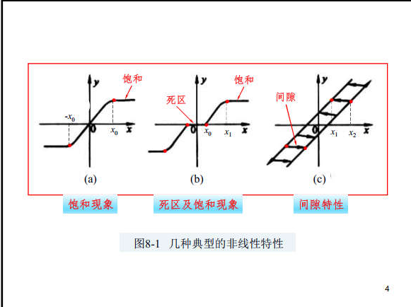
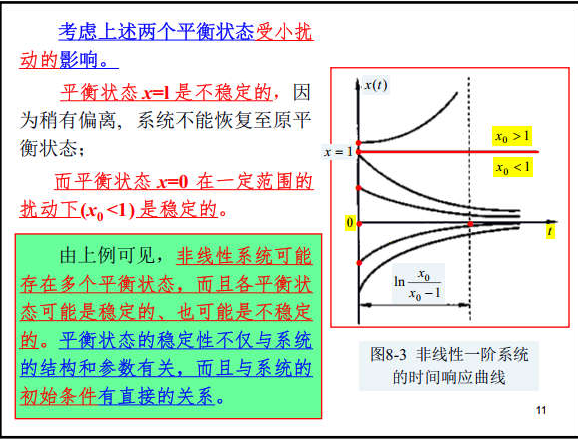
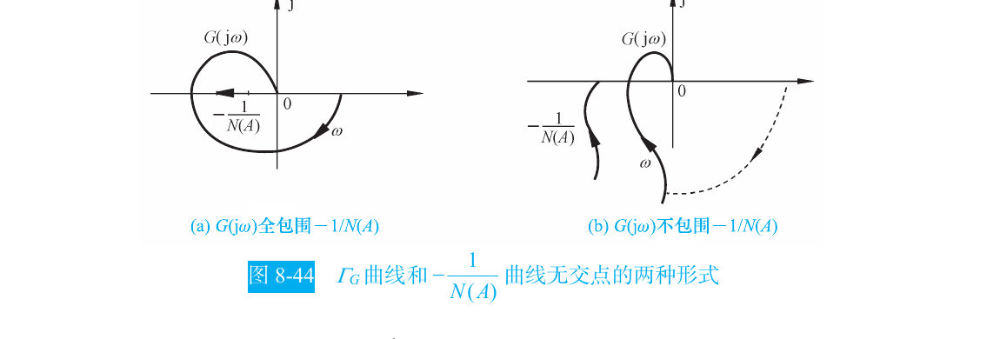
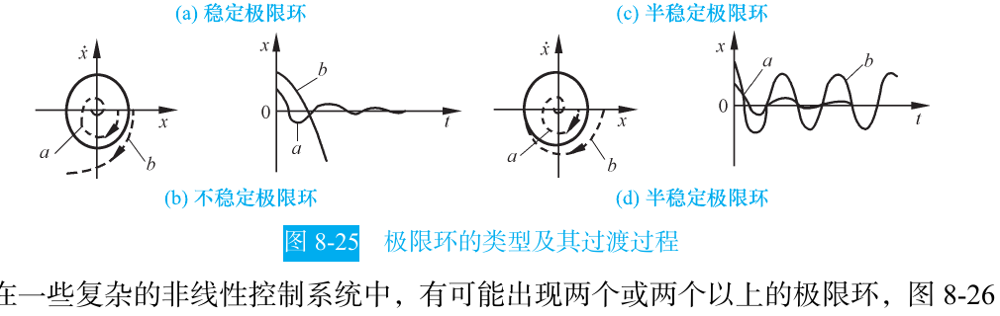

```cardlink
url: http://10.188.31.55:5244/Nextcloud/School/自动控制原理/
title: "自动控制原理 · 课程课件与复习笔记"
description: "中南大学自动化学院《自动控制原理》的课件、教材与复习笔记"
host: 10.188.31.55:5244
```

[← 返回《自动控制原理》目录](../)

## 第 8 章 非线性控制系统分析

### 真实的系统都是非线性的

第 5 章用 Nyquist 判据判稳时隐含一个前提：系统是线性的，增益是常数 $K$。真实物理系统里没有哪个环节严格线性：放大器受电源电压限制，输入一大就饱和；电动机要克服静摩擦，电枢电压小到一定程度根本转不动，存在死区；齿轮传动有装配间隙，换向时会"空走"一段。信号小的时候把这些看成线性还过得去，信号一大，继续套线性理论会给出完全错误的结论 [自控原理（第八章1）.pdf · p.1](http://10.188.31.55:5244/Nextcloud/School/自动控制原理/%E8%87%AA%E6%8E%A7%E5%8E%9F%E7%90%86%EF%BC%88%E7%AC%AC%E5%85%AB%E7%AB%A01%EF%BC%89.pdf#page=1)。

教材把随动系统拆成三类元件说明这一点：放大元件受电源电压和输出功率限制，超过线性范围就饱和；执行元件电动机有摩擦力矩和负载力矩，电压低于某值时转不动（死区），高于某值时转速不再增加（饱和）；传动机构受加工和装配精度限制，换向时存在回差 [自动控制原理（第八版） (胡寿松、姜斌、张绍杰) (z-library.sk, 1lib.sk, z-lib.sk)(1).pdf · p.393](http://10.188.31.55:5244/Nextcloud/School/自动控制原理/%E8%87%AA%E5%8A%A8%E6%8E%A7%E5%88%B6%E5%8E%9F%E7%90%86%EF%BC%88%E7%AC%AC%E5%85%AB%E7%89%88%EF%BC%89%20%28%E8%83%A1%E5%AF%BF%E6%9D%BE%E3%80%81%E5%A7%9C%E6%96%8C%E3%80%81%E5%BC%A0%E7%BB%8D%E6%9D%B0%29%20%28z-library.sk%2C%201lib.sk%2C%20z-lib.sk%29%281%29.pdf#page=393)。



非线性系统还有两个线性系统没有的现象。

第一个是**平衡状态可能不唯一**。看一阶系统 $\dot{x}=x^2-x=x(x-1)$，令 $\dot{x}=0$ 得两个平衡状态 $x=0$ 和 $x=1$。分离变量积分得 $x(t)=\frac{x_0e^{-t}}{1-x_0+x_0e^{-t}}$，时间响应随初始条件 $x_0$ 而改变：$x_0>1$ 时 $x(t)$ 递增并在 $t=\ln\frac{x_0}{x_0-1}$ 时趋于无穷大，$x_0<1$ 时 $x(t)$ 递减并趋于 0。



所以非线性系统的稳定性不仅取决于系统的结构和参数，还与系统的初始条件和扰动范围有关。线性系统则不然：它只有一个平衡状态 $x=0$，稳定性只取决于结构和参数。

第二个是**可能存在自振**。自振指没有外部输入，系统自己就维持着等幅等频率的持续振荡，而且扰动消失后还能回到原来的振幅和频率。教材用范德波尔方程 $\ddot{x}-2p(1-x^2)\dot{x}+x=0$（$p>0$）说明：$x<1$ 时 $-p(1-x^2)<0$，系统具有负阻尼，从外部获得能量，$x(t)$ 呈发散形式；$x>1$ 时系统具有正阻尼，消耗能量，$x(t)$ 呈收敛形式；$x=1$ 时零阻尼，$x(t)$ 呈等幅振荡形式 [自控原理（第八章1）.pdf · p.2](http://10.188.31.55:5244/Nextcloud/School/自动控制原理/%E8%87%AA%E6%8E%A7%E5%8E%9F%E7%90%86%EF%BC%88%E7%AC%AC%E5%85%AB%E7%AB%A01%EF%BC%89.pdf#page=2)。

### 三种分析与设计方法

课件把非线性系统的分析方法分成三类 [自控原理（第八章1）.pdf · p.3](http://10.188.31.55:5244/Nextcloud/School/自动控制原理/%E8%87%AA%E6%8E%A7%E5%8E%9F%E7%90%86%EF%BC%88%E7%AC%AC%E5%85%AB%E7%AB%A01%EF%BC%89.pdf#page=3)。

**相平面法**是图形分析方法，通过在相平面上绘制轨迹曲线，确定非线性微分方程在不同初始条件下解的运动形式。缺点是只适用于一阶、二阶系统。

**描述函数法**是基于频域分析法和由线性特性谐波线性化的一种图解分析方法，适用于"一个非线性环节加一个线性部分"闭环连接的结构，通过把非线性特性近似表示为复变增益环节，然后推广应用频率法，去分析非线性系统的稳定性和自激振荡。

**逆系统法**是运用内环非线性反馈控制构成伪线性系统，并以此为基础设计外环控制器，直接研究非线性问题而不必求解非线性系统的运动方程。

本章讲前两种。考试分工是：A 卷第 6 题走描述函数法，填空和选择里偶尔考相平面法概念。

### 描述函数的定义

描述函数法是达尼尔夫（P. J. Daniel）于 1940 年提出的。基本思想是：当系统满足一定条件时，系统中的非线性元件在正弦信号作用下可以用其一次谐波分量来近似，由此导出非线性元件的近似等效频率特性，即描述函数 [自控原理（第八章1）.pdf · p.5](http://10.188.31.55:5244/Nextcloud/School/自动控制原理/%E8%87%AA%E6%8E%A7%E5%8E%9F%E7%90%86%EF%BC%88%E7%AC%AC%E5%85%AB%E7%AB%A01%EF%BC%89.pdf#page=5)。

设非线性环节的输入是 $x(t)=A\sin\omega t$，输出 $y(t)$ 一般是非正弦的周期波。把它做傅里叶展开，取其中的基波 $y_1(t)=B_1\sin\omega t+A_1\cos\omega t$。两个傅里叶系数由积分给出：

$$
B_1=\frac{1}{\pi}\int_0^{2\pi}y(t)\sin\omega t\,d(\omega t),\qquad A_1=\frac{1}{\pi}\int_0^{2\pi}y(t)\cos\omega t\,d(\omega t)
$$

描述函数是输出基波复振幅与输入复振幅之比：

$$
N(A)=\frac{B_1+jA_1}{A}
$$

当 $y(t)$ 是 $t$ 的奇对称函数时可以证明 $A_1=0$，此时 $N(A)=\dfrac{B_1}{A}$ 是**实数**。理想继电器、饱和、死区都是这种情形，所以本章 $N(A)$ 一律按实数处理。

描述函数有两个重要特点：一般只与输入振幅 $A$ 有关，与频率 $\omega$ 无关；它是一种近似方法，忽略了高次谐波 [题型五_描述函数大题.md · p.36](http://10.188.31.55:5244/Nextcloud/School/自动控制原理/%E9%A2%98%E5%9E%8B%E4%BA%94_%E6%8F%8F%E8%BF%B0%E5%87%BD%E6%95%B0%E5%A4%A7%E9%A2%98.md)。

### 描述函数法的三个前提

课件明确列出应用条件，答概念题时会考 [自控原理（第八章1）.pdf · p.6](http://10.188.31.55:5244/Nextcloud/School/自动控制原理/%E8%87%AA%E6%8E%A7%E5%8E%9F%E7%90%86%EF%BC%88%E7%AC%AC%E5%85%AB%E7%AB%A01%EF%BC%89.pdf#page=6)。

**第一，非线性系统应简化成一个非线性环节和一个线性部分闭环连接的典型结构。**


**第二，非线性环节的输入输出特性 $y(x)$ 应是 $x$ 的奇函数**，即 $f(-x)=-f(x)$，或正弦输入下的输出 $y$ 为 $t$ 的奇对称函数 $y(t+\pi/\omega)=-y(t)$，以保证非线性元件的正弦响应不含常值分量 $A_0=0$。

**第三，系统的线性部分 $G(s)$ 应具有较好的低通滤波性能。** 非线性环节的输出一定含有高次谐波，但经线性部分传递之后，由于低通滤波作用，高次谐波分量被大大削弱，闭环通道内近似只有一次谐波流通，从而保证结果比较准确。线性部分 $G(s)$ 的阶次越高，低通滤波性能越好 [自控原理（第八章1）.pdf · p.7](http://10.188.31.55:5244/Nextcloud/School/自动控制原理/%E8%87%AA%E6%8E%A7%E5%8E%9F%E7%90%86%EF%BC%88%E7%AC%AC%E5%85%AB%E7%AB%A01%EF%BC%89.pdf#page=7)。

> [!WARNING] 相切不等于稳定
> 描述函数法还有一个隐含条件：交点处两条曲线要几乎垂直相交。若在交点处几乎相切，高次谐波衰减不够，分析结果就不可靠，甚至可能根本不存在自振。相切时特征方程有重根落在虚轴上，系统处于临界自持振荡状态，对应相平面上的半稳定极限环，不是稳定。

### 常见非线性特性的描述函数

教材表 8-1 把常见非线性特性的静特性和描述函数列在一起，考试给 $N(A)$ 或要求写 $N(A)$ 时直接对照。


这些继电特性的描述函数有统一的来源：都从一个带死区和滞环的通式

$$
N(A)=\frac{2M}{\pi A}\left[\sqrt{1-\left(\frac{mh}{A}\right)^2}+\sqrt{1-\left(\frac{h}{A}\right)^2}\right]+j\frac{2Mh}{\pi A^2}(m-1),\qquad A\ge h
$$

出发，取不同参数得到各特例 [自动控制原理（第八版） (胡寿松、姜斌、张绍杰) (z-library.sk, 1lib.sk, z-lib.sk)(1).pdf · p.424](http://10.188.31.55:5244/Nextcloud/School/自动控制原理/%E8%87%AA%E5%8A%A8%E6%8E%A7%E5%88%B6%E5%8E%9F%E7%90%86%EF%BC%88%E7%AC%AC%E5%85%AB%E7%89%88%EF%BC%89%20%28%E8%83%A1%E5%AF%BF%E6%9D%BE%E3%80%81%E5%A7%9C%E6%96%8C%E3%80%81%E5%BC%A0%E7%BB%8D%E6%9D%B0%29%20%28z-library.sk%2C%201lib.sk%2C%20z-lib.sk%29%281%29.pdf#page=424)。取 $h=0$ 得理想继电 $N(A)=\frac{4M}{\pi A}$；取 $m=1$ 得死区继电 $N(A)=\frac{4M}{\pi A}\sqrt{1-(h/A)^2}$；取 $m=-1$ 得滞环继电 $N(A)=\frac{4M}{\pi A}\sqrt{1-(h/A)^2}-j\frac{4Mh}{\pi A^2}$。

三个最常考的形式记牢：理想继电器 $N(A)=4M/(\pi A)$，饱和 $N(A)=\frac{2k}{\pi}\left[\arcsin\frac{a}{A}+\frac{a}{A}\sqrt{1-(a/A)^2}\right]$（$A\ge a$），死区 $N(A)=\frac{2k}{\pi}\left[\frac{\pi}{2}-\arcsin\frac{\Delta}{A}-\frac{\Delta}{A}\sqrt{1-(\Delta/A)^2}\right]$（$A\ge\Delta$）。

**饱和环节的推导。** 设 $|x|\le a$ 时 $y=kx$，$|x|>a$ 时 $y=\operatorname{sgn}(x)ka$。输入 $x=A\sin\omega t$，$A\ge a$，转折点由 $A\sin\psi=a$ 确定，即 $\psi=\arcsin(a/A)$。输出是奇函数且半周期对称，只需算 $B_1=\frac{4}{\pi}\int_0^{\pi/2}y(t)\sin\omega t\,d(\omega t)$。分段代入并用 $\sin\psi=a/A$、$\cos\psi=\sqrt{1-(a/A)^2}$ 合并同类项，得

$$
N(A)=\frac{2k}{\pi}\left[\arcsin\frac{a}{A}+\frac{a}{A}\sqrt{1-\left(\frac{a}{A}\right)^2}\right],\qquad A\ge a
$$

$A\le a$ 时环节工作在线性区，$N(A)=k$。$N(A)$ 随 $A$ 增大而减小，这是饱和的"变增益"特征。

**死区环节的推导。** 设 $|x|<\Delta$ 时 $y=0$，$|x|\ge\Delta$ 时 $y=k(x-\operatorname{sgn}(x)\Delta)$。转折点 $\psi_1=\arcsin(\Delta/A)$。同样只算 $B_1$，得

$$
N(A)=\frac{2k}{\pi}\left[\frac{\pi}{2}-\arcsin\frac{\Delta}{A}-\frac{\Delta}{A}\sqrt{1-\left(\frac{\Delta}{A}\right)^2}\right],\qquad A\ge\Delta
$$

$A\to\Delta^{+}$ 时 $N(A)\to0$，$A\to\infty$ 时 $N(A)\to k$，即死区把小的等效增益补了回来。


### 从 Nyquist 判据到 -1/N(A)

把非线性环节用描述函数 $N(A)$ 替代，它就变成一个"增益随振幅变化"的比例环节，闭环特征方程变为 $1+N(A)G(j\omega)=0$，即

$$
G(j\omega)=-\frac{1}{N(A)}
$$

原来的固定点 $-1/K$ 换成了**随振幅 $A$ 移动的曲线** $-1/N(A)$，它叫**负倒描述函数**。判据的骨架完全不变：在复平面上同时画 $G(j\omega)$ 与 $-1/N(A)$，看 $G(j\omega)$ 是否包围 $-1/N(A)$ [自动控制原理（第八版） (胡寿松、姜斌、张绍杰) (z-library.sk, 1lib.sk, z-lib.sk)(1).pdf · p.428](http://10.188.31.55:5244/Nextcloud/School/自动控制原理/%E8%87%AA%E5%8A%A8%E6%8E%A7%E5%88%B6%E5%8E%9F%E7%90%86%EF%BC%88%E7%AC%AC%E5%85%AB%E7%89%88%EF%BC%89%20%28%E8%83%A1%E5%AF%BF%E6%9D%BE%E3%80%81%E5%A7%9C%E6%96%8C%E3%80%81%E5%BC%A0%E7%BB%8D%E6%9D%B0%29%20%28z-library.sk%2C%201lib.sk%2C%20z-lib.sk%29%281%29.pdf#page=428)。

两种情形要分清。

**两曲线不相交。** 若 $G(j\omega)$ 不包围 $-1/N(A)$，则对任意振幅 $A$ 等效线性系统都稳定，振幅衰减到零，**非线性系统稳定**；若 $G(j\omega)$ 包围 $-1/N(A)$，则振幅不断增大直至系统故障，**非线性系统不稳定**。



**两曲线相交。** 此时特征方程有纯虚根 $s=\pm j\omega$，系统存在周期运动，即自振。$G(j\omega)$ 上交点对应的频率就是**自振频率 $\omega$**，$-1/N(A)$ 上交点对应的振幅就是**自振振幅 $A$**。当 $N(A)$ 为实数时 $-1/N(A)$ 落在负实轴上，可以把复方程拆成两式：$\operatorname{Im}[G(j\omega)]=0$ 解出 $\omega$，$\operatorname{Re}[G(j\omega)]=-1/N(A)$ 解出 $A$ [题型五_描述函数大题.md · p.134](http://10.188.31.55:5244/Nextcloud/School/自动控制原理/%E9%A2%98%E5%9E%8B%E4%BA%94_%E6%8F%8F%E8%BF%B0%E5%87%BD%E6%95%B0%E5%A4%A7%E9%A2%98.md)。

### 自振稳定性：内出稳定

两曲线相交只说明"存在周期运动"，还得判断这个周期运动受扰后能不能维持。把 $G(j\omega)$ **包围的区域看作不稳定区**、不包围的区域看作稳定区，沿 $-1/N(A)$ 曲线振幅 $A$ **增大**的方向看交点。

**从内部进入外部**，说明振幅小了会被"放大"推回交点、振幅大了会被"衰减"拉回交点，两侧都收敛到交点，该自振**稳定**。**从外部进入内部**，两侧都远离交点，该自振**不稳定**。口诀是"**内出稳定**" [自动控制原理（第八版） (胡寿松、姜斌、张绍杰) (z-library.sk, 1lib.sk, z-lib.sk)(1).pdf · p.431](http://10.188.31.55:5244/Nextcloud/School/自动控制原理/%E8%87%AA%E5%8A%A8%E6%8E%A7%E5%88%B6%E5%8E%9F%E7%90%86%EF%BC%88%E7%AC%AC%E5%85%AB%E7%89%88%EF%BC%89%20%28%E8%83%A1%E5%AF%BF%E6%9D%BE%E3%80%81%E5%A7%9C%E6%96%8C%E3%80%81%E5%BC%A0%E7%BB%8D%E6%9D%B0%29%20%28z-library.sk%2C%201lib.sk%2C%20z-lib.sk%29%281%29.pdf#page=431)。

这个判据与相平面法的极限环完全对应：稳定的自振对应稳定极限环，不稳定的自振对应不稳定极限环，两曲线相切则对应半稳定极限环。

### 相平面法：奇点与极限环

相平面法由庞加莱 1885 年首先提出。它通过图解法将一阶和二阶系统的运动过程转化为位置和速度平面上的相轨迹，从而比较直观地反映稳定性、平衡状态和初始条件的影响 [自动控制原理（第八版） (胡寿松、姜斌、张绍杰) (z-library.sk, 1lib.sk, z-lib.sk)(1).pdf · p.401](http://10.188.31.55:5244/Nextcloud/School/自动控制原理/%E8%87%AA%E5%8A%A8%E6%8E%A7%E5%88%B6%E5%8E%9F%E7%90%86%EF%BC%88%E7%AC%AC%E5%85%AB%E7%89%88%EF%BC%89%20%28%E8%83%A1%E5%AF%BF%E6%9D%BE%E3%80%81%E5%A7%9C%E6%96%8C%E3%80%81%E5%BC%A0%E7%BB%8D%E6%9D%B0%29%20%28z-library.sk%2C%201lib.sk%2C%20z-lib.sk%29%281%29.pdf#page=401)。

**奇点**是相平面上使相轨迹斜率成为不定式 $0/0$ 的点，也即系统速度与加速度同时为零的平衡点。线性二阶系统的奇点按特征根分焦点、节点、鞍点三类。

判断奇点稳定性必须画箭头看走向，不能只看曲线形状。上半平面 $\dot{x}>0$，相轨迹由左向右；下半平面 $\dot{x}<0$，相轨迹由右向左 [自动控制原理（第八版） (胡寿松、姜斌、张绍杰) (z-library.sk, 1lib.sk, z-lib.sk)(1).pdf · p.403](http://10.188.31.55:5244/Nextcloud/School/自动控制原理/%E8%87%AA%E5%8A%A8%E6%8E%A7%E5%88%B6%E5%8E%9F%E7%90%86%EF%BC%88%E7%AC%AC%E5%85%AB%E7%89%88%EF%BC%89%20%28%E8%83%A1%E5%AF%BF%E6%9D%BE%E3%80%81%E5%A7%9C%E6%96%8C%E3%80%81%E5%BC%A0%E7%BB%8D%E6%9D%B0%29%20%28z-library.sk%2C%201lib.sk%2C%20z-lib.sk%29%281%29.pdf#page=403)。稳定焦点是向心螺旋（卷向原点），不稳定焦点是离心螺旋（卷离原点），鞍点则是一条稳定轨迹、一条发散轨迹 [自动控制原理（第八版） (胡寿松、姜斌、张绍杰) (z-library.sk, 1lib.sk, z-lib.sk)(1).pdf · p.409](http://10.188.31.55:5244/Nextcloud/School/自动控制原理/%E8%87%AA%E5%8A%A8%E6%8E%A7%E5%88%B6%E5%8E%9F%E7%90%86%EF%BC%88%E7%AC%AC%E5%85%AB%E7%89%88%EF%BC%89%20%28%E8%83%A1%E5%AF%BF%E6%9D%BE%E3%80%81%E5%A7%9C%E6%96%8C%E3%80%81%E5%BC%A0%E7%BB%8D%E6%9D%B0%29%20%28z-library.sk%2C%201lib.sk%2C%20z-lib.sk%29%281%29.pdf#page=409)。不画箭头就判稳定性，容易把稳定焦点和不稳定焦点看反。

**极限环**是相平面上一条**孤立**的封闭相轨迹，环内、环外的相轨迹都渐近地卷向它或卷离它。极限环把相平面分成运动性质不同的区域，是非线性系统自振的几何对应物。只有稳定的极限环才能在实验中被观察到，不稳定或半稳定的极限环是观察不到的 [自动控制原理（第八版） (胡寿松、姜斌、张绍杰) (z-library.sk, 1lib.sk, z-lib.sk)(1).pdf · p.411](http://10.188.31.55:5244/Nextcloud/School/自动控制原理/%E8%87%AA%E5%8A%A8%E6%8E%A7%E5%88%B6%E5%8E%9F%E7%90%86%EF%BC%88%E7%AC%AC%E5%85%AB%E7%89%88%EF%BC%89%20%28%E8%83%A1%E5%AF%BF%E6%9D%BE%E3%80%81%E5%A7%9C%E6%96%8C%E3%80%81%E5%BC%A0%E7%BB%8D%E6%9D%B0%29%20%28z-library.sk%2C%201lib.sk%2C%20z-lib.sk%29%281%29.pdf#page=411)。



### A 卷第 6 题：自振条件与自振参数

题目给的是：某电机控制系统含理想继电器 $N(A)=4M/(\pi A)$，线性部分 $G(s)=\dfrac{K_2}{s(Ts+1)^2}$，参数 $K_1$、$K_2$、$M$、$T$ 均为正数。求系统发生自振时参数应满足的条件，以及自振频率和输出端振幅 [自动控制原理A卷 (1).pdf · p.3](http://10.188.31.55:5244/Nextcloud/School/自动控制原理/%E8%87%AA%E5%8A%A8%E6%8E%A7%E5%88%B6%E5%8E%9F%E7%90%86A%E5%8D%B7%20%281%29.pdf#page=3)。

**第一步，看清 $K_1$ 和继电器的关系。** 这题的 $K_1$ 与继电器是**并联**的：误差信号同时经过线性支路 $K_1$ 和非线性支路（理想继电器，输出 $\pm M$），两路在 $G(s)$ 之前相加。继电器输出是方波，基波幅值 $4M/\pi$；线性支路输出幅值 $K_1A$。二者同相相加后折算成等效描述函数，是**相加**而不是相乘：

$$
N(A)=K_1+\frac{4M}{\pi A}
$$

负倒描述函数随之是 $-\dfrac{1}{N(A)}=-\dfrac{1}{4M/(\pi A)+K_1}$。这一步是本题最关键的判断：$K_1$ 串联在非线性环节之前时要乘进 $N(A)$，并联时要加到 $N(A)$ 上，结构图看错就全盘错 [自动控制原理A卷答案(1).pdf · p.7](http://10.188.31.55:5244/Nextcloud/School/自动控制原理/%E8%87%AA%E5%8A%A8%E6%8E%A7%E5%88%B6%E5%8E%9F%E7%90%86A%E5%8D%B7%E7%AD%94%E6%A1%88%281%29.pdf#page=7)。

**第二步，求 $G(j\omega)$ 穿越负实轴的交点。** 展开 $(1+jT\omega)^2=(1-T^2\omega^2)+j2T\omega$，分母为 $j\omega[(1-T^2\omega^2)+j2T\omega]=-2T\omega^2+j\omega(1-T^2\omega^2)$。令虚部为零 $\omega(1-T^2\omega^2)=0$，取 $\omega>0$ 得穿越频率 $\omega_x=1/T$；代回得 $G(j\omega_x)=-K_2T/2$。幅频特性是 $\angle G(j\omega)=-90^\circ-2\arctan T\omega$：$\omega\to0$ 时 $G\to\infty\angle(-90^\circ)$，$\omega\to+\infty$ 时 $G\to0\angle(-270^\circ)$。

**第三步，判断相交条件。** $-1/N(A)$ 是一条有限线段：$A\to0^+$ 时 $-\dfrac{1}{N(A)}\to0^-$，$A\to\infty$ 时 $N(A)\to K_1$，所以 $-\dfrac{1}{N(A)}\to-\dfrac{1}{K_1}$。穿越点 $-K_2T/2$ 要落在这段线段内，需要

$$
-\frac{K_2T}{2}>-\frac{1}{K_1}
$$

整理后得到自振条件 [自动控制原理A卷答案(1).pdf · p.8](http://10.188.31.55:5244/Nextcloud/School/自动控制原理/%E8%87%AA%E5%8A%A8%E6%8E%A7%E5%88%B6%E5%8E%9F%E7%90%86A%E5%8D%B7%E7%AD%94%E6%A1%88%281%29.pdf#page=8)：

$$
0<K_1K_2T<2
$$

**第四步，求自振频率与振幅。** 频率就是穿越频率 $\omega=1/T$。振幅由 $-\dfrac{1}{4M/(\pi A)+K_1}=-\dfrac{K_2T}{2}$ 解出：

$$
A=\frac{4MK_2T}{\pi(2-K_1K_2T)}
$$

这个 $A$ 同时就是输出端振幅。因为本题 $r(t)=0$ 且反馈为单位负反馈，误差 $e(t)=-c(t)$，两者幅值相同；代入自振条件 $|G(j\omega_x)|=\dfrac{1}{K_1+4M/(\pi A)}$ 可验算输出幅值 $|G|\cdot\bigl(K_1A+4M/\pi\bigr)=A$。

**第五步，判断自振稳定性。** 官方答案画的极坐标图上，$-\dfrac{1}{N(A)}$ 曲线是从不稳定区穿越到稳定区的情形，按"内出稳定"规则，该自振是**稳定**的自振。

答题时的书写格式是固定的四步 [题型五_描述函数大题.md · p.653](http://10.188.31.55:5244/Nextcloud/School/自动控制原理/%E9%A2%98%E5%9E%8B%E4%BA%94_%E6%8F%8F%E8%BF%B0%E5%87%BD%E6%95%B0%E5%A4%A7%E9%A2%98.md)：

> (1) 自振方程：$G(j\omega)=-\dfrac{1}{N(A)}$
> (2) 令 $\operatorname{Im}[G(j\omega)]=0$，解得 $\omega$
> (3) 代入 $\operatorname{Re}[G(j\omega)]=-\dfrac{1}{N(A)}$，解得 $A$
> (4) 稳定性：沿 $-1/N(A)$ 的 $A$ 增大方向，从 $G(j\omega)$ 包围区域内部移向外部，故自振稳定。

如果结构图上 $K_1$ 是**串联**在非线性环节之前的，算法就换成另一种：等效描述函数 $N'(A)=K_1\cdot N(A)=\dfrac{4K_1M}{\pi A}$，负倒描述函数 $-\dfrac{\pi A}{4K_1M}$ 从原点一路伸到 $-\infty$，覆盖整条负实轴，系统总存在自振，误差端振幅 $A=\dfrac{2K_1K_2MT}{\pi}$，输出端振幅再乘上 $|G(j\omega_0)|=\dfrac{K_2T}{2}$，得 $C_0=\dfrac{K_1K_2^2MT^2}{\pi}$ [题型五_描述函数大题.md · p.241](http://10.188.31.55:5244/Nextcloud/School/自动控制原理/%E9%A2%98%E5%9E%8B%E4%BA%94_%E6%8F%8F%E8%BF%B0%E5%87%BD%E6%95%B0%E5%A4%A7%E9%A2%98.md)。考试时先看结构图再决定用哪一条。

### 饱和系统：求自振幅值与临界增益

再看一个教材例题：某系统含饱和非线性环节（$k=2$、$a=1$），线性部分 $G(s)=\dfrac{K}{s(0.1s+1)(0.2s+1)}$，$K=15$。求自振的振幅与频率，判断自振稳定性，再求使系统不出现自振的 $K$ 临界值 [自动控制原理（第八版） (胡寿松、姜斌、张绍杰) (z-library.sk, 1lib.sk, z-lib.sk)(1).pdf · p.432](http://10.188.31.55:5244/Nextcloud/School/自动控制原理/%E8%87%AA%E5%8A%A8%E6%8E%A7%E5%88%B6%E5%8E%9F%E7%90%86%EF%BC%88%E7%AC%AC%E5%85%AB%E7%89%88%EF%BC%89%20%28%E8%83%A1%E5%AF%BF%E6%9D%BE%E3%80%81%E5%A7%9C%E6%96%8C%E3%80%81%E5%BC%A0%E7%BB%8D%E6%9D%B0%29%20%28z-library.sk%2C%201lib.sk%2C%20z-lib.sk%29%281%29.pdf#page=432)。

饱和环节的 $-1/N(A)$ 是负实轴上从 $-1/k=-0.5$ 向左延伸到 $-\infty$ 的射线。

对 $G(s)=\dfrac{K}{s(T_1s+1)(T_2s+1)}$，$T_1=0.1$、$T_2=0.2$，用三阶 I 型系统速算公式，穿越频率 $\omega_x=\dfrac{1}{\sqrt{T_1T_2}}=7.07$，穿越点的值 $G(j\omega_x)=-\dfrac{KT_1T_2}{T_1+T_2}=-\dfrac{15\times0.02}{0.3}=-1$。

穿越点 $-1$ 落在射线 $(-\infty,-0.5]$ 内，两曲线相交，存在自振。相交处 $-1/N(A)=-1$，即 $N(A)=1$，代入饱和公式解出 $A\approx2.5$。所以自振频率 $\omega=7.07$，非线性环节输入端的自振振幅 $A\approx2.5$，即 $e(t)\approx2.5\sin7.07t$ [自动控制原理（第八版） (胡寿松、姜斌、张绍杰) (z-library.sk, 1lib.sk, z-lib.sk)(1).pdf · p.433](http://10.188.31.55:5244/Nextcloud/School/自动控制原理/%E8%87%AA%E5%8A%A8%E6%8E%A7%E5%88%B6%E5%8E%9F%E7%90%86%EF%BC%88%E7%AC%AC%E5%85%AB%E7%89%88%EF%BC%89%20%28%E8%83%A1%E5%AF%BF%E6%9D%BE%E3%80%81%E5%A7%9C%E6%96%8C%E3%80%81%E5%BC%A0%E7%BB%8D%E6%9D%B0%29%20%28z-library.sk%2C%201lib.sk%2C%20z-lib.sk%29%281%29.pdf#page=433)。

**判断自振稳定性。** 沿 $-1/N(A)$ 曲线 $A$ 增大方向（向左移动）：$A<2.5$ 时 $-1/N(A)$ 落在 $(-0.5,-1)$ 之间，位于 $G(j\omega)$ 包围区**内部**，等效系统不稳定，振幅增大；$A>2.5$ 时 $-1/N(A)$ 越过 $-1$ 继续向左，落在包围区**外部**，等效系统稳定，振幅减小。$A$ 增大方向是从内到外，故该自振**稳定**。

**求临界增益。** 要使系统无自振，需让穿越点与射线不相交，即穿越点落在 $-0.5$ 的右侧。由 $-\dfrac{KT_1T_2}{T_1+T_2}=-0.5$，即 $-0.0667K=-0.5$，解得 $K_{\max}=7.5$。$K<7.5$ 时两曲线不相交、系统稳定无自振；$K>7.5$ 时产生稳定自振。

### 描述函数题的四个高频坑

**$K_1$ 与非线性环节的关系搞错。** $K_1$ 串联在非线性环节之前时，等效描述函数是 $N'(A)=K_1\cdot N(A)$，要乘；$K_1$ 与非线性环节并联时，等效描述函数是 $N(A)=K_1+N_{\text{非线}}(A)$，要加。先画结构图再决定用哪一条。

**虚部等于零解出 $\omega=0$。** 自振频率必须 $\omega>0$，$\omega=0$ 舍去，只取正根。

**误差端振幅和输出端振幅混用。** 题目问哪端就答哪端，输出端等于误差端乘 $|G(j\omega_0)|$。

**自振稳定性方向搞反。** 沿 $-1/N(A)$ 的 $A$ 增大方向，从内到外是稳定，外到内是不稳定；相切是临界（半稳定），不包围才稳定 [补充_考试出题模式与特殊情况.md · p.480](http://10.188.31.55:5244/Nextcloud/School/自动控制原理/%E8%A1%A5%E5%85%85_%E8%80%83%E8%AF%95%E5%87%BA%E9%A2%98%E6%A8%A1%E5%BC%8F%E4%B8%8E%E7%89%B9%E6%AE%8A%E6%83%85%E5%86%B5.md)。

### 描述函数法与相平面法的分工

描述函数法基于频域，把非线性环节折算成等效复增益，适用于"一个非线性环节加低通线性部分"的系统，能给出自振的频率和振幅，且不受系统阶次限制。相平面法基于时域，画 $x$-$\dot{x}$ 平面上的相轨迹，只适用于一阶、二阶系统，但能精确给出初始条件和奇点类型的影响。

两者判断自振稳定性的结论一致：描述函数法的"内出稳定"对应相平面法的"稳定极限环"。

间隙特性值得单独提一句。间隙是非单值函数，同一个输入 $x$ 对应多个输出 $y$，还依赖 $\dot{x}$ 的符号。主动轮换向时要空走两倍齿隙，其间不驱动负载、能量不断积累；越过齿隙后积累的能量突然释放，会让负载运动加剧。等效增益在 $x$ 过零处从 $+\infty$ 跳到 $-\infty$，闭环表现为迅速发散。间隙过大时会造成自振甚至失稳，它和死区"只增大稳态误差"的温和影响完全不同 [自动控制原理（第八版） (胡寿松、姜斌、张绍杰) (z-library.sk, 1lib.sk, z-lib.sk)(1).pdf · p.397](http://10.188.31.55:5244/Nextcloud/School/自动控制原理/%E8%87%AA%E5%8A%A8%E6%8E%A7%E5%88%B6%E5%8E%9F%E7%90%86%EF%BC%88%E7%AC%AC%E5%85%AB%E7%89%88%EF%BC%89%20%28%E8%83%A1%E5%AF%BF%E6%9D%BE%E3%80%81%E5%A7%9C%E6%96%8C%E3%80%81%E5%BC%A0%E7%BB%8D%E6%9D%B0%29%20%28z-library.sk%2C%201lib.sk%2C%20z-lib.sk%29%281%29.pdf#page=397)。
