```cardlink
url: http://10.188.31.55:5244/Nextcloud/School/Compute-Intelligence/课件/
title: "计算智能 · 课程课件"
description: "中南大学自动化学院《计算智能》课程的全部课件"
host: 10.188.31.55:5244
```

- 第 0 章 开篇 — 课程信息与提纲、计算智能的定义与应用范围、课程主线、九个研究方向、重要性与现状、讲授方式与考试方式
- 第 1 章 计算智能与进化算法导论 — 优化问题的三要素、适应度地形与局部/全局最优、多点并行与随机转变准则、EA 通用框架与贯穿术语
- 第 2 章 遗传算法 (GA) — 编码与解码、轮盘赌选择、交叉与变异、模式定理、实数编码
- 第 3 章 进化策略 (ES) 与进化规划 (EP) — (1+1)-ES、加号与逗号选择、步长自适应、CMA-ES、1/5 成功法则
- 第 4 章 差分进化 (DE) — 差分变异、二项式与指数交叉、贪婪选择、CoDE 与 QOX/OXDE
- 第 5 章 粒子群优化 (PSO) — 速度与位置更新、惯性权重、gbest/lbest 拓扑、OL-PSO
- 第 6 章 计算智能术语体系 — 探索与开发、全局与局部、多样性与收敛性等六个对子
- 第 7 章 算法比较方法 — 基准函数、FES 预算、成功率与收敛速度、Wilcoxon 秩和检验
- 第 8 章 多目标进化算法 — 帕累托支配、非支配排序、拥挤度距离、NSGA-II、MOEA/D、IGD 与 HV
- 第 9 章 单目标约束优化问题的进化算法求解 — 约束条件的表达与进化算法中的约束处理策略
- 第 10 章 多目标优化中多个最优解的定位 — 多目标情形下多个最优解的定位方法
- 第 12 章 多目标约束优化问题的进化算法求解 — 多目标与约束并存时的处理方式与求解流程

### 四大机制对照表

四种算法的关键差异一次性摆在下表，每一行都能直接用来做选型判断 [p. 7](http://10.188.31.55:5244/Nextcloud/School/Compute-Intelligence/converted/Chapter%202_%20Introduction%20to%20GAs.pdf#page=7) [p. 4](http://10.188.31.55:5244/Nextcloud/School/Compute-Intelligence/converted/Chapter%203_%20Introduction%20to%20ES%20and%20EP.pdf#page=4) [p. 5](http://10.188.31.55:5244/Nextcloud/School/Compute-Intelligence/converted/Chapter%204_%20Introduction%20to%20Differential%20Evolution.pdf#page=5) [p. 7](http://10.188.31.55:5244/Nextcloud/School/Compute-Intelligence/converted/Chapter%205_%20Introduction%20to%20Particle%20Swarm%20Optimization.pdf#page=7)。

本文用 $N$ 表示通用种群规模；DE 写作 $NP$，ES 的父代数写作 $\mu$，比较父代种群时 $N = NP = \mu$，且 $\lambda \ge \mu$。

| 维度 | GA | ES / EP | DE | PSO |
| --- | --- | --- | --- | --- |
| 个体表示 | 二进制串（实数问题需先编码） | 实数向量 $x$；ES 还含步长 $\delta$ | 实数向量 $x$ | 实数向量 $x$（称「粒子位置」） |
| 主要算子 | 选择 + 单点交叉 + 位翻转变异 | 高斯变异 $\delta\cdot N(0,1)$；ES 还有交叉 | 差分变异 + 二项式交叉 | 速度更新 + 位置更新 |
| 新解来源 | 父代串某段互换 + 每一位小概率翻转 | 父代 + 一个正态扰动 | 基向量 + $F$ × 差分向量 + 交叉 | 上一步位置 + 刚算出的速度 |
| 选择机制 | 轮盘赌 / 锦标赛（整代排序） | $(\mu{+}\lambda)$ 或 $(\mu,\lambda)$（整代排序） | 一对一贪婪（只与自己的旧解比） | **无显式选择**；粒子永不淘汰 |
| 关键参数 | $p_c$，$p_m$，$L$（串长） | $\mu$，$\lambda$，初始 $\delta$（ES 还含 $\tau$） | $F$，$CR$，$NP$ | $\omega$，$c_1$，$c_2$，$NP$ |
| 是否需要编码 | 是（连续问题需编码成串） | 否（直接实数） | 否 | 否 |
| 适合的问题 | 离散 / 组合 / 中低维连续 | 实数连续，可配合 CMA-ES 解强耦合 | 实数连续，参数少、上手快 | 实数连续，有记忆，适合动态 / 带约束 |
| 不适合的问题 | 高维连续（串长爆炸） | 离散（实数算子无意义） | 离散；强多峰易早熟 | 纯离散（粒子位置本就是实数） |
| 典型失效模式 | 串长不够精度上不去；$p_m$ 太小早熟 | $\delta$ 不会自适应 → 卡死；$(\mu{+}\lambda)$ 易早熟 | 贪婪选择 + 种群聚拢 → 早熟 | gbest 拓扑 → 社会吸引过强，整个种群跟随一个粒子 |

**怎么读这张表**：先看「主要算子」一行。这是四种算法最本质的分歧，其余各行都是它推出来的。GA 用「位翻转 + 单点交叉」，ES 用「高斯扰动」，DE 用「差分向量 + 交叉」，PSO 用「速度更新」。算子不同决定了参数不同（对应「关键参数」一行）、适用域不同、典型失效模式不同。

## 第 0 章 开篇

### 课程信息

课程名「计算智能」，授课教师王勇，中南大学自动化学院，邮箱 ywang@csu.edu.cn，实验室主页 https://intleo.csu.edu.cn/ [p. 1](http://10.188.31.55:5244/Nextcloud/School/Compute-Intelligence/converted/Chapter%200_%20%E5%BC%80%E7%AF%87.pdf#page=1)。

课件自列的提纲分三段：课程的整体介绍、课程的研究对象、课程的讲授方式与预期目标与考试方式 [p. 2](http://10.188.31.55:5244/Nextcloud/School/Compute-Intelligence/converted/Chapter%200_%20%E5%BC%80%E7%AF%87.pdf#page=2)。

### 计算智能是什么

计算智能 (Computational Intelligence) 是人工智能的一个重要分支。它借助于模糊逻辑、神经网络、进化算法等技术，通过计算机模拟人类智能的各种能力，包括学习能力、适应能力、决策能力等，使计算机可以更加智能化地理解和处理现实世界的复杂问题 [p. 3](http://10.188.31.55:5244/Nextcloud/School/Compute-Intelligence/converted/Chapter%200_%20%E5%BC%80%E7%AF%87.pdf#page=3)。

计算智能课程是人工智能本科专业的核心课程，也是该专业唯一的一门英文课程。课件给它定了三个位置：衔接基础与高阶知识的「桥梁」、培养实践能力的「训练场」、对接产业需求的「通道」 [p. 3](http://10.188.31.55:5244/Nextcloud/School/Compute-Intelligence/converted/Chapter%200_%20%E5%BC%80%E7%AF%87.pdf#page=3)。

学术组织上，IEEE 计算智能学会 (IEEE Computational Intelligence Society) 在全球计算智能领域的学术研究和技术应用方面发挥着重要的引领作用 [p. 4](http://10.188.31.55:5244/Nextcloud/School/Compute-Intelligence/converted/Chapter%200_%20%E5%BC%80%E7%AF%87.pdf#page=4)。

### 计算智能的应用范围

计算智能的应用覆盖工业控制、金融、医疗、农业等各个领域，能解决很多难题。课件点名四个方向 [p. 5](http://10.188.31.55:5244/Nextcloud/School/Compute-Intelligence/converted/Chapter%200_%20%E5%BC%80%E7%AF%87.pdf#page=5)：

- **高效控制系统**：用模糊控制技术调节温度、湿度、气压等参数，让生产过程更智能、更高效。
- **图像识别**：用神经网络技术做图像分类、自动标注、目标检测，落在智能安防、自动驾驶、医学影像等场景。
- **金融风控**：分析大量历史数据，用进化算法预测未来市场走势，把投资决策智能化。
- **医学诊断**：分析大量医疗数据做诊断，提高病例诊断的准确性和效率。

计算智能已经成为人类智慧的一种展现形式，它不断改变着人类的工作、生活和思维方式 [p. 5](http://10.188.31.55:5244/Nextcloud/School/Compute-Intelligence/converted/Chapter%200_%20%E5%BC%80%E7%AF%87.pdf#page=5)。

### 进化算法在课程中的位置

进化算法是最为著名的智能优化技术。它利用适应值 (fitness) 这一启发式信息引导群体进化，是一种高鲁棒性的全局优化方法，具有自组织、自适应、自学习等特性 [p. 6](http://10.188.31.55:5244/Nextcloud/School/Compute-Intelligence/converted/Chapter%200_%20%E5%BC%80%E7%AF%87.pdf#page=6)。

进化算法已被广泛应用于求解科学和工程领域中的各类复杂优化问题。2015 年 5 月，《Nature》机器智能专刊专文介绍了六个新兴研究领域，进化算法位列其中；2018 年 11 月，进化算法被美国商务部列入受出口管制的代表性新兴技术清单征求意见稿 [p. 6](http://10.188.31.55:5244/Nextcloud/School/Compute-Intelligence/converted/Chapter%200_%20%E5%BC%80%E7%AF%87.pdf#page=6)。

### 课程主线：算法设计与实际应用

课件用两张图给出课程主线。

第一张把「进化算法」经由「算法设计」接到八类复杂优化问题：复杂单目标、复杂约束、复杂多目标、复杂非线性方程系统、复杂多模态、复杂混合整数规划、复杂双水平、复杂多任务优化问题。图上的标注点明这条主线的前提——科学和工程领域中的很多问题都可以建模为优化问题 [p. 7](http://10.188.31.55:5244/Nextcloud/School/Compute-Intelligence/converted/Chapter%200_%20%E5%BC%80%E7%AF%87.pdf#page=7)。


第二张把「进化算法」经由「实际应用」接到七个工程方向：汽车轻量化设计、移动边缘计算、智能机器人、新能源、医疗大数据、药物设计、脑机接口 [p. 8](http://10.188.31.55:5244/Nextcloud/School/Compute-Intelligence/converted/Chapter%200_%20%E5%BC%80%E7%AF%87.pdf#page=8)。

### 课程的研究对象：九个方向

课件把研究对象分成九项，逐项给出该项的求解难点。

**1. 进化算法**。课件列了六个算法 [p. 10](http://10.188.31.55:5244/Nextcloud/School/Compute-Intelligence/converted/Chapter%200_%20%E5%BC%80%E7%AF%87.pdf#page=10)：遗传算法 (Genetic Algorithm, GA)、进化策略 (Evolution Strategy, ES)、进化规划 (Evolutionary Programming, EP)、蚁群算法 (Ant Colony Optimization, ACO)、粒子群优化算法 (Particle Swarm Optimization, PSO)、差分进化算法 (Differential Evolution, DE)。

**2. 单目标优化问题**。这类问题的数学描述十分简单。求解难度上来有三个来源：目标函数的拓扑结构比较复杂，决策变量的数目较大，决策变量之间存在较强的相关性。命中这三条，求解难度会显著增加 [p. 11](http://10.188.31.55:5244/Nextcloud/School/Compute-Intelligence/converted/Chapter%200_%20%E5%BC%80%E7%AF%87.pdf#page=11)。

**3. 约束优化问题**。这类问题一般包含等式和非线性约束条件。这使得**可行域 (feasible region)** 占搜索空间中的比例非常小，可行解的搜索变得十分困难。可行域的离散程度进一步增加了搜索最优解的难度。决策变量个数与约束条件个数增加时，求解难度还会显著增加 [p. 12](http://10.188.31.55:5244/Nextcloud/School/Compute-Intelligence/converted/Chapter%200_%20%E5%BC%80%E7%AF%87.pdf#page=12)。


**4. 多目标优化问题**。这类问题的最优解通常是一个解集。决策变量之间具有很强的耦合关系时，最优解集将呈现出很强的非线性，求解过程十分复杂。求解难度还与目标函数的个数、目标函数的冲突程度息息相关 [p. 13](http://10.188.31.55:5244/Nextcloud/School/Compute-Intelligence/converted/Chapter%200_%20%E5%BC%80%E7%AF%87.pdf#page=13)。

**5. 非线性方程系统**。这类系统可能同时包含多个最优解，甚至包含无穷多个最优解。求解难度在于如何在一次运行中找到所有最优解。方程的非线性程度进一步增加了求解难度 [p. 14](http://10.188.31.55:5244/Nextcloud/School/Compute-Intelligence/converted/Chapter%200_%20%E5%BC%80%E7%AF%87.pdf#page=14)。

**6. 多模态优化问题**。这类问题同样包含多个最优解。它的求解难度与非线性方程系统同源，也在于如何在一次运行中找到所有最优解。决策变量个数与决策变量耦合程度增加时，求解难度显著增加 [p. 15](http://10.188.31.55:5244/Nextcloud/School/Compute-Intelligence/converted/Chapter%200_%20%E5%BC%80%E7%AF%87.pdf#page=15)。

**7. 混合整数规划问题**。这类问题指部分决策变量限制为整数的优化问题。整数决策变量将可行域划分为大量离散的片段，给搜索最优解提出了重大挑战。课件采用最优化的标准记号：`min` 是 minimize 的简称，`s.t.` 是 subject to 的简称 [p. 16](http://10.188.31.55:5244/Nextcloud/School/Compute-Intelligence/converted/Chapter%200_%20%E5%BC%80%E7%AF%87.pdf#page=16)。

**8. 双水平优化问题**。这类问题是一种具有双层递阶结构的系统优化问题，上下层问题都有各自的目标函数和约束条件。上层问题的目标函数和约束条件不仅与上层决策变量有关，还依赖于下层问题的最优解；下层优化问题的最优解又受到上层决策变量的影响 [p. 17](http://10.188.31.55:5244/Nextcloud/School/Compute-Intelligence/converted/Chapter%200_%20%E5%BC%80%E7%AF%87.pdf#page=17)。

**9. 多任务优化问题**。$M$ 个优化任务之间具有相似性。求解的关键是利用优化任务间的相似性进行知识迁移，实现所有优化任务的高效求解。第 $m$ 个优化任务各自带有决策向量、目标函数、决策空间，以及决策变量的个数 [p. 18](http://10.188.31.55:5244/Nextcloud/School/Compute-Intelligence/converted/Chapter%200_%20%E5%BC%80%E7%AF%87.pdf#page=18)。

### 求解优化问题的重要性

2019 年数理科学部拟资助 6 个重大项目，直接费用预算不超过 2000 万元/项。第一个项目主题是「最优化问题的人工智能方法」，研究内容分五块 [p. 19](http://10.188.31.55:5244/Nextcloud/School/Compute-Intelligence/converted/Chapter%200_%20%E5%BC%80%E7%AF%87.pdf#page=19)：

- **（一）连续优化的自主学习方法**。模拟人工智能的自适应学习原理，分析连续优化方法的共性构造特征；对几类典型的连续优化问题研究其人工智能方法与理论；建立参数自调节、方向自选择的自适应迭代优化算法；通过建立连续函数空间的学习理论，为自适应优化算法建立理论基础。
- **（二）多目标优化的机器学习方法**。利用机器学习方法分析各个目标间的冲突，构建自主协调策略；针对非凸多目标优化问题，建立其凸化问题的机器学习方法；针对非光滑多目标优化问题，建立光滑化的机器学习方法；发展多目标优化问题簇的元学习方法与理论。
- **（三）混合整数规划的人工智能方法**。充分利用问题类别与历史数据信息，构造分支与节点选择、割平面、启发式调用等的自适应策略；建立这些方法的评价与反馈机制 [p. 20](http://10.188.31.55:5244/Nextcloud/School/Compute-Intelligence/converted/Chapter%200_%20%E5%BC%80%E7%AF%87.pdf#page=20)。
- **（四）组合优化的深度强化学习方法**。分析共性结构，研究不同类型组合优化问题的表示方法、特征提取方法、价值网络与策略网络的构造方法；研究相应的训练算法和策略搜索算法；建立机器学习与优化方法的混合迭代算法框架；建立算法的评价与反馈机制，发展计算复杂性理论 [p. 20](http://10.188.31.55:5244/Nextcloud/School/Compute-Intelligence/converted/Chapter%200_%20%E5%BC%80%E7%AF%87.pdf#page=20)。
- **（五）典型问题的应用**。结合信息科学与技术、管理科学与工程、交通运输等学科，应用前面发展的方法与理论，解决国家重大需求和瓶颈技术中的几类典型最优化问题，验证方法的有效性、可行性和优越性 [p. 21](http://10.188.31.55:5244/Nextcloud/School/Compute-Intelligence/converted/Chapter%200_%20%E5%BC%80%E7%AF%87.pdf#page=21)。

2015 年 6 月，国家自然科学基金委公布“十二五”第五批重大项目指南，「工业过程全局优化运行的基础理论与关键技术」被列为重大项目 [p. 22](http://10.188.31.55:5244/Nextcloud/School/Compute-Intelligence/converted/Chapter%200_%20%E5%BC%80%E7%AF%87.pdf#page=22)。以石油化工、钢铁冶金为代表的基础原材料工业是国民经济的支柱产业，研究和实施全局优化运行技术，是这些企业提高资源利用效率、节能减排、实现智能转型发展的必由之路。项目要求围绕大规模多尺度集成建模、实时多目标动态优化问题求解与全局优化运行等困难问题，从基础理论、关键技术和应用验证三个层面开展创新研究 [p. 22](http://10.188.31.55:5244/Nextcloud/School/Compute-Intelligence/converted/Chapter%200_%20%E5%BC%80%E7%AF%87.pdf#page=22)。

### 进化算法求解复杂优化问题的现状

以大数据为代表的信息技术发展起来之后，优化问题的复杂程度越来越高，求解难度不断增加，这给进化算法提出重大挑战 [p. 23](http://10.188.31.55:5244/Nextcloud/School/Compute-Intelligence/converted/Chapter%200_%20%E5%BC%80%E7%AF%87.pdf#page=23)：

- 进化算法的搜索模式不够完善。
- 在求解复杂优化问题时，对背景知识挖掘不够充分。
- 算法鲁棒性、算法求解质量和求解效率均亟待提高。

### 讲授方式、预期目标与考试方式

- **课时与形式**：26 个讲授课时，PPT 讲授，中英文混合。
- **讲授内容**：介绍进化计算领域的基础（经典）工作和国际最新研究成果；介绍进化算法在实际工程中的应用。
- **培养目标**：通过本课程培养学生的批判精神、独立思考、解决问题的能力。
- **编程语言**：Matlab、C++、Python 等。
- **教材**：自选，以 PPT 为主。
- **考试方式**：闭卷考试 [p. 25](http://10.188.31.55:5244/Nextcloud/School/Compute-Intelligence/converted/Chapter%200_%20%E5%BC%80%E7%AF%87.pdf#page=25)。

## 第 1 章 计算智能与进化算法导论

### 优化问题需要说清三件事

给一条工业生产线调一组工艺参数——温度、压力、流量——让“单位能耗”尽量低。这在数学上就是一个优化问题:选 $x$,让 $f(x)$ 最小 [p. 2](http://10.188.31.55:5244/Nextcloud/School/Compute-Intelligence/converted/Chapter%201_%20Introduction%20to%20EAs.pdf#page=2)。

工程里这样的问题多得吓人:模型参数辨识、控制器参数整定、生产排程、库存优化、图像分割阈值选取、神经网络超参数搜索等等。它们的共同特征是真实问题的目标函数往往写不出干净的公式——要么有噪声、要么不可导、要么形式复杂到连符号表达都嫌长。传统优化方法(梯度下降、牛顿法、穷举)要么必须知道梯度,要么必须把搜索空间挨个点试一遍,在这些问题面前要么走不动、要么跑不完 [p. 2](http://10.188.31.55:5244/Nextcloud/School/Compute-Intelligence/converted/Chapter%201_%20Introduction%20to%20EAs.pdf#page=2)。

进化算法(Evolutionary Algorithm, EA)换了一个完全不同的思路:不去算“该往哪边走”,而是同时放一群随机解在空间里跑,让它们“模仿自然选择”——表现好的多复制、随机地小改、互相杂交——一代代改进。它对函数本身几乎不做假设:不要求可导,不要求光滑,不要求连续,只要能给出“这个解多少分”就行 [p. 8](http://10.188.31.55:5244/Nextcloud/School/Compute-Intelligence/converted/Chapter%201_%20Introduction%20to%20EAs.pdf#page=8)。

任何优化问题都由三件套组成:

- **决策变量 (decision variable)**: 你能自由调的那几个数,拼成向量 $x=(x_1,\dots,x_D)$,维数 $D$。
- **目标函数 (objective function)**: 你真正在乎的那个“分数”,写成 $f(x)$;本讲义**默认最小化**。
- **搜索空间 / 决策空间 (search space)**: $x$ 允许取值的那个区域,空间里的每一个点就是一个候选解。

搜索空间写成每一维区间的连乘:

$$
S = \prod_{j=1}^{D}[L_j, U_j]
$$

实数区间 $[a,b]$ 含两端,即 $a \le x \le b$;连乘符号 $\prod$ 表示把多个因子相乘,例如 $\prod_{i=1}^{3}\delta_i = \delta_1\delta_2\delta_3$。

打分时还要多认一个量:**适应度 (fitness)**,记作 $\mathrm{fit}(x)$。它和目标函数的方向可能相反——$f$ 越小越好,$\mathrm{fit}$ 越大越好。原题是最小化问题时,必须先写清楚 $f$ 怎么转成 $\mathrm{fit}$(最简单是取 $\mathrm{fit}=-f$),不能把两者混为一谈。

### 适应度地形:局部最优与全局最优

把函数值当海拔画出来,目标函数就有了地形。


箭头指的位置就是**最优解 (optimal solution)**,山谷的形状就是**适应度地形 (fitness landscape)**,站在地形上想做的,就是找到那个最深的谷底。抽象成数学就是:给定函数 $f$,在搜索空间 $S$ 里找使 $f$ 最小的 $x^*$。

$$
x^* = \arg\min_{x\in S} f(x)
$$

这个 $x^*$ 称为**全局最优 (global optimum)**——整个搜索空间里 $f$ 最小的那一个 [p. 2](http://10.188.31.55:5244/Nextcloud/School/Compute-Intelligence/converted/Chapter%201_%20Introduction%20to%20EAs.pdf#page=2)。

问题在于,地形往往不止一个谷底。


**单峰 (unimodal)** 地形像一只碗,只有一个谷底;**多峰 (multimodal)** 地形像一片丘陵,谷底有好几个,深浅不一。传统优化方法大多从“一个点”出发、按“下坡方向”走,这种策略叫**爬山法 (hill climbing)**——它**保证能走到最近的谷底,但保证不了那是全局最深的谷底**。这里的“下坡方向”只需要直觉:梯度就是函数“上升最快的方向”,梯度下降是朝反方向走 [p. 2](http://10.188.31.55:5244/Nextcloud/School/Compute-Intelligence/converted/Chapter%201_%20Introduction%20to%20EAs.pdf#page=2)。

梯度法在多峰地形上必然失效,一句话就能说清:梯度只给出当前位置的下坡方向,一旦滑进某个谷底,谷底处梯度为零或极小,再也走不出去;而这个谷底有多深,取决于当初从哪个坡上滚下来。

### 多点并行与随机概率转变准则

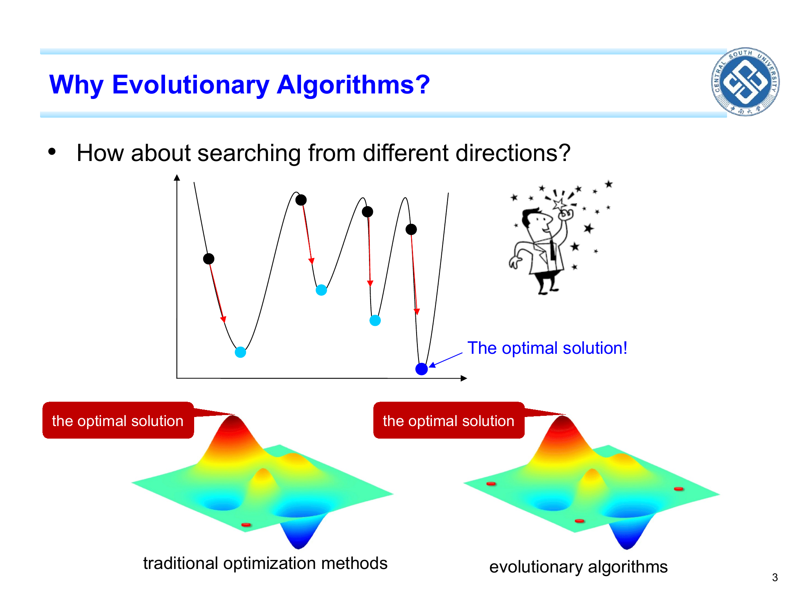

如果**同时放一群点**在搜索空间的不同位置,每个点都按“下坡方向”走几步,情况就立刻不同:

- 不同山谷可以被**同时盯住**,哪一个是全局最深一目了然;
- 万一某个点掉进了浅坑,其它点不会跟着陷进去;
- 已经找到的“好区域”可以通过“种群之间交换信息”扩散出去。

这就是**多点搜索 (multi-point search)** 相对**单点搜索 (single-point search)** 的根本优势 [p. 3](http://10.188.31.55:5244/Nextcloud/School/Compute-Intelligence/converted/Chapter%201_%20Introduction%20to%20EAs.pdf#page=3)。

但单纯的“多点爬山”还不够——多个爬山者之间不互相通报,谁也帮不了谁。进化算法又加了第二招:**下一步往哪走不是由确定性公式算出来的,而是由随机抽样决定的**——这就是 PPT 里讲的“随机概率转变准则”。它意味着即使当前解看起来不错,算法也愿意接受一小步“看起来变差”的试探,从而**跳出当前的谷底去别处看看** [p. 8](http://10.188.31.55:5244/Nextcloud/School/Compute-Intelligence/converted/Chapter%201_%20Introduction%20to%20EAs.pdf#page=8)。这里的“随机”是**伪随机数 (pseudo-random number)**:计算机用确定公式算出的“看起来随机”的数,随机种子相同则序列完全相同 [p. 8](http://10.188.31.55:5244/Nextcloud/School/Compute-Intelligence/converted/Chapter%201_%20Introduction%20to%20EAs.pdf#page=8)。

一个最小的例子。在整数点上定义 $f(0)=5,\ f(1)=2,\ f(2)=7,\ f(3)=1,\ f(4)=9$。只允许看相邻两格的“单点爬山”:从 $x=0$ 出发,$x=1$ 的 $f=2$ 比 $f(0)=5$ 好,走过去;再看 $x=1$ 的邻居,$f(0)=5$ 差、$f(2)=7$ 也差,四面都不如它,停在 $x=1$,**永远发现不了 $x=3$ 处那个 1** [p. 2](http://10.188.31.55:5244/Nextcloud/School/Compute-Intelligence/converted/Chapter%201_%20Introduction%20to%20EAs.pdf#page=2)。但如果**除了“走下坡”,每一步还允许以小概率“跳到任意一格”**:这次跳到 $x=3$,立即看到 $f(3)=1$ 是全局最优,后面的搜索就都朝它靠拢了。这就是“随机试探”的价值——它**给了算法第二次机会,允许暂时的“恶化”以换取全局视野** [p. 3](http://10.188.31.55:5244/Nextcloud/School/Compute-Intelligence/converted/Chapter%201_%20Introduction%20to%20EAs.pdf#page=3)。

多点并行 + 随机概率转变,这两条加在一起就构成了进化算法的灵魂。

### 进化算法这一族

这门课研究的核心对象是**进化算法**:留一群解、让它们“选优、交配、随机小改”、一代代改进 [p. 7](http://10.188.31.55:5244/Nextcloud/School/Compute-Intelligence/converted/Chapter%201_%20Introduction%20to%20EAs.pdf#page=7)。


三条自然隐喻各对应一个算法:GA 对应达尔文的自然选择,PSO 对应鸟群与鱼群,蚁群算法 (ant colony optimization, ACO) 模仿蚂蚁用**信息素 (pheromone)** 标记路径、逐步逼近最短路径,是另一个不靠梯度的范例 [p. 4](http://10.188.31.55:5244/Nextcloud/School/Compute-Intelligence/converted/Chapter%201_%20Introduction%20to%20EAs.pdf#page=4)。

两个容易混的词:**进化计算 (evolutionary computation)** 是“进化算法”这个研究领域的总称(学术圈子、期刊、会议),不是某个具体算法;**范例 (paradigm)** 是某个家族里最具代表性的款式——GA 是一个范例,PSO 是另一个,共 6 大范例 [p. 9](http://10.188.31.55:5244/Nextcloud/School/Compute-Intelligence/converted/Chapter%201_%20Introduction%20to%20EAs.pdf#page=9)。

### EA 通用框架:六步闭环

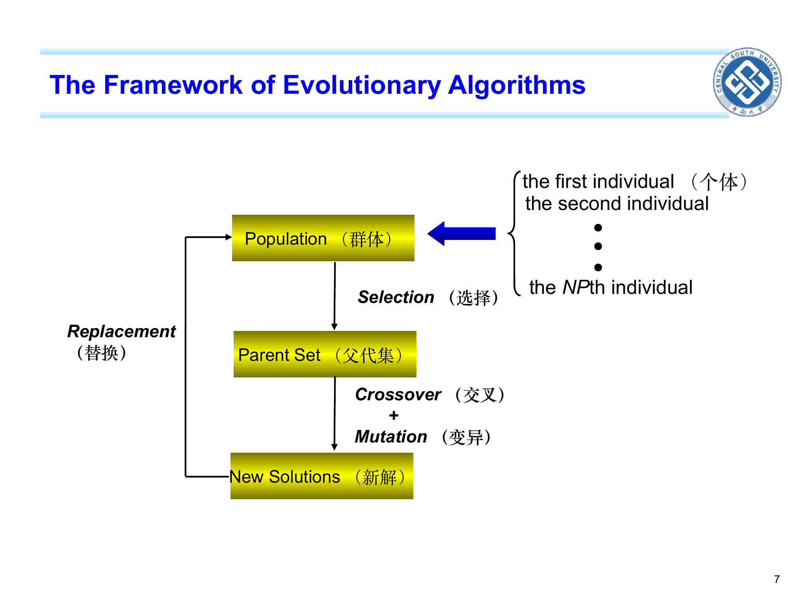

这张图是全书主干:后面四章讲的 GA、ES/EP、DE、PSO,**全都是这张图里某个或某几个步骤的换一种实现**。区别只落在“选择怎么做、交叉怎么做、变异怎么做、替换怎么做”这四问上 [p. 7](http://10.188.31.55:5244/Nextcloud/School/Compute-Intelligence/converted/Chapter%201_%20Introduction%20to%20EAs.pdf#page=7)。

六步闭环:

1. **初始化**:随机生成 $N$ 个个体,组成第 $0$ 代种群 $P(0) = \{x_1^{(0)},\dots,x_N^{(0)}\}$。每个个体 $x_i$ 就是一个候选解,可能是 0/1 串(GA),可能是实数向量(ES/DE/PSO)。这一步只做一次。
2. **计算适应度**:对 $P(t)$ 里的每个个体算 $\mathrm{fit}(x_i^{(t)})$,准备给“选择”用。在最小化问题里常常取 $\mathrm{fit} = -f$,因为适应度“越大越好”而 $f$“越小越好”,方向相反必须换算。
3. **选择 (Selection)**:按某种“适应度越高越容易被挑中”的规则,从 $P(t)$ 里挑出 $N_p$ 个个体组成**父代集** $S(t)$。这一步的产物是父代集——它不等于 $P(t)$。
4. **交叉 (Crossover)**:把 $S(t)$ 里的父代两两(或更多)配对,按某种规则交换“零件”,生成一批候选子代 $C(t)$。这一步**不评价函数值**,只是重组已有信息。
5. **变异 (Mutation)**:对 $C(t)$ 里的每个个体做一次小幅随机扰动(GA 里翻 1 位,ES/EP/DE 里加一个小随机量,PSO 里**没有这一步**),得到 $M(t)$。这一步的作用是**维持种群多样性,防止算法过早收敛到同一处**。
6. **替换 (Replacement)**:从 $P(t) \cup M(t)$(或者仅从 $M(t)$,看具体策略)里挑出 $N$ 个个体组成下一代种群 $P(t+1)$。这一步的关键问题是“老的要不要保留”——保留老的(精英策略)收敛快、易早熟;不保留(逗号策略)允许暂时变差、能逃出局部最优。这是 ES 的核心考点。

**终止判断**:若满足终止条件(达到最大代数、目标函数值足够小、连续若干代没有改进等),输出当前种群里的最优个体作为解;否则 $t \leftarrow t+1$,回到第 2 步。

两个不能跳的关键事实:

- **这是一个闭环**:第 6 步生成的 $P(t+1)$ 在下一轮里就是 $P(t)$;种群一代一代地自我更新,直到满足终止条件。
- **每一步的具体实现决定它是什么算法**:选择怎么做?轮盘赌、锦标赛(GA)、$(\mu+\lambda)$ 选择(ES)、一对一比较(DE)——差别就在选择算子上。交叉怎么做?单点交叉(GA)、无交叉(EP、PSO)、差分变异 + 二项式交叉(DE)——差别在交叉算子上。变异怎么做?位翻转(GA)、高斯变异(ES/EP)、差分变异(DE)、无变异(PSO)——差别在变异算子上。替换怎么做?整代替换、精英保留(GA)、$(\mu+\lambda)$ 或 $(\mu,\lambda)$(ES)、一对一贪婪(DE)、不淘汰任何粒子(PSO)——差别在替换算子上。

**「父代集」是后面四章唯一的分岔口**:它才是选择算子真正产出的东西,不是种群换个名字。

### 贯穿全书的术语

**探索 (exploration)**:去没去过的地方试试——可能找到更深的谷,也可能白跑一趟。**开发 (exploitation)**:在已知不错的点附近细挖——能把解算得更精确,但可能永远困在这一个谷里。

凡是问某参数调大或调小会怎样,答案几乎都能这样开头——**调大 = 更偏探索 = 更不容易早熟,但收敛更慢**。这两个词贯穿第 1–5 章所有参数:GA 的 $p_m$、ES 的步长 $\delta$、DE 的 $F$ 与 $CR$、PSO 的 $\omega$ 与 $c_1$/$c_2$ [p. 3](http://10.188.31.55:5244/Nextcloud/School/Compute-Intelligence/converted/Chapter%201_%20Introduction%20to%20EAs.pdf#page=3)。

变异率就是最直观的例子。$p_m$ 太大:每代产生大量随机扰动,好不容易积累的好模式被全部打碎——探索过度、开发为零,算法等价于随机游走,根本收不住。$p_m$ 太小:几乎不变异,种群很快变得一模一样(多样性丢光),只能在一个浅谷里打转——开发过度、探索为零,发生早熟收敛。平衡点落在“与编码串长度成反比的量级”上:既能让好模式存活下来,又能保证偶尔产生一点新模式。

下表是全章的术语总表,后面各章不再重复定义。

| 术语 | 一句话理解 |
| --- | --- |
| 种群 (population) | 一次同时持有的一整群解,不是只有一个解;种群规模记作 $N$。DE 写作 $NP$、ES 把父代个数写作 $\mu$、子代个数写作 $\lambda$,是同一角色的不同别名:$N=NP=\mu$ 并列,且 $\lambda\ge\mu$。 |
| 个体 (individual) | 种群里的一个成员,就是一个候选解 $x$(GA 里就是一条 0/1 串)。 |
| 选择 (selection) | “谁有资格当父母”的那一步——适应度高的个体更容易被选中、被复制得更多。 |
| 父代集 (parent set) | 被选择算子挑出来的那一小批“当父母的解”,规模记作 $N_p$(ES 里写作 $\mu$)。它**不等于整个种群**,只是种群的一个子集。 |
| 交叉 (crossover) | 把两个(或多个)父代的“零件”拼到一起生成新解。GA 里就是把两条串某一段互换。 |
| 变异 (mutation) | 对新解做一点随机的、小幅的改动(GA 里就是把某一位 0 变 1)。作用是让算法别只会原地打转,保持多样性。 |
| 替换 (replacement) / 环境选择 | 新解算出来后,“究竟让谁留在种群里、谁被淘汰”的那一步。它把新解写回种群,构成闭环。 |
| 父代 / 子代 (parent / offspring) | 被挑出来繁殖的是父代,繁殖出来的新解是子代;第 $t$ 代的子代就是第 $t+1$ 代的种群。 |
| 适应度 (fitness) | 给每个候选解打的分,分越高说明这个解越好。适应度函数记作 $\mathrm{fit}(x)$。 |
| 目标函数 (objective function) | 你真正在乎的那个“分数”,写成 $f(x)$,默认最小化;它与适应度是两个不同的量。 |
| 适应度地形 (fitness landscape) | 把函数值当海拔画出来的曲面,地形上有几个谷底决定了问题有多难。 |
| 梯度信息 (gradient information) | 函数“上升最快的方向”那条信息(由各维偏导数组成)。传统方法靠它下坡;进化算法**不用**它,所以能处理函数写不出、不可导的问题。 |
| 启发式方法 (heuristic method) | 靠经验规则办事:不保证给出最优解,但通常能在可接受的时间里给出够好的解,而且算得快。 |
| 元启发式 (metaheuristic) | 一类“与具体问题无关、靠一套通用搜索策略在任意问题上跑”的启发式框架。GA、ES、EP、DE、PSO 都属于元启发式——同一套算法只看得见 $f(x)$ 的数值,不关心 $x$ 代表什么。 |
| 种群多样性 (population diversity) | 群里个体彼此“有多不一样”。多样性高 = 大家分散在好几个区域;多样性低 = 所有人越来越像、挤在同一个角落。 |
| 收敛 (convergence) | 随代数增加,群里最好的解不再明显变好,曲线变平趴在一条水平线上。 |
| 早熟收敛 (premature convergence) | 曲线很早就平了,平在一个还很差的局部最优上。 |
| 收敛曲线 (convergence curve) | 横轴是代数,纵轴是“到这一代为止找到的最高适应度”的折线图,把整个搜索过程一眼看完。 |
| 局部最优 (local optimum) | 在它附近一圈里最好的点,出了这一圈,别处可能存在更深的谷,它不知道。 |
| 全局最优 (global optimum) | 整个搜索空间里真正最好的那个点。 |
| 邻域 (neighborhood) | 某个点“附近”的那些点。范围由你定义——离散串上可以是“只改一位得到的串”,实数向量上可以是“距离不超过 $\varepsilon$ 的球内”。 |
| 单峰 / 多峰 / 多模态 | 单峰地形 = 只有一个谷底(像一口碗);多峰地形 = 有多个谷底,而且分不清哪个最深。 |
| 爬山法 (hill climbing) | 从一个起点出发,每一步只往“邻居里更好的方向”走,走不动就停。它不用梯度公式,但只能到达**最近**的那个局部最优。 |
| 搜索空间 (search space) | $x$ 允许取值的那个区域,$S=\prod_{j=1}^{D}[L_j,U_j]$。 |
| 维度灾难 (curse of dimensionality) | 变量个数 $D$ 增加时,搜索空间的“体积”按指数增长,固定数量的采样点越来越稀疏,根本覆盖不住整个空间。2 维 100 个点能覆盖住,20 维 $10^{20}$ 个点根本试不完。这是“穷举不行”的定量理由。 |
| 鲁棒性 (robustness) | 算法“换个问题、换组参数也还能用”的耐折腾程度。进化算法只靠 $f$ 值不靠梯度,所以被认为鲁棒性好 [p. 12](http://10.188.31.55:5244/Nextcloud/School/Compute-Intelligence/converted/Chapter%201_%20Introduction%20to%20EAs.pdf#page=12)。 |

### 阶梯例题

#### 例 1.1 优化问题的标准形式与术语匹配

**题干**:某工厂的两个工艺参数 $x_1$、$x_2$ 分别被允许在 $[0,10]$ 与 $[-5,5]$ 范围内取值,目标是把“单位能耗” $f(x_1,x_2)$ 降到最低。请写出这个优化问题的标准形式,并指出:(a) 决策变量及维数 $D$;(b) 目标函数;(c) 搜索空间 $S$。若 $f(3,1)=2$、$f(5,2)=4$,哪个解更好?

**解答**:直接套三件套的定义,再按“默认最小化”比较 $f$ 大小。

(a) 决策变量 $x=(x_1,x_2)$,维数 $D=2$。

(b) 目标函数 $f(x_1,x_2)$(默认最小化)。

(c) 搜索空间 $S=[0,10]\times[-5,5]$,共 $10\times 10=100$ 单位的二维平面。

$f(3,1)=2 < f(5,2)=4$,按“最小化”约定,$x=(3,1)$ 比 $x=(5,2)$ 更好 [p. 2](http://10.188.31.55:5244/Nextcloud/School/Compute-Intelligence/converted/Chapter%201_%20Introduction%20to%20EAs.pdf#page=2)。

#### 例 1.2 单峰 vs 多峰——为什么传统方法对多峰失效

**题干**:给定两个目标函数

$$
\begin{aligned}
f_A(x) &= (x-3)^2, \quad x\in[0,6] \\
f_B(x) &= x^4 - 3x^2 + 1, \quad x\in[-2,2]
\end{aligned}
$$

对**每一个**,假设我们从 $x=0$ 出发,每一步只看相邻两个点的函数值,向更小的方向走一步。问:(a) 对 $f_A$,爬山法会停在何处?是否一定找到全局最优?(b) 对 $f_B$,爬山法从 $x=0$ 出发会停在何处?能找到全局最优吗?

**解答**:先算出地形上的谷底位置,再模拟爬山路径。

(a) $f_A(x)=(x-3)^2$ 是单峰地形,在 $[0,6]$ 上唯一谷底是 $x=3$ 处 $f=0$。从 $x=0$ 出发,$x=1$ 的 $f=4$ 比 $f(0)=9$ 好,走过去;$x=2$ 的 $f=1$ 比 $f(1)=4$ 好,再走过去;$x=3$ 的 $f=0$ 比 $f(2)=1$ 好,再走过去;$x=4$ 的 $f=1$ 比 $f(3)=0$ 差,反向;$x=3$ 两侧都没它好,停在 $x=3$。找到了全局最优。

(b) $f_B'(x)=4x^3-6x=2x(2x^2-3)=0$ 得 $x=0$ 与 $x=\pm\sqrt{3/2}\approx\pm 1.2247$。$f_B(0)=1$,$f_B(\pm 1.2247)=-1.25$。地形是“两个谷 $x=\pm 1.2247$、中间一个小土包 $x=0$”。从 $x=0$ 出发:看 $x=-0.1$、$f=0.99$ 比 $f(0)=1$ 略小,走过去;一步一步,会向 $x=-1.2247$ 那个谷滑过去,最终停在 $x=-1.2247$、$f=-1.25$。**但是**,对称的那个谷 $x=+1.2247$ 处 $f$ 也是 $-1.25$,所以从 $x=0$ 出发既可能停在左、也可能停在右(取决于先看到哪边)。如果初始点就在 $x=0$ 附近,它**永远发现不了另一个对称的谷底是不是比这个深**——这是单点爬山在多峰地形上的典型失败。这个例子恰好两个谷一样深;若深度不同,则一定停在较浅的那个 [p. 2](http://10.188.31.55:5244/Nextcloud/School/Compute-Intelligence/converted/Chapter%201_%20Introduction%20to%20EAs.pdf#page=2)。

#### 例 1.3 把“探索 vs 开发”翻译成算法决策

**题干**:某 EA 跑了几十代之后收敛曲线已基本水平,但停在了一个很差的局部最优上(离已知的全局最优还差很远)。在不修改算法框架的前提下,你可以调高或调低以下三个旋钮,各调一次:(i) 变异强度;(ii) 种群规模 $N$;(iii) 选择的“严格度”(如轮盘赌里让强者更突出、弱者更被压制)。请说明**每个旋钮**该怎么调,并用“探索 vs 开发”解释**为什么这么调**。

**解答**:早熟收敛说明多样性已经丢光,算法太偏向开发、忘了探索。所以每一项都该往“更偏探索”的方向调。但“探索/开发”在每个旋钮上对应的是不同的“大/小”。

- **(i) 变异强度**:调**高**。变异是“探索”的主要来源——它把个体朝新方向拽一拽;变异率太低,谁也出不了当前的浅坑。
- **(ii) 种群规模 $N$**:调**高**。更多个体意味着空间里同时“盯着”的山谷更多;太小则种群里几个个体挤在一起,多样性天然差。
- **(iii) 选择的严格度**:调**低**。选择太严,适应度高的那 1–2 个个体几乎垄断繁殖权,其他个体全被边缘化、多样性迅速丢光;让强者不强、弱者不弱,种群里能保留更多“与众不同的解” [p. 3](http://10.188.31.55:5244/Nextcloud/School/Compute-Intelligence/converted/Chapter%201_%20Introduction%20to%20EAs.pdf#page=3)。

共通逻辑:三个旋钮都朝“更偏探索 = 更不容易早熟”的方向调,但“调大还是调小”的具体方向不同。这就是“凡是问某参数调大或调小会怎样,答案几乎都能这样开头”这条在算法参数上的具体体现。

### 易错点

> [!WARNING]
> **陷阱 1:把“目标函数”和“适应度”当成同一个东西**
> 目标函数 $f$ 默认**越小越好**;适应度 $\mathrm{fit}$ 默认**越大越好**。两者方向相反,简单问题里常取 $\mathrm{fit}=-f$,但**这不是普适规则**——有的问题里 $\mathrm{fit}$ 是 $f$ 的某个非线性变换。GA 的 PPT 表里 $f$ 与 $\mathrm{fit}$ 是分两列的,正是为了提醒这件事。写“用 $f$ 值做轮盘赌选择”时,若原题是求最大值可以算对;若原题是求最小化,要用 $\mathrm{fit}$ 而不是 $f$ [p. 8](http://10.188.31.55:5244/Nextcloud/School/Compute-Intelligence/converted/Chapter%201_%20Introduction%20to%20EAs.pdf#page=8)。

> [!WARNING]
> **陷阱 2:把“种群”和“父代集”混为一谈**
> 种群 $P(t)$(PPT 图里写作 Population/群体)是**当前一代全部** $N$ 个个体;父代集 $S(t)$ 是经选择算子挑出来的那**一小批当父母的个体**,其规模 $N_p$ 通常 $\le N$,即它**不大于**种群。这里最容易搞反的是 ES:它把父代个数写作 $\mu$、每代产生的子代个数写作 $\lambda$,且 $\lambda \ge \mu$、常用 $\lambda \approx 7\mu$——也就是说 ES 的父代集**比子代少**,更不会比种群大。常见错误是把框架图中的“种群”框与“父代集”框画成同一个框;正确画法是两个独立的框,中间有“选择”箭头。框架图里多出来的这一步**就是选择算子真正做的事** [p. 7](http://10.188.31.55:5244/Nextcloud/School/Compute-Intelligence/converted/Chapter%201_%20Introduction%20to%20EAs.pdf#page=7)。

> [!WARNING]
> **陷阱 3:以为进化算法“保证找到全局最优”**
> 错。进化算法**只在概率意义上**给出强搜索,不提供最优性保证。给定有限代数 $G_{\max}$ 与有限种群 $N$,搜索范围天然有限——多峰地形上“离最优还差很远但曲线已经平了”是常态。它的价值在于**对函数几乎不做假设、不需要梯度、在合理时间内给出足够好的解**,不在于“保证最优” [p. 2](http://10.188.31.55:5244/Nextcloud/School/Compute-Intelligence/converted/Chapter%201_%20Introduction%20to%20EAs.pdf#page=2)。

## 第 2 章 遗传算法 (GA)

### 一个不可导、只能取整的优化问题

化工过程里某些反应速率、机器学习里某些 loss 项,写成代码就拿不出导数;变量又只允许取整数值(比如生产多少台设备)。目标函数 $f(x)$ 长得像"火山口被挖了几个坑"而且**不可导**:梯度法没法用(没有导数),爬山法只能爬到最近的那个山谷,穷举法又因为组合爆炸根本试不完 [Chapter 2_ Introduction to GAs.pptx · p.1](http://10.188.31.55:5244/Nextcloud/School/Compute-Intelligence/converted/Chapter%202_%20Introduction%20to%20GAs.pdf#page=1)。

### 直觉与术语:把候选解当成一条二进制串

1970 年代 Holland 教授从"物竞天择,适者生存"的生物学隐喻借来思路:不靠单个点往梯度方向走,而是**同时放一群候选解**,让它们按"好的多生、差的淘汰 + 子代之间互相交换信息 + 小概率随机翻一翻"三个动作一代代改进。这就是**遗传算法**(genetic algorithm, GA)——进化算法家族里最经典、最直白的一员:二进制串当个体、轮盘赌当选择、位翻转当变异 [Chapter 2_ Introduction to GAs.pptx · p.4](http://10.188.31.55:5244/Nextcloud/School/Compute-Intelligence/converted/Chapter%202_%20Introduction%20to%20GAs.pdf#page=4)。

**核心直觉**:GA 把每个候选解编码成一条二进制串(也叫"染色体"),一群这样的串构成一个种群。算法一代一代地跑,每代做三件事:(1) 按适应度高低决定谁有资格当父母(选择);(2) 让两条父母串在某处切断并交换尾巴(交叉);(3) 让子代串的每一位有小概率翻面(变异)。直观地说,好的串会被复制更多次,坏的串被淘汰;交叉让好片段在后代里重新组合;变异防止种群过早变得一模一样 [Chapter 2_ Introduction to GAs.pptx · p.6](http://10.188.31.55:5244/Nextcloud/School/Compute-Intelligence/converted/Chapter%202_%20Introduction%20to%20GAs.pdf#page=6)。


下面把**首次出现**的术语逐一定义。第 1 章已经定义过的通用词(个体、种群、选择、交叉、变异、适应度、收敛、早熟收敛、探索/开发)这里不重复定义,只在用到时回指 [Chapter 2_ Introduction to GAs.pptx · p.5](http://10.188.31.55:5244/Nextcloud/School/Compute-Intelligence/converted/Chapter%202_%20Introduction%20to%20GAs.pdf#page=5)。

- **染色体**(chromosome):GA 里"一个个体的样子",通常就是一条 0/1 串;整条串同时就是一个个体(individual)。
- **基因座**(locus):**位置**。串上第几位(第 1 位、第 2 位……)。
- **等位基因**(allele):**位置上的取值**。二进制编码时只能取 0 或 1。
- **基因**(gene):某个基因座上所带的信息,就是那一位的取值。
- **模式**(schema, $H$):一类串的"模板",允许某些位写成通配符 $*$。例如 $*011*0$ 表示"第 2–4 位必须是 011、最后一位必须是 0,其他位随便"。
- **模式的阶**(order of schema, $o(H)$):模板里**定死**的位数。$*011*0$ 的阶是 4。
- **模式的定义长度**(defining length, $d(H)$):模板里**第一个定死位到最后一个定死位之间的距离**。$*011*0$ 在第 2 位与第 6 位定死,定义长度是 $6-2=4$。
- **编码**(encoding) / **解码**(decoding):把实数解翻译成 0/1 串(编码)、把串翻回实数(解码)。
- **二进制编码**(binary encoding):用 0/1 串表示解。优点是通用、易交叉;缺点是连续问题的精度被串长卡住。
- **实数编码**(real-coded):不编码,直接拿实数当个体。本章前半用二进制,后面的 ES/DE/PSO 都属于实数编码。
- **交叉**(crossover):把两个父代的"零件"拼成新解,GA 里就是把两条串某一段互换。
- **变异**(mutation):对新解做一点随机的、小幅的改动(GA 里就是把某一位 0 变 1)。它的作用是防止种群过早"长得都一样"。
- **选择**(selection):决定谁有资格当父母。GA 经典做法是"轮盘赌"——适应度高的占大扇形,被抽中概率大。
- **交叉率**(crossover probability, $p_c$):一对父代**真的发生交换**的概率。
- **变异率**(mutation probability, $p_m$):**每一位**发生翻转的概率。
- **精英保留**(elitism):把当前最好的那个个体**原封不动**抄到下一代,保证最优解不会被随机的交叉变异弄丢。

**收敛** = 随代数增加、种群最好的解不再明显变好;**早熟收敛** = 曲线很早就变平、而且停在很差的解上;**收敛曲线** = "最高适应度 vs 代数"的折线图 [Chapter 2_ Introduction to GAs.pptx · p.13](http://10.188.31.55:5244/Nextcloud/School/Compute-Intelligence/converted/Chapter%202_%20Introduction%20to%20GAs.pdf#page=13)。

本章还会用到搜索空间的两个常用符号——$L_j, U_j$ 表示第 $j$ 维的下界与上界;当变量只有一个时,直接写 $L_x, U_x$ [Chapter 2_ Introduction to GAs.pptx · p.9](http://10.188.31.55:5244/Nextcloud/School/Compute-Intelligence/converted/Chapter%202_%20Introduction%20to%20GAs.pdf#page=9)。

### 编码与解码:连续问题必须先量化

把区间 $[L_x, U_x]$ 用 $L$ 位二进制串切成 $2^L$ 个等距格点。串 $b_{L-1}b_{L-2}\cdots b_0$ 对应的实数为

$$
x \;=\; L_x + \frac{U_x - L_x}{2^L - 1}\cdot(b_{L-1}\cdot 2^{L-1} + b_{L-2}\cdot 2^{L-2} + \cdots + b_0\cdot 2^0)
\;=\; L_x + \Delta\cdot \sum_{j=0}^{L-1} b_j\cdot 2^j
$$

其中 $\Delta = (U_x - L_x)/(2^L - 1)$ 叫**解码精度**(search accuracy)。**推导**:把区间长 $U_x - L_x$ 平均分到 $2^L - 1$ 个等距间隔上,每一格就是 $\Delta$ [Chapter 2_ Introduction to GAs.pptx · p.9](http://10.188.31.55:5244/Nextcloud/School/Compute-Intelligence/converted/Chapter%202_%20Introduction%20to%20GAs.pdf#page=9)。

串长由"想要多精确"反推得到。给定搜索精度 $\varepsilon$:

$$
L \;=\; \left\lceil \log_2\!\left(\frac{U_x - L_x}{\varepsilon}\right)\right\rceil
$$

**推导**:要让 $\Delta \le \varepsilon$,即 $(U_x-L_x)/(2^L - 1) \le \varepsilon$;两边乘以 $(2^L - 1)$ 得 $U_x - L_x \le \varepsilon(2^L - 1)$,即 $2^L - 1 \ge (U_x-L_x)/\varepsilon$,所以 $L \ge \log_2\bigl((U_x-L_x)/\varepsilon + 1\bigr)$;工程上近似取 $L \ge \lceil\log_2((U_x-L_x)/\varepsilon)\rceil$ [Chapter 2_ Introduction to GAs.pptx · p.9](http://10.188.31.55:5244/Nextcloud/School/Compute-Intelligence/converted/Chapter%202_%20Introduction%20to%20GAs.pdf#page=9)。

**例**:$x\in[-5, 5]$,要求精度 $\varepsilon = 0.01$,则 $(U_x-L_x)/\varepsilon = 10/0.01 = 1000$,$\log_2 1000 \approx 9.97$,所以 $L = 10$。于是 $\Delta = 10/(2^{10}-1) = 10/1023 \approx 0.009775$ [Chapter 2_ Introduction to GAs.pptx · p.9](http://10.188.31.55:5244/Nextcloud/School/Compute-Intelligence/converted/Chapter%202_%20Introduction%20to%20GAs.pdf#page=9)。

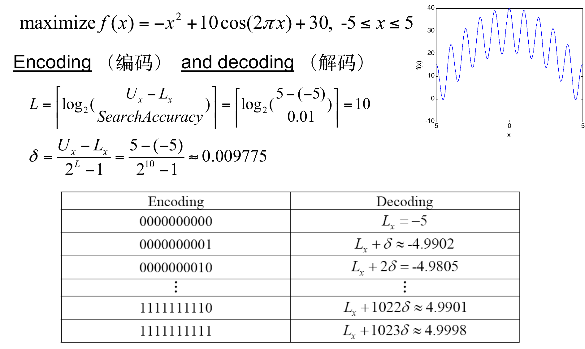

串长 $L$ 一旦定下来,搜索就被卡死在 $2^L$ 个格点上;不管目标函数曲线多光滑,GA 都只能逼近到 $\Delta$ 这个量级。要精度更高只能加大 $L$,但 $L$ 加大会让搜索空间 $2^L$ 爆炸——这就是 GA 处理**连续高维问题**的硬伤,也是后来改用实数编码的动机 [Chapter 2_ Introduction to GAs.pptx · p.9](http://10.188.31.55:5244/Nextcloud/School/Compute-Intelligence/converted/Chapter%202_%20Introduction%20to%20GAs.pdf#page=9)。

### 选择:轮盘赌

#### 概率公式的三步

**第一步**:算每个个体的选择概率

$$
p_i \;=\; \frac{\mathrm{fit}(x_i)}{\sum_{j=1}^{N}\mathrm{fit}(x_j)}
$$

**推导**:把每个个体想象成轮盘上的一个扇形,扇形面积正比于适应度。整个圆面积是 $\sum_j \mathrm{fit}(x_j)$,个体 $i$ 自己的扇形面积是 $\mathrm{fit}(x_i)$。掷一颗均匀的球进轮盘,球落在某个扇形里的概率 = 该扇形面积 / 总面积 = $p_i$ [Chapter 2_ Introduction to GAs.pptx · p.6](http://10.188.31.55:5244/Nextcloud/School/Compute-Intelligence/converted/Chapter%202_%20Introduction%20to%20GAs.pdf#page=6)。

**第二步**:算累积概率(用于划区间)

$$
q_i \;=\; \sum_{j=1}^{i} p_j
$$

把 $q_i$ 一项项累加,到 $i=N$ 时把所有 $p_j$ 都加完;由于 $\sum_j p_j = 1$,所以 $q_N = 1$。又因为每个 $p_j > 0$(假设所有个体适应度为正),所以 $q_i$ 严格递增,即 $q_1 < q_2 < \dots < q_N$ [Chapter 2_ Introduction to GAs.pptx · p.6](http://10.188.31.55:5244/Nextcloud/School/Compute-Intelligence/converted/Chapter%202_%20Introduction%20to%20GAs.pdf#page=6)。

**第三步**:抽样。生成一个均匀随机数 $r \sim U(0,1)$,找出第一个满足 $q_i \ge r$ 的 $i$,把个体 $i$ 复制到下一代。重复 $N$ 次,得到新一代 [Chapter 2_ Introduction to GAs.pptx · p.6](http://10.188.31.55:5244/Nextcloud/School/Compute-Intelligence/converted/Chapter%202_%20Introduction%20to%20GAs.pdf#page=6)。

个体 $i$ 占的随机数区间是 $[q_{i-1}, q_i)$(取 $q_0 = 0$)。$q_i$ 含不含自己两种约定都行,整篇必须前后一致;边界一旦不一致,会出现某个个体永远选不到、另一个被双重选中 [Chapter 2_ Introduction to GAs.pptx · p.6](http://10.188.31.55:5244/Nextcloud/School/Compute-Intelligence/converted/Chapter%202_%20Introduction%20to%20GAs.pdf#page=6)。

**为什么这么选**:适应度高的个体 $p_i$ 大 → 累积区间宽 → $r$ 落入该区间的概率大 → 复制得更多。这就是"适者生存"的算子化 [Chapter 2_ Introduction to GAs.pptx · p.6](http://10.188.31.55:5244/Nextcloud/School/Compute-Intelligence/converted/Chapter%202_%20Introduction%20to%20GAs.pdf#page=6)。

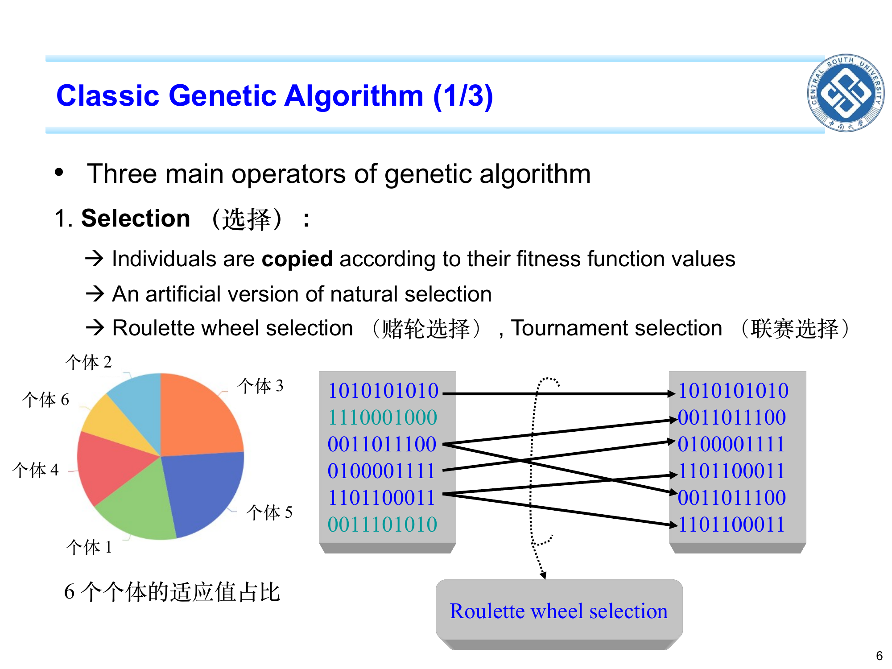

三步的顺序别记混:**用 $\mathrm{fit}$ 占比定义扇形面积 → 面积比给出概率 $p_i$ → 累积成一个 $U(0,1)$ 随机数的区间,一次抽完**。

#### PPT 算例:3 个体的概率表

PPT 给出的算例使用目标函数 $\mathrm{maximize}\; f(x) = -x^2 + 10\cos(2\pi x) + 30$,$x\in[-5, 5]$ [Chapter 2_ Introduction to GAs.pptx · p.7](http://10.188.31.55:5244/Nextcloud/School/Compute-Intelligence/converted/Chapter%202_%20Introduction%20to%20GAs.pdf#page=7)。


表里 $f(x_i)$ 与 $\mathrm{fit}(x_i)$ 分成两列:目标函数 $f(x)$ 默认**越小越好**,适应度 $\mathrm{fit}(x)$ 默认**越大越好**。无约束单目标最大化时两者相等,做了适应度缩放之后就不同;算 $p_i$ 只能用 $\mathrm{fit}$ [Chapter 2_ Introduction to GAs.pptx · p.7](http://10.188.31.55:5244/Nextcloud/School/Compute-Intelligence/converted/Chapter%202_%20Introduction%20to%20GAs.pdf#page=7)。

### 交叉与变异

#### 交叉算子

**单点交叉**(one-point crossover,PPT 唯一展开的形式):随机选两个父代 $A, B$;在 $\{1,2,\dots, L-1\}$ 中均匀选一个交叉点 $k$;保留 $A, B$ 前 $k$ 位,交换后 $L-k$ 位,得到两个子代 $A', B'$ [Chapter 2_ Introduction to GAs.pptx · p.8](http://10.188.31.55:5244/Nextcloud/School/Compute-Intelligence/converted/Chapter%202_%20Introduction%20to%20GAs.pdf#page=8)。

**两点交叉**(two-point crossover):在 $\{1,\dots,L-1\}$ 中均匀选两个交叉点 $k_1 < k_2$,交换 $[k_1, k_2]$ 区间内的位。**均匀交叉**(uniform crossover):逐位独立掷一枚公平的硬币,正面则子代这一位取父代 A,反面取父代 B [Chapter 2_ Introduction to GAs.pptx · p.8](http://10.188.31.55:5244/Nextcloud/School/Compute-Intelligence/converted/Chapter%202_%20Introduction%20to%20GAs.pdf#page=8)。

$p_c$ 是"对"这一层的概率:每次抽样出两条父代后,先掷一次 $U(0,1)$,若 $\le p_c$ 才执行交叉;否则两条父代直接进入下一代不变 [Chapter 2_ Introduction to GAs.pptx · p.8](http://10.188.31.55:5244/Nextcloud/School/Compute-Intelligence/converted/Chapter%202_%20Introduction%20to%20GAs.pdf#page=8)。

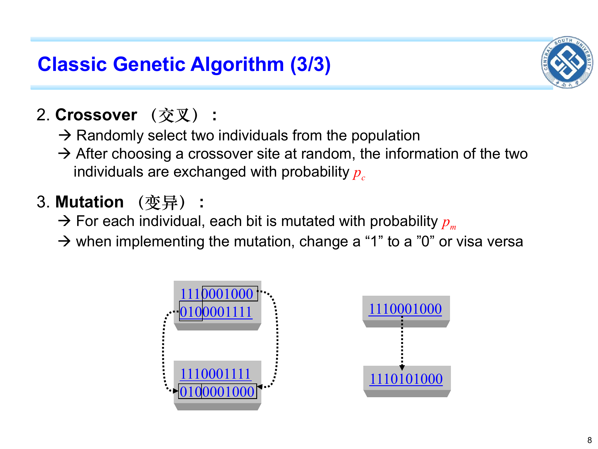

#### 位翻转变异与期望变位数

对一条 $L$ 位二进制串,每一位独立以概率 $p_m$ 翻转;设 $X$ 为这条串被翻转的位数,则

$$
X \sim \mathrm{Binomial}(L, p_m)
$$

**推导**:每位是否翻转相互独立(每次掷的都是同一个独立的均匀随机数),翻转次数就是 $L$ 个独立 Bernoulli($p_m$) 变量的和,服从二项分布 [Chapter 2_ Introduction to GAs.pptx · p.8](http://10.188.31.55:5244/Nextcloud/School/Compute-Intelligence/converted/Chapter%202_%20Introduction%20to%20GAs.pdf#page=8)。

**期望**:

$$
\mathbb{E}[X] \;=\; L\cdot p_m
$$

**推导**:二项分布的期望等于试验次数 × 每次成功概率 [Chapter 2_ Introduction to GAs.pptx · p.8](http://10.188.31.55:5244/Nextcloud/School/Compute-Intelligence/converted/Chapter%202_%20Introduction%20to%20GAs.pdf#page=8)。

**数量级直觉**:典型 $p_m \approx 1/L$ 时,$\mathbb{E}[X] = 1$——即"平均一条串翻 1 位" [Chapter 2_ Introduction to GAs.pptx · p.8](http://10.188.31.55:5244/Nextcloud/School/Compute-Intelligence/converted/Chapter%202_%20Introduction%20to%20GAs.pdf#page=8)。

### 完整手算一代 GA

#### 4 位二进制:每一步都能手算

为了把整条流水线**不跳步**走完,这里用一个 4 位二进制、每一步数值都能手算的最小例子。选择、交叉、变异三步用的都是 PPT 给出的算子。

**设定**:$\max\ f(x) = x^2$,$x \in \{0,1,2,\dots,15\}$(4 位二进制直接编码,无需缩放);适应度直接取 $\mathrm{fit} = f$;种群规模 $N = 4$ [Chapter 2_ Introduction to GAs.pptx · p.8](http://10.188.31.55:5244/Nextcloud/School/Compute-Intelligence/converted/Chapter%202_%20Introduction%20to%20GAs.pdf#page=8)。

**初始种群**(随机 4 条 4 位串):

$$
A_1 = 0011\;(x=3,\ f=9),\quad A_2 = 1100\;(x=12,\ f=144),\quad A_3 = 0101\;(x=5,\ f=25),\quad A_4 = 1001\;(x=9,\ f=81)
$$

这里 $x$ 就是二进制串直接读出来的十进制值:$0011\to 3$、$1100\to 12$、$0101\to 5$、$1001\to 9$ [Chapter 2_ Introduction to GAs.pptx · p.6](http://10.188.31.55:5244/Nextcloud/School/Compute-Intelligence/converted/Chapter%202_%20Introduction%20to%20GAs.pdf#page=6)。

**Step 1 —— 算选择概率**:$\sum \mathrm{fit} = 9+144+25+81 = 259$。

$$
p_1 = 9/259 \approx 0.0348,\quad p_2 = 144/259 \approx 0.5559,\quad p_3 = 25/259 \approx 0.0965,\quad p_4 = 81/259 \approx 0.3127
$$

校验:$0.0348 + 0.5559 + 0.0965 + 0.3127 \approx 1.0000$ [Chapter 2_ Introduction to GAs.pptx · p.6](http://10.188.31.55:5244/Nextcloud/School/Compute-Intelligence/converted/Chapter%202_%20Introduction%20to%20GAs.pdf#page=6)。

**Step 2 —— 算累积概率**:

$$
q_1 \approx 0.0348,\quad q_2 \approx 0.5908,\quad q_3 \approx 0.6873,\quad q_4 \approx 1.0000
$$

[Chapter 2_ Introduction to GAs.pptx · p.6](http://10.188.31.55:5244/Nextcloud/School/Compute-Intelligence/converted/Chapter%202_%20Introduction%20to%20GAs.pdf#page=6)

**Step 3 —— 抽样复制**:取 4 个 $U(0,1)$ 随机数,例如 $r_1=0.12, r_2=0.71, r_3=0.02, r_4=0.60$。

- $r_1=0.12$ 落在 $[q_1, q_2) = [0.0348, 0.5908)$,复制 $A_2$。得到 $A_1' = 1100$。
- $r_2=0.71$ 落在 $[q_3, q_4) = [0.6873, 1.0000)$,复制 $A_4$。得到 $A_2' = 1001$。
- $r_3=0.02$ 落在 $[0, q_1) = [0, 0.0348)$,复制 $A_1$。得到 $A_3' = 0011$。
- $r_4=0.60$ 落在 $[q_2, q_3) = [0.5908, 0.6873)$,复制 $A_3$。得到 $A_4' = 0101$。

**观察**:这组抽样把初始种群中的四个个体各复制一次;如果把随机数换成 $r_1=0.72, r_2=0.95, r_3=0.70, r_4=0.96$,四条全落在 $A_4$ 的区间里,$A_2$ 就会一次也抽不到。这就是轮盘赌的"运气"成分,补救办法是**精英保留**(elitism):把当代最好的个体原封不动抄一份进入下一代 [Chapter 2_ Introduction to GAs.pptx · p.6](http://10.188.31.55:5244/Nextcloud/School/Compute-Intelligence/converted/Chapter%202_%20Introduction%20to%20GAs.pdf#page=6)。

**Step 4 —— 单点交叉**(设 $p_c = 1$,每次都交叉):把 4 条串随机配对,例如 $\{A_1', A_2'\} = \{1100, 1001\}$ 和 $\{A_3', A_4'\} = \{0011, 0101\}$。给每对随机选交叉点,约定 $k$ 表示"保留前 $k$ 位、交换剩下的 $L-k$ 位"。

- 第一对 $1100 \times 1001$,随机选 $k=2$。前 2 位分别是 $11$ 与 $10$,后 2 位分别是 $00$ 与 $01$。交换后 2 位:

$$
A_1'' = 11|01 = 1101\;(x=13,\ f=169),\qquad A_2'' = 10|00 = 1000\;(x=8,\ f=64)
$$

- 第二对 $0011 \times 0101$,随机选 $k=3$。前 3 位分别是 $001$ 与 $010$,最后 1 位分别是 $1$ 与 $1$。交换最后 1 位:

$$
A_3'' = 001|1 = 0011\;(x=3,\ f=9),\qquad A_4'' = 010|1 = 0101\;(x=5,\ f=25)
$$

**交叉不一定产生新解**:单点交叉交换的是"两个父代在同一位置上**取值不同**的那些位"才有内容;如果两条串在交换区间里逐位相同,交换完还是原样。本例第二对 $0011$ 与 $0101$ 在 $k=3$ 后只交换第 4 位,而第 4 位都是 $1$,所以子串保持 $0011$ 与 $0101$,适应度也保持为 $9$ 与 $25$。这正是 $p_c=1$ 也不保证产生新解的直观例子;两条完全相同的串则是更极端的情形 [Chapter 2_ Introduction to GAs.pptx · p.8](http://10.188.31.55:5244/Nextcloud/School/Compute-Intelligence/converted/Chapter%202_%20Introduction%20to%20GAs.pdf#page=8)。

**Step 5 —— 位翻转变异**(设 $p_m = 0.125 = 1/L$,$L=4$ 时期望每串翻 $4\times 0.125 = 0.5$ 位):对每条子代的每一位掷 $U(0,1)$,若 $\le 0.125$ 则翻转。假设随机数恰好让 $A_2''=1000$ 的第 1 位翻转 → 变成 $A_2''' = 0000\;(x=0,\ f=0)$;其他串没翻 [Chapter 2_ Introduction to GAs.pptx · p.8](http://10.188.31.55:5244/Nextcloud/School/Compute-Intelligence/converted/Chapter%202_%20Introduction%20to%20GAs.pdf#page=8)。

**新一代种群及其适应度**:

$$
A_1''' = 1101\;(f=169),\quad A_2''' = 0000\;(f=0),\quad A_3''' = 0011\;(f=9),\quad A_4''' = 0101\;(f=25)
$$

最高 $f = 169$(由 $A_1'''$ 贡献);若加入精英 $A_2 = 1100$($f=144$)直接入选,新一代最高 $f$ 仍是 $169$,精英只是保底,防止某代整体退化 [Chapter 2_ Introduction to GAs.pptx · p.12](http://10.188.31.55:5244/Nextcloud/School/Compute-Intelligence/converted/Chapter%202_%20Introduction%20to%20GAs.pdf#page=12)。

**这一代发生了什么**:第一对交叉造出了比初始种群更好的 $1101$($f=169 > 144$),说明"把两条好串的片段拼起来"确实能探到新区域;第二对交叉因为末位相同而保持 $0011$ 与 $0101$ 不变;同一代里变异把 $1000$ 直接打成 $0000$。GA 的改善是**统计意义上的**——多代平均下来才看得出来,机制见下面的模式定理 [Chapter 2_ Introduction to GAs.pptx · p.12](http://10.188.31.55:5244/Nextcloud/School/Compute-Intelligence/converted/Chapter%202_%20Introduction%20to%20GAs.pdf#page=12)。

#### PPT 主例:10 个体 → 8 个父代 → 10 个子代

PPT 的主例用 10 位二进制和同一个目标函数 $\max\ f(x) = -x^2 + 10\cos(2\pi x) + 30$,$x\in[-5,5]$,走完 10 → 8 → 10 的完整流程 [Chapter 2_ Introduction to GAs.pptx · p.10](http://10.188.31.55:5244/Nextcloud/School/Compute-Intelligence/converted/Chapter%202_%20Introduction%20to%20GAs.pdf#page=10)。


初始种群 10 个个体的解码值与适应度如下。适应度之和 $\sum \mathrm{fit} = 186.9226$,据此算出选择概率 $p_i$ 与累积概率 $q_i$:

| 个体 | 解码 $x$ | 适应度 $\mathrm{fit}$ | $p_i$ | $q_i$ |
| --- | --- | --- | --- | --- |
| $x_1$ | -3.0254 | 30.7196 | 0.1643 | 0.1643 |
| $x_2$ | 0.2884 | 27.5294 | 0.1473 | 0.3116 |
| $x_3$ | 0.3177 | 25.7729 | 0.1379 | 0.4495 |
| $x_4$ | -1.2463 | 28.6770 | 0.1534 | 0.6029 |
| $x_5$ | -3.2893 | 16.7332 | 0.0895 | 0.6924 |
| $x_6$ | -3.4360 | 8.9924 | 0.0481 | 0.7405 |
| $x_7$ | 4.6774 | 3.7178 | 0.0199 | 0.7604 |
| $x_8$ | -3.9345 | 23.6848 | 0.1267 | 0.8871 |
| $x_9$ | -4.6188 | 1.3245 | 0.0071 | 0.8942 |
| $x_{10}$ | -0.5132 | 19.7710 | 0.1058 | 1.0000 |


8 次抽样落在这些区间上:$x_2\in[0.1643, 0.3116)$、$x_3\in[0.3116, 0.4495)$、$x_4\in[0.4495, 0.6029)$(抽中两次)、$x_5\in[0.6029, 0.6924)$、$x_6\in[0.6924, 0.7405)$、$x_8\in[0.7604, 0.8871)$、$x_{10}\in[0.8871, 1.0000)$。适应度最高的 $x_1$ 一次也没被抽中,适应度垫底的 $x_7$、$x_9$ 被淘汰 [Chapter 2_ Introduction to GAs.pptx · p.11](http://10.188.31.55:5244/Nextcloud/School/Compute-Intelligence/converted/Chapter%202_%20Introduction%20to%20GAs.pdf#page=11)。


子代表里除了父代配对产生的新个体,还有两个串与精英 $x_1$ 完全相同($y_9$、$y_{10}$,适应度都是 $30.7196$)——精英保留在这里的具体体现:靠抽签救不回 $x_1$,靠精英位能。交叉与变异之后最高适应度 $37.2576$($y_7$),比初始种群的 $30.7196$ 明显提升 [Chapter 2_ Introduction to GAs.pptx · p.12](http://10.188.31.55:5244/Nextcloud/School/Compute-Intelligence/converted/Chapter%202_%20Introduction%20to%20GAs.pdf#page=12)。

这组表是整套流程的证据链:选前最高 $30.7196$,选 + 交叉 + 变异后到 $37.2576$,证明"一代 GA 确实能把好解变多"。

### 收敛曲线

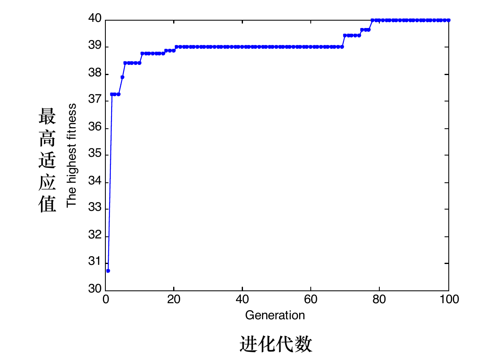

从曲线读两件事:(1) 算法在**哪一代**基本不再进步(本例约第 20 代)——这决定了"何时停";(2) 最终稳定在哪——这反映了**是否找全局最优**(本例稳定在 40,与目标函数在 $[-5,5]$ 上的最大值吻合) [Chapter 2_ Introduction to GAs.pptx · p.13](http://10.188.31.55:5244/Nextcloud/School/Compute-Intelligence/converted/Chapter%202_%20Introduction%20to%20GAs.pdf#page=13)。

### 模式定理:GA 为什么能把好片段组合起来

**问题**:GA "凭什么能变好"?为什么一代代下来最好解越来越优?1970 年代 Holland 给出了一个解释,叫**模式定理** [Chapter 2_ Introduction to GAs.pptx · p.14](http://10.188.31.55:5244/Nextcloud/School/Compute-Intelligence/converted/Chapter%202_%20Introduction%20to%20GAs.pdf#page=14)。

**定义回顾**:模式 $H$ 是一个模板,允许某些位写 $*$。$o(H)$ = 定死位数;$d(H)$ = 首末定死位的距离。

**只考虑选择**:设第 $t$ 代有 $m(H, t)$ 个个体属于模式 $H$。属于 $H$ 的个体平均适应度为 $f(H)$,种群平均适应度为 $\bar f$(整个种群所有个体适应度的算术平均,表示整群现在的整体水平);每个个体被复制的期望次数正比于自身适应度,所以 $H$ 在下一代期望的份数变为

$$
m(H, t+1) \;=\; m(H, t)\cdot\frac{f(H)}{\bar f}
$$

**推导**:个体 $i$ 在选择时被复制的期望次数 = 它的概率 $p_i = \mathrm{fit}_i / \sum_j \mathrm{fit}_j$ × 抽样次数 $N$。对属于 $H$ 的所有个体求和,$N\cdot p_i = N \cdot \mathrm{fit}_i / \sum_j \mathrm{fit}_j$;把属于 $H$ 的个体的 $\mathrm{fit}_i$ 用平均 $f(H)$ 替换,$\sum_j \mathrm{fit}_j$ 用 $N\bar f$ 替换,得 $m(H, t)\cdot f(H)/\bar f$ [Chapter 2_ Introduction to GAs.pptx · p.14](http://10.188.31.55:5244/Nextcloud/School/Compute-Intelligence/converted/Chapter%202_%20Introduction%20to%20GAs.pdf#page=14)。

**交叉的破坏**:单点交叉以 $p_c$ 概率发生,交叉点均匀选在 $L-1$ 个位置之一。若交叉点落在 $[$首定死位, 末定死位$)$ 之内,模式 $H$ 就被破坏;这种"坏位置"的个数恰好是 $d(H)$。所以破坏概率

$$
p_d \;=\; \frac{d(H)}{L-1},\qquad p_s \;\ge\; 1 - p_c\cdot\frac{d(H)}{L-1}
$$

**推导**:把模式 $H$ 的第一个定死位和最后一个定死位想象成模式在串上占的"跨度"。交叉点只有落在这段跨度里(共 $d(H)$ 个位置)才会破坏 $H$;落在这段之外的 $L-1-d(H)$ 个位置都安全 [Chapter 2_ Introduction to GAs.pptx · p.15](http://10.188.31.55:5244/Nextcloud/School/Compute-Intelligence/converted/Chapter%202_%20Introduction%20to%20GAs.pdf#page=15)。

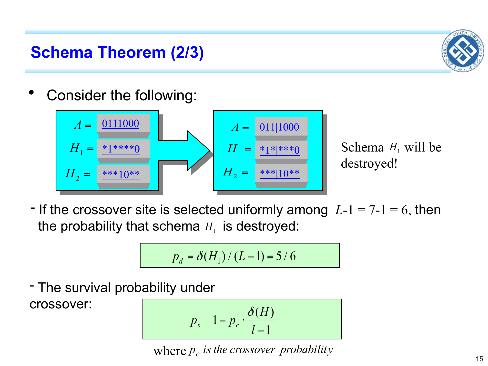

**变异的破坏**:每个定死位独立以概率 $p_m$ 翻转;$H$ 在变异下存活要求**所有定死位都不翻**,概率

$$
(1-p_m)^{o(H)} \;\approx\; 1 - o(H)\cdot p_m\quad(\text{当 } p_m \text{ 很小})
$$

**推导**:每位独立不翻的概率是 $1-p_m$,共 $o(H)$ 位 → 全部不翻的概率是 $(1-p_m)^{o(H)}$。当 $p_m \ll 1$ 时,由泰勒展开 $(1-p_m)^{o(H)} \approx 1 - o(H) p_m$(高阶项可忽略) [Chapter 2_ Introduction to GAs.pptx · p.16](http://10.188.31.55:5244/Nextcloud/School/Compute-Intelligence/converted/Chapter%202_%20Introduction%20to%20GAs.pdf#page=16)。

**合并三种算子**:选择、交叉、变异作用在不同时间点,三者**独立**,所以"存活"概率 = 三者之积 [Chapter 2_ Introduction to GAs.pptx · p.16](http://10.188.31.55:5244/Nextcloud/School/Compute-Intelligence/converted/Chapter%202_%20Introduction%20to%20GAs.pdf#page=16)。

$$
m(H, t+1) \;\ge\; m(H, t)\cdot\frac{f(H)}{\bar f}\cdot\left[1 - p_c\cdot\frac{d(H)}{L-1}\right]\cdot\bigl[1 - o(H)\cdot p_m\bigr]
$$

**结论**:低阶(小 $o(H)$)、短定义长度(小 $d(H)$)、高适应度(大 $f(H)/\bar f$)的模板,下一代份数会**指数级增长**。用更白的话说就是:"好东西由小积木拼成"——称为**积木块假设** [Chapter 2_ Introduction to GAs.pptx · p.16](http://10.188.31.55:5244/Nextcloud/School/Compute-Intelligence/converted/Chapter%202_%20Introduction%20to%20GAs.pdf#page=16)。

**为什么这条结论重要**:它解释了"交叉为什么有效"——交叉不是把整条串打散,而是**把好积木块重新组合** [Chapter 2_ Introduction to GAs.pptx · p.16](http://10.188.31.55:5244/Nextcloud/School/Compute-Intelligence/converted/Chapter%202_%20Introduction%20to%20GAs.pdf#page=16)。

代一组具体数字:$H_1 = *1{*}***0$,串长 $L = 7$。定死位是第 2 位的 $1$ 与第 7 位的 $0$,所以 $o(H_1) = 2$;首末定死位距离 $d(H_1) = 7 - 2 = 5$。取 $p_c = 0.8$、$p_m = 0.01$:

$$
p_s \;\ge\; 1 - 0.8\cdot\frac{5}{6} \;\approx\; 0.333,\qquad 1 - o(H_1)\cdot p_m \;=\; 1 - 2\times 0.01 \;=\; 0.98
$$

交叉之后这个模式至少存活三分之一,变异之后几乎原样保留。

### 实数编码 GA 与单形交叉

二进制 GA 在连续高维问题上被串长卡住。一种补救办法是**实数编码**——不编码成串,直接把每个变量当一个实数;此时"交叉"不能再做"位交换",得换成几何操作 [Chapter 2_ Introduction to GAs.pptx · p.19](http://10.188.31.55:5244/Nextcloud/School/Compute-Intelligence/converted/Chapter%202_%20Introduction%20to%20GAs.pdf#page=19)。


**单形交叉**(Simplex Crossover, SPX):把 $D+1$ 个父代当作 $D$ 维空间中一个单纯形(simplex)的顶点,在单纯形内部按比例插值产生子代。这是**多父体交叉**——不止两个父代 [Chapter 2_ Introduction to GAs.pptx · p.20](http://10.188.31.55:5244/Nextcloud/School/Compute-Intelligence/converted/Chapter%202_%20Introduction%20to%20GAs.pdf#page=20)。


把二进制串换成实数向量后,原来的"把某位 0 翻成 1"就不再有自然含义;变异必须改成实数上的扰动(常用"加一个高斯小量")。不要把"位翻转"硬塞到实数编码里 [Chapter 2_ Introduction to GAs.pptx · p.18](http://10.188.31.55:5244/Nextcloud/School/Compute-Intelligence/converted/Chapter%202_%20Introduction%20to%20GAs.pdf#page=18)。

### 阶梯例题

#### 例 2.1 照着算一份轮盘赌区间

**题干**:种群规模 $N=4$,适应度分别为 $\{2, 4, 4, 6\}$。算选择概率与累积概率,并把 $U(0,1)$ 随机数 $r=0.45$ 分配到具体个体 [Chapter 2_ Introduction to GAs.pptx · p.6](http://10.188.31.55:5244/Nextcloud/School/Compute-Intelligence/converted/Chapter%202_%20Introduction%20to%20GAs.pdf#page=6)。

**解答**:

$$
\sum \mathrm{fit} = 2 + 4 + 4 + 6 = 16,\quad p = \bigl[\tfrac{2}{16},\ \tfrac{4}{16},\ \tfrac{4}{16},\ \tfrac{6}{16}\bigr] = [0.125,\ 0.25,\ 0.25,\ 0.375]
$$

$$
q = [0.125,\ 0.375,\ 0.625,\ 1.000]
$$

$r = 0.45$ 落入 $[q_2, q_3) = [0.375, 0.625)$,所以选中**第 3 个个体**(适应度 4) [Chapter 2_ Introduction to GAs.pptx · p.6](http://10.188.31.55:5244/Nextcloud/School/Compute-Intelligence/converted/Chapter%202_%20Introduction%20to%20GAs.pdf#page=6)。

#### 例 2.2 改用锦标赛选择复算一次

**题干**:同上 $\mathrm{fit} = \{2, 4, 4, 6\}$,改成**锦标赛选择**(tournament size $k=2$):每次随机抽 2 个个体比一场,大的留下 [Chapter 2_ Introduction to GAs.pptx · p.6](http://10.188.31.55:5244/Nextcloud/School/Compute-Intelligence/converted/Chapter%202_%20Introduction%20to%20GAs.pdf#page=6)。

**解答**:锦标赛不需要先算 $p_i, q_i$——每次抽 2 个比大小即可。抽 $\{A_1, A_4\}$(适应度 2 vs 6)→ 留下 $A_4$;抽 $\{A_2, A_3\}$(4 vs 4)→ 平局可任意,留下 $A_2$ 或 $A_3$;重复两次。一次抽签结果是 $[A_4, A_2, A_3, A_4]$。$A_4$ 出现两次,符合"适应度最高被复制最多"的直觉;但**选法不再依赖具体适应度的比例**,只看相对排序,因此**对适应度的尺度不敏感**。

与轮盘赌结论一致(都是 $A_4$ 被多复制),**实现更简单、且能抵抗"超级个体"**,因此工程上锦标赛选择用得更多。PPT 原文写作"联赛选择 / Tournament selection" [Chapter 2_ Introduction to GAs.pptx · p.6](http://10.188.31.55:5244/Nextcloud/School/Compute-Intelligence/converted/Chapter%202_%20Introduction%20to%20GAs.pdf#page=6)。

#### 例 2.3 跑两代看趋势

**题干**:继续 4 位二进制例。设 $N = 4$、$p_c = 1$、$p_m = 0.125$,并**开启精英保留**。第 0 代如上;假设变异 + 交叉后第 1 代为

$$
A_1' = 1101\;(f=169),\ A_2' = 0000\;(f=0),\ A_3' = 0011\;(f=9),\ A_4' = 0101\;(f=25)
$$

精英 $A_2 = 1100$($f=144$)原样入选第 1 代 [Chapter 2_ Introduction to GAs.pptx · p.12](http://10.188.31.55:5244/Nextcloud/School/Compute-Intelligence/converted/Chapter%202_%20Introduction%20to%20GAs.pdf#page=12)。

**解答**:第 1 代加入精英后,当代最高 $f = \max(169, 0, 9, 25, 144) = 169$;因为精英每代原样保留,之后各代的最高 $f$ 只会持平或变得更好(单调不减)。把同一流程跑**三代**再观察:精英与 $1101$ 都会在第 2、3 代被保留,但种群其余个体只在 $[0, 15]$ 整数范围内小幅振荡。要突破这个"局部最优"需要 $p_m$ 略大(多翻几位)或 $L$ 加长(更细的网格)。

这就是**探索与开发**的取舍:调大 $p_m$ 更偏探索(种群不容易早熟,但收敛更慢),调小更偏开发(收敛快,却容易困在浅谷里)。$p_m$ 太小开发不够、太大又破坏精英 [Chapter 2_ Introduction to GAs.pptx · p.12](http://10.188.31.55:5244/Nextcloud/School/Compute-Intelligence/converted/Chapter%202_%20Introduction%20to%20GAs.pdf#page=12)。

### 易错点

> [!WARNING]
> **$p_c$ 与 $p_m$ 的量级**:$p_c$ 统计的是"这一对父代换不换",通常取 $0.6$–$0.9$,意思是绝大多数父代都会交叉。$p_m$ 统计的是"每一位翻不翻",通常取 $1/L$ 附近($L=10$ 时 $p_m\approx 0.05$,$L=100$ 时 $p_m\approx 0.01$),平均一条串翻不到一位。搞混这两个量级,要么让 GA 退化为纯随机搜索($p_m$ 太大),要么让变异形同虚设($p_m$ 太小,易早熟收敛) [Chapter 2_ Introduction to GAs.pptx · p.8](http://10.188.31.55:5244/Nextcloud/School/Compute-Intelligence/converted/Chapter%202_%20Introduction%20to%20GAs.pdf#page=8)。

> [!WARNING]
> **$d(H)$ 与 $o(H)$ 用反**:模式定理公式里,交叉项里是**定义长度 $d(H)$**——看长度;变异项里是**阶 $o(H)$**——看位数。问"哪个量决定交叉存活概率"答 $d(H)$,问"哪个量决定变异存活概率"答 $o(H)$。两者数学上完全不同的含义 [Chapter 2_ Introduction to GAs.pptx · p.15](http://10.188.31.55:5244/Nextcloud/School/Compute-Intelligence/converted/Chapter%202_%20Introduction%20to%20GAs.pdf#page=15)。

> [!WARNING]
> **$\Delta$ 与 $L$ 的因果关系**:$L$ 是自变量(由精度反推),$\Delta$ 是因变量($L$ 决定精度数值)。把因果颠倒成"用 $\Delta$ 反推 $L$"虽然数值上能用对数公式反解,但**因果关系**和**计算顺序**是两件事 [Chapter 2_ Introduction to GAs.pptx · p.9](http://10.188.31.55:5244/Nextcloud/School/Compute-Intelligence/converted/Chapter%202_%20Introduction%20to%20GAs.pdf#page=9)。

## 第 3 章 进化策略 (ES) 与进化规划 (EP)

### GA 的两个硬伤

第 2 章的遗传算法 (GA) 在连续优化问题上有两个硬伤。

**硬伤一:精度被串长卡死。** GA 必须先把实数 $x\in[L_x,U_x]$ 编码成 $L$ 位二进制串。$L$ 越长能刻的格子越细,但串长随维数线性增长、格子数 $2^L$ 随 $L$ 指数增长——连续问题的真实最优解精度完全取决于 $L$ 这一个数。精度不够的话,解看起来"已经收敛",其实还离最优很远。[p. 4](http://10.188.31.55:5244/Nextcloud/School/Compute-Intelligence/converted/Chapter%203_%20Introduction%20to%20ES%20and%20EP.pdf#page=4)

**硬伤二:维度爆炸。** $D=2$ 个变量、每维 10 个格子,共 100 个点,手算都行;$D=20$ 个变量时是 $10^{20}$ 个点,根本试不完。这就是维度灾难:变量个数 $D$ 增加时,搜索空间的体积按指数增长。GA 的"编码 + 交叉 + 位翻转"是为离散串设计的,搬到高维连续空间要么精度不够、要么算不动。[p. 4](http://10.188.31.55:5244/Nextcloud/School/Compute-Intelligence/converted/Chapter%203_%20Introduction%20to%20ES%20and%20EP.pdf#page=4)

决策变量取实数值(可精确到任意小数位)叫连续优化,只能取有限多个值(整数、0/1、枚举)叫离散优化。GA 处理连续问题要编码,ES/EP 直接在实数上做——这是本章存在的根本理由。本章默认 $D\ge 2$,例题为手算方便取 $D=1$,但所有公式都按任意 $D$ 写。

**ES/EP 的解法:直接在实数空间做,不让步长固定。** 进化策略 (ES) 在 1963 年由 Rechenberg 和 Schwefel 提出,进化规划 (EP) 在 1966 年由 Fogel 提出。它们的共同特点是:① 个体**直接**是一个实数向量 $x$,不需要编码;② 变异是"加一个小量",不是"翻一位";③ **步长 $\delta$ 本身也参与进化**,表现好的个体其步长会被遗传下去,步长自动变大变小,不需要人调。[p. 4](http://10.188.31.55:5244/Nextcloud/School/Compute-Intelligence/converted/Chapter%203_%20Introduction%20to%20ES%20and%20EP.pdf#page=4) [p. 13](http://10.188.31.55:5244/Nextcloud/School/Compute-Intelligence/converted/Chapter%203_%20Introduction%20to%20ES%20and%20EP.pdf#page=13)

### (1+1)-ES:一个父亲,一个孩子,选好的留下

**进化策略 (Evolution Strategy, ES)** 是 1963 年由 Rechenberg 和 Schwefel 提出的一类算法。它不用 0/1 串,而是把每个个体表示为一个实数向量 $x=(x_1,\ldots,x_D)$。[p. 4](http://10.188.31.55:5244/Nextcloud/School/Compute-Intelligence/converted/Chapter%203_%20Introduction%20to%20ES%20and%20EP.pdf#page=4)

最简单的一款叫 **$(1+1)$-ES**:每代只保留 1 个父代、生成 1 个子代,子代更好就替换父代,否则父代保留。"1+1" 里的加号就是**加号策略 (plus-selection)**。[p. 4](http://10.188.31.55:5244/Nextcloud/School/Compute-Intelligence/converted/Chapter%203_%20Introduction%20to%20ES%20and%20EP.pdf#page=4)

大白话:想象你在夜里蒙着眼走山路,每一步往脚踩的方向挪一个随机的距离;如果这一步让你比刚才低(目标函数更小),就承认这一步;否则退回来、保留原位。$(1{+}1)$-ES 就是在实数上做这件事:每代走"一步",好就认、差就退。

最小例子:$\min f(x)=x^2$,当前 $x=2$、$f(2)=4$。抽 $N(0,1)=0.4$、步长 $\delta=0.5$,得 $x' = 2 + 0.5\times 0.4 = 2.2$,$f(2.2)=4.84$,比 4 还大,不接受,保留 $x=2$。再抽 $N(0,1)=-1.8$、$\delta=0.5$,得 $x'=2+0.5\times(-1.8)=1.1$,$f(1.1)=1.21<4$,接受,$x\leftarrow 1.1$。[p. 6](http://10.188.31.55:5244/Nextcloud/School/Compute-Intelligence/converted/Chapter%203_%20Introduction%20to%20ES%20and%20EP.pdf#page=6)

#### 一步怎么走:五步伪代码

$(1{+}1)$-ES 是 ES 家族最简的版本,由 slide 5 的 $(\mu,\lambda)$ 框架退化到 $\mu=1,\lambda=1$ 得到。[p. 5](http://10.188.31.55:5244/Nextcloud/School/Compute-Intelligence/converted/Chapter%203_%20Introduction%20to%20ES%20and%20EP.pdf#page=5)

1. **初始化**:随机选父代 $x=(x_1,\ldots,x_D)$ 与初始步长 $\delta=(\delta_1,\ldots,\delta_D)$,算 $f(x)$。步长也随机,是因为我们不知道目标函数的尺度;起点也随机,是为了别落在某个特殊位置。
2. **变异**:对每维 $j=1,\ldots,D$ 独立抽一个标准正态量 $N_j(0,1)$,先算出变异后的步长
   $$\delta'_j=\delta_j\cdot\exp\bigl(\tau N(0,1)\bigr),\qquad \tau=(\sqrt{D})^{-1}$$
   再用 $\delta'_j$ 生成子代
   $$x'_j=x_j+\delta'_j\cdot N_j(0,1)$$
3. **评价**:算 $f(x')$。
4. **选择 (加号策略)**:若 $f(x')<f(x)$,则 $x\leftarrow x'$、$\delta\leftarrow\delta'$;否则 $(x,\delta)$ 一起保留原值——步长也是个体的一部分,子代被拒绝时它的步长跟着一起回退,不能只留步长、扔掉解。
5. **循环**:回到第 2 步,直到达到最大代数或目标精度。

$N_j(0,1)$ 决定"挪向哪边"(正或负),$\delta'_j$ 决定"挪多远"。第 4 步的"加号"= **父代可以参与竞争**;这里 $\mu=1$,候选池就是 $x$ 与 $x'$ 两个,谁好留谁。$\delta$ 跟着 $x$ 走这件事是 ES 与 GA 最大的不同:GA 的变异率 $p_m$ 是固定超参数,ES 的 $\delta$ 是**个体的一部分**。[p. 5](http://10.188.31.55:5244/Nextcloud/School/Compute-Intelligence/converted/Chapter%203_%20Introduction%20to%20ES%20and%20EP.pdf#page=5) [p. 6](http://10.188.31.55:5244/Nextcloud/School/Compute-Intelligence/converted/Chapter%203_%20Introduction%20to%20ES%20and%20EP.pdf#page=6)

### (μ+λ) 与 (μ,λ):候选池里有没有父代

ES 里有两个常用版本,第一步都是"复制 $\mu$ 个父代、变异出 $\lambda$ 个子代",差别在最后一步"选谁进入下一代":

- **$(\mu{+}\lambda)$-ES(加号策略)**:从 $\mu$ 个父代 + $\lambda$ 个子代中,挑适应度最好的 $\mu$ 个进入下一代。优点:父代中最优那个永远不会丢(**精英保留 (elitist)**);收敛快。缺点:好解会一直霸占种群,差的解永远进不来,因此**容易早熟**。
- **$(\mu,\lambda)$-ES(逗号策略)**:只看 $\lambda$ 个子代,从中挑 $\mu$ 个进入下一代,父代全部淘汰(写成逗号就是"只取逗号右边那一半")。代价:本代最优可能比上一代差。好处:允许暂时退化,因此**能逃出局部最优**。[p. 4](http://10.188.31.55:5244/Nextcloud/School/Compute-Intelligence/converted/Chapter%203_%20Introduction%20to%20ES%20and%20EP.pdf#page=4)

本章的 $\mu$ 是父代个数、$\lambda$ 是子代个数。第 1 章的种群规模 $N$ 在本章写作 $\mu$——它们是同一个量的两种记号(全书统一记作 $N=NP=\mu$,$NP$ 是第 4 章 DE 的写法)。$\lambda$ 与 $\mu$ 相互独立,只需 $\lambda\ge\mu$(否则从 $\lambda$ 个子代里挑不出 $\mu$ 个),经验上常取 $\lambda\approx 7\mu$。所以"父代集比种群小"在本章的正确写法是 $\mu\le\lambda$,不要把 $\lambda$ 误当成新的种群规模。[p. 4](http://10.188.31.55:5244/Nextcloud/School/Compute-Intelligence/converted/Chapter%203_%20Introduction%20to%20ES%20and%20EP.pdf#page=4)


#### 公式定义与一维最小例子

记 $\mu$ 个父代为 $\{x_1,\ldots,x_\mu\}$,每代生成 $\lambda$ 个子代 $\{x'_1,\ldots,x'_\lambda\}$,适应度越小越好(假设最小化)。下一代 $\mu$ 个父代的构造方式:

- $(\mu{+}\lambda)$:从 $\mu+\lambda$ 个个体(全部父代 + 全部子代)中按 $f$ 值升序排序,取前 $\mu$ 个。
  $$P_{\text{next}}=\arg\min_{S\subseteq\{x_1,\ldots,x_\mu,x'_1,\ldots,x'_\lambda\},\,|S|=\mu}\sum_{z\in S}f(z)$$
- $(\mu,\lambda)$:只从 $\lambda$ 个子代中取前 $\mu$ 个,父代全部丢弃。
  $$P_{\text{next}}=\arg\min_{S\subseteq\{x'_1,\ldots,x'_\lambda\},\,|S|=\mu}\sum_{z\in S}f(z)$$

一维最小例子($\mu=2$、$\lambda=4$、$\min f(x)=x^2$)。设当前父代 $\{x_1,x_2\}=\{1,-1\}$,$f$ 分别为 1、1。从每个父代变异出 2 个子代($\lambda/\mu=2$,两个父代的步长都取 0.5):

- 从 $x_1=1$ 出发:抽 $N(0,1)=0.3$ 得 $x'_1=1+0.5\times 0.3=1.15$,$f(1.15)=1.3225$;再抽 $N(0,1)=-1.4$ 得 $x'_2=1+0.5\times(-1.4)=0.3$,$f(0.3)=0.09$。
- 从 $x_2=-1$ 出发:抽 $N(0,1)=0.5$ 得 $x'_3=-1+0.5\times 0.5=-0.75$,$f(-0.75)=0.5625$;再抽 $N(0,1)=2.0$ 得 $x'_4=-1+0.5\times 2.0=0$,$f(0)=0$。

候选池 $\{x_1,x_2,x'_1,x'_2,x'_3,x'_4\}=\{1,-1,1.15,0.3,-0.75,0\}$,对应 $f$ 值 $\{1,1,1.3225,0.09,0.5625,0\}$。选 $\mu=2$ 个进入下一代:

- $(\mu{+}\lambda)$ 从 6 个里挑前 2 个:选 $x'_4=0$($f=0$)与 $x'_2=0.3$($f=0.09$)。候选池里父代 $x_1=1$、$x_2=-1$ 的 $f=1$ 都差于 $x'_2$ 的 0.09,所以**本代父代全部落选**;新父代 $=\{0,0.3\}$,$f$ 最优为 0。
- $(\mu,\lambda)$ 只看子代 $\{x'_1,x'_2,x'_3,x'_4\}=\{1.15,0.3,-0.75,0\}$,挑前 2 个:同样选 $x'_4=0$ 与 $x'_2=0.3$,新父代 $=\{0,0.3\}$,$f$ 最优为 0。

本例中两策略结果**完全相同**——因为本代父代恰好都差于两个最好的子代,加号策略保留父代的"权利"没有改变结果。另外 $x'_3=-0.75$ 看着比父代好,却输给了 $x'_2=0.3$,所以没进下一代;这正是"按 $f$ 排序取前 $\mu$ 个"的含义。差别要到多峰、长期运行时才会显著。[p. 4](http://10.188.31.55:5244/Nextcloud/School/Compute-Intelligence/converted/Chapter%203_%20Introduction%20to%20ES%20and%20EP.pdf#page=4)

#### 为什么逗号策略在多峰问题里更好

**多峰问题**指目标函数 $f$ 在搜索空间内有多个局部最优。

**直觉**:$(1{+}1)$-ES 与 $(\mu{+}\lambda)$-ES 都属于"加号家族",核心特征是**精英保留**——当前最优解永远不会被丢。问题是:如果当前最优其实只是一个很浅的局部最优,加号家族会"卡死在浅谷底",因为更好的全局最优在另一个区域,必须先暂时变差、翻过中间的山脊才能到达。

**逗号策略 $(\mu,\lambda)$ 的解法**:它强制每代父代全部淘汰,只从子代里挑——这就"承认了暂时的退化"。代价是本代最优可能比上一代差;好处是能从一个浅谷底被推走、重新落到另一个区域。机制上有两条:① 变异本身可能产生"飞得更远"的子代($\delta$ 自适应放大);② $\lambda\approx 7\mu$ 提供足够多的候选位置。

**一句话结论:多峰 / 崎岖地形用逗号 $(\mu,\lambda)$——它允许父代被淘汰、允许暂时退化,因此能逃出局部最优;单峰地形或要求每代都不退化时用加号 $(\mu{+}\lambda)$——它保留精英,收敛更快,但更容易早熟。** 这与第 1 章的"探索 vs 开发"是同一条线:调大一个参数 = 更偏探索 = 更不易早熟、但收敛更慢;调小一个参数 = 更偏开发。逗号更偏探索,加号更偏开发。[p. 4](http://10.188.31.55:5244/Nextcloud/School/Compute-Intelligence/converted/Chapter%203_%20Introduction%20to%20ES%20and%20EP.pdf#page=4)

### 步长的三级自适应:圆 → 椭圆 → 旋转椭圆

ES 最值得讲的一条主线:用同一个公式改三处,变异区域从圆升级到椭圆、再升级到旋转椭圆。

高斯变异先要有的直觉:从均值 0、标准差 1 的钟形分布 $\mathcal{N}(0,1)$ 里抽一个数,约 68% 的抽样落在 $[-1,1]$ 之间,落在 $[-3,3]$ 之外的小于 1%."小步很多、大步很少"是它的天然特性。

**高斯变异 (Gaussian mutation)** 是 ES 的标准变异:每维独立抽 $N_j(0,1)$,乘上步长 $\delta_{i,j}$ 后加到 $x_{i,j}$ 上:

$$x'_{i,j}=x_{i,j}+\delta_{i,j}\cdot N_j(0,1)$$

这里的 $\delta$ 是 ES 的**步长参数**,只出现在算法里;$\sigma$ 是**高斯分布的标准差**,只出现在 PDF 公式里。两个符号形状相近,角色不同,不要混用。本章的 $\delta$ 是逐维向量 $\delta_i=(\delta_{i,1},\ldots,\delta_{i,D})$,$D=1$ 时它就是一个实数。[p. 6](http://10.188.31.55:5244/Nextcloud/School/Compute-Intelligence/converted/Chapter%203_%20Introduction%20to%20ES%20and%20EP.pdf#page=6)

#### 第一级:圆

所有维用同一个步长,即 $\delta_{i,j}=\delta$ 对所有 $j$ 相同,变异后的解以 $x_i$ 为中心、类似均匀散布在半径 $\delta$ 的圆内:

$$x'_i=x_i+\delta\cdot\exp(\tau N(0,1))\cdot N_j(0,1),\quad \tau=(\sqrt{D})^{-1}$$

式中 $\delta\exp(\tau N(0,1))$ 是步长的自身变异(把"步长本身"也用高斯扰动一下),$\tau$ 是固定系数。PPT 自带算例:$\delta=0.5$、$\tau=0.3$、$D=10$ 时,抽到 $N(0,1)=0.2$ 得新步长 $0.5e^{0.06}\approx 0.53$,抽到 $N(0,1)=-0.2$ 得 $0.5e^{-0.06}\approx 0.47$——步长变大时搜索范围更广,变小时搜索更精细。[p. 6](http://10.188.31.55:5244/Nextcloud/School/Compute-Intelligence/converted/Chapter%203_%20Introduction%20to%20ES%20and%20EP.pdf#page=6)


#### 第二级:椭圆

每个维用各自不同的 $\delta_{i,j}$,变异区域变成以 $x_i$ 为中心、长短轴由各维 $\delta_{i,j}$ 决定的椭圆:

$$\delta'_{i,j}=\delta_{i,j}\exp(\tau' N(0,1)+\tau N_j(0,1)),\quad \tau'=(2D)^{-1},\;\tau=(2\sqrt{D})^{-1}$$

这一步加了一个**全局学习率 $\tau'$** 与一个**逐维学习率 $\tau$**:$\tau' N(0,1)$ 那一项让所有维能一起被放大或缩小,$\tau N_j(0,1)$ 那一项让每维还能独立抖动。slide 6 的 $\tau=(\sqrt{D})^{-1}$ 与 slide 7 的 $\tau'=(2D)^{-1}$ 不是笔误,是两种不同的变异变体:前者只有 1 个系数(各维同步长),后者有 2 个系数(各维独立步长)。[p. 7](http://10.188.31.55:5244/Nextcloud/School/Compute-Intelligence/converted/Chapter%203_%20Introduction%20to%20ES%20and%20EP.pdf#page=7)


#### 第三级:旋转椭圆

再引入**旋转角 $\alpha_{k,l}$**($D(D-1)/2$ 个,每个角度自己也跟着进化),通过旋转矩阵 $R(\alpha)$ 把变异方向耦合起来,变异区域变成"斜着躺的椭圆":

$$\zeta=\left(\prod_{k=1}^{D-1}\prod_{l=k+1}^{D}R(\alpha'_{k,l})\right)\boldsymbol\xi,\quad \boldsymbol\xi=(\xi_1,\ldots,\xi_D)^{\top},\;\xi_j\sim\mathcal{N}(0,\delta_{i,j}^2),\quad x'_i=x_i+\zeta$$

这里的 $\boldsymbol\xi$ 是 **D 维高斯随机向量**(第 $j$ 个分量独立抽自均值为 0、标准差为 $\delta_{i,j}$ 的正态分布),$\boldsymbol\xi$ 只在这一级出现;旋转椭圆公式里不要把 $\boldsymbol\xi$ 写成 $\eta$。[p. 8](http://10.188.31.55:5244/Nextcloud/School/Compute-Intelligence/converted/Chapter%203_%20Introduction%20to%20ES%20and%20EP.pdf#page=8)

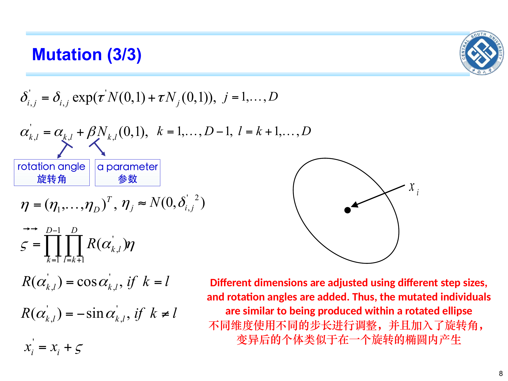

### CMA-ES:把圆、椭圆、旋转椭圆统一成一个矩阵

上面三级递进每一级都加新东西(全局学习率、旋转角)。当目标函数的"谷底"是任意形状(斜着躺、扭着弯),只靠这三个量能表达的形状还是不够多。

**协方差矩阵自适应进化策略 (Covariance Matrix Adaptation Evolution Strategy, CMA-ES)** 是 ES 里最负盛名的高级版,由 N. Hansen 提出,现已成为最有名的 ES 变体。它的核心想法是把上面三级统一到一个"采样分布"里:

$$x_k^{(g+1)}\sim m^{(g)}+\sigma^{(g)}\cdot\mathcal{N}\bigl(0,C^{(g)}\bigr)$$

三个量同时自适应更新:① **均值 $m^{(g)}$**——分布的中心在挪向好解;② **协方差矩阵 $C^{(g)}$**——分布的"形状"在跟着地形扭;③ **全局方差 $\sigma^{(g)}$**——分布的大小在跟着搜索进展缩放。注意这里的 $\sigma^{(g)}$ 是 CMA-ES 的全局缩放系数,与高斯 PDF 里的标准差参数是同一类角色。


**为什么 CMA-ES 强**:它能自动把"圆"扭成"任意方向的椭圆"。目标函数的等高线里往往有三个吸引域——一个圆、一个横躺椭圆、一个斜躺椭圆(旋转椭圆),每个吸引域的中心对应一个局部最优解;CMA-ES 能随进化自适应挑最合适的那个形状,采样分布的等高线与目标函数的等高线对齐,搜索方向就被地形决定了,普通 ES 则只能选圆或横躺椭圆。[p. 9](http://10.188.31.55:5244/Nextcloud/School/Compute-Intelligence/converted/Chapter%203_%20Introduction%20to%20ES%20and%20EP.pdf#page=9) [p. 10](http://10.188.31.55:5244/Nextcloud/School/Compute-Intelligence/converted/Chapter%203_%20Introduction%20to%20ES%20and%20EP.pdf#page=10) [p. 11](http://10.188.31.55:5244/Nextcloud/School/Compute-Intelligence/converted/Chapter%203_%20Introduction%20to%20ES%20and%20EP.pdf#page=11)


### ES 五步 vs EP 三步

$(\mu,\lambda)$-ES 的完整流程有五步,每步都在 slide 5 的框图里画出:[p. 5](http://10.188.31.55:5244/Nextcloud/School/Compute-Intelligence/converted/Chapter%203_%20Introduction%20to%20ES%20and%20EP.pdf#page=5)

1. **初始化**:对 $i=1,\ldots,\mu$,每个个体是**解 $x_i=(x_{i,1},\ldots,x_{i,D})$ 与步长 $\delta_i=(\delta_{i,1},\ldots,\delta_{i,D})$ 的成对组合**;两者都随机初始化。
2. **复制 (Copy)**:把每个父代 $(x_i,\delta_i)$ 顺序复制 $\lambda/\mu$ 次,得到 $\lambda$ 个候选。
3. **交叉 (Crossover)**:每维步长取两个父代的平均,$\delta_{i,j}=(\delta_{i,j}+\delta_{k_i,j})/2$,其中 $k_i\in\{1,\ldots,\mu\}$ 是随机挑的另一位父代。解 $x_i$ 也同样交叉(两父代的加权平均):
   $$x'_i=x_i+\kappa\,(x_{k_i}-x_i),\qquad \kappa\in[0,1]$$
   $\kappa$ 是随机或固定的混合系数;PPT 只给"解也要交叉"的文字描述,上式是最常见的写法($\kappa=1/2$ 即两父代取中点)。$(1{+}1)$-ES 因为只有一个父代,这一步自动消失。
4. **变异 (Mutation)**:同时变异 $x_i$ 和 $\delta_i$。这是 ES 与 GA 最不同的地方:GA 的变异率 $p_m$ 是固定超参数,ES 的 $\delta_i$ 是**个体的一部分**,跟 $x_i$ 一起被选择、一起进化。
5. **选择 (Selection)**:从 $\lambda$ 个子代里挑 $\mu$ 个进入下一代($(\mu,\lambda)$ 只看子代、不看父代)。

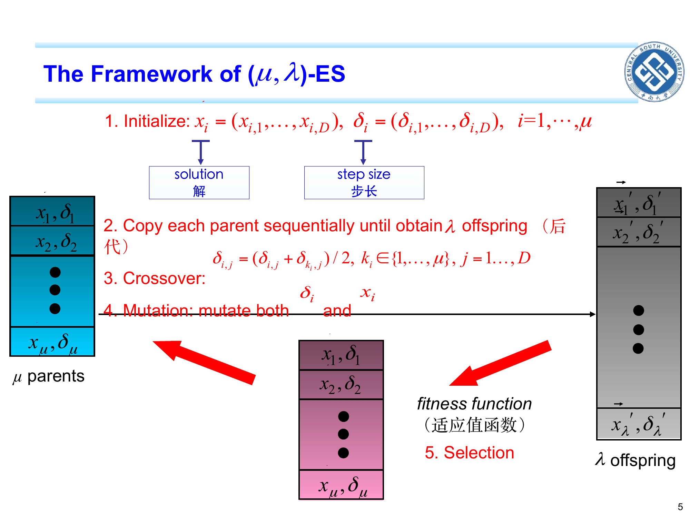

**进化规划 (Evolutionary Programming, EP)** 是 1966 年由 L. J. Fogel 提出的另一支实数进化算法。它和 ES 的差别只有一句话:**变异必须在评价之前**,而且**没有交叉**。

1. **变异**:对 $\mu$ 个父代 $(x_i,\eta_i)$ 各自变异一次,得到 $\mu$ 个子代 $(x'_i,\eta'_i)$。变异公式与 ES 类似,但 EP 的**步长 $\eta$** 用字母 $\eta$ 而不是 $\delta$;$\eta$ 在本章**只**表示 EP 的逐维步长,与 ES 的 $\delta$ 是同一角色、只是换了字母。
2. **评价**:对 $\mu$ 个父代与 $\mu$ 个子代**都**算适应度。
3. **选择**:把这 $2\mu$ 个个体组成的**参考集 (reference set)** 按适应度排序,挑前 $\mu$ 个进入下一代。

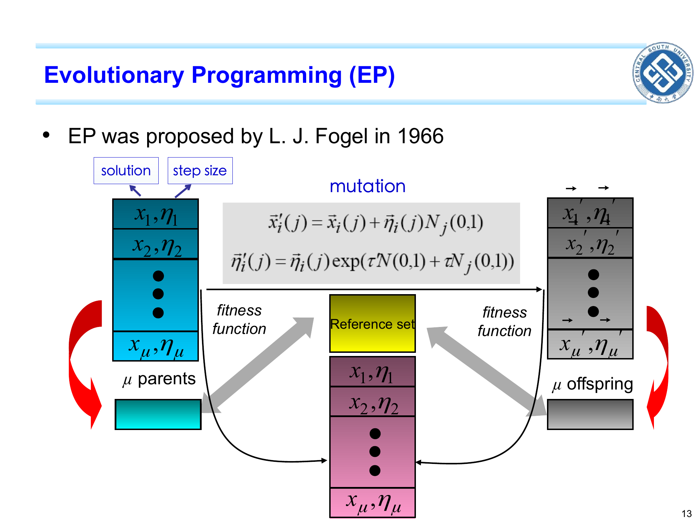

**为什么 EP 要"变异在前"**:因为父代也要进参考集参与排序,父代的适应度必须在同一代里重新算一遍,才能与子代公平比较。附带的一个效果是:EP 的选择池里有父代,所以父代中的好解不会被无条件丢掉(这一点像加号策略);但 EP 没有交叉、且变异必须发生在评价之前。

| | ES | EP |
|---|---|---|
| 流程顺序 | 初始化 → 复制 → 交叉 → 变异 → 选择 | 初始化 → 变异 → 评价 → 选择(无复制、无交叉) |
| 交叉 | 有(把两个父代的 $x$ 与 $\delta$ 平均) | 没有(只靠变异) |
| 步长符号 | $\delta_i=(\delta_{i,1},\ldots,\delta_{i,D})$ | $\eta_i=(\eta_{i,1},\ldots,\eta_{i,D})$ |
| 选择对象 | 从 $\lambda$ 个子代(或 $\mu+\lambda$ 个)里挑 $\mu$ 个 | 从 $\mu$ 父代 + $\mu$ 子代 = $2\mu$ 参考集里挑 $\mu$ 个 |
| 变异分布 | 通常只支持高斯变异 | 支持高斯或柯西两种 |

一句话区分:ES 在进化这件事上更"工程化"(有交叉、有明确的 $\mu$ 与 $\lambda$);EP 更"直接"(只有变异,而且父代与子代一起进参考集排序)。[p. 13](http://10.188.31.55:5244/Nextcloud/School/Compute-Intelligence/converted/Chapter%203_%20Introduction%20to%20ES%20and%20EP.pdf#page=13)

### 高斯变异 vs 柯西变异:尾巴厚度决定能不能跳出去

EP 有一个 ES 没有的可选项:把高斯变异换成柯西变异(Yao、Liu 与 Lin,1999)。要先说清 PDF 是什么:概率密度函数 (PDF) 是一条曲线,曲线下的面积代表概率(总面积 $=1$);标准高斯 PDF 在 $x=0$ 处最高(高度约 0.399),向两侧迅速变薄。

$$f_{\text{Gaussian}}(x)=\frac{1}{\sqrt{2\pi}\,\sigma}\exp\left(-\frac{(x-m)^2}{2\sigma^2}\right),\qquad f_{\text{Cauchy}}(x)=\frac{\gamma}{\pi\left[\gamma^2+x^2\right]}$$

高斯式中 $m$ 是均值、$\sigma$ 是标准差(PPT 把均值写作 $\mu$;本讲义改用 $m$,因为本章的 $\mu$ 已经是父代个数,避免一字母两义)。柯西式中 $\gamma>0$ 是**尺度参数 (scale parameter)**,控制曲线的胖瘦,$\gamma=1$ 时就是标准柯西分布。本讲义用 $\mathrm{Cauchy}_j(0,1)$ 表示"第 $j$ 维独立抽取的标准柯西量"(位置参数 0、尺度参数 1);PPT 原文把柯西的步长写作 $\delta_j$——那是字母撞车,不是 ES 的步长 $\delta$。两者都是钟形曲线、峰值在 0 附近、曲线下面积都是 1,差别在尾部厚薄。[p. 14](http://10.188.31.55:5244/Nextcloud/School/Compute-Intelligence/converted/Chapter%203_%20Introduction%20to%20ES%20and%20EP.pdf#page=14) [p. 15](http://10.188.31.55:5244/Nextcloud/School/Compute-Intelligence/converted/Chapter%203_%20Introduction%20to%20ES%20and%20EP.pdf#page=15)


**一句可直接背下来的口诀:远离最优解用柯西、接近最优解用高斯。** 理由:柯西尾厚 ⇒ 抽到 $|x|$ 很大值的概率比高斯高得多 ⇒ 容易跳出局部最优;高斯集中在小步长 ⇒ 适合在最优解附近精修。两者的组合让 EP 在各种问题上都稳定。[p. 20](http://10.188.31.55:5244/Nextcloud/School/Compute-Intelligence/converted/Chapter%203_%20Introduction%20to%20ES%20and%20EP.pdf#page=20)

### 1/5 成功法则:步长自动调的依据

**1/5 成功法则 (one-fifth success rule)** 是一条"自动调步长"的经验规则:**如果最近若干次变异中,成功的比例高于 1/5,说明步子还可以更大;低于 1/5 就该把步子收小。** 这里的"成功"指变异后的解比父代更好。[p. 17](http://10.188.31.55:5244/Nextcloud/School/Compute-Intelligence/converted/Chapter%203_%20Introduction%20to%20ES%20and%20EP.pdf#page=17)

**固定步长的局限**:在最小例子上能跑通,却不能同时兼顾远距离搜索与最优点附近的精细搜索。考虑 $f(x)=x^2$、$x=2$:取 $\delta=0.01$ 时,即使抽到 $N(0,1)=3$,位移也只有 $0.03$;取 $\delta=10$ 时,一次常规抽样就可能把解带到远离 $0$ 的位置。步长有个"对的值"——不大不小。这与第 1 章的"探索 vs 开发"是同一条线:$\delta$ 越大越偏探索,越小越偏开发。

#### ∂P/∂δ 的推导与几何

$\partial f/\partial \delta$ 读作"只看 $\delta$ 这一个量变化时 $f$ 的变化率",只需要会读这个符号,不需要自己求导。

推导思路:把"成功"定义为"变异后的解落在真实最优解 $x^*$ 的 $\epsilon$-邻域内",即 $|x'-x^*|\le\epsilon$。$x'$ 由 $x+\delta N(0,1)$ 决定,所以"成功"等价于 $N(0,1)$ 落在某个区间里(区间端点由 $x^*-\epsilon$ 与 $x^*+\epsilon$ 反推)。对成功概率 $P(\delta)$ 关于步长 $\delta$ 求偏导,得:

- 当 $\delta$ 很小时,$P(\delta)$ 随 $\delta$ 增大而**单调上升**(步子越大、命中邻域越容易);
- 当 $\delta$ 超过某个值,$P(\delta)$ 随 $\delta$ 增大而**单调下降**(步子过大、反而把解打飞);
- 中间存在 $\delta^*$,使 $P(\delta^*)$ 最大。

几何解释:把 $f(x)$ 的钟形密度曲线画出来,$x^*-\epsilon$ 与 $x^*+\epsilon$ 是成功邻域的两条边界。固定 $x$、$x'=x+\delta N(0,1)$,把 $\delta$ 看作"曲线在 $x$ 轴上移动的距离"——步子 $\delta$ 太大时,钟形的中心已经偏到邻域之外,邻域内只剩尾巴那一小块面积,所以 $P$ 反而变小。[p. 17](http://10.188.31.55:5244/Nextcloud/School/Compute-Intelligence/converted/Chapter%203_%20Introduction%20to%20ES%20and%20EP.pdf#page=17)

![步长与成功概率的几何解释:成功邻域为 $[x^*-\epsilon,\ x^*+\epsilon]$,只有落在该区间内的后代才算成功,改变步长 $\delta$ 相当于移动概率密度曲线的取值位置,这正是 1/5 成功法则的来源](images/fig_029.png)

> [!IMPORTANT] 1/5 成功法则:可背诵的结论
>
> - 一句话:成功率 > 1/5 ⇒ 步长应放大;成功率 < 1/5 ⇒ 步长应缩小;维持在 1/5 附近最优。
> - 推导依据:Ch3 slide 17–19 对 $\partial P/\partial \delta$ 的符号变化分析。
> - 适用范围:在大多数连续、单目标问题上有用;对非光滑、强噪声问题需谨慎。

**一个必须写明的来源事实**:PPT (Ch3) 里**没有出现过"1/5 成功法则"这五个字**。slide 17–19 的三页 ``Theoretical Background'' 给的是这条法则的**理论推导依据**(对成功概率 $P(\delta)$ 关于步长 $\delta$ 求偏导,发现 $P$ 先增后减,即存在最优步长)。"1/5" 这个具体数字来自 Rechenberg 1965–1973 年间的系列实验:在线性走廊与球面模型上,当每步成功率约 1/5 时,平均收敛速度最快。法则名与这个数字都由讲义补出,引用时应写明依据是 slide 17–19 的 $\partial P/\partial \delta$ 推导,而不是硬说成 PPT 原文。

### 手算例子

#### 手算 (1+1)-ES 在 $f(x)=x^2$ 上走 3 步

用 $(1{+}1)$-ES 求 $\min f(x)=x^2$ 在 $x\in[-5,5]$ 上的最优。初始 $x^{(0)}=2$、$\delta^{(0)}=0.5$。每代先变异步长 $\delta'=\delta\exp(\tau N(0,1))$,再用新步长变异解 $x'=x+\delta' N(0,1)$,然后与父代比:好就整体接受 $(x,\delta)\leftarrow(x',\delta')$,差就整体保留原值。取 $D=1$,所以 $\tau=(\sqrt{1})^{-1}=1$,公式简化为 $\delta'=\delta\exp(N(0,1))$。下面手算 3 代(每代抽两个独立的标准正态量,数值四舍五入到 4 位):

- **第 0 代**(初始):$x^{(0)}=2$,$\delta^{(0)}=0.5$,$f=4$。
- **第 1 代**:抽 $N_1(0,1)=-0.5$,$\delta'=0.5\times e^{-0.5}=0.3033$;抽 $N_2(0,1)=0.6$,$x'=2+0.3033\times 0.6=2.1820$,$f(2.1820)=4.7609>4$,拒绝;$(x,\delta)$ 整体回退,故 $x^{(1)}=2$、$\delta^{(1)}=0.5$。
- **第 2 代**:抽 $N_1(0,1)=0.3$,$\delta'=0.5\times e^{0.3}=0.6749$;抽 $N_2(0,1)=-1.8$,$x'=2+0.6749\times(-1.8)=0.7851$,$f(0.7851)=0.6164<4$,接受,$x^{(2)}=0.7851$、$\delta^{(2)}=0.6749$。
- **第 3 代**:抽 $N_1(0,1)=0.8$,$\delta'=0.6749\times e^{0.8}=1.5021$;抽 $N_2(0,1)=-0.7$,$x'=0.7851+1.5021\times(-0.7)=-0.2663$,$f(-0.2663)=0.0709<0.6164$,接受,$x^{(3)}=-0.2663$、$\delta^{(3)}=1.5021$。

3 代后 $x^{(3)}=-0.2663$、$f=0.0709$,离真实最优 $x^*=0$($f=0$)已经很近。第 2 代因为 $N_2(0,1)=-1.8$ 抽到一个"大的负量",大步向最优方向跳了一步;步长在连续两次成功后被推到 1.5021——这正是"成功多、步长该放大"的雏形。第 1 代被拒绝时解与步长一起回退,说明**步长也是个体的一部分**,不能只留步长扔掉解。[p. 6](http://10.188.31.55:5244/Nextcloud/School/Compute-Intelligence/converted/Chapter%203_%20Introduction%20to%20ES%20and%20EP.pdf#page=6)

#### 同样的 $f(x)=x^2$ 改用 $(\mu{+}\lambda)$,$\mu=2,\lambda=4$

初始父代 $\{x_1,x_2\}=\{2,-2\}$,$\delta_1=\delta_2=0.5$。从每个父代变异出 $\lambda/\mu=2$ 个子代,加号策略从 $2+4=6$ 个候选中挑最优 2 个。本例为把注意力放在**选择池**上,暂不更新步长(固定 $\delta=0.5$):

- 从 $x_1=2$ 出发:抽 $N(0,1)=0.3$ 得 $x'_1=2+0.5\times 0.3=2.15$,$f(2.15)=4.6225$;抽 $N(0,1)=-1.5$ 得 $x'_2=2+0.5\times(-1.5)=1.25$,$f(1.25)=1.5625$。
- 从 $x_2=-2$ 出发:抽 $N(0,1)=-0.4$ 得 $x'_3=-2+0.5\times(-0.4)=-2.2$,$f(-2.2)=4.84$;抽 $N(0,1)=1.8$ 得 $x'_4=-2+0.5\times 1.8=-1.1$,$f(-1.1)=1.21$。

候选池 $\{x_1,x_2,x'_1,x'_2,x'_3,x'_4\}=\{2,-2,2.15,1.25,-2.2,-1.1\}$,对应 $f$ 值 $\{4,4,4.6225,1.5625,4.84,1.21\}$。选 $f$ 最小的 $\mu=2$ 个:$x'_4=-1.1$($f=1.21$)与 $x'_2=1.25$($f=1.5625$),下一代父代 $=\{1.25,-1.1\}$。

本代 $f$ 最优由 $x'_2=1.25$(从 $x_1=2$ 跳过来)与 $x'_4=-1.1$(从 $x_2=-2$ 跳过来)占据,父代 $\{2,-2\}$ 全部被淘汰——这在 $(1{+}1)$ 里见不到,因为父代只有一个。**关键点**:加号策略保留了"父代也可以竞争"的权利,但**不代表父代一定赢**。[p. 4](http://10.188.31.55:5244/Nextcloud/School/Compute-Intelligence/converted/Chapter%203_%20Introduction%20to%20ES%20and%20EP.pdf#page=4)

#### 单峰与多峰分别该选哪种策略

同一个 $f(x)=x^2$、同样起点 $x^{(0)}=2$、$\delta^{(0)}=0.5$,比较 $(1{+}1)$-ES 与 $(2{+}4)$-ES 的收敛。$(1{+}1)$-ES 每代只生成 1 个子代($\mu=\lambda=1$);$(2{+}4)$-ES 每代生成 4 个子代、从 $\mu+\lambda$ 的池子里挑 2 个。注意**这两个都是加号策略**,唯一的差别是种群规模与每代候选数。

**按预算比较**:各运行 20 代时,$(1{+}1)$-ES 生成 $20\times1=20$ 个子代,$(2{+}4)$-ES 生成 $20\times4=80$ 个子代,后者每代试探的点更多。若固定子代评价次数为 20,前者可运行 20 代,后者只能运行 $20/4=5$ 代。因而不能只凭"每代更快"断言后者的性能更好,必须先说明比较的是代数还是函数评价预算。$(2{+}4)$-ES 在相同代数下拥有更多试探机会,原因是**父代个数 $\mu=2>1$、每代候选数 $\lambda=4>1$**,而**不是因为用了加号策略**——$(2{+}4)$ 与 $(1{+}1)$ 都是加号家族。

**换到多峰地形**:取 $f(x)=x^4-3x^2+x+1$($x\in[-3,3]$),它有两个谷底:全局最优在 $x^*\approx-1.3008$($f\approx-2.5139$),另有一个很浅的局部最优在 $x\approx1.1309$($f\approx-0.0702$)。若起点落在浅谷一侧,加号家族会因为"精英保留"守着这个浅谷不放(任何翻过中间山脊的移动都会先变差,被拒绝);这时应改用**逗号策略 $(\mu,\lambda)$**:它每代淘汰全部父代,允许暂时退化,因此有机会翻过山脊进入深谷。

**单峰问题用加号 $(\mu{+}\lambda)$——精英保留、收敛快;多峰 / 崎岖问题用逗号 $(\mu,\lambda)$——允许退化、能逃出局部最优。** 要比较加号与逗号,必须固定 $\mu,\lambda$ 只改选择池。[p. 4](http://10.188.31.55:5244/Nextcloud/School/Compute-Intelligence/converted/Chapter%203_%20Introduction%20to%20ES%20and%20EP.pdf#page=4)

### 易错点

> [!WARNING] ES/EP 最常踩的 5 个坑
>
> 1. **把"加号"与"逗号"写反,或把适用地形写反**。$(\mu{+}\lambda)$-ES 是父子一起选(精英保留、收敛快、**易早熟**,适合**单峰**);$(\mu,\lambda)$-ES 是只从子代里选(允许退化、**可逃出局部最优**,适合**多峰 / 崎岖地形**)。问"哪个允许退化"答 $(\mu,\lambda)$,问"哪个保留精英"答 $(\mu{+}\lambda)$,问"多峰用哪个"答 $(\mu,\lambda)$。
> 2. **把 ES 的步长 $\delta$ 与高斯分布的标准差 $\sigma$ 当成同一个符号**。$\delta$ 是逐维步长向量(ES 算法的一部分,跟着个体进化),$\sigma$ 是高斯 PDF 曲线的胖瘦参数(只出现在公式里)。混用会扣分。
> 3. **把 EP 的步长 $\eta$ 误当成第二个随机量**。本章 $\eta$ 只有一个含义——EP 的逐维步长,与 ES 的 $\delta$ 是同一角色;旋转椭圆公式里的 D 维高斯随机向量记作 $\boldsymbol\xi$,不要写成 $\eta$。柯西 PDF 的尺度参数记作 $\gamma$(PPT 原文写作 $\delta_j$),也不要与步长 $\delta$ 混。
> 4. **以为 ES 也有柯西变异**。ES 在 PPT 的伪代码里只演示了高斯变异 $x+\delta N(0,1)$;柯西变异是 **EP** 的可选项(Ch3 slide 14–16)。
> 5. **把 slide 6 的 $\tau=(\sqrt{D})^{-1}$ 与 slide 7 的 $\tau'=(2D)^{-1}$ 当成 PPT 笔误**。这是**两种不同的变异变体**:slide 6 是"各维同步长"(只有 1 个系数 $\tau$),slide 7 是"各维独立步长"(有 $\tau'$ 与 $\tau$ 两个系数,前者管全局、后者管逐维)。姊妹坑是把"1/5 成功法则"硬说成 PPT 原文——Ch3 slide 17–19 只给推导,这五个字由讲义补出;被问"该法则在 PPT 哪一页",应写"slide 17–19 的 Theoretical Background 三页给的是推导,**法则名是讲义补充的**"(硬塞"slide 20"是错的,slide 20 讲的是高斯/柯西的使用建议)。

## 第 4 章 差分进化 (DE)

### 步长自适应有多贵

第 3 章的 CMA-ES 通过学习一个完整的 $D\times D$ 协方差矩阵，把搜索区域从圆调到椭圆、再调到旋转椭圆。代价是每代要算一次协方差矩阵的更新，涉及 $O(D^2)$ 的存储与运算，维度一高就吃不消 [p. 4](http://10.188.31.55:5244/Nextcloud/School/Compute-Intelligence/converted/Chapter%204_%20Introduction%20to%20Differential%20Evolution.pdf#page=4)。

差分进化（Differential Evolution, DE）走另一条更便宜的路：不维护协方差矩阵，直接拿"两个随机个体之差"当搜索方向。这条差分向量本身同时携带方向信息与"当前种群散开尺度"信息，因此免去了 ES 步长自适应的全部学习开销。1997 年由 Storn 和 Price 提出后，DE 因其机制简洁、参数少、收敛快，迅速成为连续优化的主流算法之一 [p. 4](http://10.188.31.55:5244/Nextcloud/School/Compute-Intelligence/converted/Chapter%204_%20Introduction%20to%20Differential%20Evolution.pdf#page=4)。

DE 与前面三章算法的核心区别只有一句话：它把"变异方向"这件事交给了"种群内部个体之差"。代价是三个算子的细节必须严格记牢、不能背错。

### 浓雾里的一群登山者

想象你管着一群登山者，要在浓雾里找山的最低点。每个人只能看到自己脚下与身旁几个人的相对位置。某个人想知道下一步往哪走，他可以这么做：随便挑另外三个队友 $A$、$B$、$C$，看 $A$ 在哪儿（基向量），再看从 $B$ 到 $C$ 这条矢量指向哪儿（差分向量），然后从 $A$ 出发、沿着这条矢量迈一步。迈多大呢？自己定一个倍率 $F$。最后停下来之前，先看一眼自己现在的位置（目标向量）和新算出来的位置（试验向量）哪个海拔更低，更低的那个留下，高的那个丢回原来的位置。这就是 DE 一代里发生的全部事情 [p. 10](http://10.188.31.55:5244/Nextcloud/School/Compute-Intelligence/converted/Chapter%204_%20Introduction%20to%20Differential%20Evolution.pdf#page=10)。

本章全部变体都是"基向量 + 一组差分向量的线性组合"。基向量与差分向量这两个角色一旦搞混，变异公式必错。

### 术语速查

- **种群规模 $NP$**：DE 一代里同时持有的个体数。第 1 章的通用符号写作 $N$，第 3 章 ES 把"种群中的父代个数"写作 $\mu$，三者满足 $N=NP=\mu$；ES 另有一个子代个数 $\lambda\ge\mu$。本讲义统一写 $NP$ [p. 6](http://10.188.31.55:5244/Nextcloud/School/Compute-Intelligence/converted/Chapter%204_%20Introduction%20to%20Differential%20Evolution.pdf#page=6)。
- **迭代代数 $G$**：DE 的迭代轮数。$G$ 与第 1 章的 $t$ 是同一个量，DE 文献习惯用 $G$ [p. 4](http://10.188.31.55:5244/Nextcloud/School/Compute-Intelligence/converted/Chapter%204_%20Introduction%20to%20Differential%20Evolution.pdf#page=4)。
- **目标向量（target vector）$x_{i,G}$**：第 $G$ 代第 $i$ 个个体的"旧解"，也是这一代里要被替换的那一个。它的对手是试验向量 $u_{i,G}$，两者比完决定谁留下 [p. 5](http://10.188.31.55:5244/Nextcloud/School/Compute-Intelligence/converted/Chapter%204_%20Introduction%20to%20Differential%20Evolution.pdf#page=5)。
- **变异向量（mutant vector，又称供体向量 donor vector）$v_{i,G}$**：只经过变异算子算出来的中间解，还没参与交叉，也还没和老解比较，角色是"候选新方向的搬运工"。本讲义的 $v_{i,G}$ 一律指变异向量，与第 5 章 PSO 里同字母的速度 $v_{i,j}^t$ 无关，靠"带不带代数下标 $G$"区分 [p. 6](http://10.188.31.55:5244/Nextcloud/School/Compute-Intelligence/converted/Chapter%204_%20Introduction%20to%20Differential%20Evolution.pdf#page=6)。
- **差分向量（difference vector）$x_{r2,G}-x_{r3,G}$**：两个随机个体逐维相减得到的向量。它同时携带两件事：方向（从 $r_3$ 指向 $r_2$ 的方向）与尺度（这两个个体在当前种群里相距多远）。后者就是"自适应步长"的零成本来源——种群散开时差分向量自动变大，种群聚拢时自动变小 [p. 6](http://10.188.31.55:5244/Nextcloud/School/Compute-Intelligence/converted/Chapter%204_%20Introduction%20to%20Differential%20Evolution.pdf#page=6)。
- **基向量（base vector）**：差分变异公式里"出发位置"那个个体。最常见是随机选的 $x_{r1,G}$（DE/rand 系列），也可能是当前种群最优 $x_{best,G}$（DE/best 系列）[p. 6](http://10.188.31.55:5244/Nextcloud/School/Compute-Intelligence/converted/Chapter%204_%20Introduction%20to%20Differential%20Evolution.pdf#page=6)。
- **缩放因子（scaling factor）$F$**：差分向量的放大倍数，常用取值 0.5–1.0，控制搜索步子的整体大小 [p. 6](http://10.188.31.55:5244/Nextcloud/School/Compute-Intelligence/converted/Chapter%204_%20Introduction%20to%20Differential%20Evolution.pdf#page=6)。
- **试验向量（trial vector）$u_{i,G}$**：变异加交叉做完之后得到的"候选新解"，使命是跟目标向量一对一 PK，赢者留下 [p. 7](http://10.188.31.55:5244/Nextcloud/School/Compute-Intelligence/converted/Chapter%204_%20Introduction%20to%20Differential%20Evolution.pdf#page=7)。
- **交叉控制参数（crossover control parameter）$CR$**：逐维决定试验向量抄变异向量的那一维还是抄目标向量的那一维，取值在 $[0,1]$ 之间 [p. 8](http://10.188.31.55:5244/Nextcloud/School/Compute-Intelligence/converted/Chapter%204_%20Introduction%20to%20Differential%20Evolution.pdf#page=8)。
- **二项式交叉（binomial crossover）**：逐维独立掷骰子的交叉方式。每一维独立产生 $[0,1]$ 上的均匀随机数 $rand_j$；若 $rand_j\le CR$，则试验向量的第 $j$ 维抄自变异向量，否则抄自目标向量；另外强制至少有一维（随机挑的 $j_{rand}$）必须来自变异向量 [p. 7](http://10.188.31.55:5244/Nextcloud/School/Compute-Intelligence/converted/Chapter%204_%20Introduction%20to%20Differential%20Evolution.pdf#page=7)。
- **指数交叉（exponential crossover）**：从随机起点 $s$ 开始连续若干维抄自变异向量、再突然停住的交叉方式，连抄的维数记为 $n$ [p. 8](http://10.188.31.55:5244/Nextcloud/School/Compute-Intelligence/converted/Chapter%204_%20Introduction%20to%20Differential%20Evolution.pdf#page=8)。
- **贪婪选择（greedy selection）**：试验向量与目标向量一对一比较，若试验向量不劣于目标向量（最小化时即 $f(u_{i,G})\le f(x_{i,G})$），就用试验向量替换目标向量，否则保留原目标向量。DE 的选择是"贪婪"的，因为它从不接受一个更差的解 [p. 5](http://10.188.31.55:5244/Nextcloud/School/Compute-Intelligence/converted/Chapter%204_%20Introduction%20to%20Differential%20Evolution.pdf#page=5)。
- **当前种群最优 $x_{best,G}$**：第 $G$ 代整个种群中 $f$ 最小的个体。它不是问题的真实最优 $x^*$：前者是算法"至今找到的"，后者是问题"真正存在的"，两者只在算法完美求解时才会相等 [p. 6](http://10.188.31.55:5244/Nextcloud/School/Compute-Intelligence/converted/Chapter%204_%20Introduction%20to%20Differential%20Evolution.pdf#page=6)。
- **函数误差值 $|f(x_{best})-f(x^*)|$**：算法找到的最好值离真实最优还差多少，是 DE 实验里衡量精度的标准指标 [p. 22](http://10.188.31.55:5244/Nextcloud/School/Compute-Intelligence/converted/Chapter%204_%20Introduction%20to%20Differential%20Evolution.pdf#page=22)。
- **成功运行（successful run）**：一次独立运行结束时，若函数误差 $\le \varepsilon$（通常取 $10^{-2}$ 或 $10^{-6}$），这次算成功，否则算失败 [p. 35](http://10.188.31.55:5244/Nextcloud/School/Compute-Intelligence/converted/Chapter%204_%20Introduction%20to%20Differential%20Evolution.pdf#page=35)。
- **适应值评价次数（fitness evaluations, FES）**：算法从开始到现在一共调用过 $f(x)$ 多少次。它就是算法的"预算"，不同算法必须在同一 FES 预算下比较才公平，常用上限 $FES_{max}=10000\times D$ [p. 34](http://10.188.31.55:5244/Nextcloud/School/Compute-Intelligence/converted/Chapter%204_%20Introduction%20to%20Differential%20Evolution.pdf#page=34)。
- **变异策略命名法 DE/x/y/z**：DE 的"型号"用四个字段串起来表示 [p. 9](http://10.188.31.55:5244/Nextcloud/School/Compute-Intelligence/converted/Chapter%204_%20Introduction%20to%20Differential%20Evolution.pdf#page=9)。
  - **x**：基向量怎么选。常用 `rand`（随机挑一个）、`best`（用当前最优）、`current-to-best`（从当前到最优的方向）、`current-to-rand`（从当前到随机）。
  - **y**：用了几个差分向量。`1` 表示一个，`2` 表示两个。
  - **z**：交叉类型。`bin` 是二项式，`exp` 是指数。

  所以 DE/rand/1/bin 是"基向量随机挑 + 一个差分向量 + 二项式交叉"，DE/best/2/exp 是"基向量用当前最优 + 两个差分向量 + 指数交叉"。本章全部例题以 DE/rand/1/bin 为主线，这是最经典、最常用、文献里出现频率最高的一种型号。

### 三个算子

#### 差分变异 DE/rand/1/bin

最经典的差分变异公式只有 5 个符号：从随机选出的基向量出发，沿着两个随机个体之差的方向，迈出 $F$ 倍距离，得到变异向量。

$$
v_{i,G} = x_{r1,G} + F \cdot (x_{r2,G} - x_{r3,G})
$$

下标的抽法是硬要求：$r_1,r_2,r_3$ 从 $\{1,\dots,NP\}\setminus\{i\}$ 中均匀随机、互不相同地抽取，每代每维重抽 [p. 6](http://10.188.31.55:5244/Nextcloud/School/Compute-Intelligence/converted/Chapter%204_%20Introduction%20to%20Differential%20Evolution.pdf#page=6)。

直观上公式做的事是：从 $x_{r1,G}$ 出发，沿着差分向量的方向迈出 $F$ 倍距离，落到 $v_{i,G}$。方向是免费的（从种群内部取），尺度也是免费的（差分向量自带当前种群的散开尺度），$F$ 只是给使用者一个调步子的旋钮。

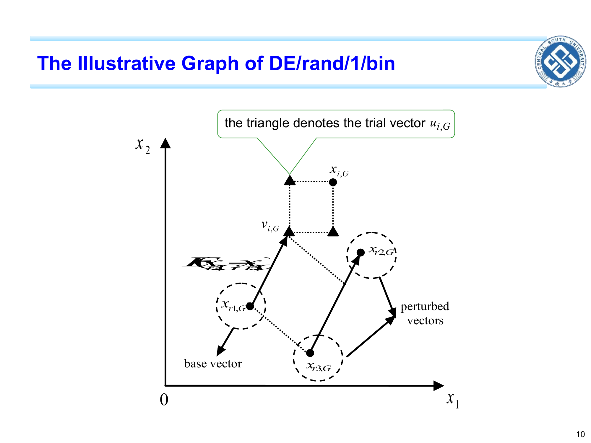

#### 变异公式族

除 DE/rand/1 之外常见的还有 5 种 [p. 6](http://10.188.31.55:5244/Nextcloud/School/Compute-Intelligence/converted/Chapter%204_%20Introduction%20to%20Differential%20Evolution.pdf#page=6)：

$$
\begin{aligned}
\text{DE/rand/2/bin:}\quad & v_{i,G} = x_{r1,G} + F(x_{r2,G}-x_{r3,G}) + F(x_{r4,G}-x_{r5,G}) \\
\text{DE/best/1/bin:}\quad & v_{i,G} = x_{best,G} + F(x_{r1,G}-x_{r2,G}) \\
\text{DE/best/2/bin:}\quad & v_{i,G} = x_{best,G} + F(x_{r1,G}-x_{r2,G}) + F(x_{r3,G}-x_{r4,G}) \\
\text{DE/current-to-best/1:}\quad & v_{i,G} = x_{i,G} + F(x_{best,G}-x_{i,G}) + F(x_{r1,G}-x_{r2,G}) \\
\text{DE/current-to-rand/1:}\quad & v_{i,G} = x_{i,G} + rand(x_{r1,G}-x_{i,G}) + F(x_{r2,G}-x_{r3,G})
\end{aligned}
$$

"基向量怎么选"与"用几个差分向量"是正交的两个维度。DE/current-to-rand/1 具有旋转不变性（把坐标系整体旋转后，它产生的搜索行为不变），因此特别适合变量耦合的旋转问题 [p. 18](http://10.188.31.55:5244/Nextcloud/School/Compute-Intelligence/converted/Chapter%204_%20Introduction%20to%20Differential%20Evolution.pdf#page=18)。

#### 二项式交叉

伪代码如下（课件只给示意图，伪代码按该图整理）：

```text
随机选一个起始维 j_rand ∈ {1,...,D}
for j = 1 to D:
    抽 rand_j ~ U(0,1)
    if rand_j <= CR or j == j_rand:
        u[i,j] = v[i,j]      # 这一维抄自变异向量
    else:
        u[i,j] = x[i,j]      # 这一维抄自目标向量
```

$j_{rand}$ 是**强制维**：无论 $rand_{j_{rand}}$ 多大，这一维一定抄自变异向量，避免"所有 $rand_j>CR$、结果 $u_{i,G}=x_{i,G}$"这种白白浪费一次评价的情况。$rand_j$ 是逐维重新抽取的均匀随机数，各维独立，不能当作常数，也不能从公式里"约掉"。$j=j_{rand}$ 是 OR 条件，优先级高于 $rand_j\le CR$ [p. 7](http://10.188.31.55:5244/Nextcloud/School/Compute-Intelligence/converted/Chapter%204_%20Introduction%20to%20Differential%20Evolution.pdf#page=7)。

$CR$ 越大、$u_{i,G}$ 越像 $v_{i,G}$；$CR$ 越小、$u_{i,G}$ 越像 $x_{i,G}$。


#### 指数交叉

指数交叉从随机起点 $s$ 开始连续若干维抄自变异向量，直到某维掷出的 $rand$ 大于等于 $CR$ 才停：

```text
随机选起始维 s ∈ {1,...,D}
n = 0
repeat:
    n = n + 1
    j = ((s + n - 1) mod D) + 1
    u[i,j] = v[i,j]
    抽 rand_j ~ U(0,1)
until rand_j >= CR
for j = 1 to D 且未在上面被赋值:
    u[i,j] = x[i,j]
```

连抄多少维记为 $n$，其分布为：

$$
P(n = v) = CR^{v-1}(1 - CR),\quad v = 1, 2, \dots
$$

推导只有一行：前 $v-1$ 次掷 $rand_j$ 必须都 $\le CR$（概率 $CR^{v-1}$），第 $v$ 次掷 $rand_j\ge CR$（概率 $1-CR$），两个独立事件相乘 [p. 8](http://10.188.31.55:5244/Nextcloud/School/Compute-Intelligence/converted/Chapter%204_%20Introduction%20to%20Differential%20Evolution.pdf#page=8)。

当 $CR$ 很小时，绝大多数时候 $n=1$ 或 $n=2$（连抄一两维就停），试验向量接近目标向量；$CR$ 接近 1 时，$n$ 可以一直延伸到接近 $D$，试验向量几乎就是变异向量本身。"指数"二字就来自这个 $CR^{v-1}$ 的几何衰减形式——$P(n=v)=CR^{v-1}(1-CR)$ 正是以 $1-CR$ 为参数、从 1 开始计数的几何分布。

起始维记作 $s$、连续交换位数记作 $n$。课件原文在这两处分别用了 $L$ 和 $r$，前者与第 2 章的染色体长度 $L$ 冲突、后者与差分下标 $r$ 冲突。


#### 一对一贪婪选择

试验向量与目标向量一对一比较，赢者留下：

$$
x_{i,G+1} = \begin{cases}
u_{i,G}, & \text{if } f(u_{i,G}) \le f(x_{i,G}) \\
x_{i,G}, & \text{otherwise}
\end{cases}
$$

DE 是"贪婪"的，因为它在每一步都用"不更差"作为替换门槛，从不接受一个让目标函数变大的解。推论是：在最小化问题下，$\min_i f(x_{i,G})$ 随 $G$ **单调不增**。这一性质带来两件事——DE 收敛很快（好的解永远不会被丢掉），但也容易早熟（一旦种群聚拢，差分向量迅速变小、搜索停滞）[p. 5](http://10.188.31.55:5244/Nextcloud/School/Compute-Intelligence/converted/Chapter%204_%20Introduction%20to%20Differential%20Evolution.pdf#page=5)。

DE 没有种群层面的选择算子。整代替换、轮盘赌选择都不存在：每个试验向量只跟自己对应的目标向量比，赢了替换、输了保留。这是 DE 与第 2 章 GA、第 3 章 ES 在选择环节的根本差别。

把三个算子串起来，就是 DE 的一代：

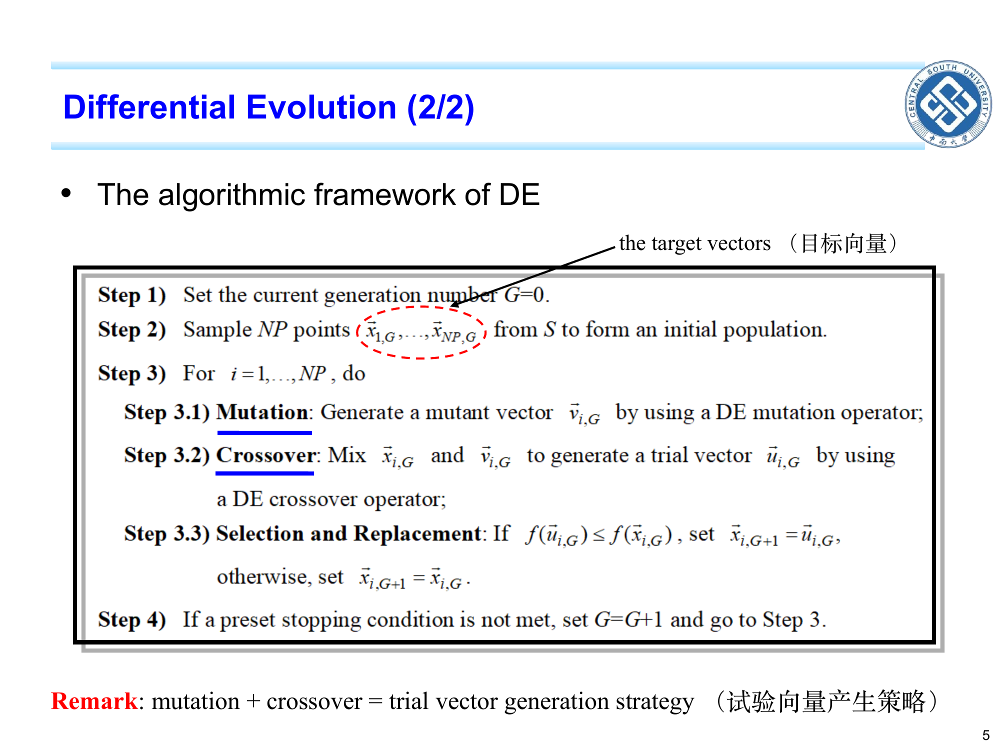

### 手算：DE/rand/1/bin 的一代

设目标函数 $f(x)=(x-5)^2$，最优 $x^*=5$、$f(x^*)=0$。种群规模 $NP=4$，第 $G$ 代的 4 个目标向量是 $x_{1,G}=1$、$x_{2,G}=3$、$x_{3,G}=6$、$x_{4,G}=8$，对应函数值 $16$、$4$、$1$、$9$，当前最优是 $x_{3,G}=6$。参数取 $F=0.8$、$CR=0.9$。下面完整跑 $i=1$ 的更新 [p. 6](http://10.188.31.55:5244/Nextcloud/School/Compute-Intelligence/converted/Chapter%204_%20Introduction%20to%20Differential%20Evolution.pdf#page=6)。

**Step 1 抽下标**：从 $\{1,2,3,4\}\setminus\{1\}=\{2,3,4\}$ 中互不相同地抽 $r_1,r_2,r_3$，这次抽到 $r_1=2$、$r_2=3$、$r_3=4$。

**Step 2 变异**：差分向量 $x_{r_2,G}-x_{r_3,G}=6-8=-2$。

$$
\begin{aligned}
v_{1,G} &= x_{r_1,G} + F \cdot (x_{r_2,G} - x_{r_3,G}) \\
&= x_{2,G} + 0.8 \cdot (x_{3,G} - x_{4,G}) \\
&= 3 + 0.8 \cdot (-2) = 1.4
\end{aligned}
$$

**Step 3 二项式交叉**：只有 1 维（$D=1$），$j_{rand}=1$ 必为强制维，$u_{1,G}=v_{1,G}=1.4$。这里因为 $D=1$，$CR$ 的大小已经不重要——只要 $j_{rand}=1$，试验向量就完全等于变异向量 [p. 7](http://10.188.31.55:5244/Nextcloud/School/Compute-Intelligence/converted/Chapter%204_%20Introduction%20to%20Differential%20Evolution.pdf#page=7)。

**Step 4 贪婪选择**：

$$
f(u_{1,G}) = f(1.4) = (-3.6)^2 = 12.96
\qquad
f(x_{1,G}) = f(1) = (-4)^2 = 16
$$

$12.96<16$，试验向量更优，所以 $x_{1,G+1}=u_{1,G}=1.4$ [p. 5](http://10.188.31.55:5244/Nextcloud/School/Compute-Intelligence/converted/Chapter%204_%20Introduction%20to%20Differential%20Evolution.pdf#page=5)。个体 1 从 $x=1$ 跳到了 $x=1.4$，离真实最优 $x^*=5$ 反而更近了。

#### 变式一：只把 F 改成 1.5

种群、下标、目标函数不变，$F$ 从 $0.8$ 改成 $1.5$ [p. 6](http://10.188.31.55:5244/Nextcloud/School/Compute-Intelligence/converted/Chapter%204_%20Introduction%20to%20Differential%20Evolution.pdf#page=6)：

$$
v_{1,G} = x_{2,G} + 1.5 \cdot (x_{3,G} - x_{4,G}) = 3 + 1.5 \cdot (-2) = 0
$$

$f(0)=25$，$f(1)=16$。变异向量比目标向量更差，即使强制维让它进了试验向量，$u_{1,G}=0$ 的函数值仍然更大，贪婪选择保留 $x_{1,G+1}=x_{1,G}=1$。

结果：$v_{1,G}=0$，$u_{1,G}=0$，$x_{1,G+1}=1$。$F$ 偏大时变异向量可能"跳过头"飞到比原来更差的位置；差分向量的方向正好背离最优时，这种浪费更明显。$F$ 调大的完整效果是：步子变大、多样性提高、偏探索，但偶尔会跳过头 [p. 19](http://10.188.31.55:5244/Nextcloud/School/Compute-Intelligence/converted/Chapter%204_%20Introduction%20to%20Differential%20Evolution.pdf#page=19)。

#### 变式二：升到 3 维，只把 CR 改掉

种群换成 3 维向量 $x_{1,G}=(1,2,3)$、$x_{2,G}=(3,4,5)$、$x_{3,G}=(6,7,8)$、$x_{4,G}=(8,9,10)$，仍取 $r_1=2,r_2=3,r_3=4$，$F=0.8$。差分向量 $(6-8,\,7-9,\,8-10)=(-2,-2,-2)$ [p. 8](http://10.188.31.55:5244/Nextcloud/School/Compute-Intelligence/converted/Chapter%204_%20Introduction%20to%20Differential%20Evolution.pdf#page=8)：

$$
v_{1,G} = x_{2,G} + 0.8 \cdot (-2,-2,-2) = (1.4,\ 2.4,\ 3.4)
$$

**$CR=0.9$**：掷到 $rand=(0.20,\,0.85,\,0.05)$，强制维取 $j_{rand}=2$。第 1 维 $0.20\le 0.9$ 抄变异得 $1.4$；第 2 维是强制维，抄变异得 $2.4$；第 3 维 $0.05\le 0.9$ 抄变异得 $3.4$。试验向量 $u_{1,G}=(1.4,\,2.4,\,3.4)$，恰好等于变异向量——$CR=0.9$ 极高，绝大多数维都满足 $rand_j\le CR$ [p. 7](http://10.188.31.55:5244/Nextcloud/School/Compute-Intelligence/converted/Chapter%204_%20Introduction%20to%20Differential%20Evolution.pdf#page=7)。

**$CR=0.1$**：掷到同样的 $rand=(0.20,\,0.85,\,0.05)$，强制维取 $j_{rand}=2$。第 1 维 $0.20>0.1$ 抄目标得 $1$；第 2 维强制抄变异得 $2.4$；第 3 维 $0.05\le 0.1$ 抄变异得 $3.4$。试验向量 $u_{1,G}=(1,\,2.4,\,3)$，只有 1 维来自变异 [p. 7](http://10.188.31.55:5244/Nextcloud/School/Compute-Intelligence/converted/Chapter%204_%20Introduction%20to%20Differential%20Evolution.pdf#page=7)。

$CR$ 直接决定试验向量在多大程度上"借用"变异向量的信息：$CR$ 大，试验向量更像变异向量（偏探索）；$CR$ 小，试验向量更像目标向量（偏开发，各变量独立优化）。目标函数可分离（$f(x)=\sum_j f_j(x_j)$）时小 $CR$ 反而更好，变量耦合（旋转问题）时大 $CR$ 更合适 [p. 20](http://10.188.31.55:5244/Nextcloud/School/Compute-Intelligence/converted/Chapter%204_%20Introduction%20to%20Differential%20Evolution.pdf#page=20)。

#### 对比：DE/rand/1/bin 与 DE/best/1/bin

仍用 $f(x)=(x-5)^2$、$NP=4$、$F=0.8$、$CR=0.9$、种群 $x=[1,3,6,8]$、当前最优 $x_{best,G}=6$。对 $i=1$ 仍抽 $r_1=2,r_2=3,r_3=4$，差分向量 $=6-8=-2$。

DE/rand/1/bin 的基向量是 $x_{r1,G}=x_{2,G}=3$：

$$
v_{1,G} = 3 + 0.8 \cdot (-2) = 1.4
$$

DE/best/1/bin 的基向量是 $x_{best,G}=6$，差分下标只需 2 个，这里用 $r_1=2,r_2=3$：

$$
v_{1,G} = 6 + 0.8 \cdot (x_{2,G}-x_{3,G}) = 6 + 0.8 \cdot (3-6) = 3.6
$$

DE/rand/1/bin 的变异向量 $1.4$ 远离当前最优 $6$、向目标向量 $1$ 靠拢一点；DE/best/1/bin 的变异向量 $3.6$ 从最优 $6$ 反向迈出一步，$3.6$ 离 $5$ 反而比 $1.4$ 更近。

结论：DE/best/1/bin 让所有变异向量都从当前最优出发，**收敛更快但多样性更低、容易早熟**；DE/rand/1/bin 让基向量随机挑，**探索更强、慢一些但不易卡死**。这是 DE 选型的最经典对比 [p. 18](http://10.188.31.55:5244/Nextcloud/School/Compute-Intelligence/converted/Chapter%204_%20Introduction%20to%20Differential%20Evolution.pdf#page=18)。

"基向量用最优"也不保证每一步都更近。把下标换成 $r_1=2,r_2=4,r_3=3$，DE/rand/1/bin 得 $v_{1,G}=3+0.8(8-6)=4.6$（离 $x^*=5$ 只有 0.4），DE/best/1/bin 得 $v_{1,G}=6+0.8(3-8)=2$（离 $5$ 有 3.0）——同一组参数下 best 反而跳过了头。它快的是长期趋势，不是每一步 [p. 18](http://10.188.31.55:5244/Nextcloud/School/Compute-Intelligence/converted/Chapter%204_%20Introduction%20to%20Differential%20Evolution.pdf#page=18)。

### 改进：CoDE、QOX 与 OXDE

**CoDE（复合差分进化，composite DE）**把"挑哪个策略、选哪组参数"也变成了一个随机过程。预先准备一个策略候选池（DE/rand/1/bin、DE/rand/2/bin、DE/current-to-rand/1）和一个参数候选池（3 组 $(F,\,CR)$ 取值），每个个体每次从两个池里各抽一个组合，生成 3 个试验向量，再取最好的那个进入下一代 [p. 15](http://10.188.31.55:5244/Nextcloud/School/Compute-Intelligence/converted/Chapter%204_%20Introduction%20to%20Differential%20Evolution.pdf#page=15)。

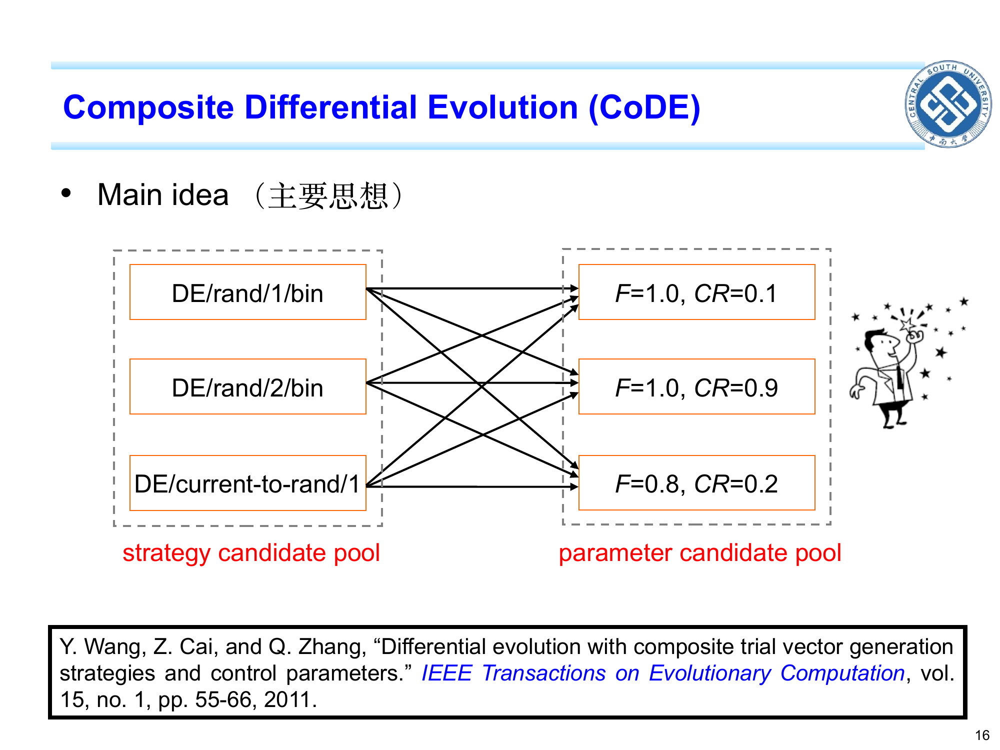


**QOX（量化正交交叉，quantization orthogonal crossover）**的动机是：DE 原有的交叉只能产生父代围出的超长方体的顶点，中间的点造不出来，搜索能力因此受限。QOX 要解决的是"如何向盒子内部也撒点"——先把两个父代围出的区域量化成有限网格点，再用正交设计从中挑几组有代表性的组合 [p. 26](http://10.188.31.55:5244/Nextcloud/School/Compute-Intelligence/converted/Chapter%204_%20Introduction%20to%20Differential%20Evolution.pdf#page=26)。


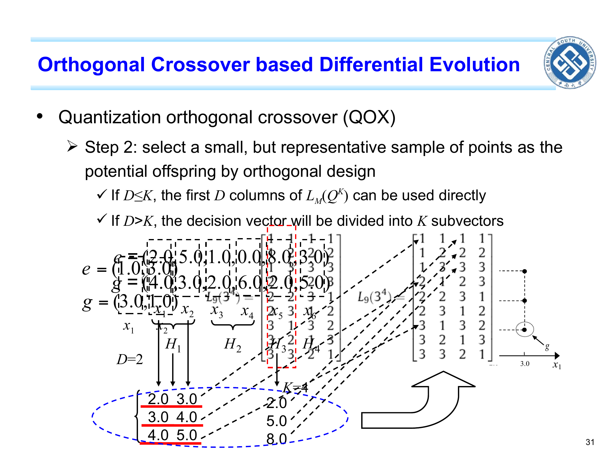

**正交设计（orthogonal design, OED，又称正交试验设计）**是一种"用尽量少的试验代表全部组合"的实验设计方法：$K$ 个因素、每个 $Q$ 个水平，本来要 $Q^K$ 次试验，用正交表 $L_M(Q^K)$ 只做 $M$ 次就有代表性。课件此处把因子数写作 $N$，与"种群规模 $N$"撞车，本讲义第 4、5 两章统一改记因子数为 $K$。正交表的构造、正交性两条性质、因子分析等方法细节不在本章展开，见第 5 章 §5.4 [p. 27](http://10.188.31.55:5244/Nextcloud/School/Compute-Intelligence/converted/Chapter%204_%20Introduction%20to%20Differential%20Evolution.pdf#page=27)。

OXDE 把 QOX 接入任意 DE 变体：用正交表一次生成 $M$ 个候选解，与差分进化的试验向量一起比较取优 [p. 32](http://10.188.31.55:5244/Nextcloud/School/Compute-Intelligence/converted/Chapter%204_%20Introduction%20to%20Differential%20Evolution.pdf#page=32)。

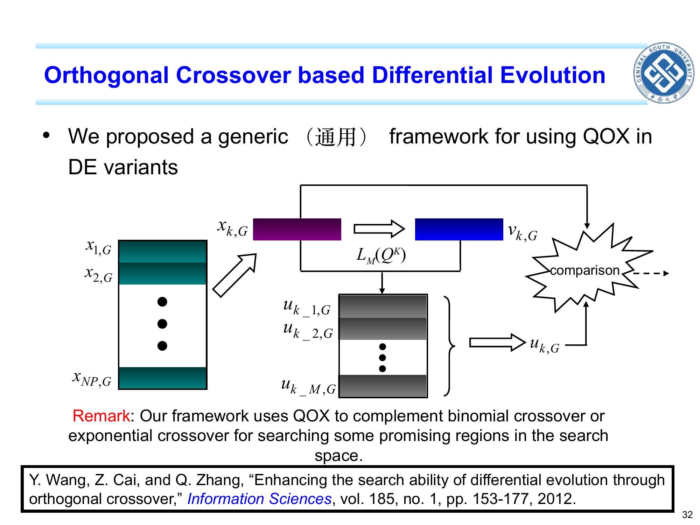

### 怎么判断一个改动有效

DE 的实验口径是固定的：在 IEEE CEC2005 基准的 25 题上跑（单模 F1–F5、基本多模 F6–F12、扩展多模 F13–F14、混合复合 F15–F25）[p. 2](http://10.188.31.55:5244/Nextcloud/School/Compute-Intelligence/converted/Chapter%207_%20Algorithm%20Comparison.pdf#page=2)，每个算法在每题上做 25 或 50 次独立运行，每次记录一次函数误差 $|f(x_{best})-f(x^*)|$ [p. 3](http://10.188.31.55:5244/Nextcloud/School/Compute-Intelligence/converted/Chapter%207_%20Algorithm%20Comparison.pdf#page=3)，用均值与标准差描述收敛表现，再用 Wilcoxon 秩和检验在显著性水平 $\alpha=0.05$ 上比较两个算法 [p. 4](http://10.188.31.55:5244/Nextcloud/School/Compute-Intelligence/converted/Chapter%207_%20Algorithm%20Comparison.pdf#page=4)。预算必须统一在 FES 上（$FES_{max}=10000\times D$），否则"收敛快"只说明代数少，不说明计算量小。

同一口径下的收敛曲线长这样：

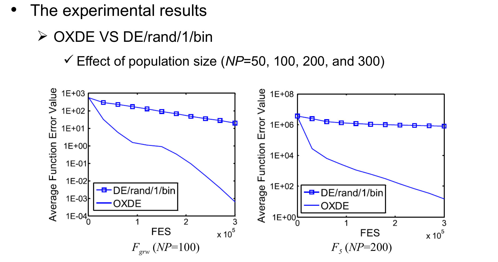

OXDE（DE/rand/1/bin + QOX）在原版 DE/rand/1/bin 的基础上，误差下降更快、最终精度更高 [p. 38](http://10.188.31.55:5244/Nextcloud/School/Compute-Intelligence/converted/Chapter%204_%20Introduction%20to%20Differential%20Evolution.pdf#page=38)。横轴用 FES 而不是代数，保证两个算法在同一计算预算下比较。

### 易错点

> [!WARNING]
> **把 $F$ 当成变异率。** $F$ 是缩放因子，控制差分向量的放大倍数。DE 里没有 GA 意义上的"逐位变异率"——差分向量整体被 $F$ 缩放，然后要么整体进入试验向量、要么不进。$F=0$ 时 $v_{i,G}=x_{r1,G}$，变异算子完全无效，等于没有搜索 [p. 6](http://10.188.31.55:5244/Nextcloud/School/Compute-Intelligence/converted/Chapter%204_%20Introduction%20to%20Differential%20Evolution.pdf#page=6)。

> [!WARNING]
> **把 $CR$ 与第 2 章的 $p_c$ 直接等同。** $CR$ 是"维"的层面：试验向量的每一维独立掷 $rand_j\le CR$ 才抄变异向量，并且强制至少一维来自变异向量（用 $j_{rand}$ 实现）。GA 的 $p_c$ 是"对"的层面，不强制至少一位参与交换。$CR=0$ 时（没有强制维）$u_{i,G}=x_{i,G}$，交叉算子完全无效，等于浪费一次 FES [p. 7](http://10.188.31.55:5244/Nextcloud/School/Compute-Intelligence/converted/Chapter%204_%20Introduction%20to%20Differential%20Evolution.pdf#page=7)。

> [!WARNING]
> **下标 $r_1,r_2,r_3$ 互不相同且不等于 $i$。** 必须从 $\{1,\dots,NP\}\setminus\{i\}$ 中均匀抽取，三件事缺一不可：① 排除 $i$ 本身，否则差分可能为 0、变异方向消失；② 三个下标互不相同，否则差分向量的某一项就退化为 0；③ 每代每维重抽，不能缓存 [p. 6](http://10.188.31.55:5244/Nextcloud/School/Compute-Intelligence/converted/Chapter%204_%20Introduction%20to%20Differential%20Evolution.pdf#page=6)。

## 第 5 章 粒子群优化 (PSO)

### 粒子群优化：速度合成、记忆与拓扑

PSO 的粒子永不淘汰:没有选择算子、没有交叉、没有变异,粒子只会被"挪一挪"位置 [Chapter 5_ Introduction to Particle Swarm Optimization.pptx · p.14](http://10.188.31.55:5244/Nextcloud/School/Compute-Intelligence/converted/Chapter%205_%20Introduction%20to%20Particle%20Swarm%20Optimization.pdf#page=14)。那么问题来了:不淘汰任何粒子,也不让粒子交配或突变,它怎么还能把一群解搜得越来越好?[Chapter 5_ Introduction to Particle Swarm Optimization.pptx · p.4](http://10.188.31.55:5244/Nextcloud/School/Compute-Intelligence/converted/Chapter%205_%20Introduction%20to%20Particle%20Swarm%20Optimization.pdf#page=4)

答案藏在"记着"两个字里:每个粒子记着自己到过的最好位置,整群也记着全局最好位置;速度由"旧速度、自己的历史最优、全群最优"三项合成,位置跟着速度走。PSO 由 Kennedy(社会心理学家)与 Eberhart(电气工程师)在 1995 年提出 [Chapter 5_ Introduction to Particle Swarm Optimization.pptx · p.4](http://10.188.31.55:5244/Nextcloud/School/Compute-Intelligence/converted/Chapter%205_%20Introduction%20to%20Particle%20Swarm%20Optimization.pdf#page=4),灵感来自鸟群觅食与进化计算两个源头 [Chapter 5_ Introduction to Particle Swarm Optimization.pptx · p.5](http://10.188.31.55:5244/Nextcloud/School/Compute-Intelligence/converted/Chapter%205_%20Introduction%20to%20Particle%20Swarm%20Optimization.pdf#page=5)。

#### 鸟群比喻与术语

把一群鸟扔到一片有食物但看不见的草地上找食物。最自然的策略是:**每只鸟一方面朝自己去过的最好位置飞(经验),另一方面朝整群里飞得最远的那只鸟所在位置飞(共享信息)**。PSO 把"鸟"换成了"粒子"(particle),"位置"就是候选解 $\mathbf{x}$,把"朝哪飞、飞多远"叫"速度" $\mathbf{v}$,并让两者一代一代地更新下去。

- **粒子群优化**(particle swarm optimization, PSO)—— 1995 年由 Kennedy 与 Eberhart 提出的一类群体智能算法;一群"粒子"靠速度在搜索空间里移动,既参考自己的历史最优,又参考种群的最优。
- **粒子**(particle)—— PSO 里的一个个体,代表一个候选解。它同时带有"位置"和"速度",并且记着自己到过的最好位置。
- **位置**(position)—— 粒子当前在搜索空间里的那个点,就是候选解 $\mathbf{x}_i^t$ 本身;它是实数向量,各维都是连续量。
- **速度**(velocity, $\mathbf{v}$)—— 粒子"这一步要移动多远、朝哪个方向",也是逐维的实数向量。第 4 章 DE 里的 $v$ 是"变异向量",出现在 $x_{r_1,G} + F(x_{r_2,G} - x_{r_3,G})$ 这种式子里;带迭代上标 $t$ 与维度下标 $j$ 的 $v$ 才是这里的 PSO 速度。
- **个体历史最优**(personal best, $\mathrm{pbest}_i$)—— 第 $i$ 个粒子从第 0 代到当前代为止自己去过的最好位置;只有当前位置比它更优时才更新它。
- **全局最优位置**(global best, $\mathrm{gbest}$)—— 整群到目前为止到过的最好位置。它就是 $\mathbf{x}_{best}$ 在 PSO 里的叫法。
- **邻域最优**(local best, $\mathrm{lbest}_i$)—— 第 $i$ 个粒子在自己那一小撮"邻居"内比出来的最好位置;当"全群"也算一个大邻域时,$\mathrm{lbest}_i$ 就退化成 $\mathrm{gbest}$。
- **拓扑 / 邻域结构**(population topology)—— "谁算谁的邻居、谁的最好位置能传给谁"的网络拓扑:圈子覆盖全群就是 gbest 版本,圈子只覆盖一小撮就是 lbest 版本。
- **加速常量**(acceleration constants, $c_1, c_2$)—— 控制"相信自己的经验"和"相信种群意见"各占多少分量的两个系数,常取 $c_1 = c_2 = 2$。
- **速度上限**(velocity limit, $v_{\max,j}$)—— 第 $j$ 维速度被允许的最大绝对值,防止数值溢出与"飞出搜索空间"。
- **修补算子**(repair operator)—— 粒子位置一旦飞出允许区间 $[L_j, U_j]$,把它"拽回来"的措施。
- **惯性权重**(inertia weight, $\omega$)—— 新速度里"保留多少旧速度"的系数;大 = 冲得猛(偏探索)、小 = 稳下来(偏开发);常用 0.9 线性递减到 0.4。
- **限制系数**(constriction coefficient, $\chi$)—— Clerc 和 Kennedy 提出的一个整体缩小系数,能把速度和位置的爆炸压住,使 $v_{\max}$ 不再必要。
- **正交学习**(orthogonal learning, OL)—— 用正交试验设计在 $\mathrm{pbest}_i$ 与 $\mathrm{lbest}_i$ 的每一维之间挑出最有效的组合,造出一个比简单线性加法更靠谱的"学习榜样" $\mathrm{ptemp}_i$。
- **学习榜样**(learning exemplar, $\mathrm{ptemp}_i$)—— OL-PSO 里粒子"这一段时间要跟谁走"的示范位置,它由正交试验设计临时造出来,与 $\mathrm{pbest}_i$、$\mathrm{lbest}_i$ 都不同。

PSO 的"有记忆"指的就是 $\mathrm{pbest}_i$ 这一条:当前解变差它也不回退,只在当前位置更优时才更新 [Chapter 5_ Introduction to Particle Swarm Optimization.pptx · p.14](http://10.188.31.55:5244/Nextcloud/School/Compute-Intelligence/converted/Chapter%205_%20Introduction%20to%20Particle%20Swarm%20Optimization.pdf#page=14)。GA 的轮盘赌有可能把当前最优个体漏到下一代,DE 的贪婪选择也只比较当前这一代;只有 PSO 的 $\mathrm{pbest}$ 会把历史最优一直记着。

PSO 的两大思想来源画在一起是这样:

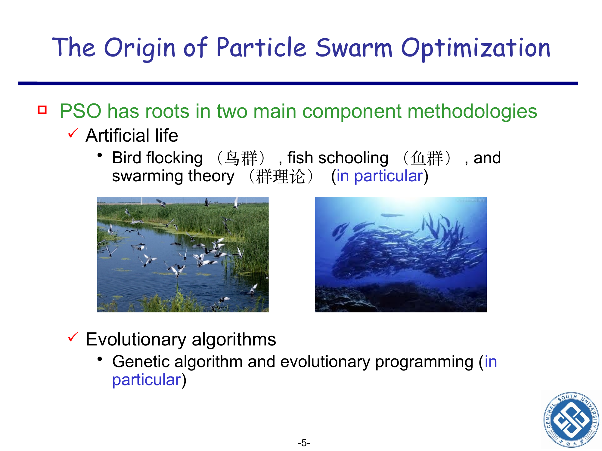

#### 速度更新:三项各管什么

PSO 只有两条公式,所有"粒子在飞"的过程都被这两条公式穷尽。速度更新方程给出第 $t$ 代、第 $i$ 个粒子在第 $j$ 维上的新速度(种群规模 $N$,搜索空间 $D$ 维),由惯性项、认知项、社会项相加得到:

$$
v_{i,j}^{t+1} \;=\; \underbrace{\omega v_{i,j}^{t}}_{\text{惯性项}} \;+\; \underbrace{c_1 r_1\bigl(\mathrm{pbest}_{i,j}^{t} - x_{i,j}^{t}\bigr)}_{\text{认知项}} \;+\; \underbrace{c_2 r_2\bigl(\mathrm{gbest}_j^{t} - x_{i,j}^{t}\bigr)}_{\text{社会项}}
$$

三项都是"沿某个参考方向移动"的形式,和梯度法里"$x$ 的负梯度方向 = 函数值下降最快的方向"是同一类直觉,不需要会求导 [Chapter 5_ Introduction to Particle Swarm Optimization.pptx · p.7](http://10.188.31.55:5244/Nextcloud/School/Compute-Intelligence/converted/Chapter%205_%20Introduction%20to%20Particle%20Swarm%20Optimization.pdf#page=7)。公式里每一项都是向量,加减法逐分量进行;粒子在 $D$ 维空间里飞,每个维度分别计算后再拼成向量 [Chapter 5_ Introduction to Particle Swarm Optimization.pptx · p.7](http://10.188.31.55:5244/Nextcloud/School/Compute-Intelligence/converted/Chapter%205_%20Introduction%20to%20Particle%20Swarm%20Optimization.pdf#page=7)。

- **惯性部分**(inertial part)$\;\omega v_{i,j}^{t}$ —— "保留多少旧速度"。$\omega$ 是惯性权重,常取 $0.9$ 线性递减到 $0.4$ [Chapter 5_ Introduction to Particle Swarm Optimization.pptx · p.18](http://10.188.31.55:5244/Nextcloud/School/Compute-Intelligence/converted/Chapter%205_%20Introduction%20to%20Particle%20Swarm%20Optimization.pdf#page=18)。PPT slide 17 把这一项记作"global search 倾向",slide 18 又叫它"惯性",是同一个东西,这里统一叫惯性项。
- **认知部分**(cognition part)$\;c_1 r_1(\mathrm{pbest}_{i,j}^{t} - x_{i,j}^{t})$ —— "朝我自己以前到过的最好位置挪一点"。$c_1$ 是认知学习因子,常取 $2$;$r_1 \sim U(0,1)$ 是每次、每维重新抽样的均匀随机数。这一项的方向恒指向 $\mathrm{pbest}_{i,j}^{t}$。
- **社会部分**(social part)$\;c_2 r_2(\mathrm{gbest}_j^{t} - x_{i,j}^{t})$ —— "朝全群最好位置挪一点"。$c_2$ 是社会学习因子,常取 $2$;$r_2 \sim U(0,1)$ 同理每次每维重抽。

每一项的方向是定死的,每一项的"长度"都靠随机数 $r_1, r_2$ 来扰动 —— 这正是 PSO 既能用种群的智慧、又不被种群拖着走向同一个点的关键。PPT 把它写成一句 remark:PSO 里"每个变量都独立更新"($j$ 逐维各算一遍,各维的 $r_1, r_2$ 互不共用) [Chapter 5_ Introduction to Particle Swarm Optimization.pptx · p.8](http://10.188.31.55:5244/Nextcloud/School/Compute-Intelligence/converted/Chapter%205_%20Introduction%20to%20Particle%20Swarm%20Optimization.pdf#page=8)。

三项之和得到新速度,新速度叠到老位置得到新位置,画出来是这样:


#### 位置更新与完整流程

位置更新方程把新速度叠到老位置上:

$$
x_{i,j}^{t+1} \;=\; x_{i,j}^{t} \;+\; v_{i,j}^{t+1}.
$$

为什么是加法?因为速度 $\mathbf{v}$ 的物理意义就是"这一步沿哪些方向走多远",位置 = 老位置 + 走过的位移,这是公式本身的要求;**$x_{i,j}$ 是实数分量**(PSO 直接在连续搜索空间里飞,不做 0/1 编码),这一步不含随机数 [Chapter 5_ Introduction to Particle Swarm Optimization.pptx · p.8](http://10.188.31.55:5244/Nextcloud/School/Compute-Intelligence/converted/Chapter%205_%20Introduction%20to%20Particle%20Swarm%20Optimization.pdf#page=8)。

PPT slide 17 给出了三个反例,直接告诉你这三项缺一不可 [Chapter 5_ Introduction to Particle Swarm Optimization.pptx · p.17](http://10.188.31.55:5244/Nextcloud/School/Compute-Intelligence/converted/Chapter%205_%20Introduction%20to%20Particle%20Swarm%20Optimization.pdf#page=17):

- 只保留惯性项($\omega = 1$, $c_1 = c_2 = 0$):粒子会保持当前速度、一直朝同方向飞,直到撞到边界;
- 去掉惯性项($\omega = 0$):搜索范围会随代数"统计性收缩",整群因为没有动量而停滞;
- 三项俱全:粒子既有扩张能力(惯性),又有向 $\mathrm{pbest}$、$\mathrm{gbest}$ 收拢的能力。

经典 PSO 实际跑起来的样子是 PPT slide 10 的伪代码 [Chapter 5_ Introduction to Particle Swarm Optimization.pptx · p.10](http://10.188.31.55:5244/Nextcloud/School/Compute-Intelligence/converted/Chapter%205_%20Introduction%20to%20Particle%20Swarm%20Optimization.pdf#page=10):


对应到步骤:

1. 初始化每个粒子的位置 $\mathbf{x}_i^0$,常用 $x_{i,j}^0 = L_j + (U_j - L_j)\cdot \mathrm{rand}$,其中 $\mathrm{rand} \sim U(0,1)$。
2. 初始化速度 $\mathbf{v}_i^0$,常用全 0 或小范围随机。
3. 把"自己当前位置"暂时设为 $\mathrm{pbest}_i^0$(还没飞过)。
4. 选出当前种群里适应度最高的粒子位置,记为 $\mathrm{gbest}^0$。
5. 循环:对每个粒子 $i$ 的每个维度 $j$,依速度公式 $\omega v_{i,j}^t + c_1 r_1(\mathrm{pbest}_{i,j}^t - x_{i,j}^t) + c_2 r_2(\mathrm{gbest}_j^t - x_{i,j}^t)$ 算新速度,再算新位置 $x_{i,j}^{t+1} = x_{i,j}^t + v_{i,j}^{t+1}$。
6. 修补:若新位置越过 $[L_j, U_j]$,调用修补算子。
7. 更新 $\mathrm{pbest}_i$:若 $f(\mathbf{x}_i^{t+1})$ 比 $f(\mathrm{pbest}_i^t)$ 更优,则 $\mathrm{pbest}_i^{t+1} \leftarrow \mathbf{x}_i^{t+1}$;否则保留。
8. 更新 $\mathrm{gbest}$:在所有粒子的 $\mathrm{pbest}$ 里挑出当前最优。
9. 终止条件:达到最大代数、达到适应度阈值、或连续若干代不再改善。

#### 速度上限与修补算子

速度太大有两个坏处:一是数值可能溢出(浮点表示范围有限),二是粒子直接飞出搜索空间。常用做法是事先给每维设一个上限 $v_{\max,j}$,常取 $v_{\max,j} \approx U_j - L_j$ [Chapter 5_ Introduction to Particle Swarm Optimization.pptx · p.12](http://10.188.31.55:5244/Nextcloud/School/Compute-Intelligence/converted/Chapter%205_%20Introduction%20to%20Particle%20Swarm%20Optimization.pdf#page=12)。$v_{\max}$ 还有三条副作用 [Chapter 5_ Introduction to Particle Swarm Optimization.pptx · p.11](http://10.188.31.55:5244/Nextcloud/School/Compute-Intelligence/converted/Chapter%205_%20Introduction%20to%20Particle%20Swarm%20Optimization.pdf#page=11):

1. 防溢出;
2. 模拟"人类学习与态度改变是增量式的"这一直觉;
3. 决定搜索粒度 —— 上限越小,粒子每一步能挪的距离越小,搜索的"刻度"越细。

粒子位置越界时调用修补算子,PPT slide 11 列了三种常见做法 [Chapter 5_ Introduction to Particle Swarm Optimization.pptx · p.11](http://10.188.31.55:5244/Nextcloud/School/Compute-Intelligence/converted/Chapter%205_%20Introduction%20to%20Particle%20Swarm%20Optimization.pdf#page=11):

- **直接拉回边界**:$x_{i,j}^{t+1} = L_j$ 若 $x_{i,j}^{t+1} < L_j$,$x_{i,j}^{t+1} = U_j$ 若 $x_{i,j}^{t+1} > U_j$;
- **往中点拉**:$x_{i,j}^{t+1} = (x_{i,j}^{t} + L_j)/2$ 或 $(x_{i,j}^{t} + U_j)/2$;
- **镜像反弹**:$x_{i,j}^{t+1} = 2L_j - x_{i,j}^{t+1}$ 若越下界,$x_{i,j}^{t+1} = 2U_j - x_{i,j}^{t+1}$ 若越上界。

#### 参数:$c_1$、$c_2$ 与惯性权重 $\omega$

PPT slide 12 给出口诀:常取 $c_1 = c_2 = 2$,太低会让粒子在群里漫游很久才被拉回来,太高会让粒子猛烈地冲向目标 [Chapter 5_ Introduction to Particle Swarm Optimization.pptx · p.12](http://10.188.31.55:5244/Nextcloud/School/Compute-Intelligence/converted/Chapter%205_%20Introduction%20to%20Particle%20Swarm%20Optimization.pdf#page=12)。两个边界情形常考,它们是速度公式的直接推论:

- $c_1 = 0$:粒子没有认知,只跟着 $\mathrm{gbest}$ 走。种群会迅速被 $\mathrm{gbest}$ 拖死,易早熟。
- $c_2 = 0$:粒子没有社会,只朝着自己的 $\mathrm{pbest}_i$ 走。退化为 $N$ 个粒子各自独立爬山,完全失去群智能。

这两个退化例子正好标出了两个系数各自管什么:$c_1$ 管"还信不信自己的历史最优",$c_2$ 管"还信不信群体的意见"。按"探索 vs 开发"的口径,调大 $\omega$、$c_1$、$c_2$ 都翻译成"更偏探索"(更不易早熟、收敛更慢),调小则"更偏开发"。

$\omega$ 的两条经验来自 PPT slide 18 [Chapter 5_ Introduction to Particle Swarm Optimization.pptx · p.18](http://10.188.31.55:5244/Nextcloud/School/Compute-Intelligence/converted/Chapter%205_%20Introduction%20to%20Particle%20Swarm%20Optimization.pdf#page=18):

- **中等常数**:如 $0.9 < \omega < 1.2$;
- **线性递减**:从 $\omega^{(0)} = 0.9$ 线性降到 $\omega^{(T_{\max})} = 0.4$。

为什么这么选?前期 $\omega$ 大,粒子冲得猛,搜索覆盖大半个空间(偏探索);后期 $\omega$ 小,粒子稳下来,在已知好解附近细挖(偏开发)。这是"探索 vs 开发"在 PSO 中的标准落地方式:**同一个 $\omega$ 时刻在变,前期偏探索、后期偏开发,所以判断"此刻偏哪边"先看 $\omega$ 走到哪一段**。

#### 限制系数 $\chi$:把爆炸压住

经典 PSO 的三项都是随机加权和,速度和位置有可能"越滚越大、冲向无穷",这种病叫**爆炸**(explosion) [Chapter 5_ Introduction to Particle Swarm Optimization.pptx · p.19](http://10.188.31.55:5244/Nextcloud/School/Compute-Intelligence/converted/Chapter%205_%20Introduction%20to%20Particle%20Swarm%20Optimization.pdf#page=19)。Clerc 和 Kennedy 在 PPT slide 20 提出限制系数(constriction coefficient)$\chi$,把整条公式再乘上 $\chi$ [Chapter 5_ Introduction to Particle Swarm Optimization.pptx · p.20](http://10.188.31.55:5244/Nextcloud/School/Compute-Intelligence/converted/Chapter%205_%20Introduction%20to%20Particle%20Swarm%20Optimization.pdf#page=20):

$$
v_{i,j}^{t+1} \;=\; \chi\Bigl[\,v_{i,j}^{t} + c_1 r_1\bigl(\mathrm{pbest}_{i,j}^{t} - x_{i,j}^{t}\bigr) + c_2 r_2\bigl(\mathrm{gbest}_j^{t} - x_{i,j}^{t}\bigr)\Bigr],
$$

其中 $\chi = 2/\bigl| 2 - \varphi - \sqrt{\varphi^2 - 4\varphi}\,\bigr|$,$\varphi = c_1 + c_2$,且要求 $\varphi > 4$。常用 $\varphi = 4.1$,得 $\chi \approx 0.729844$;此时取 $c_1 = c_2 = 2.05$,有 $\chi c_1 = \chi c_2 \approx 0.729844 \times 2.05 = 1.496180$。

PPT slide 21 给出三条优点 [Chapter 5_ Introduction to Particle Swarm Optimization.pptx · p.21](http://10.188.31.55:5244/Nextcloud/School/Compute-Intelligence/converted/Chapter%205_%20Introduction%20to%20Particle%20Swarm%20Optimization.pdf#page=21):

1. 爆炸能被压住;
2. $v_{\max}$ 变得不必要;
3. 限制系数能**保证收敛到局部最优** —— 这一条只到"局部最优"这一层,到不了"全局最优"。

但 Eberhart 与 Shi 的实验表明:加上 $v_{\max} \approx U_j - L_j$ 仍然能进一步改善性能 [Chapter 5_ Introduction to Particle Swarm Optimization.pptx · p.21](http://10.188.31.55:5244/Nextcloud/School/Compute-Intelligence/converted/Chapter%205_%20Introduction%20to%20Particle%20Swarm%20Optimization.pdf#page=21),所以 $v_{\max}$ 不必,但加它通常不亏。这两句不矛盾:"理论不必"来自 $\chi$ 提供的收敛保证,"实操推荐"来自实验——限制系数只保证收敛,不保证收敛得快,也不保证收敛到的正是想要的解。

#### 拓扑:gbest 与 lbest

PPT slide 7 同时给出 global version 与 local version [Chapter 5_ Introduction to Particle Swarm Optimization.pptx · p.7](http://10.188.31.55:5244/Nextcloud/School/Compute-Intelligence/converted/Chapter%205_%20Introduction%20to%20Particle%20Swarm%20Optimization.pdf#page=7):

- **gbest 拓扑**:每个粒子都能看到整群的 $\mathrm{gbest}$,种群被一个"中心点"拉紧,收敛快但易早熟;
- **lbest 拓扑**:每个粒子只能看到自己那一小圈(通常用环形拓扑:粒子 $i$ 的邻域是 $\{i-1, i, i+1\}$ 等)的 $\mathrm{lbest}_i$,种群被切成若干子群,信息传播较慢但更抗早熟。

**为什么 lbest 更抗早熟**?因为 $\mathrm{gbest}$ 的社会吸引过强,所有粒子被一个点牵着,多样性提前丢光;$\mathrm{lbest}$ 把社会吸引分散到若干个"局部最好",粒子之间在空间里能保持散布 —— 这正是 slide 7 把"种群拓扑"列为可调设计量的原因。

于是判断"此刻偏探索还是偏开发"有三个旋钮:$\omega$ 决定时间上的前后期,$c_1$、$c_2$ 决定信任的分配,拓扑决定信息流通的范围。**gbest 偏开发**(收敛快,代价是早熟风险),**lbest 偏探索**(收敛慢,换来多样性)。

#### OL-PSO 与正交试验设计

第 4 章(DE)的 QOX(量化正交交叉)只讲动机与几何,正交设计的方法细节放在这里。

**OL-PSO 的动机**是:经典 PSO 用 $\mathrm{pbest}_i$ 与 $\mathrm{lbest}_i$ 的线性相加来更新速度,这种学习策略可能造成**振荡**(oscillation,抖动)与**不高效**(inefficiency) [Chapter 5_ Introduction to Particle Swarm Optimization.pptx · p.22](http://10.188.31.55:5244/Nextcloud/School/Compute-Intelligence/converted/Chapter%205_%20Introduction%20to%20Particle%20Swarm%20Optimization.pdf#page=22)。PPT slide 22 的数值例取

$$
\min f(\mathbf{x}) = x_1^2 + x_2^2 + x_3^2,\qquad
\mathbf{x}_i^t = [2, 5, 2],\qquad
\mathrm{pbest}_i^t = [0, 2, 5],\qquad
\mathrm{lbest}_i^t = [5, 0, 1].
$$

该页以正交学习构造学习榜样 $\mathrm{ptemp}_i^t = [0, 0, 1]$,函数值从 $f(\mathbf{x}_i^t)=33$ 降至 $f(\mathrm{ptemp}_i^t)=1$。这组数值只能说明该例中的学习榜样更好,不能据此推出每一次线性学习都会变差。一般情况下,当 $\mathrm{pbest}_i$ 与 $\mathrm{lbest}_i$ 的各维分量给出互相冲突的方向时,它们的线性组合可能越过较好的区域,从而得到更差的位置;这是线性组合在特定参数和随机抽样下可能出现的情形,不是上面数值例所证明的结论。


**正交试验设计**(OED, orthogonal experimental design):在 $K$ 种变量(称**因子**,factor)、每种变量 $Q$ 个水平(level)的设定下,本该做 $Q^K$ 次"实验"(称**完全因子实验**),OED 用正交表只挑 $M$ 次有代表性的实验(称**部分因子实验**) [Chapter 5_ Introduction to Particle Swarm Optimization.pptx · p.24](http://10.188.31.55:5244/Nextcloud/School/Compute-Intelligence/converted/Chapter%205_%20Introduction%20to%20Particle%20Swarm%20Optimization.pdf#page=24)。

**两个符号说明**:(1) PPT 原文把因子数写作 $N$(所以完全因子实验记作 $Q^N$),这个 $N$ 与全书"种群规模 $N$"直接撞车,第 4、5 两章统一改记 $K$,即 PPT 此处的 $N$ 就是这里的 $K$。(2) 水平数 $Q$ 与第 2 章轮盘赌的累积概率 $q_i$ 靠大小写区分:$Q$ 只用于正交设计,$q_i$ 只用于累积概率。

**正交表**(orthogonal array,PPT 原文写作"正交矩阵",这里统一叫"正交表")记作 $L_M(Q^K)$:**$K$ 个因子、每个 $Q$ 个水平、一共 $M$ 组组合**。常用的两位级正交表 $L_8(2^7)$ 由 PPT slide 25 给出 [Chapter 5_ Introduction to Particle Swarm Optimization.pptx · p.25](http://10.188.31.55:5244/Nextcloud/School/Compute-Intelligence/converted/Chapter%205_%20Introduction%20to%20Particle%20Swarm%20Optimization.pdf#page=25):

$$
L_8(2^7) \;=\;
\begin{bmatrix}
1 & 1 & 1 & 1 & 1 & 1 & 1 \\
1 & 1 & 1 & 2 & 2 & 2 & 2 \\
1 & 2 & 2 & 1 & 1 & 2 & 2 \\
1 & 2 & 2 & 2 & 2 & 1 & 1 \\
2 & 1 & 2 & 1 & 2 & 1 & 2 \\
2 & 1 & 2 & 2 & 1 & 2 & 1 \\
2 & 2 & 1 & 1 & 2 & 2 & 1 \\
2 & 2 & 1 & 2 & 1 & 1 & 2
\end{bmatrix}
$$

PPT slide 25 给出正交性的两条性质 [Chapter 5_ Introduction to Particle Swarm Optimization.pptx · p.25](http://10.188.31.55:5244/Nextcloud/School/Compute-Intelligence/converted/Chapter%205_%20Introduction%20to%20Particle%20Swarm%20Optimization.pdf#page=25):

1. **每列中**:每个水平(1 或 2)出现的次数相同;
2. **任意两列之间**:每一种水平组合(1,1)、(1,2)、(2,1)、(2,2)出现的次数相同。

正因为这两个"公平"性质,从正交表里挑出来的 $M$ 个组合对因子集合是"最有代表性的"。上面的 $L_8(2^7)$ 可以自己数一遍:每一列两个水平各出现 4 次;任取两列,四种组合各出现 2 次。

**因子分析**(factor analysis):对正交表生成的 $M$ 个实验结果,按下式统计每个因素取每个水平时的平均表现 [Chapter 5_ Introduction to Particle Swarm Optimization.pptx · p.26](http://10.188.31.55:5244/Nextcloud/School/Compute-Intelligence/converted/Chapter%205_%20Introduction%20to%20Particle%20Swarm%20Optimization.pdf#page=26):

$$
S_{nq} \;=\; \frac{\sum_{m=1}^{M} f(\mathbf{x}_m) \cdot z_{mnq}}{\sum_{m=1}^{M} z_{mnq}},
$$

其中 $z_{mnq}$ 是 0/1 指示量(第 $m$ 组实验中第 $n$ 个因素是否取了第 $q$ 个水平)。$S_{nq}$ 小(最小化时)的那个水平就是"更好的水平"。

**OL 策略的实操**(PPT slide 27 [Chapter 5_ Introduction to Particle Swarm Optimization.pptx · p.27](http://10.188.31.55:5244/Nextcloud/School/Compute-Intelligence/converted/Chapter%205_%20Introduction%20to%20Particle%20Swarm%20Optimization.pdf#page=27)):

1. 把 $\mathrm{pbest}_i$ 与 $\mathrm{lbest}_i$ 的每一维当作一个因子,2 个水平(取自 $\mathrm{pbest}_i$ 或 $\mathrm{lbest}_i$)。
2. 用 $L_{M}(2^{K})$ 生成 $M$ 个候选向量。
3. 因子分析算出每一维"更好的水平",拼成新的 $\mathrm{ptemp}_i$。
4. 把速度公式中的 $\mathrm{lbest}$ 替换成 $\mathrm{ptemp}_i$:$v_{i,j}^{t+1} = \omega v_{i,j}^t + c r_j (\mathrm{ptemp}_{i,j}^t - x_{i,j}^t)$。
5. 当 $\mathrm{ptemp}_i$ 不再能让 $x_i$ 改善时,重新造一个。

**代价**:每代多花 $M$ 次函数评价(要评测 $M$ 个候选向量,见上面第 2 步)。所以 OL-PSO 比经典 PSO 更贵,换来的是一份更靠谱的学习榜样。

#### 三个手算例子

**例:2 维粒子的一次更新。** 2 维搜索空间,第 $t$ 代第 $i$ 个粒子的状态如下:

$$
\mathbf{x}_i^t = (1, 2), \quad \mathbf{v}_i^t = (0.5, -0.3), \quad
\mathrm{pbest}_i^t = (0.5, 1), \quad \mathrm{gbest}^t = (0, 0).
$$

参数:$\omega = 0.5$,$c_1 = c_2 = 1.5$。本次更新中,第 1 维抽到 $r_{1,1}=0.6$、$r_{2,1}=0.4$;第 2 维独立抽到 $r_{1,2}=0.3$、$r_{2,2}=0.7$ [Chapter 5_ Introduction to Particle Swarm Optimization.pptx · p.8](http://10.188.31.55:5244/Nextcloud/School/Compute-Intelligence/converted/Chapter%205_%20Introduction%20to%20Particle%20Swarm%20Optimization.pdf#page=8)。逐维套速度公式与位置公式。

第 1 维($j=1$):

$$
\begin{aligned}
v_{i,1}^{t+1} &= \omega v_{i,1}^t + c_1 r_1 (\mathrm{pbest}_{i,1}^t - x_{i,1}^t) + c_2 r_2 (\mathrm{gbest}_1^t - x_{i,1}^t) \\
&= 0.5 \times 0.5 + 1.5 \times 0.6 \times (0.5 - 1) + 1.5 \times 0.4 \times (0 - 1) \\
&= 0.25 + 1.5 \times 0.6 \times (-0.5) + 1.5 \times 0.4 \times (-1) \\
&= 0.25 - 0.45 - 0.60 \\
&= -0.80.
\end{aligned}
$$

第 2 维($j=2$):

$$
\begin{aligned}
v_{i,2}^{t+1} &= 0.5 \times (-0.3) + 1.5 \times 0.3 \times (1 - 2) + 1.5 \times 0.7 \times (0 - 2) \\
&= -0.15 + 1.5 \times 0.3 \times (-1) + 1.5 \times 0.7 \times (-2) \\
&= -0.15 - 0.45 - 2.10 \\
&= -2.70.
\end{aligned}
$$

更新位置:$x_{i,1}^{t+1} = 1 + (-0.80) = 0.20$,$x_{i,2}^{t+1} = 2 + (-2.70) = -0.70$。所以 $\mathbf{v}_i^{t+1} = (-0.80, -2.70)$,$\mathbf{x}_i^{t+1} = (0.20, -0.70)$。

**例:改 $\omega$ 看轨迹。** 保持上例的其余参数不变,只把 $\omega$ 改为 $0.9$。惯性项变大,粒子保持更多旧速度。

第 1 维:

$$
\begin{aligned}
v_{i,1}^{t+1} &= 0.9 \times 0.5 + 1.5 \times 0.6 \times (-0.5) + 1.5 \times 0.4 \times (-1) \\
&= 0.45 - 0.45 - 0.60 \\
&= -0.60.
\end{aligned}
$$

第 2 维:

$$
\begin{aligned}
v_{i,2}^{t+1} &= 0.9 \times (-0.3) + 1.5 \times 0.3 \times (-1) + 1.5 \times 0.7 \times (-2) \\
&= -0.27 - 0.45 - 2.10 \\
&= -2.82.
\end{aligned}
$$

位置:$\mathbf{x}_i^{t+1} = (1 + (-0.60),\; 2 + (-2.82)) = (0.40,\; -0.82)$,即 $\mathbf{v}_i^{t+1} = (-0.60, -2.82)$,$\mathbf{x}_i^{t+1} = (0.40, -0.82)$。$\omega$ 从 $0.5$ 升到 $0.9$,惯性项从 $0.25$ 变成 $0.45$、从 $-0.15$ 变成 $-0.27$,新速度里保留下来的旧速度分量更多 —— 这就是 $\omega$ 偏探索的体现,取值依据见 slide 18 的两条经验 [Chapter 5_ Introduction to Particle Swarm Optimization.pptx · p.18](http://10.188.31.55:5244/Nextcloud/School/Compute-Intelligence/converted/Chapter%205_%20Introduction%20to%20Particle%20Swarm%20Optimization.pdf#page=18)。

**例:PSO 与 GA / DE 在同一问题上的对比。** 在 $\min f(x) = x^2$,$x \in [-5, 5]$ 上分别用 GA(二进制 10 位串)、DE(DE/rand/1/bin,$F = 0.8, CR = 0.9$)、PSO($\omega = 0.9 \to 0.4$ 线性、$c_1 = c_2 = 2$)独立跑 100 代,种群规模都是 20,定性比较收敛行为。三种算法的"收敛逻辑"不一样 —— GA 靠选择 + 变异慢爬,DE 靠差分向量大步跳,PSO 靠"飞过去"。

- **GA**:10 位二进制串共 $1024$ 个点,要先把 $x$ 量化成串(精度 $10/1023 \approx 0.0098$)。每代靠轮盘赌、单点交叉、位翻转,典型表现是"前 30 代慢、50 代以后才开始收敛、最终精度受串长限制"。
- **DE**:差分向量 $x_{r_2} - x_{r_3}$ 自动携带当前种群的尺度,$F = 0.8$ 让步子偏大,易探索;$CR = 0.9$ 让后代多样。收敛较快,但易早熟(贪婪选择会迅速淘汰多样性)。
- **PSO**:$\omega$ 从 $0.9$ 线性降到 $0.4$,前期粒子飞得猛、覆盖全空间;后期粒子稳下来,在 $\mathrm{gbest}$ 附近细挖。无交叉、无变异、无选择 —— 粒子永不淘汰,所以多样性比 DE 保留得更久。

三者最终都收敛到 $x = 0$;差别在收敛速度、最终精度、抗早熟能力上:PSO 的精度不被编码限制(直接用实数),DE 在大步长时收敛最快,GA 在多峰问题上更鲁棒(交叉 + 变异的组合多)。PSO 的两个参数档位取自 PPT 的常用档:$\omega$ 见 slide 18、$c_1 = c_2 = 2$ 见 slide 12 [Chapter 5_ Introduction to Particle Swarm Optimization.pptx · p.18](http://10.188.31.55:5244/Nextcloud/School/Compute-Intelligence/converted/Chapter%205_%20Introduction%20to%20Particle%20Swarm%20Optimization.pdf#page=18)。

#### 三个最容易写错的地方

> [!WARNING]
> 把 $r_1, r_2$ 当成常数。它们是每次更新粒子、每一维都重新掷一次的均匀随机数,不能约掉、不能合并成常数。错把它们当成 $0.5$,公式就简化成确定的常数倍,丢掉"用随机扰动打破粒子被单一目标拉死"的设计意图 [Chapter 5_ Introduction to Particle Swarm Optimization.pptx · p.7](http://10.188.31.55:5244/Nextcloud/School/Compute-Intelligence/converted/Chapter%205_%20Introduction%20to%20Particle%20Swarm%20Optimization.pdf#page=7)

> [!WARNING]
> 以为 $\omega$ 越大收敛越快。$\omega$ 大 $\Rightarrow$ 探索更强、收敛更慢;$\omega$ 小 $\Rightarrow$ 开发更强、收敛更快但易早熟。"前期大、后期小"的线性递减正是为了让粒子先广搜、再精调 [Chapter 5_ Introduction to Particle Swarm Optimization.pptx · p.18](http://10.188.31.55:5244/Nextcloud/School/Compute-Intelligence/converted/Chapter%205_%20Introduction%20to%20Particle%20Swarm%20Optimization.pdf#page=18)

> [!WARNING]
> 把 $c_1 = 0$ 或 $c_2 = 0$ 当作"无所谓"。$c_1 = 0$ 时粒子被 $\mathrm{gbest}$ 单点拉死,易早熟;$c_2 = 0$ 时粒子退化为各爬各的山,完全失去群智能。写"取 $c_1 = 0$ 节省计算"会失分 [Chapter 5_ Introduction to Particle Swarm Optimization.pptx · p.12](http://10.188.31.55:5244/Nextcloud/School/Compute-Intelligence/converted/Chapter%205_%20Introduction%20to%20Particle%20Swarm%20Optimization.pdf#page=12)

## 第 6 章 计算智能术语体系

### 同一场讨论里的两种说法

跟同学讨论「为什么我的 GA 在这个问题上跑不过 DE」，你说「DE 探索更广」，他说「DE 收敛更快」。这两句话听起来像在描述同一件事，方向却相反：一个说 DE 在搜索空间里看得多，一个说 DE 离最优更近。它们能同时成立，因为探索与开发是一对方向相反的力，任何算法在某一瞬间都只能偏向一边 [p. 3](http://10.188.31.55:5244/Nextcloud/School/Compute-Intelligence/converted/Chapter%206_%20Terminology%20in%20EAs.pdf#page=3)。

第二组对话是同一个问题的另一个侧面。你说「Rosenbrock 不可分离」，老师说「它的等高线是斜的」，两句话是同一件事的两面。地形上变量互相耦合时，变量需要协同变化，只按坐标轴方向做高斯变异就变慢。CMA-ES 在二次问题上快、在 Rosenbrock 上慢，原因是它学习协方差矩阵，把搜索方向转到了地形主轴上 [p. 7](http://10.188.31.55:5244/Nextcloud/School/Compute-Intelligence/converted/Chapter%206_%20Terminology%20in%20EAs.pdf#page=7) [p. 8](http://10.188.31.55:5244/Nextcloud/School/Compute-Intelligence/converted/Chapter%206_%20Terminology%20in%20EAs.pdf#page=8)。

### 六个对子，三个层面

| 术语对子 | 左端含义 | 右端含义 |
|---|---|---|
| 探索 vs 开发 | 种群在搜索空间里覆盖得广 | 当前最优已经接近全局最优 |
| 全局搜索 vs 局部搜索 | 整张地形都搜 | 当前邻域精修 |
| 多样性 vs 收敛性 | 种群里个体彼此不同 | 种群都聚到最优附近 |
| 单模 vs 多模 | 只有一个全局最优 | 全局最优与若干局部最优并存 |
| 可分离 vs 不可分离 | 变量之间不耦合 | 变量之间强耦合 |
| 各向同性 vs 旋转 | 各方向等价 | 不同方向上地形不同 |

这六个对子分属三个层面，不是一个层面的六件事：

- **搜索行为层面**（探索 vs 开发 / 全局 vs 局部）：回答「你在搜索空间里走得多远、多快、多集中」。
- **种群状态层面**（多样性 vs 收敛性）：回答「种群当下长什么样」——个体是分散还是聚拢。
- **问题结构层面**（单模 vs 多模 / 可分离 vs 不可分离 / 各向同性 vs 旋转）：回答「你的问题地形长什么样」。

前两个层面描述算法，第三个层面描述问题。问题结构层面说的就是适应度地形（fitness landscape）——目标函数在搜索空间里的形状，第 1 章 §1.3 讲过 [p. 11](http://10.188.31.55:5244/Nextcloud/School/Compute-Intelligence/converted/Chapter%200_%20%E5%BC%80%E7%AF%87.pdf#page=11)。地形在这里被拆成可分离性和各向同性两个可以判定的性质。算法对不上问题结构，就会出现「跑不快 / 跑不到」。

### 探索与开发：方向相反的两个力

**探索**（exploration）：种群覆盖的搜索空间比例大，不同个体出现在不同的山谷里；算法更可能发现新谷，但单一个体离最优还不够近 [p. 3](http://10.188.31.55:5244/Nextcloud/School/Compute-Intelligence/converted/Chapter%206_%20Terminology%20in%20EAs.pdf#page=3)。

**开发**（exploitation）：种群已经聚到某一个山谷里，正在精细搜索最优邻域；算法更可能把当前最优推到更精确，但探索新谷的能力下降 [p. 3](http://10.188.31.55:5244/Nextcloud/School/Compute-Intelligence/converted/Chapter%206_%20Terminology%20in%20EAs.pdf#page=3)。

判定这两个倾向各用一个数：

- **探索强度** $\sigma_{\text{pop}} = \sqrt{\frac{1}{N}\sum_{i=1}^{N}\|\mathbf{x}_i - \bar{\mathbf{x}}\|^2}$：种群中个体到种群重心的均方根距离，越大越探索。
- **开发强度** $d_{\text{best}} = \|\mathbf{x}_{\text{best}} - \mathbf{x}^*\|$：算法当前最优到问题真实最优的距离，越小越开发。

两个指标通常存在权衡，但并非严格反向：一个种群可以一部分个体继续探索，另一部分个体在当前优良区域开发。

**算法启示**：$\omega$ 偏大（PSO 第 5 章 §5.4）、$p_m$ 偏大（GA 第 2 章 §2.4）、$F$ 偏大（DE 第 4 章 §4.4）偏向探索；$c_2$ 偏大（PSO）、$(\mu{+}\lambda)$（ES 第 3 章 §3.3）偏向开发 [p. 3](http://10.188.31.55:5244/Nextcloud/School/Compute-Intelligence/converted/Chapter%206_%20Terminology%20in%20EAs.pdf#page=3)。


### 全局搜索与局部搜索：愿不愿意跨山谷

**全局搜索**（global search）：把整张地形都纳入考虑，即使当前位置已经靠近最优，也不放弃远方的山谷 [p. 4](http://10.188.31.55:5244/Nextcloud/School/Compute-Intelligence/converted/Chapter%206_%20Terminology%20in%20EAs.pdf#page=4)。

**局部搜索**（local search）：只看当前位置的邻域，只在已经找到的山谷里精细搜索 [p. 4](http://10.188.31.55:5244/Nextcloud/School/Compute-Intelligence/converted/Chapter%206_%20Terminology%20in%20EAs.pdf#page=4)。

这一对与探索/开发高度相关，但强调的点不同：全局 vs 局部讲的是「是否愿意跨山谷」，探索 vs 开发讲的是「种群散不散」。工程上，模拟退火、爬山这类局部搜索等同于开发；GA、DE 这类全局搜索前半段偏探索、后半段偏开发 [p. 4](http://10.188.31.55:5244/Nextcloud/School/Compute-Intelligence/converted/Chapter%206_%20Terminology%20in%20EAs.pdf#page=4)。

**判定标准**：全局搜索在「种群是否跨越多个盆地」上是肯定的；局部搜索只看当前位置到原方向上的最近改进。爬山法是局部搜索的极端——只看当前位置的邻域，接受任何让函数值变好的移动，直到再无改进就停。

**算法启示**：问题只有一个谷底时局部搜索够用，只要盆地一个一个找下去。谷底多于一个、或者不知道谷底有几个，局部搜索会锁死在最先找到的那个谷里；这时要用全局搜索——GA、DE 靠种群同时占住多个盆地，把搜索方向摊开到整张地形上。


### 多样性与收敛性：同一现象的两次测量

**多样性**（diversity）：种群中个体彼此不同的程度，$\sigma_{\text{pop}}$ 是它常见的数值化指标 [p. 5](http://10.188.31.55:5244/Nextcloud/School/Compute-Intelligence/converted/Chapter%206_%20Terminology%20in%20EAs.pdf#page=5)。

**收敛性**（convergence）：种群正在向某个吸引子（通常是最优解附近）集中的程度，通常用「$\mathbf{x}_{\text{best}}$ 在最近若干代里改善了多少」来量化 [p. 5](http://10.188.31.55:5244/Nextcloud/School/Compute-Intelligence/converted/Chapter%206_%20Terminology%20in%20EAs.pdf#page=5)。

多样性对应探索，收敛性对应开发——但它们是同一现象的两次测量，不必被独立调节，调一个另一个通常就反向变化。

**判定标准**：多样性仍用 $\sigma_{\text{pop}}$；收敛性看最近 $k$ 代里 $\mathbf{x}_{\text{best}}$ 的累计变化量 $\sum_{t=T-k+1}^{T}\|\mathbf{x}_{\text{best}}^{t} - \mathbf{x}_{\text{best}}^{t-1}\|$，越小越收敛。

多样性降到 0 但还没找到全局最优，就是早熟收敛（premature convergence）——种群已经聚拢，收敛却停在了错误的位置。

**算法启示**：这两个数是同一现象的两次测量，调参只能朝一个方向推。要探索就加大 $\sigma_{\text{pop}}$（放大初始种群、抬高变异率），代价是收敛变慢；要收敛就压低 $\sigma_{\text{pop}}$、盯紧 $d_{\text{best}}$，代价是多样性掉光。


### 单模与多模：盆地数决定成败

**单模问题**（unimodal problem）：整个搜索空间里只有一个全局最优，没有局部最优。球面函数 $f(\mathbf{x})=\sum x_i^2$ 是典型单模 [p. 6](http://10.188.31.55:5244/Nextcloud/School/Compute-Intelligence/converted/Chapter%206_%20Terminology%20in%20EAs.pdf#page=6)。

**多模问题**（multimodal problem）：除了全局最优，还有若干个局部最优。典型例子是 Rastrigin $f(\mathbf{x})=10D+\sum[x_i^2-10\cos(2\pi x_i)]$，在 $\mathbb{R}^D$ 上有约 $11^D$ 个局部最优 [p. 6](http://10.188.31.55:5244/Nextcloud/School/Compute-Intelligence/converted/Chapter%206_%20Terminology%20in%20EAs.pdf#page=6)。

**判定标准**：画出地形等高线，数盆地的数量。一个盆地是单模，多个盆地是多模。正式的定量指标是盆地计数（basin count），工程上常用「随机起点爬山，看它收敛到几个不同的最优点」作粗略估计。

局部最优的数量随维数指数增长，Rastrigin 在 $\mathbb{R}^D$ 上就有约 $11^D$ 个。按「覆盖所有局部最优」来定种群规模这条路走不通，实际 $N$ 要结合维度、采样策略和 FES 预算来定。

**算法启示**：多模问题要求种群保持多样性，否则一旦掉进局部最优就跑不出来。单模：开发优先，$\omega$ 偏小、$p_m$ 偏小、$c_2$ 偏大。多模：探索优先，$\omega$ 偏大、$p_m$ 偏大、$c_2$ 偏小，或者改用 lbest 拓扑（PSO 第 5 章 §5.4） [p. 6](http://10.188.31.55:5244/Nextcloud/School/Compute-Intelligence/converted/Chapter%206_%20Terminology%20in%20EAs.pdf#page=6)。


### 可分离与不可分离：Hessian 的非对角元

**可分离问题**（separable problem）：目标函数可以写成 $f(\mathbf{x}) = \sum_{j=1}^{D} f_j(x_j)$，变量之间互不影响，可以逐维独立优化。$f = x + y$ 是可分离的，最优点可以分别对 $x$ 和 $y$ 优化 [p. 7](http://10.188.31.55:5244/Nextcloud/School/Compute-Intelligence/converted/Chapter%206_%20Terminology%20in%20EAs.pdf#page=7)。

**不可分离问题**（non-separable problem）：变量之间强耦合，一个变量的最优值取决于其他变量的值。$f = x \cdot y$ 是不可分离的，固定 $x$ 再优化 $y$，反过来要重新调 $x$ [p. 7](http://10.188.31.55:5244/Nextcloud/School/Compute-Intelligence/converted/Chapter%206_%20Terminology%20in%20EAs.pdf#page=7)。

**判定标准**：形式上，Hessian 矩阵 $H_f$ 是对角阵则 $f$ 可分离，否则不可分离。工程粗判方法：把 $\mathbf{x}$ 的两个坐标分别扰动一个 $\epsilon$，看函数值变化能不能拆成两个独立项 [p. 7](http://10.188.31.55:5244/Nextcloud/School/Compute-Intelligence/converted/Chapter%206_%20Terminology%20in%20EAs.pdf#page=7)。

**算法启示**：可分离问题上 GA、坐标轴方向的高斯变异都够用，因为每个变量可以独立收敛；不可分离问题上必须同时改变多个变量——DE 的差分向量、CMA-ES 的协方差矩阵自适应都是为此设计。


### 各向同性与旋转：等高线的主轴方向

**各向同性**（isotropic）：地形在不同方向上的「曲率」相同——对二次地形而言，等高线是圆，或者 Hessian 与单位阵成比例。主轴沿坐标轴但长短轴不同的椭圆只是未旋转的各向异性 [p. 8](http://10.188.31.55:5244/Nextcloud/School/Compute-Intelligence/converted/Chapter%206_%20Terminology%20in%20EAs.pdf#page=8)。

**旋转地形**（rotated landscape）：最优方向不沿坐标轴——等高线是旋转椭圆 [p. 8](http://10.188.31.55:5244/Nextcloud/School/Compute-Intelligence/converted/Chapter%206_%20Terminology%20in%20EAs.pdf#page=8)。

**判定标准**：画出地形等高线。圆形是各向同性；主轴沿坐标轴但长短轴不同的椭圆是未旋转但各向异性；旋转椭圆是旋转地形。

**算法启示**：各向同性问题上按坐标轴独立搜索就够，单维 GA、PSO 都可以；旋转地形上必须让搜索方向旋转——CMA-ES（第 3 章 §3.4 的协方差矩阵自适应）、DE 的差分向量方向都是为此设计。

旋转地形一定不可分离：否则把坐标轴转到主轴方向上就分开了。

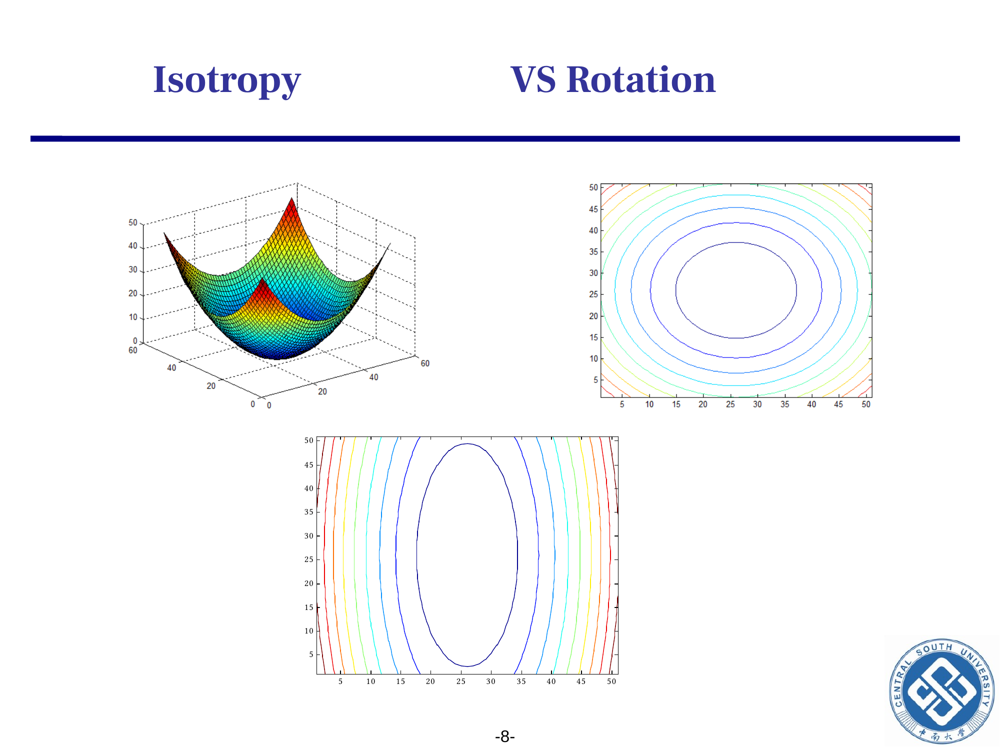

### 两个指标是怎么算出来的

#### 多样性指标 $\sigma_{\text{pop}}$

目标是把「种群有多分散」量化成一个数。

第一步取种群重心。个体 $\{\mathbf{x}_1,\dots,\mathbf{x}_N\}$ 的均值

$$
\bar{\mathbf{x}} = \frac{1}{N}\sum_{i=1}^{N}\mathbf{x}_i
$$

是种群在搜索空间里的平均位置，它把分散的个体归到一点。

第二步算到重心的均方距离。每个个体到重心的距离平方是 $\|\mathbf{x}_i - \bar{\mathbf{x}}\|^2$，对所有个体求平均得

$$
\sigma_{\text{pop}}^2 = \frac{1}{N}\sum_{i=1}^{N}\|\mathbf{x}_i - \bar{\mathbf{x}}\|^2
$$

第三步开方。$\sigma_{\text{pop}}$ 是均方根距离，单位与 $\mathbf{x}$ 相同，与决策变量 $x_j$ 的量纲一致。

物理意义：$\sigma_{\text{pop}}$ 描述种群覆盖搜索空间的能力。$N$ 个点散在 $[-5,5]^D$ 上时，$\sigma_{\text{pop}}$ 的量级约为 5；收敛到最优时，$\sigma_{\text{pop}} \to 0$ [p. 5](http://10.188.31.55:5244/Nextcloud/School/Compute-Intelligence/converted/Chapter%206_%20Terminology%20in%20EAs.pdf#page=5)。

#### 不可分离的形式化判定

对 $f(\mathbf{x})$ 求二阶偏导，得 Hessian 矩阵

$$
H_f(\mathbf{x}) = \begin{pmatrix}
\frac{\partial^2 f}{\partial x_1^2} & \frac{\partial^2 f}{\partial x_1 \partial x_2} & \cdots & \frac{\partial^2 f}{\partial x_1 \partial x_D} \\
\frac{\partial^2 f}{\partial x_2 \partial x_1} & \frac{\partial^2 f}{\partial x_2^2} & \cdots & \frac{\partial^2 f}{\partial x_2 \partial x_D} \\
\vdots & \vdots & \ddots & \vdots \\
\frac{\partial^2 f}{\partial x_D \partial x_1} & \frac{\partial^2 f}{\partial x_D \partial x_2} & \cdots & \frac{\partial^2 f}{\partial x_D^2}
\end{pmatrix}
$$

$H_f$ 是 $D \times D$ 实对称矩阵（连续二阶偏导相等）。可分离当且仅当 $H_f$ 是对角矩阵：对角元是变量自身的弯曲程度，非对角元（交叉项）是两个变量之间的耦合强度；非对角元全为 0 则可分离，任意非对角元非 0 则不可分离。Rosenbrock $f=100(y-x^2)^2+(1-x)^2$ 在 $x$ 与 $y$ 上交叉耦合，$H_f$ 有非零非对角元，所以不可分离。

工程意义：算法如果只在坐标轴方向变异（各维同向、互不相关），遇到 $H_f$ 有非对角元的问题就慢，必须让搜索方向旋转到主轴方向。CMA-ES 的协方差矩阵学习、DE 的差分向量都属于这一类 [p. 7](http://10.188.31.55:5244/Nextcloud/School/Compute-Intelligence/converted/Chapter%206_%20Terminology%20in%20EAs.pdf#page=7) [p. 8](http://10.188.31.55:5244/Nextcloud/School/Compute-Intelligence/converted/Chapter%206_%20Terminology%20in%20EAs.pdf#page=8)。

### 四个例子

#### 例 6.1：球面函数 $f(\mathbf{x})=\sum x_i^2$ 的术语定位

判断 $f(\mathbf{x})=\sum_{i=1}^{D} x_i^2$ 在搜索空间 $[-5,5]^D$ 上的术语属性。逐对检查：

- **单模 vs 多模**：$f$ 是严格凸函数，只有一个极小点 $\mathbf{x}=\mathbf{0}$，单模。
- **可分离 vs 不可分离**：$H_f = 2I$ 是对角阵，$\frac{\partial^2 f}{\partial x_j \partial x_k}=0$ 对所有 $j\ne k$，可分离。
- **各向同性 vs 旋转**：$H_f$ 比例于单位阵，所有方向曲率相同，各向同性。
- **多样性 vs 收敛性**：单模各向同性，开发就够了，不需要强多样性。

答案：单模 / 可分离 / 各向同性 / 开发优先。这种「简单」问题用什么算法都行，GA、ES、DE、PSO 都能轻松找到 $\mathbf{0}$ [p. 7](http://10.188.31.55:5244/Nextcloud/School/Compute-Intelligence/converted/Chapter%206_%20Terminology%20in%20EAs.pdf#page=7)。

#### 例 6.2：Rosenbrock $f=100(y-x^2)^2+(1-x)^2$ 的术语定位

定义域 $[-2,2]^2$，最优 $(x^*,y^*)=(1,1)$。

- **单模 vs 多模**：$f$ 全局只有一个极小点，单模。
- **可分离 vs 不可分离**：$H_f$ 有非零非对角元（$\frac{\partial^2 f}{\partial x \partial y} = -400x$ 在 $x \ne 0$ 处非零），不可分离。
- **各向同性 vs 旋转**：最小值位于香蕉形窄谷里，谷的主轴沿 $y \approx x^2$ 方向，旋转。
- **多样性 vs 收敛性**：需要探索找谷、再沿着旋转的谷精细搜索，先探索后开发。

答案：单模 / 不可分离 / 旋转 / 探索+开发并用。GA 在 Rosenbrock 上慢，是因为它在坐标轴方向变异，走不出旋转窄谷；CMA-ES 快，是因为它学到协方差矩阵，把搜索方向转到了谷轴上 [p. 8](http://10.188.31.55:5244/Nextcloud/School/Compute-Intelligence/converted/Chapter%206_%20Terminology%20in%20EAs.pdf#page=8)。

#### 例 6.3：二次型 $f(x,y)=x^2+2xy+2y^2$ 的可分离性与旋转

先算 Hessian：

$$
H_f = \begin{pmatrix} 2 & 2 \\ 2 & 4 \end{pmatrix}
$$

非对角元为 2，非零，所以 $f$ 不可分离。

要判旋转，看 Hessian 的主特征向量方向。特征值为 $3 \pm \sqrt{5} \approx 5.236$ 与 $0.764$，对应特征向量约 $(0.53, 0.85)$ 与 $(0.85, -0.53)$。主轴方向 $(0.53, 0.85)$ 不沿坐标轴，所以这是旋转地形 [p. 7](http://10.188.31.55:5244/Nextcloud/School/Compute-Intelligence/converted/Chapter%206_%20Terminology%20in%20EAs.pdf#page=7)。

为什么沿 $x$ 坐标轴的高斯变异对这个问题有效但慢：只沿 $x$ 方向变异能优化掉 $x^2$ 项，但 $2xy+2y^2$ 仍耦合着 $x$——$x$ 变好时 $y$ 的最优点也跟着变，必须反复「优化 $x$ → 重选 $y$ → 再优化 $x$」。算法能跑，但每一步只跨过 $x$ 方向，沿旋转主轴的快路径走不到。

#### 例 6.4：六个对子 → 算法选型

问题：连续优化 $D=10$、多峰、变量弱耦合、地形近似各向同性，该选什么算法。

1. **单模/多模**：多峰 → 算法必须保持多样性，优先探索。
2. **可分离/不可分离**：弱耦合 → 各维可独立优化也可一起优化，问题不大。
3. **各向同性/旋转**：近似各向同性 → 坐标轴方向的高斯变异就够。
4. **综合选型**：多峰 + 各向同性 → DE/rand/1/bin 或 PSO/lbest 都是好选择；ES 用 $(\mu,\lambda)$（只从子代选择），避免 $(\mu{+}\lambda)$ 保留父代导致早熟。
5. **参数提示**：$F=0.5$、$CR=0.9$（DE）；$\omega=0.7 \to 0.4$ 线性递减、$c_1=c_2=1.5$、lbest 拓扑（PSO）。

答案：DE 或 PSO/lbest，不用 CMA-ES（过度杀鸡用牛刀，且各向同性下协方差矩阵学不到有意义的结构）。六个对子是诊断工具：它不能直接告诉你用哪个算法，但能告诉你这个算法为什么跑不动，或者哪个对子是问题的瓶颈。

### 容易踩的坑

> [!WARNING]
> **把「多样性低」当成「算法失败」。** 在单模、凸问题上，多样性降到 0 是收敛成功的标志，算法做完了它该做的事。多样性低只是早熟的必要条件，不是充分条件；判定要看「多样性低」和「当前最优离真实最优还远」同时成立。

> [!WARNING]
> **把「不可分离」当成「旋转地形」。** 不可分离蕴含变量间耦合，但不一定有旋转：$f=x^2+xy$ 不可分离，解的等高线主轴却沿坐标轴，不旋转。判定旋转要看等高线主轴是否沿坐标轴，不是只看 Hessian 有没有非对角元 [p. 7](http://10.188.31.55:5244/Nextcloud/School/Compute-Intelligence/converted/Chapter%206_%20Terminology%20in%20EAs.pdf#page=7)。

> [!WARNING]
> **在多模问题上用 $(\mu{+}\lambda)$-ES 或 gbest 拓扑。** 这两种机制都只留一个吸引子，全群朝当前最优收缩，容易早熟。多模问题必须避免单一吸引子：ES 用 $(\mu,\lambda)$（只看子代），PSO 用 lbest 拓扑（每小撮各自看最优）；DE 因为是一对一贪婪选择，在多模上也有早熟风险，要靠大 $NP$ + 大 $F$ 维持多样性（第 4 章 §4.6）。

## 第 7 章 算法比较方法

### 甲比乙好，凭什么这么说

两个进化算法摆在面前，凭什么说「甲比乙好」？

设想一个真实场景：你跑两个算法 A、B，各跑 25 次，得到 A 的均值误差 $1.2 \times 10^{-3}$、B 的均值误差 $1.0 \times 10^{-3}$。你能说「B 比 A 好」吗？

不能。B 只比 A 小 $0.2 \times 10^{-3}$，而两个算法单次运行的方差可能比这个差距大很多。如果两组样本的均值差异落在样本噪声范围里，这个差异就是统计上不显著的——多跑几次，谁赢谁输可能反过来。算法比较不是看均值谁小，而是看统计显著性 [p. 4](http://10.188.31.55:5244/Nextcloud/School/Compute-Intelligence/converted/Chapter%207_%20Algorithm%20Comparison.pdf#page=4)。

再看一个场景：A 算法 1000 代达到误差 $10^{-6}$，B 算法 2000 代才到。A 收敛快，但函数评价次数不一定少——A 每代评估 200 次，B 每代评估 50 次，A 实际用了 $200 \times 1000 = 2 \times 10^5$ 次，B 只用了 $50 \times 2000 = 1 \times 10^5$ 次。收敛速度要统一在 FES 上，不能统一在代数上 [p. 5](http://10.188.31.55:5244/Nextcloud/School/Compute-Intelligence/converted/Chapter%207_%20Algorithm%20Comparison.pdf#page=5)。

这两件事合起来是一套完整的流程 [p. 1](http://10.188.31.55:5244/Nextcloud/School/Compute-Intelligence/converted/Chapter%207_%20Algorithm%20Comparison.pdf#page=1)：

1. 选基准：IEEE CEC2005 的 25 个测试函数，覆盖单模、基本多模、扩展多模、混合复合四类。
2. 统一预算：所有算法用同一个 FES$_{\text{max}}$、同一个成功阈值 $\varepsilon$。
3. 多次运行：每个算法在每道题上跑 $R \ge 25$ 次独立运行，每次换随机种子。
4. 报成绩单：$\bar{E} \pm \sigma_E$、成功率 SR、平均收敛 FES。
5. 判显著性：Wilcoxon 秩和检验，$\alpha = 0.05$，给出 $+$ / $-$ / $\approx$ 符号。
6. 分类汇总：按四类分别统计胜负，不只给一个总分。

论文里「算法 A 在 25 题里 22 题显著优于 B」这句话，每个数字都对应上面这六步。

### 基准：统一什么才叫公平

基准测试函数（benchmark test function）是一组已知全局最优 $\mathbf{x}^*$ 与 $f(\mathbf{x}^*)$ 的测试问题，用来在统一条件下评价算法。本课程采用 IEEE CEC2005 标准，共 25 题，分四类 [p. 2](http://10.188.31.55:5244/Nextcloud/School/Compute-Intelligence/converted/Chapter%207_%20Algorithm%20Comparison.pdf#page=2)：

| 类别 | 题号 | 说明 |
|---|---|---|
| 单模 unimodal | F1–F5 | 只有一个全局最优 |
| 基本多模 basic multimodal | F6–F12 | 多个全局最优 |
| 扩展多模 expanded multimodal | F13–F14 | 更高维、更多全局最优 |
| 混合复合 hybrid composition | F15–F25 | 多个成分函数线性组合 |

分四类不是形式主义：不同算法擅长的类别不同——ES 擅长单模，DE 擅长基本多模，PSO 擅长扩展多模，GA 在混合复合上仍有竞争力。只给一个总分会被总分掩盖分类，分类报告才看得出算法在哪些类上好。算法在不同类上的表现可以截然不同，所以比较算法必须分类报告，不能只给一个总分 [p. 2](http://10.188.31.55:5244/Nextcloud/School/Compute-Intelligence/converted/Chapter%207_%20Algorithm%20Comparison.pdf#page=2)。


真实工程问题（如 PID 控制器调参）当基准有两条走不通：一是全局最优 $\mathbf{x}^*$ 不知道，算不出函数误差；二是单次评估很贵（例如仿真 1 小时），跑 25 次独立运行代价太大。CEC2005 基准解析可算 $\mathbf{x}^*$、单次评估快、四类覆盖，所以成了论文通用基准 [p. 2](http://10.188.31.55:5244/Nextcloud/School/Compute-Intelligence/converted/Chapter%207_%20Algorithm%20Comparison.pdf#page=2)。

### 预算：FES 与 FES$_{\text{max}}$

适应值评价次数（fitness evaluations, FES）指算法调用目标函数 $f(\mathbf{x})$ 一次的计数 [p. 5](http://10.188.31.55:5244/Nextcloud/School/Compute-Intelligence/converted/Chapter%207_%20Algorithm%20Comparison.pdf#page=5)。最大函数评价次数 FES$_{\text{max}}$ 是算法的算力预算——一个算法最多调用 $f$ 的次数，设完之后它决定算法能跑多久 [p. 2](http://10.188.31.55:5244/Nextcloud/School/Compute-Intelligence/converted/Chapter%207_%20Algorithm%20Comparison.pdf#page=2)。

同一次评估，各算法的花销不同：一个 GA 评估一次种群花 $N$ 次 FES，一个 DE 评估一个试验向量花 1 次 FES。FES$_{\text{max}}$ 的作用就是把两边的算力拉到同一条起跑线上。

用 FES 而不是代数，有两个理由：

- **种群规模差异**：GA 每代通常评估 $N$ 个新个体，DE 每代通常评估 $NP$ 个试验向量，PSO 每代通常评估 $N$ 个移动后的粒子，ES 每代通常评估 $\lambda$ 个子代。同样的 100 代，A、B 用的 FES 不同，无法比较。
- **公平比较**：统一在「FES$_{\text{max}}$ 次函数评估」上——A、B 都跑到 100 万次 FES，谁找到的 $\mathbf{x}_{\text{best}}$ 更好，谁就更优 [p. 2](http://10.188.31.55:5244/Nextcloud/School/Compute-Intelligence/converted/Chapter%207_%20Algorithm%20Comparison.pdf#page=2)。

### 成绩单：多次独立运行

进化算法有随机性：同样的算法、同样的问题、同样的参数，只换随机种子，最终结果就不同。一次运行 $\mathbf{x}_{\text{best}}$ 的好坏只是一个样本点，不能代表算法的能力。多次独立运行（many independent runs）用不同的随机种子把同一个算法重复跑 $R$ 次（通常 $R = 25$ 或 $R = 50$），每次记录最终函数误差 [p. 3](http://10.188.31.55:5244/Nextcloud/School/Compute-Intelligence/converted/Chapter%207_%20Algorithm%20Comparison.pdf#page=3)。

对每次独立运行 $r$，记录三样东西：

- $\mathbf{x}_{\text{best},r}$——算法这次跑出的最优解；
- $E_r = |f(\mathbf{x}_{\text{best},r}) - f(\mathbf{x}^*)|$——函数误差，这是算法比较的唯一硬指标，越接近 0 越好；
- $\text{FES}_r$——这次跑达到成功条件所花的 FES。

然后对 $R$ 次的 $E_r$ 求均值 $\bar{E}$ 与标准差 $\sigma_E$，这两个数字才是算法的成绩单 [p. 3](http://10.188.31.55:5244/Nextcloud/School/Compute-Intelligence/converted/Chapter%207_%20Algorithm%20Comparison.pdf#page=3)。

### 收敛速度：成功率与两个 FES 口径

成功条件（successful condition）通常设一个阈值 $\varepsilon$（如 $0.01$ 或 $10^{-8}$），只要 $E_r \le \varepsilon$ 就称这次运行为成功运行（successful run）[p. 5](http://10.188.31.55:5244/Nextcloud/School/Compute-Intelligence/converted/Chapter%207_%20Algorithm%20Comparison.pdf#page=5)。成功率是成功运行占全部运行的比例：

$$
\text{SR} = \frac{\#\text{successful runs}}{R}
$$

它反映算法鲁棒性——算法跑多少次能成。

收敛速度用 FES 报，分两个口径。只统计成功运行时，分子是成功运行的集合 $S$：

$$
\overline{\text{FES}}_{\mathrm{succ}} = \frac{1}{|S|}\sum_{r \in S}\text{FES}_r
$$

把失败运行也纳入时，先令失败运行的 $\text{FES}_r = \text{FES}_{\text{max}}$，再对全部 $R$ 次求均值：

$$
\overline{\text{FES}}_{\mathrm{all}} = \frac{1}{R}\sum_{r=1}^{R}\text{FES}_r
$$

两个都要报，因为它们回答不同的问题。$\overline{\text{FES}}_{\mathrm{succ}}$ 只说「找到最优时有多快」，「20 次成功 + 5 次失败」这个事实从它里面读不出来；$\overline{\text{FES}}_{\mathrm{all}}$ 把失败拉到 FES$_{\text{max}}$，把成功率也折进了均值——它越大通常意味着成功率越低。

同一个问题、同一个 FES$_{\text{max}}$，谁用的 FES 少，谁就更算力高效 [p. 5](http://10.188.31.55:5244/Nextcloud/School/Compute-Intelligence/converted/Chapter%207_%20Algorithm%20Comparison.pdf#page=5)。

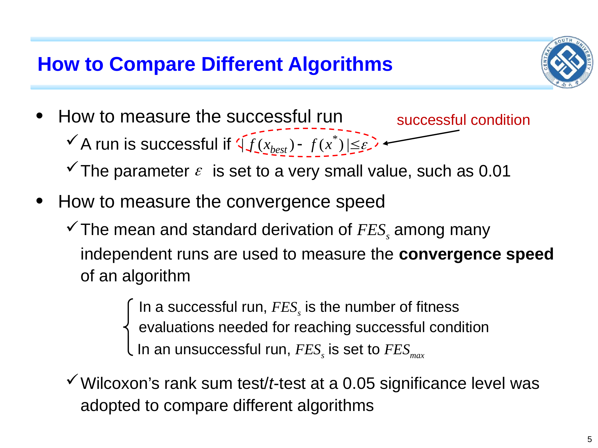

### 判定：Wilcoxon 秩和检验

均值差异 $\bar{E}_A - \bar{E}_B$ 必须通过统计检验才算「显著」。

Wilcoxon 秩和检验（Wilcoxon rank-sum test）是非参数统计检验，把两组样本的秩做对比，检验两组分布的位置或整体分布是否存在差异。只有在两组分布形状等条件相近时，才可把结果近似解释为位置参数（如中位数）的差异，显著性水平常取 $\alpha = 0.05$ [p. 4](http://10.188.31.55:5244/Nextcloud/School/Compute-Intelligence/converted/Chapter%207_%20Algorithm%20Comparison.pdf#page=4)。t 检验（t-test）是参数统计检验，假设两组样本来自正态分布，看两组均值是否显著不同，显著性水平同上。

选哪个：Wilcoxon 不要求正态，对异常值更鲁棒，通常首选；t 检验要求正态，但检验力更强，样本量小的时候（例如 $R = 10$）慎用。

进化算法的函数误差分布通常不严格正态——很多跑出接近 0 的「成功」与跑不出最优的「失败」形成混合分布——所以非参数检验更安全 [p. 4](http://10.188.31.55:5244/Nextcloud/School/Compute-Intelligence/converted/Chapter%207_%20Algorithm%20Comparison.pdf#page=4)。

论文常用三个符号报告结果 [p. 4](http://10.188.31.55:5244/Nextcloud/School/Compute-Intelligence/converted/Chapter%207_%20Algorithm%20Comparison.pdf#page=4)：

- $A + B$：A 显著优于 B；
- $A - B$：A 显著差于 B；
- $A \approx B$：A、B 无显著差异。

### 公式推导

#### 函数误差的均值与方差

用 $R$ 次独立运行的 $E_1, \dots, E_R$ 估计算法在这道问题上的真实均值误差。样本均值是真实均值的无偏估计：

$$
\bar{E} = \frac{1}{R}\sum_{r=1}^{R}E_r
$$

样本方差除以 $R - 1$ 而不是 $R$，是 Bessel 校正——样本方差系统低估总体方差，除以 $R - 1$ 才是无偏估计：

$$
\sigma_E^2 = \frac{1}{R-1}\sum_{r=1}^{R}(E_r - \bar{E})^2
$$

论文通常写作 $\bar{E} \pm \sigma_E$。$\bar{E}$ 反映算法的平均表现，$\sigma_E$ 反映算法的稳定性：$\bar{E}$ 小且 $\sigma_E$ 小的算法既快又稳 [p. 3](http://10.188.31.55:5244/Nextcloud/School/Compute-Intelligence/converted/Chapter%207_%20Algorithm%20Comparison.pdf#page=3)。

#### Wilcoxon 秩和检验的检验量

从两组样本 $X = (X_1, \dots, X_m)$ 与 $Y = (Y_1, \dots, Y_n)$ 检验「两组分布是否存在位置或整体差异」。计算分四步。

第一步，合并排序：把 $X$ 与 $Y$ 合并成 $m + n$ 个数，从小到大排序，记下每个值来自哪个数组。

第二步，赋秩：对每个值赋顺序号；若两个值相等，取平均秩。

第三步，分组秩和：$W_X$ 是 $X$ 中所有值的秩之和，$W_Y$ 是 $Y$ 中所有值的秩之和，二者之和恒为 $(m+n)(m+n+1)/2$。

第四步，算统计量：

$$
U = W_X - \frac{m(m+1)}{2}
$$

当 $m, n \ge 10$ 时，$U$ 近似正态 $\mathcal{N}\left(\frac{mn}{2}, \sqrt{\frac{mn(m+n+1)}{12}}\right)$，查正态表得 $p$ 值。

判定：若 $p < \alpha$（通常 $\alpha = 0.05$），拒绝「两组分布没有差异」的零假设，两组存在统计显著差异。这个结论只在「当前检验假设下」成立，不要无条件把它写成中位数差异。

### 三个例子

#### 例 7.1：均值、标准差与 Wilcoxon 判定

算法 A、B 各跑 5 次，误差 $E_A = [1.2, 1.5, 1.1, 1.3, 1.4] \times 10^{-3}$，$E_B = [1.0, 1.1, 0.9, 1.0, 1.2] \times 10^{-3}$。求均值、标准差，并粗判 B 是否显著优于 A。

均值：

$$
\bar{E}_A = \frac{1.2+1.5+1.1+1.3+1.4}{5} \times 10^{-3} = 1.3 \times 10^{-3}
$$

$$
\bar{E}_B = \frac{1.0+1.1+0.9+1.0+1.2}{5} \times 10^{-3} = 1.04 \times 10^{-3}
$$

标准差（Bessel 校正，分母取 $R - 1 = 4$）：

$$
\sigma_A^2 = \frac{(1.2-1.3)^2 + (1.5-1.3)^2 + (1.1-1.3)^2 + (1.3-1.3)^2 + (1.4-1.3)^2}{4} \times 10^{-6} = 0.025 \times 10^{-6}
$$

$$
\sigma_A \approx 0.158 \times 10^{-3}
$$

$$
\sigma_B^2 = \frac{(1.0-1.04)^2 + (1.1-1.04)^2 + (0.9-1.04)^2 + (1.0-1.04)^2 + (1.2-1.04)^2}{4} \times 10^{-6} = 0.013 \times 10^{-6}
$$

$$
\sigma_B \approx 0.114 \times 10^{-3}
$$

显著性：均值差 $\bar{E}_A - \bar{E}_B = 0.26 \times 10^{-3}$，接近 $2\sigma_A$。Wilcoxon 检验在 $m = n = 5$ 的小样本下不一定显著——粗判 B 略优，但需要更多运行确认 [p. 3](http://10.188.31.55:5244/Nextcloud/School/Compute-Intelligence/converted/Chapter%207_%20Algorithm%20Comparison.pdf#page=3)。

#### 例 7.2：成功率与收敛速度

某算法在 $D = 10$ 球面上跑 25 次，FES$_{\text{max}} = 5 \times 10^4$，成功阈值 $\varepsilon = 10^{-6}$。20 次成功，5 次失败；成功运行所用 FES 列表 $S = [8000, 9200, 7500, 11000, 8500, \dots]$。

成功率：

$$
\text{SR} = \frac{20}{25} = 80\%
$$

只含成功运行的平均 FES（假设列表和为 $1.8 \times 10^5$）：

$$
\overline{\text{FES}}_{\mathrm{succ}} = \frac{1.8 \times 10^5}{20} = 9000
$$

含失败运行的平均 FES（失败运行取 $\text{FES}_r = \text{FES}_{\text{max}} = 5 \times 10^4$）：

$$
\overline{\text{FES}}_{\mathrm{all}} = \frac{20 \times 9000 + 5 \times 50000}{25} = 17200
$$

报告格式：SR = 80%，只含成功运行 9000 FES，含失败运行 17200 FES [p. 5](http://10.188.31.55:5244/Nextcloud/School/Compute-Intelligence/converted/Chapter%207_%20Algorithm%20Comparison.pdf#page=5)。

#### 例 7.3：CEC2005 25 题的完整报告

A、B 两算法在 CEC2005 上各跑 25 次，逐题报告 $\bar{E}_A \pm \sigma_A$ 与 $\bar{E}_B \pm \sigma_B$，并用 Wilcoxon 检验。汇总分三层写。

逐题报告：每题 $i = 1, \dots, 25$ 写一行「$\bar{E}_A \pm \sigma_A$ vs $\bar{E}_B \pm \sigma_B$，Wilcoxon $p =$ 数值，符号 $+$ / $-$ / $\approx$」。

分类汇总：按四类分（F1–F5、F6–F12、F13–F14、F15–F25），统计每类里 $+$ / $-$ / $\approx$ 的数量。

总评：「A 在 F1–F5 上 5/5 优于 B、在 F6–F12 上 4/7 优于 B、在 F13–F14 上 1/2 优于 B、在 F15–F25 上 5/11 优于 B；在 25 题中 A 显著优于 15 题、显著差于 6 题、无显著差异 4 题。」这是进化计算论文的通用格式 [p. 4](http://10.188.31.55:5244/Nextcloud/School/Compute-Intelligence/converted/Chapter%207_%20Algorithm%20Comparison.pdf#page=4)。

### 容易踩的坑

> [!WARNING]
> **用一次运行的 $\mathbf{x}_{\text{best}}$ 做算法比较。** 跑 1 次看谁好就下结论，是把一个样本点当成了算法的能力。进化算法有随机性，必须至少 25 次独立运行取均值与标准差，且 Wilcoxon 检验显著之后才能下结论 [p. 3](http://10.188.31.55:5244/Nextcloud/School/Compute-Intelligence/converted/Chapter%207_%20Algorithm%20Comparison.pdf#page=3)。

> [!WARNING]
> **收敛速度按代数比，或不同算法用不同的 FES$_{\text{max}}$。** A 算法 100 代达到 $10^{-3}$、B 算法 200 代达到，说「A 比 B 快」——种群规模不同，1 代的 FES 不同，这个比较没有意义。同理，A 跑 $10^5$ FES、B 跑 $10^6$ FES 再比高低，B 可能只是因为 FES 多才跑得更准。要比的是达到阈值所花的 FES，且 FES$_{\text{max}}$ 必须对所有参与比较的算法相同 [p. 5](http://10.188.31.55:5244/Nextcloud/School/Compute-Intelligence/converted/Chapter%207_%20Algorithm%20Comparison.pdf#page=5) [p. 2](http://10.188.31.55:5244/Nextcloud/School/Compute-Intelligence/converted/Chapter%207_%20Algorithm%20Comparison.pdf#page=2)。

> [!WARNING]
> **把「无显著差异」说成「两个算法相同」。** Wilcoxon 检验 $p > 0.05$ 只说明在当前样本量下没有足够证据证明它们不同，不等于接受「两者相同」这个原假设。$R$ 增大、换一道问题，显著差异可能就出来了。论文里的 $A \approx B$ 应读作「本测试集与本样本量下未检出显著差异」 [p. 4](http://10.188.31.55:5244/Nextcloud/School/Compute-Intelligence/converted/Chapter%207_%20Algorithm%20Comparison.pdf#page=4)。

### 实证对比：同一个问题上四种算法差了几个数量级

优化某控制器的 $D=10$ 个参数，让一个仿真模型的输出指标最小。同一套预算下换四种算法：

- **GA**：跑 1000 代，误差降到 $10^{-3}$，然后停住；
- **DE**：同样 1000 代，误差降到 $10^{-6}$；
- **PSO**：跑到 500 代就停滞，误差停在 $10^{-2}$；
- **ES**：跑到 2000 代，误差降到 $10^{-5}$。

四种算法都「能用」，代价和精度差了几个数量级。

差别来自算法本身——它们不是同一个算法的不同名字，是四种不同的思想：

- **GA**（genetic algorithm，遗传算法）用二进制串当个体，靠选择 + 交叉 + 变异三步让好片段重组 [p. 4](http://10.188.31.55:5244/Nextcloud/School/Compute-Intelligence/converted/Chapter%202_%20Introduction%20to%20GAs.pdf#page=4)。它擅长离散与组合问题，在连续高维问题上精度被串长卡住。
- **ES/EP**（evolution strategy / evolutionary planning，进化策略/进化规划）用实数当个体，步长也跟着一起进化 [p. 4](http://10.188.31.55:5244/Nextcloud/School/Compute-Intelligence/converted/Chapter%203_%20Introduction%20to%20ES%20and%20EP.pdf#page=4)。它擅长实数连续问题，尤其适合凸 / 单峰地形。
- **DE**（differential evolution，差分进化）用两个随机个体之差当搜索方向，一对一贪婪比较 [p. 4](http://10.188.31.55:5244/Nextcloud/School/Compute-Intelligence/converted/Chapter%204_%20Introduction%20to%20Differential%20Evolution.pdf#page=4)。它擅长实数连续问题，收敛最快但容易早熟。
- **PSO**（particle swarm optimization，粒子群优化）用速度 + 记忆 + 社会信息移动粒子，谁都不淘汰 [p. 4](http://10.188.31.55:5244/Nextcloud/School/Compute-Intelligence/converted/Chapter%205_%20Introduction%20to%20Particle%20Swarm%20Optimization.pdf#page=4)。它擅长实数连续问题，靠拓扑结构（gbest vs lbest）平衡探索与开发。

没有银弹。每种算法都有适用域，选错的代价从「慢几倍」到「根本跑不到好解」。

后面反复要用两个概念：

- **探索 vs 开发**：探索是种群散开、同时覆盖多个候选区域，开发是聚到一处做精细搜索。调大探索强度通常更不容易早熟，但收敛更慢。
- **种群多样性**：种群中个体越分散，越可能同时覆盖多个候选区域；多样性过早消失就是早熟收敛。

### 手算对比：同一个连续问题上四种算法各跑一代

本章没有新公式，但可以把四种算法放在同一个最小问题上各手算一遍，差异出在哪一步一眼可见。

统一设定：求 $\min f(x) = (x-3)^2$，$x \in [-5, 5]$，真实最优 $x^* = 3$，$f(x^*) = 0$，种群规模 $N = 4$。四种算法共用同一组起点：

$$
x^{(0)} = \{-2,\ 0,\ 3,\ 5\},\quad f = \{25,\ 9,\ 0,\ 4\}
$$

#### GA：二进制编码 + 轮盘赌 + 单点交叉 + 位翻转

**设定**：串长 $L = 10$，把 $[-5, 5]$ 切成 $2^{10} = 1024$ 个可取格点，精度 $\Delta = 10/1023 \approx 0.009775$。解码公式 $x = -5 + 10\,\mathrm{bin}/1023$，适应度取 $\mathrm{fit} = 100 - f$（保证所有 $\mathrm{fit} > 0$）。$p_c = 1$，$p_m = 1/L = 0.1$ [p. 10](http://10.188.31.55:5244/Nextcloud/School/Compute-Intelligence/converted/Chapter%202_%20Introduction%20to%20GAs.pdf#page=10) [p. 11](http://10.188.31.55:5244/Nextcloud/School/Compute-Intelligence/converted/Chapter%202_%20Introduction%20to%20GAs.pdf#page=11) [p. 12](http://10.188.31.55:5244/Nextcloud/School/Compute-Intelligence/converted/Chapter%202_%20Introduction%20to%20GAs.pdf#page=12)。

**Step 1 —— 编码**：按 $\mathrm{bin} = \operatorname{round}((x+5)\times 1023/10)$ 取最近格点：

$$
-2 \to 0100110011\;(\mathrm{bin}=307,\ x\approx-1.999022),\quad
0 \to 1000000000\;(\mathrm{bin}=512,\ x\approx0.004888),
$$

$$
3 \to 1100110010\;(\mathrm{bin}=818,\ x\approx2.996090),\quad
5 \to 1111111111\;(\mathrm{bin}=1023,\ x=5).
$$

前三个目标值不能恰落在格点上，格点误差绝对值不超过 $\Delta/2 \approx 0.004888$。

**Step 2 —— 适应度**：由解码后的 $x$ 计算

$$
f \approx \{24.990226,\ 8.970698,\ 0.000015,\ 4.000000\},
$$

$$
\mathrm{fit} \approx \{75.009774,\ 91.029302,\ 99.999985,\ 96.000000\},\qquad
\sum \mathrm{fit} \approx 362.039061.
$$

**Step 3 —— 轮盘赌**：选择概率与累积概率为

$$
p \approx \{0.207187,\ 0.251435,\ 0.276213,\ 0.265165\},\qquad
q \approx \{0.207187,\ 0.458622,\ 0.734835,\ 1.000000\}.
$$

令 $q_0 = 0$，设抽到 $r = (0.31, 0.65, 0.18, 0.92)$，按半开区间 $[q_{k-1}, q_k)$ 选择：

- $r_1 = 0.31 \in [q_1, q_2)$，复制第 2 个（$x \approx 0.004888$，$f \approx 8.970698$）；
- $r_2 = 0.65 \in [q_2, q_3)$，复制第 3 个（$x \approx 2.996090$，$f \approx 0.000015$）；
- $r_3 = 0.18 \in [q_0, q_1)$，复制第 1 个（$x \approx -1.999022$，$f \approx 24.990226$）；
- $r_4 = 0.92 \in [q_3, q_4)$，复制第 4 个（$x = 5$，$f = 4$）。

父代按抽取顺序重排为 $\{0.004888,\ 2.996090,\ -1.999022,\ 5\}$。最优个体的选择概率最大，但轮盘赌只保证统计上的偏好，不保证每次抽样都复制它。

**Step 4 —— 单点交叉**：把重排后的 4 条串两两配对 $\{P_1, P_2\}$ 与 $\{P_3, P_4\}$：

- $P_1 = 1000000000$ 与 $P_2 = 1100110010$，交叉点 $k = 5$。交换后得到 $P_1' = 1000010010$（$x \approx 0.180841$，$f \approx 7.947659$）与 $P_2' = 1100100000$（$x \approx 2.820137$，$f \approx 0.032351$）。
- $P_3 = 0100110011$ 与 $P_4 = 1111111111$，交叉点 $k = 7$。交换后得到 $P_3' = 0100110111$（$x \approx -1.959922$，$f \approx 24.600824$）与 $P_4' = 1111111011$（$x \approx 4.960899$，$f \approx 3.845126$）。

**Step 5 —— 位翻转变异**：假设仅 $P_1'$ 的第 8 位翻转，$1000010010 \to 1000010110$。该子代变为 $x \approx 0.219941$，$f \approx 7.728726$；其余三条串不变。

**新一代**：未计精英保留的四个子代为 $\{0.219941,\ 2.820137,\ -1.959922,\ 4.960899\}$，对应 $f \approx \{7.728726,\ 0.032351,\ 24.600824,\ 3.845126\}$，其中最优为 $x \approx 2.820137$。若采用精英保留，父代中解码后的最优个体 $x \approx 2.996090$（$f \approx 0.000015$）替换最差子代，故实际保留种群的最优值是 $f \approx 0.000015$，而不是精确的 $0$。

#### ES：$(1{+}1)$-ES + 步长自适应

**设定**：父代 $x = 5$（$f = 4$，取种群里最差的那个，看 ES 能不能救回来），步长 $\delta = 0.5$，$D = 1$，$\tau = (\sqrt{1})^{-1} = 1$，步长更新公式 $\delta' = \delta\exp(N(0,1))$ [p. 13](http://10.188.31.55:5244/Nextcloud/School/Compute-Intelligence/converted/Chapter%203_%20Introduction%20to%20ES%20and%20EP.pdf#page=13)。

**Step 1 —— 变异**：抽两个独立标准正态量 $N_1 = -0.4$（用于 $\delta$ 更新）、$N_2 = 1.2$（用于 $x$ 变异）：

- 新步长 $\delta' = 0.5 \times \exp(-0.4) = 0.5 \times 0.6703 = 0.3352$；
- 子代 $x' = 5 + 0.3352 \times 1.2 = 5 + 0.4022 = 5.4022$。

$f(5.4022) = (5.4022 - 3)^2 = 2.4022^2 \approx 5.771$。

**Step 2 —— 选择（加号）**：$f(5.4022) \approx 5.771 > f(5) = 4$，不接受。$x \leftarrow 5$，$\delta \leftarrow 0.3352$。

**再走一步**：抽 $N_1 = 0.7$、$N_2 = -2.1$：

- $\delta' = 0.3352 \times \exp(0.7) = 0.3352 \times 2.0138 = 0.6750$；
- $x' = 5 + 0.6750 \times (-2.1) = 5 - 1.4175 = 3.5825$。

$f(3.5825) = 0.5825^2 \approx 0.339 < 4$，接受。$x \leftarrow 3.5825$，$\delta \leftarrow 0.6750$。

**结果**：2 步后 $x = 3.5825$，$f = 0.339$，离真实最优 $x^* = 3$ 还差一点。ES 直接做实数操作，精度不受 $L$ 限制，但每代只看父代与子代的对比（$(\mu{+}\lambda)$ 也是父子一起比，不像 GA 的整代排序）。

#### DE/rand/1/bin

**设定**：$NP = 4$，$F = 0.8$，$CR = 0.9$，初始种群 $x_{1,G} = 5$，$x_{2,G} = 3$，$x_{3,G} = 0$，$x_{4,G} = -2$。当前最优 $x_{best,G} = 3$ [p. 5](http://10.188.31.55:5244/Nextcloud/School/Compute-Intelligence/converted/Chapter%204_%20Introduction%20to%20Differential%20Evolution.pdf#page=5)。

对 $i = 1$（$x_{1,G} = 5$）跑一代更新：

**Step 1 —— 抽下标**：从 $\{2, 3, 4\}$ 中互不相同地抽 $r_1, r_2, r_3$，假设抽到 $r_1 = 2$，$r_2 = 4$，$r_3 = 3$。

**Step 2 —— 变异**：差分向量 $x_{r_2,G} - x_{r_3,G} = -2 - 0 = -2$。

$$
v_{1,G} = x_{r_1,G} + F\cdot(x_{r_2,G} - x_{r_3,G}) = 3 + 0.8\times(-2) = 3 - 1.6 = 1.4
$$

**Step 3 —— 二项式交叉**：$D = 1$，$j_{rand} = 1$ 必为强制维，$u_{1,G} = v_{1,G} = 1.4$。

**Step 4 —— 贪婪选择**：$f(1.4) = (1.4-3)^2 = 2.56$，$f(5) = 4$。$2.56 < 4$，接受，$x_{1,G+1} = 1.4$。

**结果**：$x_{1,G+1} = 1.4$，$f = 2.56$。对其他三个个体跑同样的步骤，新一代种群大约会向 $x^* = 3$ 聚拢。DE 的变异方向来自种群差分，选择是一对一贪婪；种群聚拢后差分向量变小，搜索可能停滞。

#### PSO：经典 gbest 版本

**设定**：4 个粒子位置 $x^{(0)} = \{-2,\ 0,\ 3,\ 5\}$，$f = \{25,\ 9,\ 0,\ 4\}$。初始速度 $v^{(0)} = \{-0.5,\ 0.5,\ 0,\ 0.5\}$。$\omega = 0.7$，$c_1 = c_2 = 1.5$。每个粒子的初始 $pbest$ 等于自身位置，全局 $gbest = 3$（$f = 0$，第 3 个粒子） [p. 7](http://10.188.31.55:5244/Nextcloud/School/Compute-Intelligence/converted/Chapter%205_%20Introduction%20to%20Particle%20Swarm%20Optimization.pdf#page=7)。

对粒子 1（$x_1 = -2$，$v_1 = -0.5$，$pbest_1 = -2$）做一次更新：

**Step 1 —— 抽随机数**：设本次抽到 $r_1 = 0.4$，$r_2 = 0.7$。

**Step 2 —— 速度更新**：

$$
v_1 \leftarrow 0.7\times(-0.5) + 1.5\times 0.4\times(pbest_1 - x_1) + 1.5\times 0.7\times(gbest - x_1)
$$

$$
= -0.35 + 0.6\times(-2-(-2)) + 1.05\times(3-(-2))
$$

$$
= -0.35 + 0 + 1.05\times 5 = -0.35 + 5.25 = 4.90
$$

**Step 3 —— 位置更新**：

$$
x_1 \leftarrow x_1 + v_1 = -2 + 4.90 = 2.90
$$

$f(2.90) = (2.90-3)^2 = 0.01$。

**Step 4 —— 更新 $pbest$**：$f(2.90) = 0.01 < f(-2) = 25$，所以 $pbest_1 \leftarrow 2.90$。

**结果**：粒子 1 一代后从 $x = -2$ 跳到 $x = 2.90$（$f = 0.01$），几乎到位。PSO 不淘汰粒子，靠 $pbest$ 与 $gbest$ 间接「记忆」好解；速度公式的三项把惯性、个人经验、社会信息合成一个方向与步长。

#### 四解对比：中间变量差在哪一步

| 对比项 | GA | ES(1+1) | DE/rand/1/bin | PSO |
| --- | --- | --- | --- | --- |
| 新解的来源 | 父代串某段互换 + 位翻转 | 父代 + 高斯扰动 | 基向量 + 差分向量 + 交叉 | 旧位置 + 新算出的速度 |
| 是否需要编码 | 是 | 否 | 否 | 否 |
| 选择范围 | 整代 $N$ 个排序 | 父子共 2 个比 | 仅与自己的旧解比 | 无显式选择 |
| 是否淘汰差解 | 是（轮盘赌 / 锦标赛） | 是（子差就丢） | 是（子差就丢） | **否** |
| 「步长」参数 | 隐含在 $p_m$ 与串长 $L$ | $\delta$（逐维、自适应） | $F$（种群差分长度） | $v$（速度，逐维） |
| 新解坐标 | 父代附近（由 $p_c, p_m$ 决定远近） | 父代 $\pm$ 几十倍 $\delta$ | 基向量附近（由 $F$ 决定远近） | 当前位置 $\pm$ 速度 |

四种算法的差异集中在「新解怎么来」和「差解怎么处理」两步，其余的（初始化、终止、迭代代数）在工程上几乎相同 [p. 7](http://10.188.31.55:5244/Nextcloud/School/Compute-Intelligence/converted/Chapter%202_%20Introduction%20to%20GAs.pdf#page=7) [p. 4](http://10.188.31.55:5244/Nextcloud/School/Compute-Intelligence/converted/Chapter%203_%20Introduction%20to%20ES%20and%20EP.pdf#page=4) [p. 5](http://10.188.31.55:5244/Nextcloud/School/Compute-Intelligence/converted/Chapter%204_%20Introduction%20to%20Differential%20Evolution.pdf#page=5) [p. 7](http://10.188.31.55:5244/Nextcloud/School/Compute-Intelligence/converted/Chapter%205_%20Introduction%20to%20Particle%20Swarm%20Optimization.pdf#page=7)。

### 效率对比：固定评价预算，不固定代数

沿用 $f(x) = (x-3)^2$，固定 $F = 0.5$，$CR = 0.9$。种群规模分别取 $NP = 4$ 与 $NP = 50$，初始种群都在 $[-5, 5]$ 上均匀采样。能不能只凭 $NP$ 判断哪一种设置更快？

不能。$NP$ 变大通常提高初始多样性，但每一代也要多做适应度评价；不同随机初始种群和随机抽样会改变一次运行的轨迹，不能用未做实验的固定代数下结论。

正确的比较口径是：固定适应度评价次数预算，用多个随机种子分别运行两种设置，比较最终误差或达到同一误差所需的评价次数。$NP = 50$ 每代要评价 50 个试验个体，$NP = 4$ 每代只评价 4 个——前者提供更丰富的差分方向，后者在同一预算里迭代更多代。题设不足以推出确定的快慢关系。

### 多峰对比：谁先卡死

把目标函数改成多峰 $f(x) = x^4 - 3x^2 + 1$（$x \in [-3, 3]$）。它在 $x = \pm\sqrt{3/2} \approx \pm 1.225$ 处有两个全局谷底 $f = -1.25$，在 $x = 0$ 处有一个局部极大 $f = 1$。四种算法各跑 100 代（固定 $N = 10$，参数取各章常用值），记录最后 10 代里「全局最优 $f$ 值」的变化。

单点爬山型算法可能停在第一个被发现的谷底附近，能不能跳到另一个谷底取决于多样性维持能力：

- **GA**：位翻转维持多样性，$p_m$ 适中时能跨过小包；但种群一旦快速收敛到某个谷底，模式定理加速同化，剩下的多样性就跨不出去了。中等概率早熟。
- **ES(1+1)**：单点搜索，没有种群多样性，完全靠高斯扰动够不够大。$|N(0,1)| > 2$ 的概率只有约 5%，而小包高度 $\Delta f \approx 2.25$ 不算太矮，容易卡死。最易早熟。
- **DE**：贪婪选择让种群迅速聚拢，一旦挤在某个谷底就出不来；$F$ 调到 1.5+ 可以略缓解。易早熟。
- **PSO**：gbest 拓扑把整个种群拉到同一个最佳位置，社会吸引过强；改成 lbest 拓扑可缓解。在 gbest 下易早熟。

答案：ES(1+1) 最先卡死，DE 与 PSO(gbest) 次之，GA 中等。多峰问题上 ES 选 $(\mu,\lambda)$，避免父代长期占据种群；单峰或单调改进问题通常选 $(\mu{+}\lambda)$。其余算法靠种群多样性、DE 的多策略（CoDE）或 PSO 的 lbest 拓扑延缓早熟。

### 实战选型：三道工程题

三个工程优化问题，特征各不相同。为每个问题选最合适的算法与关键参数，并写出可能的失败模式。

**问题 A（TSP / 离散）**：旅行商问题的路径优化，$N = 30$ 个城市，目标是路径总长度最小，决策变量是 30 个城市的排列顺序。

用 **GA**。理由：决策变量是离散排列，ES/DE/PSO 都假设实数连续，直接套用不合适；PSO 的粒子位置是实数，套 $x \leftarrow x+v$ 得到的位置不是合法解。关键参数：$p_c \approx 0.9$，$p_m \approx 1/L$（$L = N = 30$ 时 $p_m \approx 0.033$）；排列编码应使用保持排列合法性的专用交叉。失败模式：$p_m$ 太小则种群多样性掉光，所有个体很快变成同一条路径，搜索停滞。

**问题 B（$D = 20$ 实数、有强交叉项）**：$f(x) = \sum_{i=1}^{20}(x_i-1)^2 + 0.1\sum_{i<j} x_i x_j$（$x \in [-5,5]^{20}$），可微但有强交叉项。

用 **CMA-ES**。理由：变量间强耦合时，协方差建模能表达变量共同变化；DE 的二项式交叉是逐维操作，是否适合要靠试验比较。关键参数：按 CMA-ES 的种群规模与步长设置初始化，并以验证误差监控停滞。失败模式：误用 GA 的话，串长 $L$ 至少需要 $\log_2(10/10^{-3}) \approx 13$ 位/变量，20 维串长约 260 位，搜索空间 $2^{260}$ 极大；DE 的交叉率设置不当会把强耦合变量拆开，收敛变慢。

**问题 C（$D = 10$ 多峰、预算紧）**：$D = 10$ 维实数目标函数，多峰、非凸，$f$ 评估一次需 5 秒（高保真仿真），预算只允许 1000 次评估。

用 **PSO(lbest 拓扑)** 或 **DE + 周期性重启**。理由：预算只有 1000 次评估，DE 每代算 10 个 $f$、PSO 每代算 10 个 $f$，都只够跑 100 代，没有时间等慢收敛；多峰要求多样性维持，lbest 拓扑（每个粒子只看邻居）比 gbest 更抗早熟。关键参数：PSO 取 $\omega$ 从 0.9 线性递减到 0.4、$c_1 = c_2 = 2$、粒子数 20–30；DE 取 $NP = 30$、$F = 0.5$、$CR = 0.5$，每 20 代注入 5 个随机新个体「重启」。失败模式：PSO 用 gbest 会过早把全群拉到第一个被发现的峰；DE 的贪婪选择会让种群聚拢后停滞。两者都需要显式的多样性维持机制。

答案：A 选 GA（排列专用交叉）；B 选 CMA-ES；C 选 PSO(lbest) 或 DE + 周期性重启。最易出错的选型是把 GA 套到 B，或把 PSO(gbest) 套到 C——这两种「看起来差不多」的搭配都会显著拉低算法效率。

## 第 8 章 多目标进化算法

### 目标互相冲突，最优点不是一个点

买车要在价格和舒适度之间取舍。10 万元的车便宜但不太舒服，20 万元的车更舒服但贵——两个目标互相冲突，没法同时满足，只能平衡。这类问题叫**多目标优化问题**（multiobjective optimization problem, MOP）[p. 8](http://10.188.31.55:5244/Nextcloud/School/Compute-Intelligence/converted/Chapter%208_Evolutionary%20Algorithms%20for%20Solving%20Multiobjective%20Optimization%20Problems.pdf#page=8)。

决策者要的是一组「在不同价位上舒适度最高」的备选，一辆「最便宜」的车解决不了问题。只优化价格这一个目标，等于把整条帕累托前沿扔掉。


进化算法天然适合这类问题：它一次维护一群解，一群解正好能同时逼近前沿上的多个点。在两个目标的共同作用下，整个种群被推向「更便宜也更舒适」的方向，直到无法继续改进，得到一组供决策者挑选的解 [p. 9](http://10.188.31.55:5244/Nextcloud/School/Compute-Intelligence/converted/Chapter%208_Evolutionary%20Algorithms%20for%20Solving%20Multiobjective%20Optimization%20Problems.pdf#page=9)。

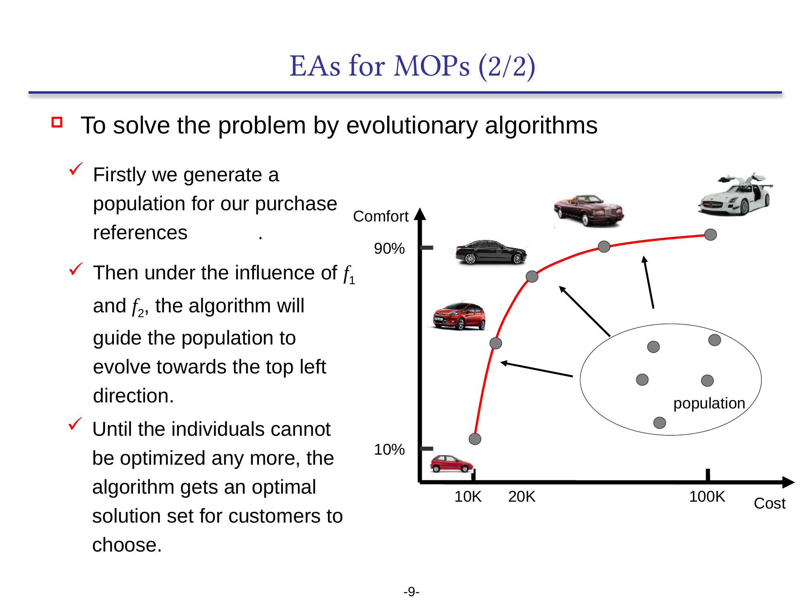

### 多目标优化问题与帕累托支配

#### MOP 的形式化

第 1 章把优化问题写成「决策变量 $\mathbf{x}$ → 目标函数 $f(\mathbf{x})$」。多目标情形下目标函数有 $m$ 个（$m \ge 2$），决策变量维数 $D$ 不变，可行域仍是各变量取值区间的直积 $S = \prod_{i=1}^{D}[L_i, U_i]$：

$$\min_{\mathbf{x}\in S} \mathbf{f}(\mathbf{x}) = (f_1(\mathbf{x}), f_2(\mathbf{x}), \dots, f_m(\mathbf{x})), \qquad \mathbf{x} = (x_1,\dots,x_D)$$

单目标用一个数决定好坏；多目标用一个 $m$ 维向量决定好坏。向量之间没有天然的大小关系，要比较两个解，需要标量化（MOEA/D 用的方法）或支配关系（NSGA-II 用的方法）[p. 4](http://10.188.31.55:5244/Nextcloud/School/Compute-Intelligence/converted/Chapter%208_Evolutionary%20Algorithms%20for%20Solving%20Multiobjective%20Optimization%20Problems.pdf#page=4)。

#### 帕累托支配

两个解 $\mathbf{x}_a, \mathbf{x}_b$，当且仅当下面两条同时成立时，称 $\mathbf{x}_a$ **支配** $\mathbf{x}_b$（记作 $\mathbf{x}_a \prec \mathbf{x}_b$）：

- 在**所有**目标上都不比 $\mathbf{x}_b$ 差：$\forall i \in \{1,\dots,m\}: f_i(\mathbf{x}_a) \le f_i(\mathbf{x}_b)$；
- 在**至少一个**目标上严格好于 $\mathbf{x}_b$：$\exists j \in \{1,\dots,m\}: f_j(\mathbf{x}_a) < f_j(\mathbf{x}_b)$ [p. 6](http://10.188.31.55:5244/Nextcloud/School/Compute-Intelligence/converted/Chapter%208_Evolutionary%20Algorithms%20for%20Solving%20Multiobjective%20Optimization%20Problems.pdf#page=6)。

谁支配谁，谁就更好。两个解谁都不支配谁，就是**互不支配**，它们代表不同的目标权衡。

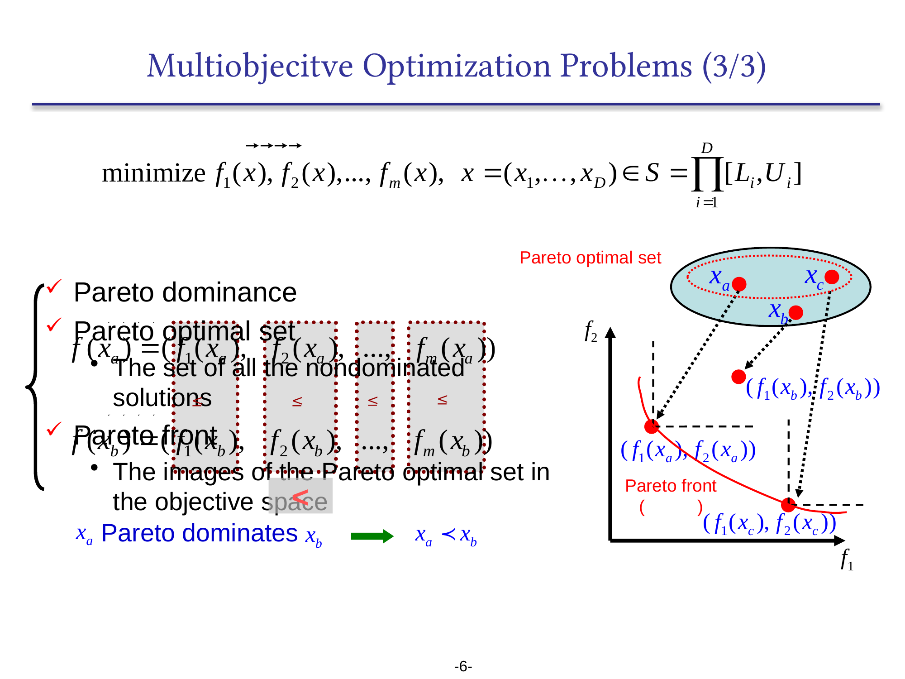

#### 帕累托最优解集与帕累托前沿

**帕累托最优解集**（Pareto optimal set）是所有不被任何其他解支配的解：

$$\text{PS} = \{\mathbf{x}^* \in S : \neg\exists \mathbf{x} \in S,\ \mathbf{x} \prec \mathbf{x}^*\}$$

**帕累托前沿**（Pareto front）是这个解集在目标空间里的像：

$$\text{PF} = \{\mathbf{f}(\mathbf{x}^*) : \mathbf{x}^* \in \text{PS}\}$$

单目标的最优解是一个点；多目标的最优解是前沿这条曲线（曲面）。算法的目标是找到一组在前沿上均匀分布的点，让决策者从中挑一个 [p. 6](http://10.188.31.55:5244/Nextcloud/School/Compute-Intelligence/converted/Chapter%208_Evolutionary%20Algorithms%20for%20Solving%20Multiobjective%20Optimization%20Problems.pdf#page=6)。

最小的例子是 $\min f_1 = x^2$、$\min f_2 = (x-2)^2$，$x \in [-2, 4]$：两个目标各自的最优位置不同，$x$ 从 0 扫到 2 会把前沿上每个点都经过一遍 [p. 5](http://10.188.31.55:5244/Nextcloud/School/Compute-Intelligence/converted/Chapter%208_Evolutionary%20Algorithms%20for%20Solving%20Multiobjective%20Optimization%20Problems.pdf#page=5)。

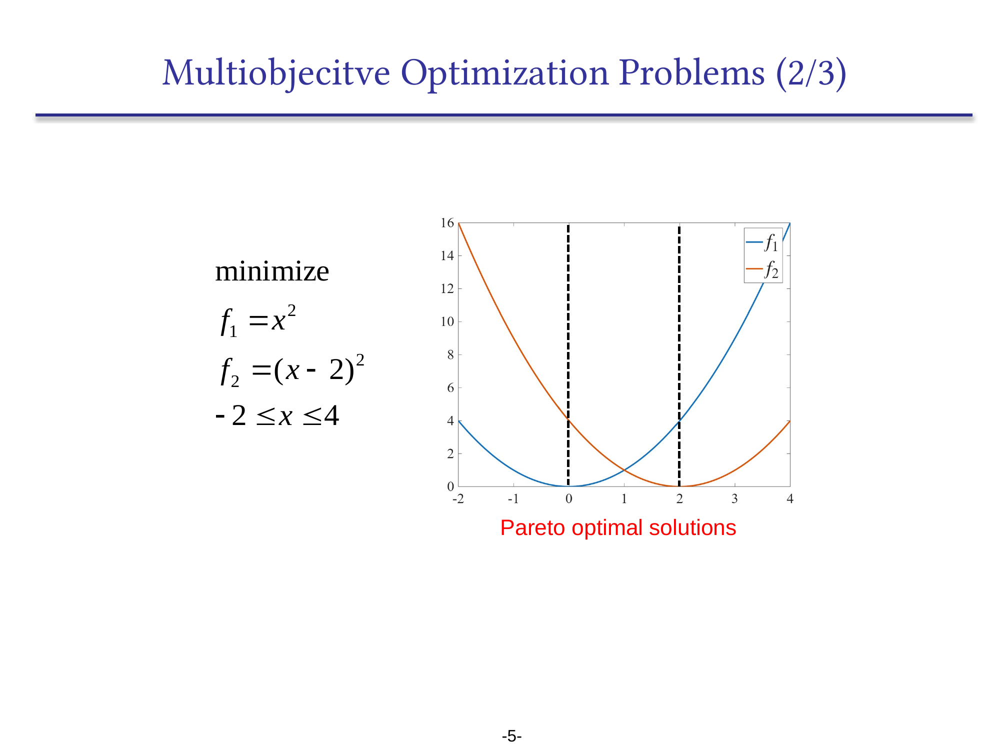

### 非支配排序：分层保证收敛

多目标上「谁更好」没法用一个数决定，但种群内部的解仍然分得出层次。**非支配排序**（nondominated sorting）把种群按支配关系分层 [p. 15](http://10.188.31.55:5244/Nextcloud/School/Compute-Intelligence/converted/Chapter%208_Evolutionary%20Algorithms%20for%20Solving%20Multiobjective%20Optimization%20Problems.pdf#page=15)：

- $F_1$：不被任何解支配的解，也就是当前种群的帕累托前沿；
- $F_2$：从种群中去掉 $F_1$ 之后，不被任何剩余解支配的解；
- $F_3$、$F_4$ 依次类推。

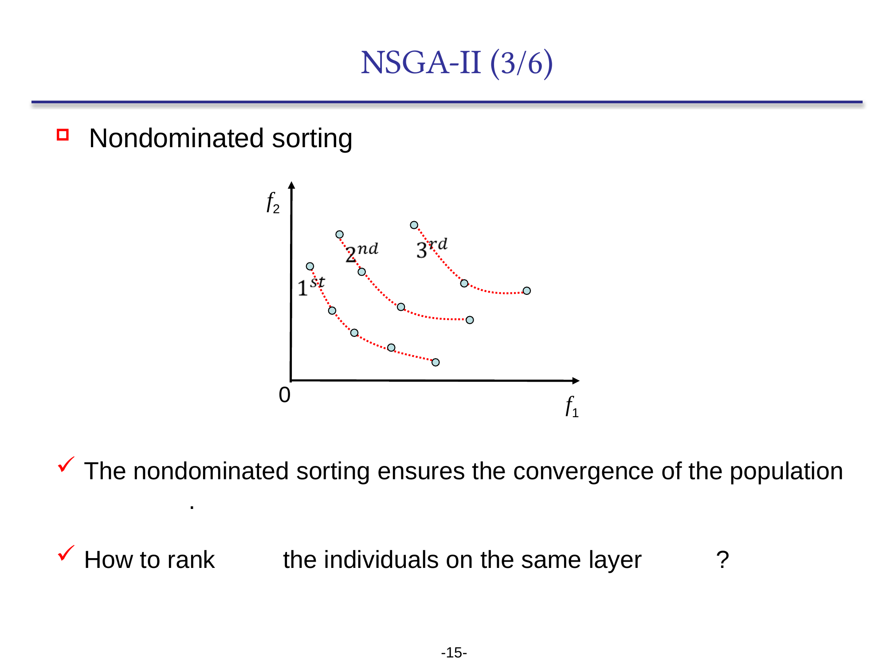

层与层之间有明确的好坏：$F_2$ 中每个解至少被 $F_1$ 中某个解支配。所以选择算子可以优先选低层，这就是**收敛性**的来源——种群被压向帕累托前沿。

同一层里的解互相不支配，支配关系排不出顺序。NSGA-II 用**拥挤度距离**给同层继续排序。

#### 算法过程

把种群 $\mathcal{P} = \{\mathbf{x}_1,\dots,\mathbf{x}_N\}$ 分层的标准做法：

1. **初始化**。每个 $\mathbf{x}_i$ 配一个支配计数器 $n_i = 0$ 和被支配集合 $S_i = \emptyset$。
2. **两两比较**。对每对 $(\mathbf{x}_i, \mathbf{x}_j)$：若 $\mathbf{x}_i \prec \mathbf{x}_j$，则 $S_i \leftarrow S_i \cup \{\mathbf{x}_j\}$，$n_j \leftarrow n_j + 1$；若 $\mathbf{x}_j \prec \mathbf{x}_i$，则 $S_j \leftarrow S_j \cup \{\mathbf{x}_i\}$，$n_i \leftarrow n_i + 1$。
3. **提取第一层**。$F_1 = \{\mathbf{x}_i : n_i = 0\}$，即没有解支配 $\mathbf{x}_i$。
4. **逐层提取**。当前层 $F_k$ 中每个 $\mathbf{x}_i$ 遍历 $S_i$ 中每个 $\mathbf{x}_j$，把 $n_j$ 减 1；$n_j$ 减到 0 的解进下一层 $F_{k+1}$。
5. **终止**。$F_k = \emptyset$ 时停止。

直接两两比较的复杂度是 $O(mN^2)$：$m$ 个目标、$N$ 个个体，每次比较要看 $m$ 个目标值 [p. 15](http://10.188.31.55:5244/Nextcloud/School/Compute-Intelligence/converted/Chapter%208_Evolutionary%20Algorithms%20for%20Solving%20Multiobjective%20Optimization%20Problems.pdf#page=15)。

### 拥挤度距离：同层排序保证分布

同层内部的解互相不支配。NSGA-II 用**拥挤度距离**（crowding distance）给它们排序：取 $\mathbf{x}_i$ 在每个目标上最近的两个同层邻居，把各个方向上归一化后的间距相加，得到「$\mathbf{x}_i$ 周围有多空旷」的度量 [p. 16](http://10.188.31.55:5244/Nextcloud/School/Compute-Intelligence/converted/Chapter%208_Evolutionary%20Algorithms%20for%20Solving%20Multiobjective%20Optimization%20Problems.pdf#page=16)。

$m = 2$ 时，$j$ 与 $h$ 分别是 $\mathbf{x}_i$ 在 $f_1$、$f_2$ 方向上最近的同层个体：

$$
i_{\text{distance}} = \frac{f_1(j) - f_1(h)}{f_{1\max} - f_{1\min}} + \frac{f_2(h) - f_2(j)}{f_{2\max} - f_{2\min}}
$$

拥挤度距离越大，说明周围越空旷，保留它有助于种群均匀铺开。**同层排序时距离大的优先**；边界个体（在某个目标上取值最小或最大的）距离取 $\infty$，优先保留。


#### 归一化怎么来的

各目标的量纲不同，$f_1$ 的一个单位可能远大于 $f_2$ 的一个单位，直接相加会让某个目标独占拥挤度。归一化把每个目标压到同一个尺度：

1. 对每个目标 $f_i$，把同层个体按 $f_i$ 值排序，边界个体（最小与最大）的距离取 $\infty$。
2. 对中间个体 $\mathbf{x}_k$，$f_i$ 方向上最近的两个同层个体是 $\mathbf{x}_{k-1}$ 与 $\mathbf{x}_{k+1}$：

$$\Delta f_{i,k} = \frac{f_i(\mathbf{x}_{k+1}) - f_i(\mathbf{x}_{k-1})}{f_{i,\max} - f_{i,\min}}$$

3. 各目标方向上的间距相加，得到总距离：

$$k_{\text{distance}} = \sum_{i=1}^{m} \Delta f_{i,k}$$

$\Delta f_{i,k}$ 反映 $\mathbf{x}_k$ 在 $f_i$ 方向上的「密度比」：周围密集则 $\Delta f_{i,k}$ 小，周围空旷则大 [p. 16](http://10.188.31.55:5244/Nextcloud/School/Compute-Intelligence/converted/Chapter%208_Evolutionary%20Algorithms%20for%20Solving%20Multiobjective%20Optimization%20Problems.pdf#page=16)。

### 手动判定：支配关系、分层与同层排序

#### 例：4 个解的支配关系

4 个解，二维目标，都最小化：

$$\mathbf{x}_a = (1, 3), \mathbf{x}_b = (2, 2), \mathbf{x}_c = (3, 1), \mathbf{x}_d = (1, 4)$$

逐对比较：

- $\mathbf{x}_a$ vs $\mathbf{x}_b$：$f_1 = 1 < 2$，$f_2 = 3 > 2$——在 $f_1$ 上好、在 $f_2$ 上差，**互不支配**；
- $\mathbf{x}_a$ vs $\mathbf{x}_c$：$f_1 = 1 < 3$，$f_2 = 3 > 1$——**互不支配**；
- $\mathbf{x}_a$ vs $\mathbf{x}_d$：$f_1 = 1 = 1$，$f_2 = 3 < 4$——$f_1$ 平，$f_2$ 上严格好，$\mathbf{x}_a \prec \mathbf{x}_d$；
- $\mathbf{x}_b$ vs $\mathbf{x}_c$：$f_1 = 2 < 3$，$f_2 = 2 > 1$——**互不支配**。

答案：$\mathbf{x}_a \prec \mathbf{x}_d$，其他各对互不支配。$\mathbf{x}_a, \mathbf{x}_b, \mathbf{x}_c$ 都属于帕累托最优解集，$\mathbf{x}_d$ 被 $\mathbf{x}_a$ 支配。

#### 例：提取第一层与第二层

6 个解的二维目标值（都最小化）：

$$\mathcal{P} = \{(1,5), (2,3), (3,4), (4,2), (5,1), (3,3)\}$$

逐个检查「有没有解支配它」：

- $(1,5)$：$f_1$ 全场最小，任何解的 $f_1$ 都只能更大，做不到「两个目标都不差且至少一个严格更好」。**属于 $F_1$**；
- $(2,3)$：没有解能支配它；它反而支配 $(3,4)$（$2<3, 3<4$）与 $(3,3)$（$2<3, 3=3$）。**属于 $F_1$**；
- $(3,4)$：被 $(2,3)$ 支配（$2<3, 3<4$）。**不在 $F_1$**；
- $(4,2)$：没有解能同时在这两个目标上不差于它并严格更好。**属于 $F_1$**；
- $(5,1)$：$f_2$ 全场最小，同理无人能支配。**属于 $F_1$**；
- $(3,3)$：被 $(2,3)$ 支配（$2<3$ 且 $3=3$，满足「都不差 + 至少一个严格更好」）。**不在 $F_1$**。

答案：$F_1 = \{(1,5), (2,3), (4,2), (5,1)\}$。去掉 $F_1$ 后剩下的 $(3,4)$ 与 $(3,3)$ 互不支配，所以 $F_2 = \{(3,4), (3,3)\}$。

$(1,5)$ 的 $f_2$ 是全场最差，但没人能支配它。帕累托最优看的是支配关系，不看总分。

#### 例：同层排序

沿用上例的 $F_1 = \{(1,5), (2,3), (4,2), (5,1)\}$：

1. **边界个体**：按 $f_1$ 排序为 $(1,5) \to (2,3) \to (4,2) \to (5,1)$，两端的 $(1,5)$ 与 $(5,1)$ 拥挤度距离取 $\infty$，优先保留；
2. **中间个体 $(2,3)$**：按 $f_1$ 邻居是 $(1,5)$ 与 $(4,2)$，$\Delta f_1 = \frac{4-1}{5-1} = \frac{3}{4}$；按 $f_2$ 排序为 $(5,1) \to (4,2) \to (2,3) \to (1,5)$，邻居是 $(4,2)$ 与 $(1,5)$，$\Delta f_2 = \frac{5-2}{5-1} = \frac{3}{4}$。合计 $i_{\text{distance}} = \frac{3}{4} + \frac{3}{4} = 1.5$；
3. **中间个体 $(4,2)$**：按 $f_1$ 邻居是 $(2,3)$ 与 $(5,1)$，$\Delta f_1 = \frac{5-2}{5-1} = \frac{3}{4}$；按 $f_2$ 邻居是 $(5,1)$ 与 $(2,3)$，$\Delta f_2 = \frac{3-1}{5-1} = \frac{1}{2}$。合计 $i_{\text{distance}} = \frac{3}{4} + \frac{1}{2} = 1.25$。

保留顺序（拥挤度距离从大到小）：$(1,5)$ 与 $(5,1)$（边界，$\infty$）$>$ $(2,3)$（1.5）$>$ $(4,2)$（1.25）。同层优先保留距离大的个体，种群才能均匀铺在前沿上。

### NSGA-II：父代与子代合并成 2N 再排序

NSGA-II（非支配排序遗传算法 II）由 K. Deb 等人于 2002 年提出，是 NSGA 的改进版，也是进化多目标优化领域最经典的方法 [p. 13](http://10.188.31.55:5244/Nextcloud/School/Compute-Intelligence/converted/Chapter%208_Evolutionary%20Algorithms%20for%20Solving%20Multiobjective%20Optimization%20Problems.pdf#page=13)。它只动一个地方：把单目标 GA 的选择算子换成**非支配排序 + 拥挤度距离排序**这两步 [p. 14](http://10.188.31.55:5244/Nextcloud/School/Compute-Intelligence/converted/Chapter%208_Evolutionary%20Algorithms%20for%20Solving%20Multiobjective%20Optimization%20Problems.pdf#page=14)。

框架的关键在种群更新这一步。$P_t$ 是当前父代种群（$N$ 个个体），$Q_t$ 是子代种群（$N$ 个个体），NSGA-II 把两者合并成一个 $2N$ 的排序池：

$$R_t = P_t \cup Q_t, \qquad |R_t| = 2N$$

对 $R_t$ 做非支配排序分成 $F_1, F_2, \dots$，再在每层内按拥挤度距离从大到小排序，按这个顺序取前 $N$ 个组成下一代 $P_{t+1}$，其余的被拒绝（Rejected）[p. 17](http://10.188.31.55:5244/Nextcloud/School/Compute-Intelligence/converted/Chapter%208_Evolutionary%20Algorithms%20for%20Solving%20Multiobjective%20Optimization%20Problems.pdf#page=17)。


父代进入排序池这一步是 NSGA-II 的**精英保留**：父代一定参加和子代的竞争，好解不会被下一代挤掉。

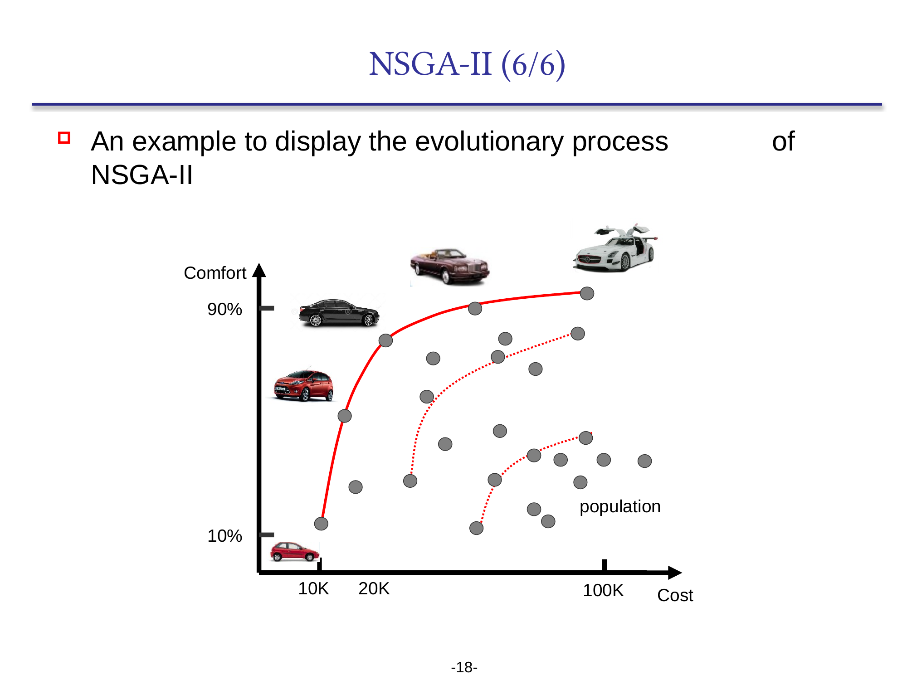

图里是购车问题上的进化过程：每一代种群整体向左上角推进，前沿从零散分布逐渐铺成一条权衡曲线 [p. 18](http://10.188.31.55:5244/Nextcloud/School/Compute-Intelligence/converted/Chapter%208_Evolutionary%20Algorithms%20for%20Solving%20Multiobjective%20Optimization%20Problems.pdf#page=18)。

### MOEA/D：分解成 NP 个单目标子问题

MOEA/D（基于分解的多目标进化算法）由 Q. Zhang 和 H. Li 于 2007 年提出。它与 NSGA-II 走的是相反的路：NSGA-II 在整个种群上做全局排序，MOEA/D 先**分解**问题，再用**邻域信息**更新种群 [p. 20](http://10.188.31.55:5244/Nextcloud/School/Compute-Intelligence/converted/Chapter%208_Evolutionary%20Algorithms%20for%20Solving%20Multiobjective%20Optimization%20Problems.pdf#page=20)。

#### 标量化与权重向量

**标量化**（scalarization）把多目标问题转成单目标：给每个目标一个权重 $\alpha_i \ge 0$ 且 $\sum_{i=1}^{m}\alpha_i = 1$，优化加权和

$$\min \sum_{i=1}^{m} \alpha_i f_i(\mathbf{x})$$

双目标情形就是 $\min \alpha f_1(\mathbf{x}) + (1-\alpha) f_2(\mathbf{x})$，$0 \le \alpha \le 1$。在适当条件下，每个权重向量对应一个标量子问题，其最优解通常是帕累托最优解。不同的权重可能得到同一个解；前沿非凸时，加权和还会漏掉一部分区域 [p. 21](http://10.188.31.55:5244/Nextcloud/School/Compute-Intelligence/converted/Chapter%208_Evolutionary%20Algorithms%20for%20Solving%20Multiobjective%20Optimization%20Problems.pdf#page=21)。


权重向量在目标空间里指的是一个**方向**：$\alpha$ 越靠近 1，子问题越偏 $f_1$，靠近 0 就越偏 $f_2$。它回答的是「在前沿上往哪个方向取点」，目标的重要性不在权重里。$\alpha_1 = 0.8$ 的子问题会给出 $f_1$ 相对更好、$f_2$ 相对更差的解，两个目标都还在各自的平衡点上。

#### 邻域与替换

MOEA/D 的进化过程按子问题逐个推进 [p. 25](http://10.188.31.55:5244/Nextcloud/School/Compute-Intelligence/converted/Chapter%208_Evolutionary%20Algorithms%20for%20Solving%20Multiobjective%20Optimization%20Problems.pdf#page=25)：

1. 均匀生成 $NP$ 个权重向量；
2. 每个权重向量初始化一个个体，种群与权重向量一一对应；
3. 为每个个体算邻居——权重向量空间里欧几里得距离最近的 $T$ 个；
4. 从邻居中选两个做杂交，产生一个后代；
5. 评估后代，如果它在自己子问题的标量化目标上比父个体好，就替换父个体 [p. 22](http://10.188.31.55:5244/Nextcloud/School/Compute-Intelligence/converted/Chapter%208_Evolutionary%20Algorithms%20for%20Solving%20Multiobjective%20Optimization%20Problems.pdf#page=22) [p. 23](http://10.188.31.55:5244/Nextcloud/School/Compute-Intelligence/converted/Chapter%208_Evolutionary%20Algorithms%20for%20Solving%20Multiobjective%20Optimization%20Problems.pdf#page=23) [p. 24](http://10.188.31.55:5244/Nextcloud/School/Compute-Intelligence/converted/Chapter%208_Evolutionary%20Algorithms%20for%20Solving%20Multiobjective%20Optimization%20Problems.pdf#page=24)。

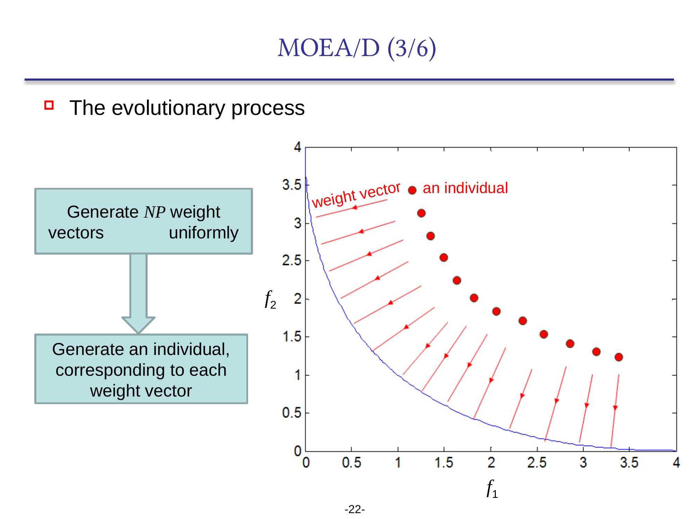

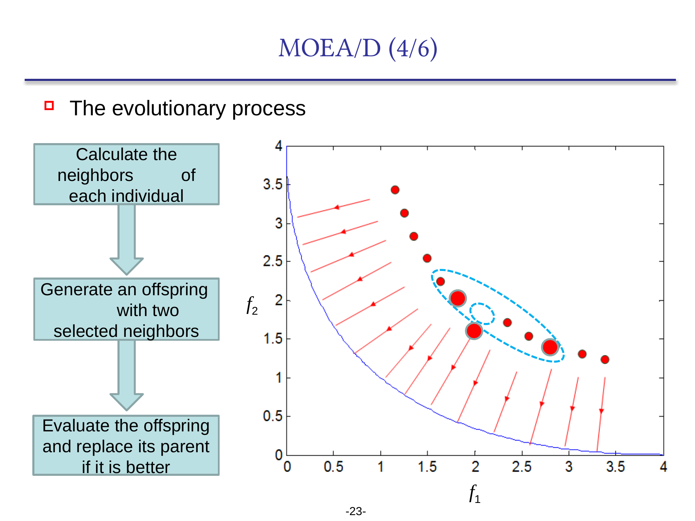


邻居机制让子问题之间互相学习：邻域里的解给当前子问题提供搜索方向。每代每个子问题只跟 $T$ 个邻居打交道，复杂度 $O(NT)$，比 NSGA-II 的 $O(mN^2)$ 便宜。

#### 两条路线的差别

| 维度 | NSGA-II | MOEA/D |
|---|---|---|
| 选择 | 非支配排序 + 拥挤度距离排序 | 邻居内的标量函数值比较 |
| 多样性来源 | 拥挤度距离（同层内） | 权重向量的分布 |
| 收敛来源 | 非支配排序（优先选低层） | 邻居信息（子问题互相学习） |
| 每代复杂度 | $O(mN^2)$ | $O(NT)$ |
| 适合的前沿 | 非凸、形状不规则 | 规则（凸或近似凸） |

MOEA/D 用加权和做分解，前沿非凸时有一部分区域扫不到；NSGA-II 不做加权，对非凸前沿更稳 [p. 21](http://10.188.31.55:5244/Nextcloud/School/Compute-Intelligence/converted/Chapter%208_Evolutionary%20Algorithms%20for%20Solving%20Multiobjective%20Optimization%20Problems.pdf#page=21)。

### 评价一个结果集：IGD 与 HV

算法输出一组解，怎么判断它离真正的最优前沿有多远？两个常用指标，分别对应「真实前沿已知」和「真实前沿未知」两种情形。

#### IGD：前沿已知时看距离

**IGD**（inverted generational distance，反向世代距离）以前沿上的一组参考点为起点，算每个参考点到算法找到的最近解的距离，再取平均：

$$\text{IGD}(A) = \frac{1}{|R|}\sum_{r \in R} \min_{a \in A} d(r, a)$$

**IGD 越小越好**。小说明解集既贴近前沿，又沿着前沿铺得均匀 [p. 26](http://10.188.31.55:5244/Nextcloud/School/Compute-Intelligence/converted/Chapter%208_Evolutionary%20Algorithms%20for%20Solving%20Multiobjective%20Optimization%20Problems.pdf#page=26)。


#### HV：前沿未知时看覆盖体积

**HV**（hypervolume，超体积）算非支配解集相对一个固定参考点所支配的目标空间体积：

$$\text{HV}(A) = \lambda\!\left(\bigcup_{a \in A} \text{box}(a, \mathbf{r})\right)$$

**HV 越大越好**。大说明解集覆盖的目标空间更广 [p. 27](http://10.188.31.55:5244/Nextcloud/School/Compute-Intelligence/converted/Chapter%208_Evolutionary%20Algorithms%20for%20Solving%20Multiobjective%20Optimization%20Problems.pdf#page=27)。


### 易错点

> [!WARNING] 把「互不支配」当成「等价」
> **错误**：$\mathbf{x}_a$ 与 $\mathbf{x}_b$ 互不支配时，认为二者没有区别。
> **正确**：互不支配只说明比不出大小。它们是帕累托最优解集上的不同点，各代表一种权衡方向。决策者按偏好挑一个，但算法不能只留其中一个。

> [!WARNING] 只算非支配排序，忽略拥挤度距离
> **错误**：同层个体随机选。这样同层里密集的解全部保留，稀疏区域的解被丢，种群只覆盖帕累托前沿的一段。
> **正确**：同层必须按拥挤度距离排序，距离大的优先，确保种群均匀覆盖整条前沿 [p. 16](http://10.188.31.55:5244/Nextcloud/School/Compute-Intelligence/converted/Chapter%208_Evolutionary%20Algorithms%20for%20Solving%20Multiobjective%20Optimization%20Problems.pdf#page=16)。

> [!WARNING] 把权重向量当成「目标重要性」
> **错误**：$\alpha_1 = 0.8$、$\alpha_2 = 0.2$ 表示「$f_1$ 比 $f_2$ 重要 4 倍」。
> **正确**：权重只是标量化工具。$\alpha_1 = 0.8$ 优化 $0.8 f_1 + 0.2 f_2$，得到的解在 $f_1$ 上相对更好、$f_2$ 上相对更差，两个目标都达到各自的平衡。权重向量是前沿上的方向选择。

## 第 9 章 单目标约束优化问题的进化算法求解

### SCOP 的形式化：两类约束与违反度

单目标约束优化问题 (single-objective constrained optimization problems, SCOPs) 的骨架是：最小化一个目标函数 $f(\mathbf{x})$，同时让 $\mathbf{x}$ 满足一组约束 [p. 4](http://10.188.31.55:5244/Nextcloud/School/Compute-Intelligence/converted/Chapter%209_Evolutionary%20Algorithms%20for%20Solving%20Single-objective%20Constrained%20Optimization%20Problems.pdf#page=4)。约束分两类——不等式约束 (inequality constraints) 和等式约束 (equality constraints) [p. 4](http://10.188.31.55:5244/Nextcloud/School/Compute-Intelligence/converted/Chapter%209_Evolutionary%20Algorithms%20for%20Solving%20Single-objective%20Constrained%20Optimization%20Problems.pdf#page=4)。等式约束带一个正的容差 (a positive tolerance value)：算法判不准 $h_j(\mathbf{x})=0$，只能判它落进一条容差带里 [p. 4](http://10.188.31.55:5244/Nextcloud/School/Compute-Intelligence/converted/Chapter%209_Evolutionary%20Algorithms%20for%20Solving%20Single-objective%20Constrained%20Optimization%20Problems.pdf#page=4)。

约束让解多出一重身份。除了目标函数值，课件还要度量一个解违反了约束多少，叫**约束违反度** (degree of constraint violation)，分两步给：先算个体在第 $j$ 条约束上的违反度，再把个体在所有约束上的违反度加起来 [p. 4](http://10.188.31.55:5244/Nextcloud/School/Compute-Intelligence/converted/Chapter%209_Evolutionary%20Algorithms%20for%20Solving%20Single-objective%20Constrained%20Optimization%20Problems.pdf#page=4) [p. 5](http://10.188.31.55:5244/Nextcloud/School/Compute-Intelligence/converted/Chapter%209_Evolutionary%20Algorithms%20for%20Solving%20Single-objective%20Constrained%20Optimization%20Problems.pdf#page=5)。有了这个量，可行域 (feasible region) 才被定义出来：违反度为零的那片区域就是可行域，落进去的解叫可行解 (feasible solution)，落在外面的叫不可行解 (infeasible solution) [p. 5](http://10.188.31.55:5244/Nextcloud/School/Compute-Intelligence/converted/Chapter%209_Evolutionary%20Algorithms%20for%20Solving%20Single-objective%20Constrained%20Optimization%20Problems.pdf#page=5)。课件把违反度按约束类型分成两支给出：不等式约束那支取 $\max\{0,\,g_j(\mathbf{x})\}$，等式约束那支取 $\max\{0,\,|h_j(\mathbf{x})|-\delta\}$，这里的 $\delta$ 记这个正的容差，课件正文只说了容差存在，没有给符号 [p. 4](http://10.188.31.55:5244/Nextcloud/School/Compute-Intelligence/converted/Chapter%209_Evolutionary%20Algorithms%20for%20Solving%20Single-objective%20Constrained%20Optimization%20Problems.pdf#page=4)。

课件连着给三个例子，把"约束把可行域压成一小块"摆在眼前。第一个例子 [p. 6](http://10.188.31.55:5244/Nextcloud/School/Compute-Intelligence/converted/Chapter%209_Evolutionary%20Algorithms%20for%20Solving%20Single-objective%20Constrained%20Optimization%20Problems.pdf#page=6)：

$$
\min\ f(\mathbf{x}) = \sum_{i=1}^{2} x_i^2 - 10\cos(2\pi x_i) + 10, \qquad -5 \le x_1, x_2 \le 5
$$

$$
\text{s.t.}\quad x_1 + 2 \le 0, \qquad -x_1 - 3 \le 0, \qquad 2x_1 + x_2 + 7 = 0
$$

配图上画满等高线，可行域是左上角一小块，用箭头标了出来 [p. 6](http://10.188.31.55:5244/Nextcloud/School/Compute-Intelligence/converted/Chapter%209_Evolutionary%20Algorithms%20for%20Solving%20Single-objective%20Constrained%20Optimization%20Problems.pdf#page=6)。第二个例子换了搜索范围和约束形状 [p. 7](http://10.188.31.55:5244/Nextcloud/School/Compute-Intelligence/converted/Chapter%209_Evolutionary%20Algorithms%20for%20Solving%20Single-objective%20Constrained%20Optimization%20Problems.pdf#page=7)：

$$
\min\ f(\mathbf{x}) = \sum_{i=1}^{2} x_i^2 - 10\cos(2\pi x_i) + 10, \qquad -10 \le x_1 \le 5, \quad -5 \le x_2 \le 5
$$

$$
\text{s.t.}\quad 3(x_1+7)^2 + x_2^2 \le 0.3 \quad \text{or} \quad (x_1+8)^2 + (x_2-3)^2 \le 2
$$

可行域是两个小圆盘的并，图上只标出其中一个圆盘和最优解所在的那个点 [p. 7](http://10.188.31.55:5244/Nextcloud/School/Compute-Intelligence/converted/Chapter%209_Evolutionary%20Algorithms%20for%20Solving%20Single-objective%20Constrained%20Optimization%20Problems.pdf#page=7)。第三个例子把两个圆盘并成一个 [p. 8](http://10.188.31.55:5244/Nextcloud/School/Compute-Intelligence/converted/Chapter%209_Evolutionary%20Algorithms%20for%20Solving%20Single-objective%20Constrained%20Optimization%20Problems.pdf#page=8)：

$$
\min\ f(\mathbf{x}) = \sum_{i=1}^{2} x_i^2 - 10\cos(2\pi x_i) + 10, \qquad -10 \le x_1 \le 5, \quad -5 \le x_2 \le 5
$$

$$
\text{s.t.}\quad 3(x_1+9)^2 + x_2^2 \le 2
$$

可行域依然只是搜索空间里的一小块 [p. 8](http://10.188.31.55:5244/Nextcloud/School/Compute-Intelligence/converted/Chapter%209_Evolutionary%20Algorithms%20for%20Solving%20Single-objective%20Constrained%20Optimization%20Problems.pdf#page=8)。三个例子的目标函数一样，差别全在约束上。约束一改，可行域的形状、位置、大小跟着变，最优解也挪位置。约束处理技术因此不能只读目标函数的地形，它必须同时读懂可行域的形状 [p. 8](http://10.188.31.55:5244/Nextcloud/School/Compute-Intelligence/converted/Chapter%209_Evolutionary%20Algorithms%20for%20Solving%20Single-objective%20Constrained%20Optimization%20Problems.pdf#page=8)。

### 用进化算法解 SCOP：两个目标与一个矛盾

进化算法解 SCOP 已经长成一支专门的队伍，叫约束优化进化算法 (constrained optimization EAs, COEAs)。成因很直接：因为约束的存在，人们提出了大量约束处理技术 (constraint-handling techniques)，并把它们集成进各种 EA 里 [p. 10](http://10.188.31.55:5244/Nextcloud/School/Compute-Intelligence/converted/Chapter%209_Evolutionary%20Algorithms%20for%20Solving%20Single-objective%20Constrained%20Optimization%20Problems.pdf#page=10)。

课件给 COEAs 定了两个目的 [p. 10](http://10.188.31.55:5244/Nextcloud/School/Compute-Intelligence/converted/Chapter%209_Evolutionary%20Algorithms%20for%20Solving%20Single-objective%20Constrained%20Optimization%20Problems.pdf#page=10)。第一个是尽快靠近可行域 (approach the feasible region promptly)，第二个是最后拿到最优解。两条目的的时序不同：搜索初期种群多半在可行域外，先得往里走；进了可行域，任务才切换成在域内找最优。课件用三张种群分布图演示这个过程：第 1 代个体散在整个搜索空间，第 30 代聚到可行域附近，第 50 代收敛到可行域里的最优点 [p. 13](http://10.188.31.55:5244/Nextcloud/School/Compute-Intelligence/converted/Chapter%209_Evolutionary%20Algorithms%20for%20Solving%20Single-objective%20Constrained%20Optimization%20Problems.pdf#page=13)。

COEAs 的骨架由两件东西拼成：EA 提供搜索能力，约束处理技术提供比较准则 (criterion)。课件把这层关系写成 "COEAs = EAs + constraint-handling techniques"，并指出约束处理技术要回答的具体问题是：拿什么准则去比较父代群体和子代群体里的个体 [p. 11](http://10.188.31.55:5244/Nextcloud/School/Compute-Intelligence/converted/Chapter%209_Evolutionary%20Algorithms%20for%20Solving%20Single-objective%20Constrained%20Optimization%20Problems.pdf#page=11)。搜索范围同时覆盖不可行域和可行域两片 [p. 11](http://10.188.31.55:5244/Nextcloud/School/Compute-Intelligence/converted/Chapter%209_Evolutionary%20Algorithms%20for%20Solving%20Single-objective%20Constrained%20Optimization%20Problems.pdf#page=11)。

这里有一个绕不开的矛盾 (contradiction)。COEAs 的目标是找到可行的最优解，可有些不可行解反而携带了对找到可行最优解更重要的信息——不可行解能告诉算法该往哪个方向挪 [p. 12](http://10.188.31.55:5244/Nextcloud/School/Compute-Intelligence/converted/Chapter%209_Evolutionary%20Algorithms%20for%20Solving%20Single-objective%20Constrained%20Optimization%20Problems.pdf#page=12)。把不可行解一律判死刑，搜索就少了这半份信息；把它们一律留下，群体又会被拽离可行域。课件把出路说成一句话：在约束违反度 (constraint violation) 和目标函数 (objective function) 之间确定一个权衡 (tradeoff) [p. 12](http://10.188.31.55:5244/Nextcloud/School/Compute-Intelligence/converted/Chapter%209_Evolutionary%20Algorithms%20for%20Solving%20Single-objective%20Constrained%20Optimization%20Problems.pdf#page=12)。

### 约束处理技术的三条路线

课件把约束处理技术的主旨收成一句：确定比较父代与子代个体的准则；核心收成另一句：在目标函数和约束违反度之间做权衡 [p. 15](http://10.188.31.55:5244/Nextcloud/School/Compute-Intelligence/converted/Chapter%209_Evolutionary%20Algorithms%20for%20Solving%20Single-objective%20Constrained%20Optimization%20Problems.pdf#page=15)。按"怎么在两者之间权衡"分，主流做法有三类 [p. 16](http://10.188.31.55:5244/Nextcloud/School/Compute-Intelligence/converted/Chapter%209_Evolutionary%20Algorithms%20for%20Solving%20Single-objective%20Constrained%20Optimization%20Problems.pdf#page=16)：

- **惩罚函数法** (methods based on penalty functions)：把违反度按一个系数加到目标函数上。
- **可行解偏好法** (methods based on preference of feasible solutions over infeasible solutions)：先分层，可行解整体排在不可行解前面。
- **多目标优化法** (methods based on multiobjective optimization)：把每条约束当成一个目标。

三类的差别不在"是否用违反度"，而在违反度和目标函数怎么合成一个可比较的标量。惩罚函数法把它们加权成一个数，可行解偏好法先分层再排序，多目标优化法干脆不合成，让两个量各自参与支配比较 [p. 16](http://10.188.31.55:5244/Nextcloud/School/Compute-Intelligence/converted/Chapter%209_Evolutionary%20Algorithms%20for%20Solving%20Single-objective%20Constrained%20Optimization%20Problems.pdf#page=16)。

### 惩罚函数法：把违反程度写进目标函数

惩罚函数法往目标函数里塞一个惩罚项 (penalty term)，用一个惩罚因子 (penalty factor) 标定它的分量 [p. 17](http://10.188.31.55:5244/Nextcloud/School/Compute-Intelligence/converted/Chapter%209_Evolutionary%20Algorithms%20for%20Solving%20Single-objective%20Constrained%20Optimization%20Problems.pdf#page=17)。惩罚项进适应度函数，约束问题就被改写成无约束问题。

课件给的第一条忠告是：惩罚因子依赖于问题 (penalty factors are problem-dependent) [p. 17](http://10.188.31.55:5244/Nextcloud/School/Compute-Intelligence/converted/Chapter%209_Evolutionary%20Algorithms%20for%20Solving%20Single-objective%20Constrained%20Optimization%20Problems.pdf#page=17)。同一个因子换到另一个问题上就未必合用，这一条把固定因子的做法压得很紧。

后来的工作都冲着动态设置因子去。课件把这条线上的成果归成两类：一类用单调非减序列 (monotonically nondecreasing sequence) 让惩罚因子随代数上升，一类用自适应方法 (adaptive approach) 让因子跟着种群状态变 [p. 18](http://10.188.31.55:5244/Nextcloud/School/Compute-Intelligence/converted/Chapter%209_Evolutionary%20Algorithms%20for%20Solving%20Single-objective%20Constrained%20Optimization%20Problems.pdf#page=18)。

因子的大小决定成败，两头都坏 [p. 19](http://10.188.31.55:5244/Nextcloud/School/Compute-Intelligence/converted/Chapter%209_Evolutionary%20Algorithms%20for%20Solving%20Single-objective%20Constrained%20Optimization%20Problems.pdf#page=19)。因子太小，不可行解照样能在适应度上胜出，EA 会把它演化下去；因子太大，找可行解变得很容易，但解的质量很差。课件接着给这两头命名：惩罚不够叫 under-penalization，惩罚过头叫 over-penalization [p. 22](http://10.188.31.55:5244/Nextcloud/School/Compute-Intelligence/converted/Chapter%209_Evolutionary%20Algorithms%20for%20Solving%20Single-objective%20Constrained%20Optimization%20Problems.pdf#page=22)。

那怎么定因子？课件给了一个从排序出发的办法 [p. 20](http://10.188.31.55:5244/Nextcloud/School/Compute-Intelligence/converted/Chapter%209_Evolutionary%20Algorithms%20for%20Solving%20Single-objective%20Constrained%20Optimization%20Problems.pdf#page=20)：先把这 $\lambda$ 个个体按适应度排序 (rank)，再看排序后相邻的一对 (adjacent pair) $i$ 和 $i+1$，从这两步里算出一个至关重要的惩罚系数 (critical penalty coefficient)。相邻对正是"目标函数和惩罚项谁说话算数"翻转位置的地方，所以它被选来做临界点的计算。

课件把相邻对的比较拆成三种情形 [p. 21](http://10.188.31.55:5244/Nextcloud/School/Compute-Intelligence/converted/Chapter%209_Evolutionary%20Algorithms%20for%20Solving%20Single-objective%20Constrained%20Optimization%20Problems.pdf#page=21)。给定一个比较用的取值 $r_g$，两个个体的比较结果有三种可能：由目标函数支配 (dominated by the objective function)，由惩罚函数支配 (dominated by the penalty function)，或者两者都不能支配对方 (nondominated)。两个备注把它用起来：比较不可支配个体和可行个体时，$r_g$ 取什么值都不改变不等式关系；对整个种群来说，选定的 $r_g$ 决定了群体里有多大比例的个体分别被目标函数和惩罚函数支配 [p. 21](http://10.188.31.55:5244/Nextcloud/School/Compute-Intelligence/converted/Chapter%209_Evolutionary%20Algorithms%20for%20Solving%20Single-objective%20Constrained%20Optimization%20Problems.pdf#page=21)。$r_g$ 就是那个权衡旋钮，课件在下一页把它和它的带横线版本 $\bar{r}_g$ 并排画出来，作为"两个方向都不对"之后的出路 [p. 22](http://10.188.31.55:5244/Nextcloud/School/Compute-Intelligence/converted/Chapter%209_Evolutionary%20Algorithms%20for%20Solving%20Single-objective%20Constrained%20Optimization%20Problems.pdf#page=22)。

课件最后补一条常识性的提醒：$r_g$ 和 $\bar{r}_g$ 都不是常数，它们依赖于问题，而且因为取决于当前种群 (the current population)，每一代都可能变 [p. 23](http://10.188.31.55:5244/Nextcloud/School/Compute-Intelligence/converted/Chapter%209_Evolutionary%20Algorithms%20for%20Solving%20Single-objective%20Constrained%20Optimization%20Problems.pdf#page=23)。

### 可行解偏好法：先分层，再比较

第二类做法反过来：先按可行性分层，层内再比别的。可行解整体被认为优于不可行解，但只是"好到某个程度" (to a certain degree) [p. 24](http://10.188.31.55:5244/Nextcloud/School/Compute-Intelligence/converted/Chapter%209_Evolutionary%20Algorithms%20for%20Solving%20Single-objective%20Constrained%20Optimization%20Problems.pdf#page=24)。课件的批评很直白：这种做法忽略了不可行解携带的重要信息 (ignore the important information of infeasible solutions) [p. 24](http://10.188.31.55:5244/Nextcloud/School/Compute-Intelligence/converted/Chapter%209_Evolutionary%20Algorithms%20for%20Solving%20Single-objective%20Constrained%20Optimization%20Problems.pdf#page=24)。这一类有两种比较准则：可行性准则和随机排序 [p. 24](http://10.188.31.55:5244/Nextcloud/School/Compute-Intelligence/converted/Chapter%209_Evolutionary%20Algorithms%20for%20Solving%20Single-objective%20Constrained%20Optimization%20Problems.pdf#page=24)。

最常见的一条准则是**可行性准则** (the feasibility rule)，课件给了三个分支 [p. 25](http://10.188.31.55:5244/Nextcloud/School/Compute-Intelligence/converted/Chapter%209_Evolutionary%20Algorithms%20for%20Solving%20Single-objective%20Constrained%20Optimization%20Problems.pdf#page=25)。两个都不可行时，违反度小的那个更好；一个不可行一个可行时，可行的那个更好；两个都可行时，目标函数值更好的那个更好。准则还牵进一个量：群体中最差可行解的目标函数值 (the objective function value of the worst feasible solution in the population) [p. 25](http://10.188.31.55:5244/Nextcloud/School/Compute-Intelligence/converted/Chapter%209_Evolutionary%20Algorithms%20for%20Solving%20Single-objective%20Constrained%20Optimization%20Problems.pdf#page=25)。

随机排序 (stochastic ranking, SR) 换了个比较机制，用来削弱可行性准则的刚性 [p. 26](http://10.188.31.55:5244/Nextcloud/School/Compute-Intelligence/converted/Chapter%209_Evolutionary%20Algorithms%20for%20Solving%20Single-objective%20Constrained%20Optimization%20Problems.pdf#page=26)。它引一个概率参数 $P_f$，每次挑排序后相邻的两个个体来比：两个都可行时照常比目标函数；否则抽一个 $[0,1]$ 上均匀分布的随机数 $u$，$u<P_f$ 就比目标函数，否则比违反度，谁的违反度小谁赢 [p. 26](http://10.188.31.55:5244/Nextcloud/School/Compute-Intelligence/converted/Chapter%209_Evolutionary%20Algorithms%20for%20Solving%20Single-objective%20Constrained%20Optimization%20Problems.pdf#page=26)。$P_f$ 就是可行性优先程度的一个旋钮。

实现上 SR 用冒泡排序 (bubble ranking) 反复扫相邻对，课件把这段伪代码原样列出 [p. 27](http://10.188.31.55:5244/Nextcloud/School/Compute-Intelligence/converted/Chapter%209_Evolutionary%20Algorithms%20for%20Solving%20Single-objective%20Constrained%20Optimization%20Problems.pdf#page=27)。其中 $\phi$ 是约束违反度，$f$ 是目标函数值：

```
I_j = j,  for j in {1, ..., λ}
for i = 1 to N:
    for j = 1 to λ-1:
        sample u ∈ U(0, 1)
        if (φ(I_j) = φ(I_{j+1}) = 0) or (u < P_f):
            if f(I_j) > f(I_{j+1}): swap(I_j, I_{j+1})
        else:
            if φ(I_j) > φ(I_{j+1}): swap(I_j, I_{j+1})
    if no swap done: break
```

可行解偏好法这一支的代价和收益是对称的：它不要用户调任何参数，代价是丢掉了不可行解里的那半份信息 [p. 24](http://10.188.31.55:5244/Nextcloud/School/Compute-Intelligence/converted/Chapter%209_Evolutionary%20Algorithms%20for%20Solving%20Single-objective%20Constrained%20Optimization%20Problems.pdf#page=24)。

### 多目标优化法与 24 个基准测试函数

第三类做法把每条约束都当成一个目标函数 (each constraint is considered as an objective function) [p. 28](http://10.188.31.55:5244/Nextcloud/School/Compute-Intelligence/converted/Chapter%209_Evolutionary%20Algorithms%20for%20Solving%20Single-objective%20Constrained%20Optimization%20Problems.pdf#page=28)。约束不再被折进一个标量适应度，而是和目标函数一起留在向量里，交给第 8 章讲过的多目标机制去排。这条路的代价被课件点得很明确：约束一多，维度就跟着涨，遭遇维数灾难 (curse of dimensionality) [p. 28](http://10.188.31.55:5244/Nextcloud/School/Compute-Intelligence/converted/Chapter%209_Evolutionary%20Algorithms%20for%20Solving%20Single-objective%20Constrained%20Optimization%20Problems.pdf#page=28)。约束少的时候这条路很干净，约束一多就得想别的办法。课件在这一点上列了相关综述文献 [p. 29](http://10.188.31.55:5244/Nextcloud/School/Compute-Intelligence/converted/Chapter%209_Evolutionary%20Algorithms%20for%20Solving%20Single-objective%20Constrained%20Optimization%20Problems.pdf#page=29)。

算法好不好要有尺子。课件用 24 个标准测试函数 (benchmark test functions) 来量 [p. 30](http://10.188.31.55:5244/Nextcloud/School/Compute-Intelligence/converted/Chapter%209_Evolutionary%20Algorithms%20for%20Solving%20Single-objective%20Constrained%20Optimization%20Problems.pdf#page=30)，每个函数带一组特征：$\rho$ 是可行域占搜索空间的比例 (the proportion of the feasible region)；LI、NI 是线性与非线性不等式约束的个数；LE 是线性等式约束的个数；NE 这一列课件照抄了 LI 的措辞，按四列的命名对应关系它记的是非线性等式约束的个数；$a$ 是起作用的约束 (active constraints) 的个数，即最优解正压在某条约束的边界上 [p. 30](http://10.188.31.55:5244/Nextcloud/School/Compute-Intelligence/converted/Chapter%209_Evolutionary%20Algorithms%20for%20Solving%20Single-objective%20Constrained%20Optimization%20Problems.pdf#page=30)。

这 24 个函数把可行域比例从接近 0 一直铺到接近 1，逼着算法在"可行域窄得难找"和"可行域宽得几乎等于无约束"两端都得能干活 [p. 30](http://10.188.31.55:5244/Nextcloud/School/Compute-Intelligence/converted/Chapter%209_Evolutionary%20Algorithms%20for%20Solving%20Single-objective%20Constrained%20Optimization%20Problems.pdf#page=30)。表里的几个极端例子能说明问题：g02 是 20 维非线性函数，可行域占 99.9971%，等于几乎不做约束；g12 是 3 维二次函数，可行域只占 4.7713%；g19 是 15 维非线性函数，可行域占 33.4761%；g24 是 2 维线性函数，可行域占 79.6566%。约束个数上 g20 最密：24 维线性函数，带 2 个线性等式约束和 12 个非线性等式约束，起作用的约束有 16 个 [p. 30](http://10.188.31.55:5244/Nextcloud/School/Compute-Intelligence/converted/Chapter%209_Evolutionary%20Algorithms%20for%20Solving%20Single-objective%20Constrained%20Optimization%20Problems.pdf#page=30)。

### 讲者的方法：从 CW 到 FROFI

课件把讲者本人的工作摆成四组 [p. 32](http://10.188.31.55:5244/Nextcloud/School/Compute-Intelligence/converted/Chapter%209_Evolutionary%20Algorithms%20for%20Solving%20Single-objective%20Constrained%20Optimization%20Problems.pdf#page=32)：CW 与 CMODE，HCOEA 与 DyHF，ATM 与 $(\mu+\lambda)$-CDE，最后是 FROFI。这四组恰好沿着两条轴展开：一条轴换约束处理技术，一条轴换搜索引擎。

#### CW：把有偏的准则换成无偏的准则

CW 的出发点是准则本身有偏 (biased)。课件的说法是：现有的约束处理技术大多用一套有偏的比较准则，而帕累托支配 (Pareto dominance) 是一套无偏的比较准则 (unbiased comparison criterion) [p. 34](http://10.188.31.55:5244/Nextcloud/School/Compute-Intelligence/converted/Chapter%209_Evolutionary%20Algorithms%20for%20Solving%20Single-objective%20Constrained%20Optimization%20Problems.pdf#page=34)。CW 的做法是把约束处理问题改写成双目标 (biobjective) 问题，再用多目标优化的机制去解 [p. 34](http://10.188.31.55:5244/Nextcloud/School/Compute-Intelligence/converted/Chapter%209_Evolutionary%20Algorithms%20for%20Solving%20Single-objective%20Constrained%20Optimization%20Problems.pdf#page=34)。课件在页面上标出它依据的问题形式 [p. 34](http://10.188.31.55:5244/Nextcloud/School/Compute-Intelligence/converted/Chapter%209_Evolutionary%20Algorithms%20for%20Solving%20Single-objective%20Constrained%20Optimization%20Problems.pdf#page=34)：

$$
\min\ f(\bar{\mathbf{x}}) \quad \text{s.t.}\quad g_j(\bar{\mathbf{x}}) \le 0,\ j = 1,\dots,l; \qquad h_j(\bar{\mathbf{x}}) \le 0,\ j = l+1,\dots,p
$$

这个改写问题跟一般的多目标问题有一处不同：它在可行域内会退化成单目标问题 (retrogress into a single-objective optimization problem within the feasible region) [p. 35](http://10.188.31.55:5244/Nextcloud/School/Compute-Intelligence/converted/Chapter%209_Evolutionary%20Algorithms%20for%20Solving%20Single-objective%20Constrained%20Optimization%20Problems.pdf#page=35)。课件用一张图说明这个几何 [p. 35](http://10.188.31.55:5244/Nextcloud/School/Compute-Intelligence/converted/Chapter%209_Evolutionary%20Algorithms%20for%20Solving%20Single-objective%20Constrained%20Optimization%20Problems.pdf#page=35)：横轴是 $G$，纵轴是 $f$。帕累托最优集被映射到帕累托前沿 (Pareto front) 上，可行域 $\Omega$ 被映射到一段实线 (solid segment) 上，全局最优解落在前沿和实线的交点处，搜索空间 $S$ 里的点被映射到前沿上以及前沿上方的位置 [p. 35](http://10.188.31.55:5244/Nextcloud/School/Compute-Intelligence/converted/Chapter%209_Evolutionary%20Algorithms%20for%20Solving%20Single-objective%20Constrained%20Optimization%20Problems.pdf#page=35)。实线段的存在是这套几何的关键：可行域内的排序退化回普通单目标排序。

种群更新的一步，课件用三个记号写清楚：`.` 表示父代，`$\Delta$` 表示子代，`o` 表示子代群体里的非劣个体 (nondominated individual)，谁帕累托支配谁就标上 [p. 36](http://10.188.31.55:5244/Nextcloud/School/Compute-Intelligence/converted/Chapter%209_Evolutionary%20Algorithms%20for%20Solving%20Single-objective%20Constrained%20Optimization%20Problems.pdf#page=36)。

CW 还有一套存档与替换 (archiving and replacement) 机制：每一代把违反度最低的那个不可行解存进档案 (archive) [p. 37](http://10.188.31.55:5244/Nextcloud/School/Compute-Intelligence/converted/Chapter%209_Evolutionary%20Algorithms%20for%20Solving%20Single-objective%20Constrained%20Optimization%20Problems.pdf#page=37)。课件同时点出帕累托支配在这件事上的低效：只有区域 ABCDA 里的个体能帕累托支配别人，于是替换很少发生 (replacement may occur occasionally)，选择压 (selection pressure) 很低 [p. 37](http://10.188.31.55:5244/Nextcloud/School/Compute-Intelligence/converted/Chapter%209_Evolutionary%20Algorithms%20for%20Solving%20Single-objective%20Constrained%20Optimization%20Problems.pdf#page=37)。补救办法是随机替换 (randomly replace) [p. 37](http://10.188.31.55:5244/Nextcloud/School/Compute-Intelligence/converted/Chapter%209_Evolutionary%20Algorithms%20for%20Solving%20Single-objective%20Constrained%20Optimization%20Problems.pdf#page=37)。重组算子用单形交叉 (simplex crossover, SPX)：$n+1$ 个个体在 $n$ 维空间里张成一个单形，把旧单形撑开得到新单形，再从新单形里随机生成一个个体 [p. 38](http://10.188.31.55:5244/Nextcloud/School/Compute-Intelligence/converted/Chapter%209_Evolutionary%20Algorithms%20for%20Solving%20Single-objective%20Constrained%20Optimization%20Problems.pdf#page=38)。

#### CMODE：换掉膨胀因子，换一套替换机制

CMODE 接着换掉 CW 的两个痛点 [p. 39](http://10.188.31.55:5244/Nextcloud/School/Compute-Intelligence/converted/Chapter%209_Evolutionary%20Algorithms%20for%20Solving%20Single-objective%20Constrained%20Optimization%20Problems.pdf#page=39)。第一，CW 里混进了问题相关的控制参数，比如单形交叉的膨胀因子 (expanding factor)；第二，课件给 CMODE 装上了差分进化 (DE) 来生成新解，并且配一套新的不可行解替换机制 (a novel infeasible solution replacement mechanism) [p. 39](http://10.188.31.55:5244/Nextcloud/School/Compute-Intelligence/converted/Chapter%209_Evolutionary%20Algorithms%20for%20Solving%20Single-objective%20Constrained%20Optimization%20Problems.pdf#page=39)。

新的替换机制分确定性和随机两种 [p. 40](http://10.188.31.55:5244/Nextcloud/School/Compute-Intelligence/converted/Chapter%209_Evolutionary%20Algorithms%20for%20Solving%20Single-objective%20Constrained%20Optimization%20Problems.pdf#page=40)。左边一栏是确定性替换 (deterministic replacement)，目标是同时提升群体的质量 (quality) 和可行性 (feasibility)；右边一栏是随机替换 (random replacement)，目标是同时提升群体的可行性 (feasibility) 和多样性 (diversity)。课件把进入这套流程的个体说成是在收敛性和可行性两方面最差的那批 [p. 40](http://10.188.31.55:5244/Nextcloud/School/Compute-Intelligence/converted/Chapter%209_Evolutionary%20Algorithms%20for%20Solving%20Single-objective%20Constrained%20Optimization%20Problems.pdf#page=40)。

确定性替换靠三个量分工 [p. 41](http://10.188.31.55:5244/Nextcloud/School/Compute-Intelligence/converted/Chapter%209_Evolutionary%20Algorithms%20for%20Solving%20Single-objective%20Constrained%20Optimization%20Problems.pdf#page=41)：强度值 (strength value)、排名值 (rank value)，以及最终适应度函数 (final fitness function)。排名值按约束违反度排出来；最终适应度函数以帕累托支配 (based on Pareto dominance) 为基础，把收敛性 (convergence) 和可行性 (feasibility) 两项合到一起。课件用一个具体的小例子走了一遍替换过程 [p. 42](http://10.188.31.55:5244/Nextcloud/School/Compute-Intelligence/converted/Chapter%209_Evolutionary%20Algorithms%20for%20Solving%20Single-objective%20Constrained%20Optimization%20Problems.pdf#page=42)。

#### HCOEA 与 DyHF：混合搜索与动态调度

HCOEA (hybrid constrained EA) 的出发点是一个更一般的看法：COEAs 可以概括成"约束处理技术 + EA"，因此一个合适的约束处理技术必须配一个合适的搜索算法来一起考虑 [p. 44](http://10.188.31.55:5244/Nextcloud/School/Compute-Intelligence/converted/Chapter%209_Evolutionary%20Algorithms%20for%20Solving%20Single-objective%20Constrained%20Optimization%20Problems.pdf#page=44)。HCOEA 用多目标优化技术处理约束，同时把全局搜索模型 (global search model) 和局部搜索模型 (local search model) 组合起来 [p. 44](http://10.188.31.55:5244/Nextcloud/School/Compute-Intelligence/converted/Chapter%209_Evolutionary%20Algorithms%20for%20Solving%20Single-objective%20Constrained%20Optimization%20Problems.pdf#page=44)。

课件把主框架写成一段伪代码 [p. 45](http://10.188.31.55:5244/Nextcloud/School/Compute-Intelligence/converted/Chapter%209_Evolutionary%20Algorithms%20for%20Solving%20Single-objective%20Constrained%20Optimization%20Problems.pdf#page=45)：$t=0$ 时用 $A(0)=\mathrm{initialize}(A)$ 建库；循环里先从搜索空间里任意取一个参考点 (reference point) $\bar{r}$，然后 $t=t+1$，把 $A'(t)$ 和 $A''(t)$ 都清空，$A'(t)$ 由全局搜索模型算出，$A''(t)$ 由局部搜索模型拿着 $\bar{r}$ 和 $A'(t)$ 算出，最后 $A(t)=A'(t)$，输出 $A(t)$。$A$ 是存档，两个带撇的分别是全局搜索和局部搜索的产物。

全局搜索模型的做法是：先把 $N$ 个个体的种群随机配成 $N/2$ 对，再按顺序取配对个体，用交叉和变异产生成对子代；子代若帕累托支配对应的父代，就顶掉父代 [p. 46](http://10.188.31.55:5244/Nextcloud/School/Compute-Intelligence/converted/Chapter%209_Evolutionary%20Algorithms%20for%20Solving%20Single-objective%20Constrained%20Optimization%20Problems.pdf#page=46)。课件点明这个模型本质上是一个小生境遗传算法 (niching genetic algorithm) [p. 46](http://10.188.31.55:5244/Nextcloud/School/Compute-Intelligence/converted/Chapter%209_Evolutionary%20Algorithms%20for%20Solving%20Single-objective%20Constrained%20Optimization%20Problems.pdf#page=46)。局部搜索模型把种群划成若干子种群 (subpopulation)，每个子种群朝可行域和最优解推 [p. 47](http://10.188.31.55:5244/Nextcloud/School/Compute-Intelligence/converted/Chapter%209_Evolutionary%20Algorithms%20for%20Solving%20Single-objective%20Constrained%20Optimization%20Problems.pdf#page=47)。实现上，局部搜索拿当前最好的不可行个体 (the best infeasible individual) 出发，配一个子种群，父代与子代之间同样用帕累托支配和随机替换来定去留 [p. 48](http://10.188.31.55:5244/Nextcloud/School/Compute-Intelligence/converted/Chapter%209_Evolutionary%20Algorithms%20for%20Solving%20Single-objective%20Constrained%20Optimization%20Problems.pdf#page=48)。

HCOEA 把两个模型的调用比例写死了。DyHF (dynamic hybrid framework) 的动机正是这个比例不该写死：进化的不同阶段需要不同的局部与全局搜索概率 (different probabilities for the local and global search) 才能拿到最好的性能 [p. 49](http://10.188.31.55:5244/Nextcloud/School/Compute-Intelligence/converted/Chapter%209_Evolutionary%20Algorithms%20for%20Solving%20Single-objective%20Constrained%20Optimization%20Problems.pdf#page=49)。DyHF 同样用 DE 生成子代群体，并且让两个模型动态地交替上场 [p. 49](http://10.188.31.55:5244/Nextcloud/School/Compute-Intelligence/converted/Chapter%209_Evolutionary%20Algorithms%20for%20Solving%20Single-objective%20Constrained%20Optimization%20Problems.pdf#page=49)。

调度的依据是种群的可行比例 (feasibility proportion)。课件给的规则是一行判断 [p. 50](http://10.188.31.55:5244/Nextcloud/School/Compute-Intelligence/converted/Chapter%209_Evolutionary%20Algorithms%20for%20Solving%20Single-objective%20Constrained%20Optimization%20Problems.pdf#page=50)：取一个 $[0,1]$ 上均匀分布的随机数 `rand`，当前种群的可行比例为 $N_F/N_P$（$N_F$ 是可行解个数，$N_P$ 是种群规模），`rand` 小于 $N_F/N_P$ 就走全局搜索模型，否则走局部搜索模型。

课件随后用三个阶段把这条规则的意义讲开 [p. 51](http://10.188.31.55:5244/Nextcloud/School/Compute-Intelligence/converted/Chapter%209_Evolutionary%20Algorithms%20for%20Solving%20Single-objective%20Constrained%20Optimization%20Problems.pdf#page=51) [p. 52](http://10.188.31.55:5244/Nextcloud/School/Compute-Intelligence/converted/Chapter%209_Evolutionary%20Algorithms%20for%20Solving%20Single-objective%20Constrained%20Optimization%20Problems.pdf#page=52) [p. 53](http://10.188.31.55:5244/Nextcloud/School/Compute-Intelligence/converted/Chapter%209_Evolutionary%20Algorithms%20for%20Solving%20Single-objective%20Constrained%20Optimization%20Problems.pdf#page=53)。早期可行比例可能为零甚至更小，局部搜索模型上场更频繁，把种群迅速往可行方向带；进化推进后种群靠近可行域，一部分个体已经可行，全局搜索被逐渐加强，让个体去探更有希望的区域，尤其是可行域那一侧；后期大多数个体都可行，局部搜索的概率被压低，全局搜索主要用来打磨群体整体质量。三段合起来的效果是：这套动态调度能在"求可行"和"求收敛"之间平滑切换 [p. 53](http://10.188.31.55:5244/Nextcloud/School/Compute-Intelligence/converted/Chapter%209_Evolutionary%20Algorithms%20for%20Solving%20Single-objective%20Constrained%20Optimization%20Problems.pdf#page=53)。

#### ATM 与 $(\mu+\lambda)$-CDE：自适应权衡

ATM (adaptive tradeoff model) 换了个角度组织约束处理。课件先摆出进化过程中种群必然遇到的三种情形 [p. 55](http://10.188.31.55:5244/Nextcloud/School/Compute-Intelligence/converted/Chapter%209_Evolutionary%20Algorithms%20for%20Solving%20Single-objective%20Constrained%20Optimization%20Problems.pdf#page=55)：不可行情形 (infeasible situation，种群里全是不可行解)、半可行情形 (semi-feasible situation，可行解与不可行解混在一起)、可行情形 (feasible situation，种群里全是可行解)。ATM 的做法是分而治之 (divide and conquer)：给每种情形配一套专门的权衡策略 [p. 55](http://10.188.31.55:5244/Nextcloud/School/Compute-Intelligence/converted/Chapter%209_Evolutionary%20Algorithms%20for%20Solving%20Single-objective%20Constrained%20Optimization%20Problems.pdf#page=55)。

不可行情形下的策略是纯约束视角：非劣个体代表种群的帕累托最优集，用分层非支配排序 (hierarchical nondominated sorting) 处理，再按约束违反度升序给这些非劣个体排名，只把前一半非劣个体放进子代群体 [p. 57](http://10.188.31.55:5244/Nextcloud/School/Compute-Intelligence/converted/Chapter%209_Evolutionary%20Algorithms%20for%20Solving%20Single-objective%20Constrained%20Optimization%20Problems.pdf#page=57)。课件给这张权衡画了图 [p. 58](http://10.188.31.55:5244/Nextcloud/School/Compute-Intelligence/converted/Chapter%209_Evolutionary%20Algorithms%20for%20Solving%20Single-objective%20Constrained%20Optimization%20Problems.pdf#page=58)。

半可行情形是 ATM 的主战场 [p. 59](http://10.188.31.55:5244/Nextcloud/School/Compute-Intelligence/converted/Chapter%209_Evolutionary%20Algorithms%20for%20Solving%20Single-objective%20Constrained%20Optimization%20Problems.pdf#page=59)。这里仍然要回答那个老问题：目标是找到可行的最优解，可有些不可行解携带了对找到可行最优解更重要的信息。所以第二套权衡策略要同时留下重要的可行解和重要的不可行解。课件给了这套策略的记法：把 $\lambda$ 个个体编号记成集合 $Z=\{1,2,\dots,\lambda\}$，再按可行性把 $Z$ 分成可行组 $Z_1$ 和不可行组 $Z_2$ [p. 59](http://10.188.31.55:5244/Nextcloud/School/Compute-Intelligence/converted/Chapter%209_Evolutionary%20Algorithms%20for%20Solving%20Single-objective%20Constrained%20Optimization%20Problems.pdf#page=59)。

第二套策略先算出群体里最好和最差的可行解，再算一个转换后的目标函数 (converted objective function)：转换只动不可行个体的目标函数值，可行个体一个都不碰 [p. 60](http://10.188.31.55:5244/Nextcloud/School/Compute-Intelligence/converted/Chapter%209_Evolutionary%20Algorithms%20for%20Solving%20Single-objective%20Constrained%20Optimization%20Problems.pdf#page=60)。转换要用到上一代种群里的可行比例，它随种群状态变，于是转换后的适应度也跟着变 [p. 62](http://10.188.31.55:5244/Nextcloud/School/Compute-Intelligence/converted/Chapter%209_Evolutionary%20Algorithms%20for%20Solving%20Single-objective%20Constrained%20Optimization%20Problems.pdf#page=62)。

接着是归一化 (normalization)。课件给了两条备注 [p. 61](http://10.188.31.55:5244/Nextcloud/School/Compute-Intelligence/converted/Chapter%209_Evolutionary%20Algorithms%20for%20Solving%20Single-objective%20Constrained%20Optimization%20Problems.pdf#page=61)：目标函数值的归一化同时用可行组和不可行组的数据；不可行个体违反度的归一化只用不可行组里的最大和最小违反度。第二套权衡策略因此具备两个能力：按上一代的可行比例自适应地转换个体适应度，按上一代的信息自适应地调整可行解与不可行解的排名 [p. 62](http://10.188.31.55:5244/Nextcloud/School/Compute-Intelligence/converted/Chapter%209_Evolutionary%20Algorithms%20for%20Solving%20Single-objective%20Constrained%20Optimization%20Problems.pdf#page=62)。

课件用四条性质检查这套机制 [p. 63](http://10.188.31.55:5244/Nextcloud/School/Compute-Intelligence/converted/Chapter%209_Evolutionary%20Algorithms%20for%20Solving%20Single-objective%20Constrained%20Optimization%20Problems.pdf#page=63)。Property 1 是比较规则：两个可行解之间只看目标函数值，可行解与不可行解、不可行解与不可行解之间则把目标函数值和约束违反度放在一起看。Property 2 讲的是参数的影响：不可行个体的目标函数值越大，进入下一代种群的概率越低 (lower)，越小则越高 (higher)。Property 3：有些不可行个体比可行解更好。Property 4：最好的可行个体同时也是适应度最小的那个 [p. 63](http://10.188.31.55:5244/Nextcloud/School/Compute-Intelligence/converted/Chapter%209_Evolutionary%20Algorithms%20for%20Solving%20Single-objective%20Constrained%20Optimization%20Problems.pdf#page=63)。可行情形最简单：退化成无约束优化 (unconstrained optimization)，个体之间的比较只看目标函数值 [p. 64](http://10.188.31.55:5244/Nextcloud/School/Compute-Intelligence/converted/Chapter%209_Evolutionary%20Algorithms%20for%20Solving%20Single-objective%20Constrained%20Optimization%20Problems.pdf#page=64)。

$(\mu+\lambda)$-CDE 换的是搜索引擎 [p. 65](http://10.188.31.55:5244/Nextcloud/School/Compute-Intelligence/converted/Chapter%209_Evolutionary%20Algorithms%20for%20Solving%20Single-objective%20Constrained%20Optimization%20Problems.pdf#page=65)。动机很直接：ATM 用的是简单的 $(\mu,\lambda)$-ES 作搜索引擎，改用 $(\mu+\lambda)$-DE 作搜索引擎，约束处理技术则交给改进过的 ATM [p. 65](http://10.188.31.55:5244/Nextcloud/School/Compute-Intelligence/converted/Chapter%209_Evolutionary%20Algorithms%20for%20Solving%20Single-objective%20Constrained%20Optimization%20Problems.pdf#page=65)。$(\mu+\lambda)$-DE 的结构是：$\mu$ 个父代产生 $\lambda$ 个子代，最后留下 $\mu$ 个质量更高的个体 [p. 66](http://10.188.31.55:5244/Nextcloud/School/Compute-Intelligence/converted/Chapter%209_Evolutionary%20Algorithms%20for%20Solving%20Single-objective%20Constrained%20Optimization%20Problems.pdf#page=66)。课件在这一页把 DE 的几种变异算子摆出来，$(\mu+\lambda)$-DE 的变异就出自其中 [p. 66](http://10.188.31.55:5244/Nextcloud/School/Compute-Intelligence/converted/Chapter%209_Evolutionary%20Algorithms%20for%20Solving%20Single-objective%20Constrained%20Optimization%20Problems.pdf#page=66)。

$(\mu+\lambda)$-CDE 顺手修了 ATM 的一个粗糙处：算约束违反度时用了两个准则 (two criteria)，因为不同约束的违反度量可能差着量级 (largely different scales)，不同约束之间的差异也可能并不显著 (may not be significant) [p. 67](http://10.188.31.55:5244/Nextcloud/School/Compute-Intelligence/converted/Chapter%209_Evolutionary%20Algorithms%20for%20Solving%20Single-objective%20Constrained%20Optimization%20Problems.pdf#page=67)。改进后的 ATM 在不可行情形下先按约束违反度挑出最好的 $(\mu+\lambda)/2$ 个个体，再从中随机选；半可行情形沿用 ATM 的做法，只把最终适应度函数换掉；可行情形原样照搬 ATM [p. 68](http://10.188.31.55:5244/Nextcloud/School/Compute-Intelligence/converted/Chapter%209_Evolutionary%20Algorithms%20for%20Solving%20Single-objective%20Constrained%20Optimization%20Problems.pdf#page=68) [p. 69](http://10.188.31.55:5244/Nextcloud/School/Compute-Intelligence/converted/Chapter%209_Evolutionary%20Algorithms%20for%20Solving%20Single-objective%20Constrained%20Optimization%20Problems.pdf#page=69)。

#### FROFI：把目标函数信息塞回可行性准则

FROFI 回到 Deb 的可行性准则，但先看它被摆出来的位置 [p. 71](http://10.188.31.55:5244/Nextcloud/School/Compute-Intelligence/converted/Chapter%209_Evolutionary%20Algorithms%20for%20Solving%20Single-objective%20Constrained%20Optimization%20Problems.pdf#page=71)：任意可行解都优于任意不可行解；两个可行解之间比目标函数值；两个不可行解之间比违反度。课件的批评落在最后一条上：可行性准则把太多重量压在约束上 (too many emphases have been put on the constraints) [p. 72](http://10.188.31.55:5244/Nextcloud/School/Compute-Intelligence/converted/Chapter%209_Evolutionary%20Algorithms%20for%20Solving%20Single-objective%20Constrained%20Optimization%20Problems.pdf#page=72)。FROFI 的思路是把目标函数信息同时塞回可行性准则和搜索算法 (incorporating objective function information into both the feasibility rule and the search algorithm) [p. 72](http://10.188.31.55:5244/Nextcloud/School/Compute-Intelligence/converted/Chapter%209_Evolutionary%20Algorithms%20for%20Solving%20Single-objective%20Constrained%20Optimization%20Problems.pdf#page=72)。

往准则里加信息这一步，课件写成两条定理 [p. 73](http://10.188.31.55:5244/Nextcloud/School/Compute-Intelligence/converted/Chapter%209_Evolutionary%20Algorithms%20for%20Solving%20Single-objective%20Constrained%20Optimization%20Problems.pdf#page=73)：如果一个子代被存进档案 (archive)，那么父代与该子代在帕累托意义下互不支配；并且该子代是一个不可行解。两条合起来把"什么样的不可行解值得留"讲清了。

替换的流程因此也定下来了 [p. 74](http://10.188.31.55:5244/Nextcloud/School/Compute-Intelligence/converted/Chapter%209_Evolutionary%20Algorithms%20for%20Solving%20Single-objective%20Constrained%20Optimization%20Problems.pdf#page=74)：先把档案里的个体按约束违反度降序排，把种群里的个体按目标函数升序排、再切成若干子种群 (subpopulation)，然后用违反度最大的那个个体去替换，替换的数目取决于子种群个数 (we need to set the number of subpopulations)。往搜索算法里加信息这一步，课件给的是一个带 best 个体的 DE 变体 [p. 75](http://10.188.31.55:5244/Nextcloud/School/Compute-Intelligence/converted/Chapter%209_Evolutionary%20Algorithms%20for%20Solving%20Single-objective%20Constrained%20Optimization%20Problems.pdf#page=75)：

```
if rand < 0.5:
    v_{i,t} = x_{i,t} + rand * (x_{r1,t} - x_{i,t}) + F * (x_{r2,t} - x_{r3,t})   # DE/current-to-rand/1
    u_{i,t} = v_{i,t}
else:
    v_{i,t} = x_{r1,t} + rand * (x_{best,t} - x_{i,t}) + F * (x_{r2,t} - x_{r3,t})   # DE/rand-to-best/1
    执行 DE 的二项式交叉，生成试探向量 u_{i,t}
```

其中 $x_{best,t}$ 是按目标函数值算出的群体最优个体 [p. 75](http://10.188.31.55:5244/Nextcloud/School/Compute-Intelligence/converted/Chapter%209_Evolutionary%20Algorithms%20for%20Solving%20Single-objective%20Constrained%20Optimization%20Problems.pdf#page=75)。

FROFI 的三条优点被课件列在最后 [p. 76](http://10.188.31.55:5244/Nextcloud/School/Compute-Intelligence/converted/Chapter%209_Evolutionary%20Algorithms%20for%20Solving%20Single-objective%20Constrained%20Optimization%20Problems.pdf#page=76)：它是在约束和目标函数之间做平衡的有效办法；实现简单；时间复杂度是 $n\log n$。

### 两条轴上的平衡

课件最后收了四条 [p. 77](http://10.188.31.55:5244/Nextcloud/School/Compute-Intelligence/converted/Chapter%209_Evolutionary%20Algorithms%20for%20Solving%20Single-objective%20Constrained%20Optimization%20Problems.pdf#page=77)。COEAs 的性能同时取决于约束处理技术和搜索算法，两条轴都得站住。约束处理技术的本质是在约束和目标函数之间找平衡；搜索算法这一侧，同样要在约束和目标函数之间找平衡。走多目标化这条路处理约束是有希望的，而且看起来两个目标就够用 (it seems that two objectives are enough)。

这两条轴和前面讲的四组工作正好对齐：CW、CMODE、ATM、FROFI 动的是第一条，HCOEA、DyHF、$(\mu+\lambda)$-CDE 动的是第二条。课件在结论里把它们并排放，等于把"约束处理技术 + 搜索算法"这个 COEAs 的通用结构又讲了一遍 [p. 77](http://10.188.31.55:5244/Nextcloud/School/Compute-Intelligence/converted/Chapter%209_Evolutionary%20Algorithms%20for%20Solving%20Single-objective%20Constrained%20Optimization%20Problems.pdf#page=77)。

## 第 10 章 多目标优化中多个最优解的定位

### 非线性方程系统：形式、求解目标与三类已有方法

非线性方程系统（nonlinear equation system, NES）是一组需要同时成立的方程。课件把它的形式写成：

$$
e_1(x)=0,\ e_2(x)=0,\ \dots,\ e_m(x)=0,\qquad x=(x_1,\dots,x_D)\in S=\prod_{i=1}^{D}[L_i,U_i]
$$

$m$ 个方程、$D$ 个决策变量，第 $i$ 个变量的取值区间是 $[L_i,U_i]$，$S$ 是这些区间的直积 [p. 4](http://10.188.31.55:5244/Nextcloud/School/Compute-Intelligence/converted/Chapter%2010_Multiobjective%20Optimization%20for%20Locating%20Multiple%20Optimal%20Solutions%20of%20NESs%20and%20MMOPs.pdf#page=4)。这类问题出现在化学过程、机器人、电子电路、工程材料与物理中。

课件给的例子很简单：

$$
e_1(x_1,x_2)=x_1^2+x_2^2-1=0,\qquad e_2(x_1,x_2)=x_1-x_2=0,\qquad -1\le x_1,x_2\le 1
$$

第一条方程是单位圆，第二条是对角直线，两条曲线在决策空间里交于两点，课件把这两个交点标成最优解 [p. 5](http://10.188.31.55:5244/Nextcloud/School/Compute-Intelligence/converted/Chapter%2010_Multiobjective%20Optimization%20for%20Locating%20Multiple%20Optimal%20Solutions%20of%20NESs%20and%20MMOPs.pdf#page=5)。一个 NES 因此可能同时包含多个最优解。

这类问题的分量有数学上的来源。1998 年菲尔兹奖得主 Steve Smale 列出了面向 21 世纪的 18 个挑战问题，其中包含 "Does P = NP?"；与 NES 相关的有三个：Problem 4（多项式的整数零点）、Problem 8（把动力学引入经济理论）、Problem 17（解多项式方程）。求 NES 的最优解既有工程意义，也是数学的核心问题之一 [p. 6](http://10.188.31.55:5244/Nextcloud/School/Compute-Intelligence/converted/Chapter%2010_Multiobjective%20Optimization%20for%20Locating%20Multiple%20Optimal%20Solutions%20of%20NESs%20and%20MMOPs.pdf#page=6)。

用进化算法解 NES，目标是"一次运行定位所有最优解"（locate all the optimal solutions in a single run）。课件给出的流程是：NES 先经过一次变换变成某种优化问题，再交给进化算法求解 [p. 7](http://10.188.31.55:5244/Nextcloud/School/Compute-Intelligence/converted/Chapter%2010_Multiobjective%20Optimization%20for%20Locating%20Multiple%20Optimal%20Solutions%20of%20NESs%20and%20MMOPs.pdf#page=7)。围绕这次变换，已有的做法分三类。

单目标变换把方程组压成一个标量目标：

$$
\min_{x\in S}\ \sum_{i=1}^{m}\left|e_i(x)\right|
\qquad\text{或}\qquad
\min_{x\in S}\ \sum_{i=1}^{m}e_i^2(x)
$$

主要缺陷：一次运行通常只能找到一个最优解 [p. 8](http://10.188.31.55:5244/Nextcloud/School/Compute-Intelligence/converted/Chapter%2010_Multiobjective%20Optimization%20for%20Locating%20Multiple%20Optimal%20Solutions%20of%20NESs%20and%20MMOPs.pdf#page=8)。

约束变换把方程组放进约束条件：

$$
\min_{x\in S}\ \sum_{i=1}^{m}\left|e_i(x)\right|
\quad\text{s.t.}\quad e_i(x)\ge 0,\ i=1,\dots,m
$$

约束也可以写成 $e_i(x)=0$。这一类方法同样受"一次运行只能定位一个最优解"限制，另外还要额外引入约束处理技术 [p. 9](http://10.188.31.55:5244/Nextcloud/School/Compute-Intelligence/converted/Chapter%2010_Multiobjective%20Optimization%20for%20Locating%20Multiple%20Optimal%20Solutions%20of%20NESs%20and%20MMOPs.pdf#page=9)。

多目标变换（CA 方法，Grosan 与 Abraham 2008）把每个方程当成一个目标：

$$
\min_{x\in S}\ \left(\left|e_1(x)\right|,\left|e_2(x)\right|,\dots,\left|e_m(x)\right|\right)
$$

目标个数等于方程个数。缺陷有两个：可能受"维数灾难"（也就是超多目标问题）困扰；一次运行也许只找到一个解 [p. 10](http://10.188.31.55:5244/Nextcloud/School/Compute-Intelligence/converted/Chapter%2010_Multiobjective%20Optimization%20for%20Locating%20Multiple%20Optimal%20Solutions%20of%20NESs%20and%20MMOPs.pdf#page=10)。

### MONES：把方程系统转成双目标问题

用进化算法解 NES 时，人们期望一次运行定位多个最优解。这个过程与用进化算法解多目标优化问题（multiobjective optimization problem, MOP）很像。于是自然的问题来了：NES 能否被变换成 MOP，让多目标进化算法去解变换后的问题。Song、Wang、Li 与 Cai 在 2015 年给出了肯定答案，方法称为 MONES（multiobjective optimization for NESs）[p. 11](http://10.188.31.55:5244/Nextcloud/School/Compute-Intelligence/converted/Chapter%2010_Multiobjective%20Optimization%20for%20Locating%20Multiple%20Optimal%20Solutions%20of%20NESs%20and%20MMOPs.pdf#page=11)。

变换后的双目标问题写成：

$$
\min_{x\in S}\begin{cases}
f_1(x)=x_1+\displaystyle\sum_{i=1}^{m}\left|e_i(x)\right|\\[2mm]
f_2(x)=1-x_1+m\cdot\max\left(\left|e_1(x)\right|,\dots,\left|e_m(x)\right|\right)
\end{cases}
$$

课件在这一页把原方程组和变换后的双目标问题并排放在一起 [p. 12](http://10.188.31.55:5244/Nextcloud/School/Compute-Intelligence/converted/Chapter%2010_Multiobjective%20Optimization%20for%20Locating%20Multiple%20Optimal%20Solutions%20of%20NESs%20and%20MMOPs.pdf#page=12)，然后把这个式子拆成两项分别讲。第一项只依赖第一个决策变量，课件用 $\alpha_1$、$\alpha_2$ 记它：

$$
\min_{x\in S}\begin{cases}
\alpha_1(x)=x_1\\[1mm]
\alpha_2(x)=1-x_1
\end{cases}
$$

$\alpha_1$ 随 $x_1$ 严格单调递增，$\alpha_2$ 随 $x_1$ 严格单调递减，两条直线在 $x_1=0.5$ 处相交。课件由此给出结论：NES 决策空间里的每一个决策向量都是第一项的 Pareto 最优解，第一项最优解在目标空间里的像都落在线段 $y=1-x$ 上 [p. 13](http://10.188.31.55:5244/Nextcloud/School/Compute-Intelligence/converted/Chapter%2010_Multiobjective%20Optimization%20for%20Locating%20Multiple%20Optimal%20Solutions%20of%20NESs%20and%20MMOPs.pdf#page=13)。

第二项度量方程组被满足的程度，课件用 $\beta_1$、$\beta_2$ 记它：

$$
\min_{x\in S}\begin{cases}
\beta_1(x)=\displaystyle\sum_{i=1}^{m}\left|e_i(x)\right|\\[2mm]
\beta_2(x)=m\cdot\max\left(\left|e_1(x)\right|,\dots,\left|e_m(x)\right|\right)
\end{cases}
$$

两项都是非负的。$\beta_1$ 是各方程绝对值之和，$\beta_2$ 是各方程绝对值的最大值再乘方程个数 $m$。课件给出两条 Remark：Remark I 是最优解 $x^*$ 满足 $\beta_1(x^*)=\beta_2(x^*)=0$；Remark II 是参数 $m$ 用来让 $\beta_1(x^*)$ 与 $\beta_2(x^*)$ 的量级相当 [p. 14](http://10.188.31.55:5244/Nextcloud/School/Compute-Intelligence/converted/Chapter%2010_Multiobjective%20Optimization%20for%20Locating%20Multiple%20Optimal%20Solutions%20of%20NESs%20and%20MMOPs.pdf#page=14)。

把两项加起来就是上面的 $f_1$ 与 $f_2$。于是 NES 最优解在目标空间里的像同样落在 $y=1-x$ 的线段上 [p. 15](http://10.188.31.55:5244/Nextcloud/School/Compute-Intelligence/converted/Chapter%2010_Multiobjective%20Optimization%20for%20Locating%20Multiple%20Optimal%20Solutions%20of%20NESs%20and%20MMOPs.pdf#page=15)。课件对 MONES 的评价是三点：NES 被转成了一个双目标优化问题；这个变换带来若干非常好的性质；NSGA-II 之类的多目标进化算法可以直接拿来解这个变换后的问题 [p. 16](http://10.188.31.55:5244/Nextcloud/School/Compute-Intelligence/converted/Chapter%2010_Multiobjective%20Optimization%20for%20Locating%20Multiple%20Optimal%20Solutions%20of%20NESs%20and%20MMOPs.pdf#page=16)。

### MONES 与 CA 的差别，以及 MONES 的实验

课件用前面那个具体系统对比 CA 与 MONES，在决策空间和目标空间各做一遍。决策空间里放进六个个体 A 到 F，目标空间里画出这些个体在两种变换下的像。差别落在筛选结果上——按 CA 的目标空间做非支配排序，留下的个体是 B 与 D；按 MONES 的目标空间做，留下的个体是 E 与 B [p. 17](http://10.188.31.55:5244/Nextcloud/School/Compute-Intelligence/converted/Chapter%2010_Multiobjective%20Optimization%20for%20Locating%20Multiple%20Optimal%20Solutions%20of%20NESs%20and%20MMOPs.pdf#page=17) [p. 18](http://10.188.31.55:5244/Nextcloud/School/Compute-Intelligence/converted/Chapter%2010_Multiobjective%20Optimization%20for%20Locating%20Multiple%20Optimal%20Solutions%20of%20NESs%20and%20MMOPs.pdf#page=18)。同样一批个体、同样的最优解，两种变换给出的 Pareto front 上的分配并不一样。

实验用 F1 到 F7 共七个测试实例。课件给出的表格记录了每个实例的决策变量个数、决策空间、线性方程个数、非线性方程个数与最优解个数。F1 是上面那个两变量例子，两个最优解；F2 有 20 个决策变量、2 个非线性方程、2 个最优解；F3 是 2 个决策变量、11 个最优解；F4 是 2 个决策变量、15 个最优解；F5、F6、F7 的最优解个数都是无穷多个 [p. 19](http://10.188.31.55:5244/Nextcloud/School/Compute-Intelligence/converted/Chapter%2010_Multiobjective%20Optimization%20for%20Locating%20Multiple%20Optimal%20Solutions%20of%20NESs%20and%20MMOPs.pdf#page=19)。

评价指标有两个。第一个是 IGD（Inverted Generational Distance，反向世代距离），它度量求得的 Pareto front 与真实前沿的距离，越小越好 [p. 20](http://10.188.31.55:5244/Nextcloud/School/Compute-Intelligence/converted/Chapter%2010_Multiobjective%20Optimization%20for%20Locating%20Multiple%20Optimal%20Solutions%20of%20NESs%20and%20MMOPs.pdf#page=20)。课件的表格给出 CA 与 MONES 在七个实例上的 best、mean、worst 与标准差。F1 上 IGD 的平均值 CA 是 9.99E-01、MONES 是 2.01E-04；F3 上是 1.16E+00 对 2.12E-03；F6 上是 1.66E+00 对 2.31E-02；F7 上是 8.41E-01 对 1.15E-01。MONES 在每个实例上都更低。

第二个指标是 NOF（Number of the Optimal Solutions Found，最优解的数目），它直接数找到了多少个最优解 [p. 21](http://10.188.31.55:5244/Nextcloud/School/Compute-Intelligence/converted/Chapter%2010_Multiobjective%20Optimization%20for%20Locating%20Multiple%20Optimal%20Solutions%20of%20NESs%20and%20MMOPs.pdf#page=21)。F3 上 CA 找到 1.00E+00 个、MONES 找到 1.10E+01 个；F4 上是 1.00E+00 对 1.41E+01；F5 上是 1.00E+00 对 3.73E+01；F6 上是 0.00E+00 对 7.31E+01；F7 上平均值是 1.80E+00 对 2.02E+01。CA 在这几个实例上几乎只找到一个解。

课件还画出 F1、F4、F5 的收敛行为，在决策空间里对比 CA 与 MONES 的一次典型运行 [p. 22](http://10.188.31.55:5244/Nextcloud/School/Compute-Intelligence/converted/Chapter%2010_Multiobjective%20Optimization%20for%20Locating%20Multiple%20Optimal%20Solutions%20of%20NESs%20and%20MMOPs.pdf#page=22)。

### WeB：给每个决策变量配一个权重

MONES 有一处弱点：只用第一个决策变量构造双目标问题。若多个最优解的第一个决策变量取值相同，MONES 会把其中一些丢掉。WeB（weighted biobjective transformation）针对这一点改动。

WeB 保留 MONES 的三个好性质：双目标结构（目标函数个数最少，只有两个）、两个目标互相冲突（NES 的最优解因此成为变换后问题的 Pareto 最优解）、Pareto front 是线性的（$y=1-x$，是多目标进化算法最容易逼近的类型）[p. 23](http://10.188.31.55:5244/Nextcloud/School/Compute-Intelligence/converted/Chapter%2010_Multiobjective%20Optimization%20for%20Locating%20Multiple%20Optimal%20Solutions%20of%20NESs%20and%20MMOPs.pdf#page=23)。

改动在第一项：给每个决策变量配一个权重，权重向量 $w=(w_1,\dots,w_n)$ 的第 $i$ 个分量 $w_i$ 在 0 和 1 之间随机取值，并与 $x_i$ 绑定 [p. 24](http://10.188.31.55:5244/Nextcloud/School/Compute-Intelligence/converted/Chapter%2010_Multiobjective%20Optimization%20for%20Locating%20Multiple%20Optimal%20Solutions%20of%20NESs%20and%20MMOPs.pdf#page=24)。变换后的双目标问题写成：

$$
\min_{x\in S}\begin{cases}
f_1(x)=\dfrac{\sum_{i=1}^{n}w_i x_i}{\sum_{i=1}^{n}w_i}+\displaystyle\sum_{i=1}^{m}\left|e_i(x)\right|\\[3mm]
f_2(x)=1-\dfrac{\sum_{i=1}^{n}w_i x_i}{\sum_{i=1}^{n}w_i}+\displaystyle\sum_{i=1}^{m}\left|e_i(x)\right|
\end{cases}
$$

分子是决策变量的加权和，分母是权重之和，所以这一项是 $x$ 的一个加权线性组合，落在 0 与 1 之间；再加上第二项，$f_1$ 与 $f_2$ 仍然互相冲突。

WeB 与 MONES 的关系很清楚：若 $w_1\ne 0$ 且 $(w_2,\dots,w_n)=(0,\dots,0)$，WeB 就退化成 MONES，所以 MONES 只是 WeB 的一个特例。WeB 继承了 MONES 的三个好性质，并多出一条 one-to-one mapping：NES 的所有最优解会映到 Pareto front 上互不相同的点，从而不会互相挤掉 [p. 25](http://10.188.31.55:5244/Nextcloud/School/Compute-Intelligence/converted/Chapter%2010_Multiobjective%20Optimization%20for%20Locating%20Multiple%20Optimal%20Solutions%20of%20NESs%20and%20MMOPs.pdf#page=25)。

### 多模态优化问题：形式与已有方法

现实中的很多优化问题具有 multimodal 性质，多个最优解可能同时存在。这类问题称为多模态优化问题（multimodal optimization problem, MMOP），形式是：

$$
\max_{x\in S} f(x)\quad\text{或}\quad\min_{x\in S} f(x),
\qquad x=(x_1,\dots,x_D)\in S=\prod_{i=1}^{D}[L_i,U_i]
$$

与 NES 的差别在于目标只有一个，多个最优解来自函数本身的多峰结构 [p. 27](http://10.188.31.55:5244/Nextcloud/School/Compute-Intelligence/converted/Chapter%2010_Multiobjective%20Optimization%20for%20Locating%20Multiple%20Optimal%20Solutions%20of%20NESs%20and%20MMOPs.pdf#page=27)。课件这一页给出若干多模态函数的图形例子 [p. 28](http://10.188.31.55:5244/Nextcloud/School/Compute-Intelligence/converted/Chapter%2010_Multiobjective%20Optimization%20for%20Locating%20Multiple%20Optimal%20Solutions%20of%20NESs%20and%20MMOPs.pdf#page=28)。

解 MMOP 的已有方法有两类。

Niching methods（小生境方法）在决策空间里显式划分区域，让每个峰由若干个体占据。最早的 niching method 是 Cavicchio 在 1970 年提出的 preselection method；现在流行的做法有 clearing（Pétrowski，ICEC 1996）、fitness sharing（Goldberg 与 Richardson，ICGA 1987）、crowding（De Jong，1975 年博士论文）、restricted tournament selection（Harik，ICGA 1995）、speciation（Li 等，ECJ 2002）。缺陷是：需要一些依赖于具体问题的 niching 参数 [p. 29](http://10.188.31.55:5244/Nextcloud/School/Compute-Intelligence/converted/Chapter%2010_Multiobjective%20Optimization%20for%20Locating%20Multiple%20Optimal%20Solutions%20of%20NESs%20and%20MMOPs.pdf#page=29)。

多目标方法通常构造两个目标：第一个是原多模态函数，第二个是距离信息（Das 等，IEEE TEVC 2013）或梯度信息（Deb 与 Saha，ECJ 2012）。缺陷有两个：无法保证变换后的两个目标完全冲突；原问题的最优解与变换后问题的 Pareto 最优解之间的关系难以从理论上验证 [p. 30](http://10.188.31.55:5244/Nextcloud/School/Compute-Intelligence/converted/Chapter%2010_Multiobjective%20Optimization%20for%20Locating%20Multiple%20Optimal%20Solutions%20of%20NESs%20and%20MMOPs.pdf#page=30)。

### MOMMOP：双目标变换、隐含小生境与两个问题

MOMMOP（multiobjective optimization for MMOPs，Wang、Li、Gary 与 Song，2015）把 MONES 的思路搬到 MMOP 上 [p. 31](http://10.188.31.55:5244/Nextcloud/School/Compute-Intelligence/converted/Chapter%2010_Multiobjective%20Optimization%20for%20Locating%20Multiple%20Optimal%20Solutions%20of%20NESs%20and%20MMOPs.pdf#page=31)。

变换后的双目标问题写成：

$$
\min_{x\in S}\begin{cases}
f_1(x)=x_1+\dfrac{\left|f(x)-\mathrm{best\_refer}\right|}{\left|\mathrm{worst\_refer}-\mathrm{best\_refer}\right|}\cdot (U_1-L_1)\cdot \eta\\[3mm]
f_2(x)=1-x_1+\dfrac{\left|f(x)-\mathrm{best\_refer}\right|}{\left|\mathrm{worst\_refer}-\mathrm{best\_refer}\right|}\cdot (U_1-L_1)\cdot \eta
\end{cases}
$$

第一项是 $x_1$ 与 $1-x_1$，与 MONES 的第一项相同；第二项由课件单独展开讲 [p. 32](http://10.188.31.55:5244/Nextcloud/School/Compute-Intelligence/converted/Chapter%2010_Multiobjective%20Optimization%20for%20Locating%20Multiple%20Optimal%20Solutions%20of%20NESs%20and%20MMOPs.pdf#page=32)。第二项里的各个量课件逐个标注：$\mathrm{best\_refer}$ 是进化过程中最好的个体的目标函数值，$\mathrm{worst\_refer}$ 是最差个体的目标函数值，$f(x)$ 是当前个体的目标函数值，$U_1-L_1$ 是第一个决策变量的取值范围，最后那个系数 $\eta$ 是 the scaling factor（缩放因子）。课件的 Remark 点明设计意图：目的是让第一项与第二项处在同一量级。对原 MMOP 的最优解，$f(x)=\mathrm{best\_refer}$，第二项取到零 [p. 33](http://10.188.31.55:5244/Nextcloud/School/Compute-Intelligence/converted/Chapter%2010_Multiobjective%20Optimization%20for%20Locating%20Multiple%20Optimal%20Solutions%20of%20NESs%20and%20MMOPs.pdf#page=33)。把两项合起来，MMOP 最优解在目标空间里的像同样落在 $y=1-x$ 的线段上 [p. 34](http://10.188.31.55:5244/Nextcloud/School/Compute-Intelligence/converted/Chapter%2010_Multiobjective%20Optimization%20for%20Locating%20Multiple%20Optimal%20Solutions%20of%20NESs%20and%20MMOPs.pdf#page=34)。

课件接着回答"MOMMOP 为什么有效"。答案是 MOMMOP 是一种隐含的小生境方法（implicit niching method）。课件用三个个体说明。决策空间里的点是 $(0.1,1)$、$(0.15,0.8)$、$(0.6,0.8)$，横坐标是 $x$、纵坐标是 $f(x)$。变换到目标空间，三个个体的像是 $(0.0,0.9)$、$(0.35,1.05)$、$(0.8,0.6)$。课件在图上算了两笔账：函数值 0.8 的那个个体加上第二项得到 $0.15+0.2=0.35$ 与 $1-0.15+0.2=1.05$，函数值 0.8 的另一个个体得到 $0.6+0.2=0.8$ 与 $1-0.6+0.2=0.6$。关键在中间两个点：它们的目标函数值相同，第一个决策变量不同，变换后落到目标空间里两个不同的位置，彼此不支配；函数值最高的那个点第二项为零，落在 $(0.0,0.9)$。个体在目标空间里靠位置分开，效果上等价于把不同区域分开占据，这就是"隐含的小生境" [p. 35](http://10.188.31.55:5244/Nextcloud/School/Compute-Intelligence/converted/Chapter%2010_Multiobjective%20Optimization%20for%20Locating%20Multiple%20Optimal%20Solutions%20of%20NESs%20and%20MMOPs.pdf#page=35)。

课件随后指出 MOMMOP 的两个问题。

第一个问题：一些最优解可能在一个或多个决策变量上取相同的值 [p. 36](http://10.188.31.55:5244/Nextcloud/School/Compute-Intelligence/converted/Chapter%2010_Multiobjective%20Optimization%20for%20Locating%20Multiple%20Optimal%20Solutions%20of%20NESs%20and%20MMOPs.pdf#page=36)。课件给出的解法是换用别的决策变量来构造双目标问题：分别用 $x_1$、$x_2$、$x_D$ 构造三个双目标问题 BOP1、BOP2、BOPD，形如

$$
\min_{x\in S}\begin{cases}
f_1^{(k)}(x)=x_k+\dfrac{\left|f(x)-\mathrm{best\_refer}\right|}{\left|\mathrm{worst\_refer}-\mathrm{best\_refer}\right|}\cdot (U_k-L_k)\cdot \eta\\[3mm]
f_2^{(k)}(x)=1-x_k+\dfrac{\left|f(x)-\mathrm{best\_refer}\right|}{\left|\mathrm{worst\_refer}-\mathrm{best\_refer}\right|}\cdot (U_k-L_k)\cdot \eta
\end{cases}
$$

支配判据也随之改变：只有当 $x_u$ 在全部三个双目标问题上都支配 $x_v$ 时，才判定 $x_u$ 支配 $x_v$：

$$
x_u\prec x_v\ \text{on BOP1}\ \wedge\ x_u\prec x_v\ \text{on BOP2}\ \wedge\ \dots\ \wedge\ x_u\prec x_v\ \text{on BOPD}
$$

第二个问题：某些吸引域（basins of attraction）里个体很少，同时同一吸引域内有些个体彼此十分相似 [p. 37](http://10.188.31.55:5244/Nextcloud/School/Compute-Intelligence/converted/Chapter%2010_Multiobjective%20Optimization%20for%20Locating%20Multiple%20Optimal%20Solutions%20of%20NESs%20and%20MMOPs.pdf#page=37)。后者让相似的个体互相不支配，谁也淘汰不掉谁，计算资源被白白浪费。课件引入第二条比较准则来补足 Pareto 支配：$f(x_a)$ 优于 $f(x_b)$，并且 $x_a$ 与 $x_b$ 归一化之后的差小于 0.01：

$$
f(x_a)\ \text{优于}\ f(x_b)\ \wedge\ \mathrm{normalization}(x_a)-\mathrm{normalization}(x_b)<0.01
$$

比较两个个体时，两条准则并列使用 [p. 38](http://10.188.31.55:5244/Nextcloud/School/Compute-Intelligence/converted/Chapter%2010_Multiobjective%20Optimization%20for%20Locating%20Multiple%20Optimal%20Solutions%20of%20NESs%20and%20MMOPs.pdf#page=38)：满足"在所有 BOP 上支配"，或者满足"$f$ 更优且归一化后足够接近"，任一条成立即判定前者支配后者。

### 实验结果与整个方法框架

实验用 IEEE CEC2013 niching methods 专题与竞赛提供的 20 个 benchmark 函数。课件列出它们的名单：F1 Five-Uneven-Peak Trap、F2 Equal Maxima、F3 Uneven Decreasing Maxima、F4 Himmelblau、F5 Six-Hump Camel Back、F6 Shubert with 2D、F7 Vincent with 2D、F8 Shubert with 3D、F9 Vincent with 3D、F10 Modified Rastrigin，F11 到 F20 是 Composition Function 1 到 4 在 2D、3D、5D、10D、20D 上的组合版本 [p. 39](http://10.188.31.55:5244/Nextcloud/School/Compute-Intelligence/converted/Chapter%2010_Multiobjective%20Optimization%20for%20Locating%20Multiple%20Optimal%20Solutions%20of%20NESs%20and%20MMOPs.pdf#page=39)。

第一组对比针对 CEC2013 里四个较新的方法：dADE/nrand/1、NVMO、PNSGA-II、MNSGA-II。多问题 Wilcoxon 检验的结果是 MOMMOP 对这四个方法全部显著（在 0.05 与 0.1 两个显著性水平上都是 Yes），$p$ 值依次为 3.61E-02、2.71E-03、3.81E-05、4.77E-06。Friedman 检验的排名是 MOMMOP 1.75、dADE/nrand/1 2.275、NVMO 2.75、PNSGA-II 3.475、MNSGA-II 4.75，MOMMOP 排在最前 [p. 40](http://10.188.31.55:5244/Nextcloud/School/Compute-Intelligence/converted/Chapter%2010_Multiobjective%20Optimization%20for%20Locating%20Multiple%20Optimal%20Solutions%20of%20NESs%20and%20MMOPs.pdf#page=40)。

第二组对比针对四个单目标方法：NCDE、NSDE、LIPS、r2pso。Friedman 排名 MOMMOP 1.875、LIPS 2.525、NSDE 2.725、NCDE 3.25、r2pso 4.625。Wilcoxon 检验里 MOMMOP 对 NCDE 显著（$p=1.87E-04$）、对 r2pso 显著（$p=4.77E-06$），对 NSDE 在 0.1 水平上显著而 0.05 水平上不显著（$p=7.64E-02$），对 LIPS 同样在 0.1 水平上显著、0.05 水平上不显著（$p=5.46E-02$）[p. 41](http://10.188.31.55:5244/Nextcloud/School/Compute-Intelligence/converted/Chapter%2010_Multiobjective%20Optimization%20for%20Locating%20Multiple%20Optimal%20Solutions%20of%20NESs%20and%20MMOPs.pdf#page=41)。

第三组对比针对两个多目标方法：MOBIDE 与 BMPGA。Friedman 排名 MOMMOP 1.375、MOBIDE 1.75、BMPGA 2.875。Wilcoxon 检验对 MOBIDE 不显著（$p=1.56E-01$），对 BMPGA 显著（$p=1.56E-02$）[p. 42](http://10.188.31.55:5244/Nextcloud/School/Compute-Intelligence/converted/Chapter%2010_Multiobjective%20Optimization%20for%20Locating%20Multiple%20Optimal%20Solutions%20of%20NESs%20and%20MMOPs.pdf#page=42)。

课件最后给出一个数字：216 个最优解，配图是多模态函数 $f(x_1,x_2)$ 的曲面与被定位到的解 [p. 43](http://10.188.31.55:5244/Nextcloud/School/Compute-Intelligence/converted/Chapter%2010_Multiobjective%20Optimization%20for%20Locating%20Multiple%20Optimal%20Solutions%20of%20NESs%20and%20MMOPs.pdf#page=43)。

整套方法的框架由四点组成：为 NES 与 MMOP 提出一个基于多目标优化的通用框架；NES 或 MMOP 被变换成一个双目标问题，且两个目标互相冲突；NES 或 MMOP 的最优解就是变换后双目标问题的 Pareto 最优解；多目标进化算法在一次运行里逼近这个问题的 Pareto 最优解，NES 或 MMOP 的多个最优解随之到手 [p. 45](http://10.188.31.55:5244/Nextcloud/School/Compute-Intelligence/converted/Chapter%2010_Multiobjective%20Optimization%20for%20Locating%20Multiple%20Optimal%20Solutions%20of%20NESs%20and%20MMOPs.pdf#page=45)。

## 第 12 章 多目标约束优化问题的进化算法求解

### 多目标约束优化问题的形式

多目标约束优化问题（multiobjective constrained optimization problem, MCOP）在多目标优化的基础上加了约束。课件把问题写成目标函数向量加两类约束 [p. 2](http://10.188.31.55:5244/Nextcloud/School/Compute-Intelligence/converted/Chapter%2012_Evolutionary%20Algorithms%20for%20Solving%20Multiobjective%20Constrained%20Optimization%20Problems.pdf#page=2)：

$$
\min\; f_1(\mathbf{x}), f_2(\mathbf{x}), \dots, f_m(\mathbf{x})
$$

$$
\text{s.t.}\quad g_j(\mathbf{x}) \le 0,\; j = 1, \dots, l
$$

$$
h_j(\mathbf{x}) = 0,\; j = l + 1, \dots, m
$$

$$
\mathbf{x} = (x_1, x_2, \dots, x_D) \in S
$$

$D$ 是决策变量的维数，$S$ 是决策空间。两类约束连续编号：不等式约束 $g_j(\mathbf{x}) \le 0$ 占前 $l$ 个下标，等式约束 $h_j(\mathbf{x}) = 0$ 的下标接着从 $l+1$ 数起。课件的公式里，目标函数的末位下标与等式约束的末位下标都写作 $m$。

约束把一部分解挡在可行域之外，帕累托前沿因此分成两条：不受约束影响的那条叫无约束帕累托前沿，落进可行域的那条叫约束帕累托前沿 (constrained PF)。课件用四张图区分两者的关系 [p. 2](http://10.188.31.55:5244/Nextcloud/School/Compute-Intelligence/converted/Chapter%2012_Evolutionary%20Algorithms%20for%20Solving%20Multiobjective%20Constrained%20Optimization%20Problems.pdf#page=2)。有一种情形里整条无约束前沿都落在可行域内，约束帕累托前沿与无约束前沿完全重合，约束不起作用。另一种情形里前沿有一段跑到可行域外面，这一段被切掉，约束帕累托前沿变短并向可行域内侧弯。可行域的形状直接决定前沿的形状，前沿不再只由目标函数之间的冲突决定。

课件给出这个领域的两大挑战 [p. 2](http://10.188.31.55:5244/Nextcloud/School/Compute-Intelligence/converted/Chapter%2012_Evolutionary%20Algorithms%20for%20Solving%20Multiobjective%20Constrained%20Optimization%20Problems.pdf#page=2)。第一，现有的测试问题设计得不好，可行域比例过大就是典型表现，可行域一大，随机初始化就能撞上大量可行解，约束形同虚设。第二，现有方法无法很好地收敛到帕累托前沿，在这样的问题上拿到的解集往往既不收敛也不均匀。

已有人工 MCOP 测试函数按构造方式分成若干族 [p. 3](http://10.188.31.55:5244/Nextcloud/School/Compute-Intelligence/converted/Chapter%2012_Evolutionary%20Algorithms%20for%20Solving%20Multiobjective%20Constrained%20Optimization%20Problems.pdf#page=3)：Deb 等人提出的 CTP 函数，Zhang 等人提出的 CF 函数，Jain 等人提出的 C-DTLZ 函数，Li 等人提出的 NCTPs 函数，以及 Fan 等人提出的 DAC-MOP1-15 函数。后面两节讲的 MW 与 DOC 是针对这套测试函数的缺陷重新设计出来的两套测试套件。

### 测试套件一：MW

MW 套件分两步造测试函数 [p. 4](http://10.188.31.55:5244/Nextcloud/School/Compute-Intelligence/converted/Chapter%2012_Evolutionary%20Algorithms%20for%20Solving%20Multiobjective%20Constrained%20Optimization%20Problems.pdf#page=4)：第一步全局控制 (global control process)，第二步局部调整 (local adjustment process)。两步各管一件事：全局控制管可行域的大小，局部调整管约束的复杂度。

全局控制分三步 [p. 4](http://10.188.31.55:5244/Nextcloud/School/Compute-Intelligence/converted/Chapter%2012_Evolutionary%20Algorithms%20for%20Solving%20Multiobjective%20Constrained%20Optimization%20Problems.pdf#page=4)。第一步选一组数学形式相近的函数，课件的例子是两个圆：

$$
L_1:\; x^2 + y^2 - 1^2 = 0
$$

$$
L_2:\; x^2 + y^2 - 1.2^2 = 0
$$

第二步由其中一条曲线产生无约束帕累托前沿。取 $L_1$ 时前沿满足 $f_1^2 + f_2^2 - 1^2 = 0$，即

$$
f_2 = \sqrt{1 - f_1^2}
$$

第三步由同族的另一条曲线写出不等式约束。取 $L_2$ 得 $f_1^2 + f_2^2 - 1.2^2 = 0$，写成

$$
c(\bar{\mathbf{x}}) = f_1^2 + f_2^2 - 1.2^2 \le 0
$$

两个圆合起来给出一个测试问题 [p. 4](http://10.188.31.55:5244/Nextcloud/School/Compute-Intelligence/converted/Chapter%2012_Evolutionary%20Algorithms%20for%20Solving%20Multiobjective%20Constrained%20Optimization%20Problems.pdf#page=4)：

$$
\min \begin{cases} f_1 = x_1 \\ f_2 = g\sqrt{1 - f_1^2} \end{cases}
\quad \text{s.t.}\quad c(\bar{\mathbf{x}}) = f_1^2 + f_2^2 - 1.2^2 \le 0
$$

$g$ 是决策变量部分，负责把决策空间撑开。配套的图标出可行域的边界是 $L_2$，约束前沿与无约束前沿重合在 $L_1$ 上 [p. 4](http://10.188.31.55:5244/Nextcloud/School/Compute-Intelligence/converted/Chapter%2012_Evolutionary%20Algorithms%20for%20Solving%20Multiobjective%20Constrained%20Optimization%20Problems.pdf#page=4)。换一个半径，可行域的大小随之改变，这就是全局控制能调节的地方。

局部调整往约束里塞进一个周期函数 [p. 5](http://10.188.31.55:5244/Nextcloud/School/Compute-Intelligence/converted/Chapter%2012_Evolutionary%20Algorithms%20for%20Solving%20Multiobjective%20Constrained%20Optimization%20Problems.pdf#page=5)，函数形式是

$$
A \sin\left(B \cdot l(\bar{F})^{\,C}\right)^{D}
$$

$l(\bar{F})$ 取目标函数值向量的一个角度，$A$ 调幅值，$B$ 决定局部形状的个数，$C$ 决定它们的分布，$D$ 决定凹凸性。落到具体的约束上，课件写的是 [p. 5](http://10.188.31.55:5244/Nextcloud/School/Compute-Intelligence/converted/Chapter%2012_Evolutionary%20Algorithms%20for%20Solving%20Multiobjective%20Constrained%20Optimization%20Problems.pdf#page=5)：

$$
f_1^2 + f_2^2 - \left(1.2 - 0.15 \sin(20l)\right)^2 \le 0
$$

角度项的取法是 $l = \arctan(f_2/f_1)$，写在配套的图注里 [p. 5](http://10.188.31.55:5244/Nextcloud/School/Compute-Intelligence/converted/Chapter%2012_Evolutionary%20Algorithms%20for%20Solving%20Multiobjective%20Constrained%20Optimization%20Problems.pdf#page=5)。周期函数让可行域的边界长出一排波浪，边界复杂度因此上升。

MW 套件有四条特点 [p. 6](http://10.188.31.55:5244/Nextcloud/School/Compute-Intelligence/converted/Chapter%2012_Evolutionary%20Algorithms%20for%20Solving%20Multiobjective%20Constrained%20Optimization%20Problems.pdf#page=6)。可行域比例小且可控，来自全局控制里换半径的操作。约束在目标函数上有足够强的非线性，来自局部调整加进去的周期函数。约束帕累托前沿的几何结构多样。全局控制如果选多个相近的函数一起用，还能造出带多个约束的测试问题。

套件共 14 个问题，编号 MW1 到 MW14，分两批出现在课件里 [p. 7](http://10.188.31.55:5244/Nextcloud/School/Compute-Intelligence/converted/Chapter%2012_Evolutionary%20Algorithms%20for%20Solving%20Multiobjective%20Constrained%20Optimization%20Problems.pdf#page=7) 与 [p. 8](http://10.188.31.55:5244/Nextcloud/School/Compute-Intelligence/converted/Chapter%2012_Evolutionary%20Algorithms%20for%20Solving%20Multiobjective%20Constrained%20Optimization%20Problems.pdf#page=8)。其中 MW4、MW8、MW14 的图上标了 $m=3$，是三目标问题。

### 测试套件二：DOC

DOC 套件针对的是另一个缺口 [p. 9](http://10.188.31.55:5244/Nextcloud/School/Compute-Intelligence/converted/Chapter%2012_Evolutionary%20Algorithms%20for%20Solving%20Multiobjective%20Constrained%20Optimization%20Problems.pdf#page=9)。真实的 MCOP 里，决策空间的约束 (decision constraints) 与目标空间的约束 (objective constraints) 同时存在，现有人工测试问题从不同时考虑这两类约束，模拟真实场景的能力因此有限。课件用购车问题说明两类约束的区别 [p. 9](http://10.188.31.55:5244/Nextcloud/School/Compute-Intelligence/converted/Chapter%2012_Evolutionary%20Algorithms%20for%20Solving%20Multiobjective%20Constrained%20Optimization%20Problems.pdf#page=9)。价格与舒适度是两个目标，约束有三条：Cost $\le \$50K$ 直接写成目标函数的不等式，属于目标空间约束；Seats $\ge 5$ 与 Country $=$ Germany 描述的是决策变量本身，在目标空间里写不出来，属于决策空间约束。目标空间约束切掉可行域的一角，决策空间约束则直接改变决策变量能取的范围。

DOC 由三部分组成 [p. 10](http://10.188.31.55:5244/Nextcloud/School/Compute-Intelligence/converted/Chapter%2012_Evolutionary%20Algorithms%20for%20Solving%20Multiobjective%20Constrained%20Optimization%20Problems.pdf#page=10)：一个无约束的多目标优化问题、目标空间里的约束、决策空间里的约束。

课件给出的构造例子按这三部分铺开 [p. 11](http://10.188.31.55:5244/Nextcloud/School/Compute-Intelligence/converted/Chapter%2012_Evolutionary%20Algorithms%20for%20Solving%20Multiobjective%20Constrained%20Optimization%20Problems.pdf#page=11)。无约束问题取

$$
\min \begin{cases} f_1 = x_1 \\ f_2 = g(\mathbf{x})\left(1 - \sqrt{f_1/g(\mathbf{x})}\right) \end{cases}
$$

目标空间约束取两条不等式：

$$
g_1 = f_1^2 + f_2^2 \le 1
$$

$$
g_2 = (f_1 + 1)^2 + (f_2 + 1)^2 \ge 5
$$

决策空间约束取一条不等式加一条等式：

$$
g_3 = x_2 + 2x_3 \le 6
$$

$$
h_1 = 2x_2 + x_3 = 6
$$

两类约束的效果不同 [p. 11](http://10.188.31.55:5244/Nextcloud/School/Compute-Intelligence/converted/Chapter%2012_Evolutionary%20Algorithms%20for%20Solving%20Multiobjective%20Constrained%20Optimization%20Problems.pdf#page=11)。目标空间约束在目标平面上切出一个很小的可行域，帕累托前沿从一条直线变成一段弧。决策空间约束作用在变量上，$x_2$–$x_3$ 平面上的可行域被压到极窄。

DOC 共 9 个实例，编号 DOC-1 到 DOC-9 [p. 12](http://10.188.31.55:5244/Nextcloud/School/Compute-Intelligence/converted/Chapter%2012_Evolutionary%20Algorithms%20for%20Solving%20Multiobjective%20Constrained%20Optimization%20Problems.pdf#page=12)。实例表给出每个问题的目标数 $m$、维数 $D$、目标空间约束个数 (NOC)、决策空间约束个数 (NDC)、不等式约束个数 (NIC)、等式约束个数 (NEC)、可行域比例，以及帕累托前沿和可行域各自的性质。可行域比例一列说明这套问题的难度：DOC-1 的可行域比例是 26.97%，DOC-4 是 0.53%，其余七个实例全是 0.00%。前沿性质一列覆盖凹、凸、线性这些形状和连续、离散、混合、退化这几种形态，可行域性质一列覆盖非线性、极小、多模这几种形态。配套的图给出一个完整的问题定义：目标函数带 $g(\mathbf{x})$ 的具体表达式，目标空间约束、决策空间约束、搜索空间全部列出。

整套 DOC 的特点写在课件的收尾页 [p. 13](http://10.188.31.55:5244/Nextcloud/School/Compute-Intelligence/converted/Chapter%2012_Evolutionary%20Algorithms%20for%20Solving%20Multiobjective%20Constrained%20Optimization%20Problems.pdf#page=13)。决策空间约束的类型很多，不等式约束、等式约束、线性约束、非线性约束都有，这些约束取自真实应用，所以决策空间的可行域有非线性、极小、多模等复杂性质。目标空间约束设计得简单可控，作用是把可行域缩小，同时让帕累托前沿有连续、离散、混合这些不同形态。整体上，DOC 给约束多目标进化算法出了难题：算法要同时给出分布均匀、收敛良好、而且可行的解集。

### ToP：两阶段框架

ToP 是一个简单而高效的两阶段框架 [p. 14](http://10.188.31.55:5244/Nextcloud/School/Compute-Intelligence/converted/Chapter%2012_Evolutionary%20Algorithms%20for%20Solving%20Multiobjective%20Constrained%20Optimization%20Problems.pdf#page=14)。框架的图给出三步：初始种群先撒在可行域外，第一阶段结束后种群被拉进可行域并聚到帕累托前沿附近，第二阶段再把种群铺到整条前沿上。

第一阶段做的事是 [p. 15](http://10.188.31.55:5244/Nextcloud/School/Compute-Intelligence/converted/Chapter%2012_Evolutionary%20Algorithms%20for%20Solving%20Multiobjective%20Constrained%20Optimization%20Problems.pdf#page=15)：把 MCOP 改写成带约束的单目标问题 (SCOP)。改写方式是忽略目标函数之间的冲突，把 $m$ 个目标函数直接求和：

$$
\min\; \sum_{i=1}^{m} f_i(\mathbf{x})
$$

两类约束原样保留，不等式约束仍是 $g_j(\mathbf{x}) \le 0$（$j = 1, \dots, l$），等式约束仍是 $h_j(\mathbf{x}) = 0$（$j = l+1, \dots, m$）。求和让目标函数之间不再互相拉扯，单目标求解器能一路把种群拉进可行域。课件给出这样改写的两点好处 [p. 15](http://10.188.31.55:5244/Nextcloud/School/Compute-Intelligence/converted/Chapter%2012_Evolutionary%20Algorithms%20for%20Solving%20Multiobjective%20Constrained%20Optimization%20Problems.pdf#page=15)：收敛速度更快，可行域内部的早熟收敛也被缓解。

第一阶段结束后的种群位置由图的三个子图给出 [p. 15](http://10.188.31.55:5244/Nextcloud/School/Compute-Intelligence/converted/Chapter%2012_Evolutionary%20Algorithms%20for%20Solving%20Multiobjective%20Constrained%20Optimization%20Problems.pdf#page=15)。三个子图分别对应种群聚在帕累托前沿上、中、下三处的情况，每一种情形下种群都落进了可行域并紧贴前沿，蓝色箭头标出种群将要扩展的方向。

第二阶段做回多目标 [p. 16](http://10.188.31.55:5244/Nextcloud/School/Compute-Intelligence/converted/Chapter%2012_Evolutionary%20Algorithms%20for%20Solving%20Multiobjective%20Constrained%20Optimization%20Problems.pdf#page=16)：用一个具体的多目标进化算法求出最终解。原则上任何多目标进化算法都能放进第二阶段。课件在 DOC-1、DOC-4、DOC-6、DOC-7 上对比了加 ToP 前后 NSGA-II-CDP 与 IDEA 的表现 [p. 16](http://10.188.31.55:5244/Nextcloud/School/Compute-Intelligence/converted/Chapter%2012_Evolutionary%20Algorithms%20for%20Solving%20Multiobjective%20Constrained%20Optimization%20Problems.pdf#page=16)：加进 ToP 之后，解的分布明显贴近真实的帕累托前沿，前沿两端的空白也被填上。

### ToR：两个排名加权的适应度

ToR 面向约束处理技术 [p. 17](http://10.188.31.55:5244/Nextcloud/School/Compute-Intelligence/converted/Chapter%2012_Evolutionary%20Algorithms%20for%20Solving%20Multiobjective%20Constrained%20Optimization%20Problems.pdf#page=17)。在约束多目标优化里，约束支配原理 (constrained dominance principle, CDP) 是其中一类。CDP 的优点是简单、灵活、没有参数、容易嵌进多目标进化算法。缺点也在这里：CDP 总是让约束优先于目标，容易导致早熟收敛。课件给出 CDP 的定义 [p. 17](http://10.188.31.55:5244/Nextcloud/School/Compute-Intelligence/converted/Chapter%2012_Evolutionary%20Algorithms%20for%20Solving%20Multiobjective%20Constrained%20Optimization%20Problems.pdf#page=17)：解 $\vec{a}$ 约束支配解 $\vec{b}$（记作 $\vec{a} \prec_c \vec{b}$）当三条之一成立：$\vec{a}$ 与 $\vec{b}$ 都可行且 $\vec{a} \prec \vec{b}$；$\vec{a}$ 可行而 $\vec{b}$ 不可行；$\vec{a}$ 与 $\vec{b}$ 都不可行且 $G(\vec{a}) < G(\vec{b})$，$G$ 是约束违反量。

ToR 的思路是绕开 CDP 单一排序的局限 [p. 18](http://10.188.31.55:5244/Nextcloud/School/Compute-Intelligence/converted/Chapter%2012_Evolutionary%20Algorithms%20for%20Solving%20Multiobjective%20Constrained%20Optimization%20Problems.pdf#page=18)：每个解的适应度由两个排名加权求和，一个排名按 CDP 给出 $R_i^c$，另一个排名忽略约束、按帕累托支配给出 $R_i^p$。这样目标函数的信息也进了适应度。

课件把两个排序的流程写成两个算法 [p. 19](http://10.188.31.55:5244/Nextcloud/School/Compute-Intelligence/converted/Chapter%2012_Evolutionary%20Algorithms%20for%20Solving%20Multiobjective%20Constrained%20Optimization%20Problems.pdf#page=19)。算法一按 CDP 排序，算法二按帕累托支配排序，两者步骤相同：先把种群按各自的支配关系分进非支配层 $L = \{L_1, L_2, \dots\}$，再在每一层内部按拥挤度距离降序排，最后记录每个解的名次，分别得到 $R_i^c$ 与 $R_i^p$。

适应度函数与权重系数写在课件的公式里 [p. 19](http://10.188.31.55:5244/Nextcloud/School/Compute-Intelligence/converted/Chapter%2012_Evolutionary%20Algorithms%20for%20Solving%20Multiobjective%20Constrained%20Optimization%20Problems.pdf#page=19)：

$$
\min\; fit_i = \alpha R_i^c + (1 - \alpha) R_i^p
$$

$$
\alpha = 0.5 + 0.5 \cdot P_{fea}
$$

$P_{fea}$ 是可行解在种群中所占的比例，它自适应地反映进化过程中种群的状态，系数 $\alpha$ 因此在约束与目标之间做平衡。可行解多时 $\alpha$ 接近 1，适应度主要由 CDP 排名决定；可行解少时 $\alpha$ 接近 0.5，两个排名的权重相当，目标函数的信息能多进来一些。

课件用三个例子演示 $\alpha$ 随 $P_{fea}$ 变化的效果 [p. 20](http://10.188.31.55:5244/Nextcloud/School/Compute-Intelligence/converted/Chapter%2012_Evolutionary%20Algorithms%20for%20Solving%20Multiobjective%20Constrained%20Optimization%20Problems.pdf#page=20) [p. 21](http://10.188.31.55:5244/Nextcloud/School/Compute-Intelligence/converted/Chapter%2012_Evolutionary%20Algorithms%20for%20Solving%20Multiobjective%20Constrained%20Optimization%20Problems.pdf#page=21) [p. 22](http://10.188.31.55:5244/Nextcloud/School/Compute-Intelligence/converted/Chapter%2012_Evolutionary%20Algorithms%20for%20Solving%20Multiobjective%20Constrained%20Optimization%20Problems.pdf#page=22)。例 (a) 的 $P_{fea} = 0$，系数 $\alpha = 0.5$；例 (b) 的 $P_{fea} = 0.4$，系数 $\alpha = 0.7$；例 (c) 的 $P_{fea} = 0.8$，系数 $\alpha = 0.9$。每个例子给出 10 个解的目标值 $(f_1, f_2)$、两种排名给出的名次（表里同时标出非支配排序的层号 NL 与拥挤度距离 CD）、以及算出的适应度。$R_i^c$ 行与 $fit_i$ 行各有 5 个格子加了底色，标出各自行里数值最小的 5 个解。三个例子连起来看，这两套解集随 $P_{fea}$ 上升逐步靠拢：例 (a) 里按 CDP 选出的 5 个解与按适应度选出的 5 个解重合 3 个，例 (b) 重合 4 个，例 (c) 完全重合。

ToR 的特点写在最后一页 [p. 23](http://10.188.31.55:5244/Nextcloud/School/Compute-Intelligence/converted/Chapter%2012_Evolutionary%20Algorithms%20for%20Solving%20Multiobjective%20Constrained%20Optimization%20Problems.pdf#page=23)。因为排序时用了帕累托支配，ToR 用上了目标函数的信息，保住了若干有潜力的不可行解。这些不可行解能帮算法去探可行域里还没走到的地方，从不可行的一侧逼近那些压在可行域边界上的帕累托最优解。$P_{fea}$ 趋近 1 时，ToR 的表现与 CDP 接近，可行解的数量有保证。这一条重要，因为最后交出去的解必须可行，不可行解再多也不能算数。

