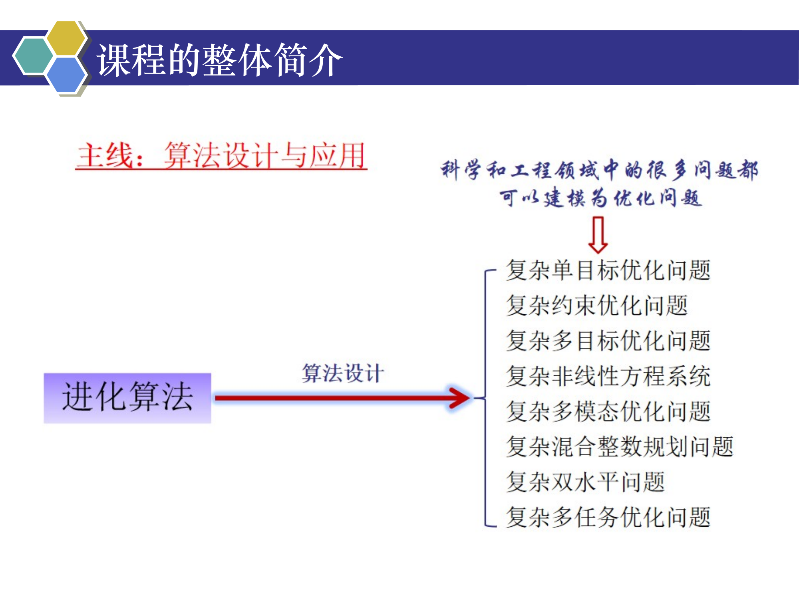
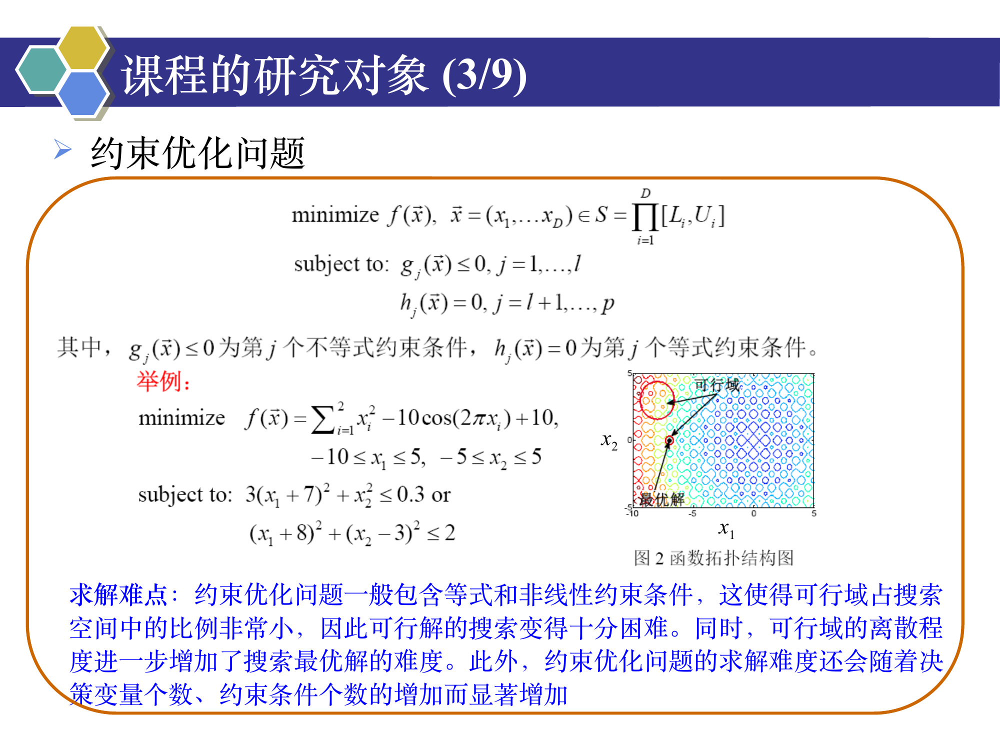

```cardlink
url: http://10.188.31.55:5244/Nextcloud/School/Compute-Intelligence/课件/
title: "计算智能 · 课程课件"
description: "中南大学自动化学院《计算智能》课程的全部课件"
host: 10.188.31.55:5244
```

[← 返回《计算智能：进化算法与优化方法》目录](../)

## 第 0 章 开篇

### 课程信息

课程名「计算智能」，授课教师王勇，中南大学自动化学院，邮箱 ywang@csu.edu.cn，实验室主页 https://intleo.csu.edu.cn/ [Chapter 0_ 开篇.pdf · p.1](http://10.188.31.55:5244/Nextcloud/School/Compute-Intelligence/converted/Chapter%200_%20%E5%BC%80%E7%AF%87.pdf#page=1)。

课件自列的提纲分三段：课程的整体介绍、课程的研究对象、课程的讲授方式与预期目标与考试方式 [Chapter 0_ 开篇.pdf · p.2](http://10.188.31.55:5244/Nextcloud/School/Compute-Intelligence/converted/Chapter%200_%20%E5%BC%80%E7%AF%87.pdf#page=2)。

### 计算智能是什么

计算智能 (Computational Intelligence) 是人工智能的一个重要分支。它借助于模糊逻辑、神经网络、进化算法等技术，通过计算机模拟人类智能的各种能力，包括学习能力、适应能力、决策能力等，使计算机可以更加智能化地理解和处理现实世界的复杂问题 [Chapter 0_ 开篇.pdf · p.3](http://10.188.31.55:5244/Nextcloud/School/Compute-Intelligence/converted/Chapter%200_%20%E5%BC%80%E7%AF%87.pdf#page=3)。

计算智能课程是人工智能本科专业的核心课程，也是该专业唯一的一门英文课程。课件给它定了三个位置：衔接基础与高阶知识的「桥梁」、培养实践能力的「训练场」、对接产业需求的「通道」 [Chapter 0_ 开篇.pdf · p.3](http://10.188.31.55:5244/Nextcloud/School/Compute-Intelligence/converted/Chapter%200_%20%E5%BC%80%E7%AF%87.pdf#page=3)。

学术组织上，IEEE 计算智能学会 (IEEE Computational Intelligence Society) 在全球计算智能领域的学术研究和技术应用方面发挥着重要的引领作用 [Chapter 0_ 开篇.pdf · p.4](http://10.188.31.55:5244/Nextcloud/School/Compute-Intelligence/converted/Chapter%200_%20%E5%BC%80%E7%AF%87.pdf#page=4)。

### 计算智能的应用范围

计算智能的应用覆盖工业控制、金融、医疗、农业等各个领域，能解决很多难题。课件点名四个方向 [Chapter 0_ 开篇.pdf · p.5](http://10.188.31.55:5244/Nextcloud/School/Compute-Intelligence/converted/Chapter%200_%20%E5%BC%80%E7%AF%87.pdf#page=5)：

- **高效控制系统**：用模糊控制技术调节温度、湿度、气压等参数，让生产过程更智能、更高效。
- **图像识别**：用神经网络技术做图像分类、自动标注、目标检测，落在智能安防、自动驾驶、医学影像等场景。
- **金融风控**：分析大量历史数据，用进化算法预测未来市场走势，把投资决策智能化。
- **医学诊断**：分析大量医疗数据做诊断，提高病例诊断的准确性和效率。

计算智能已经成为人类智慧的一种展现形式，它不断改变着人类的工作、生活和思维方式 [Chapter 0_ 开篇.pdf · p.5](http://10.188.31.55:5244/Nextcloud/School/Compute-Intelligence/converted/Chapter%200_%20%E5%BC%80%E7%AF%87.pdf#page=5)。

### 进化算法在课程中的位置

进化算法是最为著名的智能优化技术。它利用适应值 (fitness) 这一启发式信息引导群体进化，是一种高鲁棒性的全局优化方法，具有自组织、自适应、自学习等特性 [Chapter 0_ 开篇.pdf · p.6](http://10.188.31.55:5244/Nextcloud/School/Compute-Intelligence/converted/Chapter%200_%20%E5%BC%80%E7%AF%87.pdf#page=6)。

进化算法已被广泛应用于求解科学和工程领域中的各类复杂优化问题。2015 年 5 月，《Nature》机器智能专刊专文介绍了六个新兴研究领域，进化算法位列其中；2018 年 11 月，进化算法被美国商务部列入受出口管制的代表性新兴技术清单征求意见稿 [Chapter 0_ 开篇.pdf · p.6](http://10.188.31.55:5244/Nextcloud/School/Compute-Intelligence/converted/Chapter%200_%20%E5%BC%80%E7%AF%87.pdf#page=6)。

### 课程主线：算法设计与实际应用

课件用两张图给出课程主线。

第一张把「进化算法」经由「算法设计」接到八类复杂优化问题：复杂单目标、复杂约束、复杂多目标、复杂非线性方程系统、复杂多模态、复杂混合整数规划、复杂双水平、复杂多任务优化问题。图上的标注点明这条主线的前提——科学和工程领域中的很多问题都可以建模为优化问题 [Chapter 0_ 开篇.pdf · p.7](http://10.188.31.55:5244/Nextcloud/School/Compute-Intelligence/converted/Chapter%200_%20%E5%BC%80%E7%AF%87.pdf#page=7)。



第二张把「进化算法」经由「实际应用」接到七个工程方向：汽车轻量化设计、移动边缘计算、智能机器人、新能源、医疗大数据、药物设计、脑机接口 [Chapter 0_ 开篇.pdf · p.8](http://10.188.31.55:5244/Nextcloud/School/Compute-Intelligence/converted/Chapter%200_%20%E5%BC%80%E7%AF%87.pdf#page=8)。

### 课程的研究对象：九个方向

课件把研究对象分成九项，逐项给出该项的求解难点。

**1. 进化算法**。课件列了六个算法 [Chapter 0_ 开篇.pdf · p.10](http://10.188.31.55:5244/Nextcloud/School/Compute-Intelligence/converted/Chapter%200_%20%E5%BC%80%E7%AF%87.pdf#page=10)：遗传算法 (Genetic Algorithm, GA)、进化策略 (Evolution Strategy, ES)、进化规划 (Evolutionary Programming, EP)、蚁群算法 (Ant Colony Optimization, ACO)、粒子群优化算法 (Particle Swarm Optimization, PSO)、差分进化算法 (Differential Evolution, DE)。

**2. 单目标优化问题**。这类问题的数学描述十分简单。求解难度上来有三个来源：目标函数的拓扑结构比较复杂，决策变量的数目较大，决策变量之间存在较强的相关性。命中这三条，求解难度会显著增加 [Chapter 0_ 开篇.pdf · p.11](http://10.188.31.55:5244/Nextcloud/School/Compute-Intelligence/converted/Chapter%200_%20%E5%BC%80%E7%AF%87.pdf#page=11)。

**3. 约束优化问题**。这类问题一般包含等式和非线性约束条件。这使得**可行域 (feasible region)** 占搜索空间中的比例非常小，可行解的搜索变得十分困难。可行域的离散程度进一步增加了搜索最优解的难度。决策变量个数与约束条件个数增加时，求解难度还会显著增加 [Chapter 0_ 开篇.pdf · p.12](http://10.188.31.55:5244/Nextcloud/School/Compute-Intelligence/converted/Chapter%200_%20%E5%BC%80%E7%AF%87.pdf#page=12)。



**4. 多目标优化问题**。这类问题的最优解通常是一个解集。决策变量之间具有很强的耦合关系时，最优解集将呈现出很强的非线性，求解过程十分复杂。求解难度还与目标函数的个数、目标函数的冲突程度息息相关 [Chapter 0_ 开篇.pdf · p.13](http://10.188.31.55:5244/Nextcloud/School/Compute-Intelligence/converted/Chapter%200_%20%E5%BC%80%E7%AF%87.pdf#page=13)。

**5. 非线性方程系统**。这类系统可能同时包含多个最优解，甚至包含无穷多个最优解。求解难度在于如何在一次运行中找到所有最优解。方程的非线性程度进一步增加了求解难度 [Chapter 0_ 开篇.pdf · p.14](http://10.188.31.55:5244/Nextcloud/School/Compute-Intelligence/converted/Chapter%200_%20%E5%BC%80%E7%AF%87.pdf#page=14)。

**6. 多模态优化问题**。这类问题同样包含多个最优解。它的求解难度与非线性方程系统同源，也在于如何在一次运行中找到所有最优解。决策变量个数与决策变量耦合程度增加时，求解难度显著增加 [Chapter 0_ 开篇.pdf · p.15](http://10.188.31.55:5244/Nextcloud/School/Compute-Intelligence/converted/Chapter%200_%20%E5%BC%80%E7%AF%87.pdf#page=15)。

**7. 混合整数规划问题**。这类问题指部分决策变量限制为整数的优化问题。整数决策变量将可行域划分为大量离散的片段，给搜索最优解提出了重大挑战。课件采用最优化的标准记号：`min` 是 minimize 的简称，`s.t.` 是 subject to 的简称 [Chapter 0_ 开篇.pdf · p.16](http://10.188.31.55:5244/Nextcloud/School/Compute-Intelligence/converted/Chapter%200_%20%E5%BC%80%E7%AF%87.pdf#page=16)。

**8. 双水平优化问题**。这类问题是一种具有双层递阶结构的系统优化问题，上下层问题都有各自的目标函数和约束条件。上层问题的目标函数和约束条件不仅与上层决策变量有关，还依赖于下层问题的最优解；下层优化问题的最优解又受到上层决策变量的影响 [Chapter 0_ 开篇.pdf · p.17](http://10.188.31.55:5244/Nextcloud/School/Compute-Intelligence/converted/Chapter%200_%20%E5%BC%80%E7%AF%87.pdf#page=17)。

**9. 多任务优化问题**。$M$ 个优化任务之间具有相似性。求解的关键是利用优化任务间的相似性进行知识迁移，实现所有优化任务的高效求解。第 $m$ 个优化任务各自带有决策向量、目标函数、决策空间，以及决策变量的个数 [Chapter 0_ 开篇.pdf · p.18](http://10.188.31.55:5244/Nextcloud/School/Compute-Intelligence/converted/Chapter%200_%20%E5%BC%80%E7%AF%87.pdf#page=18)。

### 求解优化问题的重要性

2019 年数理科学部拟资助 6 个重大项目，直接费用预算不超过 2000 万元/项。第一个项目主题是「最优化问题的人工智能方法」，研究内容分五块 [Chapter 0_ 开篇.pdf · p.19](http://10.188.31.55:5244/Nextcloud/School/Compute-Intelligence/converted/Chapter%200_%20%E5%BC%80%E7%AF%87.pdf#page=19)：

- **（一）连续优化的自主学习方法**。模拟人工智能的自适应学习原理，分析连续优化方法的共性构造特征；对几类典型的连续优化问题研究其人工智能方法与理论；建立参数自调节、方向自选择的自适应迭代优化算法；通过建立连续函数空间的学习理论，为自适应优化算法建立理论基础。
- **（二）多目标优化的机器学习方法**。利用机器学习方法分析各个目标间的冲突，构建自主协调策略；针对非凸多目标优化问题，建立其凸化问题的机器学习方法；针对非光滑多目标优化问题，建立光滑化的机器学习方法；发展多目标优化问题簇的元学习方法与理论。
- **（三）混合整数规划的人工智能方法**。充分利用问题类别与历史数据信息，构造分支与节点选择、割平面、启发式调用等的自适应策略；建立这些方法的评价与反馈机制 [Chapter 0_ 开篇.pdf · p.20](http://10.188.31.55:5244/Nextcloud/School/Compute-Intelligence/converted/Chapter%200_%20%E5%BC%80%E7%AF%87.pdf#page=20)。
- **（四）组合优化的深度强化学习方法**。分析共性结构，研究不同类型组合优化问题的表示方法、特征提取方法、价值网络与策略网络的构造方法；研究相应的训练算法和策略搜索算法；建立机器学习与优化方法的混合迭代算法框架；建立算法的评价与反馈机制，发展计算复杂性理论 [Chapter 0_ 开篇.pdf · p.20](http://10.188.31.55:5244/Nextcloud/School/Compute-Intelligence/converted/Chapter%200_%20%E5%BC%80%E7%AF%87.pdf#page=20)。
- **（五）典型问题的应用**。结合信息科学与技术、管理科学与工程、交通运输等学科，应用前面发展的方法与理论，解决国家重大需求和瓶颈技术中的几类典型最优化问题，验证方法的有效性、可行性和优越性 [Chapter 0_ 开篇.pdf · p.21](http://10.188.31.55:5244/Nextcloud/School/Compute-Intelligence/converted/Chapter%200_%20%E5%BC%80%E7%AF%87.pdf#page=21)。

2015 年 6 月，国家自然科学基金委公布“十二五”第五批重大项目指南，「工业过程全局优化运行的基础理论与关键技术」被列为重大项目 [Chapter 0_ 开篇.pdf · p.22](http://10.188.31.55:5244/Nextcloud/School/Compute-Intelligence/converted/Chapter%200_%20%E5%BC%80%E7%AF%87.pdf#page=22)。以石油化工、钢铁冶金为代表的基础原材料工业是国民经济的支柱产业，研究和实施全局优化运行技术，是这些企业提高资源利用效率、节能减排、实现智能转型发展的必由之路。项目要求围绕大规模多尺度集成建模、实时多目标动态优化问题求解与全局优化运行等困难问题，从基础理论、关键技术和应用验证三个层面开展创新研究 [Chapter 0_ 开篇.pdf · p.22](http://10.188.31.55:5244/Nextcloud/School/Compute-Intelligence/converted/Chapter%200_%20%E5%BC%80%E7%AF%87.pdf#page=22)。

### 进化算法求解复杂优化问题的现状

以大数据为代表的信息技术发展起来之后，优化问题的复杂程度越来越高，求解难度不断增加，这给进化算法提出重大挑战 [Chapter 0_ 开篇.pdf · p.23](http://10.188.31.55:5244/Nextcloud/School/Compute-Intelligence/converted/Chapter%200_%20%E5%BC%80%E7%AF%87.pdf#page=23)：

- 进化算法的搜索模式不够完善。
- 在求解复杂优化问题时，对背景知识挖掘不够充分。
- 算法鲁棒性、算法求解质量和求解效率均亟待提高。

### 讲授方式、预期目标与考试方式

- **课时与形式**：26 个讲授课时，PPT 讲授，中英文混合。
- **讲授内容**：介绍进化计算领域的基础（经典）工作和国际最新研究成果；介绍进化算法在实际工程中的应用。
- **培养目标**：通过本课程培养学生的批判精神、独立思考、解决问题的能力。
- **编程语言**：Matlab、C++、Python 等。
- **教材**：自选，以 PPT 为主。
- **考试方式**：闭卷考试 [Chapter 0_ 开篇.pdf · p.25](http://10.188.31.55:5244/Nextcloud/School/Compute-Intelligence/converted/Chapter%200_%20%E5%BC%80%E7%AF%87.pdf#page=25)。
