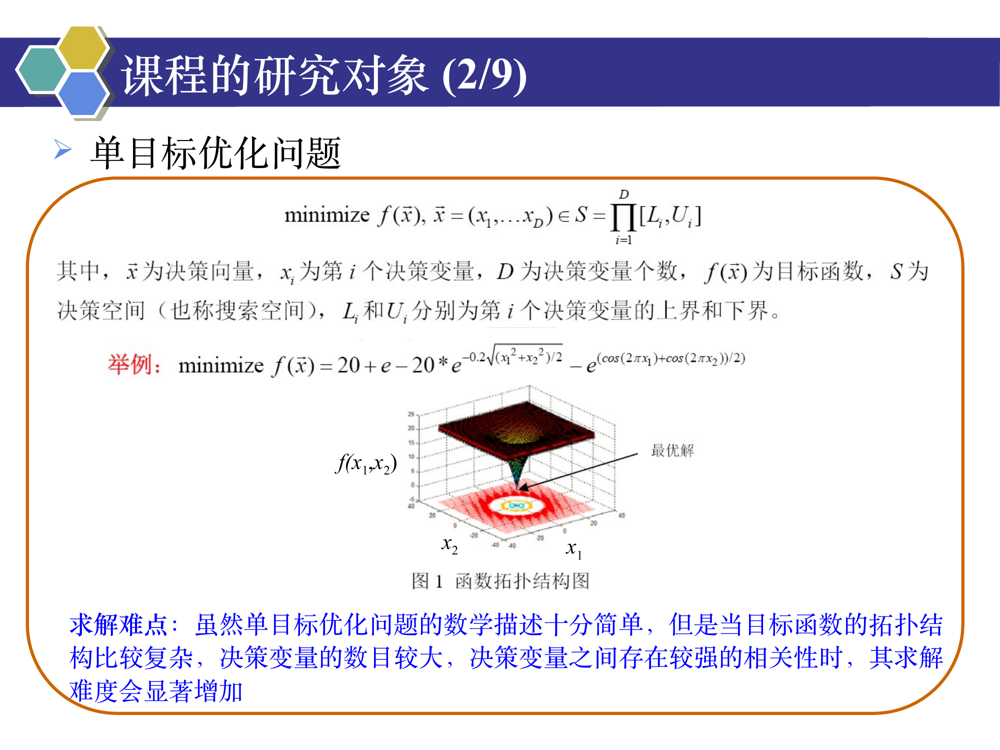
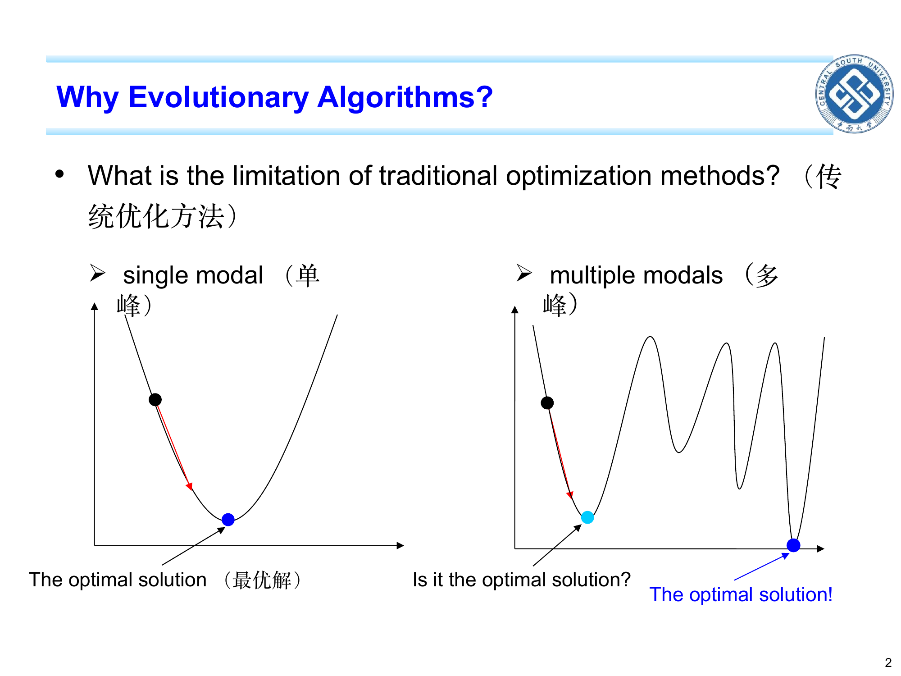
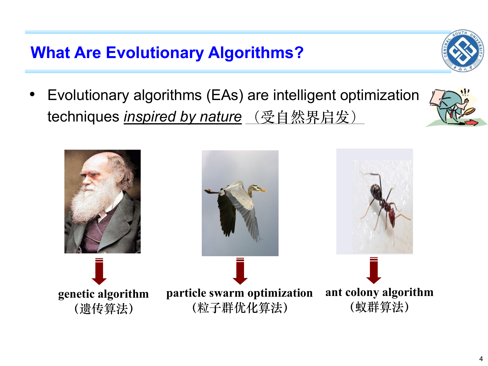

```cardlink
url: http://10.188.31.55:5244/Nextcloud/School/Compute-Intelligence/课件/
title: "计算智能 · 课程课件"
description: "中南大学自动化学院《计算智能》课程的全部课件"
host: 10.188.31.55:5244
```

[← 返回《计算智能：进化算法与优化方法》目录](../)

## 第 1 章 计算智能与进化算法导论

### 优化问题需要说清三件事

给一条工业生产线调一组工艺参数——温度、压力、流量——让“单位能耗”尽量低。这在数学上就是一个优化问题:选 $x$,让 $f(x)$ 最小 [Chapter 1_ Introduction to EAs.pdf · p.2](http://10.188.31.55:5244/Nextcloud/School/Compute-Intelligence/converted/Chapter%201_%20Introduction%20to%20EAs.pdf#page=2)。

工程里这样的问题多得吓人:模型参数辨识、控制器参数整定、生产排程、库存优化、图像分割阈值选取、神经网络超参数搜索等等。它们的共同特征是真实问题的目标函数往往写不出干净的公式——要么有噪声、要么不可导、要么形式复杂到连符号表达都嫌长。传统优化方法(梯度下降、牛顿法、穷举)要么必须知道梯度,要么必须把搜索空间挨个点试一遍,在这些问题面前要么走不动、要么跑不完 [Chapter 1_ Introduction to EAs.pdf · p.2](http://10.188.31.55:5244/Nextcloud/School/Compute-Intelligence/converted/Chapter%201_%20Introduction%20to%20EAs.pdf#page=2)。

进化算法(Evolutionary Algorithm, EA)换了一个完全不同的思路:不去算“该往哪边走”,而是同时放一群随机解在空间里跑,让它们“模仿自然选择”——表现好的多复制、随机地小改、互相杂交——一代代改进。它对函数本身几乎不做假设:不要求可导,不要求光滑,不要求连续,只要能给出“这个解多少分”就行 [Chapter 1_ Introduction to EAs.pdf · p.8](http://10.188.31.55:5244/Nextcloud/School/Compute-Intelligence/converted/Chapter%201_%20Introduction%20to%20EAs.pdf#page=8)。

任何优化问题都由三件套组成:

- **决策变量 (decision variable)**: 你能自由调的那几个数,拼成向量 $x=(x_1,\dots,x_D)$,维数 $D$。
- **目标函数 (objective function)**: 你真正在乎的那个“分数”,写成 $f(x)$;本讲义**默认最小化**。
- **搜索空间 / 决策空间 (search space)**: $x$ 允许取值的那个区域,空间里的每一个点就是一个候选解。

搜索空间写成每一维区间的连乘:

$$
S = \prod_{j=1}^{D}[L_j, U_j]
$$

实数区间 $[a,b]$ 含两端,即 $a \le x \le b$;连乘符号 $\prod$ 表示把多个因子相乘,例如 $\prod_{i=1}^{3}\delta_i = \delta_1\delta_2\delta_3$。

打分时还要多认一个量:**适应度 (fitness)**,记作 $\mathrm{fit}(x)$。它和目标函数的方向可能相反——$f$ 越小越好,$\mathrm{fit}$ 越大越好。原题是最小化问题时,必须先写清楚 $f$ 怎么转成 $\mathrm{fit}$(最简单是取 $\mathrm{fit}=-f$),不能把两者混为一谈。

### 适应度地形:局部最优与全局最优

把函数值当海拔画出来,目标函数就有了地形。



箭头指的位置就是**最优解 (optimal solution)**,山谷的形状就是**适应度地形 (fitness landscape)**,站在地形上想做的,就是找到那个最深的谷底。抽象成数学就是:给定函数 $f$,在搜索空间 $S$ 里找使 $f$ 最小的 $x^*$。

$$
x^* = \arg\min_{x\in S} f(x)
$$

这个 $x^*$ 称为**全局最优 (global optimum)**——整个搜索空间里 $f$ 最小的那一个 [Chapter 1_ Introduction to EAs.pdf · p.2](http://10.188.31.55:5244/Nextcloud/School/Compute-Intelligence/converted/Chapter%201_%20Introduction%20to%20EAs.pdf#page=2)。

问题在于,地形往往不止一个谷底。



**单峰 (unimodal)** 地形像一只碗,只有一个谷底;**多峰 (multimodal)** 地形像一片丘陵,谷底有好几个,深浅不一。传统优化方法大多从“一个点”出发、按“下坡方向”走,这种策略叫**爬山法 (hill climbing)**——它**保证能走到最近的谷底,但保证不了那是全局最深的谷底**。这里的“下坡方向”只需要直觉:梯度就是函数“上升最快的方向”,梯度下降是朝反方向走 [Chapter 1_ Introduction to EAs.pdf · p.2](http://10.188.31.55:5244/Nextcloud/School/Compute-Intelligence/converted/Chapter%201_%20Introduction%20to%20EAs.pdf#page=2)。

梯度法在多峰地形上必然失效,一句话就能说清:梯度只给出当前位置的下坡方向,一旦滑进某个谷底,谷底处梯度为零或极小,再也走不出去;而这个谷底有多深,取决于当初从哪个坡上滚下来。

### 多点并行与随机概率转变准则


如果**同时放一群点**在搜索空间的不同位置,每个点都按“下坡方向”走几步,情况就立刻不同:

- 不同山谷可以被**同时盯住**,哪一个是全局最深一目了然;
- 万一某个点掉进了浅坑,其它点不会跟着陷进去;
- 已经找到的“好区域”可以通过“种群之间交换信息”扩散出去。

这就是**多点搜索 (multi-point search)** 相对**单点搜索 (single-point search)** 的根本优势 [Chapter 1_ Introduction to EAs.pdf · p.3](http://10.188.31.55:5244/Nextcloud/School/Compute-Intelligence/converted/Chapter%201_%20Introduction%20to%20EAs.pdf#page=3)。

但单纯的“多点爬山”还不够——多个爬山者之间不互相通报,谁也帮不了谁。进化算法又加了第二招:**下一步往哪走不是由确定性公式算出来的,而是由随机抽样决定的**——这就是 PPT 里讲的“随机概率转变准则”。它意味着即使当前解看起来不错,算法也愿意接受一小步“看起来变差”的试探,从而**跳出当前的谷底去别处看看** [Chapter 1_ Introduction to EAs.pdf · p.8](http://10.188.31.55:5244/Nextcloud/School/Compute-Intelligence/converted/Chapter%201_%20Introduction%20to%20EAs.pdf#page=8)。这里的“随机”是**伪随机数 (pseudo-random number)**:计算机用确定公式算出的“看起来随机”的数,随机种子相同则序列完全相同 [Chapter 1_ Introduction to EAs.pdf · p.8](http://10.188.31.55:5244/Nextcloud/School/Compute-Intelligence/converted/Chapter%201_%20Introduction%20to%20EAs.pdf#page=8)。

一个最小的例子。在整数点上定义 $f(0)=5,\ f(1)=2,\ f(2)=7,\ f(3)=1,\ f(4)=9$。只允许看相邻两格的“单点爬山”:从 $x=0$ 出发,$x=1$ 的 $f=2$ 比 $f(0)=5$ 好,走过去;再看 $x=1$ 的邻居,$f(0)=5$ 差、$f(2)=7$ 也差,四面都不如它,停在 $x=1$,**永远发现不了 $x=3$ 处那个 1** [Chapter 1_ Introduction to EAs.pdf · p.2](http://10.188.31.55:5244/Nextcloud/School/Compute-Intelligence/converted/Chapter%201_%20Introduction%20to%20EAs.pdf#page=2)。但如果**除了“走下坡”,每一步还允许以小概率“跳到任意一格”**:这次跳到 $x=3$,立即看到 $f(3)=1$ 是全局最优,后面的搜索就都朝它靠拢了。这就是“随机试探”的价值——它**给了算法第二次机会,允许暂时的“恶化”以换取全局视野** [Chapter 1_ Introduction to EAs.pdf · p.3](http://10.188.31.55:5244/Nextcloud/School/Compute-Intelligence/converted/Chapter%201_%20Introduction%20to%20EAs.pdf#page=3)。

多点并行 + 随机概率转变,这两条加在一起就构成了进化算法的灵魂。

### 进化算法这一族

这门课研究的核心对象是**进化算法**:留一群解、让它们“选优、交配、随机小改”、一代代改进 [Chapter 1_ Introduction to EAs.pdf · p.7](http://10.188.31.55:5244/Nextcloud/School/Compute-Intelligence/converted/Chapter%201_%20Introduction%20to%20EAs.pdf#page=7)。



三条自然隐喻各对应一个算法:GA 对应达尔文的自然选择,PSO 对应鸟群与鱼群,蚁群算法 (ant colony optimization, ACO) 模仿蚂蚁用**信息素 (pheromone)** 标记路径、逐步逼近最短路径,是另一个不靠梯度的范例 [Chapter 1_ Introduction to EAs.pdf · p.4](http://10.188.31.55:5244/Nextcloud/School/Compute-Intelligence/converted/Chapter%201_%20Introduction%20to%20EAs.pdf#page=4)。

两个容易混的词:**进化计算 (evolutionary computation)** 是“进化算法”这个研究领域的总称(学术圈子、期刊、会议),不是某个具体算法;**范例 (paradigm)** 是某个家族里最具代表性的款式——GA 是一个范例,PSO 是另一个,共 6 大范例 [Chapter 1_ Introduction to EAs.pdf · p.9](http://10.188.31.55:5244/Nextcloud/School/Compute-Intelligence/converted/Chapter%201_%20Introduction%20to%20EAs.pdf#page=9)。

### EA 通用框架:六步闭环


这张图是全书主干:后面四章讲的 GA、ES/EP、DE、PSO,**全都是这张图里某个或某几个步骤的换一种实现**。区别只落在“选择怎么做、交叉怎么做、变异怎么做、替换怎么做”这四问上 [Chapter 1_ Introduction to EAs.pdf · p.7](http://10.188.31.55:5244/Nextcloud/School/Compute-Intelligence/converted/Chapter%201_%20Introduction%20to%20EAs.pdf#page=7)。

六步闭环:

1. **初始化**:随机生成 $N$ 个个体,组成第 $0$ 代种群 $P(0) = \{x_1^{(0)},\dots,x_N^{(0)}\}$。每个个体 $x_i$ 就是一个候选解,可能是 0/1 串(GA),可能是实数向量(ES/DE/PSO)。这一步只做一次。
2. **计算适应度**:对 $P(t)$ 里的每个个体算 $\mathrm{fit}(x_i^{(t)})$,准备给“选择”用。在最小化问题里常常取 $\mathrm{fit} = -f$,因为适应度“越大越好”而 $f$“越小越好”,方向相反必须换算。
3. **选择 (Selection)**:按某种“适应度越高越容易被挑中”的规则,从 $P(t)$ 里挑出 $N_p$ 个个体组成**父代集** $S(t)$。这一步的产物是父代集——它不等于 $P(t)$。
4. **交叉 (Crossover)**:把 $S(t)$ 里的父代两两(或更多)配对,按某种规则交换“零件”,生成一批候选子代 $C(t)$。这一步**不评价函数值**,只是重组已有信息。
5. **变异 (Mutation)**:对 $C(t)$ 里的每个个体做一次小幅随机扰动(GA 里翻 1 位,ES/EP/DE 里加一个小随机量,PSO 里**没有这一步**),得到 $M(t)$。这一步的作用是**维持种群多样性,防止算法过早收敛到同一处**。
6. **替换 (Replacement)**:从 $P(t) \cup M(t)$(或者仅从 $M(t)$,看具体策略)里挑出 $N$ 个个体组成下一代种群 $P(t+1)$。这一步的关键问题是“老的要不要保留”——保留老的(精英策略)收敛快、易早熟;不保留(逗号策略)允许暂时变差、能逃出局部最优。这是 ES 的核心考点。

**终止判断**:若满足终止条件(达到最大代数、目标函数值足够小、连续若干代没有改进等),输出当前种群里的最优个体作为解;否则 $t \leftarrow t+1$,回到第 2 步。

两个不能跳的关键事实:

- **这是一个闭环**:第 6 步生成的 $P(t+1)$ 在下一轮里就是 $P(t)$;种群一代一代地自我更新,直到满足终止条件。
- **每一步的具体实现决定它是什么算法**:选择怎么做?轮盘赌、锦标赛(GA)、$(\mu+\lambda)$ 选择(ES)、一对一比较(DE)——差别就在选择算子上。交叉怎么做?单点交叉(GA)、无交叉(EP、PSO)、差分变异 + 二项式交叉(DE)——差别在交叉算子上。变异怎么做?位翻转(GA)、高斯变异(ES/EP)、差分变异(DE)、无变异(PSO)——差别在变异算子上。替换怎么做?整代替换、精英保留(GA)、$(\mu+\lambda)$ 或 $(\mu,\lambda)$(ES)、一对一贪婪(DE)、不淘汰任何粒子(PSO)——差别在替换算子上。

**「父代集」是后面四章唯一的分岔口**:它才是选择算子真正产出的东西,不是种群换个名字。

### 贯穿全书的术语

**探索 (exploration)**:去没去过的地方试试——可能找到更深的谷,也可能白跑一趟。**开发 (exploitation)**:在已知不错的点附近细挖——能把解算得更精确,但可能永远困在这一个谷里。

凡是问某参数调大或调小会怎样,答案几乎都能这样开头——**调大 = 更偏探索 = 更不容易早熟,但收敛更慢**。这两个词贯穿第 1–5 章所有参数:GA 的 $p_m$、ES 的步长 $\delta$、DE 的 $F$ 与 $CR$、PSO 的 $\omega$ 与 $c_1$/$c_2$ [Chapter 1_ Introduction to EAs.pdf · p.3](http://10.188.31.55:5244/Nextcloud/School/Compute-Intelligence/converted/Chapter%201_%20Introduction%20to%20EAs.pdf#page=3)。

变异率就是最直观的例子。$p_m$ 太大:每代产生大量随机扰动,好不容易积累的好模式被全部打碎——探索过度、开发为零,算法等价于随机游走,根本收不住。$p_m$ 太小:几乎不变异,种群很快变得一模一样(多样性丢光),只能在一个浅谷里打转——开发过度、探索为零,发生早熟收敛。平衡点落在“与编码串长度成反比的量级”上:既能让好模式存活下来,又能保证偶尔产生一点新模式。

下表是全章的术语总表,后面各章不再重复定义。

| 术语 | 一句话理解 |
| --- | --- |
| 种群 (population) | 一次同时持有的一整群解,不是只有一个解;种群规模记作 $N$。DE 写作 $NP$、ES 把父代个数写作 $\mu$、子代个数写作 $\lambda$,是同一角色的不同别名:$N=NP=\mu$ 并列,且 $\lambda\ge\mu$。 |
| 个体 (individual) | 种群里的一个成员,就是一个候选解 $x$(GA 里就是一条 0/1 串)。 |
| 选择 (selection) | “谁有资格当父母”的那一步——适应度高的个体更容易被选中、被复制得更多。 |
| 父代集 (parent set) | 被选择算子挑出来的那一小批“当父母的解”,规模记作 $N_p$(ES 里写作 $\mu$)。它**不等于整个种群**,只是种群的一个子集。 |
| 交叉 (crossover) | 把两个(或多个)父代的“零件”拼到一起生成新解。GA 里就是把两条串某一段互换。 |
| 变异 (mutation) | 对新解做一点随机的、小幅的改动(GA 里就是把某一位 0 变 1)。作用是让算法别只会原地打转,保持多样性。 |
| 替换 (replacement) / 环境选择 | 新解算出来后,“究竟让谁留在种群里、谁被淘汰”的那一步。它把新解写回种群,构成闭环。 |
| 父代 / 子代 (parent / offspring) | 被挑出来繁殖的是父代,繁殖出来的新解是子代;第 $t$ 代的子代就是第 $t+1$ 代的种群。 |
| 适应度 (fitness) | 给每个候选解打的分,分越高说明这个解越好。适应度函数记作 $\mathrm{fit}(x)$。 |
| 目标函数 (objective function) | 你真正在乎的那个“分数”,写成 $f(x)$,默认最小化;它与适应度是两个不同的量。 |
| 适应度地形 (fitness landscape) | 把函数值当海拔画出来的曲面,地形上有几个谷底决定了问题有多难。 |
| 梯度信息 (gradient information) | 函数“上升最快的方向”那条信息(由各维偏导数组成)。传统方法靠它下坡;进化算法**不用**它,所以能处理函数写不出、不可导的问题。 |
| 启发式方法 (heuristic method) | 靠经验规则办事:不保证给出最优解,但通常能在可接受的时间里给出够好的解,而且算得快。 |
| 元启发式 (metaheuristic) | 一类“与具体问题无关、靠一套通用搜索策略在任意问题上跑”的启发式框架。GA、ES、EP、DE、PSO 都属于元启发式——同一套算法只看得见 $f(x)$ 的数值,不关心 $x$ 代表什么。 |
| 种群多样性 (population diversity) | 群里个体彼此“有多不一样”。多样性高 = 大家分散在好几个区域;多样性低 = 所有人越来越像、挤在同一个角落。 |
| 收敛 (convergence) | 随代数增加,群里最好的解不再明显变好,曲线变平趴在一条水平线上。 |
| 早熟收敛 (premature convergence) | 曲线很早就平了,平在一个还很差的局部最优上。 |
| 收敛曲线 (convergence curve) | 横轴是代数,纵轴是“到这一代为止找到的最高适应度”的折线图,把整个搜索过程一眼看完。 |
| 局部最优 (local optimum) | 在它附近一圈里最好的点,出了这一圈,别处可能存在更深的谷,它不知道。 |
| 全局最优 (global optimum) | 整个搜索空间里真正最好的那个点。 |
| 邻域 (neighborhood) | 某个点“附近”的那些点。范围由你定义——离散串上可以是“只改一位得到的串”,实数向量上可以是“距离不超过 $\varepsilon$ 的球内”。 |
| 单峰 / 多峰 / 多模态 | 单峰地形 = 只有一个谷底(像一口碗);多峰地形 = 有多个谷底,而且分不清哪个最深。 |
| 爬山法 (hill climbing) | 从一个起点出发,每一步只往“邻居里更好的方向”走,走不动就停。它不用梯度公式,但只能到达**最近**的那个局部最优。 |
| 搜索空间 (search space) | $x$ 允许取值的那个区域,$S=\prod_{j=1}^{D}[L_j,U_j]$。 |
| 维度灾难 (curse of dimensionality) | 变量个数 $D$ 增加时,搜索空间的“体积”按指数增长,固定数量的采样点越来越稀疏,根本覆盖不住整个空间。2 维 100 个点能覆盖住,20 维 $10^{20}$ 个点根本试不完。这是“穷举不行”的定量理由。 |
| 鲁棒性 (robustness) | 算法“换个问题、换组参数也还能用”的耐折腾程度。进化算法只靠 $f$ 值不靠梯度,所以被认为鲁棒性好 [Chapter 1_ Introduction to EAs.pdf · p.12](http://10.188.31.55:5244/Nextcloud/School/Compute-Intelligence/converted/Chapter%201_%20Introduction%20to%20EAs.pdf#page=12)。 |

### 阶梯例题

#### 例 1.1 优化问题的标准形式与术语匹配

**题干**:某工厂的两个工艺参数 $x_1$、$x_2$ 分别被允许在 $[0,10]$ 与 $[-5,5]$ 范围内取值,目标是把“单位能耗” $f(x_1,x_2)$ 降到最低。请写出这个优化问题的标准形式,并指出:(a) 决策变量及维数 $D$;(b) 目标函数;(c) 搜索空间 $S$。若 $f(3,1)=2$、$f(5,2)=4$,哪个解更好?

**解答**:直接套三件套的定义,再按“默认最小化”比较 $f$ 大小。

(a) 决策变量 $x=(x_1,x_2)$,维数 $D=2$。

(b) 目标函数 $f(x_1,x_2)$(默认最小化)。

(c) 搜索空间 $S=[0,10]\times[-5,5]$,共 $10\times 10=100$ 单位的二维平面。

$f(3,1)=2 < f(5,2)=4$,按“最小化”约定,$x=(3,1)$ 比 $x=(5,2)$ 更好 [Chapter 1_ Introduction to EAs.pdf · p.2](http://10.188.31.55:5244/Nextcloud/School/Compute-Intelligence/converted/Chapter%201_%20Introduction%20to%20EAs.pdf#page=2)。

#### 例 1.2 单峰 vs 多峰——为什么传统方法对多峰失效

**题干**:给定两个目标函数

$$
\begin{aligned}
f_A(x) &= (x-3)^2, \quad x\in[0,6] \\
f_B(x) &= x^4 - 3x^2 + 1, \quad x\in[-2,2]
\end{aligned}
$$

对**每一个**,假设我们从 $x=0$ 出发,每一步只看相邻两个点的函数值,向更小的方向走一步。问:(a) 对 $f_A$,爬山法会停在何处?是否一定找到全局最优?(b) 对 $f_B$,爬山法从 $x=0$ 出发会停在何处?能找到全局最优吗?

**解答**:先算出地形上的谷底位置,再模拟爬山路径。

(a) $f_A(x)=(x-3)^2$ 是单峰地形,在 $[0,6]$ 上唯一谷底是 $x=3$ 处 $f=0$。从 $x=0$ 出发,$x=1$ 的 $f=4$ 比 $f(0)=9$ 好,走过去;$x=2$ 的 $f=1$ 比 $f(1)=4$ 好,再走过去;$x=3$ 的 $f=0$ 比 $f(2)=1$ 好,再走过去;$x=4$ 的 $f=1$ 比 $f(3)=0$ 差,反向;$x=3$ 两侧都没它好,停在 $x=3$。找到了全局最优。

(b) $f_B'(x)=4x^3-6x=2x(2x^2-3)=0$ 得 $x=0$ 与 $x=\pm\sqrt{3/2}\approx\pm 1.2247$。$f_B(0)=1$,$f_B(\pm 1.2247)=-1.25$。地形是“两个谷 $x=\pm 1.2247$、中间一个小土包 $x=0$”。从 $x=0$ 出发:看 $x=-0.1$、$f=0.99$ 比 $f(0)=1$ 略小,走过去;一步一步,会向 $x=-1.2247$ 那个谷滑过去,最终停在 $x=-1.2247$、$f=-1.25$。**但是**,对称的那个谷 $x=+1.2247$ 处 $f$ 也是 $-1.25$,所以从 $x=0$ 出发既可能停在左、也可能停在右(取决于先看到哪边)。如果初始点就在 $x=0$ 附近,它**永远发现不了另一个对称的谷底是不是比这个深**——这是单点爬山在多峰地形上的典型失败。这个例子恰好两个谷一样深;若深度不同,则一定停在较浅的那个 [Chapter 1_ Introduction to EAs.pdf · p.2](http://10.188.31.55:5244/Nextcloud/School/Compute-Intelligence/converted/Chapter%201_%20Introduction%20to%20EAs.pdf#page=2)。

#### 例 1.3 把“探索 vs 开发”翻译成算法决策

**题干**:某 EA 跑了几十代之后收敛曲线已基本水平,但停在了一个很差的局部最优上(离已知的全局最优还差很远)。在不修改算法框架的前提下,你可以调高或调低以下三个旋钮,各调一次:(i) 变异强度;(ii) 种群规模 $N$;(iii) 选择的“严格度”(如轮盘赌里让强者更突出、弱者更被压制)。请说明**每个旋钮**该怎么调,并用“探索 vs 开发”解释**为什么这么调**。

**解答**:早熟收敛说明多样性已经丢光,算法太偏向开发、忘了探索。所以每一项都该往“更偏探索”的方向调。但“探索/开发”在每个旋钮上对应的是不同的“大/小”。

- **(i) 变异强度**:调**高**。变异是“探索”的主要来源——它把个体朝新方向拽一拽;变异率太低,谁也出不了当前的浅坑。
- **(ii) 种群规模 $N$**:调**高**。更多个体意味着空间里同时“盯着”的山谷更多;太小则种群里几个个体挤在一起,多样性天然差。
- **(iii) 选择的严格度**:调**低**。选择太严,适应度高的那 1–2 个个体几乎垄断繁殖权,其他个体全被边缘化、多样性迅速丢光;让强者不强、弱者不弱,种群里能保留更多“与众不同的解” [Chapter 1_ Introduction to EAs.pdf · p.3](http://10.188.31.55:5244/Nextcloud/School/Compute-Intelligence/converted/Chapter%201_%20Introduction%20to%20EAs.pdf#page=3)。

共通逻辑:三个旋钮都朝“更偏探索 = 更不容易早熟”的方向调,但“调大还是调小”的具体方向不同。这就是“凡是问某参数调大或调小会怎样,答案几乎都能这样开头”这条在算法参数上的具体体现。

### 易错点

> [!WARNING]
> **陷阱 1:把“目标函数”和“适应度”当成同一个东西**
> 目标函数 $f$ 默认**越小越好**;适应度 $\mathrm{fit}$ 默认**越大越好**。两者方向相反,简单问题里常取 $\mathrm{fit}=-f$,但**这不是普适规则**——有的问题里 $\mathrm{fit}$ 是 $f$ 的某个非线性变换。GA 的 PPT 表里 $f$ 与 $\mathrm{fit}$ 是分两列的,正是为了提醒这件事。写“用 $f$ 值做轮盘赌选择”时,若原题是求最大值可以算对;若原题是求最小化,要用 $\mathrm{fit}$ 而不是 $f$ [Chapter 1_ Introduction to EAs.pdf · p.8](http://10.188.31.55:5244/Nextcloud/School/Compute-Intelligence/converted/Chapter%201_%20Introduction%20to%20EAs.pdf#page=8)。

> [!WARNING]
> **陷阱 2:把“种群”和“父代集”混为一谈**
> 种群 $P(t)$(PPT 图里写作 Population/群体)是**当前一代全部** $N$ 个个体;父代集 $S(t)$ 是经选择算子挑出来的那**一小批当父母的个体**,其规模 $N_p$ 通常 $\le N$,即它**不大于**种群。这里最容易搞反的是 ES:它把父代个数写作 $\mu$、每代产生的子代个数写作 $\lambda$,且 $\lambda \ge \mu$、常用 $\lambda \approx 7\mu$——也就是说 ES 的父代集**比子代少**,更不会比种群大。常见错误是把框架图中的“种群”框与“父代集”框画成同一个框;正确画法是两个独立的框,中间有“选择”箭头。框架图里多出来的这一步**就是选择算子真正做的事** [Chapter 1_ Introduction to EAs.pdf · p.7](http://10.188.31.55:5244/Nextcloud/School/Compute-Intelligence/converted/Chapter%201_%20Introduction%20to%20EAs.pdf#page=7)。

> [!WARNING]
> **陷阱 3:以为进化算法“保证找到全局最优”**
> 错。进化算法**只在概率意义上**给出强搜索,不提供最优性保证。给定有限代数 $G_{\max}$ 与有限种群 $N$,搜索范围天然有限——多峰地形上“离最优还差很远但曲线已经平了”是常态。它的价值在于**对函数几乎不做假设、不需要梯度、在合理时间内给出足够好的解**,不在于“保证最优” [Chapter 1_ Introduction to EAs.pdf · p.2](http://10.188.31.55:5244/Nextcloud/School/Compute-Intelligence/converted/Chapter%201_%20Introduction%20to%20EAs.pdf#page=2)。
