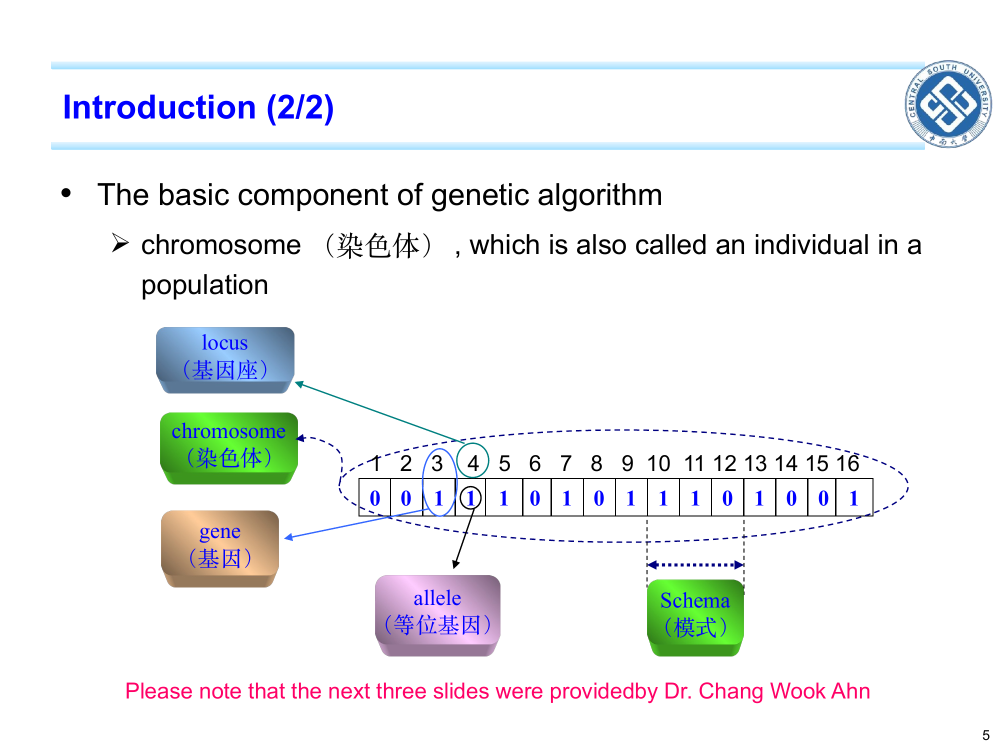
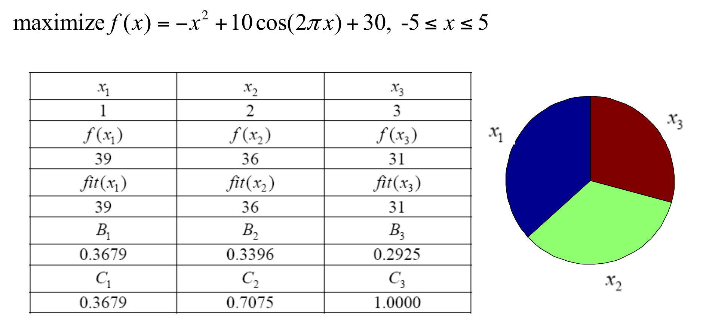
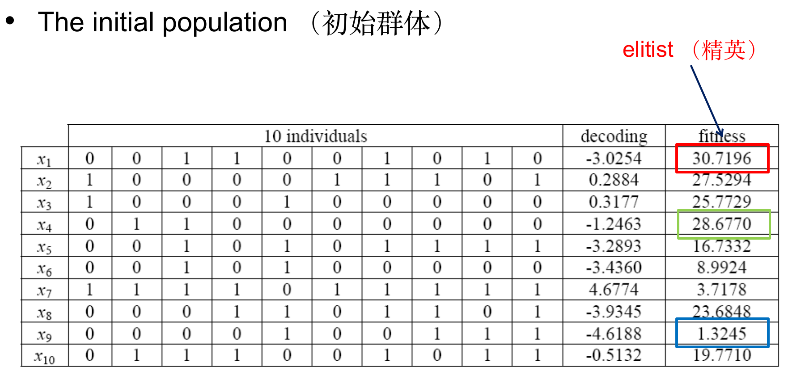
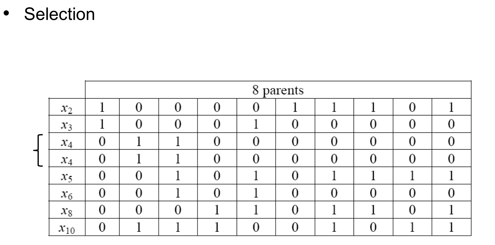
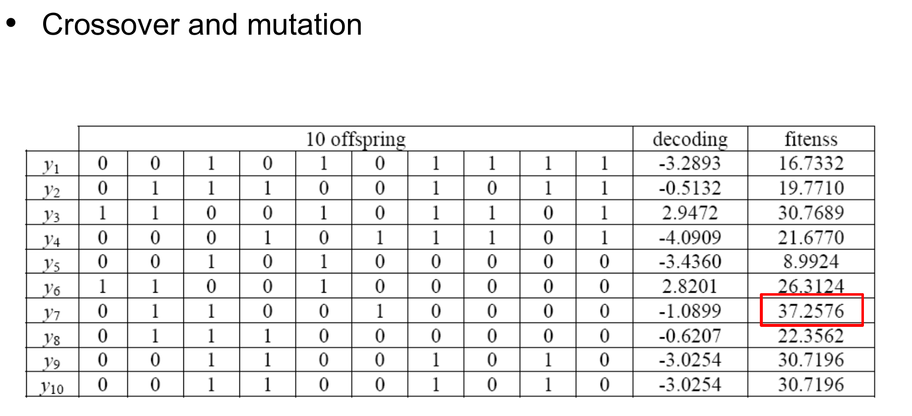
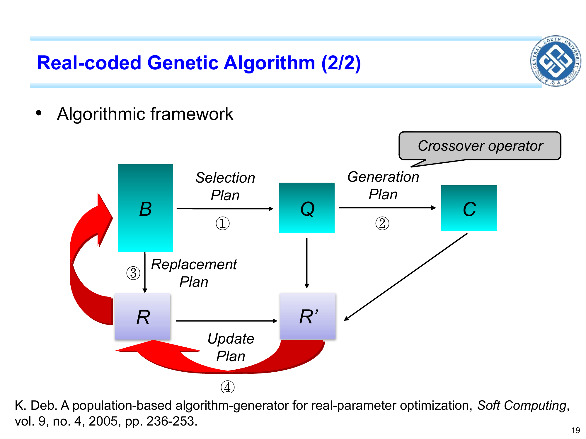
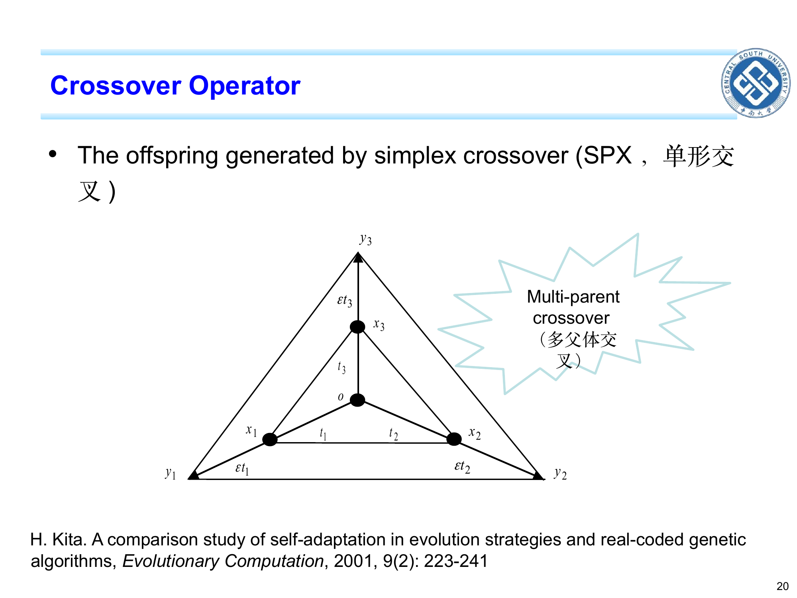

```cardlink
url: http://10.188.31.55:5244/Nextcloud/School/Compute-Intelligence/课件/
title: "计算智能 · 课程课件"
description: "中南大学自动化学院《计算智能》课程的全部课件"
host: 10.188.31.55:5244
```

[← 返回《计算智能：进化算法与优化方法》目录](../)

## 第 2 章 遗传算法 (GA)

### 一个不可导、只能取整的优化问题

化工过程里某些反应速率、机器学习里某些 loss 项,写成代码就拿不出导数;变量又只允许取整数值(比如生产多少台设备)。目标函数 $f(x)$ 长得像"火山口被挖了几个坑"而且**不可导**:梯度法没法用(没有导数),爬山法只能爬到最近的那个山谷,穷举法又因为组合爆炸根本试不完 [Chapter 2_ Introduction to GAs.pptx · p.1](http://10.188.31.55:5244/Nextcloud/School/Compute-Intelligence/converted/Chapter%202_%20Introduction%20to%20GAs.pdf#page=1)。

### 直觉与术语:把候选解当成一条二进制串

1970 年代 Holland 教授从"物竞天择,适者生存"的生物学隐喻借来思路:不靠单个点往梯度方向走,而是**同时放一群候选解**,让它们按"好的多生、差的淘汰 + 子代之间互相交换信息 + 小概率随机翻一翻"三个动作一代代改进。这就是**遗传算法**(genetic algorithm, GA)——进化算法家族里最经典、最直白的一员:二进制串当个体、轮盘赌当选择、位翻转当变异 [Chapter 2_ Introduction to GAs.pptx · p.4](http://10.188.31.55:5244/Nextcloud/School/Compute-Intelligence/converted/Chapter%202_%20Introduction%20to%20GAs.pdf#page=4)。

**核心直觉**:GA 把每个候选解编码成一条二进制串(也叫"染色体"),一群这样的串构成一个种群。算法一代一代地跑,每代做三件事:(1) 按适应度高低决定谁有资格当父母(选择);(2) 让两条父母串在某处切断并交换尾巴(交叉);(3) 让子代串的每一位有小概率翻面(变异)。直观地说,好的串会被复制更多次,坏的串被淘汰;交叉让好片段在后代里重新组合;变异防止种群过早变得一模一样 [Chapter 2_ Introduction to GAs.pptx · p.6](http://10.188.31.55:5244/Nextcloud/School/Compute-Intelligence/converted/Chapter%202_%20Introduction%20to%20GAs.pdf#page=6)。



下面把**首次出现**的术语逐一定义。第 1 章已经定义过的通用词(个体、种群、选择、交叉、变异、适应度、收敛、早熟收敛、探索/开发)这里不重复定义,只在用到时回指 [Chapter 2_ Introduction to GAs.pptx · p.5](http://10.188.31.55:5244/Nextcloud/School/Compute-Intelligence/converted/Chapter%202_%20Introduction%20to%20GAs.pdf#page=5)。

- **染色体**(chromosome):GA 里"一个个体的样子",通常就是一条 0/1 串;整条串同时就是一个个体(individual)。
- **基因座**(locus):**位置**。串上第几位(第 1 位、第 2 位……)。
- **等位基因**(allele):**位置上的取值**。二进制编码时只能取 0 或 1。
- **基因**(gene):某个基因座上所带的信息,就是那一位的取值。
- **模式**(schema, $H$):一类串的"模板",允许某些位写成通配符 $*$。例如 $*011*0$ 表示"第 2–4 位必须是 011、最后一位必须是 0,其他位随便"。
- **模式的阶**(order of schema, $o(H)$):模板里**定死**的位数。$*011*0$ 的阶是 4。
- **模式的定义长度**(defining length, $d(H)$):模板里**第一个定死位到最后一个定死位之间的距离**。$*011*0$ 在第 2 位与第 6 位定死,定义长度是 $6-2=4$。
- **编码**(encoding) / **解码**(decoding):把实数解翻译成 0/1 串(编码)、把串翻回实数(解码)。
- **二进制编码**(binary encoding):用 0/1 串表示解。优点是通用、易交叉;缺点是连续问题的精度被串长卡住。
- **实数编码**(real-coded):不编码,直接拿实数当个体。本章前半用二进制,后面的 ES/DE/PSO 都属于实数编码。
- **交叉**(crossover):把两个父代的"零件"拼成新解,GA 里就是把两条串某一段互换。
- **变异**(mutation):对新解做一点随机的、小幅的改动(GA 里就是把某一位 0 变 1)。它的作用是防止种群过早"长得都一样"。
- **选择**(selection):决定谁有资格当父母。GA 经典做法是"轮盘赌"——适应度高的占大扇形,被抽中概率大。
- **交叉率**(crossover probability, $p_c$):一对父代**真的发生交换**的概率。
- **变异率**(mutation probability, $p_m$):**每一位**发生翻转的概率。
- **精英保留**(elitism):把当前最好的那个个体**原封不动**抄到下一代,保证最优解不会被随机的交叉变异弄丢。

**收敛** = 随代数增加、种群最好的解不再明显变好;**早熟收敛** = 曲线很早就变平、而且停在很差的解上;**收敛曲线** = "最高适应度 vs 代数"的折线图 [Chapter 2_ Introduction to GAs.pptx · p.13](http://10.188.31.55:5244/Nextcloud/School/Compute-Intelligence/converted/Chapter%202_%20Introduction%20to%20GAs.pdf#page=13)。

本章还会用到搜索空间的两个常用符号——$L_j, U_j$ 表示第 $j$ 维的下界与上界;当变量只有一个时,直接写 $L_x, U_x$ [Chapter 2_ Introduction to GAs.pptx · p.9](http://10.188.31.55:5244/Nextcloud/School/Compute-Intelligence/converted/Chapter%202_%20Introduction%20to%20GAs.pdf#page=9)。

### 编码与解码:连续问题必须先量化

把区间 $[L_x, U_x]$ 用 $L$ 位二进制串切成 $2^L$ 个等距格点。串 $b_{L-1}b_{L-2}\cdots b_0$ 对应的实数为

$$
x \;=\; L_x + \frac{U_x - L_x}{2^L - 1}\cdot(b_{L-1}\cdot 2^{L-1} + b_{L-2}\cdot 2^{L-2} + \cdots + b_0\cdot 2^0)
\;=\; L_x + \Delta\cdot \sum_{j=0}^{L-1} b_j\cdot 2^j
$$

其中 $\Delta = (U_x - L_x)/(2^L - 1)$ 叫**解码精度**(search accuracy)。**推导**:把区间长 $U_x - L_x$ 平均分到 $2^L - 1$ 个等距间隔上,每一格就是 $\Delta$ [Chapter 2_ Introduction to GAs.pptx · p.9](http://10.188.31.55:5244/Nextcloud/School/Compute-Intelligence/converted/Chapter%202_%20Introduction%20to%20GAs.pdf#page=9)。

串长由"想要多精确"反推得到。给定搜索精度 $\varepsilon$:

$$
L \;=\; \left\lceil \log_2\!\left(\frac{U_x - L_x}{\varepsilon}\right)\right\rceil
$$

**推导**:要让 $\Delta \le \varepsilon$,即 $(U_x-L_x)/(2^L - 1) \le \varepsilon$;两边乘以 $(2^L - 1)$ 得 $U_x - L_x \le \varepsilon(2^L - 1)$,即 $2^L - 1 \ge (U_x-L_x)/\varepsilon$,所以 $L \ge \log_2\bigl((U_x-L_x)/\varepsilon + 1\bigr)$;工程上近似取 $L \ge \lceil\log_2((U_x-L_x)/\varepsilon)\rceil$ [Chapter 2_ Introduction to GAs.pptx · p.9](http://10.188.31.55:5244/Nextcloud/School/Compute-Intelligence/converted/Chapter%202_%20Introduction%20to%20GAs.pdf#page=9)。

**例**:$x\in[-5, 5]$,要求精度 $\varepsilon = 0.01$,则 $(U_x-L_x)/\varepsilon = 10/0.01 = 1000$,$\log_2 1000 \approx 9.97$,所以 $L = 10$。于是 $\Delta = 10/(2^{10}-1) = 10/1023 \approx 0.009775$ [Chapter 2_ Introduction to GAs.pptx · p.9](http://10.188.31.55:5244/Nextcloud/School/Compute-Intelligence/converted/Chapter%202_%20Introduction%20to%20GAs.pdf#page=9)。


串长 $L$ 一旦定下来,搜索就被卡死在 $2^L$ 个格点上;不管目标函数曲线多光滑,GA 都只能逼近到 $\Delta$ 这个量级。要精度更高只能加大 $L$,但 $L$ 加大会让搜索空间 $2^L$ 爆炸——这就是 GA 处理**连续高维问题**的硬伤,也是后来改用实数编码的动机 [Chapter 2_ Introduction to GAs.pptx · p.9](http://10.188.31.55:5244/Nextcloud/School/Compute-Intelligence/converted/Chapter%202_%20Introduction%20to%20GAs.pdf#page=9)。

### 选择:轮盘赌

#### 概率公式的三步

**第一步**:算每个个体的选择概率

$$
p_i \;=\; \frac{\mathrm{fit}(x_i)}{\sum_{j=1}^{N}\mathrm{fit}(x_j)}
$$

**推导**:把每个个体想象成轮盘上的一个扇形,扇形面积正比于适应度。整个圆面积是 $\sum_j \mathrm{fit}(x_j)$,个体 $i$ 自己的扇形面积是 $\mathrm{fit}(x_i)$。掷一颗均匀的球进轮盘,球落在某个扇形里的概率 = 该扇形面积 / 总面积 = $p_i$ [Chapter 2_ Introduction to GAs.pptx · p.6](http://10.188.31.55:5244/Nextcloud/School/Compute-Intelligence/converted/Chapter%202_%20Introduction%20to%20GAs.pdf#page=6)。

**第二步**:算累积概率(用于划区间)

$$
q_i \;=\; \sum_{j=1}^{i} p_j
$$

把 $q_i$ 一项项累加,到 $i=N$ 时把所有 $p_j$ 都加完;由于 $\sum_j p_j = 1$,所以 $q_N = 1$。又因为每个 $p_j > 0$(假设所有个体适应度为正),所以 $q_i$ 严格递增,即 $q_1 < q_2 < \dots < q_N$ [Chapter 2_ Introduction to GAs.pptx · p.6](http://10.188.31.55:5244/Nextcloud/School/Compute-Intelligence/converted/Chapter%202_%20Introduction%20to%20GAs.pdf#page=6)。

**第三步**:抽样。生成一个均匀随机数 $r \sim U(0,1)$,找出第一个满足 $q_i \ge r$ 的 $i$,把个体 $i$ 复制到下一代。重复 $N$ 次,得到新一代 [Chapter 2_ Introduction to GAs.pptx · p.6](http://10.188.31.55:5244/Nextcloud/School/Compute-Intelligence/converted/Chapter%202_%20Introduction%20to%20GAs.pdf#page=6)。

个体 $i$ 占的随机数区间是 $[q_{i-1}, q_i)$(取 $q_0 = 0$)。$q_i$ 含不含自己两种约定都行,整篇必须前后一致;边界一旦不一致,会出现某个个体永远选不到、另一个被双重选中 [Chapter 2_ Introduction to GAs.pptx · p.6](http://10.188.31.55:5244/Nextcloud/School/Compute-Intelligence/converted/Chapter%202_%20Introduction%20to%20GAs.pdf#page=6)。

**为什么这么选**:适应度高的个体 $p_i$ 大 → 累积区间宽 → $r$ 落入该区间的概率大 → 复制得更多。这就是"适者生存"的算子化 [Chapter 2_ Introduction to GAs.pptx · p.6](http://10.188.31.55:5244/Nextcloud/School/Compute-Intelligence/converted/Chapter%202_%20Introduction%20to%20GAs.pdf#page=6)。


三步的顺序别记混:**用 $\mathrm{fit}$ 占比定义扇形面积 → 面积比给出概率 $p_i$ → 累积成一个 $U(0,1)$ 随机数的区间,一次抽完**。

#### PPT 算例:3 个体的概率表

PPT 给出的算例使用目标函数 $\mathrm{maximize}\; f(x) = -x^2 + 10\cos(2\pi x) + 30$,$x\in[-5, 5]$ [Chapter 2_ Introduction to GAs.pptx · p.7](http://10.188.31.55:5244/Nextcloud/School/Compute-Intelligence/converted/Chapter%202_%20Introduction%20to%20GAs.pdf#page=7)。



表里 $f(x_i)$ 与 $\mathrm{fit}(x_i)$ 分成两列:目标函数 $f(x)$ 默认**越小越好**,适应度 $\mathrm{fit}(x)$ 默认**越大越好**。无约束单目标最大化时两者相等,做了适应度缩放之后就不同;算 $p_i$ 只能用 $\mathrm{fit}$ [Chapter 2_ Introduction to GAs.pptx · p.7](http://10.188.31.55:5244/Nextcloud/School/Compute-Intelligence/converted/Chapter%202_%20Introduction%20to%20GAs.pdf#page=7)。

### 交叉与变异

#### 交叉算子

**单点交叉**(one-point crossover,PPT 唯一展开的形式):随机选两个父代 $A, B$;在 $\{1,2,\dots, L-1\}$ 中均匀选一个交叉点 $k$;保留 $A, B$ 前 $k$ 位,交换后 $L-k$ 位,得到两个子代 $A', B'$ [Chapter 2_ Introduction to GAs.pptx · p.8](http://10.188.31.55:5244/Nextcloud/School/Compute-Intelligence/converted/Chapter%202_%20Introduction%20to%20GAs.pdf#page=8)。

**两点交叉**(two-point crossover):在 $\{1,\dots,L-1\}$ 中均匀选两个交叉点 $k_1 < k_2$,交换 $[k_1, k_2]$ 区间内的位。**均匀交叉**(uniform crossover):逐位独立掷一枚公平的硬币,正面则子代这一位取父代 A,反面取父代 B [Chapter 2_ Introduction to GAs.pptx · p.8](http://10.188.31.55:5244/Nextcloud/School/Compute-Intelligence/converted/Chapter%202_%20Introduction%20to%20GAs.pdf#page=8)。

$p_c$ 是"对"这一层的概率:每次抽样出两条父代后,先掷一次 $U(0,1)$,若 $\le p_c$ 才执行交叉;否则两条父代直接进入下一代不变 [Chapter 2_ Introduction to GAs.pptx · p.8](http://10.188.31.55:5244/Nextcloud/School/Compute-Intelligence/converted/Chapter%202_%20Introduction%20to%20GAs.pdf#page=8)。


#### 位翻转变异与期望变位数

对一条 $L$ 位二进制串,每一位独立以概率 $p_m$ 翻转;设 $X$ 为这条串被翻转的位数,则

$$
X \sim \mathrm{Binomial}(L, p_m)
$$

**推导**:每位是否翻转相互独立(每次掷的都是同一个独立的均匀随机数),翻转次数就是 $L$ 个独立 Bernoulli($p_m$) 变量的和,服从二项分布 [Chapter 2_ Introduction to GAs.pptx · p.8](http://10.188.31.55:5244/Nextcloud/School/Compute-Intelligence/converted/Chapter%202_%20Introduction%20to%20GAs.pdf#page=8)。

**期望**:

$$
\mathbb{E}[X] \;=\; L\cdot p_m
$$

**推导**:二项分布的期望等于试验次数 × 每次成功概率 [Chapter 2_ Introduction to GAs.pptx · p.8](http://10.188.31.55:5244/Nextcloud/School/Compute-Intelligence/converted/Chapter%202_%20Introduction%20to%20GAs.pdf#page=8)。

**数量级直觉**:典型 $p_m \approx 1/L$ 时,$\mathbb{E}[X] = 1$——即"平均一条串翻 1 位" [Chapter 2_ Introduction to GAs.pptx · p.8](http://10.188.31.55:5244/Nextcloud/School/Compute-Intelligence/converted/Chapter%202_%20Introduction%20to%20GAs.pdf#page=8)。

### 完整手算一代 GA

#### 4 位二进制:每一步都能手算

为了把整条流水线**不跳步**走完,这里用一个 4 位二进制、每一步数值都能手算的最小例子。选择、交叉、变异三步用的都是 PPT 给出的算子。

**设定**:$\max\ f(x) = x^2$,$x \in \{0,1,2,\dots,15\}$(4 位二进制直接编码,无需缩放);适应度直接取 $\mathrm{fit} = f$;种群规模 $N = 4$ [Chapter 2_ Introduction to GAs.pptx · p.8](http://10.188.31.55:5244/Nextcloud/School/Compute-Intelligence/converted/Chapter%202_%20Introduction%20to%20GAs.pdf#page=8)。

**初始种群**(随机 4 条 4 位串):

$$
A_1 = 0011\;(x=3,\ f=9),\quad A_2 = 1100\;(x=12,\ f=144),\quad A_3 = 0101\;(x=5,\ f=25),\quad A_4 = 1001\;(x=9,\ f=81)
$$

这里 $x$ 就是二进制串直接读出来的十进制值:$0011\to 3$、$1100\to 12$、$0101\to 5$、$1001\to 9$ [Chapter 2_ Introduction to GAs.pptx · p.6](http://10.188.31.55:5244/Nextcloud/School/Compute-Intelligence/converted/Chapter%202_%20Introduction%20to%20GAs.pdf#page=6)。

**Step 1 —— 算选择概率**:$\sum \mathrm{fit} = 9+144+25+81 = 259$。

$$
p_1 = 9/259 \approx 0.0348,\quad p_2 = 144/259 \approx 0.5559,\quad p_3 = 25/259 \approx 0.0965,\quad p_4 = 81/259 \approx 0.3127
$$

校验:$0.0348 + 0.5559 + 0.0965 + 0.3127 \approx 1.0000$ [Chapter 2_ Introduction to GAs.pptx · p.6](http://10.188.31.55:5244/Nextcloud/School/Compute-Intelligence/converted/Chapter%202_%20Introduction%20to%20GAs.pdf#page=6)。

**Step 2 —— 算累积概率**:

$$
q_1 \approx 0.0348,\quad q_2 \approx 0.5908,\quad q_3 \approx 0.6873,\quad q_4 \approx 1.0000
$$

[Chapter 2_ Introduction to GAs.pptx · p.6](http://10.188.31.55:5244/Nextcloud/School/Compute-Intelligence/converted/Chapter%202_%20Introduction%20to%20GAs.pdf#page=6)

**Step 3 —— 抽样复制**:取 4 个 $U(0,1)$ 随机数,例如 $r_1=0.12, r_2=0.71, r_3=0.02, r_4=0.60$。

- $r_1=0.12$ 落在 $[q_1, q_2) = [0.0348, 0.5908)$,复制 $A_2$。得到 $A_1' = 1100$。
- $r_2=0.71$ 落在 $[q_3, q_4) = [0.6873, 1.0000)$,复制 $A_4$。得到 $A_2' = 1001$。
- $r_3=0.02$ 落在 $[0, q_1) = [0, 0.0348)$,复制 $A_1$。得到 $A_3' = 0011$。
- $r_4=0.60$ 落在 $[q_2, q_3) = [0.5908, 0.6873)$,复制 $A_3$。得到 $A_4' = 0101$。

**观察**:这组抽样把初始种群中的四个个体各复制一次;如果把随机数换成 $r_1=0.72, r_2=0.95, r_3=0.70, r_4=0.96$,四条全落在 $A_4$ 的区间里,$A_2$ 就会一次也抽不到。这就是轮盘赌的"运气"成分,补救办法是**精英保留**(elitism):把当代最好的个体原封不动抄一份进入下一代 [Chapter 2_ Introduction to GAs.pptx · p.6](http://10.188.31.55:5244/Nextcloud/School/Compute-Intelligence/converted/Chapter%202_%20Introduction%20to%20GAs.pdf#page=6)。

**Step 4 —— 单点交叉**(设 $p_c = 1$,每次都交叉):把 4 条串随机配对,例如 $\{A_1', A_2'\} = \{1100, 1001\}$ 和 $\{A_3', A_4'\} = \{0011, 0101\}$。给每对随机选交叉点,约定 $k$ 表示"保留前 $k$ 位、交换剩下的 $L-k$ 位"。

- 第一对 $1100 \times 1001$,随机选 $k=2$。前 2 位分别是 $11$ 与 $10$,后 2 位分别是 $00$ 与 $01$。交换后 2 位:

$$
A_1'' = 11|01 = 1101\;(x=13,\ f=169),\qquad A_2'' = 10|00 = 1000\;(x=8,\ f=64)
$$

- 第二对 $0011 \times 0101$,随机选 $k=3$。前 3 位分别是 $001$ 与 $010$,最后 1 位分别是 $1$ 与 $1$。交换最后 1 位:

$$
A_3'' = 001|1 = 0011\;(x=3,\ f=9),\qquad A_4'' = 010|1 = 0101\;(x=5,\ f=25)
$$

**交叉不一定产生新解**:单点交叉交换的是"两个父代在同一位置上**取值不同**的那些位"才有内容;如果两条串在交换区间里逐位相同,交换完还是原样。本例第二对 $0011$ 与 $0101$ 在 $k=3$ 后只交换第 4 位,而第 4 位都是 $1$,所以子串保持 $0011$ 与 $0101$,适应度也保持为 $9$ 与 $25$。这正是 $p_c=1$ 也不保证产生新解的直观例子;两条完全相同的串则是更极端的情形 [Chapter 2_ Introduction to GAs.pptx · p.8](http://10.188.31.55:5244/Nextcloud/School/Compute-Intelligence/converted/Chapter%202_%20Introduction%20to%20GAs.pdf#page=8)。

**Step 5 —— 位翻转变异**(设 $p_m = 0.125 = 1/L$,$L=4$ 时期望每串翻 $4\times 0.125 = 0.5$ 位):对每条子代的每一位掷 $U(0,1)$,若 $\le 0.125$ 则翻转。假设随机数恰好让 $A_2''=1000$ 的第 1 位翻转 → 变成 $A_2''' = 0000\;(x=0,\ f=0)$;其他串没翻 [Chapter 2_ Introduction to GAs.pptx · p.8](http://10.188.31.55:5244/Nextcloud/School/Compute-Intelligence/converted/Chapter%202_%20Introduction%20to%20GAs.pdf#page=8)。

**新一代种群及其适应度**:

$$
A_1''' = 1101\;(f=169),\quad A_2''' = 0000\;(f=0),\quad A_3''' = 0011\;(f=9),\quad A_4''' = 0101\;(f=25)
$$

最高 $f = 169$(由 $A_1'''$ 贡献);若加入精英 $A_2 = 1100$($f=144$)直接入选,新一代最高 $f$ 仍是 $169$,精英只是保底,防止某代整体退化 [Chapter 2_ Introduction to GAs.pptx · p.12](http://10.188.31.55:5244/Nextcloud/School/Compute-Intelligence/converted/Chapter%202_%20Introduction%20to%20GAs.pdf#page=12)。

**这一代发生了什么**:第一对交叉造出了比初始种群更好的 $1101$($f=169 > 144$),说明"把两条好串的片段拼起来"确实能探到新区域;第二对交叉因为末位相同而保持 $0011$ 与 $0101$ 不变;同一代里变异把 $1000$ 直接打成 $0000$。GA 的改善是**统计意义上的**——多代平均下来才看得出来,机制见下面的模式定理 [Chapter 2_ Introduction to GAs.pptx · p.12](http://10.188.31.55:5244/Nextcloud/School/Compute-Intelligence/converted/Chapter%202_%20Introduction%20to%20GAs.pdf#page=12)。

#### PPT 主例:10 个体 → 8 个父代 → 10 个子代

PPT 的主例用 10 位二进制和同一个目标函数 $\max\ f(x) = -x^2 + 10\cos(2\pi x) + 30$,$x\in[-5,5]$,走完 10 → 8 → 10 的完整流程 [Chapter 2_ Introduction to GAs.pptx · p.10](http://10.188.31.55:5244/Nextcloud/School/Compute-Intelligence/converted/Chapter%202_%20Introduction%20to%20GAs.pdf#page=10)。



初始种群 10 个个体的解码值与适应度如下。适应度之和 $\sum \mathrm{fit} = 186.9226$,据此算出选择概率 $p_i$ 与累积概率 $q_i$:

| 个体 | 解码 $x$ | 适应度 $\mathrm{fit}$ | $p_i$ | $q_i$ |
| --- | --- | --- | --- | --- |
| $x_1$ | -3.0254 | 30.7196 | 0.1643 | 0.1643 |
| $x_2$ | 0.2884 | 27.5294 | 0.1473 | 0.3116 |
| $x_3$ | 0.3177 | 25.7729 | 0.1379 | 0.4495 |
| $x_4$ | -1.2463 | 28.6770 | 0.1534 | 0.6029 |
| $x_5$ | -3.2893 | 16.7332 | 0.0895 | 0.6924 |
| $x_6$ | -3.4360 | 8.9924 | 0.0481 | 0.7405 |
| $x_7$ | 4.6774 | 3.7178 | 0.0199 | 0.7604 |
| $x_8$ | -3.9345 | 23.6848 | 0.1267 | 0.8871 |
| $x_9$ | -4.6188 | 1.3245 | 0.0071 | 0.8942 |
| $x_{10}$ | -0.5132 | 19.7710 | 0.1058 | 1.0000 |



8 次抽样落在这些区间上:$x_2\in[0.1643, 0.3116)$、$x_3\in[0.3116, 0.4495)$、$x_4\in[0.4495, 0.6029)$(抽中两次)、$x_5\in[0.6029, 0.6924)$、$x_6\in[0.6924, 0.7405)$、$x_8\in[0.7604, 0.8871)$、$x_{10}\in[0.8871, 1.0000)$。适应度最高的 $x_1$ 一次也没被抽中,适应度垫底的 $x_7$、$x_9$ 被淘汰 [Chapter 2_ Introduction to GAs.pptx · p.11](http://10.188.31.55:5244/Nextcloud/School/Compute-Intelligence/converted/Chapter%202_%20Introduction%20to%20GAs.pdf#page=11)。



子代表里除了父代配对产生的新个体,还有两个串与精英 $x_1$ 完全相同($y_9$、$y_{10}$,适应度都是 $30.7196$)——精英保留在这里的具体体现:靠抽签救不回 $x_1$,靠精英位能。交叉与变异之后最高适应度 $37.2576$($y_7$),比初始种群的 $30.7196$ 明显提升 [Chapter 2_ Introduction to GAs.pptx · p.12](http://10.188.31.55:5244/Nextcloud/School/Compute-Intelligence/converted/Chapter%202_%20Introduction%20to%20GAs.pdf#page=12)。

这组表是整套流程的证据链:选前最高 $30.7196$,选 + 交叉 + 变异后到 $37.2576$,证明"一代 GA 确实能把好解变多"。

### 收敛曲线


从曲线读两件事:(1) 算法在**哪一代**基本不再进步(本例约第 20 代)——这决定了"何时停";(2) 最终稳定在哪——这反映了**是否找全局最优**(本例稳定在 40,与目标函数在 $[-5,5]$ 上的最大值吻合) [Chapter 2_ Introduction to GAs.pptx · p.13](http://10.188.31.55:5244/Nextcloud/School/Compute-Intelligence/converted/Chapter%202_%20Introduction%20to%20GAs.pdf#page=13)。

### 模式定理:GA 为什么能把好片段组合起来

**问题**:GA "凭什么能变好"?为什么一代代下来最好解越来越优?1970 年代 Holland 给出了一个解释,叫**模式定理** [Chapter 2_ Introduction to GAs.pptx · p.14](http://10.188.31.55:5244/Nextcloud/School/Compute-Intelligence/converted/Chapter%202_%20Introduction%20to%20GAs.pdf#page=14)。

**定义回顾**:模式 $H$ 是一个模板,允许某些位写 $*$。$o(H)$ = 定死位数;$d(H)$ = 首末定死位的距离。

**只考虑选择**:设第 $t$ 代有 $m(H, t)$ 个个体属于模式 $H$。属于 $H$ 的个体平均适应度为 $f(H)$,种群平均适应度为 $\bar f$(整个种群所有个体适应度的算术平均,表示整群现在的整体水平);每个个体被复制的期望次数正比于自身适应度,所以 $H$ 在下一代期望的份数变为

$$
m(H, t+1) \;=\; m(H, t)\cdot\frac{f(H)}{\bar f}
$$

**推导**:个体 $i$ 在选择时被复制的期望次数 = 它的概率 $p_i = \mathrm{fit}_i / \sum_j \mathrm{fit}_j$ × 抽样次数 $N$。对属于 $H$ 的所有个体求和,$N\cdot p_i = N \cdot \mathrm{fit}_i / \sum_j \mathrm{fit}_j$;把属于 $H$ 的个体的 $\mathrm{fit}_i$ 用平均 $f(H)$ 替换,$\sum_j \mathrm{fit}_j$ 用 $N\bar f$ 替换,得 $m(H, t)\cdot f(H)/\bar f$ [Chapter 2_ Introduction to GAs.pptx · p.14](http://10.188.31.55:5244/Nextcloud/School/Compute-Intelligence/converted/Chapter%202_%20Introduction%20to%20GAs.pdf#page=14)。

**交叉的破坏**:单点交叉以 $p_c$ 概率发生,交叉点均匀选在 $L-1$ 个位置之一。若交叉点落在 $[$首定死位, 末定死位$)$ 之内,模式 $H$ 就被破坏;这种"坏位置"的个数恰好是 $d(H)$。所以破坏概率

$$
p_d \;=\; \frac{d(H)}{L-1},\qquad p_s \;\ge\; 1 - p_c\cdot\frac{d(H)}{L-1}
$$

**推导**:把模式 $H$ 的第一个定死位和最后一个定死位想象成模式在串上占的"跨度"。交叉点只有落在这段跨度里(共 $d(H)$ 个位置)才会破坏 $H$;落在这段之外的 $L-1-d(H)$ 个位置都安全 [Chapter 2_ Introduction to GAs.pptx · p.15](http://10.188.31.55:5244/Nextcloud/School/Compute-Intelligence/converted/Chapter%202_%20Introduction%20to%20GAs.pdf#page=15)。


**变异的破坏**:每个定死位独立以概率 $p_m$ 翻转;$H$ 在变异下存活要求**所有定死位都不翻**,概率

$$
(1-p_m)^{o(H)} \;\approx\; 1 - o(H)\cdot p_m\quad(\text{当 } p_m \text{ 很小})
$$

**推导**:每位独立不翻的概率是 $1-p_m$,共 $o(H)$ 位 → 全部不翻的概率是 $(1-p_m)^{o(H)}$。当 $p_m \ll 1$ 时,由泰勒展开 $(1-p_m)^{o(H)} \approx 1 - o(H) p_m$(高阶项可忽略) [Chapter 2_ Introduction to GAs.pptx · p.16](http://10.188.31.55:5244/Nextcloud/School/Compute-Intelligence/converted/Chapter%202_%20Introduction%20to%20GAs.pdf#page=16)。

**合并三种算子**:选择、交叉、变异作用在不同时间点,三者**独立**,所以"存活"概率 = 三者之积 [Chapter 2_ Introduction to GAs.pptx · p.16](http://10.188.31.55:5244/Nextcloud/School/Compute-Intelligence/converted/Chapter%202_%20Introduction%20to%20GAs.pdf#page=16)。

$$
m(H, t+1) \;\ge\; m(H, t)\cdot\frac{f(H)}{\bar f}\cdot\left[1 - p_c\cdot\frac{d(H)}{L-1}\right]\cdot\bigl[1 - o(H)\cdot p_m\bigr]
$$

**结论**:低阶(小 $o(H)$)、短定义长度(小 $d(H)$)、高适应度(大 $f(H)/\bar f$)的模板,下一代份数会**指数级增长**。用更白的话说就是:"好东西由小积木拼成"——称为**积木块假设** [Chapter 2_ Introduction to GAs.pptx · p.16](http://10.188.31.55:5244/Nextcloud/School/Compute-Intelligence/converted/Chapter%202_%20Introduction%20to%20GAs.pdf#page=16)。

**为什么这条结论重要**:它解释了"交叉为什么有效"——交叉不是把整条串打散,而是**把好积木块重新组合** [Chapter 2_ Introduction to GAs.pptx · p.16](http://10.188.31.55:5244/Nextcloud/School/Compute-Intelligence/converted/Chapter%202_%20Introduction%20to%20GAs.pdf#page=16)。

代一组具体数字:$H_1 = *1{*}***0$,串长 $L = 7$。定死位是第 2 位的 $1$ 与第 7 位的 $0$,所以 $o(H_1) = 2$;首末定死位距离 $d(H_1) = 7 - 2 = 5$。取 $p_c = 0.8$、$p_m = 0.01$:

$$
p_s \;\ge\; 1 - 0.8\cdot\frac{5}{6} \;\approx\; 0.333,\qquad 1 - o(H_1)\cdot p_m \;=\; 1 - 2\times 0.01 \;=\; 0.98
$$

交叉之后这个模式至少存活三分之一,变异之后几乎原样保留。

### 实数编码 GA 与单形交叉

二进制 GA 在连续高维问题上被串长卡住。一种补救办法是**实数编码**——不编码成串,直接把每个变量当一个实数;此时"交叉"不能再做"位交换",得换成几何操作 [Chapter 2_ Introduction to GAs.pptx · p.19](http://10.188.31.55:5244/Nextcloud/School/Compute-Intelligence/converted/Chapter%202_%20Introduction%20to%20GAs.pdf#page=19)。



**单形交叉**(Simplex Crossover, SPX):把 $D+1$ 个父代当作 $D$ 维空间中一个单纯形(simplex)的顶点,在单纯形内部按比例插值产生子代。这是**多父体交叉**——不止两个父代 [Chapter 2_ Introduction to GAs.pptx · p.20](http://10.188.31.55:5244/Nextcloud/School/Compute-Intelligence/converted/Chapter%202_%20Introduction%20to%20GAs.pdf#page=20)。



把二进制串换成实数向量后,原来的"把某位 0 翻成 1"就不再有自然含义;变异必须改成实数上的扰动(常用"加一个高斯小量")。不要把"位翻转"硬塞到实数编码里 [Chapter 2_ Introduction to GAs.pptx · p.18](http://10.188.31.55:5244/Nextcloud/School/Compute-Intelligence/converted/Chapter%202_%20Introduction%20to%20GAs.pdf#page=18)。

### 阶梯例题

#### 例 2.1 照着算一份轮盘赌区间

**题干**:种群规模 $N=4$,适应度分别为 $\{2, 4, 4, 6\}$。算选择概率与累积概率,并把 $U(0,1)$ 随机数 $r=0.45$ 分配到具体个体 [Chapter 2_ Introduction to GAs.pptx · p.6](http://10.188.31.55:5244/Nextcloud/School/Compute-Intelligence/converted/Chapter%202_%20Introduction%20to%20GAs.pdf#page=6)。

**解答**:

$$
\sum \mathrm{fit} = 2 + 4 + 4 + 6 = 16,\quad p = \bigl[\tfrac{2}{16},\ \tfrac{4}{16},\ \tfrac{4}{16},\ \tfrac{6}{16}\bigr] = [0.125,\ 0.25,\ 0.25,\ 0.375]
$$

$$
q = [0.125,\ 0.375,\ 0.625,\ 1.000]
$$

$r = 0.45$ 落入 $[q_2, q_3) = [0.375, 0.625)$,所以选中**第 3 个个体**(适应度 4) [Chapter 2_ Introduction to GAs.pptx · p.6](http://10.188.31.55:5244/Nextcloud/School/Compute-Intelligence/converted/Chapter%202_%20Introduction%20to%20GAs.pdf#page=6)。

#### 例 2.2 改用锦标赛选择复算一次

**题干**:同上 $\mathrm{fit} = \{2, 4, 4, 6\}$,改成**锦标赛选择**(tournament size $k=2$):每次随机抽 2 个个体比一场,大的留下 [Chapter 2_ Introduction to GAs.pptx · p.6](http://10.188.31.55:5244/Nextcloud/School/Compute-Intelligence/converted/Chapter%202_%20Introduction%20to%20GAs.pdf#page=6)。

**解答**:锦标赛不需要先算 $p_i, q_i$——每次抽 2 个比大小即可。抽 $\{A_1, A_4\}$(适应度 2 vs 6)→ 留下 $A_4$;抽 $\{A_2, A_3\}$(4 vs 4)→ 平局可任意,留下 $A_2$ 或 $A_3$;重复两次。一次抽签结果是 $[A_4, A_2, A_3, A_4]$。$A_4$ 出现两次,符合"适应度最高被复制最多"的直觉;但**选法不再依赖具体适应度的比例**,只看相对排序,因此**对适应度的尺度不敏感**。

与轮盘赌结论一致(都是 $A_4$ 被多复制),**实现更简单、且能抵抗"超级个体"**,因此工程上锦标赛选择用得更多。PPT 原文写作"联赛选择 / Tournament selection" [Chapter 2_ Introduction to GAs.pptx · p.6](http://10.188.31.55:5244/Nextcloud/School/Compute-Intelligence/converted/Chapter%202_%20Introduction%20to%20GAs.pdf#page=6)。

#### 例 2.3 跑两代看趋势

**题干**:继续 4 位二进制例。设 $N = 4$、$p_c = 1$、$p_m = 0.125$,并**开启精英保留**。第 0 代如上;假设变异 + 交叉后第 1 代为

$$
A_1' = 1101\;(f=169),\ A_2' = 0000\;(f=0),\ A_3' = 0011\;(f=9),\ A_4' = 0101\;(f=25)
$$

精英 $A_2 = 1100$($f=144$)原样入选第 1 代 [Chapter 2_ Introduction to GAs.pptx · p.12](http://10.188.31.55:5244/Nextcloud/School/Compute-Intelligence/converted/Chapter%202_%20Introduction%20to%20GAs.pdf#page=12)。

**解答**:第 1 代加入精英后,当代最高 $f = \max(169, 0, 9, 25, 144) = 169$;因为精英每代原样保留,之后各代的最高 $f$ 只会持平或变得更好(单调不减)。把同一流程跑**三代**再观察:精英与 $1101$ 都会在第 2、3 代被保留,但种群其余个体只在 $[0, 15]$ 整数范围内小幅振荡。要突破这个"局部最优"需要 $p_m$ 略大(多翻几位)或 $L$ 加长(更细的网格)。

这就是**探索与开发**的取舍:调大 $p_m$ 更偏探索(种群不容易早熟,但收敛更慢),调小更偏开发(收敛快,却容易困在浅谷里)。$p_m$ 太小开发不够、太大又破坏精英 [Chapter 2_ Introduction to GAs.pptx · p.12](http://10.188.31.55:5244/Nextcloud/School/Compute-Intelligence/converted/Chapter%202_%20Introduction%20to%20GAs.pdf#page=12)。

### 易错点

> [!WARNING]
> **$p_c$ 与 $p_m$ 的量级**:$p_c$ 统计的是"这一对父代换不换",通常取 $0.6$–$0.9$,意思是绝大多数父代都会交叉。$p_m$ 统计的是"每一位翻不翻",通常取 $1/L$ 附近($L=10$ 时 $p_m\approx 0.05$,$L=100$ 时 $p_m\approx 0.01$),平均一条串翻不到一位。搞混这两个量级,要么让 GA 退化为纯随机搜索($p_m$ 太大),要么让变异形同虚设($p_m$ 太小,易早熟收敛) [Chapter 2_ Introduction to GAs.pptx · p.8](http://10.188.31.55:5244/Nextcloud/School/Compute-Intelligence/converted/Chapter%202_%20Introduction%20to%20GAs.pdf#page=8)。

> [!WARNING]
> **$d(H)$ 与 $o(H)$ 用反**:模式定理公式里,交叉项里是**定义长度 $d(H)$**——看长度;变异项里是**阶 $o(H)$**——看位数。问"哪个量决定交叉存活概率"答 $d(H)$,问"哪个量决定变异存活概率"答 $o(H)$。两者数学上完全不同的含义 [Chapter 2_ Introduction to GAs.pptx · p.15](http://10.188.31.55:5244/Nextcloud/School/Compute-Intelligence/converted/Chapter%202_%20Introduction%20to%20GAs.pdf#page=15)。

> [!WARNING]
> **$\Delta$ 与 $L$ 的因果关系**:$L$ 是自变量(由精度反推),$\Delta$ 是因变量($L$ 决定精度数值)。把因果颠倒成"用 $\Delta$ 反推 $L$"虽然数值上能用对数公式反解,但**因果关系**和**计算顺序**是两件事 [Chapter 2_ Introduction to GAs.pptx · p.9](http://10.188.31.55:5244/Nextcloud/School/Compute-Intelligence/converted/Chapter%202_%20Introduction%20to%20GAs.pdf#page=9)。
