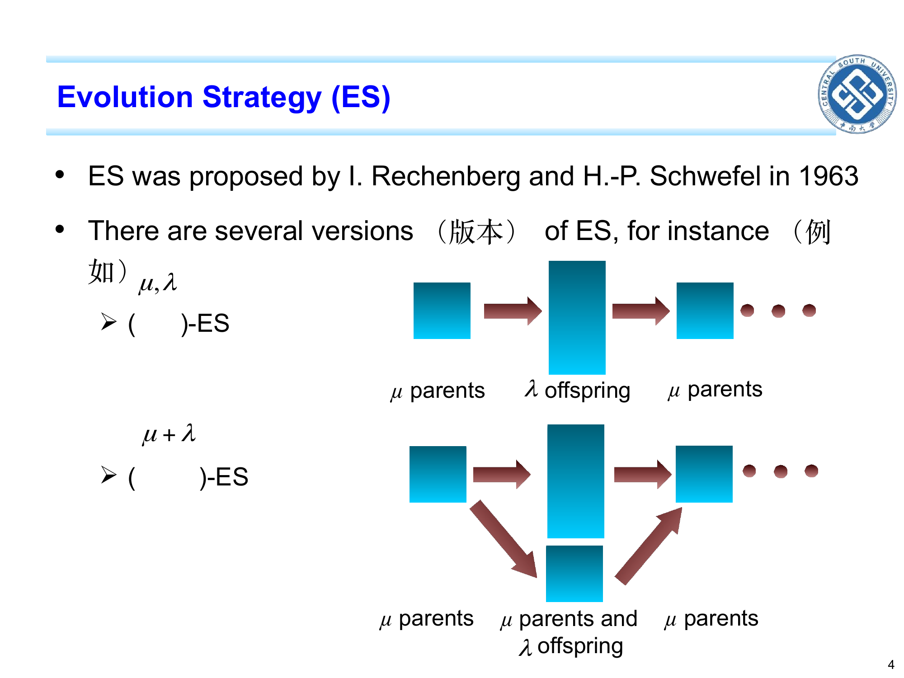
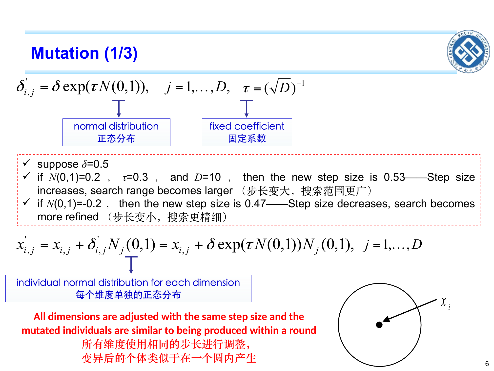
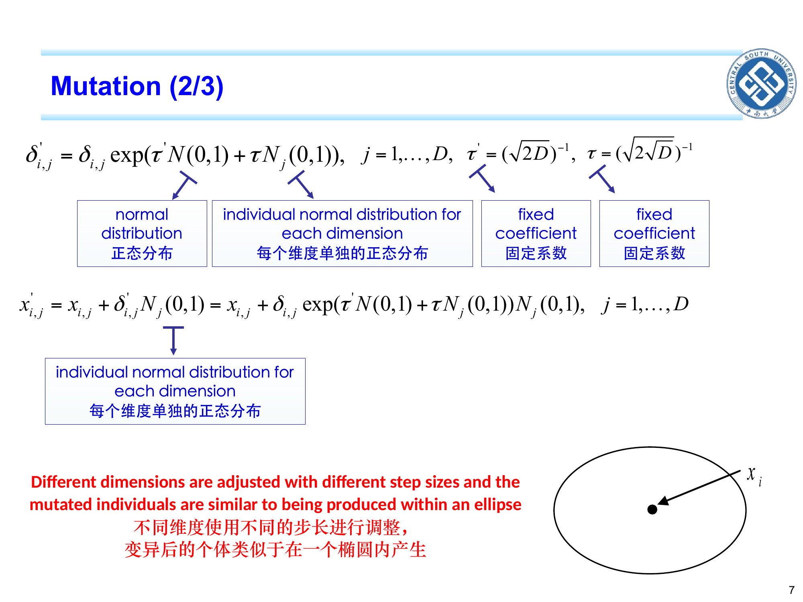
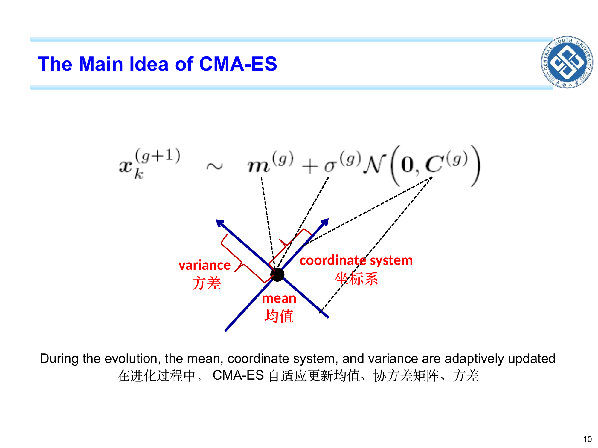
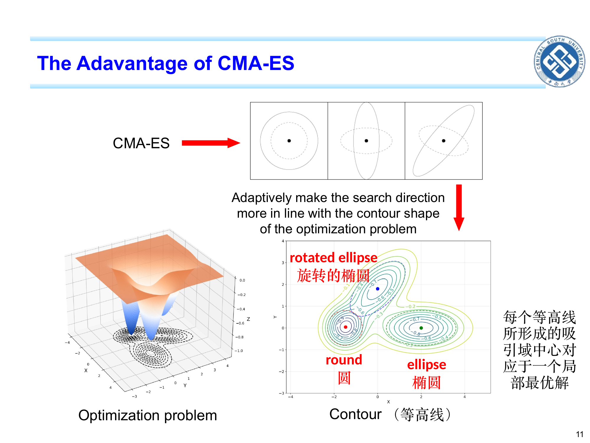
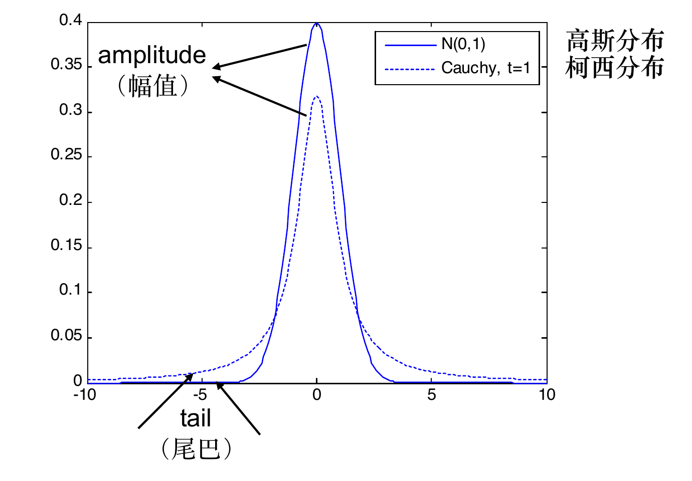

```cardlink
url: http://10.188.31.55:5244/Nextcloud/School/Compute-Intelligence/课件/
title: "计算智能 · 课程课件"
description: "中南大学自动化学院《计算智能》课程的全部课件"
host: 10.188.31.55:5244
```

[← 返回《计算智能：进化算法与优化方法》目录](../)

## 第 3 章 进化策略 (ES) 与进化规划 (EP)

### GA 的两个硬伤

第 2 章的遗传算法 (GA) 在连续优化问题上有两个硬伤。

**硬伤一:精度被串长卡死。** GA 必须先把实数 $x\in[L_x,U_x]$ 编码成 $L$ 位二进制串。$L$ 越长能刻的格子越细,但串长随维数线性增长、格子数 $2^L$ 随 $L$ 指数增长——连续问题的真实最优解精度完全取决于 $L$ 这一个数。精度不够的话,解看起来"已经收敛",其实还离最优很远。[Chapter 3_ Introduction to ES and EP.pdf · p.4](http://10.188.31.55:5244/Nextcloud/School/Compute-Intelligence/converted/Chapter%203_%20Introduction%20to%20ES%20and%20EP.pdf#page=4)

**硬伤二:维度爆炸。** $D=2$ 个变量、每维 10 个格子,共 100 个点,手算都行;$D=20$ 个变量时是 $10^{20}$ 个点,根本试不完。这就是维度灾难:变量个数 $D$ 增加时,搜索空间的体积按指数增长。GA 的"编码 + 交叉 + 位翻转"是为离散串设计的,搬到高维连续空间要么精度不够、要么算不动。[Chapter 3_ Introduction to ES and EP.pdf · p.4](http://10.188.31.55:5244/Nextcloud/School/Compute-Intelligence/converted/Chapter%203_%20Introduction%20to%20ES%20and%20EP.pdf#page=4)

决策变量取实数值(可精确到任意小数位)叫连续优化,只能取有限多个值(整数、0/1、枚举)叫离散优化。GA 处理连续问题要编码,ES/EP 直接在实数上做——这是本章存在的根本理由。本章默认 $D\ge 2$,例题为手算方便取 $D=1$,但所有公式都按任意 $D$ 写。

**ES/EP 的解法:直接在实数空间做,不让步长固定。** 进化策略 (ES) 在 1963 年由 Rechenberg 和 Schwefel 提出,进化规划 (EP) 在 1966 年由 Fogel 提出。它们的共同特点是:① 个体**直接**是一个实数向量 $x$,不需要编码;② 变异是"加一个小量",不是"翻一位";③ **步长 $\delta$ 本身也参与进化**,表现好的个体其步长会被遗传下去,步长自动变大变小,不需要人调。[Chapter 3_ Introduction to ES and EP.pdf · p.4](http://10.188.31.55:5244/Nextcloud/School/Compute-Intelligence/converted/Chapter%203_%20Introduction%20to%20ES%20and%20EP.pdf#page=4) [Chapter 3_ Introduction to ES and EP.pdf · p.13](http://10.188.31.55:5244/Nextcloud/School/Compute-Intelligence/converted/Chapter%203_%20Introduction%20to%20ES%20and%20EP.pdf#page=13)

### (1+1)-ES:一个父亲,一个孩子,选好的留下

**进化策略 (Evolution Strategy, ES)** 是 1963 年由 Rechenberg 和 Schwefel 提出的一类算法。它不用 0/1 串,而是把每个个体表示为一个实数向量 $x=(x_1,\ldots,x_D)$。[Chapter 3_ Introduction to ES and EP.pdf · p.4](http://10.188.31.55:5244/Nextcloud/School/Compute-Intelligence/converted/Chapter%203_%20Introduction%20to%20ES%20and%20EP.pdf#page=4)

最简单的一款叫 **$(1+1)$-ES**:每代只保留 1 个父代、生成 1 个子代,子代更好就替换父代,否则父代保留。"1+1" 里的加号就是**加号策略 (plus-selection)**。[Chapter 3_ Introduction to ES and EP.pdf · p.4](http://10.188.31.55:5244/Nextcloud/School/Compute-Intelligence/converted/Chapter%203_%20Introduction%20to%20ES%20and%20EP.pdf#page=4)

大白话:想象你在夜里蒙着眼走山路,每一步往脚踩的方向挪一个随机的距离;如果这一步让你比刚才低(目标函数更小),就承认这一步;否则退回来、保留原位。$(1{+}1)$-ES 就是在实数上做这件事:每代走"一步",好就认、差就退。

最小例子:$\min f(x)=x^2$,当前 $x=2$、$f(2)=4$。抽 $N(0,1)=0.4$、步长 $\delta=0.5$,得 $x' = 2 + 0.5\times 0.4 = 2.2$,$f(2.2)=4.84$,比 4 还大,不接受,保留 $x=2$。再抽 $N(0,1)=-1.8$、$\delta=0.5$,得 $x'=2+0.5\times(-1.8)=1.1$,$f(1.1)=1.21<4$,接受,$x\leftarrow 1.1$。[Chapter 3_ Introduction to ES and EP.pdf · p.6](http://10.188.31.55:5244/Nextcloud/School/Compute-Intelligence/converted/Chapter%203_%20Introduction%20to%20ES%20and%20EP.pdf#page=6)

#### 一步怎么走:五步伪代码

$(1{+}1)$-ES 是 ES 家族最简的版本,由 slide 5 的 $(\mu,\lambda)$ 框架退化到 $\mu=1,\lambda=1$ 得到。[Chapter 3_ Introduction to ES and EP.pdf · p.5](http://10.188.31.55:5244/Nextcloud/School/Compute-Intelligence/converted/Chapter%203_%20Introduction%20to%20ES%20and%20EP.pdf#page=5)

1. **初始化**:随机选父代 $x=(x_1,\ldots,x_D)$ 与初始步长 $\delta=(\delta_1,\ldots,\delta_D)$,算 $f(x)$。步长也随机,是因为我们不知道目标函数的尺度;起点也随机,是为了别落在某个特殊位置。
2. **变异**:对每维 $j=1,\ldots,D$ 独立抽一个标准正态量 $N_j(0,1)$,先算出变异后的步长
   $$\delta'_j=\delta_j\cdot\exp\bigl(\tau N(0,1)\bigr),\qquad \tau=(\sqrt{D})^{-1}$$
   再用 $\delta'_j$ 生成子代
   $$x'_j=x_j+\delta'_j\cdot N_j(0,1)$$
3. **评价**:算 $f(x')$。
4. **选择 (加号策略)**:若 $f(x')<f(x)$,则 $x\leftarrow x'$、$\delta\leftarrow\delta'$;否则 $(x,\delta)$ 一起保留原值——步长也是个体的一部分,子代被拒绝时它的步长跟着一起回退,不能只留步长、扔掉解。
5. **循环**:回到第 2 步,直到达到最大代数或目标精度。

$N_j(0,1)$ 决定"挪向哪边"(正或负),$\delta'_j$ 决定"挪多远"。第 4 步的"加号"= **父代可以参与竞争**;这里 $\mu=1$,候选池就是 $x$ 与 $x'$ 两个,谁好留谁。$\delta$ 跟着 $x$ 走这件事是 ES 与 GA 最大的不同:GA 的变异率 $p_m$ 是固定超参数,ES 的 $\delta$ 是**个体的一部分**。[Chapter 3_ Introduction to ES and EP.pdf · p.5](http://10.188.31.55:5244/Nextcloud/School/Compute-Intelligence/converted/Chapter%203_%20Introduction%20to%20ES%20and%20EP.pdf#page=5) [Chapter 3_ Introduction to ES and EP.pdf · p.6](http://10.188.31.55:5244/Nextcloud/School/Compute-Intelligence/converted/Chapter%203_%20Introduction%20to%20ES%20and%20EP.pdf#page=6)

### (μ+λ) 与 (μ,λ):候选池里有没有父代

ES 里有两个常用版本,第一步都是"复制 $\mu$ 个父代、变异出 $\lambda$ 个子代",差别在最后一步"选谁进入下一代":

- **$(\mu{+}\lambda)$-ES(加号策略)**:从 $\mu$ 个父代 + $\lambda$ 个子代中,挑适应度最好的 $\mu$ 个进入下一代。优点:父代中最优那个永远不会丢(**精英保留 (elitist)**);收敛快。缺点:好解会一直霸占种群,差的解永远进不来,因此**容易早熟**。
- **$(\mu,\lambda)$-ES(逗号策略)**:只看 $\lambda$ 个子代,从中挑 $\mu$ 个进入下一代,父代全部淘汰(写成逗号就是"只取逗号右边那一半")。代价:本代最优可能比上一代差。好处:允许暂时退化,因此**能逃出局部最优**。[Chapter 3_ Introduction to ES and EP.pdf · p.4](http://10.188.31.55:5244/Nextcloud/School/Compute-Intelligence/converted/Chapter%203_%20Introduction%20to%20ES%20and%20EP.pdf#page=4)

本章的 $\mu$ 是父代个数、$\lambda$ 是子代个数。第 1 章的种群规模 $N$ 在本章写作 $\mu$——它们是同一个量的两种记号(全书统一记作 $N=NP=\mu$,$NP$ 是第 4 章 DE 的写法)。$\lambda$ 与 $\mu$ 相互独立,只需 $\lambda\ge\mu$(否则从 $\lambda$ 个子代里挑不出 $\mu$ 个),经验上常取 $\lambda\approx 7\mu$。所以"父代集比种群小"在本章的正确写法是 $\mu\le\lambda$,不要把 $\lambda$ 误当成新的种群规模。[Chapter 3_ Introduction to ES and EP.pdf · p.4](http://10.188.31.55:5244/Nextcloud/School/Compute-Intelligence/converted/Chapter%203_%20Introduction%20to%20ES%20and%20EP.pdf#page=4)



#### 公式定义与一维最小例子

记 $\mu$ 个父代为 $\{x_1,\ldots,x_\mu\}$,每代生成 $\lambda$ 个子代 $\{x'_1,\ldots,x'_\lambda\}$,适应度越小越好(假设最小化)。下一代 $\mu$ 个父代的构造方式:

- $(\mu{+}\lambda)$:从 $\mu+\lambda$ 个个体(全部父代 + 全部子代)中按 $f$ 值升序排序,取前 $\mu$ 个。
  $$P_{\text{next}}=\arg\min_{S\subseteq\{x_1,\ldots,x_\mu,x'_1,\ldots,x'_\lambda\},\,|S|=\mu}\sum_{z\in S}f(z)$$
- $(\mu,\lambda)$:只从 $\lambda$ 个子代中取前 $\mu$ 个,父代全部丢弃。
  $$P_{\text{next}}=\arg\min_{S\subseteq\{x'_1,\ldots,x'_\lambda\},\,|S|=\mu}\sum_{z\in S}f(z)$$

一维最小例子($\mu=2$、$\lambda=4$、$\min f(x)=x^2$)。设当前父代 $\{x_1,x_2\}=\{1,-1\}$,$f$ 分别为 1、1。从每个父代变异出 2 个子代($\lambda/\mu=2$,两个父代的步长都取 0.5):

- 从 $x_1=1$ 出发:抽 $N(0,1)=0.3$ 得 $x'_1=1+0.5\times 0.3=1.15$,$f(1.15)=1.3225$;再抽 $N(0,1)=-1.4$ 得 $x'_2=1+0.5\times(-1.4)=0.3$,$f(0.3)=0.09$。
- 从 $x_2=-1$ 出发:抽 $N(0,1)=0.5$ 得 $x'_3=-1+0.5\times 0.5=-0.75$,$f(-0.75)=0.5625$;再抽 $N(0,1)=2.0$ 得 $x'_4=-1+0.5\times 2.0=0$,$f(0)=0$。

候选池 $\{x_1,x_2,x'_1,x'_2,x'_3,x'_4\}=\{1,-1,1.15,0.3,-0.75,0\}$,对应 $f$ 值 $\{1,1,1.3225,0.09,0.5625,0\}$。选 $\mu=2$ 个进入下一代:

- $(\mu{+}\lambda)$ 从 6 个里挑前 2 个:选 $x'_4=0$($f=0$)与 $x'_2=0.3$($f=0.09$)。候选池里父代 $x_1=1$、$x_2=-1$ 的 $f=1$ 都差于 $x'_2$ 的 0.09,所以**本代父代全部落选**;新父代 $=\{0,0.3\}$,$f$ 最优为 0。
- $(\mu,\lambda)$ 只看子代 $\{x'_1,x'_2,x'_3,x'_4\}=\{1.15,0.3,-0.75,0\}$,挑前 2 个:同样选 $x'_4=0$ 与 $x'_2=0.3$,新父代 $=\{0,0.3\}$,$f$ 最优为 0。

本例中两策略结果**完全相同**——因为本代父代恰好都差于两个最好的子代,加号策略保留父代的"权利"没有改变结果。另外 $x'_3=-0.75$ 看着比父代好,却输给了 $x'_2=0.3$,所以没进下一代;这正是"按 $f$ 排序取前 $\mu$ 个"的含义。差别要到多峰、长期运行时才会显著。[Chapter 3_ Introduction to ES and EP.pdf · p.4](http://10.188.31.55:5244/Nextcloud/School/Compute-Intelligence/converted/Chapter%203_%20Introduction%20to%20ES%20and%20EP.pdf#page=4)

#### 为什么逗号策略在多峰问题里更好

**多峰问题**指目标函数 $f$ 在搜索空间内有多个局部最优。

**直觉**:$(1{+}1)$-ES 与 $(\mu{+}\lambda)$-ES 都属于"加号家族",核心特征是**精英保留**——当前最优解永远不会被丢。问题是:如果当前最优其实只是一个很浅的局部最优,加号家族会"卡死在浅谷底",因为更好的全局最优在另一个区域,必须先暂时变差、翻过中间的山脊才能到达。

**逗号策略 $(\mu,\lambda)$ 的解法**:它强制每代父代全部淘汰,只从子代里挑——这就"承认了暂时的退化"。代价是本代最优可能比上一代差;好处是能从一个浅谷底被推走、重新落到另一个区域。机制上有两条:① 变异本身可能产生"飞得更远"的子代($\delta$ 自适应放大);② $\lambda\approx 7\mu$ 提供足够多的候选位置。

**一句话结论:多峰 / 崎岖地形用逗号 $(\mu,\lambda)$——它允许父代被淘汰、允许暂时退化,因此能逃出局部最优;单峰地形或要求每代都不退化时用加号 $(\mu{+}\lambda)$——它保留精英,收敛更快,但更容易早熟。** 这与第 1 章的"探索 vs 开发"是同一条线:调大一个参数 = 更偏探索 = 更不易早熟、但收敛更慢;调小一个参数 = 更偏开发。逗号更偏探索,加号更偏开发。[Chapter 3_ Introduction to ES and EP.pdf · p.4](http://10.188.31.55:5244/Nextcloud/School/Compute-Intelligence/converted/Chapter%203_%20Introduction%20to%20ES%20and%20EP.pdf#page=4)

### 步长的三级自适应:圆 → 椭圆 → 旋转椭圆

ES 最值得讲的一条主线:用同一个公式改三处,变异区域从圆升级到椭圆、再升级到旋转椭圆。

高斯变异先要有的直觉:从均值 0、标准差 1 的钟形分布 $\mathcal{N}(0,1)$ 里抽一个数,约 68% 的抽样落在 $[-1,1]$ 之间,落在 $[-3,3]$ 之外的小于 1%."小步很多、大步很少"是它的天然特性。

**高斯变异 (Gaussian mutation)** 是 ES 的标准变异:每维独立抽 $N_j(0,1)$,乘上步长 $\delta_{i,j}$ 后加到 $x_{i,j}$ 上:

$$x'_{i,j}=x_{i,j}+\delta_{i,j}\cdot N_j(0,1)$$

这里的 $\delta$ 是 ES 的**步长参数**,只出现在算法里;$\sigma$ 是**高斯分布的标准差**,只出现在 PDF 公式里。两个符号形状相近,角色不同,不要混用。本章的 $\delta$ 是逐维向量 $\delta_i=(\delta_{i,1},\ldots,\delta_{i,D})$,$D=1$ 时它就是一个实数。[Chapter 3_ Introduction to ES and EP.pdf · p.6](http://10.188.31.55:5244/Nextcloud/School/Compute-Intelligence/converted/Chapter%203_%20Introduction%20to%20ES%20and%20EP.pdf#page=6)

#### 第一级:圆

所有维用同一个步长,即 $\delta_{i,j}=\delta$ 对所有 $j$ 相同,变异后的解以 $x_i$ 为中心、类似均匀散布在半径 $\delta$ 的圆内:

$$x'_i=x_i+\delta\cdot\exp(\tau N(0,1))\cdot N_j(0,1),\quad \tau=(\sqrt{D})^{-1}$$

式中 $\delta\exp(\tau N(0,1))$ 是步长的自身变异(把"步长本身"也用高斯扰动一下),$\tau$ 是固定系数。PPT 自带算例:$\delta=0.5$、$\tau=0.3$、$D=10$ 时,抽到 $N(0,1)=0.2$ 得新步长 $0.5e^{0.06}\approx 0.53$,抽到 $N(0,1)=-0.2$ 得 $0.5e^{-0.06}\approx 0.47$——步长变大时搜索范围更广,变小时搜索更精细。[Chapter 3_ Introduction to ES and EP.pdf · p.6](http://10.188.31.55:5244/Nextcloud/School/Compute-Intelligence/converted/Chapter%203_%20Introduction%20to%20ES%20and%20EP.pdf#page=6)



#### 第二级:椭圆

每个维用各自不同的 $\delta_{i,j}$,变异区域变成以 $x_i$ 为中心、长短轴由各维 $\delta_{i,j}$ 决定的椭圆:

$$\delta'_{i,j}=\delta_{i,j}\exp(\tau' N(0,1)+\tau N_j(0,1)),\quad \tau'=(2D)^{-1},\;\tau=(2\sqrt{D})^{-1}$$

这一步加了一个**全局学习率 $\tau'$** 与一个**逐维学习率 $\tau$**:$\tau' N(0,1)$ 那一项让所有维能一起被放大或缩小,$\tau N_j(0,1)$ 那一项让每维还能独立抖动。slide 6 的 $\tau=(\sqrt{D})^{-1}$ 与 slide 7 的 $\tau'=(2D)^{-1}$ 不是笔误,是两种不同的变异变体:前者只有 1 个系数(各维同步长),后者有 2 个系数(各维独立步长)。[Chapter 3_ Introduction to ES and EP.pdf · p.7](http://10.188.31.55:5244/Nextcloud/School/Compute-Intelligence/converted/Chapter%203_%20Introduction%20to%20ES%20and%20EP.pdf#page=7)



#### 第三级:旋转椭圆

再引入**旋转角 $\alpha_{k,l}$**($D(D-1)/2$ 个,每个角度自己也跟着进化),通过旋转矩阵 $R(\alpha)$ 把变异方向耦合起来,变异区域变成"斜着躺的椭圆":

$$\zeta=\left(\prod_{k=1}^{D-1}\prod_{l=k+1}^{D}R(\alpha'_{k,l})\right)\boldsymbol\xi,\quad \boldsymbol\xi=(\xi_1,\ldots,\xi_D)^{\top},\;\xi_j\sim\mathcal{N}(0,\delta_{i,j}^2),\quad x'_i=x_i+\zeta$$

这里的 $\boldsymbol\xi$ 是 **D 维高斯随机向量**(第 $j$ 个分量独立抽自均值为 0、标准差为 $\delta_{i,j}$ 的正态分布),$\boldsymbol\xi$ 只在这一级出现;旋转椭圆公式里不要把 $\boldsymbol\xi$ 写成 $\eta$。[Chapter 3_ Introduction to ES and EP.pdf · p.8](http://10.188.31.55:5244/Nextcloud/School/Compute-Intelligence/converted/Chapter%203_%20Introduction%20to%20ES%20and%20EP.pdf#page=8)


### CMA-ES:把圆、椭圆、旋转椭圆统一成一个矩阵

上面三级递进每一级都加新东西(全局学习率、旋转角)。当目标函数的"谷底"是任意形状(斜着躺、扭着弯),只靠这三个量能表达的形状还是不够多。

**协方差矩阵自适应进化策略 (Covariance Matrix Adaptation Evolution Strategy, CMA-ES)** 是 ES 里最负盛名的高级版,由 N. Hansen 提出,现已成为最有名的 ES 变体。它的核心想法是把上面三级统一到一个"采样分布"里:

$$x_k^{(g+1)}\sim m^{(g)}+\sigma^{(g)}\cdot\mathcal{N}\bigl(0,C^{(g)}\bigr)$$

三个量同时自适应更新:① **均值 $m^{(g)}$**——分布的中心在挪向好解;② **协方差矩阵 $C^{(g)}$**——分布的"形状"在跟着地形扭;③ **全局方差 $\sigma^{(g)}$**——分布的大小在跟着搜索进展缩放。注意这里的 $\sigma^{(g)}$ 是 CMA-ES 的全局缩放系数,与高斯 PDF 里的标准差参数是同一类角色。



**为什么 CMA-ES 强**:它能自动把"圆"扭成"任意方向的椭圆"。目标函数的等高线里往往有三个吸引域——一个圆、一个横躺椭圆、一个斜躺椭圆(旋转椭圆),每个吸引域的中心对应一个局部最优解;CMA-ES 能随进化自适应挑最合适的那个形状,采样分布的等高线与目标函数的等高线对齐,搜索方向就被地形决定了,普通 ES 则只能选圆或横躺椭圆。[Chapter 3_ Introduction to ES and EP.pdf · p.9](http://10.188.31.55:5244/Nextcloud/School/Compute-Intelligence/converted/Chapter%203_%20Introduction%20to%20ES%20and%20EP.pdf#page=9) [Chapter 3_ Introduction to ES and EP.pdf · p.10](http://10.188.31.55:5244/Nextcloud/School/Compute-Intelligence/converted/Chapter%203_%20Introduction%20to%20ES%20and%20EP.pdf#page=10) [Chapter 3_ Introduction to ES and EP.pdf · p.11](http://10.188.31.55:5244/Nextcloud/School/Compute-Intelligence/converted/Chapter%203_%20Introduction%20to%20ES%20and%20EP.pdf#page=11)



### ES 五步 vs EP 三步

$(\mu,\lambda)$-ES 的完整流程有五步,每步都在 slide 5 的框图里画出:[Chapter 3_ Introduction to ES and EP.pdf · p.5](http://10.188.31.55:5244/Nextcloud/School/Compute-Intelligence/converted/Chapter%203_%20Introduction%20to%20ES%20and%20EP.pdf#page=5)

1. **初始化**:对 $i=1,\ldots,\mu$,每个个体是**解 $x_i=(x_{i,1},\ldots,x_{i,D})$ 与步长 $\delta_i=(\delta_{i,1},\ldots,\delta_{i,D})$ 的成对组合**;两者都随机初始化。
2. **复制 (Copy)**:把每个父代 $(x_i,\delta_i)$ 顺序复制 $\lambda/\mu$ 次,得到 $\lambda$ 个候选。
3. **交叉 (Crossover)**:每维步长取两个父代的平均,$\delta_{i,j}=(\delta_{i,j}+\delta_{k_i,j})/2$,其中 $k_i\in\{1,\ldots,\mu\}$ 是随机挑的另一位父代。解 $x_i$ 也同样交叉(两父代的加权平均):
   $$x'_i=x_i+\kappa\,(x_{k_i}-x_i),\qquad \kappa\in[0,1]$$
   $\kappa$ 是随机或固定的混合系数;PPT 只给"解也要交叉"的文字描述,上式是最常见的写法($\kappa=1/2$ 即两父代取中点)。$(1{+}1)$-ES 因为只有一个父代,这一步自动消失。
4. **变异 (Mutation)**:同时变异 $x_i$ 和 $\delta_i$。这是 ES 与 GA 最不同的地方:GA 的变异率 $p_m$ 是固定超参数,ES 的 $\delta_i$ 是**个体的一部分**,跟 $x_i$ 一起被选择、一起进化。
5. **选择 (Selection)**:从 $\lambda$ 个子代里挑 $\mu$ 个进入下一代($(\mu,\lambda)$ 只看子代、不看父代)。


**进化规划 (Evolutionary Programming, EP)** 是 1966 年由 L. J. Fogel 提出的另一支实数进化算法。它和 ES 的差别只有一句话:**变异必须在评价之前**,而且**没有交叉**。

1. **变异**:对 $\mu$ 个父代 $(x_i,\eta_i)$ 各自变异一次,得到 $\mu$ 个子代 $(x'_i,\eta'_i)$。变异公式与 ES 类似,但 EP 的**步长 $\eta$** 用字母 $\eta$ 而不是 $\delta$;$\eta$ 在本章**只**表示 EP 的逐维步长,与 ES 的 $\delta$ 是同一角色、只是换了字母。
2. **评价**:对 $\mu$ 个父代与 $\mu$ 个子代**都**算适应度。
3. **选择**:把这 $2\mu$ 个个体组成的**参考集 (reference set)** 按适应度排序,挑前 $\mu$ 个进入下一代。


**为什么 EP 要"变异在前"**:因为父代也要进参考集参与排序,父代的适应度必须在同一代里重新算一遍,才能与子代公平比较。附带的一个效果是:EP 的选择池里有父代,所以父代中的好解不会被无条件丢掉(这一点像加号策略);但 EP 没有交叉、且变异必须发生在评价之前。

| | ES | EP |
|---|---|---|
| 流程顺序 | 初始化 → 复制 → 交叉 → 变异 → 选择 | 初始化 → 变异 → 评价 → 选择(无复制、无交叉) |
| 交叉 | 有(把两个父代的 $x$ 与 $\delta$ 平均) | 没有(只靠变异) |
| 步长符号 | $\delta_i=(\delta_{i,1},\ldots,\delta_{i,D})$ | $\eta_i=(\eta_{i,1},\ldots,\eta_{i,D})$ |
| 选择对象 | 从 $\lambda$ 个子代(或 $\mu+\lambda$ 个)里挑 $\mu$ 个 | 从 $\mu$ 父代 + $\mu$ 子代 = $2\mu$ 参考集里挑 $\mu$ 个 |
| 变异分布 | 通常只支持高斯变异 | 支持高斯或柯西两种 |

一句话区分:ES 在进化这件事上更"工程化"(有交叉、有明确的 $\mu$ 与 $\lambda$);EP 更"直接"(只有变异,而且父代与子代一起进参考集排序)。[Chapter 3_ Introduction to ES and EP.pdf · p.13](http://10.188.31.55:5244/Nextcloud/School/Compute-Intelligence/converted/Chapter%203_%20Introduction%20to%20ES%20and%20EP.pdf#page=13)

### 高斯变异 vs 柯西变异:尾巴厚度决定能不能跳出去

EP 有一个 ES 没有的可选项:把高斯变异换成柯西变异(Yao、Liu 与 Lin,1999)。要先说清 PDF 是什么:概率密度函数 (PDF) 是一条曲线,曲线下的面积代表概率(总面积 $=1$);标准高斯 PDF 在 $x=0$ 处最高(高度约 0.399),向两侧迅速变薄。

$$f_{\text{Gaussian}}(x)=\frac{1}{\sqrt{2\pi}\,\sigma}\exp\left(-\frac{(x-m)^2}{2\sigma^2}\right),\qquad f_{\text{Cauchy}}(x)=\frac{\gamma}{\pi\left[\gamma^2+x^2\right]}$$

高斯式中 $m$ 是均值、$\sigma$ 是标准差(PPT 把均值写作 $\mu$;本讲义改用 $m$,因为本章的 $\mu$ 已经是父代个数,避免一字母两义)。柯西式中 $\gamma>0$ 是**尺度参数 (scale parameter)**,控制曲线的胖瘦,$\gamma=1$ 时就是标准柯西分布。本讲义用 $\mathrm{Cauchy}_j(0,1)$ 表示"第 $j$ 维独立抽取的标准柯西量"(位置参数 0、尺度参数 1);PPT 原文把柯西的步长写作 $\delta_j$——那是字母撞车,不是 ES 的步长 $\delta$。两者都是钟形曲线、峰值在 0 附近、曲线下面积都是 1,差别在尾部厚薄。[Chapter 3_ Introduction to ES and EP.pdf · p.14](http://10.188.31.55:5244/Nextcloud/School/Compute-Intelligence/converted/Chapter%203_%20Introduction%20to%20ES%20and%20EP.pdf#page=14) [Chapter 3_ Introduction to ES and EP.pdf · p.15](http://10.188.31.55:5244/Nextcloud/School/Compute-Intelligence/converted/Chapter%203_%20Introduction%20to%20ES%20and%20EP.pdf#page=15)



**一句可直接背下来的口诀:远离最优解用柯西、接近最优解用高斯。** 理由:柯西尾厚 ⇒ 抽到 $|x|$ 很大值的概率比高斯高得多 ⇒ 容易跳出局部最优;高斯集中在小步长 ⇒ 适合在最优解附近精修。两者的组合让 EP 在各种问题上都稳定。[Chapter 3_ Introduction to ES and EP.pdf · p.20](http://10.188.31.55:5244/Nextcloud/School/Compute-Intelligence/converted/Chapter%203_%20Introduction%20to%20ES%20and%20EP.pdf#page=20)

### 1/5 成功法则:步长自动调的依据

**1/5 成功法则 (one-fifth success rule)** 是一条"自动调步长"的经验规则:**如果最近若干次变异中,成功的比例高于 1/5,说明步子还可以更大;低于 1/5 就该把步子收小。** 这里的"成功"指变异后的解比父代更好。[Chapter 3_ Introduction to ES and EP.pdf · p.17](http://10.188.31.55:5244/Nextcloud/School/Compute-Intelligence/converted/Chapter%203_%20Introduction%20to%20ES%20and%20EP.pdf#page=17)

**固定步长的局限**:在最小例子上能跑通,却不能同时兼顾远距离搜索与最优点附近的精细搜索。考虑 $f(x)=x^2$、$x=2$:取 $\delta=0.01$ 时,即使抽到 $N(0,1)=3$,位移也只有 $0.03$;取 $\delta=10$ 时,一次常规抽样就可能把解带到远离 $0$ 的位置。步长有个"对的值"——不大不小。这与第 1 章的"探索 vs 开发"是同一条线:$\delta$ 越大越偏探索,越小越偏开发。

#### ∂P/∂δ 的推导与几何

$\partial f/\partial \delta$ 读作"只看 $\delta$ 这一个量变化时 $f$ 的变化率",只需要会读这个符号,不需要自己求导。

推导思路:把"成功"定义为"变异后的解落在真实最优解 $x^*$ 的 $\epsilon$-邻域内",即 $|x'-x^*|\le\epsilon$。$x'$ 由 $x+\delta N(0,1)$ 决定,所以"成功"等价于 $N(0,1)$ 落在某个区间里(区间端点由 $x^*-\epsilon$ 与 $x^*+\epsilon$ 反推)。对成功概率 $P(\delta)$ 关于步长 $\delta$ 求偏导,得:

- 当 $\delta$ 很小时,$P(\delta)$ 随 $\delta$ 增大而**单调上升**(步子越大、命中邻域越容易);
- 当 $\delta$ 超过某个值,$P(\delta)$ 随 $\delta$ 增大而**单调下降**(步子过大、反而把解打飞);
- 中间存在 $\delta^*$,使 $P(\delta^*)$ 最大。

几何解释:把 $f(x)$ 的钟形密度曲线画出来,$x^*-\epsilon$ 与 $x^*+\epsilon$ 是成功邻域的两条边界。固定 $x$、$x'=x+\delta N(0,1)$,把 $\delta$ 看作"曲线在 $x$ 轴上移动的距离"——步子 $\delta$ 太大时,钟形的中心已经偏到邻域之外,邻域内只剩尾巴那一小块面积,所以 $P$ 反而变小。[Chapter 3_ Introduction to ES and EP.pdf · p.17](http://10.188.31.55:5244/Nextcloud/School/Compute-Intelligence/converted/Chapter%203_%20Introduction%20to%20ES%20and%20EP.pdf#page=17)

![步长与成功概率的几何解释:成功邻域为 $[x^*-\epsilon,\ x^*+\epsilon]$,只有落在该区间内的后代才算成功,改变步长 $\delta$ 相当于移动概率密度曲线的取值位置,这正是 1/5 成功法则的来源](images/fig_029.png)

> [!IMPORTANT] 1/5 成功法则:可背诵的结论
>
> - 一句话:成功率 > 1/5 ⇒ 步长应放大;成功率 < 1/5 ⇒ 步长应缩小;维持在 1/5 附近最优。
> - 推导依据:Ch3 slide 17–19 对 $\partial P/\partial \delta$ 的符号变化分析。
> - 适用范围:在大多数连续、单目标问题上有用;对非光滑、强噪声问题需谨慎。

**一个必须写明的来源事实**:PPT (Ch3) 里**没有出现过"1/5 成功法则"这五个字**。slide 17–19 的三页 ``Theoretical Background'' 给的是这条法则的**理论推导依据**(对成功概率 $P(\delta)$ 关于步长 $\delta$ 求偏导,发现 $P$ 先增后减,即存在最优步长)。"1/5" 这个具体数字来自 Rechenberg 1965–1973 年间的系列实验:在线性走廊与球面模型上,当每步成功率约 1/5 时,平均收敛速度最快。法则名与这个数字都由讲义补出,引用时应写明依据是 slide 17–19 的 $\partial P/\partial \delta$ 推导,而不是硬说成 PPT 原文。

### 手算例子

#### 手算 (1+1)-ES 在 $f(x)=x^2$ 上走 3 步

用 $(1{+}1)$-ES 求 $\min f(x)=x^2$ 在 $x\in[-5,5]$ 上的最优。初始 $x^{(0)}=2$、$\delta^{(0)}=0.5$。每代先变异步长 $\delta'=\delta\exp(\tau N(0,1))$,再用新步长变异解 $x'=x+\delta' N(0,1)$,然后与父代比:好就整体接受 $(x,\delta)\leftarrow(x',\delta')$,差就整体保留原值。取 $D=1$,所以 $\tau=(\sqrt{1})^{-1}=1$,公式简化为 $\delta'=\delta\exp(N(0,1))$。下面手算 3 代(每代抽两个独立的标准正态量,数值四舍五入到 4 位):

- **第 0 代**(初始):$x^{(0)}=2$,$\delta^{(0)}=0.5$,$f=4$。
- **第 1 代**:抽 $N_1(0,1)=-0.5$,$\delta'=0.5\times e^{-0.5}=0.3033$;抽 $N_2(0,1)=0.6$,$x'=2+0.3033\times 0.6=2.1820$,$f(2.1820)=4.7609>4$,拒绝;$(x,\delta)$ 整体回退,故 $x^{(1)}=2$、$\delta^{(1)}=0.5$。
- **第 2 代**:抽 $N_1(0,1)=0.3$,$\delta'=0.5\times e^{0.3}=0.6749$;抽 $N_2(0,1)=-1.8$,$x'=2+0.6749\times(-1.8)=0.7851$,$f(0.7851)=0.6164<4$,接受,$x^{(2)}=0.7851$、$\delta^{(2)}=0.6749$。
- **第 3 代**:抽 $N_1(0,1)=0.8$,$\delta'=0.6749\times e^{0.8}=1.5021$;抽 $N_2(0,1)=-0.7$,$x'=0.7851+1.5021\times(-0.7)=-0.2663$,$f(-0.2663)=0.0709<0.6164$,接受,$x^{(3)}=-0.2663$、$\delta^{(3)}=1.5021$。

3 代后 $x^{(3)}=-0.2663$、$f=0.0709$,离真实最优 $x^*=0$($f=0$)已经很近。第 2 代因为 $N_2(0,1)=-1.8$ 抽到一个"大的负量",大步向最优方向跳了一步;步长在连续两次成功后被推到 1.5021——这正是"成功多、步长该放大"的雏形。第 1 代被拒绝时解与步长一起回退,说明**步长也是个体的一部分**,不能只留步长扔掉解。[Chapter 3_ Introduction to ES and EP.pdf · p.6](http://10.188.31.55:5244/Nextcloud/School/Compute-Intelligence/converted/Chapter%203_%20Introduction%20to%20ES%20and%20EP.pdf#page=6)

#### 同样的 $f(x)=x^2$ 改用 $(\mu{+}\lambda)$,$\mu=2,\lambda=4$

初始父代 $\{x_1,x_2\}=\{2,-2\}$,$\delta_1=\delta_2=0.5$。从每个父代变异出 $\lambda/\mu=2$ 个子代,加号策略从 $2+4=6$ 个候选中挑最优 2 个。本例为把注意力放在**选择池**上,暂不更新步长(固定 $\delta=0.5$):

- 从 $x_1=2$ 出发:抽 $N(0,1)=0.3$ 得 $x'_1=2+0.5\times 0.3=2.15$,$f(2.15)=4.6225$;抽 $N(0,1)=-1.5$ 得 $x'_2=2+0.5\times(-1.5)=1.25$,$f(1.25)=1.5625$。
- 从 $x_2=-2$ 出发:抽 $N(0,1)=-0.4$ 得 $x'_3=-2+0.5\times(-0.4)=-2.2$,$f(-2.2)=4.84$;抽 $N(0,1)=1.8$ 得 $x'_4=-2+0.5\times 1.8=-1.1$,$f(-1.1)=1.21$。

候选池 $\{x_1,x_2,x'_1,x'_2,x'_3,x'_4\}=\{2,-2,2.15,1.25,-2.2,-1.1\}$,对应 $f$ 值 $\{4,4,4.6225,1.5625,4.84,1.21\}$。选 $f$ 最小的 $\mu=2$ 个:$x'_4=-1.1$($f=1.21$)与 $x'_2=1.25$($f=1.5625$),下一代父代 $=\{1.25,-1.1\}$。

本代 $f$ 最优由 $x'_2=1.25$(从 $x_1=2$ 跳过来)与 $x'_4=-1.1$(从 $x_2=-2$ 跳过来)占据,父代 $\{2,-2\}$ 全部被淘汰——这在 $(1{+}1)$ 里见不到,因为父代只有一个。**关键点**:加号策略保留了"父代也可以竞争"的权利,但**不代表父代一定赢**。[Chapter 3_ Introduction to ES and EP.pdf · p.4](http://10.188.31.55:5244/Nextcloud/School/Compute-Intelligence/converted/Chapter%203_%20Introduction%20to%20ES%20and%20EP.pdf#page=4)

#### 单峰与多峰分别该选哪种策略

同一个 $f(x)=x^2$、同样起点 $x^{(0)}=2$、$\delta^{(0)}=0.5$,比较 $(1{+}1)$-ES 与 $(2{+}4)$-ES 的收敛。$(1{+}1)$-ES 每代只生成 1 个子代($\mu=\lambda=1$);$(2{+}4)$-ES 每代生成 4 个子代、从 $\mu+\lambda$ 的池子里挑 2 个。注意**这两个都是加号策略**,唯一的差别是种群规模与每代候选数。

**按预算比较**:各运行 20 代时,$(1{+}1)$-ES 生成 $20\times1=20$ 个子代,$(2{+}4)$-ES 生成 $20\times4=80$ 个子代,后者每代试探的点更多。若固定子代评价次数为 20,前者可运行 20 代,后者只能运行 $20/4=5$ 代。因而不能只凭"每代更快"断言后者的性能更好,必须先说明比较的是代数还是函数评价预算。$(2{+}4)$-ES 在相同代数下拥有更多试探机会,原因是**父代个数 $\mu=2>1$、每代候选数 $\lambda=4>1$**,而**不是因为用了加号策略**——$(2{+}4)$ 与 $(1{+}1)$ 都是加号家族。

**换到多峰地形**:取 $f(x)=x^4-3x^2+x+1$($x\in[-3,3]$),它有两个谷底:全局最优在 $x^*\approx-1.3008$($f\approx-2.5139$),另有一个很浅的局部最优在 $x\approx1.1309$($f\approx-0.0702$)。若起点落在浅谷一侧,加号家族会因为"精英保留"守着这个浅谷不放(任何翻过中间山脊的移动都会先变差,被拒绝);这时应改用**逗号策略 $(\mu,\lambda)$**:它每代淘汰全部父代,允许暂时退化,因此有机会翻过山脊进入深谷。

**单峰问题用加号 $(\mu{+}\lambda)$——精英保留、收敛快;多峰 / 崎岖问题用逗号 $(\mu,\lambda)$——允许退化、能逃出局部最优。** 要比较加号与逗号,必须固定 $\mu,\lambda$ 只改选择池。[Chapter 3_ Introduction to ES and EP.pdf · p.4](http://10.188.31.55:5244/Nextcloud/School/Compute-Intelligence/converted/Chapter%203_%20Introduction%20to%20ES%20and%20EP.pdf#page=4)

### 易错点

> [!WARNING] ES/EP 最常踩的 5 个坑
>
> 1. **把"加号"与"逗号"写反,或把适用地形写反**。$(\mu{+}\lambda)$-ES 是父子一起选(精英保留、收敛快、**易早熟**,适合**单峰**);$(\mu,\lambda)$-ES 是只从子代里选(允许退化、**可逃出局部最优**,适合**多峰 / 崎岖地形**)。问"哪个允许退化"答 $(\mu,\lambda)$,问"哪个保留精英"答 $(\mu{+}\lambda)$,问"多峰用哪个"答 $(\mu,\lambda)$。
> 2. **把 ES 的步长 $\delta$ 与高斯分布的标准差 $\sigma$ 当成同一个符号**。$\delta$ 是逐维步长向量(ES 算法的一部分,跟着个体进化),$\sigma$ 是高斯 PDF 曲线的胖瘦参数(只出现在公式里)。混用会扣分。
> 3. **把 EP 的步长 $\eta$ 误当成第二个随机量**。本章 $\eta$ 只有一个含义——EP 的逐维步长,与 ES 的 $\delta$ 是同一角色;旋转椭圆公式里的 D 维高斯随机向量记作 $\boldsymbol\xi$,不要写成 $\eta$。柯西 PDF 的尺度参数记作 $\gamma$(PPT 原文写作 $\delta_j$),也不要与步长 $\delta$ 混。
> 4. **以为 ES 也有柯西变异**。ES 在 PPT 的伪代码里只演示了高斯变异 $x+\delta N(0,1)$;柯西变异是 **EP** 的可选项(Ch3 slide 14–16)。
> 5. **把 slide 6 的 $\tau=(\sqrt{D})^{-1}$ 与 slide 7 的 $\tau'=(2D)^{-1}$ 当成 PPT 笔误**。这是**两种不同的变异变体**:slide 6 是"各维同步长"(只有 1 个系数 $\tau$),slide 7 是"各维独立步长"(有 $\tau'$ 与 $\tau$ 两个系数,前者管全局、后者管逐维)。姊妹坑是把"1/5 成功法则"硬说成 PPT 原文——Ch3 slide 17–19 只给推导,这五个字由讲义补出;被问"该法则在 PPT 哪一页",应写"slide 17–19 的 Theoretical Background 三页给的是推导,**法则名是讲义补充的**"(硬塞"slide 20"是错的,slide 20 讲的是高斯/柯西的使用建议)。
