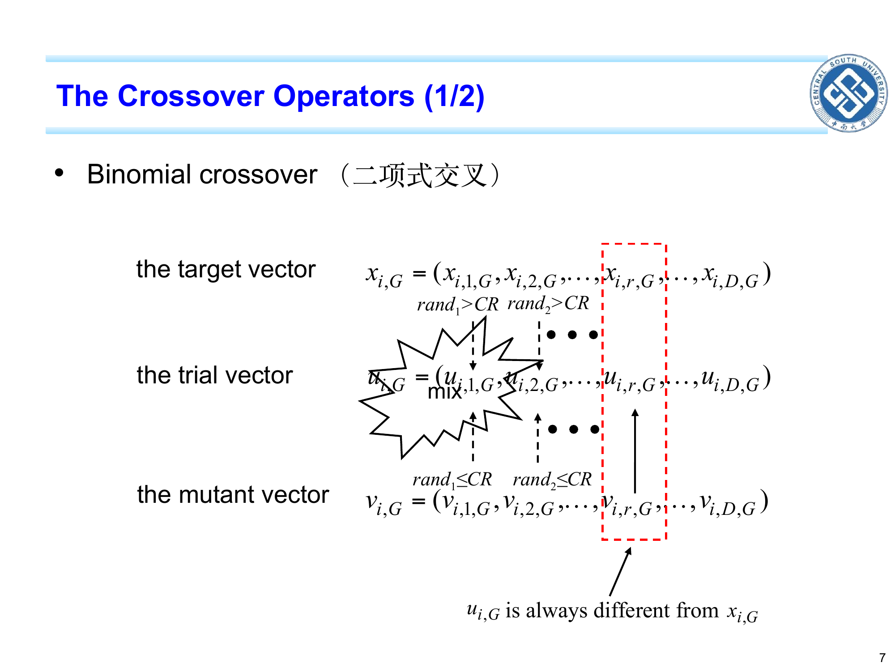
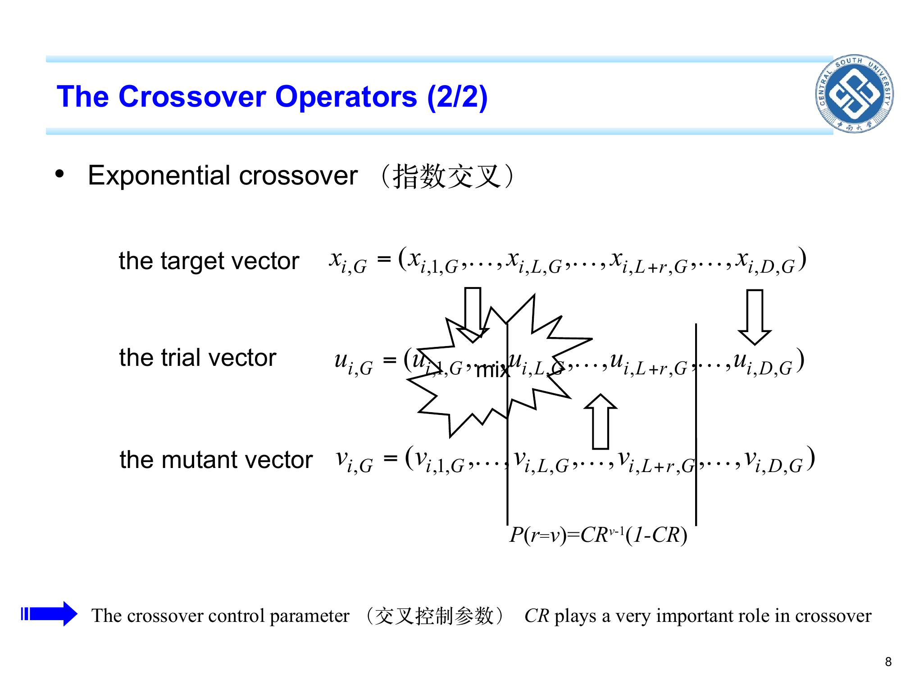
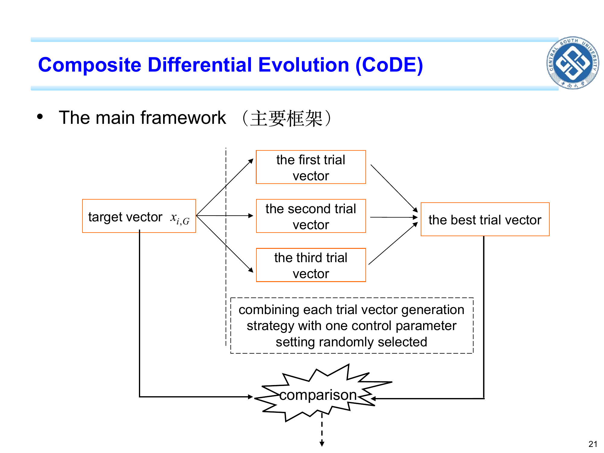
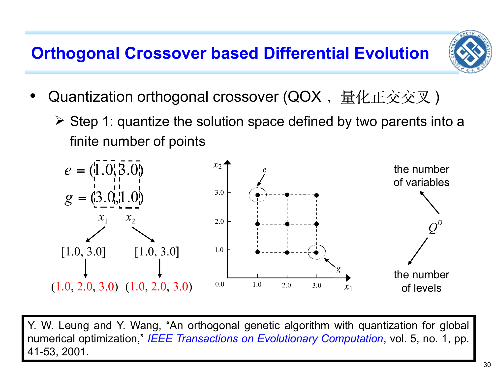

```cardlink
url: http://10.188.31.55:5244/Nextcloud/School/Compute-Intelligence/课件/
title: "计算智能 · 课程课件"
description: "中南大学自动化学院《计算智能》课程的全部课件"
host: 10.188.31.55:5244
```

[← 返回《计算智能：进化算法与优化方法》目录](../)

## 第 4 章 差分进化 (DE)

### 步长自适应有多贵

第 3 章的 CMA-ES 通过学习一个完整的 $D\times D$ 协方差矩阵，把搜索区域从圆调到椭圆、再调到旋转椭圆。代价是每代要算一次协方差矩阵的更新，涉及 $O(D^2)$ 的存储与运算，维度一高就吃不消 [Chapter 4_ Introduction to Differential Evolution.pdf · p.4](http://10.188.31.55:5244/Nextcloud/School/Compute-Intelligence/converted/Chapter%204_%20Introduction%20to%20Differential%20Evolution.pdf#page=4)。

差分进化（Differential Evolution, DE）走另一条更便宜的路：不维护协方差矩阵，直接拿"两个随机个体之差"当搜索方向。这条差分向量本身同时携带方向信息与"当前种群散开尺度"信息，因此免去了 ES 步长自适应的全部学习开销。1997 年由 Storn 和 Price 提出后，DE 因其机制简洁、参数少、收敛快，迅速成为连续优化的主流算法之一 [Chapter 4_ Introduction to Differential Evolution.pdf · p.4](http://10.188.31.55:5244/Nextcloud/School/Compute-Intelligence/converted/Chapter%204_%20Introduction%20to%20Differential%20Evolution.pdf#page=4)。

DE 与前面三章算法的核心区别只有一句话：它把"变异方向"这件事交给了"种群内部个体之差"。代价是三个算子的细节必须严格记牢、不能背错。

### 浓雾里的一群登山者

想象你管着一群登山者，要在浓雾里找山的最低点。每个人只能看到自己脚下与身旁几个人的相对位置。某个人想知道下一步往哪走，他可以这么做：随便挑另外三个队友 $A$、$B$、$C$，看 $A$ 在哪儿（基向量），再看从 $B$ 到 $C$ 这条矢量指向哪儿（差分向量），然后从 $A$ 出发、沿着这条矢量迈一步。迈多大呢？自己定一个倍率 $F$。最后停下来之前，先看一眼自己现在的位置（目标向量）和新算出来的位置（试验向量）哪个海拔更低，更低的那个留下，高的那个丢回原来的位置。这就是 DE 一代里发生的全部事情 [Chapter 4_ Introduction to Differential Evolution.pdf · p.10](http://10.188.31.55:5244/Nextcloud/School/Compute-Intelligence/converted/Chapter%204_%20Introduction%20to%20Differential%20Evolution.pdf#page=10)。

本章全部变体都是"基向量 + 一组差分向量的线性组合"。基向量与差分向量这两个角色一旦搞混，变异公式必错。

### 术语速查

- **种群规模 $NP$**：DE 一代里同时持有的个体数。第 1 章的通用符号写作 $N$，第 3 章 ES 把"种群中的父代个数"写作 $\mu$，三者满足 $N=NP=\mu$；ES 另有一个子代个数 $\lambda\ge\mu$。本讲义统一写 $NP$ [Chapter 4_ Introduction to Differential Evolution.pdf · p.6](http://10.188.31.55:5244/Nextcloud/School/Compute-Intelligence/converted/Chapter%204_%20Introduction%20to%20Differential%20Evolution.pdf#page=6)。
- **迭代代数 $G$**：DE 的迭代轮数。$G$ 与第 1 章的 $t$ 是同一个量，DE 文献习惯用 $G$ [Chapter 4_ Introduction to Differential Evolution.pdf · p.4](http://10.188.31.55:5244/Nextcloud/School/Compute-Intelligence/converted/Chapter%204_%20Introduction%20to%20Differential%20Evolution.pdf#page=4)。
- **目标向量（target vector）$x_{i,G}$**：第 $G$ 代第 $i$ 个个体的"旧解"，也是这一代里要被替换的那一个。它的对手是试验向量 $u_{i,G}$，两者比完决定谁留下 [Chapter 4_ Introduction to Differential Evolution.pdf · p.5](http://10.188.31.55:5244/Nextcloud/School/Compute-Intelligence/converted/Chapter%204_%20Introduction%20to%20Differential%20Evolution.pdf#page=5)。
- **变异向量（mutant vector，又称供体向量 donor vector）$v_{i,G}$**：只经过变异算子算出来的中间解，还没参与交叉，也还没和老解比较，角色是"候选新方向的搬运工"。本讲义的 $v_{i,G}$ 一律指变异向量，与第 5 章 PSO 里同字母的速度 $v_{i,j}^t$ 无关，靠"带不带代数下标 $G$"区分 [Chapter 4_ Introduction to Differential Evolution.pdf · p.6](http://10.188.31.55:5244/Nextcloud/School/Compute-Intelligence/converted/Chapter%204_%20Introduction%20to%20Differential%20Evolution.pdf#page=6)。
- **差分向量（difference vector）$x_{r2,G}-x_{r3,G}$**：两个随机个体逐维相减得到的向量。它同时携带两件事：方向（从 $r_3$ 指向 $r_2$ 的方向）与尺度（这两个个体在当前种群里相距多远）。后者就是"自适应步长"的零成本来源——种群散开时差分向量自动变大，种群聚拢时自动变小 [Chapter 4_ Introduction to Differential Evolution.pdf · p.6](http://10.188.31.55:5244/Nextcloud/School/Compute-Intelligence/converted/Chapter%204_%20Introduction%20to%20Differential%20Evolution.pdf#page=6)。
- **基向量（base vector）**：差分变异公式里"出发位置"那个个体。最常见是随机选的 $x_{r1,G}$（DE/rand 系列），也可能是当前种群最优 $x_{best,G}$（DE/best 系列）[Chapter 4_ Introduction to Differential Evolution.pdf · p.6](http://10.188.31.55:5244/Nextcloud/School/Compute-Intelligence/converted/Chapter%204_%20Introduction%20to%20Differential%20Evolution.pdf#page=6)。
- **缩放因子（scaling factor）$F$**：差分向量的放大倍数，常用取值 0.5–1.0，控制搜索步子的整体大小 [Chapter 4_ Introduction to Differential Evolution.pdf · p.6](http://10.188.31.55:5244/Nextcloud/School/Compute-Intelligence/converted/Chapter%204_%20Introduction%20to%20Differential%20Evolution.pdf#page=6)。
- **试验向量（trial vector）$u_{i,G}$**：变异加交叉做完之后得到的"候选新解"，使命是跟目标向量一对一 PK，赢者留下 [Chapter 4_ Introduction to Differential Evolution.pdf · p.7](http://10.188.31.55:5244/Nextcloud/School/Compute-Intelligence/converted/Chapter%204_%20Introduction%20to%20Differential%20Evolution.pdf#page=7)。
- **交叉控制参数（crossover control parameter）$CR$**：逐维决定试验向量抄变异向量的那一维还是抄目标向量的那一维，取值在 $[0,1]$ 之间 [Chapter 4_ Introduction to Differential Evolution.pdf · p.8](http://10.188.31.55:5244/Nextcloud/School/Compute-Intelligence/converted/Chapter%204_%20Introduction%20to%20Differential%20Evolution.pdf#page=8)。
- **二项式交叉（binomial crossover）**：逐维独立掷骰子的交叉方式。每一维独立产生 $[0,1]$ 上的均匀随机数 $rand_j$；若 $rand_j\le CR$，则试验向量的第 $j$ 维抄自变异向量，否则抄自目标向量；另外强制至少有一维（随机挑的 $j_{rand}$）必须来自变异向量 [Chapter 4_ Introduction to Differential Evolution.pdf · p.7](http://10.188.31.55:5244/Nextcloud/School/Compute-Intelligence/converted/Chapter%204_%20Introduction%20to%20Differential%20Evolution.pdf#page=7)。
- **指数交叉（exponential crossover）**：从随机起点 $s$ 开始连续若干维抄自变异向量、再突然停住的交叉方式，连抄的维数记为 $n$ [Chapter 4_ Introduction to Differential Evolution.pdf · p.8](http://10.188.31.55:5244/Nextcloud/School/Compute-Intelligence/converted/Chapter%204_%20Introduction%20to%20Differential%20Evolution.pdf#page=8)。
- **贪婪选择（greedy selection）**：试验向量与目标向量一对一比较，若试验向量不劣于目标向量（最小化时即 $f(u_{i,G})\le f(x_{i,G})$），就用试验向量替换目标向量，否则保留原目标向量。DE 的选择是"贪婪"的，因为它从不接受一个更差的解 [Chapter 4_ Introduction to Differential Evolution.pdf · p.5](http://10.188.31.55:5244/Nextcloud/School/Compute-Intelligence/converted/Chapter%204_%20Introduction%20to%20Differential%20Evolution.pdf#page=5)。
- **当前种群最优 $x_{best,G}$**：第 $G$ 代整个种群中 $f$ 最小的个体。它不是问题的真实最优 $x^*$：前者是算法"至今找到的"，后者是问题"真正存在的"，两者只在算法完美求解时才会相等 [Chapter 4_ Introduction to Differential Evolution.pdf · p.6](http://10.188.31.55:5244/Nextcloud/School/Compute-Intelligence/converted/Chapter%204_%20Introduction%20to%20Differential%20Evolution.pdf#page=6)。
- **函数误差值 $|f(x_{best})-f(x^*)|$**：算法找到的最好值离真实最优还差多少，是 DE 实验里衡量精度的标准指标 [Chapter 4_ Introduction to Differential Evolution.pdf · p.22](http://10.188.31.55:5244/Nextcloud/School/Compute-Intelligence/converted/Chapter%204_%20Introduction%20to%20Differential%20Evolution.pdf#page=22)。
- **成功运行（successful run）**：一次独立运行结束时，若函数误差 $\le \varepsilon$（通常取 $10^{-2}$ 或 $10^{-6}$），这次算成功，否则算失败 [Chapter 4_ Introduction to Differential Evolution.pdf · p.35](http://10.188.31.55:5244/Nextcloud/School/Compute-Intelligence/converted/Chapter%204_%20Introduction%20to%20Differential%20Evolution.pdf#page=35)。
- **适应值评价次数（fitness evaluations, FES）**：算法从开始到现在一共调用过 $f(x)$ 多少次。它就是算法的"预算"，不同算法必须在同一 FES 预算下比较才公平，常用上限 $FES_{max}=10000\times D$ [Chapter 4_ Introduction to Differential Evolution.pdf · p.34](http://10.188.31.55:5244/Nextcloud/School/Compute-Intelligence/converted/Chapter%204_%20Introduction%20to%20Differential%20Evolution.pdf#page=34)。
- **变异策略命名法 DE/x/y/z**：DE 的"型号"用四个字段串起来表示 [Chapter 4_ Introduction to Differential Evolution.pdf · p.9](http://10.188.31.55:5244/Nextcloud/School/Compute-Intelligence/converted/Chapter%204_%20Introduction%20to%20Differential%20Evolution.pdf#page=9)。
  - **x**：基向量怎么选。常用 `rand`（随机挑一个）、`best`（用当前最优）、`current-to-best`（从当前到最优的方向）、`current-to-rand`（从当前到随机）。
  - **y**：用了几个差分向量。`1` 表示一个，`2` 表示两个。
  - **z**：交叉类型。`bin` 是二项式，`exp` 是指数。

  所以 DE/rand/1/bin 是"基向量随机挑 + 一个差分向量 + 二项式交叉"，DE/best/2/exp 是"基向量用当前最优 + 两个差分向量 + 指数交叉"。本章全部例题以 DE/rand/1/bin 为主线，这是最经典、最常用、文献里出现频率最高的一种型号。

### 三个算子

#### 差分变异 DE/rand/1/bin

最经典的差分变异公式只有 5 个符号：从随机选出的基向量出发，沿着两个随机个体之差的方向，迈出 $F$ 倍距离，得到变异向量。

$$
v_{i,G} = x_{r1,G} + F \cdot (x_{r2,G} - x_{r3,G})
$$

下标的抽法是硬要求：$r_1,r_2,r_3$ 从 $\{1,\dots,NP\}\setminus\{i\}$ 中均匀随机、互不相同地抽取，每代每维重抽 [Chapter 4_ Introduction to Differential Evolution.pdf · p.6](http://10.188.31.55:5244/Nextcloud/School/Compute-Intelligence/converted/Chapter%204_%20Introduction%20to%20Differential%20Evolution.pdf#page=6)。

直观上公式做的事是：从 $x_{r1,G}$ 出发，沿着差分向量的方向迈出 $F$ 倍距离，落到 $v_{i,G}$。方向是免费的（从种群内部取），尺度也是免费的（差分向量自带当前种群的散开尺度），$F$ 只是给使用者一个调步子的旋钮。


#### 变异公式族

除 DE/rand/1 之外常见的还有 5 种 [Chapter 4_ Introduction to Differential Evolution.pdf · p.6](http://10.188.31.55:5244/Nextcloud/School/Compute-Intelligence/converted/Chapter%204_%20Introduction%20to%20Differential%20Evolution.pdf#page=6)：

$$
\begin{aligned}
\text{DE/rand/2/bin:}\quad & v_{i,G} = x_{r1,G} + F(x_{r2,G}-x_{r3,G}) + F(x_{r4,G}-x_{r5,G}) \\
\text{DE/best/1/bin:}\quad & v_{i,G} = x_{best,G} + F(x_{r1,G}-x_{r2,G}) \\
\text{DE/best/2/bin:}\quad & v_{i,G} = x_{best,G} + F(x_{r1,G}-x_{r2,G}) + F(x_{r3,G}-x_{r4,G}) \\
\text{DE/current-to-best/1:}\quad & v_{i,G} = x_{i,G} + F(x_{best,G}-x_{i,G}) + F(x_{r1,G}-x_{r2,G}) \\
\text{DE/current-to-rand/1:}\quad & v_{i,G} = x_{i,G} + rand(x_{r1,G}-x_{i,G}) + F(x_{r2,G}-x_{r3,G})
\end{aligned}
$$

"基向量怎么选"与"用几个差分向量"是正交的两个维度。DE/current-to-rand/1 具有旋转不变性（把坐标系整体旋转后，它产生的搜索行为不变），因此特别适合变量耦合的旋转问题 [Chapter 4_ Introduction to Differential Evolution.pdf · p.18](http://10.188.31.55:5244/Nextcloud/School/Compute-Intelligence/converted/Chapter%204_%20Introduction%20to%20Differential%20Evolution.pdf#page=18)。

#### 二项式交叉

伪代码如下（课件只给示意图，伪代码按该图整理）：

```text
随机选一个起始维 j_rand ∈ {1,...,D}
for j = 1 to D:
    抽 rand_j ~ U(0,1)
    if rand_j <= CR or j == j_rand:
        u[i,j] = v[i,j]      # 这一维抄自变异向量
    else:
        u[i,j] = x[i,j]      # 这一维抄自目标向量
```

$j_{rand}$ 是**强制维**：无论 $rand_{j_{rand}}$ 多大，这一维一定抄自变异向量，避免"所有 $rand_j>CR$、结果 $u_{i,G}=x_{i,G}$"这种白白浪费一次评价的情况。$rand_j$ 是逐维重新抽取的均匀随机数，各维独立，不能当作常数，也不能从公式里"约掉"。$j=j_{rand}$ 是 OR 条件，优先级高于 $rand_j\le CR$ [Chapter 4_ Introduction to Differential Evolution.pdf · p.7](http://10.188.31.55:5244/Nextcloud/School/Compute-Intelligence/converted/Chapter%204_%20Introduction%20to%20Differential%20Evolution.pdf#page=7)。

$CR$ 越大、$u_{i,G}$ 越像 $v_{i,G}$；$CR$ 越小、$u_{i,G}$ 越像 $x_{i,G}$。



#### 指数交叉

指数交叉从随机起点 $s$ 开始连续若干维抄自变异向量，直到某维掷出的 $rand$ 大于等于 $CR$ 才停：

```text
随机选起始维 s ∈ {1,...,D}
n = 0
repeat:
    n = n + 1
    j = ((s + n - 1) mod D) + 1
    u[i,j] = v[i,j]
    抽 rand_j ~ U(0,1)
until rand_j >= CR
for j = 1 to D 且未在上面被赋值:
    u[i,j] = x[i,j]
```

连抄多少维记为 $n$，其分布为：

$$
P(n = v) = CR^{v-1}(1 - CR),\quad v = 1, 2, \dots
$$

推导只有一行：前 $v-1$ 次掷 $rand_j$ 必须都 $\le CR$（概率 $CR^{v-1}$），第 $v$ 次掷 $rand_j\ge CR$（概率 $1-CR$），两个独立事件相乘 [Chapter 4_ Introduction to Differential Evolution.pdf · p.8](http://10.188.31.55:5244/Nextcloud/School/Compute-Intelligence/converted/Chapter%204_%20Introduction%20to%20Differential%20Evolution.pdf#page=8)。

当 $CR$ 很小时，绝大多数时候 $n=1$ 或 $n=2$（连抄一两维就停），试验向量接近目标向量；$CR$ 接近 1 时，$n$ 可以一直延伸到接近 $D$，试验向量几乎就是变异向量本身。"指数"二字就来自这个 $CR^{v-1}$ 的几何衰减形式——$P(n=v)=CR^{v-1}(1-CR)$ 正是以 $1-CR$ 为参数、从 1 开始计数的几何分布。

起始维记作 $s$、连续交换位数记作 $n$。课件原文在这两处分别用了 $L$ 和 $r$，前者与第 2 章的染色体长度 $L$ 冲突、后者与差分下标 $r$ 冲突。



#### 一对一贪婪选择

试验向量与目标向量一对一比较，赢者留下：

$$
x_{i,G+1} = \begin{cases}
u_{i,G}, & \text{if } f(u_{i,G}) \le f(x_{i,G}) \\
x_{i,G}, & \text{otherwise}
\end{cases}
$$

DE 是"贪婪"的，因为它在每一步都用"不更差"作为替换门槛，从不接受一个让目标函数变大的解。推论是：在最小化问题下，$\min_i f(x_{i,G})$ 随 $G$ **单调不增**。这一性质带来两件事——DE 收敛很快（好的解永远不会被丢掉），但也容易早熟（一旦种群聚拢，差分向量迅速变小、搜索停滞）[Chapter 4_ Introduction to Differential Evolution.pdf · p.5](http://10.188.31.55:5244/Nextcloud/School/Compute-Intelligence/converted/Chapter%204_%20Introduction%20to%20Differential%20Evolution.pdf#page=5)。

DE 没有种群层面的选择算子。整代替换、轮盘赌选择都不存在：每个试验向量只跟自己对应的目标向量比，赢了替换、输了保留。这是 DE 与第 2 章 GA、第 3 章 ES 在选择环节的根本差别。

把三个算子串起来，就是 DE 的一代：


### 手算：DE/rand/1/bin 的一代

设目标函数 $f(x)=(x-5)^2$，最优 $x^*=5$、$f(x^*)=0$。种群规模 $NP=4$，第 $G$ 代的 4 个目标向量是 $x_{1,G}=1$、$x_{2,G}=3$、$x_{3,G}=6$、$x_{4,G}=8$，对应函数值 $16$、$4$、$1$、$9$，当前最优是 $x_{3,G}=6$。参数取 $F=0.8$、$CR=0.9$。下面完整跑 $i=1$ 的更新 [Chapter 4_ Introduction to Differential Evolution.pdf · p.6](http://10.188.31.55:5244/Nextcloud/School/Compute-Intelligence/converted/Chapter%204_%20Introduction%20to%20Differential%20Evolution.pdf#page=6)。

**Step 1 抽下标**：从 $\{1,2,3,4\}\setminus\{1\}=\{2,3,4\}$ 中互不相同地抽 $r_1,r_2,r_3$，这次抽到 $r_1=2$、$r_2=3$、$r_3=4$。

**Step 2 变异**：差分向量 $x_{r_2,G}-x_{r_3,G}=6-8=-2$。

$$
\begin{aligned}
v_{1,G} &= x_{r_1,G} + F \cdot (x_{r_2,G} - x_{r_3,G}) \\
&= x_{2,G} + 0.8 \cdot (x_{3,G} - x_{4,G}) \\
&= 3 + 0.8 \cdot (-2) = 1.4
\end{aligned}
$$

**Step 3 二项式交叉**：只有 1 维（$D=1$），$j_{rand}=1$ 必为强制维，$u_{1,G}=v_{1,G}=1.4$。这里因为 $D=1$，$CR$ 的大小已经不重要——只要 $j_{rand}=1$，试验向量就完全等于变异向量 [Chapter 4_ Introduction to Differential Evolution.pdf · p.7](http://10.188.31.55:5244/Nextcloud/School/Compute-Intelligence/converted/Chapter%204_%20Introduction%20to%20Differential%20Evolution.pdf#page=7)。

**Step 4 贪婪选择**：

$$
f(u_{1,G}) = f(1.4) = (-3.6)^2 = 12.96
\qquad
f(x_{1,G}) = f(1) = (-4)^2 = 16
$$

$12.96<16$，试验向量更优，所以 $x_{1,G+1}=u_{1,G}=1.4$ [Chapter 4_ Introduction to Differential Evolution.pdf · p.5](http://10.188.31.55:5244/Nextcloud/School/Compute-Intelligence/converted/Chapter%204_%20Introduction%20to%20Differential%20Evolution.pdf#page=5)。个体 1 从 $x=1$ 跳到了 $x=1.4$，离真实最优 $x^*=5$ 反而更近了。

#### 变式一：只把 F 改成 1.5

种群、下标、目标函数不变，$F$ 从 $0.8$ 改成 $1.5$ [Chapter 4_ Introduction to Differential Evolution.pdf · p.6](http://10.188.31.55:5244/Nextcloud/School/Compute-Intelligence/converted/Chapter%204_%20Introduction%20to%20Differential%20Evolution.pdf#page=6)：

$$
v_{1,G} = x_{2,G} + 1.5 \cdot (x_{3,G} - x_{4,G}) = 3 + 1.5 \cdot (-2) = 0
$$

$f(0)=25$，$f(1)=16$。变异向量比目标向量更差，即使强制维让它进了试验向量，$u_{1,G}=0$ 的函数值仍然更大，贪婪选择保留 $x_{1,G+1}=x_{1,G}=1$。

结果：$v_{1,G}=0$，$u_{1,G}=0$，$x_{1,G+1}=1$。$F$ 偏大时变异向量可能"跳过头"飞到比原来更差的位置；差分向量的方向正好背离最优时，这种浪费更明显。$F$ 调大的完整效果是：步子变大、多样性提高、偏探索，但偶尔会跳过头 [Chapter 4_ Introduction to Differential Evolution.pdf · p.19](http://10.188.31.55:5244/Nextcloud/School/Compute-Intelligence/converted/Chapter%204_%20Introduction%20to%20Differential%20Evolution.pdf#page=19)。

#### 变式二：升到 3 维，只把 CR 改掉

种群换成 3 维向量 $x_{1,G}=(1,2,3)$、$x_{2,G}=(3,4,5)$、$x_{3,G}=(6,7,8)$、$x_{4,G}=(8,9,10)$，仍取 $r_1=2,r_2=3,r_3=4$，$F=0.8$。差分向量 $(6-8,\,7-9,\,8-10)=(-2,-2,-2)$ [Chapter 4_ Introduction to Differential Evolution.pdf · p.8](http://10.188.31.55:5244/Nextcloud/School/Compute-Intelligence/converted/Chapter%204_%20Introduction%20to%20Differential%20Evolution.pdf#page=8)：

$$
v_{1,G} = x_{2,G} + 0.8 \cdot (-2,-2,-2) = (1.4,\ 2.4,\ 3.4)
$$

**$CR=0.9$**：掷到 $rand=(0.20,\,0.85,\,0.05)$，强制维取 $j_{rand}=2$。第 1 维 $0.20\le 0.9$ 抄变异得 $1.4$；第 2 维是强制维，抄变异得 $2.4$；第 3 维 $0.05\le 0.9$ 抄变异得 $3.4$。试验向量 $u_{1,G}=(1.4,\,2.4,\,3.4)$，恰好等于变异向量——$CR=0.9$ 极高，绝大多数维都满足 $rand_j\le CR$ [Chapter 4_ Introduction to Differential Evolution.pdf · p.7](http://10.188.31.55:5244/Nextcloud/School/Compute-Intelligence/converted/Chapter%204_%20Introduction%20to%20Differential%20Evolution.pdf#page=7)。

**$CR=0.1$**：掷到同样的 $rand=(0.20,\,0.85,\,0.05)$，强制维取 $j_{rand}=2$。第 1 维 $0.20>0.1$ 抄目标得 $1$；第 2 维强制抄变异得 $2.4$；第 3 维 $0.05\le 0.1$ 抄变异得 $3.4$。试验向量 $u_{1,G}=(1,\,2.4,\,3)$，只有 1 维来自变异 [Chapter 4_ Introduction to Differential Evolution.pdf · p.7](http://10.188.31.55:5244/Nextcloud/School/Compute-Intelligence/converted/Chapter%204_%20Introduction%20to%20Differential%20Evolution.pdf#page=7)。

$CR$ 直接决定试验向量在多大程度上"借用"变异向量的信息：$CR$ 大，试验向量更像变异向量（偏探索）；$CR$ 小，试验向量更像目标向量（偏开发，各变量独立优化）。目标函数可分离（$f(x)=\sum_j f_j(x_j)$）时小 $CR$ 反而更好，变量耦合（旋转问题）时大 $CR$ 更合适 [Chapter 4_ Introduction to Differential Evolution.pdf · p.20](http://10.188.31.55:5244/Nextcloud/School/Compute-Intelligence/converted/Chapter%204_%20Introduction%20to%20Differential%20Evolution.pdf#page=20)。

#### 对比：DE/rand/1/bin 与 DE/best/1/bin

仍用 $f(x)=(x-5)^2$、$NP=4$、$F=0.8$、$CR=0.9$、种群 $x=[1,3,6,8]$、当前最优 $x_{best,G}=6$。对 $i=1$ 仍抽 $r_1=2,r_2=3,r_3=4$，差分向量 $=6-8=-2$。

DE/rand/1/bin 的基向量是 $x_{r1,G}=x_{2,G}=3$：

$$
v_{1,G} = 3 + 0.8 \cdot (-2) = 1.4
$$

DE/best/1/bin 的基向量是 $x_{best,G}=6$，差分下标只需 2 个，这里用 $r_1=2,r_2=3$：

$$
v_{1,G} = 6 + 0.8 \cdot (x_{2,G}-x_{3,G}) = 6 + 0.8 \cdot (3-6) = 3.6
$$

DE/rand/1/bin 的变异向量 $1.4$ 远离当前最优 $6$、向目标向量 $1$ 靠拢一点；DE/best/1/bin 的变异向量 $3.6$ 从最优 $6$ 反向迈出一步，$3.6$ 离 $5$ 反而比 $1.4$ 更近。

结论：DE/best/1/bin 让所有变异向量都从当前最优出发，**收敛更快但多样性更低、容易早熟**；DE/rand/1/bin 让基向量随机挑，**探索更强、慢一些但不易卡死**。这是 DE 选型的最经典对比 [Chapter 4_ Introduction to Differential Evolution.pdf · p.18](http://10.188.31.55:5244/Nextcloud/School/Compute-Intelligence/converted/Chapter%204_%20Introduction%20to%20Differential%20Evolution.pdf#page=18)。

"基向量用最优"也不保证每一步都更近。把下标换成 $r_1=2,r_2=4,r_3=3$，DE/rand/1/bin 得 $v_{1,G}=3+0.8(8-6)=4.6$（离 $x^*=5$ 只有 0.4），DE/best/1/bin 得 $v_{1,G}=6+0.8(3-8)=2$（离 $5$ 有 3.0）——同一组参数下 best 反而跳过了头。它快的是长期趋势，不是每一步 [Chapter 4_ Introduction to Differential Evolution.pdf · p.18](http://10.188.31.55:5244/Nextcloud/School/Compute-Intelligence/converted/Chapter%204_%20Introduction%20to%20Differential%20Evolution.pdf#page=18)。

### 改进：CoDE、QOX 与 OXDE

**CoDE（复合差分进化，composite DE）**把"挑哪个策略、选哪组参数"也变成了一个随机过程。预先准备一个策略候选池（DE/rand/1/bin、DE/rand/2/bin、DE/current-to-rand/1）和一个参数候选池（3 组 $(F,\,CR)$ 取值），每个个体每次从两个池里各抽一个组合，生成 3 个试验向量，再取最好的那个进入下一代 [Chapter 4_ Introduction to Differential Evolution.pdf · p.15](http://10.188.31.55:5244/Nextcloud/School/Compute-Intelligence/converted/Chapter%204_%20Introduction%20to%20Differential%20Evolution.pdf#page=15)。




**QOX（量化正交交叉，quantization orthogonal crossover）**的动机是：DE 原有的交叉只能产生父代围出的超长方体的顶点，中间的点造不出来，搜索能力因此受限。QOX 要解决的是"如何向盒子内部也撒点"——先把两个父代围出的区域量化成有限网格点，再用正交设计从中挑几组有代表性的组合 [Chapter 4_ Introduction to Differential Evolution.pdf · p.26](http://10.188.31.55:5244/Nextcloud/School/Compute-Intelligence/converted/Chapter%204_%20Introduction%20to%20Differential%20Evolution.pdf#page=26)。




**正交设计（orthogonal design, OED，又称正交试验设计）**是一种"用尽量少的试验代表全部组合"的实验设计方法：$K$ 个因素、每个 $Q$ 个水平，本来要 $Q^K$ 次试验，用正交表 $L_M(Q^K)$ 只做 $M$ 次就有代表性。课件此处把因子数写作 $N$，与"种群规模 $N$"撞车，本讲义第 4、5 两章统一改记因子数为 $K$。正交表的构造、正交性两条性质、因子分析等方法细节不在本章展开，见第 5 章 §5.4 [Chapter 4_ Introduction to Differential Evolution.pdf · p.27](http://10.188.31.55:5244/Nextcloud/School/Compute-Intelligence/converted/Chapter%204_%20Introduction%20to%20Differential%20Evolution.pdf#page=27)。

OXDE 把 QOX 接入任意 DE 变体：用正交表一次生成 $M$ 个候选解，与差分进化的试验向量一起比较取优 [Chapter 4_ Introduction to Differential Evolution.pdf · p.32](http://10.188.31.55:5244/Nextcloud/School/Compute-Intelligence/converted/Chapter%204_%20Introduction%20to%20Differential%20Evolution.pdf#page=32)。


### 怎么判断一个改动有效

DE 的实验口径是固定的：在 IEEE CEC2005 基准的 25 题上跑（单模 F1–F5、基本多模 F6–F12、扩展多模 F13–F14、混合复合 F15–F25）[Chapter 7_ Algorithm Comparison.pdf · p.2](http://10.188.31.55:5244/Nextcloud/School/Compute-Intelligence/converted/Chapter%207_%20Algorithm%20Comparison.pdf#page=2)，每个算法在每题上做 25 或 50 次独立运行，每次记录一次函数误差 $|f(x_{best})-f(x^*)|$ [Chapter 7_ Algorithm Comparison.pdf · p.3](http://10.188.31.55:5244/Nextcloud/School/Compute-Intelligence/converted/Chapter%207_%20Algorithm%20Comparison.pdf#page=3)，用均值与标准差描述收敛表现，再用 Wilcoxon 秩和检验在显著性水平 $\alpha=0.05$ 上比较两个算法 [Chapter 7_ Algorithm Comparison.pdf · p.4](http://10.188.31.55:5244/Nextcloud/School/Compute-Intelligence/converted/Chapter%207_%20Algorithm%20Comparison.pdf#page=4)。预算必须统一在 FES 上（$FES_{max}=10000\times D$），否则"收敛快"只说明代数少，不说明计算量小。

同一口径下的收敛曲线长这样：


OXDE（DE/rand/1/bin + QOX）在原版 DE/rand/1/bin 的基础上，误差下降更快、最终精度更高 [Chapter 4_ Introduction to Differential Evolution.pdf · p.38](http://10.188.31.55:5244/Nextcloud/School/Compute-Intelligence/converted/Chapter%204_%20Introduction%20to%20Differential%20Evolution.pdf#page=38)。横轴用 FES 而不是代数，保证两个算法在同一计算预算下比较。

### 易错点

> [!WARNING]
> **把 $F$ 当成变异率。** $F$ 是缩放因子，控制差分向量的放大倍数。DE 里没有 GA 意义上的"逐位变异率"——差分向量整体被 $F$ 缩放，然后要么整体进入试验向量、要么不进。$F=0$ 时 $v_{i,G}=x_{r1,G}$，变异算子完全无效，等于没有搜索 [Chapter 4_ Introduction to Differential Evolution.pdf · p.6](http://10.188.31.55:5244/Nextcloud/School/Compute-Intelligence/converted/Chapter%204_%20Introduction%20to%20Differential%20Evolution.pdf#page=6)。

> [!WARNING]
> **把 $CR$ 与第 2 章的 $p_c$ 直接等同。** $CR$ 是"维"的层面：试验向量的每一维独立掷 $rand_j\le CR$ 才抄变异向量，并且强制至少一维来自变异向量（用 $j_{rand}$ 实现）。GA 的 $p_c$ 是"对"的层面，不强制至少一位参与交换。$CR=0$ 时（没有强制维）$u_{i,G}=x_{i,G}$，交叉算子完全无效，等于浪费一次 FES [Chapter 4_ Introduction to Differential Evolution.pdf · p.7](http://10.188.31.55:5244/Nextcloud/School/Compute-Intelligence/converted/Chapter%204_%20Introduction%20to%20Differential%20Evolution.pdf#page=7)。

> [!WARNING]
> **下标 $r_1,r_2,r_3$ 互不相同且不等于 $i$。** 必须从 $\{1,\dots,NP\}\setminus\{i\}$ 中均匀抽取，三件事缺一不可：① 排除 $i$ 本身，否则差分可能为 0、变异方向消失；② 三个下标互不相同，否则差分向量的某一项就退化为 0；③ 每代每维重抽，不能缓存 [Chapter 4_ Introduction to Differential Evolution.pdf · p.6](http://10.188.31.55:5244/Nextcloud/School/Compute-Intelligence/converted/Chapter%204_%20Introduction%20to%20Differential%20Evolution.pdf#page=6)。
