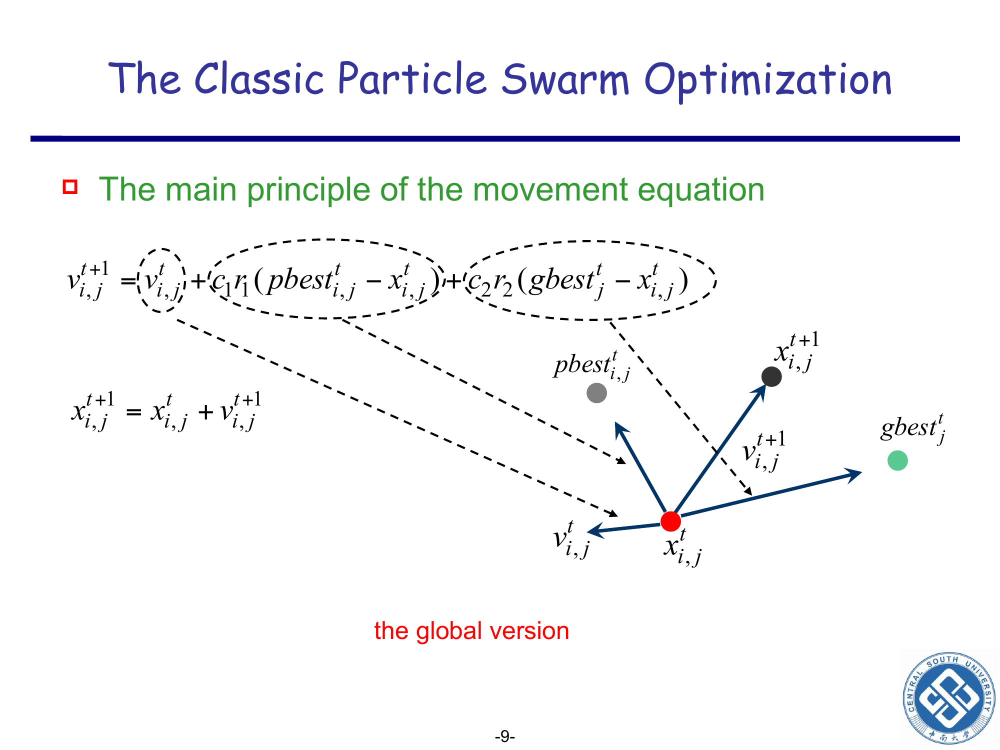
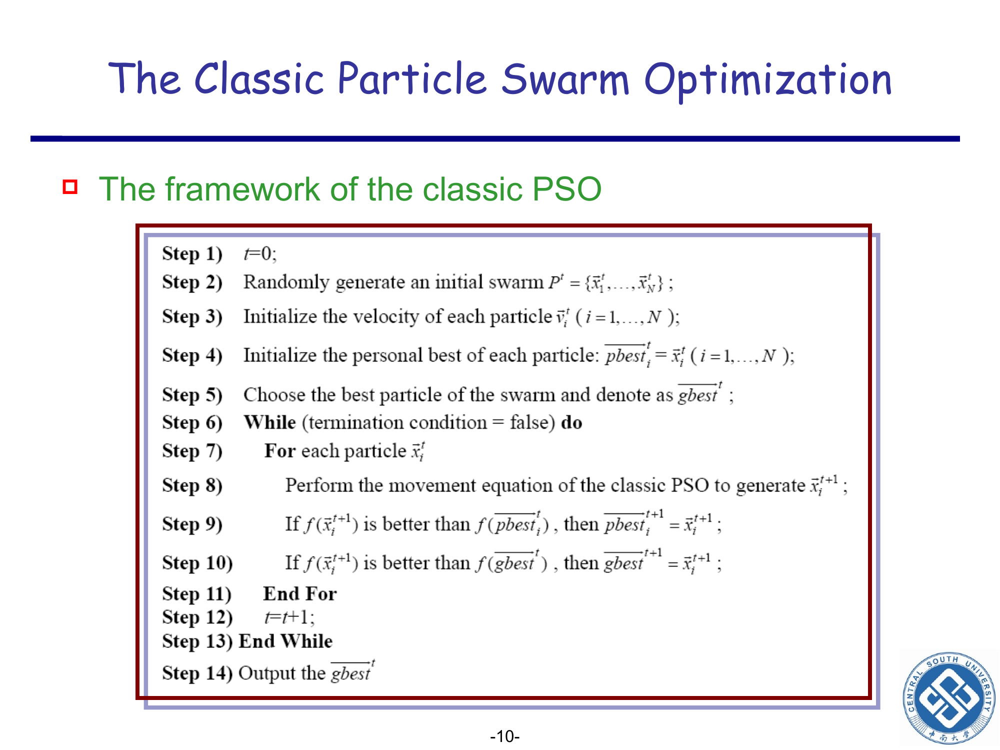
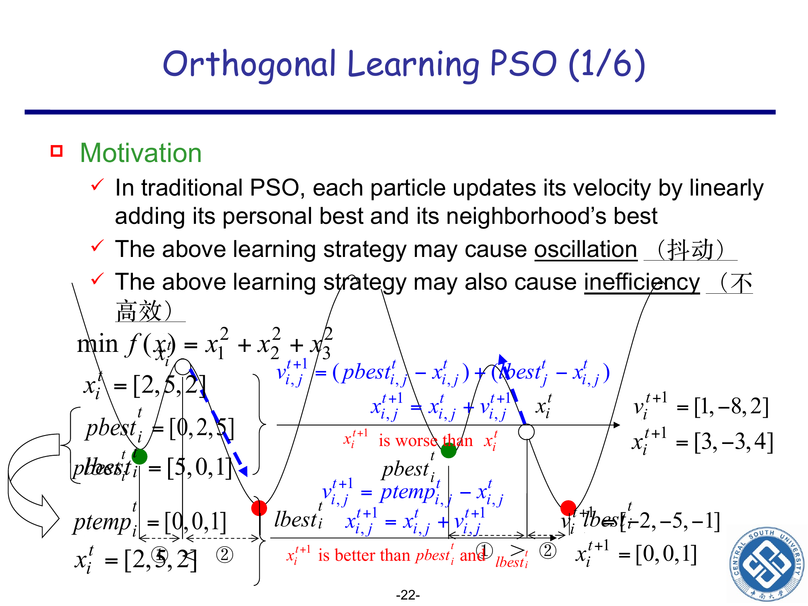

```cardlink
url: http://10.188.31.55:5244/Nextcloud/School/Compute-Intelligence/课件/
title: "计算智能 · 课程课件"
description: "中南大学自动化学院《计算智能》课程的全部课件"
host: 10.188.31.55:5244
```

[← 返回《计算智能：进化算法与优化方法》目录](../)

## 第 5 章 粒子群优化 (PSO)

### 粒子群优化：速度合成、记忆与拓扑

PSO 的粒子永不淘汰:没有选择算子、没有交叉、没有变异,粒子只会被"挪一挪"位置 [Chapter 5_ Introduction to Particle Swarm Optimization.pptx · p.14](http://10.188.31.55:5244/Nextcloud/School/Compute-Intelligence/converted/Chapter%205_%20Introduction%20to%20Particle%20Swarm%20Optimization.pdf#page=14)。那么问题来了:不淘汰任何粒子,也不让粒子交配或突变,它怎么还能把一群解搜得越来越好?[Chapter 5_ Introduction to Particle Swarm Optimization.pptx · p.4](http://10.188.31.55:5244/Nextcloud/School/Compute-Intelligence/converted/Chapter%205_%20Introduction%20to%20Particle%20Swarm%20Optimization.pdf#page=4)

答案藏在"记着"两个字里:每个粒子记着自己到过的最好位置,整群也记着全局最好位置;速度由"旧速度、自己的历史最优、全群最优"三项合成,位置跟着速度走。PSO 由 Kennedy(社会心理学家)与 Eberhart(电气工程师)在 1995 年提出 [Chapter 5_ Introduction to Particle Swarm Optimization.pptx · p.4](http://10.188.31.55:5244/Nextcloud/School/Compute-Intelligence/converted/Chapter%205_%20Introduction%20to%20Particle%20Swarm%20Optimization.pdf#page=4),灵感来自鸟群觅食与进化计算两个源头 [Chapter 5_ Introduction to Particle Swarm Optimization.pptx · p.5](http://10.188.31.55:5244/Nextcloud/School/Compute-Intelligence/converted/Chapter%205_%20Introduction%20to%20Particle%20Swarm%20Optimization.pdf#page=5)。

#### 鸟群比喻与术语

把一群鸟扔到一片有食物但看不见的草地上找食物。最自然的策略是:**每只鸟一方面朝自己去过的最好位置飞(经验),另一方面朝整群里飞得最远的那只鸟所在位置飞(共享信息)**。PSO 把"鸟"换成了"粒子"(particle),"位置"就是候选解 $\mathbf{x}$,把"朝哪飞、飞多远"叫"速度" $\mathbf{v}$,并让两者一代一代地更新下去。

- **粒子群优化**(particle swarm optimization, PSO)—— 1995 年由 Kennedy 与 Eberhart 提出的一类群体智能算法;一群"粒子"靠速度在搜索空间里移动,既参考自己的历史最优,又参考种群的最优。
- **粒子**(particle)—— PSO 里的一个个体,代表一个候选解。它同时带有"位置"和"速度",并且记着自己到过的最好位置。
- **位置**(position)—— 粒子当前在搜索空间里的那个点,就是候选解 $\mathbf{x}_i^t$ 本身;它是实数向量,各维都是连续量。
- **速度**(velocity, $\mathbf{v}$)—— 粒子"这一步要移动多远、朝哪个方向",也是逐维的实数向量。第 4 章 DE 里的 $v$ 是"变异向量",出现在 $x_{r_1,G} + F(x_{r_2,G} - x_{r_3,G})$ 这种式子里;带迭代上标 $t$ 与维度下标 $j$ 的 $v$ 才是这里的 PSO 速度。
- **个体历史最优**(personal best, $\mathrm{pbest}_i$)—— 第 $i$ 个粒子从第 0 代到当前代为止自己去过的最好位置;只有当前位置比它更优时才更新它。
- **全局最优位置**(global best, $\mathrm{gbest}$)—— 整群到目前为止到过的最好位置。它就是 $\mathbf{x}_{best}$ 在 PSO 里的叫法。
- **邻域最优**(local best, $\mathrm{lbest}_i$)—— 第 $i$ 个粒子在自己那一小撮"邻居"内比出来的最好位置;当"全群"也算一个大邻域时,$\mathrm{lbest}_i$ 就退化成 $\mathrm{gbest}$。
- **拓扑 / 邻域结构**(population topology)—— "谁算谁的邻居、谁的最好位置能传给谁"的网络拓扑:圈子覆盖全群就是 gbest 版本,圈子只覆盖一小撮就是 lbest 版本。
- **加速常量**(acceleration constants, $c_1, c_2$)—— 控制"相信自己的经验"和"相信种群意见"各占多少分量的两个系数,常取 $c_1 = c_2 = 2$。
- **速度上限**(velocity limit, $v_{\max,j}$)—— 第 $j$ 维速度被允许的最大绝对值,防止数值溢出与"飞出搜索空间"。
- **修补算子**(repair operator)—— 粒子位置一旦飞出允许区间 $[L_j, U_j]$,把它"拽回来"的措施。
- **惯性权重**(inertia weight, $\omega$)—— 新速度里"保留多少旧速度"的系数;大 = 冲得猛(偏探索)、小 = 稳下来(偏开发);常用 0.9 线性递减到 0.4。
- **限制系数**(constriction coefficient, $\chi$)—— Clerc 和 Kennedy 提出的一个整体缩小系数,能把速度和位置的爆炸压住,使 $v_{\max}$ 不再必要。
- **正交学习**(orthogonal learning, OL)—— 用正交试验设计在 $\mathrm{pbest}_i$ 与 $\mathrm{lbest}_i$ 的每一维之间挑出最有效的组合,造出一个比简单线性加法更靠谱的"学习榜样" $\mathrm{ptemp}_i$。
- **学习榜样**(learning exemplar, $\mathrm{ptemp}_i$)—— OL-PSO 里粒子"这一段时间要跟谁走"的示范位置,它由正交试验设计临时造出来,与 $\mathrm{pbest}_i$、$\mathrm{lbest}_i$ 都不同。

PSO 的"有记忆"指的就是 $\mathrm{pbest}_i$ 这一条:当前解变差它也不回退,只在当前位置更优时才更新 [Chapter 5_ Introduction to Particle Swarm Optimization.pptx · p.14](http://10.188.31.55:5244/Nextcloud/School/Compute-Intelligence/converted/Chapter%205_%20Introduction%20to%20Particle%20Swarm%20Optimization.pdf#page=14)。GA 的轮盘赌有可能把当前最优个体漏到下一代,DE 的贪婪选择也只比较当前这一代;只有 PSO 的 $\mathrm{pbest}$ 会把历史最优一直记着。

PSO 的两大思想来源画在一起是这样:


#### 速度更新:三项各管什么

PSO 只有两条公式,所有"粒子在飞"的过程都被这两条公式穷尽。速度更新方程给出第 $t$ 代、第 $i$ 个粒子在第 $j$ 维上的新速度(种群规模 $N$,搜索空间 $D$ 维),由惯性项、认知项、社会项相加得到:

$$
v_{i,j}^{t+1} \;=\; \underbrace{\omega v_{i,j}^{t}}_{\text{惯性项}} \;+\; \underbrace{c_1 r_1\bigl(\mathrm{pbest}_{i,j}^{t} - x_{i,j}^{t}\bigr)}_{\text{认知项}} \;+\; \underbrace{c_2 r_2\bigl(\mathrm{gbest}_j^{t} - x_{i,j}^{t}\bigr)}_{\text{社会项}}
$$

三项都是"沿某个参考方向移动"的形式,和梯度法里"$x$ 的负梯度方向 = 函数值下降最快的方向"是同一类直觉,不需要会求导 [Chapter 5_ Introduction to Particle Swarm Optimization.pptx · p.7](http://10.188.31.55:5244/Nextcloud/School/Compute-Intelligence/converted/Chapter%205_%20Introduction%20to%20Particle%20Swarm%20Optimization.pdf#page=7)。公式里每一项都是向量,加减法逐分量进行;粒子在 $D$ 维空间里飞,每个维度分别计算后再拼成向量 [Chapter 5_ Introduction to Particle Swarm Optimization.pptx · p.7](http://10.188.31.55:5244/Nextcloud/School/Compute-Intelligence/converted/Chapter%205_%20Introduction%20to%20Particle%20Swarm%20Optimization.pdf#page=7)。

- **惯性部分**(inertial part)$\;\omega v_{i,j}^{t}$ —— "保留多少旧速度"。$\omega$ 是惯性权重,常取 $0.9$ 线性递减到 $0.4$ [Chapter 5_ Introduction to Particle Swarm Optimization.pptx · p.18](http://10.188.31.55:5244/Nextcloud/School/Compute-Intelligence/converted/Chapter%205_%20Introduction%20to%20Particle%20Swarm%20Optimization.pdf#page=18)。PPT slide 17 把这一项记作"global search 倾向",slide 18 又叫它"惯性",是同一个东西,这里统一叫惯性项。
- **认知部分**(cognition part)$\;c_1 r_1(\mathrm{pbest}_{i,j}^{t} - x_{i,j}^{t})$ —— "朝我自己以前到过的最好位置挪一点"。$c_1$ 是认知学习因子,常取 $2$;$r_1 \sim U(0,1)$ 是每次、每维重新抽样的均匀随机数。这一项的方向恒指向 $\mathrm{pbest}_{i,j}^{t}$。
- **社会部分**(social part)$\;c_2 r_2(\mathrm{gbest}_j^{t} - x_{i,j}^{t})$ —— "朝全群最好位置挪一点"。$c_2$ 是社会学习因子,常取 $2$;$r_2 \sim U(0,1)$ 同理每次每维重抽。

每一项的方向是定死的,每一项的"长度"都靠随机数 $r_1, r_2$ 来扰动 —— 这正是 PSO 既能用种群的智慧、又不被种群拖着走向同一个点的关键。PPT 把它写成一句 remark:PSO 里"每个变量都独立更新"($j$ 逐维各算一遍,各维的 $r_1, r_2$ 互不共用) [Chapter 5_ Introduction to Particle Swarm Optimization.pptx · p.8](http://10.188.31.55:5244/Nextcloud/School/Compute-Intelligence/converted/Chapter%205_%20Introduction%20to%20Particle%20Swarm%20Optimization.pdf#page=8)。

三项之和得到新速度,新速度叠到老位置得到新位置,画出来是这样:



#### 位置更新与完整流程

位置更新方程把新速度叠到老位置上:

$$
x_{i,j}^{t+1} \;=\; x_{i,j}^{t} \;+\; v_{i,j}^{t+1}.
$$

为什么是加法?因为速度 $\mathbf{v}$ 的物理意义就是"这一步沿哪些方向走多远",位置 = 老位置 + 走过的位移,这是公式本身的要求;**$x_{i,j}$ 是实数分量**(PSO 直接在连续搜索空间里飞,不做 0/1 编码),这一步不含随机数 [Chapter 5_ Introduction to Particle Swarm Optimization.pptx · p.8](http://10.188.31.55:5244/Nextcloud/School/Compute-Intelligence/converted/Chapter%205_%20Introduction%20to%20Particle%20Swarm%20Optimization.pdf#page=8)。

PPT slide 17 给出了三个反例,直接告诉你这三项缺一不可 [Chapter 5_ Introduction to Particle Swarm Optimization.pptx · p.17](http://10.188.31.55:5244/Nextcloud/School/Compute-Intelligence/converted/Chapter%205_%20Introduction%20to%20Particle%20Swarm%20Optimization.pdf#page=17):

- 只保留惯性项($\omega = 1$, $c_1 = c_2 = 0$):粒子会保持当前速度、一直朝同方向飞,直到撞到边界;
- 去掉惯性项($\omega = 0$):搜索范围会随代数"统计性收缩",整群因为没有动量而停滞;
- 三项俱全:粒子既有扩张能力(惯性),又有向 $\mathrm{pbest}$、$\mathrm{gbest}$ 收拢的能力。

经典 PSO 实际跑起来的样子是 PPT slide 10 的伪代码 [Chapter 5_ Introduction to Particle Swarm Optimization.pptx · p.10](http://10.188.31.55:5244/Nextcloud/School/Compute-Intelligence/converted/Chapter%205_%20Introduction%20to%20Particle%20Swarm%20Optimization.pdf#page=10):



对应到步骤:

1. 初始化每个粒子的位置 $\mathbf{x}_i^0$,常用 $x_{i,j}^0 = L_j + (U_j - L_j)\cdot \mathrm{rand}$,其中 $\mathrm{rand} \sim U(0,1)$。
2. 初始化速度 $\mathbf{v}_i^0$,常用全 0 或小范围随机。
3. 把"自己当前位置"暂时设为 $\mathrm{pbest}_i^0$(还没飞过)。
4. 选出当前种群里适应度最高的粒子位置,记为 $\mathrm{gbest}^0$。
5. 循环:对每个粒子 $i$ 的每个维度 $j$,依速度公式 $\omega v_{i,j}^t + c_1 r_1(\mathrm{pbest}_{i,j}^t - x_{i,j}^t) + c_2 r_2(\mathrm{gbest}_j^t - x_{i,j}^t)$ 算新速度,再算新位置 $x_{i,j}^{t+1} = x_{i,j}^t + v_{i,j}^{t+1}$。
6. 修补:若新位置越过 $[L_j, U_j]$,调用修补算子。
7. 更新 $\mathrm{pbest}_i$:若 $f(\mathbf{x}_i^{t+1})$ 比 $f(\mathrm{pbest}_i^t)$ 更优,则 $\mathrm{pbest}_i^{t+1} \leftarrow \mathbf{x}_i^{t+1}$;否则保留。
8. 更新 $\mathrm{gbest}$:在所有粒子的 $\mathrm{pbest}$ 里挑出当前最优。
9. 终止条件:达到最大代数、达到适应度阈值、或连续若干代不再改善。

#### 速度上限与修补算子

速度太大有两个坏处:一是数值可能溢出(浮点表示范围有限),二是粒子直接飞出搜索空间。常用做法是事先给每维设一个上限 $v_{\max,j}$,常取 $v_{\max,j} \approx U_j - L_j$ [Chapter 5_ Introduction to Particle Swarm Optimization.pptx · p.12](http://10.188.31.55:5244/Nextcloud/School/Compute-Intelligence/converted/Chapter%205_%20Introduction%20to%20Particle%20Swarm%20Optimization.pdf#page=12)。$v_{\max}$ 还有三条副作用 [Chapter 5_ Introduction to Particle Swarm Optimization.pptx · p.11](http://10.188.31.55:5244/Nextcloud/School/Compute-Intelligence/converted/Chapter%205_%20Introduction%20to%20Particle%20Swarm%20Optimization.pdf#page=11):

1. 防溢出;
2. 模拟"人类学习与态度改变是增量式的"这一直觉;
3. 决定搜索粒度 —— 上限越小,粒子每一步能挪的距离越小,搜索的"刻度"越细。

粒子位置越界时调用修补算子,PPT slide 11 列了三种常见做法 [Chapter 5_ Introduction to Particle Swarm Optimization.pptx · p.11](http://10.188.31.55:5244/Nextcloud/School/Compute-Intelligence/converted/Chapter%205_%20Introduction%20to%20Particle%20Swarm%20Optimization.pdf#page=11):

- **直接拉回边界**:$x_{i,j}^{t+1} = L_j$ 若 $x_{i,j}^{t+1} < L_j$,$x_{i,j}^{t+1} = U_j$ 若 $x_{i,j}^{t+1} > U_j$;
- **往中点拉**:$x_{i,j}^{t+1} = (x_{i,j}^{t} + L_j)/2$ 或 $(x_{i,j}^{t} + U_j)/2$;
- **镜像反弹**:$x_{i,j}^{t+1} = 2L_j - x_{i,j}^{t+1}$ 若越下界,$x_{i,j}^{t+1} = 2U_j - x_{i,j}^{t+1}$ 若越上界。

#### 参数:$c_1$、$c_2$ 与惯性权重 $\omega$

PPT slide 12 给出口诀:常取 $c_1 = c_2 = 2$,太低会让粒子在群里漫游很久才被拉回来,太高会让粒子猛烈地冲向目标 [Chapter 5_ Introduction to Particle Swarm Optimization.pptx · p.12](http://10.188.31.55:5244/Nextcloud/School/Compute-Intelligence/converted/Chapter%205_%20Introduction%20to%20Particle%20Swarm%20Optimization.pdf#page=12)。两个边界情形常考,它们是速度公式的直接推论:

- $c_1 = 0$:粒子没有认知,只跟着 $\mathrm{gbest}$ 走。种群会迅速被 $\mathrm{gbest}$ 拖死,易早熟。
- $c_2 = 0$:粒子没有社会,只朝着自己的 $\mathrm{pbest}_i$ 走。退化为 $N$ 个粒子各自独立爬山,完全失去群智能。

这两个退化例子正好标出了两个系数各自管什么:$c_1$ 管"还信不信自己的历史最优",$c_2$ 管"还信不信群体的意见"。按"探索 vs 开发"的口径,调大 $\omega$、$c_1$、$c_2$ 都翻译成"更偏探索"(更不易早熟、收敛更慢),调小则"更偏开发"。

$\omega$ 的两条经验来自 PPT slide 18 [Chapter 5_ Introduction to Particle Swarm Optimization.pptx · p.18](http://10.188.31.55:5244/Nextcloud/School/Compute-Intelligence/converted/Chapter%205_%20Introduction%20to%20Particle%20Swarm%20Optimization.pdf#page=18):

- **中等常数**:如 $0.9 < \omega < 1.2$;
- **线性递减**:从 $\omega^{(0)} = 0.9$ 线性降到 $\omega^{(T_{\max})} = 0.4$。

为什么这么选?前期 $\omega$ 大,粒子冲得猛,搜索覆盖大半个空间(偏探索);后期 $\omega$ 小,粒子稳下来,在已知好解附近细挖(偏开发)。这是"探索 vs 开发"在 PSO 中的标准落地方式:**同一个 $\omega$ 时刻在变,前期偏探索、后期偏开发,所以判断"此刻偏哪边"先看 $\omega$ 走到哪一段**。

#### 限制系数 $\chi$:把爆炸压住

经典 PSO 的三项都是随机加权和,速度和位置有可能"越滚越大、冲向无穷",这种病叫**爆炸**(explosion) [Chapter 5_ Introduction to Particle Swarm Optimization.pptx · p.19](http://10.188.31.55:5244/Nextcloud/School/Compute-Intelligence/converted/Chapter%205_%20Introduction%20to%20Particle%20Swarm%20Optimization.pdf#page=19)。Clerc 和 Kennedy 在 PPT slide 20 提出限制系数(constriction coefficient)$\chi$,把整条公式再乘上 $\chi$ [Chapter 5_ Introduction to Particle Swarm Optimization.pptx · p.20](http://10.188.31.55:5244/Nextcloud/School/Compute-Intelligence/converted/Chapter%205_%20Introduction%20to%20Particle%20Swarm%20Optimization.pdf#page=20):

$$
v_{i,j}^{t+1} \;=\; \chi\Bigl[\,v_{i,j}^{t} + c_1 r_1\bigl(\mathrm{pbest}_{i,j}^{t} - x_{i,j}^{t}\bigr) + c_2 r_2\bigl(\mathrm{gbest}_j^{t} - x_{i,j}^{t}\bigr)\Bigr],
$$

其中 $\chi = 2/\bigl| 2 - \varphi - \sqrt{\varphi^2 - 4\varphi}\,\bigr|$,$\varphi = c_1 + c_2$,且要求 $\varphi > 4$。常用 $\varphi = 4.1$,得 $\chi \approx 0.729844$;此时取 $c_1 = c_2 = 2.05$,有 $\chi c_1 = \chi c_2 \approx 0.729844 \times 2.05 = 1.496180$。

PPT slide 21 给出三条优点 [Chapter 5_ Introduction to Particle Swarm Optimization.pptx · p.21](http://10.188.31.55:5244/Nextcloud/School/Compute-Intelligence/converted/Chapter%205_%20Introduction%20to%20Particle%20Swarm%20Optimization.pdf#page=21):

1. 爆炸能被压住;
2. $v_{\max}$ 变得不必要;
3. 限制系数能**保证收敛到局部最优** —— 这一条只到"局部最优"这一层,到不了"全局最优"。

但 Eberhart 与 Shi 的实验表明:加上 $v_{\max} \approx U_j - L_j$ 仍然能进一步改善性能 [Chapter 5_ Introduction to Particle Swarm Optimization.pptx · p.21](http://10.188.31.55:5244/Nextcloud/School/Compute-Intelligence/converted/Chapter%205_%20Introduction%20to%20Particle%20Swarm%20Optimization.pdf#page=21),所以 $v_{\max}$ 不必,但加它通常不亏。这两句不矛盾:"理论不必"来自 $\chi$ 提供的收敛保证,"实操推荐"来自实验——限制系数只保证收敛,不保证收敛得快,也不保证收敛到的正是想要的解。

#### 拓扑:gbest 与 lbest

PPT slide 7 同时给出 global version 与 local version [Chapter 5_ Introduction to Particle Swarm Optimization.pptx · p.7](http://10.188.31.55:5244/Nextcloud/School/Compute-Intelligence/converted/Chapter%205_%20Introduction%20to%20Particle%20Swarm%20Optimization.pdf#page=7):

- **gbest 拓扑**:每个粒子都能看到整群的 $\mathrm{gbest}$,种群被一个"中心点"拉紧,收敛快但易早熟;
- **lbest 拓扑**:每个粒子只能看到自己那一小圈(通常用环形拓扑:粒子 $i$ 的邻域是 $\{i-1, i, i+1\}$ 等)的 $\mathrm{lbest}_i$,种群被切成若干子群,信息传播较慢但更抗早熟。

**为什么 lbest 更抗早熟**?因为 $\mathrm{gbest}$ 的社会吸引过强,所有粒子被一个点牵着,多样性提前丢光;$\mathrm{lbest}$ 把社会吸引分散到若干个"局部最好",粒子之间在空间里能保持散布 —— 这正是 slide 7 把"种群拓扑"列为可调设计量的原因。

于是判断"此刻偏探索还是偏开发"有三个旋钮:$\omega$ 决定时间上的前后期,$c_1$、$c_2$ 决定信任的分配,拓扑决定信息流通的范围。**gbest 偏开发**(收敛快,代价是早熟风险),**lbest 偏探索**(收敛慢,换来多样性)。

#### OL-PSO 与正交试验设计

第 4 章(DE)的 QOX(量化正交交叉)只讲动机与几何,正交设计的方法细节放在这里。

**OL-PSO 的动机**是:经典 PSO 用 $\mathrm{pbest}_i$ 与 $\mathrm{lbest}_i$ 的线性相加来更新速度,这种学习策略可能造成**振荡**(oscillation,抖动)与**不高效**(inefficiency) [Chapter 5_ Introduction to Particle Swarm Optimization.pptx · p.22](http://10.188.31.55:5244/Nextcloud/School/Compute-Intelligence/converted/Chapter%205_%20Introduction%20to%20Particle%20Swarm%20Optimization.pdf#page=22)。PPT slide 22 的数值例取

$$
\min f(\mathbf{x}) = x_1^2 + x_2^2 + x_3^2,\qquad
\mathbf{x}_i^t = [2, 5, 2],\qquad
\mathrm{pbest}_i^t = [0, 2, 5],\qquad
\mathrm{lbest}_i^t = [5, 0, 1].
$$

该页以正交学习构造学习榜样 $\mathrm{ptemp}_i^t = [0, 0, 1]$,函数值从 $f(\mathbf{x}_i^t)=33$ 降至 $f(\mathrm{ptemp}_i^t)=1$。这组数值只能说明该例中的学习榜样更好,不能据此推出每一次线性学习都会变差。一般情况下,当 $\mathrm{pbest}_i$ 与 $\mathrm{lbest}_i$ 的各维分量给出互相冲突的方向时,它们的线性组合可能越过较好的区域,从而得到更差的位置;这是线性组合在特定参数和随机抽样下可能出现的情形,不是上面数值例所证明的结论。



**正交试验设计**(OED, orthogonal experimental design):在 $K$ 种变量(称**因子**,factor)、每种变量 $Q$ 个水平(level)的设定下,本该做 $Q^K$ 次"实验"(称**完全因子实验**),OED 用正交表只挑 $M$ 次有代表性的实验(称**部分因子实验**) [Chapter 5_ Introduction to Particle Swarm Optimization.pptx · p.24](http://10.188.31.55:5244/Nextcloud/School/Compute-Intelligence/converted/Chapter%205_%20Introduction%20to%20Particle%20Swarm%20Optimization.pdf#page=24)。

**两个符号说明**:(1) PPT 原文把因子数写作 $N$(所以完全因子实验记作 $Q^N$),这个 $N$ 与全书"种群规模 $N$"直接撞车,第 4、5 两章统一改记 $K$,即 PPT 此处的 $N$ 就是这里的 $K$。(2) 水平数 $Q$ 与第 2 章轮盘赌的累积概率 $q_i$ 靠大小写区分:$Q$ 只用于正交设计,$q_i$ 只用于累积概率。

**正交表**(orthogonal array,PPT 原文写作"正交矩阵",这里统一叫"正交表")记作 $L_M(Q^K)$:**$K$ 个因子、每个 $Q$ 个水平、一共 $M$ 组组合**。常用的两位级正交表 $L_8(2^7)$ 由 PPT slide 25 给出 [Chapter 5_ Introduction to Particle Swarm Optimization.pptx · p.25](http://10.188.31.55:5244/Nextcloud/School/Compute-Intelligence/converted/Chapter%205_%20Introduction%20to%20Particle%20Swarm%20Optimization.pdf#page=25):

$$
L_8(2^7) \;=\;
\begin{bmatrix}
1 & 1 & 1 & 1 & 1 & 1 & 1 \\
1 & 1 & 1 & 2 & 2 & 2 & 2 \\
1 & 2 & 2 & 1 & 1 & 2 & 2 \\
1 & 2 & 2 & 2 & 2 & 1 & 1 \\
2 & 1 & 2 & 1 & 2 & 1 & 2 \\
2 & 1 & 2 & 2 & 1 & 2 & 1 \\
2 & 2 & 1 & 1 & 2 & 2 & 1 \\
2 & 2 & 1 & 2 & 1 & 1 & 2
\end{bmatrix}
$$

PPT slide 25 给出正交性的两条性质 [Chapter 5_ Introduction to Particle Swarm Optimization.pptx · p.25](http://10.188.31.55:5244/Nextcloud/School/Compute-Intelligence/converted/Chapter%205_%20Introduction%20to%20Particle%20Swarm%20Optimization.pdf#page=25):

1. **每列中**:每个水平(1 或 2)出现的次数相同;
2. **任意两列之间**:每一种水平组合(1,1)、(1,2)、(2,1)、(2,2)出现的次数相同。

正因为这两个"公平"性质,从正交表里挑出来的 $M$ 个组合对因子集合是"最有代表性的"。上面的 $L_8(2^7)$ 可以自己数一遍:每一列两个水平各出现 4 次;任取两列,四种组合各出现 2 次。

**因子分析**(factor analysis):对正交表生成的 $M$ 个实验结果,按下式统计每个因素取每个水平时的平均表现 [Chapter 5_ Introduction to Particle Swarm Optimization.pptx · p.26](http://10.188.31.55:5244/Nextcloud/School/Compute-Intelligence/converted/Chapter%205_%20Introduction%20to%20Particle%20Swarm%20Optimization.pdf#page=26):

$$
S_{nq} \;=\; \frac{\sum_{m=1}^{M} f(\mathbf{x}_m) \cdot z_{mnq}}{\sum_{m=1}^{M} z_{mnq}},
$$

其中 $z_{mnq}$ 是 0/1 指示量(第 $m$ 组实验中第 $n$ 个因素是否取了第 $q$ 个水平)。$S_{nq}$ 小(最小化时)的那个水平就是"更好的水平"。

**OL 策略的实操**(PPT slide 27 [Chapter 5_ Introduction to Particle Swarm Optimization.pptx · p.27](http://10.188.31.55:5244/Nextcloud/School/Compute-Intelligence/converted/Chapter%205_%20Introduction%20to%20Particle%20Swarm%20Optimization.pdf#page=27)):

1. 把 $\mathrm{pbest}_i$ 与 $\mathrm{lbest}_i$ 的每一维当作一个因子,2 个水平(取自 $\mathrm{pbest}_i$ 或 $\mathrm{lbest}_i$)。
2. 用 $L_{M}(2^{K})$ 生成 $M$ 个候选向量。
3. 因子分析算出每一维"更好的水平",拼成新的 $\mathrm{ptemp}_i$。
4. 把速度公式中的 $\mathrm{lbest}$ 替换成 $\mathrm{ptemp}_i$:$v_{i,j}^{t+1} = \omega v_{i,j}^t + c r_j (\mathrm{ptemp}_{i,j}^t - x_{i,j}^t)$。
5. 当 $\mathrm{ptemp}_i$ 不再能让 $x_i$ 改善时,重新造一个。

**代价**:每代多花 $M$ 次函数评价(要评测 $M$ 个候选向量,见上面第 2 步)。所以 OL-PSO 比经典 PSO 更贵,换来的是一份更靠谱的学习榜样。

#### 三个手算例子

**例:2 维粒子的一次更新。** 2 维搜索空间,第 $t$ 代第 $i$ 个粒子的状态如下:

$$
\mathbf{x}_i^t = (1, 2), \quad \mathbf{v}_i^t = (0.5, -0.3), \quad
\mathrm{pbest}_i^t = (0.5, 1), \quad \mathrm{gbest}^t = (0, 0).
$$

参数:$\omega = 0.5$,$c_1 = c_2 = 1.5$。本次更新中,第 1 维抽到 $r_{1,1}=0.6$、$r_{2,1}=0.4$;第 2 维独立抽到 $r_{1,2}=0.3$、$r_{2,2}=0.7$ [Chapter 5_ Introduction to Particle Swarm Optimization.pptx · p.8](http://10.188.31.55:5244/Nextcloud/School/Compute-Intelligence/converted/Chapter%205_%20Introduction%20to%20Particle%20Swarm%20Optimization.pdf#page=8)。逐维套速度公式与位置公式。

第 1 维($j=1$):

$$
\begin{aligned}
v_{i,1}^{t+1} &= \omega v_{i,1}^t + c_1 r_1 (\mathrm{pbest}_{i,1}^t - x_{i,1}^t) + c_2 r_2 (\mathrm{gbest}_1^t - x_{i,1}^t) \\
&= 0.5 \times 0.5 + 1.5 \times 0.6 \times (0.5 - 1) + 1.5 \times 0.4 \times (0 - 1) \\
&= 0.25 + 1.5 \times 0.6 \times (-0.5) + 1.5 \times 0.4 \times (-1) \\
&= 0.25 - 0.45 - 0.60 \\
&= -0.80.
\end{aligned}
$$

第 2 维($j=2$):

$$
\begin{aligned}
v_{i,2}^{t+1} &= 0.5 \times (-0.3) + 1.5 \times 0.3 \times (1 - 2) + 1.5 \times 0.7 \times (0 - 2) \\
&= -0.15 + 1.5 \times 0.3 \times (-1) + 1.5 \times 0.7 \times (-2) \\
&= -0.15 - 0.45 - 2.10 \\
&= -2.70.
\end{aligned}
$$

更新位置:$x_{i,1}^{t+1} = 1 + (-0.80) = 0.20$,$x_{i,2}^{t+1} = 2 + (-2.70) = -0.70$。所以 $\mathbf{v}_i^{t+1} = (-0.80, -2.70)$,$\mathbf{x}_i^{t+1} = (0.20, -0.70)$。

**例:改 $\omega$ 看轨迹。** 保持上例的其余参数不变,只把 $\omega$ 改为 $0.9$。惯性项变大,粒子保持更多旧速度。

第 1 维:

$$
\begin{aligned}
v_{i,1}^{t+1} &= 0.9 \times 0.5 + 1.5 \times 0.6 \times (-0.5) + 1.5 \times 0.4 \times (-1) \\
&= 0.45 - 0.45 - 0.60 \\
&= -0.60.
\end{aligned}
$$

第 2 维:

$$
\begin{aligned}
v_{i,2}^{t+1} &= 0.9 \times (-0.3) + 1.5 \times 0.3 \times (-1) + 1.5 \times 0.7 \times (-2) \\
&= -0.27 - 0.45 - 2.10 \\
&= -2.82.
\end{aligned}
$$

位置:$\mathbf{x}_i^{t+1} = (1 + (-0.60),\; 2 + (-2.82)) = (0.40,\; -0.82)$,即 $\mathbf{v}_i^{t+1} = (-0.60, -2.82)$,$\mathbf{x}_i^{t+1} = (0.40, -0.82)$。$\omega$ 从 $0.5$ 升到 $0.9$,惯性项从 $0.25$ 变成 $0.45$、从 $-0.15$ 变成 $-0.27$,新速度里保留下来的旧速度分量更多 —— 这就是 $\omega$ 偏探索的体现,取值依据见 slide 18 的两条经验 [Chapter 5_ Introduction to Particle Swarm Optimization.pptx · p.18](http://10.188.31.55:5244/Nextcloud/School/Compute-Intelligence/converted/Chapter%205_%20Introduction%20to%20Particle%20Swarm%20Optimization.pdf#page=18)。

**例:PSO 与 GA / DE 在同一问题上的对比。** 在 $\min f(x) = x^2$,$x \in [-5, 5]$ 上分别用 GA(二进制 10 位串)、DE(DE/rand/1/bin,$F = 0.8, CR = 0.9$)、PSO($\omega = 0.9 \to 0.4$ 线性、$c_1 = c_2 = 2$)独立跑 100 代,种群规模都是 20,定性比较收敛行为。三种算法的"收敛逻辑"不一样 —— GA 靠选择 + 变异慢爬,DE 靠差分向量大步跳,PSO 靠"飞过去"。

- **GA**:10 位二进制串共 $1024$ 个点,要先把 $x$ 量化成串(精度 $10/1023 \approx 0.0098$)。每代靠轮盘赌、单点交叉、位翻转,典型表现是"前 30 代慢、50 代以后才开始收敛、最终精度受串长限制"。
- **DE**:差分向量 $x_{r_2} - x_{r_3}$ 自动携带当前种群的尺度,$F = 0.8$ 让步子偏大,易探索;$CR = 0.9$ 让后代多样。收敛较快,但易早熟(贪婪选择会迅速淘汰多样性)。
- **PSO**:$\omega$ 从 $0.9$ 线性降到 $0.4$,前期粒子飞得猛、覆盖全空间;后期粒子稳下来,在 $\mathrm{gbest}$ 附近细挖。无交叉、无变异、无选择 —— 粒子永不淘汰,所以多样性比 DE 保留得更久。

三者最终都收敛到 $x = 0$;差别在收敛速度、最终精度、抗早熟能力上:PSO 的精度不被编码限制(直接用实数),DE 在大步长时收敛最快,GA 在多峰问题上更鲁棒(交叉 + 变异的组合多)。PSO 的两个参数档位取自 PPT 的常用档:$\omega$ 见 slide 18、$c_1 = c_2 = 2$ 见 slide 12 [Chapter 5_ Introduction to Particle Swarm Optimization.pptx · p.18](http://10.188.31.55:5244/Nextcloud/School/Compute-Intelligence/converted/Chapter%205_%20Introduction%20to%20Particle%20Swarm%20Optimization.pdf#page=18)。

#### 三个最容易写错的地方

> [!WARNING]
> 把 $r_1, r_2$ 当成常数。它们是每次更新粒子、每一维都重新掷一次的均匀随机数,不能约掉、不能合并成常数。错把它们当成 $0.5$,公式就简化成确定的常数倍,丢掉"用随机扰动打破粒子被单一目标拉死"的设计意图 [Chapter 5_ Introduction to Particle Swarm Optimization.pptx · p.7](http://10.188.31.55:5244/Nextcloud/School/Compute-Intelligence/converted/Chapter%205_%20Introduction%20to%20Particle%20Swarm%20Optimization.pdf#page=7)

> [!WARNING]
> 以为 $\omega$ 越大收敛越快。$\omega$ 大 $\Rightarrow$ 探索更强、收敛更慢;$\omega$ 小 $\Rightarrow$ 开发更强、收敛更快但易早熟。"前期大、后期小"的线性递减正是为了让粒子先广搜、再精调 [Chapter 5_ Introduction to Particle Swarm Optimization.pptx · p.18](http://10.188.31.55:5244/Nextcloud/School/Compute-Intelligence/converted/Chapter%205_%20Introduction%20to%20Particle%20Swarm%20Optimization.pdf#page=18)

> [!WARNING]
> 把 $c_1 = 0$ 或 $c_2 = 0$ 当作"无所谓"。$c_1 = 0$ 时粒子被 $\mathrm{gbest}$ 单点拉死,易早熟;$c_2 = 0$ 时粒子退化为各爬各的山,完全失去群智能。写"取 $c_1 = 0$ 节省计算"会失分 [Chapter 5_ Introduction to Particle Swarm Optimization.pptx · p.12](http://10.188.31.55:5244/Nextcloud/School/Compute-Intelligence/converted/Chapter%205_%20Introduction%20to%20Particle%20Swarm%20Optimization.pdf#page=12)
