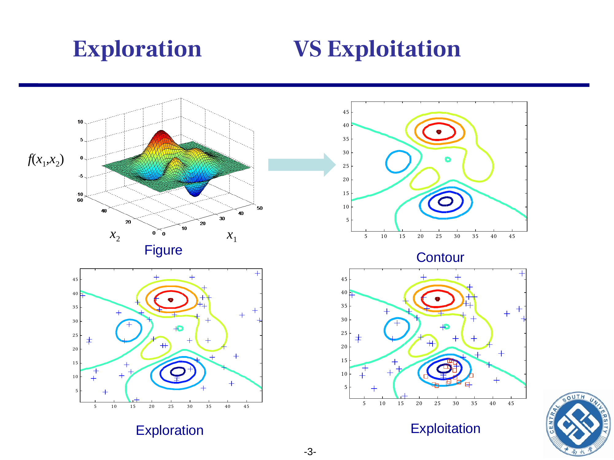
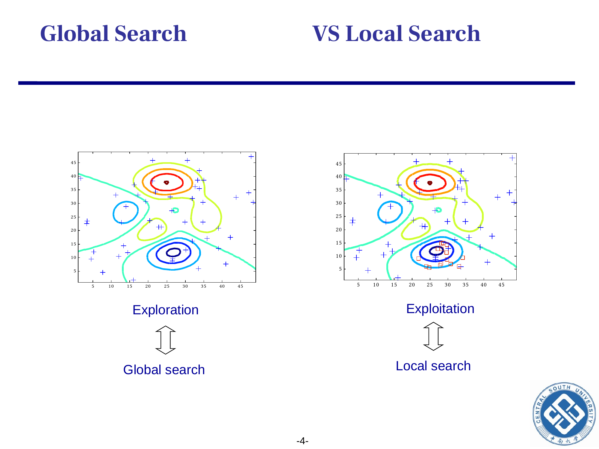
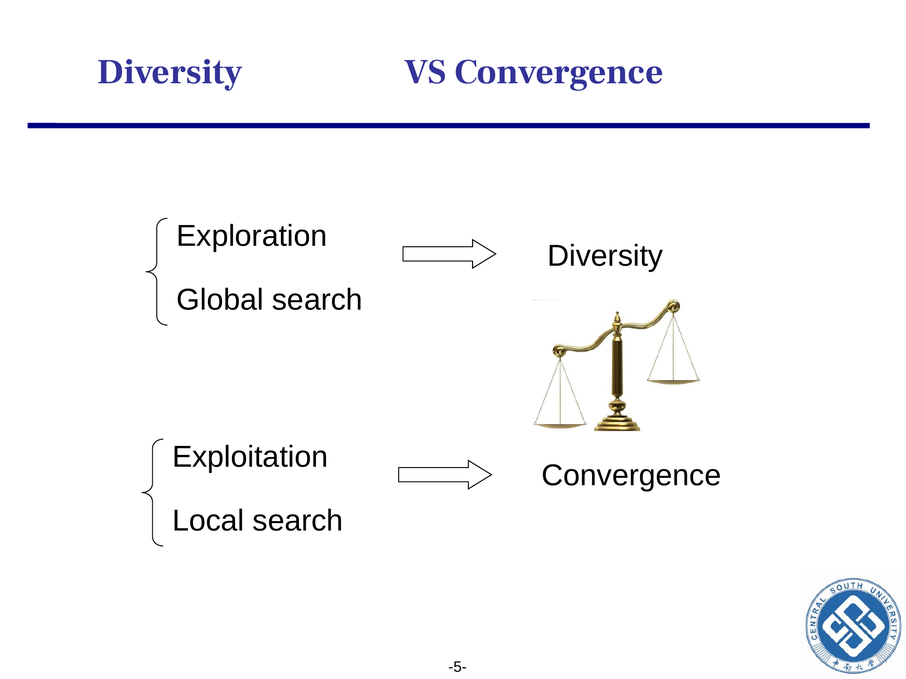
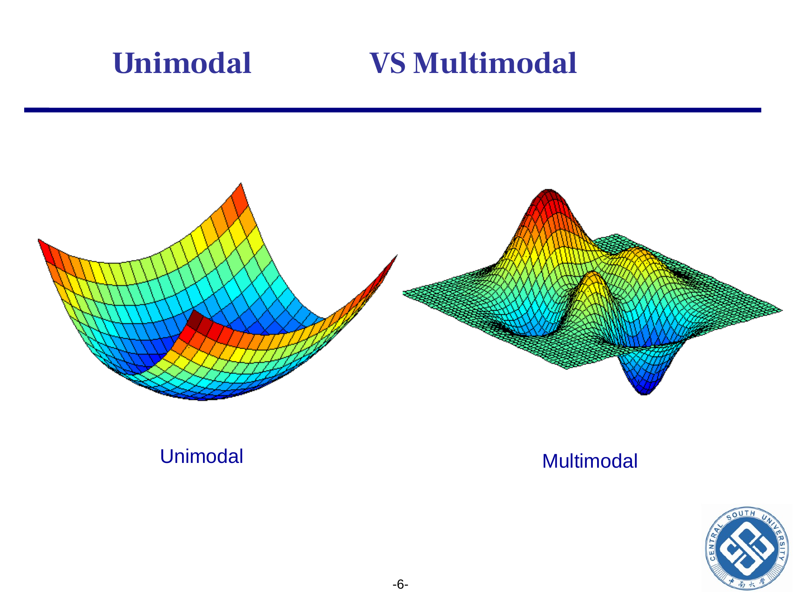
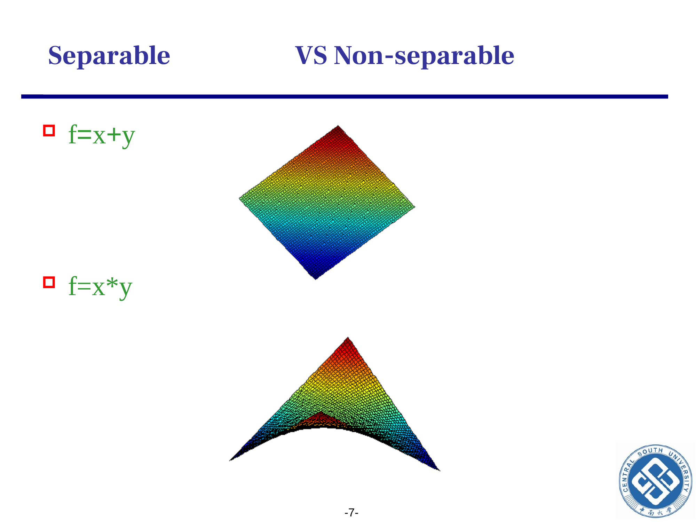

```cardlink
url: http://10.188.31.55:5244/Nextcloud/School/Compute-Intelligence/课件/
title: "计算智能 · 课程课件"
description: "中南大学自动化学院《计算智能》课程的全部课件"
host: 10.188.31.55:5244
```

[← 返回《计算智能：进化算法与优化方法》目录](../)

## 第 6 章 计算智能术语体系

### 同一场讨论里的两种说法

跟同学讨论「为什么我的 GA 在这个问题上跑不过 DE」，你说「DE 探索更广」，他说「DE 收敛更快」。这两句话听起来像在描述同一件事，方向却相反：一个说 DE 在搜索空间里看得多，一个说 DE 离最优更近。它们能同时成立，因为探索与开发是一对方向相反的力，任何算法在某一瞬间都只能偏向一边 [Chapter 6_ Terminology in EAs.pdf · p.3](http://10.188.31.55:5244/Nextcloud/School/Compute-Intelligence/converted/Chapter%206_%20Terminology%20in%20EAs.pdf#page=3)。

第二组对话是同一个问题的另一个侧面。你说「Rosenbrock 不可分离」，老师说「它的等高线是斜的」，两句话是同一件事的两面。地形上变量互相耦合时，变量需要协同变化，只按坐标轴方向做高斯变异就变慢。CMA-ES 在二次问题上快、在 Rosenbrock 上慢，原因是它学习协方差矩阵，把搜索方向转到了地形主轴上 [Chapter 6_ Terminology in EAs.pdf · p.7](http://10.188.31.55:5244/Nextcloud/School/Compute-Intelligence/converted/Chapter%206_%20Terminology%20in%20EAs.pdf#page=7) [Chapter 6_ Terminology in EAs.pdf · p.8](http://10.188.31.55:5244/Nextcloud/School/Compute-Intelligence/converted/Chapter%206_%20Terminology%20in%20EAs.pdf#page=8)。

### 六个对子，三个层面

| 术语对子 | 左端含义 | 右端含义 |
|---|---|---|
| 探索 vs 开发 | 种群在搜索空间里覆盖得广 | 当前最优已经接近全局最优 |
| 全局搜索 vs 局部搜索 | 整张地形都搜 | 当前邻域精修 |
| 多样性 vs 收敛性 | 种群里个体彼此不同 | 种群都聚到最优附近 |
| 单模 vs 多模 | 只有一个全局最优 | 全局最优与若干局部最优并存 |
| 可分离 vs 不可分离 | 变量之间不耦合 | 变量之间强耦合 |
| 各向同性 vs 旋转 | 各方向等价 | 不同方向上地形不同 |

这六个对子分属三个层面，不是一个层面的六件事：

- **搜索行为层面**（探索 vs 开发 / 全局 vs 局部）：回答「你在搜索空间里走得多远、多快、多集中」。
- **种群状态层面**（多样性 vs 收敛性）：回答「种群当下长什么样」——个体是分散还是聚拢。
- **问题结构层面**（单模 vs 多模 / 可分离 vs 不可分离 / 各向同性 vs 旋转）：回答「你的问题地形长什么样」。

前两个层面描述算法，第三个层面描述问题。问题结构层面说的就是适应度地形（fitness landscape）——目标函数在搜索空间里的形状，第 1 章 §1.3 讲过 [Chapter 0_ 开篇.pdf · p.11](http://10.188.31.55:5244/Nextcloud/School/Compute-Intelligence/converted/Chapter%200_%20%E5%BC%80%E7%AF%87.pdf#page=11)。地形在这里被拆成可分离性和各向同性两个可以判定的性质。算法对不上问题结构，就会出现「跑不快 / 跑不到」。

### 探索与开发：方向相反的两个力

**探索**（exploration）：种群覆盖的搜索空间比例大，不同个体出现在不同的山谷里；算法更可能发现新谷，但单一个体离最优还不够近 [Chapter 6_ Terminology in EAs.pdf · p.3](http://10.188.31.55:5244/Nextcloud/School/Compute-Intelligence/converted/Chapter%206_%20Terminology%20in%20EAs.pdf#page=3)。

**开发**（exploitation）：种群已经聚到某一个山谷里，正在精细搜索最优邻域；算法更可能把当前最优推到更精确，但探索新谷的能力下降 [Chapter 6_ Terminology in EAs.pdf · p.3](http://10.188.31.55:5244/Nextcloud/School/Compute-Intelligence/converted/Chapter%206_%20Terminology%20in%20EAs.pdf#page=3)。

判定这两个倾向各用一个数：

- **探索强度** $\sigma_{\text{pop}} = \sqrt{\frac{1}{N}\sum_{i=1}^{N}\|\mathbf{x}_i - \bar{\mathbf{x}}\|^2}$：种群中个体到种群重心的均方根距离，越大越探索。
- **开发强度** $d_{\text{best}} = \|\mathbf{x}_{\text{best}} - \mathbf{x}^*\|$：算法当前最优到问题真实最优的距离，越小越开发。

两个指标通常存在权衡，但并非严格反向：一个种群可以一部分个体继续探索，另一部分个体在当前优良区域开发。

**算法启示**：$\omega$ 偏大（PSO 第 5 章 §5.4）、$p_m$ 偏大（GA 第 2 章 §2.4）、$F$ 偏大（DE 第 4 章 §4.4）偏向探索；$c_2$ 偏大（PSO）、$(\mu{+}\lambda)$（ES 第 3 章 §3.3）偏向开发 [Chapter 6_ Terminology in EAs.pdf · p.3](http://10.188.31.55:5244/Nextcloud/School/Compute-Intelligence/converted/Chapter%206_%20Terminology%20in%20EAs.pdf#page=3)。



### 全局搜索与局部搜索：愿不愿意跨山谷

**全局搜索**（global search）：把整张地形都纳入考虑，即使当前位置已经靠近最优，也不放弃远方的山谷 [Chapter 6_ Terminology in EAs.pdf · p.4](http://10.188.31.55:5244/Nextcloud/School/Compute-Intelligence/converted/Chapter%206_%20Terminology%20in%20EAs.pdf#page=4)。

**局部搜索**（local search）：只看当前位置的邻域，只在已经找到的山谷里精细搜索 [Chapter 6_ Terminology in EAs.pdf · p.4](http://10.188.31.55:5244/Nextcloud/School/Compute-Intelligence/converted/Chapter%206_%20Terminology%20in%20EAs.pdf#page=4)。

这一对与探索/开发高度相关，但强调的点不同：全局 vs 局部讲的是「是否愿意跨山谷」，探索 vs 开发讲的是「种群散不散」。工程上，模拟退火、爬山这类局部搜索等同于开发；GA、DE 这类全局搜索前半段偏探索、后半段偏开发 [Chapter 6_ Terminology in EAs.pdf · p.4](http://10.188.31.55:5244/Nextcloud/School/Compute-Intelligence/converted/Chapter%206_%20Terminology%20in%20EAs.pdf#page=4)。

**判定标准**：全局搜索在「种群是否跨越多个盆地」上是肯定的；局部搜索只看当前位置到原方向上的最近改进。爬山法是局部搜索的极端——只看当前位置的邻域，接受任何让函数值变好的移动，直到再无改进就停。

**算法启示**：问题只有一个谷底时局部搜索够用，只要盆地一个一个找下去。谷底多于一个、或者不知道谷底有几个，局部搜索会锁死在最先找到的那个谷里；这时要用全局搜索——GA、DE 靠种群同时占住多个盆地，把搜索方向摊开到整张地形上。



### 多样性与收敛性：同一现象的两次测量

**多样性**（diversity）：种群中个体彼此不同的程度，$\sigma_{\text{pop}}$ 是它常见的数值化指标 [Chapter 6_ Terminology in EAs.pdf · p.5](http://10.188.31.55:5244/Nextcloud/School/Compute-Intelligence/converted/Chapter%206_%20Terminology%20in%20EAs.pdf#page=5)。

**收敛性**（convergence）：种群正在向某个吸引子（通常是最优解附近）集中的程度，通常用「$\mathbf{x}_{\text{best}}$ 在最近若干代里改善了多少」来量化 [Chapter 6_ Terminology in EAs.pdf · p.5](http://10.188.31.55:5244/Nextcloud/School/Compute-Intelligence/converted/Chapter%206_%20Terminology%20in%20EAs.pdf#page=5)。

多样性对应探索，收敛性对应开发——但它们是同一现象的两次测量，不必被独立调节，调一个另一个通常就反向变化。

**判定标准**：多样性仍用 $\sigma_{\text{pop}}$；收敛性看最近 $k$ 代里 $\mathbf{x}_{\text{best}}$ 的累计变化量 $\sum_{t=T-k+1}^{T}\|\mathbf{x}_{\text{best}}^{t} - \mathbf{x}_{\text{best}}^{t-1}\|$，越小越收敛。

多样性降到 0 但还没找到全局最优，就是早熟收敛（premature convergence）——种群已经聚拢，收敛却停在了错误的位置。

**算法启示**：这两个数是同一现象的两次测量，调参只能朝一个方向推。要探索就加大 $\sigma_{\text{pop}}$（放大初始种群、抬高变异率），代价是收敛变慢；要收敛就压低 $\sigma_{\text{pop}}$、盯紧 $d_{\text{best}}$，代价是多样性掉光。



### 单模与多模：盆地数决定成败

**单模问题**（unimodal problem）：整个搜索空间里只有一个全局最优，没有局部最优。球面函数 $f(\mathbf{x})=\sum x_i^2$ 是典型单模 [Chapter 6_ Terminology in EAs.pdf · p.6](http://10.188.31.55:5244/Nextcloud/School/Compute-Intelligence/converted/Chapter%206_%20Terminology%20in%20EAs.pdf#page=6)。

**多模问题**（multimodal problem）：除了全局最优，还有若干个局部最优。典型例子是 Rastrigin $f(\mathbf{x})=10D+\sum[x_i^2-10\cos(2\pi x_i)]$，在 $\mathbb{R}^D$ 上有约 $11^D$ 个局部最优 [Chapter 6_ Terminology in EAs.pdf · p.6](http://10.188.31.55:5244/Nextcloud/School/Compute-Intelligence/converted/Chapter%206_%20Terminology%20in%20EAs.pdf#page=6)。

**判定标准**：画出地形等高线，数盆地的数量。一个盆地是单模，多个盆地是多模。正式的定量指标是盆地计数（basin count），工程上常用「随机起点爬山，看它收敛到几个不同的最优点」作粗略估计。

局部最优的数量随维数指数增长，Rastrigin 在 $\mathbb{R}^D$ 上就有约 $11^D$ 个。按「覆盖所有局部最优」来定种群规模这条路走不通，实际 $N$ 要结合维度、采样策略和 FES 预算来定。

**算法启示**：多模问题要求种群保持多样性，否则一旦掉进局部最优就跑不出来。单模：开发优先，$\omega$ 偏小、$p_m$ 偏小、$c_2$ 偏大。多模：探索优先，$\omega$ 偏大、$p_m$ 偏大、$c_2$ 偏小，或者改用 lbest 拓扑（PSO 第 5 章 §5.4） [Chapter 6_ Terminology in EAs.pdf · p.6](http://10.188.31.55:5244/Nextcloud/School/Compute-Intelligence/converted/Chapter%206_%20Terminology%20in%20EAs.pdf#page=6)。



### 可分离与不可分离：Hessian 的非对角元

**可分离问题**（separable problem）：目标函数可以写成 $f(\mathbf{x}) = \sum_{j=1}^{D} f_j(x_j)$，变量之间互不影响，可以逐维独立优化。$f = x + y$ 是可分离的，最优点可以分别对 $x$ 和 $y$ 优化 [Chapter 6_ Terminology in EAs.pdf · p.7](http://10.188.31.55:5244/Nextcloud/School/Compute-Intelligence/converted/Chapter%206_%20Terminology%20in%20EAs.pdf#page=7)。

**不可分离问题**（non-separable problem）：变量之间强耦合，一个变量的最优值取决于其他变量的值。$f = x \cdot y$ 是不可分离的，固定 $x$ 再优化 $y$，反过来要重新调 $x$ [Chapter 6_ Terminology in EAs.pdf · p.7](http://10.188.31.55:5244/Nextcloud/School/Compute-Intelligence/converted/Chapter%206_%20Terminology%20in%20EAs.pdf#page=7)。

**判定标准**：形式上，Hessian 矩阵 $H_f$ 是对角阵则 $f$ 可分离，否则不可分离。工程粗判方法：把 $\mathbf{x}$ 的两个坐标分别扰动一个 $\epsilon$，看函数值变化能不能拆成两个独立项 [Chapter 6_ Terminology in EAs.pdf · p.7](http://10.188.31.55:5244/Nextcloud/School/Compute-Intelligence/converted/Chapter%206_%20Terminology%20in%20EAs.pdf#page=7)。

**算法启示**：可分离问题上 GA、坐标轴方向的高斯变异都够用，因为每个变量可以独立收敛；不可分离问题上必须同时改变多个变量——DE 的差分向量、CMA-ES 的协方差矩阵自适应都是为此设计。



### 各向同性与旋转：等高线的主轴方向

**各向同性**（isotropic）：地形在不同方向上的「曲率」相同——对二次地形而言，等高线是圆，或者 Hessian 与单位阵成比例。主轴沿坐标轴但长短轴不同的椭圆只是未旋转的各向异性 [Chapter 6_ Terminology in EAs.pdf · p.8](http://10.188.31.55:5244/Nextcloud/School/Compute-Intelligence/converted/Chapter%206_%20Terminology%20in%20EAs.pdf#page=8)。

**旋转地形**（rotated landscape）：最优方向不沿坐标轴——等高线是旋转椭圆 [Chapter 6_ Terminology in EAs.pdf · p.8](http://10.188.31.55:5244/Nextcloud/School/Compute-Intelligence/converted/Chapter%206_%20Terminology%20in%20EAs.pdf#page=8)。

**判定标准**：画出地形等高线。圆形是各向同性；主轴沿坐标轴但长短轴不同的椭圆是未旋转但各向异性；旋转椭圆是旋转地形。

**算法启示**：各向同性问题上按坐标轴独立搜索就够，单维 GA、PSO 都可以；旋转地形上必须让搜索方向旋转——CMA-ES（第 3 章 §3.4 的协方差矩阵自适应）、DE 的差分向量方向都是为此设计。

旋转地形一定不可分离：否则把坐标轴转到主轴方向上就分开了。


### 两个指标是怎么算出来的

#### 多样性指标 $\sigma_{\text{pop}}$

目标是把「种群有多分散」量化成一个数。

第一步取种群重心。个体 $\{\mathbf{x}_1,\dots,\mathbf{x}_N\}$ 的均值

$$
\bar{\mathbf{x}} = \frac{1}{N}\sum_{i=1}^{N}\mathbf{x}_i
$$

是种群在搜索空间里的平均位置，它把分散的个体归到一点。

第二步算到重心的均方距离。每个个体到重心的距离平方是 $\|\mathbf{x}_i - \bar{\mathbf{x}}\|^2$，对所有个体求平均得

$$
\sigma_{\text{pop}}^2 = \frac{1}{N}\sum_{i=1}^{N}\|\mathbf{x}_i - \bar{\mathbf{x}}\|^2
$$

第三步开方。$\sigma_{\text{pop}}$ 是均方根距离，单位与 $\mathbf{x}$ 相同，与决策变量 $x_j$ 的量纲一致。

物理意义：$\sigma_{\text{pop}}$ 描述种群覆盖搜索空间的能力。$N$ 个点散在 $[-5,5]^D$ 上时，$\sigma_{\text{pop}}$ 的量级约为 5；收敛到最优时，$\sigma_{\text{pop}} \to 0$ [Chapter 6_ Terminology in EAs.pdf · p.5](http://10.188.31.55:5244/Nextcloud/School/Compute-Intelligence/converted/Chapter%206_%20Terminology%20in%20EAs.pdf#page=5)。

#### 不可分离的形式化判定

对 $f(\mathbf{x})$ 求二阶偏导，得 Hessian 矩阵

$$
H_f(\mathbf{x}) = \begin{pmatrix}
\frac{\partial^2 f}{\partial x_1^2} & \frac{\partial^2 f}{\partial x_1 \partial x_2} & \cdots & \frac{\partial^2 f}{\partial x_1 \partial x_D} \\
\frac{\partial^2 f}{\partial x_2 \partial x_1} & \frac{\partial^2 f}{\partial x_2^2} & \cdots & \frac{\partial^2 f}{\partial x_2 \partial x_D} \\
\vdots & \vdots & \ddots & \vdots \\
\frac{\partial^2 f}{\partial x_D \partial x_1} & \frac{\partial^2 f}{\partial x_D \partial x_2} & \cdots & \frac{\partial^2 f}{\partial x_D^2}
\end{pmatrix}
$$

$H_f$ 是 $D \times D$ 实对称矩阵（连续二阶偏导相等）。可分离当且仅当 $H_f$ 是对角矩阵：对角元是变量自身的弯曲程度，非对角元（交叉项）是两个变量之间的耦合强度；非对角元全为 0 则可分离，任意非对角元非 0 则不可分离。Rosenbrock $f=100(y-x^2)^2+(1-x)^2$ 在 $x$ 与 $y$ 上交叉耦合，$H_f$ 有非零非对角元，所以不可分离。

工程意义：算法如果只在坐标轴方向变异（各维同向、互不相关），遇到 $H_f$ 有非对角元的问题就慢，必须让搜索方向旋转到主轴方向。CMA-ES 的协方差矩阵学习、DE 的差分向量都属于这一类 [Chapter 6_ Terminology in EAs.pdf · p.7](http://10.188.31.55:5244/Nextcloud/School/Compute-Intelligence/converted/Chapter%206_%20Terminology%20in%20EAs.pdf#page=7) [Chapter 6_ Terminology in EAs.pdf · p.8](http://10.188.31.55:5244/Nextcloud/School/Compute-Intelligence/converted/Chapter%206_%20Terminology%20in%20EAs.pdf#page=8)。

### 四个例子

#### 例 6.1：球面函数 $f(\mathbf{x})=\sum x_i^2$ 的术语定位

判断 $f(\mathbf{x})=\sum_{i=1}^{D} x_i^2$ 在搜索空间 $[-5,5]^D$ 上的术语属性。逐对检查：

- **单模 vs 多模**：$f$ 是严格凸函数，只有一个极小点 $\mathbf{x}=\mathbf{0}$，单模。
- **可分离 vs 不可分离**：$H_f = 2I$ 是对角阵，$\frac{\partial^2 f}{\partial x_j \partial x_k}=0$ 对所有 $j\ne k$，可分离。
- **各向同性 vs 旋转**：$H_f$ 比例于单位阵，所有方向曲率相同，各向同性。
- **多样性 vs 收敛性**：单模各向同性，开发就够了，不需要强多样性。

答案：单模 / 可分离 / 各向同性 / 开发优先。这种「简单」问题用什么算法都行，GA、ES、DE、PSO 都能轻松找到 $\mathbf{0}$ [Chapter 6_ Terminology in EAs.pdf · p.7](http://10.188.31.55:5244/Nextcloud/School/Compute-Intelligence/converted/Chapter%206_%20Terminology%20in%20EAs.pdf#page=7)。

#### 例 6.2：Rosenbrock $f=100(y-x^2)^2+(1-x)^2$ 的术语定位

定义域 $[-2,2]^2$，最优 $(x^*,y^*)=(1,1)$。

- **单模 vs 多模**：$f$ 全局只有一个极小点，单模。
- **可分离 vs 不可分离**：$H_f$ 有非零非对角元（$\frac{\partial^2 f}{\partial x \partial y} = -400x$ 在 $x \ne 0$ 处非零），不可分离。
- **各向同性 vs 旋转**：最小值位于香蕉形窄谷里，谷的主轴沿 $y \approx x^2$ 方向，旋转。
- **多样性 vs 收敛性**：需要探索找谷、再沿着旋转的谷精细搜索，先探索后开发。

答案：单模 / 不可分离 / 旋转 / 探索+开发并用。GA 在 Rosenbrock 上慢，是因为它在坐标轴方向变异，走不出旋转窄谷；CMA-ES 快，是因为它学到协方差矩阵，把搜索方向转到了谷轴上 [Chapter 6_ Terminology in EAs.pdf · p.8](http://10.188.31.55:5244/Nextcloud/School/Compute-Intelligence/converted/Chapter%206_%20Terminology%20in%20EAs.pdf#page=8)。

#### 例 6.3：二次型 $f(x,y)=x^2+2xy+2y^2$ 的可分离性与旋转

先算 Hessian：

$$
H_f = \begin{pmatrix} 2 & 2 \\ 2 & 4 \end{pmatrix}
$$

非对角元为 2，非零，所以 $f$ 不可分离。

要判旋转，看 Hessian 的主特征向量方向。特征值为 $3 \pm \sqrt{5} \approx 5.236$ 与 $0.764$，对应特征向量约 $(0.53, 0.85)$ 与 $(0.85, -0.53)$。主轴方向 $(0.53, 0.85)$ 不沿坐标轴，所以这是旋转地形 [Chapter 6_ Terminology in EAs.pdf · p.7](http://10.188.31.55:5244/Nextcloud/School/Compute-Intelligence/converted/Chapter%206_%20Terminology%20in%20EAs.pdf#page=7)。

为什么沿 $x$ 坐标轴的高斯变异对这个问题有效但慢：只沿 $x$ 方向变异能优化掉 $x^2$ 项，但 $2xy+2y^2$ 仍耦合着 $x$——$x$ 变好时 $y$ 的最优点也跟着变，必须反复「优化 $x$ → 重选 $y$ → 再优化 $x$」。算法能跑，但每一步只跨过 $x$ 方向，沿旋转主轴的快路径走不到。

#### 例 6.4：六个对子 → 算法选型

问题：连续优化 $D=10$、多峰、变量弱耦合、地形近似各向同性，该选什么算法。

1. **单模/多模**：多峰 → 算法必须保持多样性，优先探索。
2. **可分离/不可分离**：弱耦合 → 各维可独立优化也可一起优化，问题不大。
3. **各向同性/旋转**：近似各向同性 → 坐标轴方向的高斯变异就够。
4. **综合选型**：多峰 + 各向同性 → DE/rand/1/bin 或 PSO/lbest 都是好选择；ES 用 $(\mu,\lambda)$（只从子代选择），避免 $(\mu{+}\lambda)$ 保留父代导致早熟。
5. **参数提示**：$F=0.5$、$CR=0.9$（DE）；$\omega=0.7 \to 0.4$ 线性递减、$c_1=c_2=1.5$、lbest 拓扑（PSO）。

答案：DE 或 PSO/lbest，不用 CMA-ES（过度杀鸡用牛刀，且各向同性下协方差矩阵学不到有意义的结构）。六个对子是诊断工具：它不能直接告诉你用哪个算法，但能告诉你这个算法为什么跑不动，或者哪个对子是问题的瓶颈。

### 容易踩的坑

> [!WARNING]
> **把「多样性低」当成「算法失败」。** 在单模、凸问题上，多样性降到 0 是收敛成功的标志，算法做完了它该做的事。多样性低只是早熟的必要条件，不是充分条件；判定要看「多样性低」和「当前最优离真实最优还远」同时成立。

> [!WARNING]
> **把「不可分离」当成「旋转地形」。** 不可分离蕴含变量间耦合，但不一定有旋转：$f=x^2+xy$ 不可分离，解的等高线主轴却沿坐标轴，不旋转。判定旋转要看等高线主轴是否沿坐标轴，不是只看 Hessian 有没有非对角元 [Chapter 6_ Terminology in EAs.pdf · p.7](http://10.188.31.55:5244/Nextcloud/School/Compute-Intelligence/converted/Chapter%206_%20Terminology%20in%20EAs.pdf#page=7)。

> [!WARNING]
> **在多模问题上用 $(\mu{+}\lambda)$-ES 或 gbest 拓扑。** 这两种机制都只留一个吸引子，全群朝当前最优收缩，容易早熟。多模问题必须避免单一吸引子：ES 用 $(\mu,\lambda)$（只看子代），PSO 用 lbest 拓扑（每小撮各自看最优）；DE 因为是一对一贪婪选择，在多模上也有早熟风险，要靠大 $NP$ + 大 $F$ 维持多样性（第 4 章 §4.6）。
