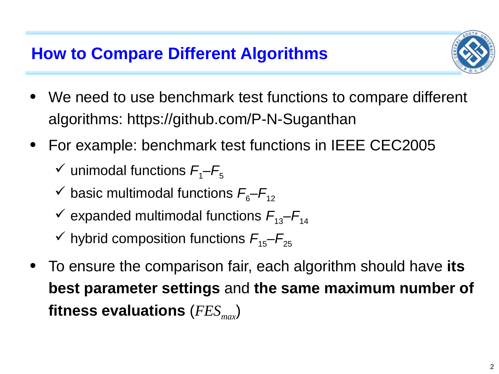

```cardlink
url: http://10.188.31.55:5244/Nextcloud/School/Compute-Intelligence/课件/
title: "计算智能 · 课程课件"
description: "中南大学自动化学院《计算智能》课程的全部课件"
host: 10.188.31.55:5244
```

[← 返回《计算智能：进化算法与优化方法》目录](../)

## 第 7 章 算法比较方法

### 甲比乙好，凭什么这么说

两个进化算法摆在面前，凭什么说「甲比乙好」？

设想一个真实场景：你跑两个算法 A、B，各跑 25 次，得到 A 的均值误差 $1.2 \times 10^{-3}$、B 的均值误差 $1.0 \times 10^{-3}$。你能说「B 比 A 好」吗？

不能。B 只比 A 小 $0.2 \times 10^{-3}$，而两个算法单次运行的方差可能比这个差距大很多。如果两组样本的均值差异落在样本噪声范围里，这个差异就是统计上不显著的——多跑几次，谁赢谁输可能反过来。算法比较不是看均值谁小，而是看统计显著性 [Chapter 7_ Algorithm Comparison.pdf · p.4](http://10.188.31.55:5244/Nextcloud/School/Compute-Intelligence/converted/Chapter%207_%20Algorithm%20Comparison.pdf#page=4)。

再看一个场景：A 算法 1000 代达到误差 $10^{-6}$，B 算法 2000 代才到。A 收敛快，但函数评价次数不一定少——A 每代评估 200 次，B 每代评估 50 次，A 实际用了 $200 \times 1000 = 2 \times 10^5$ 次，B 只用了 $50 \times 2000 = 1 \times 10^5$ 次。收敛速度要统一在 FES 上，不能统一在代数上 [Chapter 7_ Algorithm Comparison.pdf · p.5](http://10.188.31.55:5244/Nextcloud/School/Compute-Intelligence/converted/Chapter%207_%20Algorithm%20Comparison.pdf#page=5)。

这两件事合起来是一套完整的流程 [Chapter 7_ Algorithm Comparison.pdf · p.1](http://10.188.31.55:5244/Nextcloud/School/Compute-Intelligence/converted/Chapter%207_%20Algorithm%20Comparison.pdf#page=1)：

1. 选基准：IEEE CEC2005 的 25 个测试函数，覆盖单模、基本多模、扩展多模、混合复合四类。
2. 统一预算：所有算法用同一个 FES$_{\text{max}}$、同一个成功阈值 $\varepsilon$。
3. 多次运行：每个算法在每道题上跑 $R \ge 25$ 次独立运行，每次换随机种子。
4. 报成绩单：$\bar{E} \pm \sigma_E$、成功率 SR、平均收敛 FES。
5. 判显著性：Wilcoxon 秩和检验，$\alpha = 0.05$，给出 $+$ / $-$ / $\approx$ 符号。
6. 分类汇总：按四类分别统计胜负，不只给一个总分。

论文里「算法 A 在 25 题里 22 题显著优于 B」这句话，每个数字都对应上面这六步。

### 基准：统一什么才叫公平

基准测试函数（benchmark test function）是一组已知全局最优 $\mathbf{x}^*$ 与 $f(\mathbf{x}^*)$ 的测试问题，用来在统一条件下评价算法。本课程采用 IEEE CEC2005 标准，共 25 题，分四类 [Chapter 7_ Algorithm Comparison.pdf · p.2](http://10.188.31.55:5244/Nextcloud/School/Compute-Intelligence/converted/Chapter%207_%20Algorithm%20Comparison.pdf#page=2)：

| 类别 | 题号 | 说明 |
|---|---|---|
| 单模 unimodal | F1–F5 | 只有一个全局最优 |
| 基本多模 basic multimodal | F6–F12 | 多个全局最优 |
| 扩展多模 expanded multimodal | F13–F14 | 更高维、更多全局最优 |
| 混合复合 hybrid composition | F15–F25 | 多个成分函数线性组合 |

分四类不是形式主义：不同算法擅长的类别不同——ES 擅长单模，DE 擅长基本多模，PSO 擅长扩展多模，GA 在混合复合上仍有竞争力。只给一个总分会被总分掩盖分类，分类报告才看得出算法在哪些类上好。算法在不同类上的表现可以截然不同，所以比较算法必须分类报告，不能只给一个总分 [Chapter 7_ Algorithm Comparison.pdf · p.2](http://10.188.31.55:5244/Nextcloud/School/Compute-Intelligence/converted/Chapter%207_%20Algorithm%20Comparison.pdf#page=2)。



真实工程问题（如 PID 控制器调参）当基准有两条走不通：一是全局最优 $\mathbf{x}^*$ 不知道，算不出函数误差；二是单次评估很贵（例如仿真 1 小时），跑 25 次独立运行代价太大。CEC2005 基准解析可算 $\mathbf{x}^*$、单次评估快、四类覆盖，所以成了论文通用基准 [Chapter 7_ Algorithm Comparison.pdf · p.2](http://10.188.31.55:5244/Nextcloud/School/Compute-Intelligence/converted/Chapter%207_%20Algorithm%20Comparison.pdf#page=2)。

### 预算：FES 与 FES$_{\text{max}}$

适应值评价次数（fitness evaluations, FES）指算法调用目标函数 $f(\mathbf{x})$ 一次的计数 [Chapter 7_ Algorithm Comparison.pdf · p.5](http://10.188.31.55:5244/Nextcloud/School/Compute-Intelligence/converted/Chapter%207_%20Algorithm%20Comparison.pdf#page=5)。最大函数评价次数 FES$_{\text{max}}$ 是算法的算力预算——一个算法最多调用 $f$ 的次数，设完之后它决定算法能跑多久 [Chapter 7_ Algorithm Comparison.pdf · p.2](http://10.188.31.55:5244/Nextcloud/School/Compute-Intelligence/converted/Chapter%207_%20Algorithm%20Comparison.pdf#page=2)。

同一次评估，各算法的花销不同：一个 GA 评估一次种群花 $N$ 次 FES，一个 DE 评估一个试验向量花 1 次 FES。FES$_{\text{max}}$ 的作用就是把两边的算力拉到同一条起跑线上。

用 FES 而不是代数，有两个理由：

- **种群规模差异**：GA 每代通常评估 $N$ 个新个体，DE 每代通常评估 $NP$ 个试验向量，PSO 每代通常评估 $N$ 个移动后的粒子，ES 每代通常评估 $\lambda$ 个子代。同样的 100 代，A、B 用的 FES 不同，无法比较。
- **公平比较**：统一在「FES$_{\text{max}}$ 次函数评估」上——A、B 都跑到 100 万次 FES，谁找到的 $\mathbf{x}_{\text{best}}$ 更好，谁就更优 [Chapter 7_ Algorithm Comparison.pdf · p.2](http://10.188.31.55:5244/Nextcloud/School/Compute-Intelligence/converted/Chapter%207_%20Algorithm%20Comparison.pdf#page=2)。

### 成绩单：多次独立运行

进化算法有随机性：同样的算法、同样的问题、同样的参数，只换随机种子，最终结果就不同。一次运行 $\mathbf{x}_{\text{best}}$ 的好坏只是一个样本点，不能代表算法的能力。多次独立运行（many independent runs）用不同的随机种子把同一个算法重复跑 $R$ 次（通常 $R = 25$ 或 $R = 50$），每次记录最终函数误差 [Chapter 7_ Algorithm Comparison.pdf · p.3](http://10.188.31.55:5244/Nextcloud/School/Compute-Intelligence/converted/Chapter%207_%20Algorithm%20Comparison.pdf#page=3)。

对每次独立运行 $r$，记录三样东西：

- $\mathbf{x}_{\text{best},r}$——算法这次跑出的最优解；
- $E_r = |f(\mathbf{x}_{\text{best},r}) - f(\mathbf{x}^*)|$——函数误差，这是算法比较的唯一硬指标，越接近 0 越好；
- $\text{FES}_r$——这次跑达到成功条件所花的 FES。

然后对 $R$ 次的 $E_r$ 求均值 $\bar{E}$ 与标准差 $\sigma_E$，这两个数字才是算法的成绩单 [Chapter 7_ Algorithm Comparison.pdf · p.3](http://10.188.31.55:5244/Nextcloud/School/Compute-Intelligence/converted/Chapter%207_%20Algorithm%20Comparison.pdf#page=3)。

### 收敛速度：成功率与两个 FES 口径

成功条件（successful condition）通常设一个阈值 $\varepsilon$（如 $0.01$ 或 $10^{-8}$），只要 $E_r \le \varepsilon$ 就称这次运行为成功运行（successful run）[Chapter 7_ Algorithm Comparison.pdf · p.5](http://10.188.31.55:5244/Nextcloud/School/Compute-Intelligence/converted/Chapter%207_%20Algorithm%20Comparison.pdf#page=5)。成功率是成功运行占全部运行的比例：

$$
\text{SR} = \frac{\#\text{successful runs}}{R}
$$

它反映算法鲁棒性——算法跑多少次能成。

收敛速度用 FES 报，分两个口径。只统计成功运行时，分子是成功运行的集合 $S$：

$$
\overline{\text{FES}}_{\mathrm{succ}} = \frac{1}{|S|}\sum_{r \in S}\text{FES}_r
$$

把失败运行也纳入时，先令失败运行的 $\text{FES}_r = \text{FES}_{\text{max}}$，再对全部 $R$ 次求均值：

$$
\overline{\text{FES}}_{\mathrm{all}} = \frac{1}{R}\sum_{r=1}^{R}\text{FES}_r
$$

两个都要报，因为它们回答不同的问题。$\overline{\text{FES}}_{\mathrm{succ}}$ 只说「找到最优时有多快」，「20 次成功 + 5 次失败」这个事实从它里面读不出来；$\overline{\text{FES}}_{\mathrm{all}}$ 把失败拉到 FES$_{\text{max}}$，把成功率也折进了均值——它越大通常意味着成功率越低。

同一个问题、同一个 FES$_{\text{max}}$，谁用的 FES 少，谁就更算力高效 [Chapter 7_ Algorithm Comparison.pdf · p.5](http://10.188.31.55:5244/Nextcloud/School/Compute-Intelligence/converted/Chapter%207_%20Algorithm%20Comparison.pdf#page=5)。


### 判定：Wilcoxon 秩和检验

均值差异 $\bar{E}_A - \bar{E}_B$ 必须通过统计检验才算「显著」。

Wilcoxon 秩和检验（Wilcoxon rank-sum test）是非参数统计检验，把两组样本的秩做对比，检验两组分布的位置或整体分布是否存在差异。只有在两组分布形状等条件相近时，才可把结果近似解释为位置参数（如中位数）的差异，显著性水平常取 $\alpha = 0.05$ [Chapter 7_ Algorithm Comparison.pdf · p.4](http://10.188.31.55:5244/Nextcloud/School/Compute-Intelligence/converted/Chapter%207_%20Algorithm%20Comparison.pdf#page=4)。t 检验（t-test）是参数统计检验，假设两组样本来自正态分布，看两组均值是否显著不同，显著性水平同上。

选哪个：Wilcoxon 不要求正态，对异常值更鲁棒，通常首选；t 检验要求正态，但检验力更强，样本量小的时候（例如 $R = 10$）慎用。

进化算法的函数误差分布通常不严格正态——很多跑出接近 0 的「成功」与跑不出最优的「失败」形成混合分布——所以非参数检验更安全 [Chapter 7_ Algorithm Comparison.pdf · p.4](http://10.188.31.55:5244/Nextcloud/School/Compute-Intelligence/converted/Chapter%207_%20Algorithm%20Comparison.pdf#page=4)。

论文常用三个符号报告结果 [Chapter 7_ Algorithm Comparison.pdf · p.4](http://10.188.31.55:5244/Nextcloud/School/Compute-Intelligence/converted/Chapter%207_%20Algorithm%20Comparison.pdf#page=4)：

- $A + B$：A 显著优于 B；
- $A - B$：A 显著差于 B；
- $A \approx B$：A、B 无显著差异。

### 公式推导

#### 函数误差的均值与方差

用 $R$ 次独立运行的 $E_1, \dots, E_R$ 估计算法在这道问题上的真实均值误差。样本均值是真实均值的无偏估计：

$$
\bar{E} = \frac{1}{R}\sum_{r=1}^{R}E_r
$$

样本方差除以 $R - 1$ 而不是 $R$，是 Bessel 校正——样本方差系统低估总体方差，除以 $R - 1$ 才是无偏估计：

$$
\sigma_E^2 = \frac{1}{R-1}\sum_{r=1}^{R}(E_r - \bar{E})^2
$$

论文通常写作 $\bar{E} \pm \sigma_E$。$\bar{E}$ 反映算法的平均表现，$\sigma_E$ 反映算法的稳定性：$\bar{E}$ 小且 $\sigma_E$ 小的算法既快又稳 [Chapter 7_ Algorithm Comparison.pdf · p.3](http://10.188.31.55:5244/Nextcloud/School/Compute-Intelligence/converted/Chapter%207_%20Algorithm%20Comparison.pdf#page=3)。

#### Wilcoxon 秩和检验的检验量

从两组样本 $X = (X_1, \dots, X_m)$ 与 $Y = (Y_1, \dots, Y_n)$ 检验「两组分布是否存在位置或整体差异」。计算分四步。

第一步，合并排序：把 $X$ 与 $Y$ 合并成 $m + n$ 个数，从小到大排序，记下每个值来自哪个数组。

第二步，赋秩：对每个值赋顺序号；若两个值相等，取平均秩。

第三步，分组秩和：$W_X$ 是 $X$ 中所有值的秩之和，$W_Y$ 是 $Y$ 中所有值的秩之和，二者之和恒为 $(m+n)(m+n+1)/2$。

第四步，算统计量：

$$
U = W_X - \frac{m(m+1)}{2}
$$

当 $m, n \ge 10$ 时，$U$ 近似正态 $\mathcal{N}\left(\frac{mn}{2}, \sqrt{\frac{mn(m+n+1)}{12}}\right)$，查正态表得 $p$ 值。

判定：若 $p < \alpha$（通常 $\alpha = 0.05$），拒绝「两组分布没有差异」的零假设，两组存在统计显著差异。这个结论只在「当前检验假设下」成立，不要无条件把它写成中位数差异。

### 三个例子

#### 例 7.1：均值、标准差与 Wilcoxon 判定

算法 A、B 各跑 5 次，误差 $E_A = [1.2, 1.5, 1.1, 1.3, 1.4] \times 10^{-3}$，$E_B = [1.0, 1.1, 0.9, 1.0, 1.2] \times 10^{-3}$。求均值、标准差，并粗判 B 是否显著优于 A。

均值：

$$
\bar{E}_A = \frac{1.2+1.5+1.1+1.3+1.4}{5} \times 10^{-3} = 1.3 \times 10^{-3}
$$

$$
\bar{E}_B = \frac{1.0+1.1+0.9+1.0+1.2}{5} \times 10^{-3} = 1.04 \times 10^{-3}
$$

标准差（Bessel 校正，分母取 $R - 1 = 4$）：

$$
\sigma_A^2 = \frac{(1.2-1.3)^2 + (1.5-1.3)^2 + (1.1-1.3)^2 + (1.3-1.3)^2 + (1.4-1.3)^2}{4} \times 10^{-6} = 0.025 \times 10^{-6}
$$

$$
\sigma_A \approx 0.158 \times 10^{-3}
$$

$$
\sigma_B^2 = \frac{(1.0-1.04)^2 + (1.1-1.04)^2 + (0.9-1.04)^2 + (1.0-1.04)^2 + (1.2-1.04)^2}{4} \times 10^{-6} = 0.013 \times 10^{-6}
$$

$$
\sigma_B \approx 0.114 \times 10^{-3}
$$

显著性：均值差 $\bar{E}_A - \bar{E}_B = 0.26 \times 10^{-3}$，接近 $2\sigma_A$。Wilcoxon 检验在 $m = n = 5$ 的小样本下不一定显著——粗判 B 略优，但需要更多运行确认 [Chapter 7_ Algorithm Comparison.pdf · p.3](http://10.188.31.55:5244/Nextcloud/School/Compute-Intelligence/converted/Chapter%207_%20Algorithm%20Comparison.pdf#page=3)。

#### 例 7.2：成功率与收敛速度

某算法在 $D = 10$ 球面上跑 25 次，FES$_{\text{max}} = 5 \times 10^4$，成功阈值 $\varepsilon = 10^{-6}$。20 次成功，5 次失败；成功运行所用 FES 列表 $S = [8000, 9200, 7500, 11000, 8500, \dots]$。

成功率：

$$
\text{SR} = \frac{20}{25} = 80\%
$$

只含成功运行的平均 FES（假设列表和为 $1.8 \times 10^5$）：

$$
\overline{\text{FES}}_{\mathrm{succ}} = \frac{1.8 \times 10^5}{20} = 9000
$$

含失败运行的平均 FES（失败运行取 $\text{FES}_r = \text{FES}_{\text{max}} = 5 \times 10^4$）：

$$
\overline{\text{FES}}_{\mathrm{all}} = \frac{20 \times 9000 + 5 \times 50000}{25} = 17200
$$

报告格式：SR = 80%，只含成功运行 9000 FES，含失败运行 17200 FES [Chapter 7_ Algorithm Comparison.pdf · p.5](http://10.188.31.55:5244/Nextcloud/School/Compute-Intelligence/converted/Chapter%207_%20Algorithm%20Comparison.pdf#page=5)。

#### 例 7.3：CEC2005 25 题的完整报告

A、B 两算法在 CEC2005 上各跑 25 次，逐题报告 $\bar{E}_A \pm \sigma_A$ 与 $\bar{E}_B \pm \sigma_B$，并用 Wilcoxon 检验。汇总分三层写。

逐题报告：每题 $i = 1, \dots, 25$ 写一行「$\bar{E}_A \pm \sigma_A$ vs $\bar{E}_B \pm \sigma_B$，Wilcoxon $p =$ 数值，符号 $+$ / $-$ / $\approx$」。

分类汇总：按四类分（F1–F5、F6–F12、F13–F14、F15–F25），统计每类里 $+$ / $-$ / $\approx$ 的数量。

总评：「A 在 F1–F5 上 5/5 优于 B、在 F6–F12 上 4/7 优于 B、在 F13–F14 上 1/2 优于 B、在 F15–F25 上 5/11 优于 B；在 25 题中 A 显著优于 15 题、显著差于 6 题、无显著差异 4 题。」这是进化计算论文的通用格式 [Chapter 7_ Algorithm Comparison.pdf · p.4](http://10.188.31.55:5244/Nextcloud/School/Compute-Intelligence/converted/Chapter%207_%20Algorithm%20Comparison.pdf#page=4)。

### 容易踩的坑

> [!WARNING]
> **用一次运行的 $\mathbf{x}_{\text{best}}$ 做算法比较。** 跑 1 次看谁好就下结论，是把一个样本点当成了算法的能力。进化算法有随机性，必须至少 25 次独立运行取均值与标准差，且 Wilcoxon 检验显著之后才能下结论 [Chapter 7_ Algorithm Comparison.pdf · p.3](http://10.188.31.55:5244/Nextcloud/School/Compute-Intelligence/converted/Chapter%207_%20Algorithm%20Comparison.pdf#page=3)。

> [!WARNING]
> **收敛速度按代数比，或不同算法用不同的 FES$_{\text{max}}$。** A 算法 100 代达到 $10^{-3}$、B 算法 200 代达到，说「A 比 B 快」——种群规模不同，1 代的 FES 不同，这个比较没有意义。同理，A 跑 $10^5$ FES、B 跑 $10^6$ FES 再比高低，B 可能只是因为 FES 多才跑得更准。要比的是达到阈值所花的 FES，且 FES$_{\text{max}}$ 必须对所有参与比较的算法相同 [Chapter 7_ Algorithm Comparison.pdf · p.5](http://10.188.31.55:5244/Nextcloud/School/Compute-Intelligence/converted/Chapter%207_%20Algorithm%20Comparison.pdf#page=5) [Chapter 7_ Algorithm Comparison.pdf · p.2](http://10.188.31.55:5244/Nextcloud/School/Compute-Intelligence/converted/Chapter%207_%20Algorithm%20Comparison.pdf#page=2)。

> [!WARNING]
> **把「无显著差异」说成「两个算法相同」。** Wilcoxon 检验 $p > 0.05$ 只说明在当前样本量下没有足够证据证明它们不同，不等于接受「两者相同」这个原假设。$R$ 增大、换一道问题，显著差异可能就出来了。论文里的 $A \approx B$ 应读作「本测试集与本样本量下未检出显著差异」 [Chapter 7_ Algorithm Comparison.pdf · p.4](http://10.188.31.55:5244/Nextcloud/School/Compute-Intelligence/converted/Chapter%207_%20Algorithm%20Comparison.pdf#page=4)。

### 实证对比：同一个问题上四种算法差了几个数量级

优化某控制器的 $D=10$ 个参数，让一个仿真模型的输出指标最小。同一套预算下换四种算法：

- **GA**：跑 1000 代，误差降到 $10^{-3}$，然后停住；
- **DE**：同样 1000 代，误差降到 $10^{-6}$；
- **PSO**：跑到 500 代就停滞，误差停在 $10^{-2}$；
- **ES**：跑到 2000 代，误差降到 $10^{-5}$。

四种算法都「能用」，代价和精度差了几个数量级。

差别来自算法本身——它们不是同一个算法的不同名字，是四种不同的思想：

- **GA**（genetic algorithm，遗传算法）用二进制串当个体，靠选择 + 交叉 + 变异三步让好片段重组 [Chapter 2_ Introduction to GAs.pdf · p.4](http://10.188.31.55:5244/Nextcloud/School/Compute-Intelligence/converted/Chapter%202_%20Introduction%20to%20GAs.pdf#page=4)。它擅长离散与组合问题，在连续高维问题上精度被串长卡住。
- **ES/EP**（evolution strategy / evolutionary planning，进化策略/进化规划）用实数当个体，步长也跟着一起进化 [Chapter 3_ Introduction to ES and EP.pdf · p.4](http://10.188.31.55:5244/Nextcloud/School/Compute-Intelligence/converted/Chapter%203_%20Introduction%20to%20ES%20and%20EP.pdf#page=4)。它擅长实数连续问题，尤其适合凸 / 单峰地形。
- **DE**（differential evolution，差分进化）用两个随机个体之差当搜索方向，一对一贪婪比较 [Chapter 4_ Introduction to Differential Evolution.pdf · p.4](http://10.188.31.55:5244/Nextcloud/School/Compute-Intelligence/converted/Chapter%204_%20Introduction%20to%20Differential%20Evolution.pdf#page=4)。它擅长实数连续问题，收敛最快但容易早熟。
- **PSO**（particle swarm optimization，粒子群优化）用速度 + 记忆 + 社会信息移动粒子，谁都不淘汰 [Chapter 5_ Introduction to Particle Swarm Optimization.pdf · p.4](http://10.188.31.55:5244/Nextcloud/School/Compute-Intelligence/converted/Chapter%205_%20Introduction%20to%20Particle%20Swarm%20Optimization.pdf#page=4)。它擅长实数连续问题，靠拓扑结构（gbest vs lbest）平衡探索与开发。

没有银弹。每种算法都有适用域，选错的代价从「慢几倍」到「根本跑不到好解」。

后面反复要用两个概念：

- **探索 vs 开发**：探索是种群散开、同时覆盖多个候选区域，开发是聚到一处做精细搜索。调大探索强度通常更不容易早熟，但收敛更慢。
- **种群多样性**：种群中个体越分散，越可能同时覆盖多个候选区域；多样性过早消失就是早熟收敛。

### 手算对比：同一个连续问题上四种算法各跑一代

本章没有新公式，但可以把四种算法放在同一个最小问题上各手算一遍，差异出在哪一步一眼可见。

统一设定：求 $\min f(x) = (x-3)^2$，$x \in [-5, 5]$，真实最优 $x^* = 3$，$f(x^*) = 0$，种群规模 $N = 4$。四种算法共用同一组起点：

$$
x^{(0)} = \{-2,\ 0,\ 3,\ 5\},\quad f = \{25,\ 9,\ 0,\ 4\}
$$

#### GA：二进制编码 + 轮盘赌 + 单点交叉 + 位翻转

**设定**：串长 $L = 10$，把 $[-5, 5]$ 切成 $2^{10} = 1024$ 个可取格点，精度 $\Delta = 10/1023 \approx 0.009775$。解码公式 $x = -5 + 10\,\mathrm{bin}/1023$，适应度取 $\mathrm{fit} = 100 - f$（保证所有 $\mathrm{fit} > 0$）。$p_c = 1$，$p_m = 1/L = 0.1$ [Chapter 2_ Introduction to GAs.pdf · p.10](http://10.188.31.55:5244/Nextcloud/School/Compute-Intelligence/converted/Chapter%202_%20Introduction%20to%20GAs.pdf#page=10) [Chapter 2_ Introduction to GAs.pdf · p.11](http://10.188.31.55:5244/Nextcloud/School/Compute-Intelligence/converted/Chapter%202_%20Introduction%20to%20GAs.pdf#page=11) [Chapter 2_ Introduction to GAs.pdf · p.12](http://10.188.31.55:5244/Nextcloud/School/Compute-Intelligence/converted/Chapter%202_%20Introduction%20to%20GAs.pdf#page=12)。

**Step 1 —— 编码**：按 $\mathrm{bin} = \operatorname{round}((x+5)\times 1023/10)$ 取最近格点：

$$
-2 \to 0100110011\;(\mathrm{bin}=307,\ x\approx-1.999022),\quad
0 \to 1000000000\;(\mathrm{bin}=512,\ x\approx0.004888),
$$

$$
3 \to 1100110010\;(\mathrm{bin}=818,\ x\approx2.996090),\quad
5 \to 1111111111\;(\mathrm{bin}=1023,\ x=5).
$$

前三个目标值不能恰落在格点上，格点误差绝对值不超过 $\Delta/2 \approx 0.004888$。

**Step 2 —— 适应度**：由解码后的 $x$ 计算

$$
f \approx \{24.990226,\ 8.970698,\ 0.000015,\ 4.000000\},
$$

$$
\mathrm{fit} \approx \{75.009774,\ 91.029302,\ 99.999985,\ 96.000000\},\qquad
\sum \mathrm{fit} \approx 362.039061.
$$

**Step 3 —— 轮盘赌**：选择概率与累积概率为

$$
p \approx \{0.207187,\ 0.251435,\ 0.276213,\ 0.265165\},\qquad
q \approx \{0.207187,\ 0.458622,\ 0.734835,\ 1.000000\}.
$$

令 $q_0 = 0$，设抽到 $r = (0.31, 0.65, 0.18, 0.92)$，按半开区间 $[q_{k-1}, q_k)$ 选择：

- $r_1 = 0.31 \in [q_1, q_2)$，复制第 2 个（$x \approx 0.004888$，$f \approx 8.970698$）；
- $r_2 = 0.65 \in [q_2, q_3)$，复制第 3 个（$x \approx 2.996090$，$f \approx 0.000015$）；
- $r_3 = 0.18 \in [q_0, q_1)$，复制第 1 个（$x \approx -1.999022$，$f \approx 24.990226$）；
- $r_4 = 0.92 \in [q_3, q_4)$，复制第 4 个（$x = 5$，$f = 4$）。

父代按抽取顺序重排为 $\{0.004888,\ 2.996090,\ -1.999022,\ 5\}$。最优个体的选择概率最大，但轮盘赌只保证统计上的偏好，不保证每次抽样都复制它。

**Step 4 —— 单点交叉**：把重排后的 4 条串两两配对 $\{P_1, P_2\}$ 与 $\{P_3, P_4\}$：

- $P_1 = 1000000000$ 与 $P_2 = 1100110010$，交叉点 $k = 5$。交换后得到 $P_1' = 1000010010$（$x \approx 0.180841$，$f \approx 7.947659$）与 $P_2' = 1100100000$（$x \approx 2.820137$，$f \approx 0.032351$）。
- $P_3 = 0100110011$ 与 $P_4 = 1111111111$，交叉点 $k = 7$。交换后得到 $P_3' = 0100110111$（$x \approx -1.959922$，$f \approx 24.600824$）与 $P_4' = 1111111011$（$x \approx 4.960899$，$f \approx 3.845126$）。

**Step 5 —— 位翻转变异**：假设仅 $P_1'$ 的第 8 位翻转，$1000010010 \to 1000010110$。该子代变为 $x \approx 0.219941$，$f \approx 7.728726$；其余三条串不变。

**新一代**：未计精英保留的四个子代为 $\{0.219941,\ 2.820137,\ -1.959922,\ 4.960899\}$，对应 $f \approx \{7.728726,\ 0.032351,\ 24.600824,\ 3.845126\}$，其中最优为 $x \approx 2.820137$。若采用精英保留，父代中解码后的最优个体 $x \approx 2.996090$（$f \approx 0.000015$）替换最差子代，故实际保留种群的最优值是 $f \approx 0.000015$，而不是精确的 $0$。

#### ES：$(1{+}1)$-ES + 步长自适应

**设定**：父代 $x = 5$（$f = 4$，取种群里最差的那个，看 ES 能不能救回来），步长 $\delta = 0.5$，$D = 1$，$\tau = (\sqrt{1})^{-1} = 1$，步长更新公式 $\delta' = \delta\exp(N(0,1))$ [Chapter 3_ Introduction to ES and EP.pdf · p.13](http://10.188.31.55:5244/Nextcloud/School/Compute-Intelligence/converted/Chapter%203_%20Introduction%20to%20ES%20and%20EP.pdf#page=13)。

**Step 1 —— 变异**：抽两个独立标准正态量 $N_1 = -0.4$（用于 $\delta$ 更新）、$N_2 = 1.2$（用于 $x$ 变异）：

- 新步长 $\delta' = 0.5 \times \exp(-0.4) = 0.5 \times 0.6703 = 0.3352$；
- 子代 $x' = 5 + 0.3352 \times 1.2 = 5 + 0.4022 = 5.4022$。

$f(5.4022) = (5.4022 - 3)^2 = 2.4022^2 \approx 5.771$。

**Step 2 —— 选择（加号）**：$f(5.4022) \approx 5.771 > f(5) = 4$，不接受。$x \leftarrow 5$，$\delta \leftarrow 0.3352$。

**再走一步**：抽 $N_1 = 0.7$、$N_2 = -2.1$：

- $\delta' = 0.3352 \times \exp(0.7) = 0.3352 \times 2.0138 = 0.6750$；
- $x' = 5 + 0.6750 \times (-2.1) = 5 - 1.4175 = 3.5825$。

$f(3.5825) = 0.5825^2 \approx 0.339 < 4$，接受。$x \leftarrow 3.5825$，$\delta \leftarrow 0.6750$。

**结果**：2 步后 $x = 3.5825$，$f = 0.339$，离真实最优 $x^* = 3$ 还差一点。ES 直接做实数操作，精度不受 $L$ 限制，但每代只看父代与子代的对比（$(\mu{+}\lambda)$ 也是父子一起比，不像 GA 的整代排序）。

#### DE/rand/1/bin

**设定**：$NP = 4$，$F = 0.8$，$CR = 0.9$，初始种群 $x_{1,G} = 5$，$x_{2,G} = 3$，$x_{3,G} = 0$，$x_{4,G} = -2$。当前最优 $x_{best,G} = 3$ [Chapter 4_ Introduction to Differential Evolution.pdf · p.5](http://10.188.31.55:5244/Nextcloud/School/Compute-Intelligence/converted/Chapter%204_%20Introduction%20to%20Differential%20Evolution.pdf#page=5)。

对 $i = 1$（$x_{1,G} = 5$）跑一代更新：

**Step 1 —— 抽下标**：从 $\{2, 3, 4\}$ 中互不相同地抽 $r_1, r_2, r_3$，假设抽到 $r_1 = 2$，$r_2 = 4$，$r_3 = 3$。

**Step 2 —— 变异**：差分向量 $x_{r_2,G} - x_{r_3,G} = -2 - 0 = -2$。

$$
v_{1,G} = x_{r_1,G} + F\cdot(x_{r_2,G} - x_{r_3,G}) = 3 + 0.8\times(-2) = 3 - 1.6 = 1.4
$$

**Step 3 —— 二项式交叉**：$D = 1$，$j_{rand} = 1$ 必为强制维，$u_{1,G} = v_{1,G} = 1.4$。

**Step 4 —— 贪婪选择**：$f(1.4) = (1.4-3)^2 = 2.56$，$f(5) = 4$。$2.56 < 4$，接受，$x_{1,G+1} = 1.4$。

**结果**：$x_{1,G+1} = 1.4$，$f = 2.56$。对其他三个个体跑同样的步骤，新一代种群大约会向 $x^* = 3$ 聚拢。DE 的变异方向来自种群差分，选择是一对一贪婪；种群聚拢后差分向量变小，搜索可能停滞。

#### PSO：经典 gbest 版本

**设定**：4 个粒子位置 $x^{(0)} = \{-2,\ 0,\ 3,\ 5\}$，$f = \{25,\ 9,\ 0,\ 4\}$。初始速度 $v^{(0)} = \{-0.5,\ 0.5,\ 0,\ 0.5\}$。$\omega = 0.7$，$c_1 = c_2 = 1.5$。每个粒子的初始 $pbest$ 等于自身位置，全局 $gbest = 3$（$f = 0$，第 3 个粒子） [Chapter 5_ Introduction to Particle Swarm Optimization.pdf · p.7](http://10.188.31.55:5244/Nextcloud/School/Compute-Intelligence/converted/Chapter%205_%20Introduction%20to%20Particle%20Swarm%20Optimization.pdf#page=7)。

对粒子 1（$x_1 = -2$，$v_1 = -0.5$，$pbest_1 = -2$）做一次更新：

**Step 1 —— 抽随机数**：设本次抽到 $r_1 = 0.4$，$r_2 = 0.7$。

**Step 2 —— 速度更新**：

$$
v_1 \leftarrow 0.7\times(-0.5) + 1.5\times 0.4\times(pbest_1 - x_1) + 1.5\times 0.7\times(gbest - x_1)
$$

$$
= -0.35 + 0.6\times(-2-(-2)) + 1.05\times(3-(-2))
$$

$$
= -0.35 + 0 + 1.05\times 5 = -0.35 + 5.25 = 4.90
$$

**Step 3 —— 位置更新**：

$$
x_1 \leftarrow x_1 + v_1 = -2 + 4.90 = 2.90
$$

$f(2.90) = (2.90-3)^2 = 0.01$。

**Step 4 —— 更新 $pbest$**：$f(2.90) = 0.01 < f(-2) = 25$，所以 $pbest_1 \leftarrow 2.90$。

**结果**：粒子 1 一代后从 $x = -2$ 跳到 $x = 2.90$（$f = 0.01$），几乎到位。PSO 不淘汰粒子，靠 $pbest$ 与 $gbest$ 间接「记忆」好解；速度公式的三项把惯性、个人经验、社会信息合成一个方向与步长。

#### 四解对比：中间变量差在哪一步

| 对比项 | GA | ES(1+1) | DE/rand/1/bin | PSO |
| --- | --- | --- | --- | --- |
| 新解的来源 | 父代串某段互换 + 位翻转 | 父代 + 高斯扰动 | 基向量 + 差分向量 + 交叉 | 旧位置 + 新算出的速度 |
| 是否需要编码 | 是 | 否 | 否 | 否 |
| 选择范围 | 整代 $N$ 个排序 | 父子共 2 个比 | 仅与自己的旧解比 | 无显式选择 |
| 是否淘汰差解 | 是（轮盘赌 / 锦标赛） | 是（子差就丢） | 是（子差就丢） | **否** |
| 「步长」参数 | 隐含在 $p_m$ 与串长 $L$ | $\delta$（逐维、自适应） | $F$（种群差分长度） | $v$（速度，逐维） |
| 新解坐标 | 父代附近（由 $p_c, p_m$ 决定远近） | 父代 $\pm$ 几十倍 $\delta$ | 基向量附近（由 $F$ 决定远近） | 当前位置 $\pm$ 速度 |

四种算法的差异集中在「新解怎么来」和「差解怎么处理」两步，其余的（初始化、终止、迭代代数）在工程上几乎相同 [Chapter 2_ Introduction to GAs.pdf · p.7](http://10.188.31.55:5244/Nextcloud/School/Compute-Intelligence/converted/Chapter%202_%20Introduction%20to%20GAs.pdf#page=7) [Chapter 3_ Introduction to ES and EP.pdf · p.4](http://10.188.31.55:5244/Nextcloud/School/Compute-Intelligence/converted/Chapter%203_%20Introduction%20to%20ES%20and%20EP.pdf#page=4) [Chapter 4_ Introduction to Differential Evolution.pdf · p.5](http://10.188.31.55:5244/Nextcloud/School/Compute-Intelligence/converted/Chapter%204_%20Introduction%20to%20Differential%20Evolution.pdf#page=5) [Chapter 5_ Introduction to Particle Swarm Optimization.pdf · p.7](http://10.188.31.55:5244/Nextcloud/School/Compute-Intelligence/converted/Chapter%205_%20Introduction%20to%20Particle%20Swarm%20Optimization.pdf#page=7)。

### 效率对比：固定评价预算，不固定代数

沿用 $f(x) = (x-3)^2$，固定 $F = 0.5$，$CR = 0.9$。种群规模分别取 $NP = 4$ 与 $NP = 50$，初始种群都在 $[-5, 5]$ 上均匀采样。能不能只凭 $NP$ 判断哪一种设置更快？

不能。$NP$ 变大通常提高初始多样性，但每一代也要多做适应度评价；不同随机初始种群和随机抽样会改变一次运行的轨迹，不能用未做实验的固定代数下结论。

正确的比较口径是：固定适应度评价次数预算，用多个随机种子分别运行两种设置，比较最终误差或达到同一误差所需的评价次数。$NP = 50$ 每代要评价 50 个试验个体，$NP = 4$ 每代只评价 4 个——前者提供更丰富的差分方向，后者在同一预算里迭代更多代。题设不足以推出确定的快慢关系。

### 多峰对比：谁先卡死

把目标函数改成多峰 $f(x) = x^4 - 3x^2 + 1$（$x \in [-3, 3]$）。它在 $x = \pm\sqrt{3/2} \approx \pm 1.225$ 处有两个全局谷底 $f = -1.25$，在 $x = 0$ 处有一个局部极大 $f = 1$。四种算法各跑 100 代（固定 $N = 10$，参数取各章常用值），记录最后 10 代里「全局最优 $f$ 值」的变化。

单点爬山型算法可能停在第一个被发现的谷底附近，能不能跳到另一个谷底取决于多样性维持能力：

- **GA**：位翻转维持多样性，$p_m$ 适中时能跨过小包；但种群一旦快速收敛到某个谷底，模式定理加速同化，剩下的多样性就跨不出去了。中等概率早熟。
- **ES(1+1)**：单点搜索，没有种群多样性，完全靠高斯扰动够不够大。$|N(0,1)| > 2$ 的概率只有约 5%，而小包高度 $\Delta f \approx 2.25$ 不算太矮，容易卡死。最易早熟。
- **DE**：贪婪选择让种群迅速聚拢，一旦挤在某个谷底就出不来；$F$ 调到 1.5+ 可以略缓解。易早熟。
- **PSO**：gbest 拓扑把整个种群拉到同一个最佳位置，社会吸引过强；改成 lbest 拓扑可缓解。在 gbest 下易早熟。

答案：ES(1+1) 最先卡死，DE 与 PSO(gbest) 次之，GA 中等。多峰问题上 ES 选 $(\mu,\lambda)$，避免父代长期占据种群；单峰或单调改进问题通常选 $(\mu{+}\lambda)$。其余算法靠种群多样性、DE 的多策略（CoDE）或 PSO 的 lbest 拓扑延缓早熟。

### 实战选型：三道工程题

三个工程优化问题，特征各不相同。为每个问题选最合适的算法与关键参数，并写出可能的失败模式。

**问题 A（TSP / 离散）**：旅行商问题的路径优化，$N = 30$ 个城市，目标是路径总长度最小，决策变量是 30 个城市的排列顺序。

用 **GA**。理由：决策变量是离散排列，ES/DE/PSO 都假设实数连续，直接套用不合适；PSO 的粒子位置是实数，套 $x \leftarrow x+v$ 得到的位置不是合法解。关键参数：$p_c \approx 0.9$，$p_m \approx 1/L$（$L = N = 30$ 时 $p_m \approx 0.033$）；排列编码应使用保持排列合法性的专用交叉。失败模式：$p_m$ 太小则种群多样性掉光，所有个体很快变成同一条路径，搜索停滞。

**问题 B（$D = 20$ 实数、有强交叉项）**：$f(x) = \sum_{i=1}^{20}(x_i-1)^2 + 0.1\sum_{i<j} x_i x_j$（$x \in [-5,5]^{20}$），可微但有强交叉项。

用 **CMA-ES**。理由：变量间强耦合时，协方差建模能表达变量共同变化；DE 的二项式交叉是逐维操作，是否适合要靠试验比较。关键参数：按 CMA-ES 的种群规模与步长设置初始化，并以验证误差监控停滞。失败模式：误用 GA 的话，串长 $L$ 至少需要 $\log_2(10/10^{-3}) \approx 13$ 位/变量，20 维串长约 260 位，搜索空间 $2^{260}$ 极大；DE 的交叉率设置不当会把强耦合变量拆开，收敛变慢。

**问题 C（$D = 10$ 多峰、预算紧）**：$D = 10$ 维实数目标函数，多峰、非凸，$f$ 评估一次需 5 秒（高保真仿真），预算只允许 1000 次评估。

用 **PSO(lbest 拓扑)** 或 **DE + 周期性重启**。理由：预算只有 1000 次评估，DE 每代算 10 个 $f$、PSO 每代算 10 个 $f$，都只够跑 100 代，没有时间等慢收敛；多峰要求多样性维持，lbest 拓扑（每个粒子只看邻居）比 gbest 更抗早熟。关键参数：PSO 取 $\omega$ 从 0.9 线性递减到 0.4、$c_1 = c_2 = 2$、粒子数 20–30；DE 取 $NP = 30$、$F = 0.5$、$CR = 0.5$，每 20 代注入 5 个随机新个体「重启」。失败模式：PSO 用 gbest 会过早把全群拉到第一个被发现的峰；DE 的贪婪选择会让种群聚拢后停滞。两者都需要显式的多样性维持机制。

答案：A 选 GA（排列专用交叉）；B 选 CMA-ES；C 选 PSO(lbest) 或 DE + 周期性重启。最易出错的选型是把 GA 套到 B，或把 PSO(gbest) 套到 C——这两种「看起来差不多」的搭配都会显著拉低算法效率。
