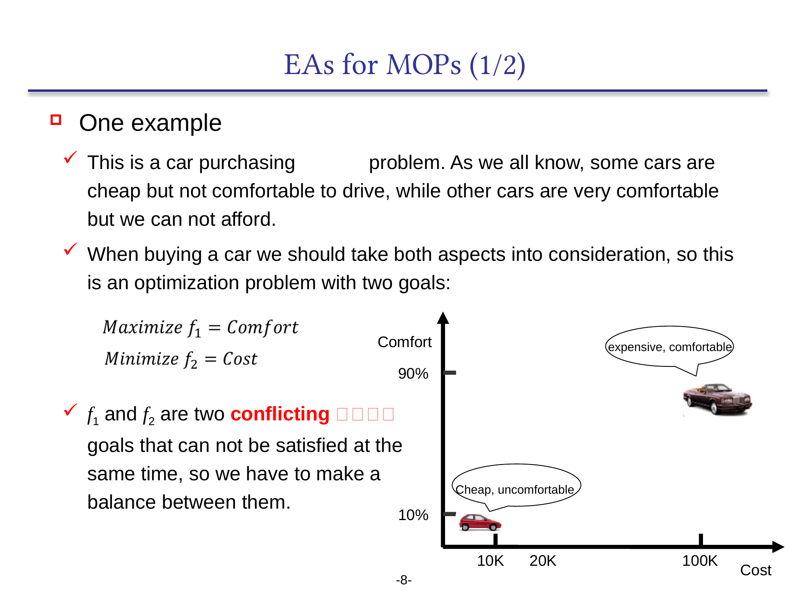
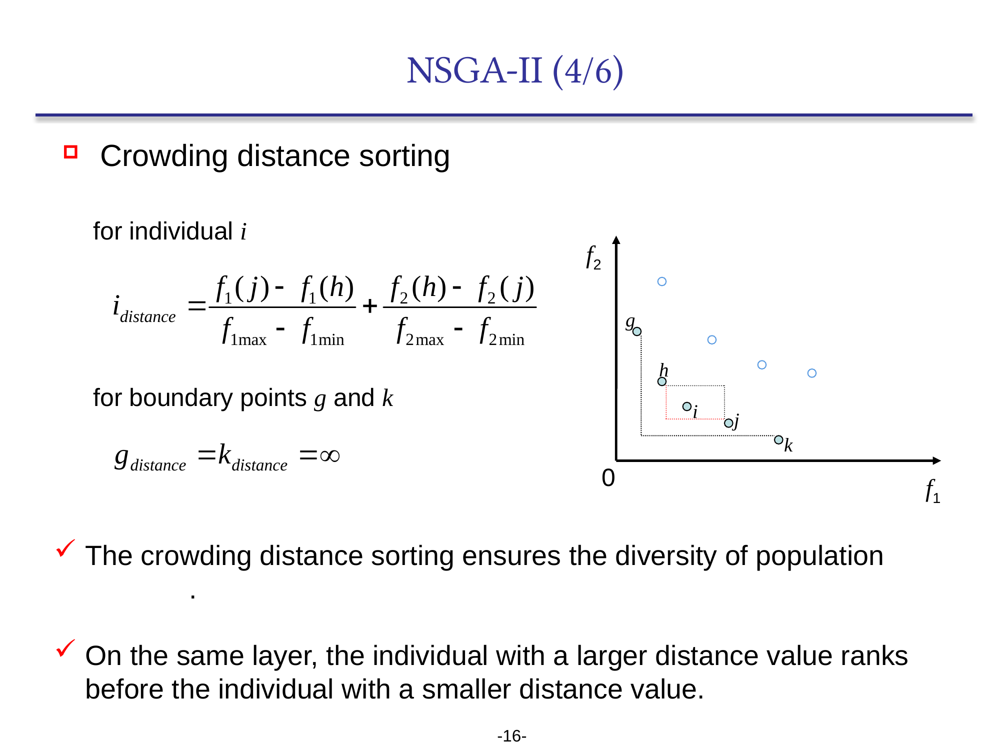
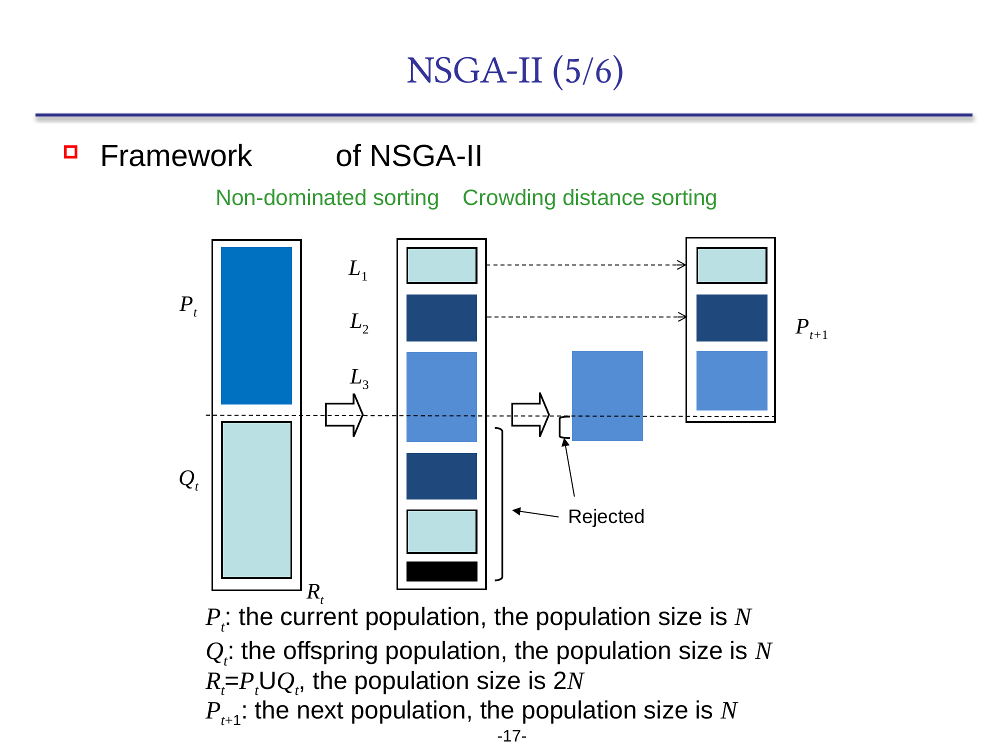
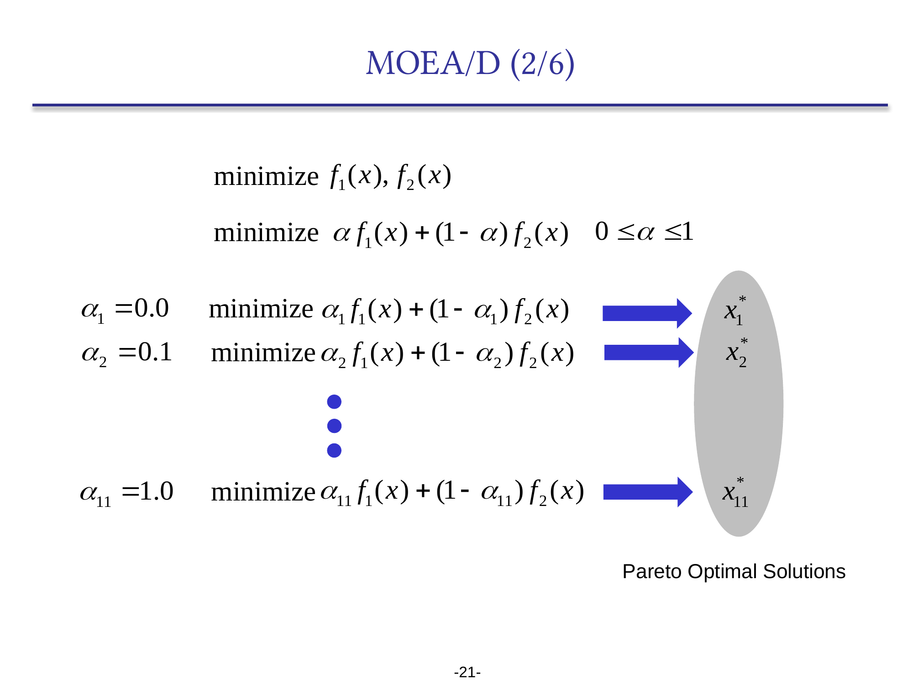
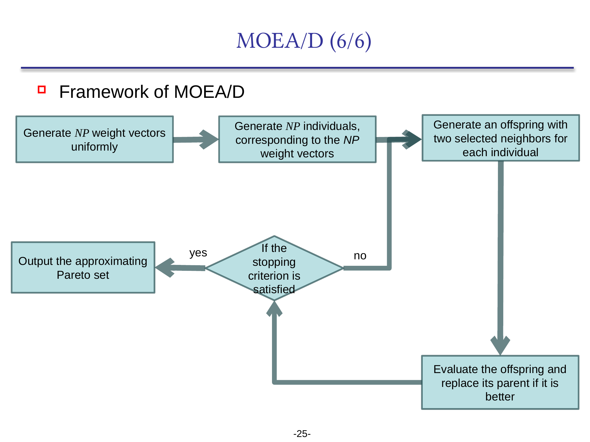
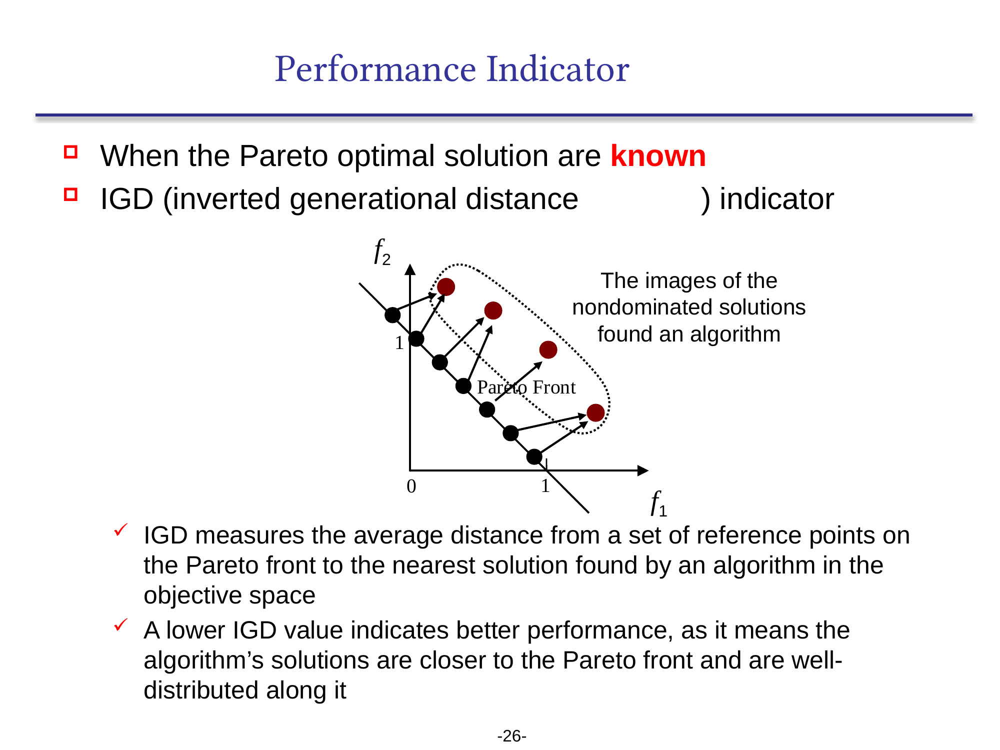
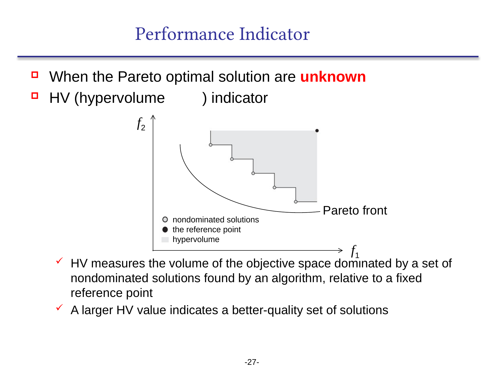

```cardlink
url: http://10.188.31.55:5244/Nextcloud/School/Compute-Intelligence/课件/
title: "计算智能 · 课程课件"
description: "中南大学自动化学院《计算智能》课程的全部课件"
host: 10.188.31.55:5244
```

[← 返回《计算智能：进化算法与优化方法》目录](../)

## 第 8 章 多目标进化算法

### 目标互相冲突，最优点不是一个点

买车要在价格和舒适度之间取舍。10 万元的车便宜但不太舒服，20 万元的车更舒服但贵——两个目标互相冲突，没法同时满足，只能平衡。这类问题叫**多目标优化问题**（multiobjective optimization problem, MOP）[Chapter 8_Evolutionary Algorithms for Solving Multiobjective Optimization Problems.pdf · p.8](http://10.188.31.55:5244/Nextcloud/School/Compute-Intelligence/converted/Chapter%208_Evolutionary%20Algorithms%20for%20Solving%20Multiobjective%20Optimization%20Problems.pdf#page=8)。

决策者要的是一组「在不同价位上舒适度最高」的备选，一辆「最便宜」的车解决不了问题。只优化价格这一个目标，等于把整条帕累托前沿扔掉。



进化算法天然适合这类问题：它一次维护一群解，一群解正好能同时逼近前沿上的多个点。在两个目标的共同作用下，整个种群被推向「更便宜也更舒适」的方向，直到无法继续改进，得到一组供决策者挑选的解 [Chapter 8_Evolutionary Algorithms for Solving Multiobjective Optimization Problems.pdf · p.9](http://10.188.31.55:5244/Nextcloud/School/Compute-Intelligence/converted/Chapter%208_Evolutionary%20Algorithms%20for%20Solving%20Multiobjective%20Optimization%20Problems.pdf#page=9)。


### 多目标优化问题与帕累托支配

#### MOP 的形式化

第 1 章把优化问题写成「决策变量 $\mathbf{x}$ → 目标函数 $f(\mathbf{x})$」。多目标情形下目标函数有 $m$ 个（$m \ge 2$），决策变量维数 $D$ 不变，可行域仍是各变量取值区间的直积 $S = \prod_{i=1}^{D}[L_i, U_i]$：

$$\min_{\mathbf{x}\in S} \mathbf{f}(\mathbf{x}) = (f_1(\mathbf{x}), f_2(\mathbf{x}), \dots, f_m(\mathbf{x})), \qquad \mathbf{x} = (x_1,\dots,x_D)$$

单目标用一个数决定好坏；多目标用一个 $m$ 维向量决定好坏。向量之间没有天然的大小关系，要比较两个解，需要标量化（MOEA/D 用的方法）或支配关系（NSGA-II 用的方法）[Chapter 8_Evolutionary Algorithms for Solving Multiobjective Optimization Problems.pdf · p.4](http://10.188.31.55:5244/Nextcloud/School/Compute-Intelligence/converted/Chapter%208_Evolutionary%20Algorithms%20for%20Solving%20Multiobjective%20Optimization%20Problems.pdf#page=4)。

#### 帕累托支配

两个解 $\mathbf{x}_a, \mathbf{x}_b$，当且仅当下面两条同时成立时，称 $\mathbf{x}_a$ **支配** $\mathbf{x}_b$（记作 $\mathbf{x}_a \prec \mathbf{x}_b$）：

- 在**所有**目标上都不比 $\mathbf{x}_b$ 差：$\forall i \in \{1,\dots,m\}: f_i(\mathbf{x}_a) \le f_i(\mathbf{x}_b)$；
- 在**至少一个**目标上严格好于 $\mathbf{x}_b$：$\exists j \in \{1,\dots,m\}: f_j(\mathbf{x}_a) < f_j(\mathbf{x}_b)$ [Chapter 8_Evolutionary Algorithms for Solving Multiobjective Optimization Problems.pdf · p.6](http://10.188.31.55:5244/Nextcloud/School/Compute-Intelligence/converted/Chapter%208_Evolutionary%20Algorithms%20for%20Solving%20Multiobjective%20Optimization%20Problems.pdf#page=6)。

谁支配谁，谁就更好。两个解谁都不支配谁，就是**互不支配**，它们代表不同的目标权衡。


#### 帕累托最优解集与帕累托前沿

**帕累托最优解集**（Pareto optimal set）是所有不被任何其他解支配的解：

$$\text{PS} = \{\mathbf{x}^* \in S : \neg\exists \mathbf{x} \in S,\ \mathbf{x} \prec \mathbf{x}^*\}$$

**帕累托前沿**（Pareto front）是这个解集在目标空间里的像：

$$\text{PF} = \{\mathbf{f}(\mathbf{x}^*) : \mathbf{x}^* \in \text{PS}\}$$

单目标的最优解是一个点；多目标的最优解是前沿这条曲线（曲面）。算法的目标是找到一组在前沿上均匀分布的点，让决策者从中挑一个 [Chapter 8_Evolutionary Algorithms for Solving Multiobjective Optimization Problems.pdf · p.6](http://10.188.31.55:5244/Nextcloud/School/Compute-Intelligence/converted/Chapter%208_Evolutionary%20Algorithms%20for%20Solving%20Multiobjective%20Optimization%20Problems.pdf#page=6)。

最小的例子是 $\min f_1 = x^2$、$\min f_2 = (x-2)^2$，$x \in [-2, 4]$：两个目标各自的最优位置不同，$x$ 从 0 扫到 2 会把前沿上每个点都经过一遍 [Chapter 8_Evolutionary Algorithms for Solving Multiobjective Optimization Problems.pdf · p.5](http://10.188.31.55:5244/Nextcloud/School/Compute-Intelligence/converted/Chapter%208_Evolutionary%20Algorithms%20for%20Solving%20Multiobjective%20Optimization%20Problems.pdf#page=5)。


### 非支配排序：分层保证收敛

多目标上「谁更好」没法用一个数决定，但种群内部的解仍然分得出层次。**非支配排序**（nondominated sorting）把种群按支配关系分层 [Chapter 8_Evolutionary Algorithms for Solving Multiobjective Optimization Problems.pdf · p.15](http://10.188.31.55:5244/Nextcloud/School/Compute-Intelligence/converted/Chapter%208_Evolutionary%20Algorithms%20for%20Solving%20Multiobjective%20Optimization%20Problems.pdf#page=15)：

- $F_1$：不被任何解支配的解，也就是当前种群的帕累托前沿；
- $F_2$：从种群中去掉 $F_1$ 之后，不被任何剩余解支配的解；
- $F_3$、$F_4$ 依次类推。


层与层之间有明确的好坏：$F_2$ 中每个解至少被 $F_1$ 中某个解支配。所以选择算子可以优先选低层，这就是**收敛性**的来源——种群被压向帕累托前沿。

同一层里的解互相不支配，支配关系排不出顺序。NSGA-II 用**拥挤度距离**给同层继续排序。

#### 算法过程

把种群 $\mathcal{P} = \{\mathbf{x}_1,\dots,\mathbf{x}_N\}$ 分层的标准做法：

1. **初始化**。每个 $\mathbf{x}_i$ 配一个支配计数器 $n_i = 0$ 和被支配集合 $S_i = \emptyset$。
2. **两两比较**。对每对 $(\mathbf{x}_i, \mathbf{x}_j)$：若 $\mathbf{x}_i \prec \mathbf{x}_j$，则 $S_i \leftarrow S_i \cup \{\mathbf{x}_j\}$，$n_j \leftarrow n_j + 1$；若 $\mathbf{x}_j \prec \mathbf{x}_i$，则 $S_j \leftarrow S_j \cup \{\mathbf{x}_i\}$，$n_i \leftarrow n_i + 1$。
3. **提取第一层**。$F_1 = \{\mathbf{x}_i : n_i = 0\}$，即没有解支配 $\mathbf{x}_i$。
4. **逐层提取**。当前层 $F_k$ 中每个 $\mathbf{x}_i$ 遍历 $S_i$ 中每个 $\mathbf{x}_j$，把 $n_j$ 减 1；$n_j$ 减到 0 的解进下一层 $F_{k+1}$。
5. **终止**。$F_k = \emptyset$ 时停止。

直接两两比较的复杂度是 $O(mN^2)$：$m$ 个目标、$N$ 个个体，每次比较要看 $m$ 个目标值 [Chapter 8_Evolutionary Algorithms for Solving Multiobjective Optimization Problems.pdf · p.15](http://10.188.31.55:5244/Nextcloud/School/Compute-Intelligence/converted/Chapter%208_Evolutionary%20Algorithms%20for%20Solving%20Multiobjective%20Optimization%20Problems.pdf#page=15)。

### 拥挤度距离：同层排序保证分布

同层内部的解互相不支配。NSGA-II 用**拥挤度距离**（crowding distance）给它们排序：取 $\mathbf{x}_i$ 在每个目标上最近的两个同层邻居，把各个方向上归一化后的间距相加，得到「$\mathbf{x}_i$ 周围有多空旷」的度量 [Chapter 8_Evolutionary Algorithms for Solving Multiobjective Optimization Problems.pdf · p.16](http://10.188.31.55:5244/Nextcloud/School/Compute-Intelligence/converted/Chapter%208_Evolutionary%20Algorithms%20for%20Solving%20Multiobjective%20Optimization%20Problems.pdf#page=16)。

$m = 2$ 时，$j$ 与 $h$ 分别是 $\mathbf{x}_i$ 在 $f_1$、$f_2$ 方向上最近的同层个体：

$$
i_{\text{distance}} = \frac{f_1(j) - f_1(h)}{f_{1\max} - f_{1\min}} + \frac{f_2(h) - f_2(j)}{f_{2\max} - f_{2\min}}
$$

拥挤度距离越大，说明周围越空旷，保留它有助于种群均匀铺开。**同层排序时距离大的优先**；边界个体（在某个目标上取值最小或最大的）距离取 $\infty$，优先保留。



#### 归一化怎么来的

各目标的量纲不同，$f_1$ 的一个单位可能远大于 $f_2$ 的一个单位，直接相加会让某个目标独占拥挤度。归一化把每个目标压到同一个尺度：

1. 对每个目标 $f_i$，把同层个体按 $f_i$ 值排序，边界个体（最小与最大）的距离取 $\infty$。
2. 对中间个体 $\mathbf{x}_k$，$f_i$ 方向上最近的两个同层个体是 $\mathbf{x}_{k-1}$ 与 $\mathbf{x}_{k+1}$：

$$\Delta f_{i,k} = \frac{f_i(\mathbf{x}_{k+1}) - f_i(\mathbf{x}_{k-1})}{f_{i,\max} - f_{i,\min}}$$

3. 各目标方向上的间距相加，得到总距离：

$$k_{\text{distance}} = \sum_{i=1}^{m} \Delta f_{i,k}$$

$\Delta f_{i,k}$ 反映 $\mathbf{x}_k$ 在 $f_i$ 方向上的「密度比」：周围密集则 $\Delta f_{i,k}$ 小，周围空旷则大 [Chapter 8_Evolutionary Algorithms for Solving Multiobjective Optimization Problems.pdf · p.16](http://10.188.31.55:5244/Nextcloud/School/Compute-Intelligence/converted/Chapter%208_Evolutionary%20Algorithms%20for%20Solving%20Multiobjective%20Optimization%20Problems.pdf#page=16)。

### 手动判定：支配关系、分层与同层排序

#### 例：4 个解的支配关系

4 个解，二维目标，都最小化：

$$\mathbf{x}_a = (1, 3), \mathbf{x}_b = (2, 2), \mathbf{x}_c = (3, 1), \mathbf{x}_d = (1, 4)$$

逐对比较：

- $\mathbf{x}_a$ vs $\mathbf{x}_b$：$f_1 = 1 < 2$，$f_2 = 3 > 2$——在 $f_1$ 上好、在 $f_2$ 上差，**互不支配**；
- $\mathbf{x}_a$ vs $\mathbf{x}_c$：$f_1 = 1 < 3$，$f_2 = 3 > 1$——**互不支配**；
- $\mathbf{x}_a$ vs $\mathbf{x}_d$：$f_1 = 1 = 1$，$f_2 = 3 < 4$——$f_1$ 平，$f_2$ 上严格好，$\mathbf{x}_a \prec \mathbf{x}_d$；
- $\mathbf{x}_b$ vs $\mathbf{x}_c$：$f_1 = 2 < 3$，$f_2 = 2 > 1$——**互不支配**。

答案：$\mathbf{x}_a \prec \mathbf{x}_d$，其他各对互不支配。$\mathbf{x}_a, \mathbf{x}_b, \mathbf{x}_c$ 都属于帕累托最优解集，$\mathbf{x}_d$ 被 $\mathbf{x}_a$ 支配。

#### 例：提取第一层与第二层

6 个解的二维目标值（都最小化）：

$$\mathcal{P} = \{(1,5), (2,3), (3,4), (4,2), (5,1), (3,3)\}$$

逐个检查「有没有解支配它」：

- $(1,5)$：$f_1$ 全场最小，任何解的 $f_1$ 都只能更大，做不到「两个目标都不差且至少一个严格更好」。**属于 $F_1$**；
- $(2,3)$：没有解能支配它；它反而支配 $(3,4)$（$2<3, 3<4$）与 $(3,3)$（$2<3, 3=3$）。**属于 $F_1$**；
- $(3,4)$：被 $(2,3)$ 支配（$2<3, 3<4$）。**不在 $F_1$**；
- $(4,2)$：没有解能同时在这两个目标上不差于它并严格更好。**属于 $F_1$**；
- $(5,1)$：$f_2$ 全场最小，同理无人能支配。**属于 $F_1$**；
- $(3,3)$：被 $(2,3)$ 支配（$2<3$ 且 $3=3$，满足「都不差 + 至少一个严格更好」）。**不在 $F_1$**。

答案：$F_1 = \{(1,5), (2,3), (4,2), (5,1)\}$。去掉 $F_1$ 后剩下的 $(3,4)$ 与 $(3,3)$ 互不支配，所以 $F_2 = \{(3,4), (3,3)\}$。

$(1,5)$ 的 $f_2$ 是全场最差，但没人能支配它。帕累托最优看的是支配关系，不看总分。

#### 例：同层排序

沿用上例的 $F_1 = \{(1,5), (2,3), (4,2), (5,1)\}$：

1. **边界个体**：按 $f_1$ 排序为 $(1,5) \to (2,3) \to (4,2) \to (5,1)$，两端的 $(1,5)$ 与 $(5,1)$ 拥挤度距离取 $\infty$，优先保留；
2. **中间个体 $(2,3)$**：按 $f_1$ 邻居是 $(1,5)$ 与 $(4,2)$，$\Delta f_1 = \frac{4-1}{5-1} = \frac{3}{4}$；按 $f_2$ 排序为 $(5,1) \to (4,2) \to (2,3) \to (1,5)$，邻居是 $(4,2)$ 与 $(1,5)$，$\Delta f_2 = \frac{5-2}{5-1} = \frac{3}{4}$。合计 $i_{\text{distance}} = \frac{3}{4} + \frac{3}{4} = 1.5$；
3. **中间个体 $(4,2)$**：按 $f_1$ 邻居是 $(2,3)$ 与 $(5,1)$，$\Delta f_1 = \frac{5-2}{5-1} = \frac{3}{4}$；按 $f_2$ 邻居是 $(5,1)$ 与 $(2,3)$，$\Delta f_2 = \frac{3-1}{5-1} = \frac{1}{2}$。合计 $i_{\text{distance}} = \frac{3}{4} + \frac{1}{2} = 1.25$。

保留顺序（拥挤度距离从大到小）：$(1,5)$ 与 $(5,1)$（边界，$\infty$）$>$ $(2,3)$（1.5）$>$ $(4,2)$（1.25）。同层优先保留距离大的个体，种群才能均匀铺在前沿上。

### NSGA-II：父代与子代合并成 2N 再排序

NSGA-II（非支配排序遗传算法 II）由 K. Deb 等人于 2002 年提出，是 NSGA 的改进版，也是进化多目标优化领域最经典的方法 [Chapter 8_Evolutionary Algorithms for Solving Multiobjective Optimization Problems.pdf · p.13](http://10.188.31.55:5244/Nextcloud/School/Compute-Intelligence/converted/Chapter%208_Evolutionary%20Algorithms%20for%20Solving%20Multiobjective%20Optimization%20Problems.pdf#page=13)。它只动一个地方：把单目标 GA 的选择算子换成**非支配排序 + 拥挤度距离排序**这两步 [Chapter 8_Evolutionary Algorithms for Solving Multiobjective Optimization Problems.pdf · p.14](http://10.188.31.55:5244/Nextcloud/School/Compute-Intelligence/converted/Chapter%208_Evolutionary%20Algorithms%20for%20Solving%20Multiobjective%20Optimization%20Problems.pdf#page=14)。

框架的关键在种群更新这一步。$P_t$ 是当前父代种群（$N$ 个个体），$Q_t$ 是子代种群（$N$ 个个体），NSGA-II 把两者合并成一个 $2N$ 的排序池：

$$R_t = P_t \cup Q_t, \qquad |R_t| = 2N$$

对 $R_t$ 做非支配排序分成 $F_1, F_2, \dots$，再在每层内按拥挤度距离从大到小排序，按这个顺序取前 $N$ 个组成下一代 $P_{t+1}$，其余的被拒绝（Rejected）[Chapter 8_Evolutionary Algorithms for Solving Multiobjective Optimization Problems.pdf · p.17](http://10.188.31.55:5244/Nextcloud/School/Compute-Intelligence/converted/Chapter%208_Evolutionary%20Algorithms%20for%20Solving%20Multiobjective%20Optimization%20Problems.pdf#page=17)。



父代进入排序池这一步是 NSGA-II 的**精英保留**：父代一定参加和子代的竞争，好解不会被下一代挤掉。


图里是购车问题上的进化过程：每一代种群整体向左上角推进，前沿从零散分布逐渐铺成一条权衡曲线 [Chapter 8_Evolutionary Algorithms for Solving Multiobjective Optimization Problems.pdf · p.18](http://10.188.31.55:5244/Nextcloud/School/Compute-Intelligence/converted/Chapter%208_Evolutionary%20Algorithms%20for%20Solving%20Multiobjective%20Optimization%20Problems.pdf#page=18)。

### MOEA/D：分解成 NP 个单目标子问题

MOEA/D（基于分解的多目标进化算法）由 Q. Zhang 和 H. Li 于 2007 年提出。它与 NSGA-II 走的是相反的路：NSGA-II 在整个种群上做全局排序，MOEA/D 先**分解**问题，再用**邻域信息**更新种群 [Chapter 8_Evolutionary Algorithms for Solving Multiobjective Optimization Problems.pdf · p.20](http://10.188.31.55:5244/Nextcloud/School/Compute-Intelligence/converted/Chapter%208_Evolutionary%20Algorithms%20for%20Solving%20Multiobjective%20Optimization%20Problems.pdf#page=20)。

#### 标量化与权重向量

**标量化**（scalarization）把多目标问题转成单目标：给每个目标一个权重 $\alpha_i \ge 0$ 且 $\sum_{i=1}^{m}\alpha_i = 1$，优化加权和

$$\min \sum_{i=1}^{m} \alpha_i f_i(\mathbf{x})$$

双目标情形就是 $\min \alpha f_1(\mathbf{x}) + (1-\alpha) f_2(\mathbf{x})$，$0 \le \alpha \le 1$。在适当条件下，每个权重向量对应一个标量子问题，其最优解通常是帕累托最优解。不同的权重可能得到同一个解；前沿非凸时，加权和还会漏掉一部分区域 [Chapter 8_Evolutionary Algorithms for Solving Multiobjective Optimization Problems.pdf · p.21](http://10.188.31.55:5244/Nextcloud/School/Compute-Intelligence/converted/Chapter%208_Evolutionary%20Algorithms%20for%20Solving%20Multiobjective%20Optimization%20Problems.pdf#page=21)。



权重向量在目标空间里指的是一个**方向**：$\alpha$ 越靠近 1，子问题越偏 $f_1$，靠近 0 就越偏 $f_2$。它回答的是「在前沿上往哪个方向取点」，目标的重要性不在权重里。$\alpha_1 = 0.8$ 的子问题会给出 $f_1$ 相对更好、$f_2$ 相对更差的解，两个目标都还在各自的平衡点上。

#### 邻域与替换

MOEA/D 的进化过程按子问题逐个推进 [Chapter 8_Evolutionary Algorithms for Solving Multiobjective Optimization Problems.pdf · p.25](http://10.188.31.55:5244/Nextcloud/School/Compute-Intelligence/converted/Chapter%208_Evolutionary%20Algorithms%20for%20Solving%20Multiobjective%20Optimization%20Problems.pdf#page=25)：

1. 均匀生成 $NP$ 个权重向量；
2. 每个权重向量初始化一个个体，种群与权重向量一一对应；
3. 为每个个体算邻居——权重向量空间里欧几里得距离最近的 $T$ 个；
4. 从邻居中选两个做杂交，产生一个后代；
5. 评估后代，如果它在自己子问题的标量化目标上比父个体好，就替换父个体 [Chapter 8_Evolutionary Algorithms for Solving Multiobjective Optimization Problems.pdf · p.22](http://10.188.31.55:5244/Nextcloud/School/Compute-Intelligence/converted/Chapter%208_Evolutionary%20Algorithms%20for%20Solving%20Multiobjective%20Optimization%20Problems.pdf#page=22) [Chapter 8_Evolutionary Algorithms for Solving Multiobjective Optimization Problems.pdf · p.23](http://10.188.31.55:5244/Nextcloud/School/Compute-Intelligence/converted/Chapter%208_Evolutionary%20Algorithms%20for%20Solving%20Multiobjective%20Optimization%20Problems.pdf#page=23) [Chapter 8_Evolutionary Algorithms for Solving Multiobjective Optimization Problems.pdf · p.24](http://10.188.31.55:5244/Nextcloud/School/Compute-Intelligence/converted/Chapter%208_Evolutionary%20Algorithms%20for%20Solving%20Multiobjective%20Optimization%20Problems.pdf#page=24)。




邻居机制让子问题之间互相学习：邻域里的解给当前子问题提供搜索方向。每代每个子问题只跟 $T$ 个邻居打交道，复杂度 $O(NT)$，比 NSGA-II 的 $O(mN^2)$ 便宜。

#### 两条路线的差别

| 维度 | NSGA-II | MOEA/D |
|---|---|---|
| 选择 | 非支配排序 + 拥挤度距离排序 | 邻居内的标量函数值比较 |
| 多样性来源 | 拥挤度距离（同层内） | 权重向量的分布 |
| 收敛来源 | 非支配排序（优先选低层） | 邻居信息（子问题互相学习） |
| 每代复杂度 | $O(mN^2)$ | $O(NT)$ |
| 适合的前沿 | 非凸、形状不规则 | 规则（凸或近似凸） |

MOEA/D 用加权和做分解，前沿非凸时有一部分区域扫不到；NSGA-II 不做加权，对非凸前沿更稳 [Chapter 8_Evolutionary Algorithms for Solving Multiobjective Optimization Problems.pdf · p.21](http://10.188.31.55:5244/Nextcloud/School/Compute-Intelligence/converted/Chapter%208_Evolutionary%20Algorithms%20for%20Solving%20Multiobjective%20Optimization%20Problems.pdf#page=21)。

### 评价一个结果集：IGD 与 HV

算法输出一组解，怎么判断它离真正的最优前沿有多远？两个常用指标，分别对应「真实前沿已知」和「真实前沿未知」两种情形。

#### IGD：前沿已知时看距离

**IGD**（inverted generational distance，反向世代距离）以前沿上的一组参考点为起点，算每个参考点到算法找到的最近解的距离，再取平均：

$$\text{IGD}(A) = \frac{1}{|R|}\sum_{r \in R} \min_{a \in A} d(r, a)$$

**IGD 越小越好**。小说明解集既贴近前沿，又沿着前沿铺得均匀 [Chapter 8_Evolutionary Algorithms for Solving Multiobjective Optimization Problems.pdf · p.26](http://10.188.31.55:5244/Nextcloud/School/Compute-Intelligence/converted/Chapter%208_Evolutionary%20Algorithms%20for%20Solving%20Multiobjective%20Optimization%20Problems.pdf#page=26)。



#### HV：前沿未知时看覆盖体积

**HV**（hypervolume，超体积）算非支配解集相对一个固定参考点所支配的目标空间体积：

$$\text{HV}(A) = \lambda\!\left(\bigcup_{a \in A} \text{box}(a, \mathbf{r})\right)$$

**HV 越大越好**。大说明解集覆盖的目标空间更广 [Chapter 8_Evolutionary Algorithms for Solving Multiobjective Optimization Problems.pdf · p.27](http://10.188.31.55:5244/Nextcloud/School/Compute-Intelligence/converted/Chapter%208_Evolutionary%20Algorithms%20for%20Solving%20Multiobjective%20Optimization%20Problems.pdf#page=27)。



### 易错点

> [!WARNING] 把「互不支配」当成「等价」
> **错误**：$\mathbf{x}_a$ 与 $\mathbf{x}_b$ 互不支配时，认为二者没有区别。
> **正确**：互不支配只说明比不出大小。它们是帕累托最优解集上的不同点，各代表一种权衡方向。决策者按偏好挑一个，但算法不能只留其中一个。

> [!WARNING] 只算非支配排序，忽略拥挤度距离
> **错误**：同层个体随机选。这样同层里密集的解全部保留，稀疏区域的解被丢，种群只覆盖帕累托前沿的一段。
> **正确**：同层必须按拥挤度距离排序，距离大的优先，确保种群均匀覆盖整条前沿 [Chapter 8_Evolutionary Algorithms for Solving Multiobjective Optimization Problems.pdf · p.16](http://10.188.31.55:5244/Nextcloud/School/Compute-Intelligence/converted/Chapter%208_Evolutionary%20Algorithms%20for%20Solving%20Multiobjective%20Optimization%20Problems.pdf#page=16)。

> [!WARNING] 把权重向量当成「目标重要性」
> **错误**：$\alpha_1 = 0.8$、$\alpha_2 = 0.2$ 表示「$f_1$ 比 $f_2$ 重要 4 倍」。
> **正确**：权重只是标量化工具。$\alpha_1 = 0.8$ 优化 $0.8 f_1 + 0.2 f_2$，得到的解在 $f_1$ 上相对更好、$f_2$ 上相对更差，两个目标都达到各自的平衡。权重向量是前沿上的方向选择。
